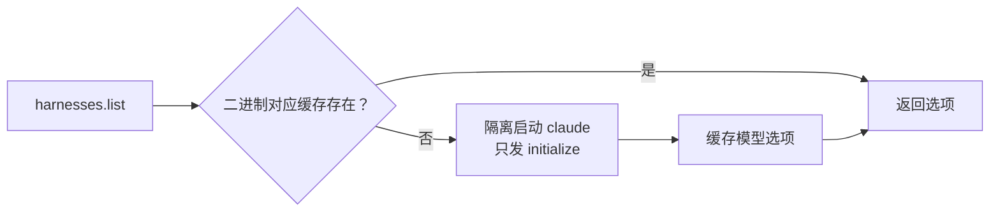

# 0021 Claude Code 适配

状态：当前设计 · 更新：2026-11-04

## 范围与现状

范围：已录制版本 2.1.312 的结构化控制、模型探测和事件映射。

| 状态 | 边界 |
|---|---|
| ✓ 代码已有 | 2.1.312 控制、模型探测、设置与续接 |
| ○ 目标 | steer、提问回答、MCP 与完整提炼隔离 |

## 接入

### 启动与控制

| 项 | 入口 |
|---|---|
| 启动 | `-p --input-format stream-json --output-format stream-json --verbose --include-partial-messages --permission-prompt-tool stdio --thinking-display summarized`（不带最后一项时思考块只有空文本） |
| 权限入口 | `--permission-mode`；`--allow-dangerously-skip-permissions` 仅允许后续切全自动，本身不绕过审批 |
| 控制协议 | 审批、中断、模式、模型、思考强度、Fast 与 Ultracode |
| 运行中设置 | `apply_flag_settings`；强度与 Fast 给 `null` 回默认 |
| 启动设置 | `--settings` JSON 中的 `fastMode`、`ultracode` |
| 续接 | `--resume` |

### 环境与版本

- 与官方 Agent SDK 同一线协议，不引入 Node 运行时
- 使用 Hoplet 托管副本，仓库录制验证或本机自检通过后才接受新轮次（2.1.312 已录制验证）
- 启动环境不得带 `CLAUDECODE` / `CLAUDE_CODE_*`（会被当成子会话而无法登录）

## 模式与模型

| 项 | 原生映射 |
|---|---|
| 审批 | `default` / `acceptEdits` / `auto` / `bypassPermissions` |
| Plan | `plan`；通过 `ExitPlanMode` 批准执行后报告 `mode.changed` |
| Fast / Ultracode | 启动 `--settings` JSON 中的 `fastMode` / `ultracode`，运行中通过 `apply_flag_settings` 更新 |
| 默认值 | 思考强度与 Fast 可用 `null` 恢复默认 |
| 续接 | `--resume` 指向原生会话，Hoplet Session ID 仍是产品身份 |

## 当前能力边界

| 能力 | 状态 |
|---|---|
| 审批 / 中断 / 设置 / 续接 | 已实现 |
| steer / 提问回答 | `Run.Steer` / `Run.Answer` 返回不支持 |
| 思考强度 | low / medium / high / xhigh / max，按模型再限制；不声明 ultra |
| MCP | `Spec.MCP` 未使用，不声明已注入 |
| Ephemeral | 只加 `--no-session-persistence`；不能据此承诺禁工具、hooks 或原生记忆 |

## 模型探测

| 项 | 规则 |
|---|---|
| 来源 | `initialize` 回复，含 `default`、`supportedEffortLevels`、`supportsFastMode` |
| 已有会话 | 接上时报告列表并更新缓存 |
| 无会话 | `-p --no-session-persistence`、空 MCP、禁用 hooks；只问 `initialize`，不发消息，不耗模型额度，读完即停 |
| 缓存 | 按 claude 二进制，换版本才重新探测；daemon 启动时后台预取 |
| 强度 | 模型的 `supportedEffortLevels` 优先；`supportsEffort` 为假时映射 `NoEffort`，不显示强度选项 |
| Fast | 仅 `supportsFastMode` 为真的模型显示 |
| 上下文变体 | 模型列表提供 `[1m]` 时作为独立选项，不另造窗口开关 |

## 事件映射

| 原生数据 | Hoplet 使用 |
|---|---|
| 每轮 `init.model` | `model.changed`，以报告模型为准 |
| `tool_result` 文本 | 工具结果正文，保存为 blob |
| `message.usage` | 最近请求上下文用量 |
| 轮末 `result.usage.iterations` 末项 | 补齐上下文用量 |
| `modelUsage.*.contextWindow` | 窗口大小 |
| `compact_boundary.post_tokens` | 压缩后已用量 |
| `TaskCreate` / `TaskUpdate` 的输入（旧的 `TodoWrite` 同样） | 维护任务表，发 `todo.list`；`subject` → `Text`，`activeForm` → `Active`；`blocks` / `blockedBy` 不传 |
| `Agent`（旧名 `Task`）工具调用 | 发 `subagent`：`subagent_type` → `Type`，`description` → `Title`，`run_in_background` → `Background`；这次调用本身不发 `ToolCall`，它的 `tool_result` 文本 → `Summary`，`is_error` → `failed` |
| 带 `parent_tool_use_id` 的行 | 归到那次调用的子代理，事件带 `Agent`；不算主对话的正文、思考和上下文用量 |

保留原始协议事件。审批、中断、切模式、模型、强度和续接通过控制协议处理，不靠 PTY 或静默时长推断完成。

## 验收

| 范围 | 条件 |
|---|---|
| 控制 | 录制验证原生审批、中断、设置与续接 |
| 能力 | 不显示或接受未支持的 steer / 提问 / MCP |
| 模型 | 列表按二进制缓存，模型限制用于设置校验 |

## 待验证

更多版本控制、提问、steer、MCP、禁工具和原生记忆副作用控制未验证。无界面模式下实际用 `TaskCreate` / `TaskUpdate` 还是 `TodoWrite`，以录制为准，两套都映射。子代理需录制：后台子代理在轮次结束后怎样报告完成与结果、用量与用时从哪一行取、停止整轮时子代理落到哪个状态。
