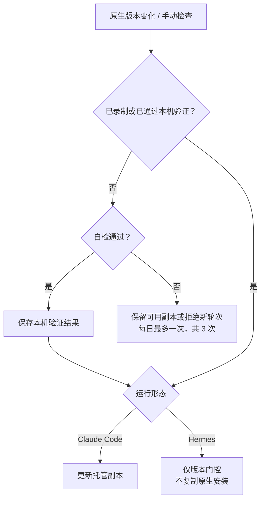

# 0023 Harness 托管与验证

状态：当前设计 · 更新：2026-11-04

## 范围与现状

范围：安装、版本门控、自动跟进、本机自检与协议录制。

| 状态 | 边界 |
|---|---|
| ✓ 代码已有 | 本机安装、托管副本、版本门控、自动跟进、自检和脱敏录制 |
| ○ 目标 | 新能力需各自验证，基础自检不覆盖全部能力 |

## 版本流程

## 托管范围（Claude Code）

- Hoplet 使用**自己托管的 CLI 副本**，关闭其自动更新
- Claude Code 登录与配置沿用全局 `~/.claude`。我在终端里用的 CLI 不受影响，Hoplet 也不替我升级它。
- 切换后删除旧副本（每份约 300 MB）
- 正在运行的会话已打开旧文件，继续用到结束
- 新会话用新副本。

| CLI | 当前范围 |
|---|---|
| `harness install / upgrade claude` | 安装或升级托管副本 |
| `harness verify hermes` | 验证原生安装，不负责升级 |

## 跟进策略

- 守护进程启动 10 分钟后、之后每天一次，查看 harness 环境 PATH 上的 CLI
- 版本与副本不同就按上图处理。只跟进已安装的副本，首次安装由我执行 `hoplet harness install claude`。自检失败的版本最多每天试一次（重启守护进程也不会多试），连续 3 次失败后不再尝试
- 守护进程关闭打断的检查和非自检原因的失败不计入。`config.toml` 中 `[harness.{kind}] follow = false` 可关闭跟进。

## 本机自检

- 用该版本、最便宜的模型、临时目录，经适配器本身走一遍：一轮对话、命令审批与拒绝、切换权限模式后免审批编辑、中断、新进程续接。消耗少量订阅额度，约一分钟。自检要求 claude 在执行 shell 命令前先询问：若用户自己的设置或钩子自动放行了该命令，自检会失败，Hoplet 安全地留在当前副本。守护进程被 SIGKILL 杀死时，正在进行的自检可能留下临时目录（检查所用的 claude 进程组只在正常关闭时随守护进程清理）。

## 录制

- `hoplet dev record` 录制真实会话，作为仓库内的契约测试（离线回放 + golden）。只在协议真的变化、需要改适配器时才录新版本并发布 Hoplet
- 平时的 CLI 小版本靠本机自检跟进，不需要发版。

## Hermes 门控与自检

- Python 安装，无法复制托管副本，只做版本门控，规则同上：仓库录制过的版本或本机自检通过的版本才开新轮次，其余版本拒绝并在 doctor 中提示。自检（`hoplet harness verify hermes`）经适配器与进程内的桥接进程走一遍：编辑审批与拒绝、全自动下免审批编辑、中断，用我配置的 Hermes 模型，在其历史里留下一个短会话
- 准备失败（临时目录）不计入失败次数，中断那一步数到 1000 为止。`hoplet harness verify hermes` 与守护进程每日检查共用一把可取消的锁（`verified.Lock`，Claude 的安装锁也用它，锁文件不变），不会同时跑两次自检
- 锁被占用时命令行提示在等待。守护进程每天检查新版本（`[harness.hermes] follow = false` 可关闭），尝试规则与 Claude 相同。升级仍由我 `hermes update`。

## Hermes 录制

- 就是真实 Hoplet 会话的 shim spool（`~/.hoplet/sessions/<id>/spool.jsonl`），`hoplet dev sanitize --harness hermes` 脱敏：去掉界面类事件，裁掉会话信息里的工具 / MCP 列表与历史消息，路径替换为 `/work`、`/Users/me`。

## 验证边界

录制只覆盖已走过路径；本机自检只覆盖核心动作，不证明全部能力有效。记忆隔离、注入、刷新和原生控制按 harness / 版本单独验证；不支持时保持能力关闭。

## 验收

| 范围 | 条件 |
|---|---|
| 安装 | 版本验证失败保留可用副本或拒绝新轮次 |
| 跟进 | 间隔、重试次数、锁与取消行为可验证 |
| 录制 | 私人路径与不可提交载荷完成脱敏 |

## 待验证

新 harness 与新能力的验证路径单独补齐，不能沿用未覆盖行为的成功结果。
