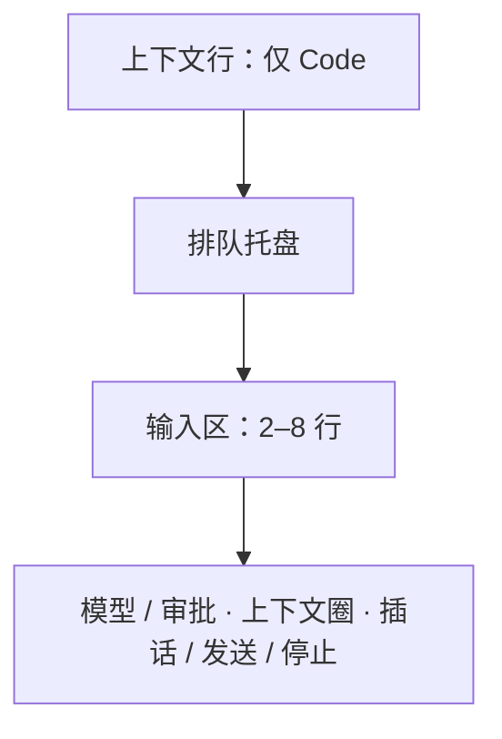

# 0024 桌面布局与交互

状态：当前设计 · 更新：2026-11-05

## 范围与现状

范围：窗口、导航、会话、输入、面板及已定义的阶段状态。数值与行为保持当前设计，未绘制状态先审核再实现。

| 状态 | 边界 |
|---|---|
| ◐ 代码现状 | 侧栏、会话、输入、审批、新建、详情、上下文圈与队列、收件箱、⌘K 命令面板 |
| ○ 目标 | 文件 / diff 右栏及后续阶段界面 |

## 窗口

- 隐藏系统标题栏，自己画标题行：侧栏顶行、正文标题行、右栏的标签栏与右列顶栏同高 52，左侧让出红绿灯。红绿灯固定在距窗口左上 (20, 19)，正好在 52 高顶行的中线上，整排顶栏的按钮都与它同一中线。
- ⌃⌘S 收起侧栏：侧栏整个隐藏，红绿灯、显示侧栏、后退、前进移到正文标题栏最左侧。
- 正文区窄于 560 时右栏自动收起。Personal 默认没有右栏。

## 侧栏

| 区 | 内容 |
|---|---|
| 顶行 | 红绿灯 · 收起侧栏 ⌃⌘S · 后退 ⌘[ · 前进 ⌘] · 右侧模式切换（只用图标：左 Personal 对话气泡 ⌘1，右 Code `</>` ⌘2） |
| 入口 | 新建 · 搜索（⌘K）· 收件箱（`attn` 角标 = 所有机器上需要你的数量，0 不显示；在收件箱时整行 `selected`、文字 600）。图标 + 文字，不写快捷键 |
| Code 列表 | 标题行"全部机器 ▾"（范围）+ 排列菜单（排序：最近更新 / 创建时间 / 名称；显示：全部 / 需要我处理的 / 运行中）；置顶分区；按**工作目录**分组（文件夹图标 · 目录名 · 右侧 ＋ 在此目录新建会话：平时半透明，指针在标题上时变实不加底，指针在 ＋ 上才加底） |
| Personal 列表 | 标题行"全部机器 ▾" + ＋ 新建伙伴；伙伴两行：头像（首字、中性灰底，右下 harness 角标）· 名字 · 最近一条消息预览 |
| 底部 44 | 本机身份按钮（电脑图标 · 本机名（系统主机名，不另起名字） · 连接图标，断开时换成带斜线的）· 归档（Code）/ 个人档案（Personal）· 设置 |

**侧栏间距：** 行 28、圆角 6、左右 8，行与行之间 2；入口组离顶行 4，与列表标题之间 16；列表标题“全部机器”用 label（11/600 `muted`），下面 4；目录分组标题 28 高、13/500 `fg2`，组与组之间 12，第一组上方 4；置顶标题 24 高、label，上下各 8。

### 会话行

一行 28 高；行首 harness 品牌图标；行尾只放一样东西：运行中转圈、需要你实心点、未读小点 + 标题加粗、出错方块、断线断链图标；只有空闲显示相对时间；悬停换成置顶、归档。会话行不显示机器（机器只在标题栏悬停提示、范围筛选和底部身份里出现）。

### 右键菜单

置顶 P · 标为未读 U · 重命名 R · 在 Finder 中显示目录 O（仅本机）· 停止 S（仅运行中）· 归档 A。

## 正文区

### 标题栏

harness 品牌图标 · 标题（13 / 600，双击改名）· ⌄ 会话菜单；右侧 会话详情开关（ⓘ `info`，⌘I，和右栏开关 `panel-right` 是两个按钮；会话详情不是弹层，是正文区右侧固定的一列，宽 280，和对话并排、不盖住内容：分块卡片——位置（机器 · 目录 · 分支）、运行（harness 与版本 · 模型与强度 · 审批）、会话（状态与建立日期 · 会话 ID 与复制、harness 自己的会话 ID 与复制（harness 标志打头，开过会话才有））；开关状态每个窗口记住）· 右栏开关（右栏收起时才在这里，打开时在右栏自己的顶栏）。不放状态胶囊，不写机器和目录（悬停标题显示）。

### Code 对话

- 轮与轮之间不画分隔线、不写时间和用时：靠你的气泡分开；几点发的悬停你的消息就能看到，用时在工作组摘要右端，改动看回复末尾的"改了 N 个文件"。隔天才在那一轮前加日期线（今天 / 昨天 / 周几 / 日期）；"已停止 · 时间"分隔线保留。
- 更早的消息：对话顶端居中一个轻按钮（向上箭头 · “更早的消息”，`muted`），平时无底，悬停 `fill` 底。
- 工作中行：一轮在跑时，对话最后一行一直有它：三个 `accent-fg` 小方块依次亮（一圈 1.2 秒）· 现在在做什么（思考中 / 运行命令 / 读取文件 / 编辑文件 / 搜索 / 抓取网页 / 回复中 / 等你审批，取真实状态，不写俏皮词）· 这一轮已用时间（只有变了的数字向上滚进）。一轮结束就去掉。减少动态效果时方块不动、数字直接换。不做文字扫光：MyGO 的文字元素不能用渐变色，自己画字会丢了选中和无障碍标签。
- 回到底部：对话没在最底部时，输入框上方居中浮一个 32 圆按钮（`surface-float` 底、`line2` 边、弹层阴影、向下箭头 `fg2`）；还在回答时箭头换成三个 `accent-fg` 小点轮流亮（一圈 1.2 秒，减少动态效果时不动）。
- 你的消息：右对齐灰气泡；悬停时在气泡左边、底边对齐出现时间、编辑并重发（最后一条）、复制、分叉，不占位置。
- 工作组：两段回复正文之间的思考和工具调用合成一组。完成后折叠成一行摘要（"思考 · 读取 4 个文件 · 搜索 1 次" · 总耗时）；展开是带左侧细线的树。运行中只显示最近 3 条；有失败时保持展开，摘要标"✕ N 个失败"（等宽 600，`fg`）。
- 工具行 24 高：动作图标（读取 / 搜索 / 编辑 / 写入 / 运行 / 抓取网页 / MCP / 子任务）· 动词 · 对象（等宽）。耗时悬停才显示；运行中显示"12 秒…"。失败时保留动作图标，紧跟对象后面加"✕ 退出码 N"（等宽 11、600、`fg`，不用玫红；harness 没给退出码时只写"✕"），输出自动展开（先显示 12 行，"还有 N 行"）。展开时先写完整的输入（对象超过 48 个字符或有多行时），再是输出；失败且没有输出写"失败，harness 没给出原因"，不画空框；取输出最多等 10 秒，取不到在框里写"没取到输出：原因"带重试，不弹提示条；一轮结束了工具还没报完，转圈换回图标、行尾写"未完成"。
- 代码块：头部语言 + 展开 / 复制图标。改动卡：回复末尾"改了 N 个文件"，点文件在右栏打开 diff。
- 审批记录：盾牌✓ 已允许 / 盾牌✕ 已拒绝 · 对象 · 理由；谁、哪台设备、何时悬停才显示。
- 插话：虚线气泡，上方插入箭头 + 送达时间。出错：警告图标 · 一句话 · 一个图标按钮（重试 / 压缩并重试 / 重新连接）。

### Personal 对话

聊天形态，按天分隔；伙伴消息在左（白色玻璃气泡 + 头像），你的消息在右（灰气泡 + 你的默认头像）；工作痕迹永远折叠成一行；结果卡片 + 建议回复胶囊；"记住了：…"、主动消息来源、替你发送的确认卡、转交 Code 会话（按伙伴、记忆、自主运行和通道能力分阶段接入）。

## 输入框

### 位置与结构

| 部分 | 规则 |
|---|---|
| 位置 | 对话下方、不压内容；`surface` 底 + `line2` 边 + `shadow-composer`，随窗口与详情栏收窄 |
| 上下文行 | 框外，左边缘对齐；机器（“本机”标记）、目录、分支，24 高 `raised` 胶囊；断线写“断开 N”，点击重连 |
| 排队托盘 | 框的上半截，共用外框；最多 3 条，其余“还有 N 条”；插话 / 编辑 / 删除悬停出现 |
| 审批时队列 | 收成“排队 N 条 · 下一条：…” |
| 输入区 | 两行起、最多 8 行 |
| 控件行 | 幽灵按钮，平时无底无边、悬停 `hover`；左模型 / 审批，右上下文圈 / 插话 / 发送或停止 |
| 模型按钮 | harness 标志、模型、强度；开启的 Plan / Fast / Ultracode 用强调色图标，带 ⌄ |
| 审批按钮 | 盾牌、档位名、⌄ |
| 快捷提示 | ↩ 排队、⌘↩ 插话、⎋ 停止只写在悬停提示 |

### 上下文圈

| 项 | 规则 |
|---|---|
| 尺寸 | 16 点圆环、2 点 `line2` 轨道，放在 28 的按钮区 |
| 弧线 | 从 12 点顺时针到已用 / 窗口；低于 75% 用 `fg3`，75% 起 `attn`，90% 起 `del` |
| 提示 | 悬停 `hover`，显示“上下文已用 N% · 已用 / 窗口 tokens”；K / M 保留一位小数，整数不写 .0 |
| 出现 | harness 同时报已用量和窗口后显示；点击暂不操作，压缩尚未接入 |

### 模型与审批菜单

| 项 | 规则 |
|---|---|
| 主菜单 | 宽 232，`ui.PopoverBase`；模型在上、推理强度在下，右侧显示当前值与 › |
| 子菜单 | 移入或点击打开右侧嵌套 `ui.PopoverBase`，贴行顶；⎋ 先关子菜单，再关主菜单 |
| 开关 | 分隔线下 `ui.Switch`，整行切换且菜单不关；Fast 需 harness 与模型支持，Plan 需原生能力，Ultracode 还需模型有 xhigh |
| 强度 | 默认 + 模型档位；Low / Medium / High / X-High / Max / Ultra，当前 ✓；选中即生效、菜单不关 |
| 模型列表 | 搜索框打开即聚焦；列表宽 280、最多 8 行滚动，按服务商分组、当前 ✓ |
| harness 列 | 新建页装多家时左侧宽 40 标志列；未安装标志 40% 不透明、悬停“· 未安装”，选中后显示安装方法 |
| 缺少列表 | 显示“… 还没有给出模型列表”，不以其他 harness 顶替 |
| 审批档位 | 需确认 / 自动编辑 / 智能审批 / 全自动 |

`PopoverMenu` 的文字项不能承载值、开关与搜索，菜单使用原生弹层组合。

### 运行与交互

| 情况 | 行为 |
|---|---|
| 断线 | 框虚线，保留输入，发送暂存在托盘；重连按序送出；M1 断线暂存只在内存，退出即丢失 |
| 审批 / 提问 | 输入框琥珀描边，下半部显示类型图标、标题、计数、命令 / diff / 问题和数字键选项 |
| 回答 | 底部输入行一直保留，作为拒绝理由或自由回答；⎋ 收起不结清审批 |
| Personal | 无上下文行和审批盾牌；建议回复胶囊放在上下文行位置（M4a） |
| 新建页 | 复用同一输入框；Code 用上下文行选机器和目录，分支在建会话后出现；M1 无 ＋ 添加和语音 |

## 收件箱

正文区的一页：侧栏“收件箱”、⇧⌘I、菜单栏“视图”、Dock 右键菜单进入；内容列 ≤760 居中。标题栏：`inbox` 图标 · “收件箱” · 各组数量。

- 多台机器：每台机器一路输入（连接、会话目录、待审批），在本地汇总；卡片写“机器 · 目录”，动作发回那台机器。待审批从 `sessions.get` 取，只取等你处理的会话，目录里这些会话变了才重取。
- 分组：需要你（等你处理的会话，每个审批一张卡）· 已完成，待查看（未读）· 出错 · 断线（每台断开的机器一张卡，下面灰列它断开前等你处理的会话，不能操作）。组标题 11 / 600 `muted` 带数量，空组不显示，组内新的在前；全空时空状态“没有要你处理的事”。“已完成，待查看”标题右侧“全部标为已读”。
- 卡片：`surface` 底、1px `line`、圆角 `radius-card`、内边距 `space-3`；harness 标志 14 · 标题 600 · 机器 · 目录 · 时间 · 打开会话（`external-link`，↩）。审批卡：类型图标（`attn-fg`）与“想运行命令 / 想编辑 文件 +N −N”· 命令（等宽 12、`fill` 底、圆角 10）· 选项按钮照 harness 给的、最多三个：允许一次（主按钮）· 本会话总是允许（有才出现）· 拒绝，按钮前写数字键 1–3。待查看卡：未读点 · 预览；悬停出“标为已读”。出错卡：`circle-alert`（`del`）· “出错了 · 预览”。断线卡：断链图标 · 机器名 · 已断线多久 · “立即重连”。
- 审批选项的文字按作用写：允许一次 · 本会话总是允许 · 总是允许 · 拒绝（输入框里的审批同样），harness 给的原文放在悬停提示里。
- 键盘：↑↓ 在卡片间移动，按过方向键才有选中（`surface` 上叠 `selected`、`line2` 边，中性灰），之前 ↩ 与 1–3 作用于第一张；↩ 打开会话；1–3 选审批选项。处理后卡片原地换成一行结果（虚线框：✓ 已允许一次 / 已拒绝 · 标题）再收起（减少动态效果时直接去掉），选中移到下一张。
- 不做：批量批准、在收件箱里回复、重试出错的轮次；“提问”卡等 harness 会提问时再加。

## ⌘K 命令面板

⌘K、侧栏“搜索”或菜单栏“视图 › 搜索”打开：在窗口正中，宽 600；面板开着时 ⌘1–4 只切范围，不切模式；`surface-float` 底（不透明，同其他弹层）、1px `line2`、圆角 14、弹层阴影，不加背后模糊；esc 或点外面关闭，焦点回到原处。

- 搜索框高 52（15 号字，占位“搜索会话和命令…”）· 范围 全部 / 会话 / 命令 / 文件（⌘1–4，面板打开时只作用于面板；“文件”只在当前是 Code 会话时出现）· 结果 · 底部键帽提示（↑↓ 选择、↩ 打开、esc 关闭）。
- 空输入：最近会话（最多 5 个，跨机器，按最近打开）· 快捷操作。有输入：会话（标题、目录、预览）· 命令（名字）· 文件（文件名、路径；当前会话目录里未被忽略的文件）分组，文件名匹配优先于路径，开头匹配 > 词首 > 包含，“全部”里每组最多 5 条；匹配到的字 `accent-fg` 600。没有匹配时一行说明；文件列表超出上限时末尾一行“只搜索了前 N 个文件”。
- 行高 `row-step`、圆角 `radius-row`：图标（harness 标志或 Lucide）· 名字 13.5 · 灰色位置（会话“机器 · 目录”，伙伴“机器 · 伙伴”）· 快捷键键帽；选中 `selected` 底（中性灰）。文件行：Material 文件图标 · 文件名 · 灰色目录。↩ 打开会话、执行命令或在右栏打开文件，并关闭。
- ⌘P 打开面板并直接在“文件”范围。
- 命令只列已有的操作：新建会话、新建伙伴、切到 Personal / Code、收件箱、显示 / 隐藏侧栏、会话详情、右栏、文件树、变更；当前会话的置顶、标为未读、重命名、在 Finder 中显示、停止、归档。

## 右栏

- 默认收起，⌥⌘I 或标题栏的 `panel-right` 开合。打开时只有右列（260，文件树与变更同宽，切换时别处不动）；打开文件或变更时查看区从左侧展开，查看区 + 右列共 640（可拖 420–960），关掉最后一个标签时查看区收起。宽度变化沿 `motion-base`（见 0014 动效）。
- 正文区至少留 560：右栏先变窄（不窄于 420）让出位置；仍放不下时，打开右栏或展开查看区会收起侧栏（红绿灯、侧栏开关和前进后退移到正文标题栏），右栏关掉或查看区收起后侧栏回来；侧栏收起时也放不下，右栏不出现。你自己打开侧栏时侧栏优先，放不下的右栏收起。1440 宽的窗口三栏并排。右栏左边、右列左边各一条 1px `line`；查看区和正文区同为 `pane`，右列用 `side`。
- 查看区标签栏（高 52，与标题栏同高）：标签 = 图标 + 名字（文件、唯一的“变更”、终端），当前标签 `raised` 底、500 字重、带 ✕；＋ 菜单（文件 ⌘P、终端），最右 ⤢ 放大到占满正文区（再按或 ⎋ 还原）。
- 路径栏（高 32，文件标签下）：仓库 › 目录 › 文件名；右侧 显示更改 · 左右对比（文件没有改动时不出现）· 在 Finder 中显示 · 打开方式（`external-link` ⌄，弹层：用默认应用打开、复制路径 ⌥⌘C；只对本机会话）。正文是只读代码视图；“显示更改”在原处标出与基线的差别，“左右对比”左基线右现在，都可展开未改动的行。打不开时正文区居中一行说明：二进制文件、文件超过 2 MiB、文件已删除、读不了（原因）。
- 右列（有自己的顶栏，与标签栏同高）：切换 文件树 / 变更（带改动数），最右收起右栏。
- 文件树：筛选（⌘P，占满一行）+ 显示被忽略的文件；根是会话目录；行高 24、每层缩进 16；有改动的文件加粗、行尾 M / A / D（M 中性灰、A 绿、D 红），目录行尾改动数；当前文件 `selected`。展开目录时才列它的内容，加载中行尾转圈；空目录写“空目录”；超出上限时列末一行“只列出前 N 项”。
- 变更：范围 本次 / 累计 / 分支（三段平分一行；M1 只有累计，不显示三段）· 汇总“N 个文件 · +a −b”· 每个仓库一节（仓库名 · 分支 · 合计，无改动写“无改动”，出错或仓库不见了写原因）· 按目录成树；没有任何改动时写“没有改动”；会话目录里没有 git 仓库时写“这个目录不是 git 仓库，看不到改动”；没有基线时写原因；点文件打开唯一的“变更”标签并滚到该文件。变更标签连续排开所有改动文件的 diff：文件标题行（⌄ · 状态 · 文件图标 · 文件名 · 目录 · +/− · 撤销 · 打开文件）、折叠条（“N 行未改动” · 所在函数）；标题行和折叠条不铺底色，新增 / 删除行 `add-bg` / `del-bg` 加 3 宽竖条。二进制、带 filter（如 LFS）的文件和被截断的 patch 在标题行下各一行说明。
- 正文区改动卡上点文件：打开右栏的“变更”标签并滚到该文件。
- Personal 右栏：产物（M4a）与触发器（M4c）；M1 的 Personal 会话没有右栏。

## 顶部菜单栏、菜单栏图标、Dock

全部用原生菜单，不自绘。

- 应用菜单：Hoplet · 文件 · 编辑 · 会话 · 视图 · 窗口 · 帮助；界面里每个有快捷键的操作都在菜单里；不可用的项置灰，harness 不支持的项对当前会话置灰。
- 菜单栏图标：单色模板图标（标志剪影），右侧数字 = 需要你的数量（为 0 不显示）；方块浓淡表示状态（运行中实心、空闲 42%、本机守护进程断开几乎透明）。菜单：需要你 · 运行中 · 机器 · 新建会话 · 打开 Hoplet · 暂停通知 · 设置 · 退出。窗口全关时继续运行。
- Dock 角标 = 需要你的数量；右键菜单：新建会话、收件箱、打开的会话窗口。

### 快捷键

| 组合 | 动作 |
|---|---|
| ⌘N | 新建会话 |
| ⇧⌘N | 新建伙伴 |
| ⌥⌘N | 新窗口 |
| ⌘K | 搜索 |
| ⌘1 / ⌘2 | 模式 |
| ⇧⌘I | 收件箱 |
| ⌃⌘S | 侧栏 |
| ⌥⌘I | 右栏 |
| ⌥⌘E | 文件树 |
| ⌥⌘D | 变更 |
| ⌘P | 打开文件 |
| ⌘I | 会话详情 |
| ⌘[ / ⌘] | 后退前进 |
| ⇧⇥ | Plan |
| ⇧⌘1–4 | 审批档位 |
| ⌘↩ | 插话 |
| ⎋ | 停止 |
| ⇧⌘P | 置顶 |
| ⇧⌘U | 标为未读 |
| ⌘⌫ | 归档 |
| ⌘/ | 快捷键一览 |

## M1 范围

依赖后续能力的界面在 M1 不显示，功能与对应界面审核完成后再接上：

| 阶段 | 界面范围 |
|---|---|
| M2 | 多机器与机器范围 |
| M3 | 撤销、提交与 PR、终端 |
| M4a | 伙伴人格、产物、结果卡、建议回复与转交 |
| M4b | 成长记忆与个人档案 |
| M4c | 触发器与自主运行状态 |
| M4d | 通道消息与替你发送确认 |
| M4e | 远端执行与离线等待状态 |
| 未排期 | 分叉、语音输入 |

本表分配能力范围，不批准尚未绘制的界面。M1 的 Personal 侧栏把每个 Personal 会话当作一个伙伴显示（名字 = 会话标题，头像 = 首字）。M1 只有本机，列表标题写“全部机器”，不带 ▾ 范围菜单。

- 本机交互阶段包含正文区、输入框、审批与提问、新建页（Code 在上下文行选工作目录，Personal 框里第一行是伙伴名字；控件行的模型按钮里按 harness 分组选模型，选哪个模型就用哪个 harness），以及侧栏“新建”、目录 ＋ 与 Personal 的 ＋ 新建伙伴；收件箱、⌘K 命令面板与侧栏“搜索”“收件箱”入口，后退 / 前进覆盖收件箱与新建页。
- 当前交互阶段暂不出现的部分（缺后端或属于后面的阶段）：轮次分隔的 +/− 与点击切到“本次”、退出码、改动卡的“全部撤销”与点文件打开 diff（右栏可用后接入）、出错条上的解决按钮、你的消息的编辑并重发与分叉、＋ 添加附件、/ 命令与 @ 引用文件、语音输入、新建页的机器选择、置顶的拖动排序、Plan 结束时的专用审批（开始执行 / 继续完善计划，暂按普通审批显示）；Personal 的结果卡片、建议回复、记住了、触发器消息、来自别处、替你发送、转交。
- 右栏在 M1 不出现：范围三段（只做累计）、撤销、终端标签与 ＋ 菜单里的“终端”、打开方式里本机编辑器与终端的列表（MyGO 没有列出本机应用的接口）。
- 伙伴在 M1 不置顶、不归档：右键菜单与标题栏 ⌄ 只有“重命名”，行上悬停不出置顶 / 归档；伙伴详情显示机器、harness 与版本、模型与强度（名字已在标题栏）。
- 会话详情是正文区右侧固定的一列（⌘I 开关），Code 分三块：机器、目录（在 Finder 中显示）、分支；运行：harness 与版本、模型与强度、审批（Plan 开着时加“· Plan”）；会话：状态与建立日期、会话 ID 与复制。
- 伙伴详情同样一列：机器（在线时加“· 在线”）；运行：harness、模型、强度。
- 提示条在正文区顶部、标题栏下方 12 点，在正文区内水平居中（MyGO 的 toast 视口只能整体靠上或靠下，靠下会被高度会变的输入框挡住），用 `surface-float` 层：失败带“重试”（能重来时）和关闭，一直显示；一次性提示 4 秒后淡出，悬停不消失；同时只有一条。
- 侧栏空列表只写一行说明，不放新建按钮；筛选为空时带“显示全部”链接。
- 新建页分三种状态：①未选目录，上下文行的目录胶囊写“选择工作目录”（字用 `fg`），占位“先选工作目录”，框下方列最多 3 个最近用过的目录，点一下即选中；②已选目录，目录胶囊写目录，点它弹出“最近用过 + 选择其他目录…”；③断线，机器胶囊写“未连接”、点它重连，框虚线，目录胶囊先收起、重连后回来，草稿保留，审批档位仍可改，强度与模型和发送置灰。
- 发送要连上、选了目录且写了内容。
- M1 不显示 Worktree，框下方不显示未提交改动提示（要守护进程能在建会话前查目录）。
- 工具输出先显示 12 行，底栏写“还有 N 行”或“输出超过 64 KB，只显示开头”，短输出没有底栏。
- 别处新建的会话出现时整行 `hover` 在 1.5 秒内淡出（`AnimateColor`；减少动态效果时不淡出，`hover` 显示 1.5 秒后直接去掉），本窗口新建的直接选中、不闪。

## 验收

| 范围 | 条件 |
|---|---|
| 当前组件 | 会话、输入、队列、详情与代码行为一致 |
| 阶段 | 未实现能力的入口不作为当前界面呈现 |
| 原生映射 | 不用覆盖层或计时器替代已选组件 |

## 待验证

未绘制状态与新后端能力先审核；窗口和减少动态效果的真机表现仍需核对。
