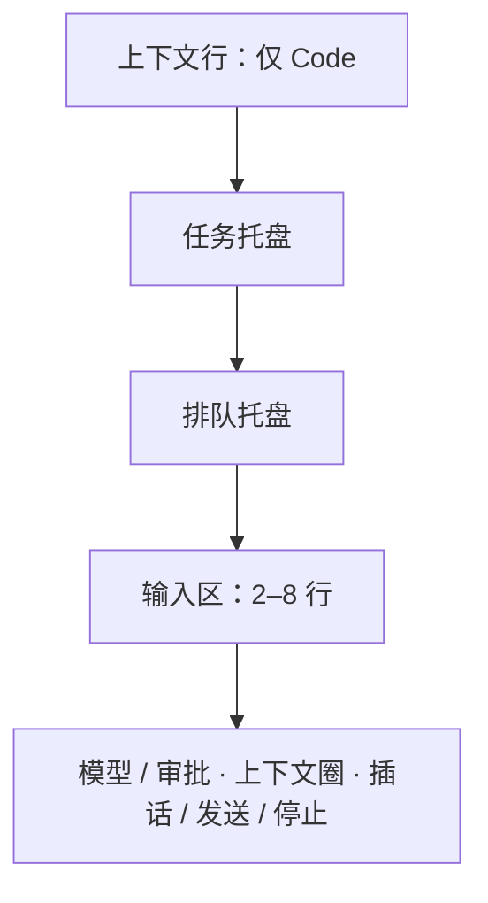

# 0024 桌面布局与交互

状态：当前设计 · 更新：2026-11-08

## 范围与现状

范围：窗口、导航、会话、输入、面板及已定义的阶段状态。数值与行为保持当前设计，未绘制状态先审核再实现。

| 状态 | 边界 |
|---|---|
| ◐ 代码现状 | 侧栏、会话、输入、审批、新建、详情、上下文圈与队列、收件箱、⌘K 命令面板、产物（右列、查看区标签、Personal 右栏）、伙伴对话（事件行、回报卡）、子会话与伙伴链接、伙伴详情与编辑人格 |
| ○ 目标 | 文件 / diff 右栏及后续阶段界面 |

## 窗口

- 隐藏系统标题栏，自己画标题行：侧栏顶行、正文标题行、右栏的标签栏与右列顶栏同高 52，左侧让出红绿灯。红绿灯固定在距窗口左上 (20, 19)，正好在 52 高顶行的中线上，整排顶栏的按钮都与它同一中线。
- ⌃⌘S 收起侧栏：侧栏整个隐藏，红绿灯、显示侧栏、后退、前进移到正文标题栏最左侧。
- Personal 的右栏只有产物：右列是产物列表，查看区只开产物标签。

### 宽度与让位

- 每一列（侧栏、右栏、查看区、会话详情）记住自己开着还是关着，开关只由你改。窗口宽度只决定开着的列此刻显不显示，从不改开关。
- 分隔条：侧栏右边、右栏左边、查看区与右列之间各一条，悬停区 1.5 宽（`ui.Split` 的 grip）、左右拖动光标；拖到范围外停在边上（`ui.Split` 不报双击，所以不做双击复位）。拖出的宽度每个窗口记住。
- 正文区至少留 560。放不下时依次：
  1. 把侧栏、右列压到最小（220），查看区压到最小（360）。
  2. 仍放不下，按“最早打开的先藏”藏起一列，直到放下。侧栏启动时就开着，算最早；你在这次运行里亲手打开过它，才按那次的时间算。查看区和右列一起藏（藏的是右栏）。
  3. 窗口变宽、或别的列关掉腾出位置时，藏起的列按相反顺序自己回来，回到藏起前的宽度。
- 你亲手打开一列时，它算最新打开的；放不下时让位的是比它早的列，不是它。
- 侧栏藏起（不管是让位还是 ⌃⌘S）时，红绿灯、显示侧栏、后退、前进移到正文标题栏最左侧。
- 打开查看区时，右栏与正文区平分侧栏以外的宽度，但右栏不小于 查看区 360 + 右列当前宽；之后窗口变宽变窄也照此重算，直到你拖过分隔条。
- 宽度变化沿 `motion-base`（200 ms EaseOut）；减少动态效果时直接到位。
- 1440 宽的窗口、默认宽度下：只开侧栏时正文区 1180，会话详情停靠；再开右栏（只有右列）正文区 920，会话详情改为浮层；打开查看区后右栏 620、正文区 560。窗口窄于 1000（220 + 560 + 220）时，侧栏和右栏只能显示一个。

## 侧栏

| 区 | 内容 |
|---|---|
| 顶行 | 红绿灯 · 收起侧栏 ⌃⌘S · 后退 ⌘[ · 前进 ⌘] · 右侧模式切换（只用图标：左 Personal 对话气泡 ⌘1，右 Code `</>` ⌘2） |
| 入口 | 新建 · 搜索（⌘K）· 收件箱（`attn` 角标 = 所有机器上需要你的数量，0 不显示；在收件箱时整行 `selected`、文字 600）。图标 + 文字，不写快捷键 |
| Code 列表 | 标题行"全部机器 ▾"（范围）+ 排列菜单（排序：最近更新 / 创建时间 / 名称；显示：全部 / 需要我处理的 / 运行中）；置顶分区；按**工作目录**分组（文件夹图标 · 目录名 · 右侧 ＋ 在此目录新建会话：平时半透明，指针在标题上时变实不加底，指针在 ＋ 上才加底） |
| Personal 列表 | 标题行"全部机器 ▾" + ＋ 新建伙伴；只列伙伴，不列子会话；伙伴两行：头像（首字、中性灰底，右下 harness 角标）· 名字（主会话标题）· 最近一条消息预览 |
| 底部 44 | 本机身份按钮（电脑图标 · 本机名（系统主机名，不另起名字） · 连接图标，断开时换成带斜线的）· 语音通话（麦克风；通话收起后变成点阵 + 时长）· 归档（Code）/ 个人档案（Personal）· 设置 |

**侧栏间距：** 行 28、圆角 6、左右 8，行与行之间 2；入口组离顶行 4，与列表标题之间 16；列表标题“全部机器”用 label（11/600 `muted`），下面 4；目录分组标题 28 高、13/500 `fg2`，组与组之间 12，第一组上方 4；置顶标题 24 高、label，上下各 8。

### 会话行

一行 28 高；行首 harness 品牌图标；行尾只放一样东西：运行中转圈、需要你实心点、未读小点 + 标题加粗、出错方块、断线断链图标；只有空闲显示相对时间；悬停换成置顶、归档。会话行不显示机器（机器只在标题栏悬停提示、范围筛选和底部身份里出现）。

### 右键菜单

置顶 P · 标为未读 U · 重命名 R · 在 Finder 中显示目录 O（仅本机）· 停止 S（仅运行中）· 归档 A。

## 正文区

### 标题栏

harness 品牌图标 · 标题（13 / 600，双击改名）· ⌄ 会话菜单；子会话的标题前先写上级伙伴的名字（`muted`，是链接，点回伙伴的主会话）和 `chevron-right`，如“旅行规划 › 查新宿的酒店”；右侧 会话详情开关（ⓘ `info`，⌘I，和右栏开关 `panel-right` 是两个按钮；正文区够宽（≥ 对话列 720 + 详情 280 + 两侧留白，即 1048）时会话详情停靠为正文区右侧一列，宽 280，和对话并排、不盖住内容；不够宽时不自己出现，按 ⓘ 才浮在正文区右上（`ui.PopoverBase`，点外面或 esc 收起；还是同样几张分块卡片，只是每张换成浮层的不透明底 `surface-float`、`line2` 边和 `shadow-popover`，不再套外框），正文区变够宽时开着的详情自动转为停靠。内容是分块卡片——位置（机器 · 目录 · 分支）、运行（harness 与版本 · 模型与强度 · 审批）、会话（状态与建立日期 · 会话 ID 与复制、harness 自己的会话 ID 与复制（harness 标志打头，开过会话才有））、子代理（这个会话派出过子代理才有，排在最后：运行中的在前，每行转圈 · 标题 · 用时；结束的收进“已结束 N 个”，默认收起，展开后完成 `check`、失败 `x`、停止 `square`，字用 `fg2`，行尾用时或“已停止”；每行点开在查看区打开记录）；开关状态每个窗口记住）· 右栏开关（右栏收起时才在这里，打开时在右栏自己的顶栏）。不放状态胶囊，不写机器和目录（悬停标题显示）。

### Code 对话

- 轮与轮之间不画分隔线、不写时间和用时：靠你的气泡分开；几点发的悬停你的消息就能看到，用时在工作组摘要右端，改动看回复末尾的"改了 N 个文件"。隔天才在那一轮前加日期线（今天 / 昨天 / 周几 / 日期）；"已停止 · 时间"分隔线保留。
- 更早的消息：对话顶端居中一个轻按钮（向上箭头 · “更早的消息”，`muted`），平时无底，悬停 `fill` 底。
- 工作中行：一轮在跑时，对话最后一行一直有它：三个 `accent-fg` 小方块依次亮（一圈 1.2 秒）· 现在在做什么（思考中 / 运行命令 / 读取文件 / 编辑文件 / 搜索 / 抓取网页 / 回复中 / 等你审批，取真实状态，不写俏皮词）· 这一轮已用时间（只有变了的数字向上滚进）。一轮结束就去掉。减少动态效果时方块不动、数字直接换。不做文字扫光：MyGO 的文字元素不能用渐变色，自己画字会丢了选中和无障碍标签。
- 回到底部：对话没在最底部时，输入框上方居中浮一个 32 圆按钮（`surface-float` 底、`line2` 边、弹层阴影、向下箭头 `fg2`）；还在回答时箭头换成三个 `accent-fg` 小点轮流亮（一圈 1.2 秒，减少动态效果时不动）。
- 你的消息：右对齐灰气泡；悬停时在气泡左边、底边对齐出现时间、编辑并重发（最后一条）、复制、分叉，不占位置。
- 工作组：两段回复正文之间的思考和工具调用合成一组。完成后折叠成一行摘要（"思考 · 读取 4 个文件 · 搜索 1 次" · 总耗时）；展开是带左侧细线的树。运行中只显示最近 3 条；有失败时保持展开，摘要标"✕ N 个失败"（等宽 600，`fg`）。
- 工具行 24 高：动作图标（读取 / 搜索 / 编辑 / 写入 / 运行 / 抓取网页 / MCP）· 动词 · 对象（等宽）。耗时悬停才显示；运行中显示"12 秒…"。失败时保留动作图标，紧跟对象后面加"✕ 退出码 N"（等宽 11、600、`fg`，不用玫红；harness 没给退出码时只写"✕"），输出自动展开（先显示 12 行，"还有 N 行"）。展开时先写完整的输入（对象超过 48 个字符或有多行时），再是输出；失败且没有输出写"失败，harness 没给出原因"，不画空框；取输出最多等 10 秒，取不到在框里写"没取到输出：原因"带重试，不弹提示条；一轮结束了工具还没报完，转圈换回图标、行尾写"未完成"。
- 子代理行（工作组里，24 高，整行是链接）：运行中转圈、其余 `bot` · 类型（harness 不给时写“子代理”）· 标题（`fg3`）· 失败时加“✕” · 行尾用时（运行中“48 秒…”，后台“后台 · 2 分 10 秒…”，停止写“已停止”）· 淡色 `chevron-right`。不在原处展开；点击在查看区打开这个子代理的记录。派出时摘要写“派出 N 个子代理”，有子代理在跑时工作中行写“子代理运行中 · N 个”；本轮结束后还有后台子代理在跑，工作组摘要后加“· N 个在后台运行”。
- 代码块：头部语言 + 展开 / 复制图标。改动卡：回复末尾"改了 N 个文件"，点文件在右栏打开 diff。
- 审批记录：盾牌✓ 已允许 / 盾牌✕ 已拒绝 · 对象 · 理由；谁、哪台设备、何时悬停才显示。
- 插话：虚线气泡，上方插入箭头 + 送达时间。出错：警告图标 · 一句话 · 一个图标按钮（重试 / 压缩并重试 / 重新连接）。

### Personal 对话

聊天形态，按天分隔；伙伴消息在左（白色玻璃气泡 + 头像），你的消息在右（灰气泡 + 你的默认头像）；工作痕迹永远折叠成一行。建议回复胶囊、“记住了：…”、主动消息来源、替你发送的确认卡按记忆、自主运行和通道能力分阶段接入。

- 事件行：伙伴委派了子会话、转交给 Code 会话或发布了产物时，对话里一行，和伙伴气泡左对齐（让出头像位置），不是气泡：细边框、无底色、最宽为对话列的 78%；图标（委派 `corner-down-right`，转交 `code-xml`，发布按产物类型）· 动词（“委派”“转交 Code”“发布”，`muted`）· 标题（500，一行截断）· 发布时加版本（等宽 `muted`，如“v3”）· `chevron-right`。整条是链接：委派与转交打开那个会话，发布在右栏打开这个产物的标签。
- 回报卡：子会话或转交的 Code 会话交回结果时一张卡，和伙伴气泡左对齐，最宽为对话列的 78%，`surface` 底、`line` 边、圆角 `radius-card`。第一行：状态（完成 `check` 绿，出错 `circle-alert` 红，等你审批 `attn` 圆点）· 标题 · “· 完成 / 出错了 / 等你审批” · 右侧来源与时间（“子会话 · 10:21”“Code · 10:32”）· `chevron-right`；下面是回报的开头，最多 3 行。整张卡是链接：子会话在 Personal 里打开，Code 会话切到 Code。伙伴自己的回复跟在卡片后面，是普通气泡。
- 子会话：从事件行或回报卡打开，同一页、有输入框，和主会话一样能对话；侧栏里伙伴那一行保持选中。

## 输入框

### 位置与结构

| 部分 | 规则 |
|---|---|
| 位置 | 对话下方、不压内容；`surface` 底 + `line2` 边 + `shadow-composer`，随窗口与详情栏收窄。对话滚到框上方时，在最后 `space-8`（对话列的底部留白）里按透明度淡出，不叠颜色（`pane` 是半透明的，叠色会成一条色带）；滚到底时内容停在留白之上，不被淡出。顶端同理：滚过标题栏下方时在最前 `space-6`（对话列的顶部留白）里淡出，滚到顶时不淡出 |
| 上下文行 | 框外，左边缘对齐；机器（“本机”标记）、目录、分支，24 高 `raised` 胶囊；断线写“断开 N”，点击重连。会话里：机器只是标记；点目录 = 在 Finder 中显示；点分支 = 打开右栏的“变更”（悬停提示写仓库数） |
| 任务托盘 | 框的最上面，在排队托盘之上，共用外框；harness 报了任务清单才出现。收起时一行：`list-todo` · “任务 已完成 / 总数 · 进行中那项”（取消的不计入总数），点击展开 / 收起（`chevrons-up-down` / `chevrons-down-up`）。展开后逐项一行（密集行 24，图标 12）：完成 `check` 与 `muted` 字，进行中运行圆点与 `fg` 600 字、写进行时说法，未开始 `circle` 与 `fg2` 字，取消 `x` 与 `faint` 字加删除线。全部完成时写“全部完成”（`check`），轮次结束后托盘收起。任务工具的调用不在工作组里显示 |
| 排队托盘 | 框的上半截，共用外框；最多 3 条，其余“还有 N 条”；插话 / 编辑 / 删除悬停出现 |
| 审批时托盘 | 任务收成一行；队列收成“排队 N 条 · 下一条：…” |
| 输入区 | 两行起、最多 8 行 |
| 控件行 | 幽灵按钮，平时无底无边、悬停 `hover`；左模型 / 审批，右上下文圈 / 插话 / 发送或停止 |
| 模型按钮 | harness 标志、模型、强度；开启的 Plan / Fast / Ultracode 用强调色图标，带 ⌄ |
| 审批按钮 | 盾牌、档位名、⌄ |
| 快捷提示 | ↩ 排队、⌘↩ 插话、⎋ 停止只写在悬停提示 |

### 上下文圈

| 项 | 规则 |
|---|---|
| 尺寸 | 16 点圆环、2 点 `line2` 轨道，放在 28 的按钮区 |
| 弧线 | 从 12 点顺时针到已用 / 窗口；低于 75% 用 `fg3`，75% 起 `attn`，90% 起 `del` |
| 提示 | 悬停 `hover`，显示“上下文已用 N% · 已用 / 窗口 tokens”；K / M 保留一位小数，整数不写 .0 |
| 出现 | harness 同时报已用量和窗口后显示；点击暂不操作，压缩尚未接入 |

### 模型与审批菜单

| 项 | 规则 |
|---|---|
| 主菜单 | 宽 232，`ui.PopoverBase`；模型在上、推理强度在下，右侧显示当前值与 › |
| 子菜单 | 移入或点击打开右侧嵌套 `ui.PopoverBase`，贴行顶；⎋ 先关子菜单，再关主菜单 |
| 开关 | 分隔线下 `ui.Switch`，整行切换且菜单不关；Fast 需 harness 与模型支持，Plan 需原生能力，Ultracode 还需模型有 xhigh |
| 强度 | 默认 + 模型档位；Low / Medium / High / X-High / Max / Ultra，当前 ✓；选中即生效、菜单不关 |
| 模型列表 | 搜索框打开即聚焦；列表宽 280、最多 8 行滚动，按服务商分组、当前 ✓ |
| harness 列 | 新建页装多家时左侧宽 40 标志列；未安装标志 40% 不透明、悬停“· 未安装”，选中后显示安装方法 |
| 缺少列表 | 显示“… 还没有给出模型列表”，不以其他 harness 顶替 |
| 审批档位 | 需确认 / 自动编辑 / 智能审批 / 全自动 |

`PopoverMenu` 的文字项不能承载值、开关与搜索，菜单使用原生弹层组合。

### 运行与交互

| 情况 | 行为 |
|---|---|
| 断线 | 框虚线，保留输入，发送暂存在托盘；重连按序送出；断线暂存目前只在内存，退出即丢失 |
| 审批 / 提问 | 输入框琥珀描边，下半部显示类型图标、标题、计数、命令 / diff / 问题和数字键选项 |
| 回答 | 底部输入行一直保留，作为拒绝理由或自由回答；⎋ 收起不结清审批 |
| Personal | 无上下文行和审批盾牌；建议回复胶囊放在上下文行位置（成长记忆之后） |
| 新建页 | 复用同一输入框；Code 用上下文行选机器和目录，分支在建会话后出现；目前无 ＋ 添加和语音 |

## 收件箱

正文区的一页：侧栏“收件箱”、⇧⌘I、菜单栏“视图”、Dock 右键菜单进入；内容列 ≤760 居中。标题栏：`inbox` 图标 · “收件箱” · 各组数量。

- 多台机器：每台机器一路输入（连接、会话目录、待审批），在本地汇总；卡片写“机器 · 目录”，动作发回那台机器。待审批从 `sessions.get` 取，只取等你处理的会话，目录里这些会话变了才重取。
- 分组：需要你（等你处理的会话，每个审批一张卡）· 已完成，待查看（未读）· 出错 · 断线（每台断开的机器一张卡，下面灰列它断开前等你处理的会话，不能操作）。组标题 11 / 600 `muted` 带数量，空组不显示，组内新的在前；全空时空状态“没有要你处理的事”。“已完成，待查看”标题右侧“全部标为已读”。
- 卡片：`surface` 底、1px `line`、圆角 `radius-card`、内边距 `space-3`；harness 标志 14 · 标题 600 · 机器 · 目录 · 时间 · 打开会话（`external-link`，↩）。审批卡：类型图标（`attn-fg`）与“想运行命令 / 想编辑 文件 +N −N”· 命令（等宽 12、`fill` 底、圆角 10）· 选项按钮照 harness 给的、最多三个：允许一次（主按钮）· 本会话总是允许（有才出现）· 拒绝，按钮前写数字键 1–3。待查看卡：未读点 · 预览；悬停出“标为已读”。出错卡：`circle-alert`（`del`）· “出错了 · 预览”。断线卡：断链图标 · 机器名 · 已断线多久 · “立即重连”。
- 审批选项的文字按作用写：允许一次 · 本会话总是允许 · 总是允许 · 拒绝（输入框里的审批同样），harness 给的原文放在悬停提示里。
- 键盘：↑↓ 在卡片间移动，按过方向键才有选中（`surface` 上叠 `selected`、`line2` 边，中性灰），之前 ↩ 与 1–3 作用于第一张；↩ 打开会话；1–3 选审批选项。处理后卡片原地换成一行结果（虚线框：✓ 已允许一次 / 已拒绝 · 标题）再收起（减少动态效果时直接去掉），选中移到下一张。
- 不做：批量批准、在收件箱里回复、重试出错的轮次；“提问”卡等 harness 会提问时再加。

## ⌘K 命令面板

⌘K、侧栏“搜索”或菜单栏“视图 › 搜索”打开：在窗口正中，宽 600；面板开着时 ⌘1–4 只切范围，不切模式；`surface-float` 底（不透明，同其他弹层）、1px `line2`、圆角 14、弹层阴影，不加背后模糊；esc 或点外面关闭，焦点回到原处。

- 搜索框高 52（15 号字，占位“搜索会话和命令…”，“文件”范围里是“搜索文件…”）· 范围 全部 / 会话 / 命令 / 文件（⌘1–4，面板打开时只作用于面板；“文件”只在当前是 Code 会话时出现）· 结果 · 底部键帽提示（↑↓ 选择、↩ 打开、esc 关闭）。
- 空输入：最近会话（最多 5 个，跨机器，按最近打开）· 快捷操作。有输入：会话（标题、目录、预览）· 命令（名字）· 文件（文件名、路径；当前会话目录里未被忽略的文件）分组，文件名匹配优先于路径，开头匹配 > 词首 > 包含，“全部”里每组最多 5 条；匹配到的字 `accent-fg` 600。没有匹配时一行说明（“文件”范围里是“没有匹配的文件”）；文件列表超出上限时末尾一行 `caption` 的“只搜索了前 N 个文件”。“文件”范围还没输入时：已打开（右栏里打开着的文件标签，按标签顺序）· 有改动（本次会话改过、还没打开的文件），行同文件行、不高亮，第一行选中；两组都空时只有搜索行与底部提示。
- 行高 `row-step`、圆角 `radius-row`：图标（harness 标志或 Lucide）· 名字 13.5 · 灰色位置（会话“机器 · 目录”，伙伴“机器 · 伙伴”）· 快捷键键帽；选中 `selected` 底（中性灰）。文件行：Material 文件图标 · 文件名 · 灰色目录。↩ 打开会话、执行命令或在右栏打开文件，并关闭。
- ⌘P 打开面板并直接在“文件”范围。
- 命令只列已有的操作：新建会话、新建伙伴、切到 Personal / Code、收件箱、显示 / 隐藏侧栏、会话详情、右栏、文件树、变更；当前会话的置顶、标为未读、重命名、在 Finder 中显示、停止、归档。

## 右栏

- 默认收起，⌥⌘I 或标题栏的 `panel-right` 开合。打开时只有右列（260，可拖 220–360，文件树、变更与产物同宽，切换时别处不动）；打开文件或变更时查看区从左侧展开（宽度见“宽度与让位”），关掉最后一个标签时查看区收起。
- 正文区与查看区里的“变更”滚动时不显示滚动条（滚轮、键盘照常）。
- 放不下时怎样让位见“宽度与让位”。右栏左边、右列左边各一条 1px `line`；查看区和正文区同为 `pane`，右列用 `side`。
- 查看区标签栏（高 52，与标题栏同高）：标签 = 图标 + 名字（文件、唯一的“变更”、终端、子代理记录（`bot` · 子代理标题）、产物），当前标签 `raised` 底、500 字重、带 ✕；＋ 菜单（文件 ⌘P、终端），最右 ⤢ 放大到占满正文区（再按或 ⎋ 还原）。
- 路径栏（高 32，文件标签下）：仓库 › 目录 › 文件名；右侧 源码（只对 Markdown：一个 `file-code` 图标按钮，默认在预览、按钮静止，按下显示源码，提示“显示源码 / 显示预览”）· 自动换行（`text-wrap` 开关，提示“自动换行”，对这个窗口里所有文件标签生效，源码、显示更改、左右对比都跟着折行；Markdown 预览时不出现）· 显示更改 · 左右对比（文件没有改动时不出现；Markdown 打开这两个时先切到源码）· 在 Finder 中显示 · 打开方式（`external-link` ⌄，弹层：用默认应用打开、复制路径 ⌥⌘C；只对本机会话）。正文是只读代码视图（Markdown 默认渲染成预览）；“显示更改”在原处标出与基线的差别，“左右对比”左基线右现在，都可展开未改动的行。打不开时正文区居中一行说明：二进制文件、文件超过 2 MiB、文件已删除、读不了（原因）。
- 查找（⌘F，文件与变更标签的 diff）：浮在代码右上角的小卡片——输入框（放大镜 · “查找”，宽 200，位置不够时先缩，最窄 96）· 区分大小写 · 全字匹配 · 正则表达式 · 计数（“2/4”，没有匹配写“无结果”）· 上一个 ⇧↩ · 下一个 ↩（没有匹配时置灰）· 关闭 esc；最宽为代码区宽度减两侧 8。只读视图不做替换和“在选区内查找”。
- 子代理记录（查看区标签，只读，没有输入框）：顶行 状态 · 类型 · 标题（`ui-medium`）· 用时；下面“任务”一块写主代理交给它的话（左边 `line2` 竖线）；再是它的工作组，和对话里一样；最后是交回的结果（正文样式），失败写“子代理出错结束：原因”，运行中最后一行是工作中行“运行中”。打开记录时文件树不标当前文件。
- 右列（有自己的顶栏，与标签栏同高）：切换 文件树 / 变更（带改动数）/ 产物（`box`），最右收起右栏。
- 文件树：筛选框“筛选文件”（占满一行；有输入时行尾一个清除按钮，提示“清除 esc”；⌘P 归命令面板的“文件”范围；有输入时读一次全部文件，按路径匹配，命中的文件连同所在目录成树，没有命中写“没有匹配的文件”）+ 显示被忽略的文件（关着 `eye-off`，开着 `eye` 按下、提示“隐藏被忽略的文件”；开着时被忽略的文件与目录名字用 `muted`；`.DS_Store` 和 `.git` 从不列出）；根是会话目录；行高 24、每层缩进 16；有改动的文件加粗、行尾 M / A / D（M 中性灰、A 绿、D 红），目录行尾改动数；当前文件 `selected`。展开目录时才列它的内容，加载中行尾转圈；空目录写“空目录”；超出上限时列末一行“只列出前 N 项”。
- 变更（右列）：顶行“N 个文件 · +a −b”，右侧一个按钮切换树 / 平铺（图标是切过去的样子：树时 `list`、提示“平铺显示”；平铺时 `list-tree`、提示“按目录显示”）· 每个仓库一节（仓库名 · 分支 · 合计，无改动写“无改动”，出错或仓库不见了写原因）· 按目录成树，平铺时每行文件名后面用 `muted` 写目录；列表跟随变更标签选的范围；没有任何改动时写“没有改动”；会话目录里没有 git 仓库时写“这个目录不是 git 仓库，看不到改动”；没有基线时写原因。点文件打开唯一的“变更”标签并滚到该文件；双击文件让变更标签只看这个文件（筛选片“bridge.go ✕”）；有两个以上仓库时点有改动的仓库标题只看这个仓库（筛选片“hoplet ✕”），再点一次或点 ✕ 取消；干净的仓库和只有一个仓库时标题不能点。
- 变更标签：顶行“[会话累计 ⌄] · N 个文件”，后面是仓库 / 文件筛选片，右侧全部折叠 · 左右对比。范围菜单（`PopoverBase`，宽 236）：会话累计（建会话以来）/ 未提交的改动（对比 HEAD）/ 分支改动（对比默认分支，如“对比 main”）/ 分隔线 / 提交（数量 ›）。点“提交”在同一弹层里换成“‹ 提交”返回行 · 分隔线 · 搜索框“搜索提交” · 提交行（标题 · 短 sha，新的在前），选一个看这个提交的改动；看着多个仓库且没选仓库时“提交”置灰，右侧写“先选一个仓库”。连续排开所有改动文件的 diff：文件标题行（⌄ · 状态 · 文件图标 · 文件名 · 目录 · +/− · 撤销 · 打开文件；点整行折叠 / 展开该文件；+/− 贴着行尾；悬停标题行时撤销与打开文件换到 +/− 的位置，+/− 先隐去，行宽不变，按钮只做自己的事）、折叠条（“N 行未改动” · 所在函数；点一下在原处展开整段未改动的行；改动前面没有未改动的行时，左边写这处改动的位置“第 a–b 行”，只删行的写旧文件的行号）；标题行和折叠条不铺底色，新增 / 删除行 `add-bg` / `del-bg` 加 3 宽竖条。二进制、带 filter（如 LFS）的文件和被截断的 patch 在标题行下各一行说明。
- 正文区改动卡上点文件：打开右栏的“变更”标签并滚到该文件。
- 产物（右列）：会话的产物，每个一行（类型图标：网页 `file-code`、Markdown 与文本 `file-text`、图片 `image`、表格 `table` · 名字 · 最新版本 · 这个版本的时间），按最新版本的时间从新到旧；有新版本时那一行移到最前，不另外提示。伙伴的列表含它委派的子会话发布的。没有时写“还没有产物”。点一行在查看区打开它的标签，已开着就切过去；开着标签的那一行 `selected`。
- 产物（查看区标签，类型图标 · 产物名）：默认显示最新版本，来了新版本自动换上。顶行：版本片（“v3 · 最新” ⌄）· 这个版本的时间 · 右侧重新加载（`refresh-cw`）。版本菜单（`PopoverBase`，宽同窄菜单）每行“v3 · 10:24”，从新到旧，当前看的版本打勾。看旧版本时顶行下面一条：`clock` · “这是旧版本，最新是 v3” · 右侧“回到最新”。网页用 `ui.WebView` 按不可信页面加载，只读这个版本自己的文件；Markdown、图片、表格、文本用原生组件。打不开时内容区写“打不开这个版本”，下面一行原因（如“读不了 index.html：file not found”）和“重试”。打开产物时文件树不标当前文件。
- Personal 右栏：右列只有产物列表（顶栏写“产物”，没有切换，最右收起右栏），查看区只开产物标签。

## 顶部菜单栏、菜单栏图标、Dock

全部用原生菜单，不自绘。

- 应用菜单：Hoplet · 文件 · 编辑 · 会话 · 视图 · 窗口 · 帮助；界面里每个有快捷键的操作都在菜单里；不可用的项置灰，harness 不支持的项对当前会话置灰。
- 菜单栏图标：单色模板图标（标志剪影），右侧数字 = 需要你的数量（为 0 不显示）；方块浓淡表示状态（运行中实心、空闲 42%、本机守护进程断开几乎透明）。菜单：需要你 · 运行中 · 机器 · 新建会话 · 打开 Hoplet · 暂停通知 · 设置 · 退出。窗口全关时继续运行。
- Dock 角标 = 需要你的数量；右键菜单：新建会话、收件箱、打开的会话窗口。

### 快捷键

| 组合 | 动作 |
|---|---|
| ⌘N | 新建会话 |
| ⇧⌘N | 新建伙伴 |
| ⌥⌘N | 新窗口 |
| ⌘K | 搜索 |
| ⌘1 / ⌘2 | 模式 |
| ⇧⌘I | 收件箱 |
| ⌃⌘S | 侧栏 |
| ⌥⌘I | 右栏 |
| ⌥⌘E | 文件树 |
| ⌥⌘D | 变更 |
| ⌘P | 打开文件 |
| ⌘I | 会话详情 |
| ⌘[ / ⌘] | 后退前进 |
| ⇧⇥ | Plan |
| ⇧⌘1–4 | 审批档位 |
| ⌘↩ | 插话 |
| ⎋ | 停止 |
| ⇧⌘P | 置顶 |
| ⇧⌘U | 标为未读 |
| ⌘⌫ | 归档 |
| ⌘/ | 快捷键一览 |

## 语音通话（目标）

- 入口在侧栏底部；多台机器时先选，只有一台不问。首次通话确认一次。
- 通话页盖住内容区，可收起；收起后通话继续，可切换会话，侧栏底部按钮变成点阵 + 时长，侧栏隐藏时在内容标题行。
- 通话条：静音、转录、挂断、收起。转录打开时右列显示操作和转录，操作可点。
- 通话记录从设置或命令面板进入，不进侧栏。

## 当前范围

依赖后续能力的界面目前不显示，功能与对应界面审核完成后再接上：

| 后续能力 | 界面范围 |
|---|---|
| 多机器 | 多机器与机器范围 |
| 检查点与 PR | 撤销、提交与 PR、终端 |
| 成长记忆 | 成长记忆与个人档案；之后接建议回复 |
| 自主运行 | 触发器与自主运行状态 |
| 通道 | 通道消息与替你发送确认 |
| 跨机执行 | 远端执行与离线等待状态 |
| 未排期 | 分叉、语音输入 |

本表分配能力范围，不批准尚未绘制的界面。目前只有本机，列表标题写“全部机器”，不带 ▾ 范围菜单。

- 本机交互阶段包含正文区、输入框、审批与提问、新建页（Code 在上下文行选工作目录，Personal 框里第一行是伙伴名字；控件行的模型按钮里按 harness 分组选模型，选哪个模型就用哪个 harness），以及侧栏“新建”、目录 ＋ 与 Personal 的 ＋ 新建伙伴；收件箱、⌘K 命令面板与侧栏“搜索”“收件箱”入口，后退 / 前进覆盖收件箱与新建页。
- 当前交互阶段暂不出现的部分（缺后端或属于后面的阶段）：轮次分隔的 +/− 与点击切到“本次”、退出码、改动卡的“全部撤销”与点文件打开 diff（右栏可用后接入）、出错条上的解决按钮、你的消息的编辑并重发与分叉、＋ 添加附件、/ 命令与 @ 引用文件、语音输入、新建页的机器选择、置顶的拖动排序、Plan 结束时的专用审批（开始执行 / 继续完善计划，暂按普通审批显示）；Personal 的建议回复、记住了、触发器消息、来自别处、替你发送。
- 右栏目前不出现：本轮改动范围、撤销、终端标签与 ＋ 菜单里的“终端”、打开方式里本机编辑器与终端的列表（MyGO 没有列出本机应用的接口）。
- 伙伴目前不置顶、不归档：右键菜单与标题栏 ⌄ 只有“重命名”，行上悬停不出置顶 / 归档。
- 会话详情（⌘I 开关）够宽时停靠为正文区右侧一列，不够宽时按 ⓘ 浮起，Code 分三块：机器、目录（在 Finder 中显示）、分支；运行：harness 与版本、模型与强度、审批（Plan 开着时加“· Plan”）；会话：状态与建立日期、会话 ID 与复制。
- 伙伴详情同样停靠或浮起（名字已在标题栏）：伙伴的主会话先是“人格”块（标题行“人格” · 右侧铅笔“编辑人格”；下面人格的开头，最多 4 行），子会话没有这一块；然后机器（在线时加“· 在线”）、目录（伙伴目录 `~/.hoplet/companions/<id>`，带“在 Finder 中显示”），没有分支行；运行：harness 与版本、模型与强度；会话块同 Code。
- 编辑人格：窗口中间的弹窗（`ui.DialogBase`，`surface-float`、圆角 `radius-panel`）：标题“编辑人格”，下面一行伙伴名 · “它每次启动都会先读这段话”；整段人格在一个固定高度、内容多时滚动的多行输入框里；底行 `info` · 什么时候生效（主会话还没运行过写“保存后，下次启动时用上”，运行过写“保存后，新的主会话才会用上”）· 取消 · 保存。
- 提示条在正文区顶部、标题栏下方 12 点，在正文区内水平居中（MyGO 的 toast 视口只能整体靠上或靠下，靠下会被高度会变的输入框挡住），用 `surface-float` 层：失败带“重试”（能重来时）和关闭，一直显示；一次性提示 4 秒后淡出，悬停不消失；同时只有一条。
- 侧栏空列表只写一行说明，不放新建按钮；筛选为空时带“显示全部”链接。
- 新建页分三种状态：①未选目录，上下文行的目录胶囊写“选择工作目录”（字用 `fg`），占位“先选工作目录”；②已选目录，目录胶囊写目录；两种状态点目录胶囊都直接打开系统的选择文件夹；③断线，机器胶囊写“未连接”、点它重连，框虚线，目录胶囊先收起、重连后回来，草稿保留，审批档位仍可改，强度与模型和发送置灰。
- 发送要连上、选了目录且写了内容。
- 目前不显示 Worktree，框下方不显示未提交改动提示（要守护进程能在建会话前查目录）。
- 工具输出先显示 12 行，底栏写“还有 N 行”或“输出超过 64 KB，只显示开头”，短输出没有底栏。
- 别处新建的会话出现时整行 `hover` 在 1.5 秒内淡出（`AnimateColor`；减少动态效果时不淡出，`hover` 显示 1.5 秒后直接去掉），本窗口新建的直接选中、不闪。

## 验收

| 范围 | 条件 |
|---|---|
| 当前组件 | 会话、输入、队列、详情与代码行为一致 |
| 阶段 | 未实现能力的入口不作为当前界面呈现 |
| 原生映射 | 不用覆盖层或计时器替代已选组件 |

## 待验证

未绘制状态与新后端能力先审核；窗口和减少动态效果的真机表现仍需核对。
