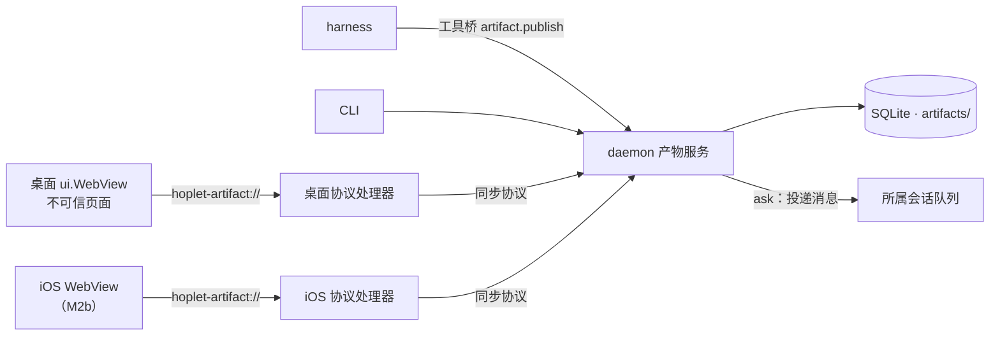

# 0025 产物

状态：当前设计 · 更新：2026-11-07

## 范围与现状

范围：会话产物的实体、版本、发布、查看、页面能力、授权与两端一致性。

| 状态 | 边界 |
|---|---|
| ○ 目标 | 产物服务、工具桥发布、桌面查看与页面能力（M4a）；iOS 查看（M2b） |

产物是会话交出的可查看结果：一页 HTML、一篇 Markdown、一张图、一份表格。它属于会话，带版本，在桌面和手机上都能打开；HTML 产物还能在声明并获准后调用少量本机能力。

## 实体与版本

| 字段 | 含义 |
|---|---|
| `id` | 稳定 ID，跨版本不变 |
| `session` | 所属会话；产物不跨会话移动 |
| `name` | 会话内唯一；同名再发布 = 新版本 |
| `kind` | `html` / `markdown` / `image` / `csv` / `text`，按入口文件扩展名判定 |
| `version` | 从 1 递增；版本发布后不可变 |
| `capabilities` | 声明的页面能力（只对 `html`），见“页面能力” |
| `by` | 发布来源：`harness` / `cli` / `page` |

- 内容存放在 `artifacts/<session>/<id>/v<n>/`：一个入口文件，HTML 另带它引用的脚本、样式、图片等文件。单个版本合计 ≤ 16 MiB、最多 64 个文件，超出时整次发布失败，不留半个版本。
- 旧版本保留，随会话删除一起删除；归档不删。
- 每次发布写一条 `ArtifactPublished` 事件（产物、版本、名字、kind、来源），事件类型带版本号，旧解码器保留。

## 发布

| 入口 | 规则 |
|---|---|
| 工具桥 `artifact.publish` | 会话身份调用，只能发布到本会话；入口文件与附带文件按相对路径给出 |
| CLI `hoplet artifact publish` | 指定会话与文件或目录，走同一服务 |
| 页面 `publish` | 见“页面能力”；不能修改能力声明 |

能力声明只能由 harness 或 CLI 的发布改变。新版本新增的能力需要重新确认，已确认的保留。

## 查看

- 桌面：查看区“产物”标签与 Personal 右栏的产物列表，界面先在画布上审定。对话里的发布事件显示为一行，点开打开对应标签。
- `markdown` / `image` / `csv` / `text` 用原生组件显示；`html` 用 MyGo 的 `ui.WebView`，页面一律以 `PageOptions.Untrusted` 加载。
- 标签默认显示最新版本，新版本到达时重新加载。可切换查看旧版本；旧版本只读，`publish` 返回 `conflict`，其他能力照常。
- 远端机器的产物同样可看：内容经同步协议读取，不需要另开端口。

## 页面加载

- 地址：`hoplet-artifact://<id>/v<n>/<path>`。客户端协议处理器经同步协议 `artifacts.read` 取文件，只能读到该版本的文件。
- daemon 返回 HTML 入口文件时在 `<head>` 开头插入桥接脚本 `/_hoplet/bridge.js`；脚本由 daemon 下发，两端客户端不各自实现。
- 页面不可信：不能调用客户端绑定的方法，收不到广播，不能开窗口，不能导航到别的源。`http(s)` 链接交给系统浏览器打开，其他链接忽略。
- 网络：内容规则挡掉本产物地址以外的一切请求。产物的脚本、样式、字体和图片必须内联或随版本发布，离线可看，页面数据不外流。

## 页面能力

页面通过 `hoplet.use(name)` 取能力对象；未声明、未获准或已撤销时得到 `null`，页面据此隐藏相关功能。调用是对本产物地址的 `POST /_hoplet/<能力>`，请求 JSON ≤ 64 KiB；处理器用 `CallerPage` 核对请求来自哪个产物与版本，再检查声明与授权，转给 daemon 的同一服务。订阅推送与 `ask` 的回复经 `EmitPage` 发给该页面。

| 能力 | 规则 |
|---|---|
| `publish` | 页面把自身状态写成新版本。请求带上它所基于的版本，不是最新版本时返回 `conflict`，页面重新加载到最新版本。只有我在客户端里查看时能调用；harness 改产物走工具桥重新发布 |
| `db` | 每个产物一份数据，按“集合 / 文档”存 JSON：取、写、删、列与订阅变化。单个文档 ≤ 256 KiB，每个产物合计 ≤ 16 MiB。数据跨版本保留，随会话删除。harness 经工具桥 `artifact.db.*` 读写同一份数据 |
| `files` | 只读本会话目录，复用会话文件接口与它的上限：超过 2 MiB、二进制文件、目录外的路径（含符号链接指出目录）一律拒绝 |
| `ask` | 向所属会话投递一条消息，走现有队列与审批；消息在对话里可见并标注来源产物。轮次结束后把 harness 的最终回复交给页面；会话忙时排队，出错、被停止或会话归档时页面收到错误。每个页面同一时刻最多一条未完成的 `ask`。内核不直接调用模型 |

错误码：`not_declared`、`not_granted`、`conflict`、`too_large`、`not_found`、`busy`、`unavailable`。请求、响应、推送与错误码定义在 `proto/`，由跨语言向量覆盖。

## 授权

- 声明：能力随发布声明，未声明的调用返回 `not_declared`。
- 确认：`files` 与 `ask` 在每个产物第一次调用时由原生 UI 确认（产物名、所属会话、能力）。确认记在 daemon，各设备一致；产物详情里可以撤销。拒绝后本次页面加载内不再询问，调用返回 `not_granted`。
- `publish` 与 `db` 只动产物自己的数据，不需要确认。
- 页面拿不到会话 token、本机 token 或任何环境变量；能力不授予页面以外的权限。

## 两端一致

| 端 | 实现 | 阶段 |
|---|---|---|
| 桌面 | MyGo `ui.WebView` + `mygo.Protocol.HandleFunc` + 内容规则 | M4a |
| iOS | SwiftUI `WebView` / `WebPage` + 自定义协议处理器 | M2b |

两端使用同一地址格式、同一桥接脚本、同一请求与错误码；Swift 端按 `testdata/vectors/` 的向量回放验证。

## 验收

| 场景 | 结果 |
|---|---|
| 发布与版本 | 同名再发布得到新版本，旧版本可看且只读；超出上限整次失败 |
| 隔离 | 页面调用不到客户端方法；外部请求全部失败；导航不出本产物 |
| 能力 | 未声明得到 `null`；`files` 越界拒绝；`publish` 基于旧版本返回 `conflict` |
| 确认 | 首次调用确认一次，撤销后再次调用重新确认，拒绝后本次加载不再询问 |
| `ask` | 消息进入所属会话并在对话里可见，回复回到页面；会话忙时排队 |
| 远端 | 配对机器上的产物在本机客户端可看、能力可用 |
| 两端 | iOS 回放向量与桌面一致（M2b） |

## 待验证

| 项 | 需确认 |
|---|---|
| 内容规则 | 不可信页面里 WebSocket、`fetch` 到其他协议等请求在 macOS 与 iOS 上都被挡住 |
| iOS 协议处理器 | `WebPage` 的自定义协议处理能否读取 `POST` 请求体 |
| 上限 | 16 MiB / 64 个文件 / 256 KiB 文档是否合适 |
