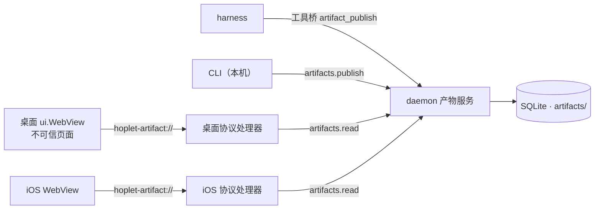

# 0025 产物

状态：当前设计 · 更新：2026-11-08

## 范围与现状

范围：会话产物的实体、版本、发布、读取、查看与页面隔离。

| 状态 | 边界 |
|---|---|
| ○ 目标 | 产物服务、工具桥与 CLI 发布、同步协议读取；桌面查看；iOS 查看 |
| 待定 | 页面能力：产物能在客户端里查看并实际使用后再定 |

产物是会话交出的可查看结果：一页 HTML、一篇 Markdown、一张图、一份表格。Personal 交付结果，产物是结果的正式形态：属于会话，带版本，在桌面和手机上都能打开，对话里有一行指向它。

## 实体与版本

| 字段 | 含义 |
|---|---|
| `id` | 稳定 ID，跨版本不变 |
| `session` | 所属会话；产物不跨会话移动 |
| `name` | 会话内唯一；同名再发布 = 新版本 |
| `kind` | 按入口文件扩展名判定，见下表；同一产物的各版本 kind 相同 |
| `version` | 从 1 递增；版本发布后不可变 |
| `entry` | 该版本的入口文件名 |
| `by` | 发布来源：`harness` / `cli` |

| kind | 入口扩展名 |
|---|---|
| `html` | `.html`、`.htm` |
| `markdown` | `.md`、`.markdown` |
| `image` | `.png`、`.jpg`、`.jpeg`、`.gif`、`.webp` |
| `csv` | `.csv` |
| `text` | `.txt` |

- 其他扩展名（包括 `.svg`）发布时返回“不支持的类型”。HTML 产物内部引用的 SVG 文件照常随版本发布。
- 内容存放在 `artifacts/<session>/<id>/v<n>/`：入口文件，HTML 另带它引用的脚本、样式、图片等文件。单个版本合计 ≤ 16 MiB、最多 64 个文件，超出时整次发布失败，不留半个版本。
- 旧版本保留，随会话删除一起删除；归档不删。已归档的会话不能再发布。
- 每次发布写一条 `ArtifactPublished` 事件（产物、版本、名字、kind、来源）到所属会话的日志，事件类型带版本号，旧解码器保留。

## 发布

发布按路径进行：daemon 自己读文件，请求里不带文件内容。

| 入口 | 规则 |
|---|---|
| 工具桥 `artifact_publish` | 会话身份调用，只能发布到本会话。参数：`name`、`entry`、`files`（可选，只对 HTML）。路径相对会话工作目录，解析符号链接后不能越出该目录 |
| CLI `hoplet artifact publish` | 指定会话与一个文件或目录：文件即入口；目录以其中的 `index.html` 为入口、目录下全部文件随版本发布。经本机连接的 `artifacts.publish`，远端设备不能调用；对配对主机发布返回“不支持” |

- 附带文件须在入口文件所在目录之下，按相对该目录的路径保存；入口保存为它的文件名。
- 只收普通文件；目录、设备文件等一律拒绝。
- 同一产物的发布串行进行；文件先写进临时目录，完整后才成为 `v<n>`，与版本记录、事件一起生效。

## 读取

`artifacts.list` 列出会话的产物（最新版本）；`artifacts.read` 读某个版本的一个文件：

| 项 | 规则 |
|---|---|
| 参数 | 产物、版本、路径（空 = 该版本的入口）、偏移 |
| 返回 | 从偏移起最多 1 MiB 的内容、文件总大小、Content-Type；客户端按偏移读完 |
| 范围 | 只能读到该版本目录下的文件；越界与不存在都返回 `not_found` |
| 远端 | 配对设备可调用，内容经同步协议传输，不另开端口 |

## 查看

- 桌面：查看区“产物”标签与 Personal 右栏的产物列表，界面先在画布上审定。对话里的发布事件显示为一行，点开打开对应标签。
- `markdown` / `image` / `csv` / `text` 用原生组件显示；`html` 用 MyGo 的 `ui.WebView`，页面一律以 `PageOptions.Untrusted` 加载。
- 标签默认显示最新版本，新版本到达时重新加载；可切换查看旧版本。

## 页面加载与隔离

- 地址：`hoplet-artifact://<id>/v<n>/<path>`。客户端协议处理器经 `artifacts.read` 取文件。
- 处理器用 `CallerPage` 核对请求来自哪个产物与版本：请求地址的产物或版本与调用页面不符时一律返回 404，不转给 daemon。页面因此只能读到自己这个版本的文件。
- 页面不可信：不能调用客户端绑定的方法，收不到广播，不能开窗口，不能导航到别的源。`http(s)` 链接交给系统浏览器打开，其他链接忽略。
- 网络：内容规则挡掉本产物地址以外的一切请求，产物的脚本、样式、字体和图片须随版本发布。

| 请求 | macOS 实测结果 |
|---|---|
| `fetch` / XHR（http、https，含 `no-cors`）、WebSocket、EventSource、`sendBeacon`、Worker、动态 `import` | 失败 |
| 外部的脚本、样式、字体、图片、iframe、音视频、`prefetch` / `preload` | 未发出 |
| 表单提交、`<a ping>`、`window.open`、导航到外部地址 | 未发出 |
| 其他自定义协议 | 未到达其处理器 |
| 同协议的其他产物地址 | 到达本协议处理器，页面读不到响应；由上面的核对拒绝 |
| WebRTC（STUN / TURN） | **照常发出**：内容规则只管 URL 请求，CSP 的 `webrtc` 指令 WebKit 不认，MyGo 没有关闭 WebRTC 的选项 |

WebRTC 是已知缺口：页面可以经 STUN 主机名、TURN 用户名把它能读到的内容带出去。MyGo 提供关闭 WebRTC 的页面选项后关闭；在此之前，页面能读到的只有它自己这个版本的文件。

## 页面能力（待定）

曾考虑让 HTML 产物在声明并获准后调用少量本机能力，使它从“能看”变成“能用、与会话连着”：

| 候选 | 用途 | 风险 |
|---|---|---|
| `db` | 产物自己的 JSON 数据，跨版本保留；harness 可读写同一份 | 只动产物自己的数据 |
| `publish` | 页面把自身状态存成新版本 | 只动产物自己 |
| `files` | 只读本会话目录 | 页面能读到会话文件，配合 WebRTC 缺口可外流 |
| `ask` | 向所属会话发一条消息并拿回回复 | 页面替我向会话说话 |

产物能在客户端里查看并实际使用后，再决定做哪些、如何声明与确认；决定前页面没有任何本机能力，也不注入桥接脚本。

## 两端一致

| 端 | 实现 |
|---|---|
| 桌面 | MyGo `ui.WebView` + `mygo.Protocol.HandleFunc` + 内容规则 |
| iOS | SwiftUI `WebView` / `WebPage` + 自定义协议处理器 |

两端使用同一地址格式与同一 `artifacts.read`；协议类型定义在 `proto/`，Swift 端按 `testdata/vectors/` 的向量回放验证。

## 验收

| 场景 | 结果 |
|---|---|
| 发布与版本 | 同名再发布得到新版本，旧版本可读且不变；超出上限、不支持的类型、越出工作目录的路径整次失败，不留文件 |
| 来源 | 会话只能发布到本会话；远端设备调用 `artifacts.publish` 被拒 |
| 读取 | 分块读完与原文件一致；越出版本目录的路径返回 `not_found` |
| 事件 | 每次发布在所属会话日志里有一条 `ArtifactPublished` |
| 隔离 | 页面调用不到客户端方法；除 WebRTC 外的外部请求全部失败；读不到其他产物与版本；导航不出本产物 |
| 远端 | 配对机器上的产物在本机客户端可看 |
| 两端 | iOS 回放向量与桌面一致 |

## 待验证

| 项 | 需确认 |
|---|---|
| iOS 内容规则 | iOS 上的不可信页面同样挡住外部请求；WebRTC 在 iOS 上的情况 |
| CDN 白名单 | 页面实际使用后，是否放行少量公共 CDN 的脚本、样式、字体与图片，减少 harness 内联依赖的负担 |
| 上限 | 16 MiB / 64 个文件是否合适 |
