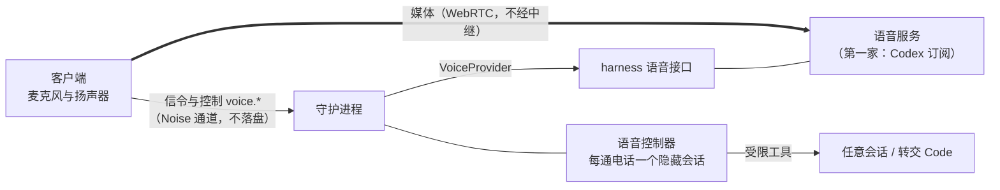

# 0027 语音通话

状态：当前设计 · 更新：2026-11-08

## 范围与现状

范围：用打电话的方式操作 Hoplet：查进度、给任意会话发话、转交新的 Code。先做桌面，iOS 后续设计。

| 状态 | 边界 |
|---|---|
| ✓ 设计已定 | 分层、生命周期、控制器工具、失败处理、桌面界面 |
| ○ 目标 | 全部代码；排在 M4a 之后，先接 Codex，再做守护进程与桌面 |

## 分层

实时语音来自 harness 的订阅额度，Hoplet 不自建语音模型，也不保存声音。

| 项 | 规则 |
|---|---|
| 接缝 | 守护进程侧一层薄接口 `VoiceProvider`：`Probe`（是否可用及原因）、`Start`（开始一通电话）；客户端只看到服务名和不透明的协商能力 |
| 第一家 | Codex 订阅。必须是 ChatGPT 账号登录的官方独立安装包，带它自己的语音组件；从官方来源下载，Hoplet 不打包、不再分发；不读 Codex 凭据，不回退到 API Key |
| 媒体 | 客户端直连语音服务；音频不经守护进程和中继 |
| 信令 | 只有 SDP 与控制消息走 Noise 通道的 `voice.*`；不写事件、不写日志 |
| 机器 | 一通电话一台机器，一台机器同时一通电话；跨机器操作等跨机执行就绪 |

## 媒体组件

客户端运行 Codex 官方包里的语音组件 `codex-voice-host`，由它负责 WebRTC、回声消除和打断；Hoplet 不自建媒体栈。

| 项 | 规则 |
|---|---|
| 来源 | 发起通话的桌面机器用自己的托管 Codex（`hoplet harness install codex`）；没有就报“缺语音组件”。连远程主机时两边都要有 |
| 启动 | 工作目录必须是组件所在目录，否则初始化失败；环境变量用固定白名单，不继承 API Key，固定 GStreamer 变量 |
| 权限 | 桌面应用声明麦克风用途说明；组件自带麦克风 entitlement |
| 顺序 | 打开设备时保持静音，主机确认后才取消静音；挂断先静音并抑制扬声器，再通知主机 |

## 语音控制器

每通电话一个隐藏的控制器会话。它不是伙伴，不绑定任何伙伴或会话，空工作目录、只读沙箱，不进侧栏。

| 工具 | 范围 |
|---|---|
| 读 | 任意会话的状态和最新回复 |
| 发 | 给任意已有会话发消息，走目标会话的队列，事件标明来自语音通话 |
| `handoff` | 新建 Code 会话并交代任务 |

- 控制器只有这三类工具，不写文件、不跑命令。
- 控制器不持有长期工作：要写代码转交 Code，其他事交给指定的伙伴。
- 发给已有会话：模型先读出目标和内容，等用户口头同意（软约束）；硬约束是目标必须解析到唯一的会话 ID，解析不出就问，不猜。
- 首版不做语音审批：等你批准的事只读出来，到屏幕上批。
- 挂断后不再处理自动回报。

## 生命周期

准备 → 协商 → 通话 → 结束；界面显示为连接中、聆听、说话、处理中、静音。

| 项 | 规则 |
|---|---|
| 归属 | 发起通话的设备独占，其他设备看不到实时状态 |
| 信令 | `voice.probe`、`voice.start`（带 offer，返回 answer）、`voice.confirm`（主机确认后才开麦）、`voice.heartbeat`、`voice.stop`；通话已结束时后续请求返回固定错误码 |
| 保活 | 5 秒心跳，15 秒无心跳结束 |
| 麦克风 | 协商完成且主机确认后才打开 |
| 挂断 | 先关本地音频，再通知主机 |
| 中断 | 守护进程重启即结束；不自动重连 |
| 转录 | 只存最终文本，写进事件，随会话同步，随归档删除；不存声音和中间结果 |
| 同意 | 每台设备第一次通话前确认一次：声音发给 OpenAI，使用 Codex 额度，只保存文字转录 |

## 失败

都在开始前检查，无回退，固定错误码，界面只给原因和处理办法，不展示服务方的原始错误，日志不写 SDP。

| 错误 | 标题 | 处理办法 |
|---|---|---|
| 没有 Codex | 这台机器没有可用的 Codex | 安装独立版 Codex，并用 ChatGPT 账号登录后再试。 |
| 非订阅登录 | 语音需要 ChatGPT 账号登录 | 当前 Codex 用的是 API Key 或自定义服务。 |
| 缺语音组件 | Codex 缺少语音组件 | 换成官方独立安装包后再试。 |
| 麦克风权限 | 没有麦克风权限 | 在系统设置的隐私与安全性里允许 Hoplet 使用麦克风。 |
| 机器占线 | studio 正在通话 | 通话在 macbook 上，先在那里挂断。 |
| 媒体不通 | 语音连接失败 | 网络可能挡住了 UDP。检查代理，或打开 TUN 模式后重试。 |
| 额度用完 | Codex 额度用完了 | 额度恢复后再试。 |
| 服务未开通 | 这个账号暂时用不了语音 | 当前账号或地区可能没有开通 Codex 语音。 |

## 桌面界面

组件与数值以设计系统为准（ADots、CCallBar、CCallControl、CCallPill、CCallOp、CTranscriptLine、MVoiceConsent、MVoiceHosts、PVoice、PVoiceHistory）。

| 项 | 规则 |
|---|---|
| 入口 | 侧栏底部麦克风按钮，一直在；多台机器时先选，只有一台不问 |
| 通话页 | 盖住内容区，无标题栏；中间是点阵，文字只在连接中和静音时出现；底部最新一条操作和通话条 |
| 视觉 | 点阵：7×7 的点裁成圆，用波形表示状态，只用品牌青 |
| 通话条 | 状态点、时长、机器，静音、转录、挂断、收起 |
| 转录 | 打开后右列显示操作和转录；操作可点，打开对应会话 |
| 收起 | 通话继续，可切换会话；侧栏底部按钮变成点阵 + 时长，侧栏隐藏时在内容标题行 |
| 通话记录 | 从设置或命令面板进入，不进侧栏 |
| 声音选择 | 放设置页，界面待绘制 |

## 验收

- 没有 Codex、非订阅登录、缺语音组件、无麦克风权限、机器占线、额度用完都在开始前给出固定提示。
- 麦克风只在协商完成且主机确认后打开；挂断时本地音频先关。
- 心跳超时、守护进程重启都结束通话，不重连，不残留音频。
- SDP 不出现在事件和日志；转录只有最终文本，一份，随会话同步、随归档删除。
- 目标不唯一时不发送；发出的消息在目标会话里标明来自语音通话。
- 控制器调用不到三类工具以外的能力。

## 待验证

- 真实通话：Codex 0.167.0 的订阅账号在协商时收到语音服务 404，原因待查（账号、地区或版本）。
- 维护者网络下 UDP 是否可达。
- 通话中注入的回报是否会被读出来。
- 麦克风权限是否归到 Hoplet 桌面应用。
