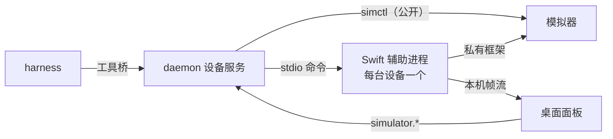

# 0028 iOS 模拟器

状态：当前设计 · 更新：2026-11-08

## 范围与现状

范围：让 Code 会话的 harness 操作本机 iOS 模拟器，并在桌面上实时查看和操作同一台设备。

| 状态 | 边界 |
|---|---|
| ✓ 已交付 | `simctl` 设备服务与占用；工具结果带图片；工具 `simulator_list`、`simulator_boot`、`simulator_launch`、`simulator_screenshot`、`simulator_open_url` |
| ○ 目标 | Swift 辅助进程、输入工具（`simulator_tap`、`simulator_swipe`、`simulator_text`、`simulator_button`）、桌面实时面板；交付前 `simulator_list` 的“输入是否可用”恒为否 |
| 已验证 | 输入与取帧的技术路径，见“验证基线” |
| 不做 | 真机、Linux、配对机器的模拟器、多点触控、由 Hoplet 创建或删除设备 |

Code 会话交付 iOS 改动时，需要亲眼看到 App 跑起来：装上、点一点、看结果。人也要能同时看到同一块屏幕，随时接手。

## 分层

| 层 | 职责 | 依赖 |
|---|---|---|
| daemon 设备服务（Go） | 设备列表、启动、安装、截图、占用、权限范围；托管辅助进程 | `xcrun simctl` |
| 辅助进程（Swift，仅 macOS） | 触摸、键盘、按键注入；取帧与缩放；探测私有接口 | Xcode 自带的 CoreSimulator、SimulatorKit，系统 Accelerate |
| 桌面面板（MyGO） | 显示帧，把鼠标转成触摸，显示占用状态 | 设备服务、帧流 |

- `simctl` 能做的事都由 Go 直接调用，私有接口只用于输入和取帧。Xcode 升级弄坏私有接口时，截图、安装、启动不受影响。
- 辅助进程是独立进程，桌面和 daemon 仍是纯 Go、无 cgo。不引入第三方依赖。
- 辅助进程放在 `apple/SimulatorHelper`，用 Swift 6 严格并发，随桌面 app 一起签名公证，与内置的 `hoplet` 同目录。找不到辅助进程时按“输入不可用”处理。

## 辅助进程

每台被使用的设备一个进程，由 daemon 按需启动，最后一个使用者离开 60 秒后退出。命令走 stdio，每行一个 JSON，带请求 ID 与结果。

| 项 | 规则 |
|---|---|
| 加载 | 运行时从 `xcode-select -p` 推出框架路径并 `dlopen`，不做链接；路径不写死 |
| 探测 | 启动时检查所需类、方法、符号是否齐全，把结果和 Xcode 版本回报给 daemon |
| 探测失败 | 进程报告后退出；设备服务标记 `input_unsupported`，`simctl` 能力照常 |
| 坐标 | 辅助进程只收比例坐标（0–1） |
| 触摸 | 按下、移动都发按下事件（移动是位置变化的按下），最后发抬起；移动事件类型不被消息函数接受 |
| 边缘手势 | 从屏幕边缘开始的手势在所有消息上带边缘参数；底边取值 3 |
| 抬起保证 | 标准输入关闭、收到终止信号或命令超时，先给进行中的触摸发抬起，再退出 |
| 崩溃 | daemon 不自动重试正在执行的命令，返回失败；下一条命令重新拉起 |

## Agent 工具

只对 Code 会话可见，且只在 macOS 主机上可见。主机不满足时，工具不出现，硬调用得到“没有这个工具”。

| 工具 | 作用 | 参数 |
|---|---|---|
| `simulator_list` | 列设备：名称、UDID、状态、屏幕点尺寸、占用者、输入是否可用 | 无 |
| `simulator_boot` | 启动一台已存在的设备，等到可用 | `device` |
| `simulator_launch` | 安装（给了 `app_path` 时）并启动 App | `device`、`bundle_id`，`app_path` |
| `simulator_screenshot` | 返回当前屏幕图片与点尺寸 | `device` |
| `simulator_tap` | 点击；`duration` 超过 0.5 秒是长按 | `device`、`x`、`y`，`duration` |
| `simulator_swipe` | 滑动 | `device`、`x`、`y`、`x2`、`y2`，`duration`、`edge` |
| `simulator_text` | 向当前焦点键入 | `device`、`text` |
| `simulator_button` | 按硬件键，当前只有 `home` | `device`、`name` |
| `simulator_open_url` | 打开 URL 或深链 | `device`、`url` |

| 项 | 规则 |
|---|---|
| 设备参数 | 名称或 UDID。`simulator_boot` 必须指定；其他工具省略时用本会话占用的设备，没有占用时失败并要求指定，不猜测 |
| 坐标 | 设备点，左上角为原点 |
| 截图 | `simctl` 取图后按设备倍率整数缩小，图片像素等于设备点，坐标可直接取自图片。倍率读自设备类型的 `main-screen-scale` |
| 回桌面 | 用 `simulator_button` 的 `home`，结果确定；底边手势的落点受速度影响，不作为回桌面的手段 |
| 键入 | ASCII 走键盘 HID；其他字符写入设备剪贴板后粘贴 |
| `edge` | `bottom` 或省略。其他边验证前返回 unsupported |
| `app_path` | 相对会话工作目录，解析符号链接后不能越出 |
| 构建 | 不提供构建工具，由 harness 在自己的 shell 里运行 `xcodebuild` |
| 审批 | 模拟器是本机隔离环境，这些工具不走审批 |
| 图片 | 工具桥结果从纯文本扩展为可带图片内容 |
| 时限 | `simulator_boot` 等待 120 秒；`simulator_launch` 的安装加启动共 300 秒；其余每个 `simctl`、`plutil` 操作 60 秒。超时按失败返回，写明超时和时长 |
| 失败 | 设备服务的所有失败都以工具错误返回给模型：下表的错误带错误码前缀，其余保留 `simctl <动词>: <stderr>` 的文字 |

| 错误 | 含义 |
|---|---|
| `simulator_unavailable` | 没有可用的 Xcode 或 `simctl` |
| `input_unsupported` | 私有接口探测失败或辅助进程缺失；输入类工具不可用 |
| `device_not_found` / `device_not_booted` | 设备不存在 / 未启动 |
| `simulator_busy` | 设备被其他占用者持有，错误里写明占用者 |
| `unsupported` | 多点触控、未验证的边缘与硬件键 |

## 占用

两个操作者同时向一台设备注入输入，彼此的结果都不可信。输入类操作（点击、滑动、键入、按键、launch）必须持有该设备的占用。

| 项 | 规则 |
|---|---|
| 持有者 | 一台设备同时一个：某个会话，或“人”（桌面面板） |
| 获得 | 设备空闲时，第一个输入操作自动获得 |
| 冲突 | 其他会话的输入返回 `simulator_busy`，不排队 |
| 人优先 | 面板上的输入总是立即拿到占用；原持有会话的下一个输入得到 `simulator_busy` |
| 进行中 | 进行中的 `simulator_launch` 保持占用，不会过期；操作结束时无论成败都重新计 60 秒 |
| 释放 | 持有者空闲 60 秒，或会话被归档、删除时释放；daemon 重启后全部清空 |
| 只读 | `simulator_list`、`simulator_screenshot` 与面板观看不需要占用 |
| `simulator_open_url` | 不需要占用，也不改变现有占用 |
| 建议 | 工具说明告诉 harness 优先用没有占用者的设备 |
| 边界 | 只约束经过 Hoplet 的操作；Simulator.app 和其他工具的操作检测不到，也拦不住 |

## 桌面面板

界面（位置、尺寸、设备选择、状态图标）先在布局画布上绘制并通过审核，再同步到设计系统。这里只规定行为。

| 项 | 规则 |
|---|---|
| 显示 | `ui.Video` 配一个读帧流的 `VideoDecoder` |
| 操作 | 按下、拖动、抬起映射成一次触摸；手势起点距屏幕边缘 4 点以内时带边缘参数 |
| 键盘 | 面板有焦点时转发按键 |
| 机器范围 | 只显示本机设备；连接配对机器时不显示面板 |
| 占用显示 | agent 持有时显示其会话；人操作后立即显示为人 |

### 帧流

| 项 | 规则 |
|---|---|
| 建立 | `simulator.stream` 由 daemon 校验本机客户端，让辅助进程开一个一次性 Unix socket，返回路径和 token |
| 取帧 | 观察帧缓冲的 seed，只在画面变化时取帧；无观看者时不取帧 |
| 尺寸 | 辅助进程按面板请求的宽度缩放，输出 RGBA，Go 侧不做像素转换 |
| 帧率 | 上限 30 fps |
| 背压 | 只保留最新一帧，读得慢就丢旧帧 |

## 验证基线

Xcode 27.2、iOS 26.5、iPhone 17 Pro，用一次性程序在专用模拟器上验证。

| 能力 | 结果 |
|---|---|
| 取帧 | `framebufferSurface` 返回 1206×2622 BGRA 的 IOSurface；滚动时约 56 fps，整帧复制约 2.3 ms |
| 点击、滚动 | 比例坐标准确；连续按下事件可驱动滚动 |
| 键入 | HID 键码输入 ASCII 成功 |
| Home 键 | 2 次均回到桌面 |
| 底边手势 | 边缘参数 3 触发，6 次均离开 App，其中 3 次确认回到桌面，另外 3 次落点未确认；参数 0 的对照 6 次均未触发 |
| 工具闭环 | Claude Code 2.1.319 经工具完成启动设备、安装、启动 App、截图，模型读出屏幕上提示词里没有的随机词；截图 402×874，等于设备点 |
| 占用 | 两个会话的工具桥连接抢同一设备：后者 `simulator_launch` 得到 `simulator_busy` 并写明持有会话，截图和 `simulator_open_url` 不受影响，持有者可重入 |
| `app_path` | 越出工作目录时失败，未执行安装 |

## 验收

| 项 | 标准 |
|---|---|
| 闭环 | harness 经工具完成装 App、启动、点击、截图，点击位置取自截图坐标 |
| 降级 | 探测失败时输入工具返回 `input_unsupported`，截图、安装、启动正常 |
| 占用 | 两个会话抢同一设备，后者得到 `simulator_busy`；人操作后 agent 被挡；超时后可重新获得 |
| 抬起 | 手势中途杀掉辅助进程的上游，设备上没有残留的按下 |
| 范围 | Personal 会话和 Linux 主机看不到工具；越出工作目录的 `app_path` 失败 |
| 面板 | 拖动滚动跟手，画面静止时不取帧，关闭面板后辅助进程按时退出 |

## 待验证

| 项 | 需确认 |
|---|---|
| MyGO 帧率 | `ui.Video` 持续显示缩放帧的 CPU 占用和延迟 |
| Hermes 看截图 | Hermes 的模型能否看到工具结果里的图片。Hermes 0.22.5 的一次验收中，默认模型被账户权限拒绝，回合没有走到工具调用 |
| 非 ASCII 键入 | 剪贴板加粘贴在各类输入框是否可靠 |
| 底边手势 | 未确认的 3 次落在哪里，手势速度的影响 |
| 其他边缘与硬件键 | 边缘参数 1、2、4 的含义；锁屏、侧边键的取值 |
| Home 键 | 更多次数的稳定性 |
| 版本跨度 | 较旧 Xcode 上探测与消息格式是否一致 |
| 签名 | 公证后的辅助进程能否加载 Xcode 内的私有框架（库验证可能需要例外授权） |
