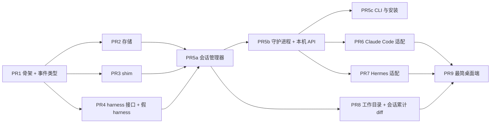

# M1 核心闭环 · 总计划

**目标：** 在一台 Mac 上跑通两种模式：用 Claude Code 跑 Code 会话，用 Hermes 跑 Personal 会话，两者共用同一个内核（守护进程、shim、存储、事件协议、审批转发），可以通过 CLI 和最简桌面端使用。

**依据：** [设计总览](../README.md)，以及 [0002](../design/0002-process-model.md)–[0005](../design/0005-sync-protocol.md)、[0007](../design/0007-commands-approvals.md)、[0008](../design/0008-workspace-lifecycle.md)、[0013](../design/0013-testing-release.md)。

**不在 M1 范围内：** 中继、配对、iOS（M2）；检查点回滚、PR、隔离模式、端口、终端（M3）；个人档案、触发器、Telegram（M4）；Codex 和 ACP（M5）。

## 全局约束

- Go 1.27；模块路径 `github.com/yangflow/hoplet`；只有一个二进制 `cmd/hoplet`。
- 代码、注释、commit 用英文；本目录下的计划用中文。
- 每个 PR 单独合入 `main`，合入后 `make check` 必须通过，系统必须仍然可用。
- 新增依赖仅限下表；表外的依赖要另行同意。

| 依赖 | 版本 | 用途 | 引入于 |
|---|---|---|---|
| `modernc.org/sqlite` | v1.61.0 | 纯 Go SQLite（无 cgo） | PR2 |
| `github.com/coder/websocket` | v1.8.15 | 客户端协议的 WebSocket | PR5b |
| `github.com/BurntSushi/toml` | v1.6.0 | 配置文件（`config.toml`，以及后续的 `rules.toml`、`hoplet.toml`、`mcp.toml`） | PR5c |
| `github.com/egoist/mygo` | v0.7.3 | 桌面端 | PR9 |

## PR 拆分与顺序

PR2、PR3、PR4 互不依赖，可以并行开发；PR6、PR7、PR8 也一样。

| PR | 标题 | 主要内容 | 验收 |
|---|---|---|---|
| 1 | `build: add Go module and protocol event types` | `go.mod`；`cmd/hoplet`（`version` 子命令）；`proto/` 事件信封、各类事件、带版本的解码注册表 | 所有事件类型往返编解码一致；旧版本事件能解码；未知类型返回明确错误；CI 中 Go 目标全部启用 |
| 2 | `feat(store): add SQLite store with event log and receipts` | 迁移框架；会话 / 轮次 / 事件 / 回执 / 审批表；blob 目录；“事件 + 投影 + 回执”同一事务；增量合批与压缩；丢失契约 | 幂等键重复提交只执行一次；需确认的写入落盘后才返回；压缩后回放结果不变；10 万事件写入基准有记录 |
| 3 | `feat(shim): add per-session shim with spool and resume` | `hoplet shim`：托管子进程 stdio；`spool.jsonl` 追加；Unix socket 帧协议（带版本）；按偏移续读 | **验证假设：** 客户端被 `kill -9` 后重连，从偏移处续读，不丢、不重；子进程感知不到客户端断开 |
| 4 | `feat(harness): add harness interfaces and scriptable fake harness` | `Harness` / `Run` 接口、能力位、归一化事件映射约定；`internal/harness/fake`：按剧本输出 Claude stream-json 子集的假 harness 二进制 | 剧本能产生：流式文本、工具调用、审批请求、中途崩溃、慢输出 |
| 5a | `feat(session): run sessions behind shims and ingest into the store` | `internal/session`：shim 版 Stdio、shim 启动器、会话管理器（创建、发送、审批先答者生效、中断、续接、脱离）、入库循环；存储补轮次状态与会话权限模式 | **验证假设：** 管理器在轮次中途走开，新管理器续接后本轮完整入库、每个事件恰好一次；两个客户端抢答同一审批只有一个生效 |
| 5b | `feat(daemon): add daemon and local API` | `hoplet daemon`：flock 单例、原子接管 socket；客户端协议（hello、目录 / 会话订阅、命令及回执、审批）；持久化消息队列；`internal/client`；守护进程先运行 `session.Manager.Recover`，再开始服务任何命令 | **验证假设：** 真实守护进程在轮次中途 `kill -9` 后重启，会话续接、事件不缺 |
| 5c | `feat(cli): add session CLI, daemon install and doctor` | CLI：`session new/list/send/watch/wait/approve/archive`、`daemon install/uninstall/status`（macOS LaunchAgent；Linux systemd 随 M2）、`env refresh`；`config.toml`；登录 shell 环境解析（去凭证）与缓存；代理注入；日志轮转；`doctor`（M1 子集） | 在终端里用假 harness 跑通一次会话（真实 harness 随 PR6 / PR7 接入） |
| 6 | `feat(harness/claude): add Claude Code adapter` | **第一步验证假设：** `hoplet dev record` 录制真实 stream-json 会话，确认审批（control_request）、中断、切换权限模式都能走通；随后实现适配器：事件映射、四档会话模式映射、审批转发、版本区间门控；契约测试（录制回放） | 用真实 Claude Code 完成一次“改文件 + 执行命令需审批”的会话；契约测试在 CI 中离线通过 |
| 7 | `feat(harness/hermes): add Hermes adapter for Personal mode` | **第一步验证假设：** 用 TUI-gateway JSON-RPC 驱动 Hermes（独立 `HERMES_HOME`），确认流式、审批、steer、interrupt；随后实现适配器、gateway 生命周期管理、契约测试 | 用真实 Hermes 完成一次 Personal 对话；守护进程重启后 Hermes 会话能续上 |
| 8 | `feat(workspace): discover repos and show session diff` | 扫描工作目录下的仓库；会话开始时用私有 index 记录基线（不写用户仓库）；按仓库给出“会话累计”diff（只读） | 多仓库目录下改动能按仓库正确汇总；用户仓库 `.git` 无任何新增 ref / 对象 |
| 9 | `feat(desktop): add minimal desktop app` | 先用 Design 出桌面设计稿；MyGO 实现：侧栏（模式切换、收件箱入口、会话按主机·目录分组）、对话流、待审批固定在输入框上方、输入框（队列、插话、停止）、只读 diff 检查器 | 桌面端完成：新建 Code 会话 → 审批 → 看 diff；新建 Personal 会话 → 对话 |

## 关键假设的验证点

| 假设 | 在哪验证 | 不成立时 |
|---|---|---|
| shim 托管 stdio 后，守护进程重启不影响 harness | PR3、PR5a、PR5b | 停下，重新讨论 0002 |
| Claude Code stream-json 控制协议覆盖审批、中断、切模式 | PR6 第一步 | 改用 `--permission-prompt-tool <MCP 工具>` 做审批 |
| Hermes 能通过 TUI-gateway 稳定驱动 | PR7 第一步 | 改用 ACP |
| 纯 Go SQLite 性能够用 | PR2 基准 | 换 cgo 版本（需同意） |

## 每个 PR 的详细计划

开工某个 PR 前，在本目录写 `m1-prN-<名称>.md`：逐步列出文件、接口、测试代码、命令和 commit，基于当时 `main` 的真实代码。

- [PR1：骨架与事件类型](m1-pr1-proto.md)（已合并）
- [PR2：存储](m1-pr2-store.md)（已合并）
- [PR3：shim](m1-pr3-shim.md)（已合并）
- [PR4：harness 接口与假 harness](m1-pr4-harness.md)（已合并）
- [PR5a：会话管理器](m1-pr5a-session.md)（已合并）
- [PR5b：守护进程与本机 API](m1-pr5b-daemon.md)（已合并）
- [PR5c：CLI 与安装](m1-pr5c-cli.md)
