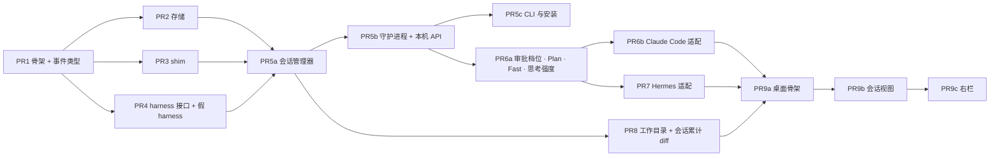

# M1 核心闭环 · 总计划

**目标：** 在一台 Mac 上跑通两种模式：用 Claude Code 跑 Code 会话，用 Hermes 跑 Personal 会话，两者共用同一个内核（守护进程、shim、存储、事件协议、审批转发），可以通过 CLI 和桌面端使用。

**依据：** [设计总览](../README.md)，以及 [0002](../design/0002-process-model.md)–[0005](../design/0005-sync-protocol.md)、[0007](../design/0007-commands-approvals.md)、[0008](../design/0008-workspace-lifecycle.md)、[0013](../design/0013-testing-release.md)、[0014](../design/0014-desktop-ui.md)。

**不在 M1 范围内：** 中继、配对、iOS（M2）；检查点回滚、PR、隔离模式、端口、终端（M3）；个人档案、触发器、Telegram（M4）；Codex 和 ACP（M5）。设计稿里依赖这些功能的界面（多机器、撤销、提交与 PR、终端、伙伴的产物与触发器、个人档案、分叉、语音）在 M1 不显示，功能落地时再接上；M1 的 Personal 侧栏把每个 Personal 会话当作一个伙伴显示，完整的伙伴模型随 M4 个人档案一起做。

## 全局约束

- Go 1.27；模块路径 `github.com/yangflow/hoplet`；只有一个二进制 `cmd/hoplet`。
- 代码、注释、commit 用英文；本目录下的计划用中文。
- 每个 PR 单独合入 `main`，合入后 `make check` 必须通过，系统必须仍然可用。
- 新增依赖仅限下表；表外的依赖要另行同意。

| 依赖 | 版本 | 用途 | 引入于 |
|---|---|---|---|
| `modernc.org/sqlite` | v1.61.0 | 纯 Go SQLite（无 cgo） | PR2 |
| `github.com/coder/websocket` | v1.8.15 | 客户端协议的 WebSocket | PR5b |
| `github.com/BurntSushi/toml` | v1.6.0 | 配置文件（`config.toml`，以及后续的 `rules.toml`、`hoplet.toml`、`mcp.toml`） | PR5c |
| `github.com/egoist/mygo` | v0.7.4 | 桌面端（原生 UI、玻璃插件、菜单与托盘） | PR9a |

随仓库分发的第三方资源（只拷贝用到的文件，各自附许可证原文，不引入代码依赖）：

| 资源 | 版本 | 许可 | 用途 | 引入于 |
|---|---|---|---|---|
| Lucide（lucide-static） | 1.66.0 | ISC | 界面图标、审批盾牌 | PR9a |
| Material Icon Theme | 5.40.0 | MIT | 文件与文件夹类型图标 | PR9c |
| Simple Icons | 16.36.0 | CC0-1.0 | Claude 标志 | PR9a |
| JetBrains Mono | 2.304 | SIL OFL 1.1 | 代码字体（Regular、SemiBold） | PR9b |

## PR 拆分与顺序

PR2、PR3、PR4 互不依赖，可以并行开发。PR6b 与 PR7 都要实现 6a 加的 Run 方法，所以都在 6a 之后；PR6b、PR7、PR8 之间互不依赖。

| PR | 标题 | 主要内容 | 验收 |
|---|---|---|---|
| 1 | `build: add Go module and protocol event types` | `go.mod`；`cmd/hoplet`（`version` 子命令）；`proto/` 事件信封、各类事件、带版本的解码注册表 | 所有事件类型往返编解码一致；旧版本事件能解码；未知类型返回明确错误；CI 中 Go 目标全部启用 |
| 2 | `feat(store): add SQLite store with event log and receipts` | 迁移框架；会话 / 轮次 / 事件 / 回执 / 审批表；blob 目录；“事件 + 投影 + 回执”同一事务；增量合批与压缩；丢失契约 | 幂等键重复提交只执行一次；需确认的写入落盘后才返回；压缩后回放结果不变；10 万事件写入基准有记录 |
| 3 | `feat(shim): add per-session shim with spool and resume` | `hoplet shim`：托管子进程 stdio；`spool.jsonl` 追加；Unix socket 帧协议（带版本）；按偏移续读 | **验证假设：** 客户端被 `kill -9` 后重连，从偏移处续读，不丢、不重；子进程感知不到客户端断开 |
| 4 | `feat(harness): add harness interfaces and scriptable fake harness` | `Harness` / `Run` 接口、能力位、归一化事件映射约定；`internal/harness/fake`：按剧本输出 Claude stream-json 子集的假 harness 二进制 | 剧本能产生：流式文本、工具调用、审批请求、中途崩溃、慢输出 |
| 5a | `feat(session): run sessions behind shims and ingest into the store` | `internal/session`：shim 版 Stdio、shim 启动器、会话管理器（创建、发送、审批先答者生效、中断、续接、脱离）、入库循环；存储补轮次状态与会话权限模式 | **验证假设：** 管理器在轮次中途走开，新管理器续接后本轮完整入库、每个事件恰好一次；两个客户端抢答同一审批只有一个生效 |
| 5b | `feat(daemon): add daemon and local API` | `hoplet daemon`：flock 单例、原子接管 socket；客户端协议（hello、目录 / 会话订阅、命令及回执、审批）；持久化消息队列；`internal/client`；守护进程先运行 `session.Manager.Recover`，再开始服务任何命令 | **验证假设：** 真实守护进程在轮次中途 `kill -9` 后重启，会话续接、事件不缺 |
| 5c | `feat(cli): add session CLI, daemon install and doctor` | CLI：`session new/list/send/watch/wait/approve/archive`、`daemon install/uninstall/status`（macOS LaunchAgent；Linux systemd 随 M2）、`env refresh`；`config.toml`；登录 shell 环境解析（去凭证）与缓存；代理注入；日志轮转；`doctor`（M1 子集） | 在终端里用假 harness 跑通一次会话（真实 harness 随 PR6 / PR7 接入） |
| 6a | `feat(session): add auto review, plan and fast modes and effort` | 审批档位改为 需确认 / 自动编辑 / 智能审批 / 全自动（缺档取更严的最近一档），去掉"只读"，加独立的 Plan 开关、Fast 开关与思考强度（含 ultra）；`mode.changed` 事件；存储迁移（只读 → 需确认 + Plan）；守护进程 `sessions.set_plan` / `set_fast` / `set_effort`；CLI `session set` | 假 harness 下默认值、回退、中途切换与 harness 自行退出 Plan 均正确；旧数据迁移正确 |
| 6b | `feat(harness/claude): add Claude Code adapter` | **第一步验证假设（已完成）：** 录制真实 stream-json 会话，确认审批（control_request）、中断、切换权限模式与模型、思考强度、Plan 批准、续接都能走通（Fast 无法经协议开启）；随后实现适配器：事件映射、审批档位 / Plan / 思考强度映射、审批转发、版本门控与 Probe 缓存；Hoplet 托管的 claude 副本（`hoplet harness install / upgrade claude`，未录制的版本先过本机自检；守护进程每天跟进我 PATH 上的 claude，doctor 显示结果）；`hoplet dev record / sanitize`；契约测试（录制回放 + golden） | 用真实 Claude Code 完成一次“改文件 + 执行命令需审批”的会话；契约测试在 CI 中离线通过 |
| 7 | `feat(harness/hermes): add Hermes adapter for Personal mode` | **第一步验证假设（已完成）：** 对本机 Hermes 0.22.5 的 gateway 录制真实会话，确认流式、编辑审批、steer、中断、设置切换、断线续接（gateway 原生 WebSocket，共用默认 `~/.hermes`）；随后实现：`hoplet hermes-bridge` 桥接进程（放在 shim 后面）、适配器（事件映射、档位 / 思考强度 / Fast / 模型、审批转发、设置排队、断线后用 receipt 补齐）、版本门控与本机自检（`hoplet harness verify hermes`，守护进程每天检查）、CLI `session interrupt / steer / stop`、契约测试（真实会话 spool 回放 + golden） | 用真实 Hermes 完成一次带编辑审批的对话；守护进程重启后 Hermes 会话能续上 |
| 8 | `feat(workspace): discover repos and show session diff` | 扫描工作目录下的仓库；建会话时、启动 harness 前记录基线（Hoplet 自己的 index 与对象库，不读用户的 index、不写用户仓库）；按仓库给出“会话累计”diff（`sessions.diff`、`hoplet session diff`） | 多仓库目录下改动能按仓库正确汇总；用户仓库 `.git` 下没有任何文件被新建、修改、删除或改动时间戳 |
| 9a | `feat(desktop): add desktop shell and design system` | 设计系统落地（[0014](../design/0014-desktop-ui.md)：token → `ui.Theme` 与应用自己的语义色、7 档字号、间距圆角）；资源（Lucide、Simple Icons 的 SVG 子集与许可证，标志与应用图标）；全玻璃窗口与标题栏；侧栏（模式切换、Code 按工作目录分组、置顶分区、排列菜单、Personal 伙伴列表、行尾状态、右键菜单、底部本机身份与连接状态、归档列表）；会话的置顶 / 未读 / 重命名（存储迁移 + `sessions.update` + CLI）；原生菜单栏、菜单栏图标、Dock 角标 | 桌面端连上守护进程，侧栏实时反映会话状态；置顶 / 未读 / 重命名在 CLI 与桌面端一致；菜单栏图标显示"需要你"数量 |
| 9b | `feat(desktop): add session view, composer and approvals` | 正文区（Code：工作组折叠、工具行、代码块、改动卡；Personal：聊天气泡）；输入框（队列、插话、停止、强度与模型、审批档位、Plan）；审批与提问在输入框内；侧栏的新建 / 搜索 / 收件箱入口与目录 ＋；新建页；收件箱；⌘K 命令面板；JetBrains Mono | 桌面端完成：新建 Code 会话 → 审批 → 看到改动；新建 Personal 会话 → 对话 |
| 9c | `feat(desktop): add changes and files panel` | 右栏：标签查看区、Material Icon Theme 文件图标、变更树 + 连续 diff（`sessions.diff`）、文件树 + 只读文件查看（守护进程新增只读的会话目录列举与读取接口） | 在桌面端看完一次会话的全部改动，并能打开任意文件 |

## 关键假设的验证点

| 假设 | 在哪验证 | 不成立时 |
|---|---|---|
| shim 托管 stdio 后，守护进程重启不影响 harness | PR3、PR5a、PR5b | 停下，重新讨论 0002 |
| Claude Code stream-json 控制协议覆盖审批、中断、切模式 | PR6 第一步 | 改用 `--permission-prompt-tool <MCP 工具>` 做审批 |
| Hermes 能通过 gateway 原生 WebSocket 稳定驱动 | PR7 第一步（已验证） | 改用 ACP |
| 纯 Go SQLite 性能够用 | PR2 基准 | 换 cgo 版本（需同意） |

## 每个 PR 的详细计划

开工某个 PR 前，在本目录写 `m1-prN-<名称>.md`：逐步列出文件、接口、测试代码、命令和 commit，基于当时 `main` 的真实代码。

- [PR1：骨架与事件类型](m1-pr1-proto.md)（已合并）
- [PR2：存储](m1-pr2-store.md)（已合并）
- [PR3：shim](m1-pr3-shim.md)（已合并）
- [PR4：harness 接口与假 harness](m1-pr4-harness.md)（已合并）
- [PR5a：会话管理器](m1-pr5a-session.md)（已合并）
- [PR5b：守护进程与本机 API](m1-pr5b-daemon.md)（已合并）
- [PR5c：CLI 与安装](m1-pr5c-cli.md)（已合并）
- [PR6a：审批档位、Plan 与思考强度](m1-pr6a-modes.md)（已合并）
- [PR6b：Claude Code 适配](m1-pr6b-claude.md)（已合并）
- [PR7：Hermes 适配](m1-pr7-hermes.md)（已合并）
- [PR8：工作目录与会话累计 diff](m1-pr8-workspace.md)（已合并）
- [PR9a：桌面骨架与设计系统](m1-pr9a-desktop-shell.md)
