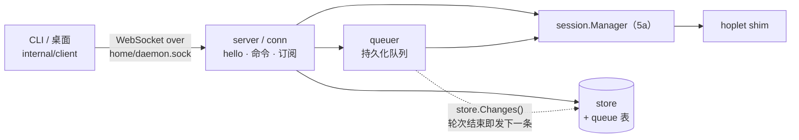

# M1 · PR5b 守护进程与本机 API · 详细计划

> **执行方式：** 按任务顺序逐步执行；每一步用 `- [ ]` 勾选。每个任务结束时 `go test -race ./...` 和 `golangci-lint run ./...` 都应通过。

**目标：** 把 5a 的会话管理器包成真正的守护进程：单例、原子接管 socket、先续接再服务；客户端协议（hello 鉴权、命令、目录 / 会话订阅及断线追赶、心跳、慢客户端断开）；持久化消息队列；Go 客户端；`hoplet daemon` 子命令。并用**真实进程**验证关键假设：守护进程在轮次中途被 `kill -9`，重启后会话续接、事件不缺不重。

**架构：**



- `internal/home`：主目录（`$HOPLET_HOME`，默认 `~/.hoplet`）里各文件的位置；本机 token 文件（0600，原子写入）。
- `internal/daemon`：`Start` 依次做 flock（`daemon.lock`，非阻塞，失败即 `ErrRunning`）→ token → 打开存储 → 管理器 `Recover` → 监听临时路径并 rename 成 `daemon.sock`（永不删除 socket 文件）→ 启动队列投递和 HTTP 服务。`Close` 断开所有连接、脱离会话（shim 继续跑）、关存储、释放锁。
- 协议（`proto/api.go`）：请求 `{id, method, params}` → `{id, result | error}`；订阅项 `{sub, item}`，结束 `{sub, end, error?}`；取消 `{sub, cancel}`。第一条请求必须是 `hello{protocol_major, device_id, token}`，主版本不符返回 `version`，token 错返回 `unauthorized`，随后断开；10 秒内没有 hello 也断开。带 `Origin` 头的握手直接 403。
- 订阅：目录订阅按目录版本号追赶（版本 0 或比当前还新的版本 → 全量快照）；会话订阅按 `after_seq` 追赶：缺口 ≤ 500 条且 ≤ 1 MiB 逐条补发，否则发最近 3 轮的快照（`more` 表示更早还有）；游标超过日志末尾也发快照。之后随 `store.Changes()` 实时推送，每项最多 500 条；队列变化时附上完整队列（首项总带）。
- 连接：每连接一个写协程；排队待写的字节超过 8 MiB（单帧总能发出）就断开这一条，客户端按游标补回；每 15 秒 ping，10 秒不回判死。
- 队列：会话空闲且队列为空时直接发送；轮次进行中（`session.ErrBusy`）或前面还有排队消息时入队。投递协程在每次存储变化后发各会话的队首；幂等键保证"发出后、出队前"崩溃也不会重复发送。发送失败（非忙）的消息带着错误留在队首、挡住后面的消息，直到被编辑、移动或删除。
- `internal/client`：`Dial`（Unix socket 上的 WebSocket + hello）、`Call`、`Subscribe` / `Next` / `Cancel`、各方法的类型化封装；不自动重连。

**技术栈：** Go 1.27；新增依赖 `github.com/coder/websocket v1.8.15`（总计划依赖表已列）。

**依据：** [M1 总计划](m1-overview.md)、[0002 进程模型](../design/0002-process-model.md)（flock、原子接管 socket、永不删 socket）、[0005 同步协议](../design/0005-sync-protocol.md)（信封、三类订阅、追赶阈值、心跳、背压、幂等）、[0006 连接与安全](../design/0006-connectivity-security.md)（Unix socket 0600 + 本机 token、拒绝带 `Origin` 的握手）、[0007 命令与审批](../design/0007-commands-approvals.md)（持久化队列、先答者生效）、[0004 会话数据模型](../design/0004-session-data-model.md)（目录布局）。

**本计划的裁决：**
- 推送合批不另加定时器：入库循环本身按 50ms 合批提交（5a），订阅每次存储变化读一次，自然合并；"需要我行动的事件立即推送"随之成立。
- 目录订阅只带会话记录（含状态，`waiting` 即有待审批）；待审批详情走会话订阅。收件箱需要的跨会话审批列表到 PR9 设计桌面时再加。
- 会话不会被删除，目录订阅暂无墓碑（存储的 `SessionsSince` 文档已写明删除时必须加）。
- 慢客户端直接断开（不做关闭握手）：它本来就读不动，握手只会多等 5 秒。守护进程退出时连接同样直接断开，客户端重连后按游标追赶。
- `sessions.create` 不带幂等键：客户端不自动重试创建。
- 生产二进制不注册任何 harness（PR6 / PR7 接入）；harness 进程环境暂用守护进程的 `PATH HOME USER LOGNAME SHELL LANG TMPDIR`，5c 换成登录 shell 解析 + 代理注入。
- 真实进程测试用"测试二进制自举"：`HOPLET_DAEMON_HELPER=1` 时测试二进制运行一个带假 harness 的守护进程，生产二进制不含假 harness。

## 全局约束

- 新增依赖只有 `github.com/coder/websocket v1.8.15`；代码、注释、commit 用英文；导出标识符有文档注释；库代码不 panic；不用 lint 抑制注释（`.golangci.yml` 中按路径和规则号的排除需写明理由）。
- 守护进程先 `Recover`，再监听 socket；socket 文件只被 rename 覆盖，任何清理逻辑都不删除它。
- 本机访问：主目录 0700、socket 0600、token 文件 0600；未 hello 的连接只能发 hello；带 `Origin` 的握手拒绝。
- 用户消息、队列写入落盘（`synchronous=FULL`）后才应答；重复命令靠幂等键去重。
- 测试不泄漏进程：每个测试结束时终止其主目录下的所有 shim 和守护进程；测试里除了"轮询直到条件成立"不用 sleep 同步。
- 分支 `feat/daemon`；commit 带 DCO 签名（`git commit -s`）；完成前 `make check` 通过。

## 文件

| 文件 | 职责 |
|---|---|
| `go.mod`、`go.sum` | `github.com/coder/websocket v1.8.15` |
| `proto/api.go`、`proto/api_test.go` | 协议帧、方法名、错误码、各方法参数与结果、订阅项 |
| `internal/store/migrations/0003_queue.sql` | 队列表 |
| `internal/store/queue.go`、`queue_test.go` | `Enqueue`（幂等、上限 100）、`Queue`、`QueuedSessions`、`EditQueued`、`FailQueued`、`DeleteQueued`、`MoveQueued` |
| `internal/home/home.go`、`home_test.go` | 主目录与文件位置、本机 token |
| `internal/client/client.go`、`methods.go`、`client_test.go` | Go 客户端 |
| `internal/daemon/daemon.go` | `Config`、`Start`、`Close`、`Done`、`Err`、`ErrRunning`；flock、socket 接管 |
| `internal/daemon/server.go` | 协议阈值 `limits`、HTTP 升级、连接跟踪 |
| `internal/daemon/conn.go` | 单个连接：hello、请求分发、写队列与背压、心跳、订阅生命周期 |
| `internal/daemon/subs.go` | 目录订阅、会话订阅与追赶 |
| `internal/daemon/methods.go` | 命令到管理器 / 存储的映射、错误分类 |
| `internal/daemon/queue.go` | 发送或入队、队列编辑、投递协程 |
| `internal/daemon/helpers_test.go`、`daemon_test.go`、`kill_test.go` | 进程内与真实进程测试 |
| `cmd/hoplet/main.go`、`daemon.go`、`daemon_test.go` | `hoplet daemon [--home DIR]` |

## 接口（后续 PR 依赖）

- `daemon.Start(ctx, daemon.Config{Home, Version, Exe, Harnesses map[string]harness.Harness, Env, Logger}) (*Daemon, error)`；`(*Daemon).Close() error`、`Done() <-chan struct{}`、`Err() error`；`daemon.ErrRunning`
- `home.Dir() (string, error)`、`home.Socket / Lock / Sessions / TokenFile(home) string`、`home.ReadToken`、`home.EnsureToken`；`home.Env = "HOPLET_HOME"`
- `client.Dial(ctx, client.Options{Socket, Token, DeviceID}) (*Client, error)`、`client.HomeOptions(home, deviceID)`；`(*Client).Call / Subscribe / Hello / Done / Close`；`(*Subscription).Next(ctx, v) / Cancel(ctx)`；`client.ErrClosed`、`client.ErrEnded`
- `(*Client)` 类型化方法：`Sessions`、`Create`、`Send`、`Respond`、`Interrupt`、`Steer`、`Answer`、`SetPermission`、`Stop`、`Archive`、`Queue`、`EditQueued`、`DeleteQueued`、`MoveQueued`、`SubscribeCatalog`、`SubscribeSession`
- `proto.ProtocolMajor = 1`、`proto.APIPath = "/v1"`；服务端错误是 `*proto.APIError{Code, Message}`

---

### 任务 0：建分支

- [ ] **步骤 1：**

```bash
git switch -c feat/daemon
go get github.com/coder/websocket@v1.8.15
```

（`go.mod` 在任务 4 用到这个包之后用 `go mod tidy` 变成直接依赖。）

### 任务 1：协议类型

**文件：** 创建 `proto/api.go`、`proto/api_test.go`

**接口：** 产生全部协议类型，后续所有任务都用到。

- [ ] **步骤 1：写测试**


`proto/api_test.go`

```go
package proto

import (
	"encoding/json"
	"testing"
)

// TestFrameWireFormat pins the JSON shape of protocol frames: every client
// depends on it.
func TestFrameWireFormat(t *testing.T) {
	for name, tc := range map[string]struct {
		v    any
		want string
	}{
		"request":     {ClientFrame{ID: 1, Method: MethodHello, Params: json.RawMessage(`{"token":"t"}`)}, `{"id":1,"method":"hello","params":{"token":"t"}}`},
		"cancel":      {ClientFrame{Sub: 4, Cancel: true}, `{"sub":4,"cancel":true}`},
		"result":      {ServerFrame{ID: 1, Result: json.RawMessage(`{}`)}, `{"id":1,"result":{}}`},
		"error":       {ServerFrame{ID: 2, Error: &APIError{Code: CodeBusy, Message: "m"}}, `{"id":2,"error":{"code":"busy","message":"m"}}`},
		"item":        {ServerFrame{Sub: 3, Item: json.RawMessage(`{"events":[]}`)}, `{"sub":3,"item":{"events":[]}}`},
		"end":         {ServerFrame{Sub: 3, End: true}, `{"sub":3,"end":true}`},
		"queued":      {SendReply{Queued: true}, `{"queued":true}`},
		"recorded":    {SendReply{Seq: 7, Turn: 2}, `{"seq":7,"turn":2}`},
		"empty queue": {SessionItem{Queue: &Queue{Messages: []QueuedMessage{}}}, `{"queue":{"messages":[]}}`},
	} {
		b, err := json.Marshal(tc.v)
		if err != nil {
			t.Fatal(err)
		}
		if string(b) != tc.want {
			t.Errorf("%s: %s, want %s", name, b, tc.want)
		}
	}
	if got := (&APIError{Code: CodeNotFound, Message: "no session"}).Error(); got != "not_found: no session" {
		t.Errorf("error text %q", got)
	}
}
```


- [ ] **步骤 2：运行，确认失败**

运行：`go test ./proto/`
预期：编译失败，`undefined: ClientFrame`

- [ ] **步骤 3：实现**


`proto/api.go`

```go
package proto

import (
	"encoding/json"
	"time"
)

// ProtocolMajor is the client protocol's major version. A client and a
// daemon whose major versions differ refuse to talk; the client is told to
// upgrade.
const ProtocolMajor = 1

// APIPath is the URL path the daemon serves the client protocol on.
const APIPath = "/v1"

// ClientFrame is one frame a client sends: a request (ID and Method set) or
// the cancellation of a subscription (Sub and Cancel set).
type ClientFrame struct {
	ID     uint64          `json:"id,omitempty"`
	Method string          `json:"method,omitempty"`
	Params json.RawMessage `json:"params,omitempty"`
	Sub    uint64          `json:"sub,omitempty"`
	Cancel bool            `json:"cancel,omitempty"`
}

// ServerFrame is one frame the daemon sends: a response to request ID
// (Result or Error), or an item of subscription Sub (Item, or End when the
// subscription is over, with Error if it failed). A subscription's ID is
// the ID of the request that opened it.
type ServerFrame struct {
	ID     uint64          `json:"id,omitempty"`
	Result json.RawMessage `json:"result,omitempty"`
	Error  *APIError       `json:"error,omitempty"`
	Sub    uint64          `json:"sub,omitempty"`
	Item   json.RawMessage `json:"item,omitempty"`
	End    bool            `json:"end,omitempty"`
}

// ErrorCode classifies an API error.
type ErrorCode string

// API error codes.
const (
	CodeBadRequest   ErrorCode = "bad_request"
	CodeUnauthorized ErrorCode = "unauthorized"
	CodeVersion      ErrorCode = "version"
	CodeNotFound     ErrorCode = "not_found"
	CodeBusy         ErrorCode = "busy"
	CodeConflict     ErrorCode = "conflict"
	CodeInvalid      ErrorCode = "invalid"
	CodeUnsupported  ErrorCode = "unsupported"
	CodeNotRunning   ErrorCode = "not_running"
	CodeInternal     ErrorCode = "internal"
)

// APIError is an error the daemon returns.
type APIError struct {
	Code    ErrorCode `json:"code"`
	Message string    `json:"message"`
}

// Error implements error.
func (e *APIError) Error() string { return string(e.Code) + ": " + e.Message }

// Methods.
const (
	MethodHello             = "hello"
	MethodSessionsList      = "sessions.list"
	MethodSessionsCreate    = "sessions.create"
	MethodSessionsSend      = "sessions.send"
	MethodSessionsRespond   = "sessions.respond"
	MethodSessionsInterrupt = "sessions.interrupt"
	MethodSessionsSteer     = "sessions.steer"
	MethodSessionsAnswer    = "sessions.answer"
	MethodSessionsSetPerm   = "sessions.set_permission"
	MethodSessionsStop      = "sessions.stop"
	MethodSessionsArchive   = "sessions.archive"
	MethodQueueList         = "queue.list"
	MethodQueueEdit         = "queue.edit"
	MethodQueueDelete       = "queue.delete"
	MethodQueueMove         = "queue.move"
	MethodSubscribeCatalog  = "subscribe.catalog"
	MethodSubscribeSession  = "subscribe.session"
)

// HelloParams opens a connection; it must be the first request.
type HelloParams struct {
	ProtocolMajor int    `json:"protocol_major"`
	DeviceID      string `json:"device_id"`
	Token         string `json:"token"`
}

// HelloResult describes the daemon.
type HelloResult struct {
	Host          string `json:"host"`
	Version       string `json:"version"`
	ProtocolMajor int    `json:"protocol_major"`
}

// SessionRef names a session.
type SessionRef struct {
	Session SessionID `json:"session"`
}

// CreateParams creates a session.
type CreateParams struct {
	Mode       Mode           `json:"mode"`
	Harness    string         `json:"harness"`
	Directory  string         `json:"directory,omitempty"`
	Isolation  Isolation      `json:"isolation,omitempty"`
	Permission PermissionMode `json:"permission,omitempty"`
	Title      string         `json:"title,omitempty"`
}

// SendParams sends a message; Key makes the request idempotent.
type SendParams struct {
	Session SessionID `json:"session"`
	Text    string    `json:"text"`
	Key     string    `json:"key"`
}

// SendReply says where the message went: recorded as event Seq in Turn, or
// queued behind the running turn.
type SendReply struct {
	Seq    uint64 `json:"seq,omitempty"`
	Turn   uint32 `json:"turn,omitempty"`
	Queued bool   `json:"queued,omitempty"`
}

// RespondParams answers an approval with one of its options.
type RespondParams struct {
	Session  SessionID `json:"session"`
	Approval string    `json:"approval"`
	Option   string    `json:"option"`
	Key      string    `json:"key"`
}

// SteerParams adds text to the running turn.
type SteerParams struct {
	Session SessionID `json:"session"`
	Text    string    `json:"text"`
}

// AnswerParams answers a question.
type AnswerParams struct {
	Session  SessionID `json:"session"`
	Question string    `json:"question"`
	Answer   string    `json:"answer"`
}

// SetPermissionParams changes a session's permission mode.
type SetPermissionParams struct {
	Session    SessionID      `json:"session"`
	Permission PermissionMode `json:"permission"`
}

// QueuedMessage is a message waiting for the running turn to end. Error,
// when set, says why the daemon could not send it; the queue then waits
// until the message is edited, moved or deleted.
type QueuedMessage struct {
	Key       string    `json:"key"`
	Text      string    `json:"text"`
	Position  int       `json:"position"`
	CreatedAt time.Time `json:"created_at"`
	Error     string    `json:"error,omitempty"`
}

// QueueEditParams changes a queued message's text.
type QueueEditParams struct {
	Session SessionID `json:"session"`
	Key     string    `json:"key"`
	Text    string    `json:"text"`
}

// QueueKeyParams names a queued message.
type QueueKeyParams struct {
	Session SessionID `json:"session"`
	Key     string    `json:"key"`
}

// QueueMoveParams moves a queued message to Position (0 is next).
type QueueMoveParams struct {
	Session  SessionID `json:"session"`
	Key      string    `json:"key"`
	Position int       `json:"position"`
}

// CatalogParams subscribes to the session list after a catalog version.
type CatalogParams struct {
	AfterVersion uint64 `json:"after_version"`
}

// CatalogItem carries sessions that changed since the last item, or all
// sessions when Snapshot is set (a first item or a cursor the daemon
// doesn't recognize). Version is the catalog version this item brings the
// client up to.
type CatalogItem struct {
	Sessions []Session `json:"sessions"`
	Version  uint64    `json:"version"`
	Snapshot bool      `json:"snapshot,omitempty"`
}

// SessionParams subscribes to one session's events after a seq.
type SessionParams struct {
	Session  SessionID `json:"session"`
	AfterSeq uint64    `json:"after_seq"`
}

// SessionItem carries a session's new events in order, or a Snapshot that
// replaces the client's view, and the session's whole queue when it changed
// (always in the first item).
type SessionItem struct {
	Events   []Event          `json:"events,omitempty"`
	Snapshot *SessionSnapshot `json:"snapshot,omitempty"`
	Queue    *Queue           `json:"queue,omitempty"`
}

// Queue is a session's queued messages, next first.
type Queue struct {
	Messages []QueuedMessage `json:"messages"`
}

// SessionSnapshot is the current state of one session: the record, its
// pending approvals and the events of its last turns, with More set when
// older events exist.
type SessionSnapshot struct {
	Session Session             `json:"session"`
	Pending []ApprovalRequested `json:"pending,omitempty"`
	Events  []Event             `json:"events"`
	More    bool                `json:"more,omitempty"`
}
```


- [ ] **步骤 4：运行，确认通过**

运行：`go test -race ./proto/`
预期：`ok`

- [ ] **步骤 5：commit**

```bash
git add proto/api.go proto/api_test.go
git commit -s -m "feat(proto): add client protocol types"
```

### 任务 2：存储：持久化消息队列

**文件：** 创建 `internal/store/migrations/0003_queue.sql`、`internal/store/queue.go`、`internal/store/queue_test.go`

**接口：** 消费 `proto.QueuedMessage`；产生 `store.MaxQueue`、`Enqueue`、`Queue`、`QueuedSessions`、`EditQueued`、`FailQueued`、`DeleteQueued`、`MoveQueued`。

位置是 0..n-1 的稠密整数，删除和移动时整体重排（队列最长 100 条）。所有写入落盘后返回，并触发 `Changes()`。

- [ ] **步骤 1：写测试**


`internal/store/queue_test.go`

```go
package store

import (
	"context"
	"errors"
	"fmt"
	"slices"
	"testing"

	"github.com/yangflow/hoplet/proto"
)

func queueKeys(t *testing.T, s *Store, id proto.SessionID) []string {
	t.Helper()
	msgs, err := s.Queue(context.Background(), id)
	if err != nil {
		t.Fatal(err)
	}
	var keys []string
	for i, m := range msgs {
		if m.Position != i {
			t.Fatalf("message %s at position %d, want %d", m.Key, m.Position, i)
		}
		keys = append(keys, m.Key)
	}
	return keys
}

func enqueue(t *testing.T, s *Store, id proto.SessionID, keys ...string) {
	t.Helper()
	for _, k := range keys {
		if _, _, err := s.Enqueue(context.Background(), id, k, "text "+k); err != nil {
			t.Fatal(err)
		}
	}
}

func TestEnqueueIsIdempotent(t *testing.T) {
	ctx := context.Background()
	s := newStore(t)
	newSession(t, s, "s")
	m, queued, err := s.Enqueue(ctx, "s", "a", "first")
	if err != nil || !queued || m.Position != 0 || m.Text != "first" {
		t.Fatalf("enqueue: %+v %v %v", m, queued, err)
	}
	again, queued, err := s.Enqueue(ctx, "s", "a", "changed")
	if err != nil || queued || again.Text != "first" || !again.CreatedAt.Equal(m.CreatedAt) {
		t.Fatalf("enqueue again: %+v %v %v", again, queued, err)
	}
	if got := queueKeys(t, s, "s"); !slices.Equal(got, []string{"a"}) {
		t.Fatalf("queue %v", got)
	}
	if _, _, err := s.Enqueue(ctx, "missing", "a", "x"); !errors.Is(err, ErrNotFound) {
		t.Fatalf("missing session: %v", err)
	}
	if _, _, err := s.Enqueue(ctx, "s", "", "x"); !errors.Is(err, ErrInvalid) {
		t.Fatalf("empty key: %v", err)
	}
}

func TestQueueIsBounded(t *testing.T) {
	s := newStore(t)
	newSession(t, s, "s")
	for i := range MaxQueue {
		enqueue(t, s, "s", fmt.Sprint(i))
	}
	if _, _, err := s.Enqueue(context.Background(), "s", "over", "x"); !errors.Is(err, ErrInvalid) {
		t.Fatalf("over the bound: %v", err)
	}
}

func TestQueueEditMoveDelete(t *testing.T) {
	ctx := context.Background()
	s := newStore(t)
	newSession(t, s, "s")
	newSession(t, s, "other")
	enqueue(t, s, "s", "a", "b", "c", "d")
	enqueue(t, s, "other", "x")

	if err := s.MoveQueued(ctx, "s", "c", 0); err != nil {
		t.Fatal(err)
	}
	if got := queueKeys(t, s, "s"); !slices.Equal(got, []string{"c", "a", "b", "d"}) {
		t.Fatalf("after move to front: %v", got)
	}
	if err := s.MoveQueued(ctx, "s", "c", 99); err != nil {
		t.Fatal(err)
	}
	if got := queueKeys(t, s, "s"); !slices.Equal(got, []string{"a", "b", "d", "c"}) {
		t.Fatalf("after move past the end: %v", got)
	}
	if err := s.MoveQueued(ctx, "s", "a", -3); err != nil {
		t.Fatal(err)
	}
	if got := queueKeys(t, s, "s"); !slices.Equal(got, []string{"a", "b", "d", "c"}) {
		t.Fatalf("after clamped move: %v", got)
	}
	if err := s.DeleteQueued(ctx, "s", "b"); err != nil {
		t.Fatal(err)
	}
	if got := queueKeys(t, s, "s"); !slices.Equal(got, []string{"a", "d", "c"}) {
		t.Fatalf("after delete: %v", got)
	}
	enqueue(t, s, "s", "e")
	if got := queueKeys(t, s, "s"); !slices.Equal(got, []string{"a", "d", "c", "e"}) {
		t.Fatalf("after enqueue: %v", got)
	}

	if err := s.FailQueued(ctx, "s", "a", "harness is gone"); err != nil {
		t.Fatal(err)
	}
	msgs, _ := s.Queue(ctx, "s")
	if msgs[0].Error != "harness is gone" {
		t.Fatalf("failure not recorded: %+v", msgs[0])
	}
	if err := s.EditQueued(ctx, "s", "a", "new text"); err != nil {
		t.Fatal(err)
	}
	msgs, _ = s.Queue(ctx, "s")
	if msgs[0].Error != "" || msgs[0].Text != "new text" {
		t.Fatalf("edit: %+v", msgs[0])
	}
	if err := s.FailQueued(ctx, "s", "a", "again"); err != nil {
		t.Fatal(err)
	}
	if err := s.MoveQueued(ctx, "s", "a", 0); err != nil {
		t.Fatal(err)
	}
	msgs, _ = s.Queue(ctx, "s")
	if msgs[0].Error != "" {
		t.Fatalf("move kept the error: %+v", msgs[0])
	}

	for name, err := range map[string]error{
		"edit":       s.EditQueued(ctx, "s", "nope", "x"),
		"fail":       s.FailQueued(ctx, "s", "nope", "x"),
		"delete":     s.DeleteQueued(ctx, "s", "nope"),
		"move":       s.MoveQueued(ctx, "s", "nope", 0),
		"other":      s.DeleteQueued(ctx, "other", "a"),
		"no session": s.DeleteQueued(ctx, "missing", "a"),
	} {
		if !errors.Is(err, ErrNotFound) {
			t.Errorf("%s: %v, want ErrNotFound", name, err)
		}
	}
	if err := s.FailQueued(ctx, "s", "a", ""); !errors.Is(err, ErrInvalid) {
		t.Fatalf("empty reason: %v", err)
	}
	if got := queueKeys(t, s, "other"); !slices.Equal(got, []string{"x"}) {
		t.Fatalf("other session's queue changed: %v", got)
	}
	if _, err := s.Queue(ctx, "missing"); !errors.Is(err, ErrNotFound) {
		t.Fatalf("queue of missing session: %v", err)
	}
}

func TestQueuedSessions(t *testing.T) {
	ctx := context.Background()
	s := newStore(t)
	newSession(t, s, "a")
	newSession(t, s, "b")
	newSession(t, s, "c")
	enqueue(t, s, "c", "1", "2")
	enqueue(t, s, "a", "1")
	ids, err := s.QueuedSessions(ctx)
	if err != nil || !slices.Equal(ids, []proto.SessionID{"a", "c"}) {
		t.Fatalf("queued sessions %v %v", ids, err)
	}
	if err := s.DeleteQueued(ctx, "a", "1"); err != nil {
		t.Fatal(err)
	}
	if ids, _ := s.QueuedSessions(ctx); !slices.Equal(ids, []proto.SessionID{"c"}) {
		t.Fatalf("after delete %v", ids)
	}
}

func TestQueueWritesSignalChanges(t *testing.T) {
	s := newStore(t)
	newSession(t, s, "s")
	ch := s.Changes()
	enqueue(t, s, "s", "a")
	select {
	case <-ch:
	default:
		t.Fatal("enqueue did not signal a change")
	}
}
```


- [ ] **步骤 2：运行，确认失败**

运行：`go test ./internal/store/`
预期：编译失败，`s.Enqueue undefined`

- [ ] **步骤 3：迁移**


`internal/store/migrations/0003_queue.sql`

```sql
CREATE TABLE queue (
    session_id TEXT NOT NULL REFERENCES sessions(id),
    key        TEXT NOT NULL,
    text       TEXT NOT NULL,
    position   INTEGER NOT NULL,
    created_at INTEGER NOT NULL,
    error      TEXT NOT NULL DEFAULT '',
    PRIMARY KEY (session_id, key)
) STRICT, WITHOUT ROWID;
```


- [ ] **步骤 4：实现**


`internal/store/queue.go`

```go
package store

import (
	"context"
	"database/sql"
	"errors"
	"fmt"
	"time"

	"github.com/yangflow/hoplet/proto"
)

// MaxQueue is how many messages may wait in one session's queue.
const MaxQueue = 100

// Enqueue appends a message to the session's queue and returns it. key makes
// the call idempotent: a message already queued under key is returned as it
// is, with queued false. The write is durable.
func (s *Store) Enqueue(ctx context.Context, id proto.SessionID, key, text string) (msg proto.QueuedMessage, queued bool, err error) {
	if key == "" {
		return proto.QueuedMessage{}, false, fmt.Errorf("%w: queued message needs a key", ErrInvalid)
	}
	now := time.Now().UTC().Truncate(time.Millisecond)
	err = s.tx(ctx, true, func(tx *sql.Tx) error {
		if err := requireSession(ctx, tx, id); err != nil {
			return err
		}
		m, err := queuedMessage(ctx, tx, id, key)
		if err == nil {
			msg = m
			return nil
		}
		if !errors.Is(err, ErrNotFound) {
			return err
		}
		var n int
		if err := tx.QueryRowContext(ctx, `SELECT count(*) FROM queue WHERE session_id = ?`, id).Scan(&n); err != nil {
			return fmt.Errorf("store: count queue: %w", err)
		}
		if n >= MaxQueue {
			return fmt.Errorf("%w: the queue of %s is full", ErrInvalid, id)
		}
		_, err = tx.ExecContext(ctx, `INSERT INTO queue (session_id, key, text, position, created_at) VALUES (?, ?, ?, ?, ?)`,
			id, key, text, n, now.UnixMilli())
		if err != nil {
			return fmt.Errorf("store: enqueue: %w", err)
		}
		msg, queued = proto.QueuedMessage{Key: key, Text: text, Position: n, CreatedAt: now}, true
		return nil
	})
	if err != nil {
		return proto.QueuedMessage{}, false, err
	}
	return msg, queued, nil
}

// Queue returns the session's queued messages, next first.
func (s *Store) Queue(ctx context.Context, id proto.SessionID) ([]proto.QueuedMessage, error) {
	var out []proto.QueuedMessage
	err := s.readTx(ctx, func(tx *sql.Tx) error {
		if err := requireSession(ctx, tx, id); err != nil {
			return err
		}
		var err error
		out, err = queue(ctx, tx, id)
		return err
	})
	return out, err
}

func queue(ctx context.Context, q queryer, id proto.SessionID) ([]proto.QueuedMessage, error) {
	rows, err := q.QueryContext(ctx, `SELECT key, text, position, created_at, error FROM queue
		WHERE session_id = ? ORDER BY position`, id)
	if err != nil {
		return nil, fmt.Errorf("store: read queue: %w", err)
	}
	defer rows.Close()
	var out []proto.QueuedMessage
	for rows.Next() {
		m, err := scanQueued(rows)
		if err != nil {
			return nil, err
		}
		out = append(out, m)
	}
	if err := rows.Err(); err != nil {
		return nil, fmt.Errorf("store: read queue: %w", err)
	}
	return out, nil
}

func queuedMessage(ctx context.Context, q queryer, id proto.SessionID, key string) (proto.QueuedMessage, error) {
	m, err := scanQueued(q.QueryRowContext(ctx, `SELECT key, text, position, created_at, error FROM queue
		WHERE session_id = ? AND key = ?`, id, key))
	if errors.Is(err, sql.ErrNoRows) {
		return proto.QueuedMessage{}, fmt.Errorf("%w: queued message %s", ErrNotFound, key)
	}
	return m, err
}

func scanQueued(r scanner) (proto.QueuedMessage, error) {
	var m proto.QueuedMessage
	var created int64
	if err := r.Scan(&m.Key, &m.Text, &m.Position, &created, &m.Error); err != nil {
		if errors.Is(err, sql.ErrNoRows) {
			return proto.QueuedMessage{}, err
		}
		return proto.QueuedMessage{}, fmt.Errorf("store: scan queued message: %w", err)
	}
	m.CreatedAt = time.UnixMilli(created).UTC()
	return m, nil
}

// QueuedSessions returns the sessions whose queue is not empty.
func (s *Store) QueuedSessions(ctx context.Context) ([]proto.SessionID, error) {
	rows, err := s.rdb.QueryContext(ctx, `SELECT DISTINCT session_id FROM queue ORDER BY session_id`)
	if err != nil {
		return nil, fmt.Errorf("store: list queued sessions: %w", err)
	}
	defer rows.Close()
	var out []proto.SessionID
	for rows.Next() {
		var id proto.SessionID
		if err := rows.Scan(&id); err != nil {
			return nil, fmt.Errorf("store: scan queued session: %w", err)
		}
		out = append(out, id)
	}
	if err := rows.Err(); err != nil {
		return nil, fmt.Errorf("store: list queued sessions: %w", err)
	}
	return out, nil
}

// EditQueued replaces a queued message's text and clears its error. The
// write is durable.
func (s *Store) EditQueued(ctx context.Context, id proto.SessionID, key, text string) error {
	return s.updateQueued(ctx, id, key, `UPDATE queue SET text = ?, error = '' WHERE session_id = ? AND key = ?`, text, id, key)
}

// FailQueued records why a queued message could not be sent; the message
// stays queued until it is edited, moved or deleted. The write is durable.
func (s *Store) FailQueued(ctx context.Context, id proto.SessionID, key, reason string) error {
	if reason == "" {
		return fmt.Errorf("%w: a failure needs a reason", ErrInvalid)
	}
	return s.updateQueued(ctx, id, key, `UPDATE queue SET error = ? WHERE session_id = ? AND key = ?`, reason, id, key)
}

func (s *Store) updateQueued(ctx context.Context, id proto.SessionID, key, query string, args ...any) error {
	return s.tx(ctx, true, func(tx *sql.Tx) error {
		res, err := tx.ExecContext(ctx, query, args...)
		if err != nil {
			return fmt.Errorf("store: update queued message: %w", err)
		}
		if n, err := res.RowsAffected(); err != nil {
			return fmt.Errorf("store: update queued message: %w", err)
		} else if n == 0 {
			return fmt.Errorf("%w: queued message %s of %s", ErrNotFound, key, id)
		}
		return nil
	})
}

// DeleteQueued removes a queued message. The write is durable.
func (s *Store) DeleteQueued(ctx context.Context, id proto.SessionID, key string) error {
	return s.reorder(ctx, id, key, func(keys []string, i int) []string {
		return append(keys[:i:i], keys[i+1:]...)
	})
}

// MoveQueued moves a queued message to position pos, 0 being next; pos is
// clamped to the queue. Moving clears the message's error. The write is
// durable.
func (s *Store) MoveQueued(ctx context.Context, id proto.SessionID, key string, pos int) error {
	return s.reorder(ctx, id, key, func(keys []string, i int) []string {
		rest := append(keys[:i:i], keys[i+1:]...)
		pos = max(0, min(pos, len(rest)))
		out := append(rest[:pos:pos], key)
		return append(out, rest[pos:]...)
	})
}

// reorder rewrites the positions of a session's queue to the order fn
// returns, given the keys in order and the index of key; keys fn drops are
// deleted.
func (s *Store) reorder(ctx context.Context, id proto.SessionID, key string, fn func(keys []string, i int) []string) error {
	return s.tx(ctx, true, func(tx *sql.Tx) error {
		msgs, err := queue(ctx, tx, id)
		if err != nil {
			return err
		}
		keys := make([]string, len(msgs))
		at := -1
		for i, m := range msgs {
			keys[i] = m.Key
			if m.Key == key {
				at = i
			}
		}
		if at < 0 {
			return fmt.Errorf("%w: queued message %s of %s", ErrNotFound, key, id)
		}
		order := fn(keys, at)
		if len(order) < len(keys) {
			if _, err := tx.ExecContext(ctx, `DELETE FROM queue WHERE session_id = ? AND key = ?`, id, key); err != nil {
				return fmt.Errorf("store: delete queued message: %w", err)
			}
		} else if _, err := tx.ExecContext(ctx, `UPDATE queue SET error = '' WHERE session_id = ? AND key = ?`, id, key); err != nil {
			return fmt.Errorf("store: clear queued error: %w", err)
		}
		for pos, k := range order {
			if _, err := tx.ExecContext(ctx, `UPDATE queue SET position = ? WHERE session_id = ? AND key = ?`, pos, id, k); err != nil {
				return fmt.Errorf("store: reorder queue: %w", err)
			}
		}
		return nil
	})
}
```


- [ ] **步骤 5：运行，确认通过**

运行：`go test -race ./internal/store/`
预期：`ok`（迁移版本号测试按迁移数计算，无需改动）

- [ ] **步骤 6：commit**

```bash
git add internal/store/migrations/0003_queue.sql internal/store/queue.go internal/store/queue_test.go
git commit -s -m "feat(store): add a durable per-session message queue"
```

### 任务 3：主目录与本机 token

**文件：** 创建 `internal/home/home.go`、`internal/home/home_test.go`

**接口：** 产生 `home.Env`、`Dir`、`Socket`、`Lock`、`Sessions`、`TokenFile`、`ReadToken`、`EnsureToken`。

- [ ] **步骤 1：写测试**


`internal/home/home_test.go`

```go
package home

import (
	"os"
	"path/filepath"
	"testing"
)

func TestDirHonorsEnv(t *testing.T) {
	t.Setenv(Env, "rel")
	d, err := Dir()
	if err != nil {
		t.Fatal(err)
	}
	if !filepath.IsAbs(d) || filepath.Base(d) != "rel" {
		t.Fatalf("dir %q", d)
	}
	t.Setenv(Env, "")
	d, err = Dir()
	if err != nil {
		t.Fatal(err)
	}
	if filepath.Base(d) != ".hoplet" {
		t.Fatalf("default dir %q", d)
	}
}

func TestEnsureTokenCreatesOnceWithMode0600(t *testing.T) {
	h := t.TempDir()
	if _, err := ReadToken(h); err == nil {
		t.Fatal("read a token that does not exist")
	}
	a, err := EnsureToken(h)
	if err != nil {
		t.Fatal(err)
	}
	if len(a) != 64 {
		t.Fatalf("token %q", a)
	}
	b, err := EnsureToken(h)
	if err != nil || b != a {
		t.Fatalf("second call %q %v, want %q", b, err, a)
	}
	fi, err := os.Stat(TokenFile(h))
	if err != nil {
		t.Fatal(err)
	}
	if fi.Mode().Perm() != 0o600 {
		t.Fatalf("mode %v", fi.Mode().Perm())
	}
	if r, err := ReadToken(h); err != nil || r != a {
		t.Fatalf("read %q %v", r, err)
	}
	if err := os.WriteFile(TokenFile(h), []byte("\n"), 0o600); err != nil {
		t.Fatal(err)
	}
	if _, err := EnsureToken(h); err == nil {
		t.Fatal("accepted an empty token file")
	}
}
```


- [ ] **步骤 2：运行，确认失败**

运行：`go test ./internal/home/`
预期：编译失败，`undefined: Env`

- [ ] **步骤 3：实现**


`internal/home/home.go`

```go
// Package home locates Hoplet's data directory and the files the daemon and
// its clients share there.
package home

import (
	"crypto/rand"
	"encoding/hex"
	"errors"
	"fmt"
	"os"
	"path/filepath"
	"strings"
)

// Env overrides the default home directory.
const Env = "HOPLET_HOME"

// Dir returns Hoplet's home: $HOPLET_HOME when set, else ~/.hoplet. The
// path is absolute; it is not created.
func Dir() (string, error) {
	if d := os.Getenv(Env); d != "" {
		return filepath.Abs(d)
	}
	h, err := os.UserHomeDir()
	if err != nil {
		return "", fmt.Errorf("home: %w", err)
	}
	return filepath.Join(h, ".hoplet"), nil
}

// Socket is the daemon's Unix socket in home.
func Socket(home string) string { return filepath.Join(home, "daemon.sock") }

// Lock is the file the running daemon holds an exclusive lock on.
func Lock(home string) string { return filepath.Join(home, "daemon.lock") }

// Sessions is the parent of the per-session directories.
func Sessions(home string) string { return filepath.Join(home, "sessions") }

// TokenFile holds the local token that clients on this machine present.
func TokenFile(home string) string { return filepath.Join(home, "token") }

// ReadToken reads the local token.
func ReadToken(home string) (string, error) {
	b, err := os.ReadFile(TokenFile(home))
	if err != nil {
		return "", fmt.Errorf("home: read token: %w", err)
	}
	tok := strings.TrimSpace(string(b))
	if tok == "" {
		return "", errors.New("home: token file is empty")
	}
	return tok, nil
}

// EnsureToken returns the local token, creating the token file (mode 0600)
// when it does not exist.
func EnsureToken(home string) (string, error) {
	tok, err := ReadToken(home)
	if err == nil || !errors.Is(err, os.ErrNotExist) {
		return tok, err
	}
	b := make([]byte, 32)
	if _, err := rand.Read(b); err != nil {
		return "", fmt.Errorf("home: make token: %w", err)
	}
	tok = hex.EncodeToString(b)
	tmp, err := os.CreateTemp(home, ".token-*")
	if err != nil {
		return "", fmt.Errorf("home: write token: %w", err)
	}
	_, werr := tmp.WriteString(tok + "\n")
	if err := errors.Join(werr, tmp.Sync(), tmp.Close()); err != nil {
		os.Remove(tmp.Name())
		return "", fmt.Errorf("home: write token: %w", err)
	}
	// CreateTemp makes the file 0600; the rename publishes it whole.
	if err := os.Rename(tmp.Name(), TokenFile(home)); err != nil {
		os.Remove(tmp.Name())
		return "", fmt.Errorf("home: write token: %w", err)
	}
	return tok, nil
}
```


- [ ] **步骤 4：运行，确认通过**

运行：`go test -race ./internal/home/`
预期：`ok`

- [ ] **步骤 5：commit**

```bash
git add internal/home
git commit -s -m "feat(home): locate the home directory and keep the local token"
```

### 任务 4：Go 客户端

**文件：** 创建 `internal/client/client.go`、`internal/client/methods.go`

**接口：** 消费任务 1 的协议类型、任务 3 的 `home.ReadToken` / `home.Socket`；产生 `client.Dial`、`HomeOptions`、`Client`、`Subscription`、`ErrClosed`、`ErrEnded` 及类型化方法。

客户端测试需要一个守护进程，放到任务 6；这里只要求编译和 lint 通过，任务 5 的守护进程测试全程通过它驱动。

- 订阅在请求发出**之前**登记，响应之后的订阅项不会丢；订阅项在内存里排队，`Next` 取走。
- 连接断开时：等待中的调用返回 `ErrClosed`（包着原因），打开的订阅在已收到的项之后返回 `ErrClosed`；主动 `Cancel` 的订阅在已收到的项之后返回 `ErrEnded`。

- [ ] **步骤 1：实现**


`internal/client/client.go`

```go
// Package client talks to a Hoplet daemon over its client protocol.
package client

import (
	"context"
	"encoding/json"
	"errors"
	"fmt"
	"net"
	"net/http"
	"sync"
	"time"

	"github.com/coder/websocket"

	"github.com/yangflow/hoplet/internal/home"
	"github.com/yangflow/hoplet/proto"
)

// ErrClosed is returned once the connection is closed or lost.
var ErrClosed = errors.New("client: connection closed")

const (
	// readLimit is the largest frame accepted from the daemon; a snapshot
	// can be large.
	readLimit = 64 << 20
	ping      = 15 * time.Second
	pingWait  = 10 * time.Second
)

// Options says where and as whom to connect.
type Options struct {
	Socket   string
	Token    string
	DeviceID string
}

// HomeOptions returns the options for the daemon of a home directory.
func HomeOptions(dir, deviceID string) (Options, error) {
	tok, err := home.ReadToken(dir)
	if err != nil {
		return Options{}, err
	}
	return Options{Socket: home.Socket(dir), Token: tok, DeviceID: deviceID}, nil
}

// Client is a connection to a daemon. Its methods are safe for concurrent
// use. A lost connection is not reestablished: dial again and resume
// subscriptions from their cursors.
type Client struct {
	ws    *websocket.Conn
	hello proto.HelloResult

	ctx    context.Context
	cancel context.CancelCauseFunc
	done   chan struct{} // closed when the reader stops

	mu      sync.Mutex
	next    uint64
	pending map[uint64]chan proto.ServerFrame
	subs    map[uint64]*Subscription
}

// Dial connects and says hello.
func Dial(ctx context.Context, o Options) (*Client, error) {
	hc := &http.Client{Transport: &http.Transport{
		DialContext: func(ctx context.Context, _, _ string) (net.Conn, error) {
			var d net.Dialer
			return d.DialContext(ctx, "unix", o.Socket)
		},
	}}
	ws, resp, err := websocket.Dial(ctx, "ws://hoplet"+proto.APIPath, &websocket.DialOptions{HTTPClient: hc})
	if resp != nil && resp.Body != nil {
		resp.Body.Close()
	}
	if err != nil {
		return nil, fmt.Errorf("client: dial %s: %w", o.Socket, err)
	}
	ws.SetReadLimit(readLimit)
	cctx, cancel := context.WithCancelCause(context.Background())
	c := &Client{
		ws: ws, ctx: cctx, cancel: cancel, done: make(chan struct{}),
		pending: map[uint64]chan proto.ServerFrame{}, subs: map[uint64]*Subscription{},
	}
	go c.read()
	go c.heartbeat()
	err = c.Call(ctx, proto.MethodHello, proto.HelloParams{
		ProtocolMajor: proto.ProtocolMajor, DeviceID: o.DeviceID, Token: o.Token,
	}, &c.hello)
	if err != nil {
		c.Close()
		return nil, err
	}
	return c, nil
}

// Hello is what the daemon said about itself.
func (c *Client) Hello() proto.HelloResult { return c.hello }

// Done is closed when the connection is lost or closed.
func (c *Client) Done() <-chan struct{} { return c.done }

// Close closes the connection; it reports an error only when the closing
// handshake fails on a connection that was still up.
func (c *Client) Close() error {
	lost := c.ctx.Err() != nil
	err := c.ws.Close(websocket.StatusNormalClosure, "")
	c.cancel(ErrClosed)
	<-c.done
	if lost {
		return nil
	}
	return err
}

func (c *Client) read() {
	defer close(c.done)
	defer c.drop()
	for {
		_, data, err := c.ws.Read(c.ctx)
		if err != nil {
			c.cancel(fmt.Errorf("%w: %w", ErrClosed, err))
			return
		}
		var f proto.ServerFrame
		if err := json.Unmarshal(data, &f); err != nil {
			c.cancel(fmt.Errorf("client: bad frame: %w", err))
			_ = c.ws.CloseNow()
			return
		}
		c.mu.Lock()
		if f.Sub != 0 {
			s := c.subs[f.Sub]
			if f.End {
				delete(c.subs, f.Sub)
			}
			c.mu.Unlock()
			if s != nil {
				s.push(f)
			}
			continue
		}
		ch := c.pending[f.ID]
		delete(c.pending, f.ID)
		c.mu.Unlock()
		if ch != nil {
			ch <- f
		}
	}
}

// drop fails every waiting call and open subscription.
func (c *Client) drop() {
	c.mu.Lock()
	defer c.mu.Unlock()
	for id, ch := range c.pending {
		close(ch)
		delete(c.pending, id)
	}
	for id, s := range c.subs {
		s.push(proto.ServerFrame{Sub: id, End: true})
		delete(c.subs, id)
	}
}

func (c *Client) heartbeat() {
	t := time.NewTicker(ping)
	defer t.Stop()
	for {
		select {
		case <-c.ctx.Done():
			return
		case <-t.C:
		}
		ctx, cancel := context.WithTimeout(c.ctx, pingWait)
		err := c.ws.Ping(ctx)
		cancel()
		if err != nil {
			c.cancel(fmt.Errorf("%w: heartbeat: %w", ErrClosed, err))
			_ = c.ws.CloseNow()
			return
		}
	}
}

// err is why the connection ended.
func (c *Client) err() error {
	if err := context.Cause(c.ctx); err != nil {
		return err
	}
	return ErrClosed
}

// request sends a request and returns the channel its response arrives on;
// sub, when set, is registered before the request goes out so no item is
// missed.
func (c *Client) request(ctx context.Context, method string, params any, sub *Subscription) (uint64, chan proto.ServerFrame, error) {
	b, err := json.Marshal(params)
	if err != nil {
		return 0, nil, fmt.Errorf("client: encode params: %w", err)
	}
	ch := make(chan proto.ServerFrame, 1)
	c.mu.Lock()
	if c.ctx.Err() != nil {
		c.mu.Unlock()
		return 0, nil, c.err()
	}
	c.next++
	id := c.next
	c.pending[id] = ch
	if sub != nil {
		sub.id = id
		c.subs[id] = sub
	}
	c.mu.Unlock()
	frame, err := json.Marshal(proto.ClientFrame{ID: id, Method: method, Params: b})
	if err != nil {
		return 0, nil, fmt.Errorf("client: encode request: %w", err)
	}
	if err := c.ws.Write(ctx, websocket.MessageText, frame); err != nil {
		c.forget(id)
		return 0, nil, fmt.Errorf("client: send %s: %w", method, err)
	}
	return id, ch, nil
}

func (c *Client) forget(id uint64) {
	c.mu.Lock()
	defer c.mu.Unlock()
	delete(c.pending, id)
	delete(c.subs, id)
}

// await waits for a response; an error from the daemon is a *proto.APIError.
func (c *Client) await(ctx context.Context, id uint64, ch chan proto.ServerFrame) (json.RawMessage, error) {
	select {
	case <-ctx.Done():
		c.forget(id)
		return nil, ctx.Err()
	case f, ok := <-ch:
		if !ok {
			return nil, c.err()
		}
		if f.Error != nil {
			return nil, f.Error
		}
		return f.Result, nil
	}
}

// Call sends a request and decodes its result into result, which may be nil.
func (c *Client) Call(ctx context.Context, method string, params, result any) error {
	id, ch, err := c.request(ctx, method, params, nil)
	if err != nil {
		return err
	}
	raw, err := c.await(ctx, id, ch)
	if err != nil {
		return err
	}
	if result == nil {
		return nil
	}
	if err := json.Unmarshal(raw, result); err != nil {
		return fmt.Errorf("client: decode %s result: %w", method, err)
	}
	return nil
}

// Subscribe opens a subscription.
func (c *Client) Subscribe(ctx context.Context, method string, params any) (*Subscription, error) {
	s := &Subscription{c: c, wake: make(chan struct{}, 1)}
	id, ch, err := c.request(ctx, method, params, s)
	if err != nil {
		return nil, err
	}
	if _, err := c.await(ctx, id, ch); err != nil {
		c.forget(id)
		return nil, err
	}
	return s, nil
}

// Subscription is an open subscription. Its items wait in memory until
// Next takes them.
type Subscription struct {
	c    *Client
	id   uint64
	wake chan struct{}

	mu    sync.Mutex
	items []json.RawMessage
	ended bool
	err   error
}

func (s *Subscription) push(f proto.ServerFrame) {
	s.mu.Lock()
	switch {
	case s.ended:
	case f.End:
		s.ended = true
		if f.Error != nil {
			s.err = f.Error
		} else if s.c.ctx.Err() != nil {
			s.err = s.c.err()
		}
	default:
		s.items = append(s.items, f.Item)
	}
	s.mu.Unlock()
	select {
	case s.wake <- struct{}{}:
	default:
	}
}

// ErrEnded is returned by Next once a subscription the client canceled has
// delivered its last item.
var ErrEnded = errors.New("client: subscription ended")

// Next decodes the next item into v, waiting for one. After the last item
// it returns the subscription's error: the daemon's, the connection's, or
// ErrEnded.
func (s *Subscription) Next(ctx context.Context, v any) error {
	for {
		s.mu.Lock()
		if len(s.items) > 0 {
			item := s.items[0]
			s.items[0] = nil
			s.items = s.items[1:]
			s.mu.Unlock()
			if err := json.Unmarshal(item, v); err != nil {
				return fmt.Errorf("client: decode item: %w", err)
			}
			return nil
		}
		if s.ended {
			err := s.err
			s.mu.Unlock()
			if err == nil {
				return ErrEnded
			}
			return err
		}
		s.mu.Unlock()
		select {
		case <-ctx.Done():
			return ctx.Err()
		case <-s.wake:
		}
	}
}

// Cancel asks the daemon to end the subscription; Next returns the items
// already received, then ErrEnded.
func (s *Subscription) Cancel(ctx context.Context) error {
	b, err := json.Marshal(proto.ClientFrame{Sub: s.id, Cancel: true})
	if err != nil {
		return err
	}
	return s.c.ws.Write(ctx, websocket.MessageText, b)
}
```


`internal/client/methods.go`

```go
package client

import (
	"context"

	"github.com/yangflow/hoplet/proto"
)

// Sessions lists every session, most recently updated first.
func (c *Client) Sessions(ctx context.Context) ([]proto.Session, error) {
	var out []proto.Session
	return out, c.Call(ctx, proto.MethodSessionsList, struct{}{}, &out)
}

// Create creates a session.
func (c *Client) Create(ctx context.Context, p proto.CreateParams) (proto.Session, error) {
	var out proto.Session
	return out, c.Call(ctx, proto.MethodSessionsCreate, p, &out)
}

// Send sends a message, or queues it behind the running turn.
func (c *Client) Send(ctx context.Context, p proto.SendParams) (proto.SendReply, error) {
	var out proto.SendReply
	return out, c.Call(ctx, proto.MethodSessionsSend, p, &out)
}

// Respond answers an approval; the first answer wins and later ones get a
// conflict error.
func (c *Client) Respond(ctx context.Context, p proto.RespondParams) error {
	return c.Call(ctx, proto.MethodSessionsRespond, p, nil)
}

// Interrupt ends the running turn.
func (c *Client) Interrupt(ctx context.Context, id proto.SessionID) error {
	return c.Call(ctx, proto.MethodSessionsInterrupt, proto.SessionRef{Session: id}, nil)
}

// Steer adds text to the running turn.
func (c *Client) Steer(ctx context.Context, p proto.SteerParams) error {
	return c.Call(ctx, proto.MethodSessionsSteer, p, nil)
}

// Answer answers a question.
func (c *Client) Answer(ctx context.Context, p proto.AnswerParams) error {
	return c.Call(ctx, proto.MethodSessionsAnswer, p, nil)
}

// SetPermission changes a session's permission mode.
func (c *Client) SetPermission(ctx context.Context, p proto.SetPermissionParams) error {
	return c.Call(ctx, proto.MethodSessionsSetPerm, p, nil)
}

// Stop stops a session's harness.
func (c *Client) Stop(ctx context.Context, id proto.SessionID) error {
	return c.Call(ctx, proto.MethodSessionsStop, proto.SessionRef{Session: id}, nil)
}

// Archive archives a session.
func (c *Client) Archive(ctx context.Context, id proto.SessionID) error {
	return c.Call(ctx, proto.MethodSessionsArchive, proto.SessionRef{Session: id}, nil)
}

// Queue returns a session's queued messages, next first.
func (c *Client) Queue(ctx context.Context, id proto.SessionID) ([]proto.QueuedMessage, error) {
	var out proto.Queue
	return out.Messages, c.Call(ctx, proto.MethodQueueList, proto.SessionRef{Session: id}, &out)
}

// EditQueued changes a queued message's text.
func (c *Client) EditQueued(ctx context.Context, p proto.QueueEditParams) error {
	return c.Call(ctx, proto.MethodQueueEdit, p, nil)
}

// DeleteQueued removes a queued message.
func (c *Client) DeleteQueued(ctx context.Context, p proto.QueueKeyParams) error {
	return c.Call(ctx, proto.MethodQueueDelete, p, nil)
}

// MoveQueued moves a queued message; position 0 is next.
func (c *Client) MoveQueued(ctx context.Context, p proto.QueueMoveParams) error {
	return c.Call(ctx, proto.MethodQueueMove, p, nil)
}

// SubscribeCatalog subscribes to the session list; items are
// proto.CatalogItem.
func (c *Client) SubscribeCatalog(ctx context.Context, afterVersion uint64) (*Subscription, error) {
	return c.Subscribe(ctx, proto.MethodSubscribeCatalog, proto.CatalogParams{AfterVersion: afterVersion})
}

// SubscribeSession subscribes to a session's events; items are
// proto.SessionItem.
func (c *Client) SubscribeSession(ctx context.Context, p proto.SessionParams) (*Subscription, error) {
	return c.Subscribe(ctx, proto.MethodSubscribeSession, p)
}
```


- [ ] **步骤 2：编译与 lint**

运行：`go build ./... && golangci-lint run ./internal/client/`
预期：`0 issues.`

- [ ] **步骤 3：commit**

```bash
git add internal/client/client.go internal/client/methods.go
git commit -s -m "feat(client): add a Go client for the daemon protocol"
```

### 任务 5：守护进程

**文件：** 创建 `internal/daemon/{daemon,server,conn,subs,methods,queue}.go` 和 `internal/daemon/{helpers,daemon,kill}_test.go`；修改 `go.mod`、`go.sum`（`go mod tidy`）

**接口：** 消费 5a 的 `session.Manager`（`New`、`Recover`、`Create`、`Send`、`Respond`、`Interrupt`、`Steer`、`Answer`、`SetPermission`、`Stop`、`Archive`、`Close`，错误 `ErrBusy`、`ErrNotRunning`、`ErrUnknownHarness`、`ErrUnsupportedVersion`、`ErrInvalidOption`）、存储（`Changes`、`Session(s)`、`SessionsSince`、`CatalogVersion`、`GapSize`、`Events`、`EventsBefore`、`Snapshot`、任务 2 的队列）、任务 1/3/4；产生 `daemon.Start`、`Config`、`Daemon`、`ErrRunning`。

要点：

| 场景 | 行为 |
|---|---|
| 第二个守护进程 | flock 失败 → `ErrRunning` |
| 启动顺序 | 锁 → token → 存储 → `Recover` → 监听临时 socket → chmod 0600 → rename 成 `daemon.sock` → 服务 |
| 退出 | `SetUnlinkOnClose(false)`：socket 文件保留，下一个守护进程 rename 覆盖 |
| 请求 | 每个请求一个协程（发送可能要拉起 shim，不能阻塞读循环和 pong） |
| 订阅 | 先回响应，再推订阅项；同一连接上订阅 ID 不可重复；连接结束不再发 end |
| 背压 | 待写字节 > 8 MiB 且已有待写帧 → 断开这条连接 |
| 错误分类 | `store.ErrNotFound`→`not_found`；`ErrInvalid`/`ErrInvalidOption`/`ErrUnknownHarness`→`invalid`；`ErrConflict`/`ErrExists`→`conflict`；`ErrBusy`→`busy`；`ErrNotRunning`→`not_running`；`ErrUnsupportedVersion`/`harness.ErrUnsupported`→`unsupported`；其余 `internal` |

- [ ] **步骤 1：写测试辅助**


`internal/daemon/helpers_test.go`

```go
package daemon

import (
	"context"
	"errors"
	"fmt"
	"os"
	"os/exec"
	"path/filepath"
	"testing"
	"time"

	"github.com/yangflow/hoplet/internal/client"
	"github.com/yangflow/hoplet/internal/harness"
	"github.com/yangflow/hoplet/internal/harness/fake"
	"github.com/yangflow/hoplet/proto"
)

var hopletExe, fakeExe string

func TestMain(m *testing.M) {
	if os.Getenv(helperEnv) == "1" {
		os.Exit(runHelper())
	}
	dir, err := os.MkdirTemp("", "dbin")
	if err != nil {
		fmt.Fprintln(os.Stderr, err)
		os.Exit(1)
	}
	hopletExe = filepath.Join(dir, "hoplet")
	if out, err := exec.Command("go", "build", "-o", hopletExe, "github.com/yangflow/hoplet/cmd/hoplet").CombinedOutput(); err != nil {
		fmt.Fprintf(os.Stderr, "build hoplet: %v\n%s", err, out)
		os.Exit(1)
	}
	if fakeExe, err = fake.BuildBinary(context.Background(), dir); err != nil {
		fmt.Fprintln(os.Stderr, err)
		os.Exit(1)
	}
	code := m.Run()
	os.RemoveAll(dir)
	os.Exit(code)
}

// newHome returns a short home directory (Unix socket paths are limited)
// holding the script; every shim under it is stopped when the test ends.
func newHome(t *testing.T, s fake.Script) (dir, script string) {
	t.Helper()
	dir, err := os.MkdirTemp("", "hd")
	if err != nil {
		t.Fatal(err)
	}
	t.Cleanup(func() { os.RemoveAll(dir) })
	t.Cleanup(func() { stopShims(t, dir) })
	if script, err = fake.WriteScript(dir, s); err != nil {
		t.Fatal(err)
	}
	if err := os.MkdirAll(filepath.Join(dir, "work"), 0o700); err != nil {
		t.Fatal(err)
	}
	return dir, script
}

func fakeHarnesses(script string) map[string]harness.Harness {
	return map[string]harness.Harness{"fake": &fake.Harness{Binary: fakeExe, Script: script}}
}

func testConfig(home, script string) Config {
	return Config{
		Home: home, Version: "test", Exe: hopletExe, Harnesses: fakeHarnesses(script),
		Env: []string{"PATH=" + os.Getenv("PATH")},
	}
}

// start starts an in-process daemon; it is closed when the test ends.
func start(t *testing.T, cfg Config) *Daemon {
	t.Helper()
	d, err := Start(context.Background(), cfg)
	if err != nil {
		t.Fatal(err)
	}
	t.Cleanup(func() {
		if err := d.Close(); err != nil {
			t.Error(err)
		}
	})
	return d
}

// dial connects to the home's daemon as device; the client is closed when
// the test ends.
func dial(t *testing.T, home, device string) *client.Client {
	t.Helper()
	o, err := client.HomeOptions(home, device)
	if err != nil {
		t.Fatal(err)
	}
	c, err := client.Dial(context.Background(), o)
	if err != nil {
		t.Fatal(err)
	}
	t.Cleanup(func() { c.Close() })
	return c
}

func timeout(t *testing.T) context.Context {
	ctx, cancel := context.WithTimeout(context.Background(), 15*time.Second)
	t.Cleanup(cancel)
	return ctx
}

func create(t *testing.T, c *client.Client, home string) proto.Session {
	t.Helper()
	sess, err := c.Create(timeout(t), proto.CreateParams{Mode: proto.ModeCode, Harness: "fake", Directory: filepath.Join(home, "work")})
	if err != nil {
		t.Fatal(err)
	}
	return sess
}

// watcher follows a session subscription, keeping what it has seen.
type watcher struct {
	t      *testing.T
	sub    *client.Subscription
	events []proto.Event
	queue  []proto.QueuedMessage
	snap   *proto.SessionSnapshot
}

func watch(t *testing.T, c *client.Client, id proto.SessionID, after uint64) *watcher {
	t.Helper()
	sub, err := c.SubscribeSession(timeout(t), proto.SessionParams{Session: id, AfterSeq: after})
	if err != nil {
		t.Fatal(err)
	}
	return &watcher{t: t, sub: sub}
}

// next reads one item.
func (w *watcher) next() proto.SessionItem {
	w.t.Helper()
	var it proto.SessionItem
	if err := w.sub.Next(timeout(w.t), &it); err != nil {
		w.t.Fatalf("next item: %v; seen %s", err, describe(w.events))
	}
	if it.Snapshot != nil {
		w.snap = it.Snapshot
		w.events = append([]proto.Event(nil), it.Snapshot.Events...)
	}
	w.events = append(w.events, it.Events...)
	if it.Queue != nil {
		w.queue = it.Queue.Messages
	}
	return it
}

// until reads items until cond holds over everything seen.
func (w *watcher) until(cond func(*watcher) bool) {
	w.t.Helper()
	for !cond(w) {
		w.next()
	}
}

func turnEnded(n int) func(*watcher) bool {
	return func(w *watcher) bool { return w.count(proto.TypeTurnEnded) >= n }
}

func (w *watcher) count(typ proto.EventType) int {
	n := 0
	for _, ev := range w.events {
		if ev.Type == typ {
			n++
		}
	}
	return n
}

// texts returns the text of every message in turn n.
func (w *watcher) texts(n uint32) []string {
	w.t.Helper()
	var out []string
	for _, ev := range w.events {
		if ev.Type != proto.TypeMessage || ev.Turn != n {
			continue
		}
		p, err := ev.Decode()
		if err != nil {
			w.t.Fatal(err)
		}
		out = append(out, p.(proto.Message).Text)
	}
	return out
}

func describe(evs []proto.Event) string {
	s := ""
	for _, ev := range evs {
		s += fmt.Sprintf("\n  %d t%d %s %s", ev.Seq, ev.Turn, ev.Type, ev.Payload)
	}
	return s
}

func apiCode(err error) proto.ErrorCode {
	var ae *proto.APIError
	if errors.As(err, &ae) {
		return ae.Code
	}
	return ""
}

// stopShims terminates every shim whose directory is under root and waits
// for them to exit.
func stopShims(t *testing.T, root string) {
	t.Helper()
	pattern := "shim --dir " + root
	_ = exec.Command("pkill", "-TERM", "-f", pattern).Run() // exits 1 when nothing matches
	deadline := time.Now().Add(15 * time.Second)
	for exec.Command("pgrep", "-f", pattern).Run() == nil {
		if time.Now().After(deadline) {
			_ = exec.Command("pkill", "-KILL", "-f", pattern).Run()
			t.Error("shims did not exit after SIGTERM")
			return
		}
		time.Sleep(20 * time.Millisecond)
	}
}

// waitCond polls cond until it holds.
func waitCond(t *testing.T, what string, cond func() bool) {
	t.Helper()
	deadline := time.Now().Add(15 * time.Second)
	for !cond() {
		if time.Now().After(deadline) {
			t.Fatalf("timed out waiting for %s", what)
		}
		time.Sleep(20 * time.Millisecond)
	}
}
```


- [ ] **步骤 2：写协议、命令、队列与追赶的测试**


`internal/daemon/daemon_test.go`

```go
package daemon

import (
	"context"
	"encoding/json"
	"errors"
	"net"
	"net/http"
	"os"
	"strings"
	"testing"

	"github.com/coder/websocket"

	"github.com/yangflow/hoplet/internal/client"
	"github.com/yangflow/hoplet/internal/harness/fake"
	"github.com/yangflow/hoplet/internal/home"
	"github.com/yangflow/hoplet/internal/store"
	"github.com/yangflow/hoplet/proto"
)

var echoScript = fake.Script{Session: "n1", Turns: []fake.Turn{{Steps: []fake.Step{{EchoPrompt: true}}}}}

func TestSecondDaemonIsRefused(t *testing.T) {
	h, script := newHome(t, echoScript)
	d, err := Start(context.Background(), testConfig(h, script))
	if err != nil {
		t.Fatal(err)
	}
	if _, err := Start(context.Background(), testConfig(h, script)); !errors.Is(err, ErrRunning) {
		t.Fatalf("second start: %v, want ErrRunning", err)
	}
	if err := d.Close(); err != nil {
		t.Fatal(err)
	}
	start(t, testConfig(h, script))
	for path, want := range map[string]os.FileMode{home.Socket(h): 0o600, home.TokenFile(h): 0o600, h: 0o700} {
		fi, err := os.Stat(path)
		if err != nil {
			t.Fatal(err)
		}
		if fi.Mode().Perm() != want {
			t.Errorf("%s has mode %v, want %v", path, fi.Mode().Perm(), want)
		}
	}
}

// rawDial opens a WebSocket to the home's daemon without saying hello.
func rawDial(t *testing.T, h string, header http.Header) (*websocket.Conn, error) {
	t.Helper()
	hc := &http.Client{Transport: &http.Transport{
		DialContext: func(ctx context.Context, _, _ string) (net.Conn, error) {
			var d net.Dialer
			return d.DialContext(ctx, "unix", home.Socket(h))
		},
	}}
	ws, resp, err := websocket.Dial(timeout(t), "ws://hoplet"+proto.APIPath, &websocket.DialOptions{HTTPClient: hc, HTTPHeader: header})
	if resp != nil && resp.Body != nil {
		resp.Body.Close()
	}
	if err == nil {
		t.Cleanup(func() { _ = ws.CloseNow() })
	}
	return ws, err
}

func rawCall(t *testing.T, ws *websocket.Conn, id uint64, method string, params any) proto.ServerFrame {
	t.Helper()
	b, _ := json.Marshal(params)
	f, _ := json.Marshal(proto.ClientFrame{ID: id, Method: method, Params: b})
	if err := ws.Write(timeout(t), websocket.MessageText, f); err != nil {
		t.Fatal(err)
	}
	_, data, err := ws.Read(timeout(t))
	if err != nil {
		t.Fatal(err)
	}
	var out proto.ServerFrame
	if err := json.Unmarshal(data, &out); err != nil {
		t.Fatal(err)
	}
	return out
}

func TestHelloIsRequiredAndChecked(t *testing.T) {
	h, script := newHome(t, echoScript)
	start(t, testConfig(h, script))
	tok, err := home.ReadToken(h)
	if err != nil {
		t.Fatal(err)
	}
	for name, tc := range map[string]struct {
		method string
		params proto.HelloParams
		code   proto.ErrorCode
	}{
		"no hello":    {proto.MethodSessionsList, proto.HelloParams{}, proto.CodeUnauthorized},
		"wrong token": {proto.MethodHello, proto.HelloParams{ProtocolMajor: proto.ProtocolMajor, DeviceID: "d", Token: "nope"}, proto.CodeUnauthorized},
		"old client":  {proto.MethodHello, proto.HelloParams{ProtocolMajor: proto.ProtocolMajor - 1, DeviceID: "d", Token: tok}, proto.CodeVersion},
		"no device":   {proto.MethodHello, proto.HelloParams{ProtocolMajor: proto.ProtocolMajor, Token: tok}, proto.CodeBadRequest},
	} {
		ws, err := rawDial(t, h, nil)
		if err != nil {
			t.Fatal(err)
		}
		f := rawCall(t, ws, 1, tc.method, tc.params)
		if f.Error == nil || f.Error.Code != tc.code {
			t.Errorf("%s: got %+v, want %s", name, f.Error, tc.code)
		}
		if _, _, err := ws.Read(timeout(t)); err == nil {
			t.Errorf("%s: the connection stayed open", name)
		}
	}

	ws, err := rawDial(t, h, nil)
	if err != nil {
		t.Fatal(err)
	}
	f := rawCall(t, ws, 1, proto.MethodHello, proto.HelloParams{ProtocolMajor: proto.ProtocolMajor, DeviceID: "d", Token: tok})
	if f.Error != nil {
		t.Fatalf("hello: %v", f.Error)
	}
	var hr proto.HelloResult
	if err := json.Unmarshal(f.Result, &hr); err != nil || hr.Version != "test" || hr.ProtocolMajor != proto.ProtocolMajor {
		t.Fatalf("hello result %+v %v", hr, err)
	}
	if f := rawCall(t, ws, 2, proto.MethodHello, proto.HelloParams{}); f.Error == nil || f.Error.Code != proto.CodeBadRequest {
		t.Fatalf("second hello: %+v", f.Error)
	}
	if f := rawCall(t, ws, 3, "no.such", nil); f.Error == nil || f.Error.Code != proto.CodeBadRequest {
		t.Fatalf("unknown method: %+v", f.Error)
	}

	if _, err := rawDial(t, h, http.Header{"Origin": {"https://example.com"}}); err == nil {
		t.Fatal("a handshake with an Origin header was accepted")
	}
	if _, err := client.Dial(timeout(t), client.Options{Socket: home.Socket(h), Token: tok, DeviceID: "d"}); err != nil {
		t.Fatalf("client dial: %v", err)
	}
}

func TestSendStreamsTheTurnAndTheCatalog(t *testing.T) {
	h, script := newHome(t, echoScript)
	start(t, testConfig(h, script))
	c := dial(t, h, "device:a")

	cat, err := c.SubscribeCatalog(timeout(t), 0)
	if err != nil {
		t.Fatal(err)
	}
	// next decodes into a fresh item: decoding into a used one would keep
	// fields the new item omits.
	next := func(s *client.Subscription) (proto.CatalogItem, error) {
		var ci proto.CatalogItem
		return ci, s.Next(timeout(t), &ci)
	}
	ci, err := next(cat)
	if err != nil || !ci.Snapshot || len(ci.Sessions) != 0 || ci.Version != 0 {
		t.Fatalf("first catalog item %+v %v", ci, err)
	}
	sess := create(t, c, h)
	if ci, err = next(cat); err != nil || ci.Snapshot || len(ci.Sessions) != 1 || ci.Sessions[0].ID != sess.ID || ci.Version != sess.Version {
		t.Fatalf("catalog item after create %+v %v", ci, err)
	}

	w := watch(t, c, sess.ID, 0)
	if it := w.next(); it.Queue == nil || len(it.Queue.Messages) != 0 || len(it.Events) != 0 {
		t.Fatalf("first item of a new session %+v", it)
	}
	res, err := c.Send(timeout(t), proto.SendParams{Session: sess.ID, Text: "hello", Key: "k1"})
	if err != nil || res.Queued || res.Turn != 1 || res.Seq != 1 {
		t.Fatalf("send %+v %v", res, err)
	}
	again, err := c.Send(timeout(t), proto.SendParams{Session: sess.ID, Text: "hello", Key: "k1"})
	if err != nil || again != res {
		t.Fatalf("retried send %+v %v, want %+v", again, err, res)
	}
	w.until(turnEnded(1))
	if got := w.texts(1); len(got) != 2 || got[0] != "hello" || got[1] != "hello" {
		t.Fatalf("turn 1 messages %v", got)
	}

	// A client that was away catches up from its catalog version.
	cat2, err := c.SubscribeCatalog(timeout(t), sess.Version)
	if err != nil {
		t.Fatal(err)
	}
	if ci, err = next(cat2); err != nil || ci.Snapshot || len(ci.Sessions) != 1 || ci.Sessions[0].Status != proto.StatusIdle || ci.Sessions[0].LastSeq == 0 {
		t.Fatalf("catch-up catalog item %+v %v", ci, err)
	}
	if err := cat2.Cancel(timeout(t)); err != nil {
		t.Fatal(err)
	}
	for {
		_, err := next(cat2)
		if errors.Is(err, client.ErrEnded) {
			break
		}
		if err != nil {
			t.Fatalf("after cancel: %v", err)
		}
	}
	// A version from the future is answered with a snapshot.
	cat3, err := c.SubscribeCatalog(timeout(t), 1<<40)
	if err != nil {
		t.Fatal(err)
	}
	if ci, err = next(cat3); err != nil || !ci.Snapshot || len(ci.Sessions) != 1 {
		t.Fatalf("future version %+v %v", ci, err)
	}
}

var approvalTurn = fake.Turn{Steps: []fake.Step{
	{Emit: &fake.Ev{Ev: "approval", ID: "a1", Kind: "command", Title: "Run go test", Options: []fake.Option{
		{ID: "once", Label: "Allow once", Scope: "once"}, {ID: "no", Label: "Deny", Scope: "deny"},
	}}},
	{AwaitApproval: "a1"},
}}

func TestTwoClientsOneApproval(t *testing.T) {
	h, script := newHome(t, fake.Script{Session: "n1", Turns: []fake.Turn{approvalTurn}})
	start(t, testConfig(h, script))
	a, b := dial(t, h, "device:a"), dial(t, h, "device:b")
	sess := create(t, a, h)
	w := watch(t, a, sess.ID, 0)
	if _, err := a.Send(timeout(t), proto.SendParams{Session: sess.ID, Text: "go", Key: "k1"}); err != nil {
		t.Fatal(err)
	}
	w.until(func(w *watcher) bool { return w.count(proto.TypeApprovalRequest) == 1 })
	errs := make(chan error, 2)
	for _, r := range []struct {
		c   *client.Client
		opt string
	}{{a, "once"}, {b, "no"}} {
		go func() {
			errs <- r.c.Respond(timeout(t), proto.RespondParams{Session: sess.ID, Approval: "a1", Option: r.opt, Key: "r-" + r.opt})
		}()
	}
	var won, lost int
	for range 2 {
		switch err := <-errs; {
		case err == nil:
			won++
		case apiCode(err) == proto.CodeConflict:
			lost++
		default:
			t.Fatalf("respond: %v", err)
		}
	}
	if won != 1 || lost != 1 {
		t.Fatalf("%d answers won, %d lost; want one each", won, lost)
	}
	w.until(turnEnded(1))
	if n := w.count(proto.TypeApprovalResolved); n != 1 {
		t.Fatalf("%d resolutions", n)
	}
}

func TestCommandsReachTheHarness(t *testing.T) {
	h, script := newHome(t, fake.Script{Session: "n1", Turns: []fake.Turn{approvalTurn}})
	start(t, testConfig(h, script))
	c := dial(t, h, "device:a")
	ctx := timeout(t)
	sess := create(t, c, h)
	if err := c.Interrupt(ctx, sess.ID); apiCode(err) != proto.CodeNotRunning {
		t.Fatalf("interrupt before start: %v", err)
	}
	w := watch(t, c, sess.ID, 0)
	if _, err := c.Send(ctx, proto.SendParams{Session: sess.ID, Text: "go", Key: "k1"}); err != nil {
		t.Fatal(err)
	}
	w.until(func(w *watcher) bool { return w.count(proto.TypeApprovalRequest) == 1 })
	if err := c.Steer(ctx, proto.SteerParams{Session: sess.ID, Text: "faster"}); err != nil {
		t.Fatal(err)
	}
	if err := c.SetPermission(ctx, proto.SetPermissionParams{Session: sess.ID, Permission: proto.ModeFullAuto}); err != nil {
		t.Fatal(err)
	}
	w.until(func(w *watcher) bool { return len(w.texts(1)) >= 3 })
	if got := w.texts(1); got[1] != "steer:faster" || got[2] != "mode:full_auto" {
		t.Fatalf("turn 1 messages %v", got)
	}
	if err := c.Respond(ctx, proto.RespondParams{Session: sess.ID, Approval: "a1", Option: "maybe", Key: "r1"}); apiCode(err) != proto.CodeInvalid {
		t.Fatalf("respond with a bad option: %v", err)
	}
	if err := c.Interrupt(ctx, sess.ID); err != nil {
		t.Fatal(err)
	}
	w.until(turnEnded(1))
	if err := c.Stop(ctx, sess.ID); err != nil {
		t.Fatal(err)
	}
	if err := c.Archive(ctx, sess.ID); err != nil {
		t.Fatal(err)
	}
	ss, err := c.Sessions(ctx)
	if err != nil || len(ss) != 1 || ss[0].ArchivedAt == nil || ss[0].Permission != proto.ModeFullAuto {
		t.Fatalf("sessions %+v %v", ss, err)
	}
}

func TestErrorsAreClassified(t *testing.T) {
	h, script := newHome(t, echoScript)
	start(t, testConfig(h, script))
	c := dial(t, h, "device:a")
	ctx := timeout(t)
	for name, tc := range map[string]struct {
		err  error
		code proto.ErrorCode
	}{
		"unknown session": {func() error {
			_, err := c.Send(ctx, proto.SendParams{Session: "nope", Text: "x", Key: "k"})
			return err
		}(), proto.CodeNotFound},
		"no key": {func() error {
			_, err := c.Send(ctx, proto.SendParams{Session: "nope", Text: "x"})
			return err
		}(), proto.CodeInvalid},
		"unknown harness": {func() error {
			_, err := c.Create(ctx, proto.CreateParams{Mode: proto.ModePersonal, Harness: "nope"})
			return err
		}(), proto.CodeInvalid},
		"relative directory": {func() error {
			_, err := c.Create(ctx, proto.CreateParams{Mode: proto.ModeCode, Harness: "fake", Directory: "work"})
			return err
		}(), proto.CodeInvalid},
		"code without directory": {func() error {
			_, err := c.Create(ctx, proto.CreateParams{Mode: proto.ModeCode, Harness: "fake"})
			return err
		}(), proto.CodeInvalid},
		"subscribe unknown session": {func() error {
			_, err := c.SubscribeSession(ctx, proto.SessionParams{Session: "nope"})
			return err
		}(), proto.CodeNotFound},
		"queue of unknown session": {func() error {
			_, err := c.Queue(ctx, "nope")
			return err
		}(), proto.CodeNotFound},
	} {
		if got := apiCode(tc.err); got != tc.code {
			t.Errorf("%s: %v, want %s", name, tc.err, tc.code)
		}
	}
	if _, err := c.Create(ctx, proto.CreateParams{Mode: proto.ModePersonal, Harness: "fake"}); err != nil {
		t.Fatalf("personal session without a directory: %v", err)
	}
}

func TestQueueWaitsForTheTurnAndKeepsOrder(t *testing.T) {
	echo := fake.Turn{Steps: []fake.Step{{EchoPrompt: true}}}
	h, script := newHome(t, fake.Script{Session: "n1", Turns: []fake.Turn{approvalTurn, echo, echo}})
	start(t, testConfig(h, script))
	c := dial(t, h, "device:a")
	ctx := timeout(t)
	sess := create(t, c, h)
	w := watch(t, c, sess.ID, 0)
	w.next()
	if _, err := c.Send(ctx, proto.SendParams{Session: sess.ID, Text: "first", Key: "m1"}); err != nil {
		t.Fatal(err)
	}
	w.until(func(w *watcher) bool { return w.count(proto.TypeApprovalRequest) == 1 })
	for _, k := range []string{"m2", "m3", "m4"} {
		res, err := c.Send(ctx, proto.SendParams{Session: sess.ID, Text: "text " + k, Key: k})
		if err != nil || !res.Queued {
			t.Fatalf("send %s while busy: %+v %v", k, res, err)
		}
	}
	if res, err := c.Send(ctx, proto.SendParams{Session: sess.ID, Text: "text m2", Key: "m2"}); err != nil || !res.Queued {
		t.Fatalf("retried queued send %+v %v", res, err)
	}
	if err := c.MoveQueued(ctx, proto.QueueMoveParams{Session: sess.ID, Key: "m3", Position: 0}); err != nil {
		t.Fatal(err)
	}
	if err := c.EditQueued(ctx, proto.QueueEditParams{Session: sess.ID, Key: "m2", Text: "edited"}); err != nil {
		t.Fatal(err)
	}
	if err := c.DeleteQueued(ctx, proto.QueueKeyParams{Session: sess.ID, Key: "m4"}); err != nil {
		t.Fatal(err)
	}
	q, err := c.Queue(ctx, sess.ID)
	if err != nil || len(q) != 2 || q[0].Key != "m3" || q[1].Key != "m2" || q[1].Text != "edited" {
		t.Fatalf("queue %+v %v", q, err)
	}
	w.until(func(w *watcher) bool { return len(w.queue) == 2 && w.queue[1].Text == "edited" })

	if err := c.Respond(ctx, proto.RespondParams{Session: sess.ID, Approval: "a1", Option: "once", Key: "r1"}); err != nil {
		t.Fatal(err)
	}
	w.until(turnEnded(3))
	if got := w.texts(2); len(got) != 2 || got[0] != "text m3" {
		t.Fatalf("turn 2 messages %v", got)
	}
	if got := w.texts(3); len(got) != 2 || got[0] != "edited" {
		t.Fatalf("turn 3 messages %v", got)
	}
	w.until(func(w *watcher) bool { return len(w.queue) == 0 })
}

func TestFailedQueuedMessageHoldsTheQueue(t *testing.T) {
	h, script := newHome(t, echoScript)
	cfg := testConfig(h, script)
	// A harness that cannot launch: every send to it fails.
	cfg.Harnesses["broken"] = &fake.Harness{}
	d := start(t, cfg)
	c := dial(t, h, "device:a")
	ctx := timeout(t)
	sess, err := c.Create(ctx, proto.CreateParams{Mode: proto.ModePersonal, Harness: "broken"})
	if err != nil {
		t.Fatal(err)
	}
	w := watch(t, c, sess.ID, 0)
	w.next()
	// Queued as if a turn had been running when it was sent.
	for _, k := range []string{"m1", "m2"} {
		if _, _, err := d.store.Enqueue(ctx, sess.ID, k, "text "+k); err != nil {
			t.Fatal(err)
		}
	}
	w.until(func(w *watcher) bool { return len(w.queue) == 2 && w.queue[0].Error != "" })
	if w.queue[1].Error != "" {
		t.Fatalf("the second message was tried too: %+v", w.queue)
	}
	if err := c.EditQueued(ctx, proto.QueueEditParams{Session: sess.ID, Key: "m1", Text: "retry"}); err != nil {
		t.Fatal(err)
	}
	w.until(func(w *watcher) bool { return w.queue[0].Text == "retry" && w.queue[0].Error != "" })
	if err := c.DeleteQueued(ctx, proto.QueueKeyParams{Session: sess.ID, Key: "m1"}); err != nil {
		t.Fatal(err)
	}
	w.until(func(w *watcher) bool { return len(w.queue) == 1 && w.queue[0].Key == "m2" && w.queue[0].Error != "" })
}

// appendPayloads appends events straight to the store.
func appendPayloads(t *testing.T, d *Daemon, id proto.SessionID, turn uint32, ps ...proto.Payload) {
	t.Helper()
	req := store.AppendRequest{Session: id, Turn: turn}
	for _, p := range ps {
		req.Entries = append(req.Entries, store.Entry{Payload: p})
	}
	if _, err := d.store.Append(context.Background(), req); err != nil {
		t.Fatal(err)
	}
}

// appendTurn appends turn n with five events: start, three messages, end.
func appendTurn(t *testing.T, d *Daemon, id proto.SessionID, n uint32) {
	t.Helper()
	msg := proto.Message{ID: "m", Role: proto.RoleAssistant, Text: "x"}
	appendPayloads(t, d, id, n, proto.TurnStarted{}, msg, msg, msg, proto.TurnEnded{Reason: proto.TurnCompleted})
}

func TestSessionCatchUpReplaysSmallGapsAndSnapshotsLargeOnes(t *testing.T) {
	h, script := newHome(t, echoScript)
	cfg := testConfig(h, script)
	cfg.lim = limits{gapEvents: 5, gapBytes: 1 << 20, snapshotTurns: 2}
	d := start(t, cfg)
	c := dial(t, h, "device:a")
	sess := create(t, c, h)
	for n := uint32(1); n <= 4; n++ {
		appendTurn(t, d, sess.ID, n) // seqs 1..20; turn 3 starts at 11
	}

	w := watch(t, c, sess.ID, 17)
	if it := w.next(); it.Snapshot != nil || len(it.Events) != 3 || it.Events[0].Seq != 18 {
		t.Fatalf("small gap: %+v", it)
	}
	next := uint32(5)
	for name, after := range map[string]uint64{"many events": 0, "cursor past the end": 99} {
		w := watch(t, c, sess.ID, after)
		it := w.next()
		if it.Snapshot == nil || it.Events != nil {
			t.Fatalf("%s: no snapshot: %+v", name, it)
		}
		evs := it.Snapshot.Events
		last := it.Snapshot.Session.LastSeq
		if uint64(len(evs)) != 10 || evs[len(evs)-1].Seq != last || !it.Snapshot.More {
			t.Fatalf("%s: snapshot of %d events %d..%d, last seq %d, more %v", name, len(evs), evs[0].Seq, evs[len(evs)-1].Seq, last, it.Snapshot.More)
		}
		// Live events follow the snapshot without a gap.
		appendTurn(t, d, sess.ID, next)
		next++
		w.until(func(w *watcher) bool { return len(w.events) == 15 })
		if w.events[10].Seq != last+1 {
			t.Fatalf("%s: live events start at %d, want %d", name, w.events[10].Seq, last+1)
		}
	}

	// Few but large events also get a snapshot.
	cfg2 := cfg
	cfg2.lim.gapBytes = 100
	if err := d.Close(); err != nil {
		t.Fatal(err)
	}
	start(t, cfg2)
	c2 := dial(t, h, "device:a")
	w = watch(t, c2, sess.ID, 25)
	if it := w.next(); it.Snapshot == nil {
		t.Fatalf("large gap of few events: %+v", it)
	}
}

func TestSlowClientIsDisconnected(t *testing.T) {
	h, script := newHome(t, echoScript)
	cfg := testConfig(h, script)
	cfg.lim = limits{page: 1, outbound: 64 << 10}
	d := start(t, cfg)
	c := dial(t, h, "device:a")
	sess := create(t, c, h)
	tok, err := home.ReadToken(h)
	if err != nil {
		t.Fatal(err)
	}
	ws, err := rawDial(t, h, nil)
	if err != nil {
		t.Fatal(err)
	}
	ws.SetReadLimit(1 << 20)
	if f := rawCall(t, ws, 1, proto.MethodHello, proto.HelloParams{ProtocolMajor: proto.ProtocolMajor, DeviceID: "slow", Token: tok}); f.Error != nil {
		t.Fatal(f.Error)
	}
	rawCall(t, ws, 2, proto.MethodSubscribeSession, proto.SessionParams{Session: sess.ID})
	if d.srv.active.Load() != 2 {
		t.Fatalf("%d connections", d.srv.active.Load())
	}
	// The slow client reads nothing more while 100 events of 32 KiB commit.
	big := strings.Repeat("x", 32<<10)
	for range 100 {
		appendPayloads(t, d, sess.ID, 0, proto.Message{ID: "m", Role: proto.RoleAssistant, Text: big})
	}
	waitCond(t, "the slow connection to close", func() bool { return d.srv.active.Load() == 1 })
	items := 0
	for {
		_, data, err := ws.Read(timeout(t))
		if err != nil {
			break
		}
		var f proto.ServerFrame
		if json.Unmarshal(data, &f) == nil && f.Sub == 2 {
			items++
		}
	}
	if items >= 100 {
		t.Fatalf("the slow client got all %d items", items)
	}
	// The other client is unaffected.
	if _, err := c.Sessions(timeout(t)); err != nil {
		t.Fatal(err)
	}
}
```


- [ ] **步骤 3：运行，确认失败**

运行：`go test ./internal/daemon/`
预期：编译失败（`undefined: Start` 等）

- [ ] **步骤 4：守护进程生命周期**


`internal/daemon/daemon.go`

```go
// Package daemon runs Hoplet's daemon: it owns the store and the session
// manager and serves the client protocol on a Unix socket.
package daemon

import (
	"context"
	"errors"
	"fmt"
	"log/slog"
	"net"
	"net/http"
	"os"
	"path/filepath"
	"strconv"
	"sync"
	"syscall"
	"time"

	"github.com/yangflow/hoplet/internal/harness"
	"github.com/yangflow/hoplet/internal/home"
	"github.com/yangflow/hoplet/internal/session"
	"github.com/yangflow/hoplet/internal/store"
	"github.com/yangflow/hoplet/proto"
)

// ErrRunning is returned by Start when another daemon holds the home's lock.
var ErrRunning = errors.New("daemon: another daemon is running")

// Config configures a daemon.
type Config struct {
	// Home is the data directory (see package home); it is created 0700.
	Home string
	// Version is reported to clients.
	Version string
	// Exe is the hoplet binary that runs shims.
	Exe string
	// Harnesses are the available harnesses by kind.
	Harnesses map[string]harness.Harness
	// Env is the complete environment of harness processes.
	Env    []string
	Logger *slog.Logger

	// lim overrides the protocol limits (tests); zero fields keep defaults.
	lim limits
}

// Daemon is a running daemon.
type Daemon struct {
	log   *slog.Logger
	lock  *os.File
	store *store.Store
	mgr   *session.Manager
	srv   *server
	http  *http.Server
	queue *queuer

	cancel context.CancelFunc
	wg     sync.WaitGroup
	done   chan struct{} // closed when serving stops
	err    error         // why serving stopped, when not by Close

	closeOnce sync.Once
	closeErr  error
}

// Start takes the home's lock, opens the store, reattaches to running
// sessions and only then starts serving on the home's socket. It returns
// once the socket accepts connections.
func Start(ctx context.Context, cfg Config) (d *Daemon, err error) {
	log := cfg.Logger
	if log == nil {
		log = slog.New(slog.DiscardHandler)
	}
	if cfg.Home == "" || cfg.Exe == "" {
		return nil, errors.New("daemon: home and exe are required")
	}
	if err := os.MkdirAll(cfg.Home, 0o700); err != nil {
		return nil, fmt.Errorf("daemon: create home: %w", err)
	}
	lock, err := takeLock(home.Lock(cfg.Home))
	if err != nil {
		return nil, err
	}
	// cleanup undoes what Start has done so far when it fails.
	var cleanup []func() error
	defer func() {
		if err != nil {
			for i := len(cleanup) - 1; i >= 0; i-- {
				err = errors.Join(err, cleanup[i]())
			}
			err = errors.Join(err, lock.Close())
		}
	}()
	token, err := home.EnsureToken(cfg.Home)
	if err != nil {
		return nil, err
	}
	st, err := store.Open(ctx, cfg.Home)
	if err != nil {
		return nil, err
	}
	cleanup = append(cleanup, st.Close)
	mgr, err := session.New(session.Config{
		Store: st, Root: home.Sessions(cfg.Home), Spawner: session.ExecSpawner{Exe: cfg.Exe},
		Harnesses: cfg.Harnesses, Env: cfg.Env, Logger: log,
	})
	if err != nil {
		return nil, err
	}
	cleanup = append(cleanup, mgr.Close)
	// Recover before serving: a command must never reach a session whose
	// shim the manager has not reattached to yet.
	if err := mgr.Recover(ctx); err != nil {
		return nil, fmt.Errorf("daemon: recover: %w", err)
	}
	ln, err := listen(home.Socket(cfg.Home))
	if err != nil {
		return nil, err
	}
	cleanup = append(cleanup, ln.Close)

	host, _ := os.Hostname()
	runCtx, cancel := context.WithCancel(context.Background())
	q := &queuer{store: st, mgr: mgr, log: log, locks: map[proto.SessionID]*sync.Mutex{}}
	srv := &server{
		ctx: runCtx, store: st, mgr: mgr, queue: q, token: token,
		host: host, version: cfg.Version, log: log, lim: cfg.lim.withDefaults(),
	}
	d = &Daemon{
		log: log, lock: lock, store: st, mgr: mgr, srv: srv, queue: q,
		http:   &http.Server{Handler: srv, ReadHeaderTimeout: 10 * time.Second},
		cancel: cancel, done: make(chan struct{}),
	}
	d.wg.Add(2)
	go func() {
		defer d.wg.Done()
		q.run(runCtx)
	}()
	go func() {
		defer d.wg.Done()
		defer close(d.done)
		if err := d.http.Serve(ln); !errors.Is(err, http.ErrServerClosed) {
			d.err = err
			log.Error("serve", "err", err)
		}
	}()
	log.Info("daemon started", "home", cfg.Home, "pid", os.Getpid())
	return d, nil
}

// Done is closed when the daemon stops serving; Err then says why.
func (d *Daemon) Done() <-chan struct{} { return d.done }

// Err is why serving stopped, or nil if it stopped because of Close.
func (d *Daemon) Err() error {
	<-d.done
	return d.err
}

// Close stops serving, ends every connection, detaches from the sessions
// (their shims keep running) and closes the store. The socket file stays:
// the next daemon replaces it.
func (d *Daemon) Close() error {
	d.closeOnce.Do(func() {
		err := d.http.Close()
		d.cancel()
		d.srv.wait()
		d.wg.Wait()
		d.closeErr = errors.Join(err, d.mgr.Close(), d.store.Close(), d.lock.Close())
	})
	return d.closeErr
}

// takeLock opens path and takes an exclusive, non-blocking lock on it,
// recording the daemon's pid. The lock lasts as long as the file is open,
// so it is released however the process exits.
func takeLock(path string) (*os.File, error) {
	f, err := os.OpenFile(filepath.Clean(path), os.O_CREATE|os.O_RDWR, 0o600)
	if err != nil {
		return nil, fmt.Errorf("daemon: open lock: %w", err)
	}
	if err := syscall.Flock(int(f.Fd()), syscall.LOCK_EX|syscall.LOCK_NB); err != nil {
		f.Close()
		if errors.Is(err, syscall.EWOULDBLOCK) {
			return nil, ErrRunning
		}
		return nil, fmt.Errorf("daemon: lock: %w", err)
	}
	if err := f.Truncate(0); err != nil {
		f.Close()
		return nil, fmt.Errorf("daemon: write lock: %w", err)
	}
	if _, err := f.WriteAt([]byte(strconv.Itoa(os.Getpid())+"\n"), 0); err != nil {
		f.Close()
		return nil, fmt.Errorf("daemon: write lock: %w", err)
	}
	return f, nil
}

// listen listens on a temporary path next to sock and renames it over sock,
// so a client never finds the path missing or owned by a dead daemon once
// this one serves. The socket file is never removed: removing it could take
// away a newer daemon's socket.
func listen(sock string) (net.Listener, error) {
	tmp := sock + "." + strconv.Itoa(os.Getpid())
	if err := os.Remove(tmp); err != nil && !errors.Is(err, os.ErrNotExist) {
		return nil, fmt.Errorf("daemon: clear temporary socket: %w", err)
	}
	ln, err := net.ListenUnix("unix", &net.UnixAddr{Name: tmp, Net: "unix"})
	if err != nil {
		return nil, fmt.Errorf("daemon: listen: %w", err)
	}
	ln.SetUnlinkOnClose(false)
	if err := os.Chmod(tmp, 0o600); err != nil {
		return nil, errors.Join(fmt.Errorf("daemon: chmod socket: %w", err), ln.Close(), os.Remove(tmp))
	}
	if err := os.Rename(tmp, sock); err != nil {
		return nil, errors.Join(fmt.Errorf("daemon: publish socket: %w", err), ln.Close(), os.Remove(tmp))
	}
	return ln, nil
}
```


- [ ] **步骤 5：服务与阈值**


`internal/daemon/server.go`

```go
package daemon

import (
	"context"
	"log/slog"
	"net/http"
	"sync"
	"sync/atomic"
	"time"

	"github.com/coder/websocket"

	"github.com/yangflow/hoplet/internal/session"
	"github.com/yangflow/hoplet/internal/store"
	"github.com/yangflow/hoplet/proto"
)

// limits are the protocol's thresholds.
type limits struct {
	// gapEvents and gapBytes bound a gap that a session subscription
	// replays; a larger gap gets a snapshot of the last snapshotTurns turns.
	gapEvents     int
	gapBytes      int64
	snapshotTurns int
	// page is the most events one session item carries.
	page int
	// outbound is how many bytes may wait to be written to one connection
	// before it is closed as too slow; the client catches up by cursor.
	outbound int64
	// ping is the heartbeat interval; a connection that does not answer a
	// ping within pingTimeout is closed.
	ping, pingTimeout time.Duration
	// readLimit is the largest frame a client may send.
	readLimit int64
}

func (l limits) withDefaults() limits {
	def := limits{
		gapEvents: 500, gapBytes: 1 << 20, snapshotTurns: 3, page: 500,
		outbound: 8 << 20, ping: 15 * time.Second, pingTimeout: 10 * time.Second, readLimit: 1 << 20,
	}
	if l.gapEvents == 0 {
		l.gapEvents = def.gapEvents
	}
	if l.gapBytes == 0 {
		l.gapBytes = def.gapBytes
	}
	if l.snapshotTurns == 0 {
		l.snapshotTurns = def.snapshotTurns
	}
	if l.page == 0 {
		l.page = def.page
	}
	if l.outbound == 0 {
		l.outbound = def.outbound
	}
	if l.ping == 0 {
		l.ping = def.ping
	}
	if l.pingTimeout == 0 {
		l.pingTimeout = def.pingTimeout
	}
	if l.readLimit == 0 {
		l.readLimit = def.readLimit
	}
	return l
}

// server serves the client protocol.
type server struct {
	ctx     context.Context // ends every connection when canceled
	store   *store.Store
	mgr     *session.Manager
	queue   *queuer
	token   string
	host    string
	version string
	log     *slog.Logger
	lim     limits

	mu     sync.Mutex
	closed bool // set by wait; no connection starts after it
	conns  sync.WaitGroup
	active atomic.Int64 // open connections
}

// ServeHTTP upgrades a request to the client protocol. A request carrying
// an Origin header comes from a browser page, which must never reach the
// daemon, so it is refused before the upgrade.
func (s *server) ServeHTTP(w http.ResponseWriter, r *http.Request) {
	if r.Header.Get("Origin") != "" {
		http.Error(w, "browser requests are not accepted", http.StatusForbidden)
		return
	}
	if r.URL.Path != proto.APIPath {
		http.NotFound(w, r)
		return
	}
	ws, err := websocket.Accept(w, r, nil)
	if err != nil {
		s.log.Debug("accept", "err", err)
		return
	}
	ws.SetReadLimit(s.lim.readLimit)
	s.mu.Lock()
	if s.closed {
		s.mu.Unlock()
		_ = ws.CloseNow()
		return
	}
	s.conns.Add(1)
	s.mu.Unlock()
	defer s.conns.Done()
	s.active.Add(1)
	defer s.active.Add(-1)
	newConn(s, ws).serve()
}

// wait refuses new connections and waits for every connection to end;
// cancel s.ctx first.
func (s *server) wait() {
	s.mu.Lock()
	s.closed = true
	s.mu.Unlock()
	s.conns.Wait()
}
```


- [ ] **步骤 6：连接**


`internal/daemon/conn.go`

```go
package daemon

import (
	"context"
	"crypto/subtle"
	"encoding/json"
	"errors"
	"fmt"
	"sync"
	"sync/atomic"
	"time"

	"github.com/coder/websocket"

	"github.com/yangflow/hoplet/proto"
)

// helloTimeout bounds how long a connection may stay without a hello.
const helloTimeout = 10 * time.Second

var (
	errSlow    = errors.New("daemon: client is too slow")
	errNoHello = errors.New("daemon: no hello in time")
)

// conn is one client connection.
type conn struct {
	s      *server
	ws     *websocket.Conn
	ctx    context.Context
	cancel context.CancelCauseFunc

	authed atomic.Bool
	device string // set by hello, before any request is handled

	outMu    sync.Mutex
	out      [][]byte // frames waiting for the writer
	outBytes int64    // bytes of out plus the frame being written
	outWake  chan struct{}

	subMu sync.Mutex
	subs  map[uint64]context.CancelFunc

	work sync.WaitGroup // request handlers, subscriptions included
}

func newConn(s *server, ws *websocket.Conn) *conn {
	ctx, cancel := context.WithCancelCause(s.ctx)
	return &conn{s: s, ws: ws, ctx: ctx, cancel: cancel, outWake: make(chan struct{}, 1), subs: map[uint64]context.CancelFunc{}}
}

// serve runs the connection until the client leaves, the connection fails
// or the daemon stops.
func (c *conn) serve() {
	var bg sync.WaitGroup
	bg.Add(2)
	go func() {
		defer bg.Done()
		c.write()
	}()
	go func() {
		defer bg.Done()
		c.heartbeat()
	}()
	timer := time.AfterFunc(helloTimeout, func() {
		if !c.authed.Load() {
			c.fail(errNoHello)
		}
	})
	c.read()
	timer.Stop()
	c.cancel(context.Canceled)
	c.work.Wait()
	bg.Wait()
	_ = c.ws.CloseNow()
}

// fail ends the connection abruptly; the client reconnects and catches up
// by cursor.
func (c *conn) fail(err error) {
	c.s.log.Info("closing connection", "err", err)
	c.cancel(err)
	_ = c.ws.CloseNow()
}

// read handles incoming frames until the connection ends.
func (c *conn) read() {
	for {
		_, data, err := c.ws.Read(c.ctx)
		if err != nil {
			return
		}
		var f proto.ClientFrame
		if err := json.Unmarshal(data, &f); err != nil {
			c.fail(fmt.Errorf("daemon: bad frame: %w", err))
			return
		}
		if f.Cancel {
			c.cancelSub(f.Sub)
			continue
		}
		if f.ID == 0 || f.Method == "" {
			c.fail(errors.New("daemon: a request needs an id and a method"))
			return
		}
		if !c.authed.Load() {
			if !c.hello(f) {
				return
			}
			continue
		}
		c.work.Add(1)
		go func() {
			defer c.work.Done()
			c.handle(f)
		}()
	}
}

// hello handles the first request, which must be a hello; it reports
// whether the connection may go on.
func (c *conn) hello(f proto.ClientFrame) bool {
	var p proto.HelloParams
	err := decode(f, &p)
	switch {
	case f.Method != proto.MethodHello:
		err = &proto.APIError{Code: proto.CodeUnauthorized, Message: "the first request must be hello"}
	case err != nil:
	case p.ProtocolMajor != proto.ProtocolMajor:
		err = &proto.APIError{Code: proto.CodeVersion, Message: fmt.Sprintf(
			"the daemon speaks protocol %d, the client %d; upgrade the older one", proto.ProtocolMajor, p.ProtocolMajor)}
	case subtle.ConstantTimeCompare([]byte(p.Token), []byte(c.s.token)) != 1:
		err = &proto.APIError{Code: proto.CodeUnauthorized, Message: "wrong token"}
	case p.DeviceID == "":
		err = &proto.APIError{Code: proto.CodeBadRequest, Message: "hello needs a device id"}
	}
	if err != nil {
		// Written directly: the writer may not run once the connection ends.
		b, _ := json.Marshal(proto.ServerFrame{ID: f.ID, Error: apiError(err)})
		ctx, cancel := context.WithTimeout(c.ctx, 5*time.Second)
		defer cancel()
		_ = c.ws.Write(ctx, websocket.MessageText, b)
		_ = c.ws.Close(websocket.StatusPolicyViolation, "hello refused")
		return false
	}
	c.device = p.DeviceID
	c.authed.Store(true)
	c.respond(f.ID, proto.HelloResult{Host: c.s.host, Version: c.s.version, ProtocolMajor: proto.ProtocolMajor}, nil)
	return true
}

func decode(f proto.ClientFrame, v any) error {
	if len(f.Params) == 0 {
		return nil
	}
	if err := json.Unmarshal(f.Params, v); err != nil {
		return &proto.APIError{Code: proto.CodeBadRequest, Message: "params: " + err.Error()}
	}
	return nil
}

// handle answers one request.
func (c *conn) handle(f proto.ClientFrame) {
	switch f.Method {
	case proto.MethodSubscribeCatalog, proto.MethodSubscribeSession:
		c.subscribe(f)
	default:
		res, err := c.call(c.ctx, f)
		c.respond(f.ID, res, err)
	}
}

// respond queues the response to request id.
func (c *conn) respond(id uint64, res any, err error) {
	f := proto.ServerFrame{ID: id}
	if err != nil {
		f.Error = apiError(err)
	} else if f.Result, err = json.Marshal(res); err != nil {
		f.Result, f.Error = nil, apiError(fmt.Errorf("daemon: encode result: %w", err))
	}
	c.send(f)
}

// item queues an item of subscription sub.
func (c *conn) item(sub uint64, v any) error {
	b, err := json.Marshal(v)
	if err != nil {
		return fmt.Errorf("daemon: encode item: %w", err)
	}
	c.send(proto.ServerFrame{Sub: sub, Item: b})
	return nil
}

func (c *conn) send(f proto.ServerFrame) {
	if c.ctx.Err() != nil {
		return // the writer is gone
	}
	b, err := json.Marshal(f)
	if err != nil {
		c.fail(fmt.Errorf("daemon: encode frame: %w", err))
		return
	}
	c.outMu.Lock()
	// A frame alone always goes out, however large; frames piling up behind
	// it mean the client does not keep up.
	if c.outBytes > 0 && c.outBytes+int64(len(b)) > c.s.lim.outbound {
		c.outMu.Unlock()
		c.fail(errSlow)
		return
	}
	c.out = append(c.out, b)
	c.outBytes += int64(len(b))
	c.outMu.Unlock()
	select {
	case c.outWake <- struct{}{}:
	default:
	}
}

// write writes queued frames in order until the connection ends.
func (c *conn) write() {
	for {
		c.outMu.Lock()
		if len(c.out) == 0 {
			c.outMu.Unlock()
			select {
			case <-c.ctx.Done():
				return
			case <-c.outWake:
			}
			continue
		}
		b := c.out[0]
		c.out[0] = nil
		c.out = c.out[1:]
		c.outMu.Unlock()
		err := c.ws.Write(c.ctx, websocket.MessageText, b)
		c.outMu.Lock()
		c.outBytes -= int64(len(b))
		c.outMu.Unlock()
		if err != nil {
			c.cancel(err)
			return
		}
	}
}

// heartbeat pings the client; one that does not answer in time is gone.
func (c *conn) heartbeat() {
	t := time.NewTicker(c.s.lim.ping)
	defer t.Stop()
	for {
		select {
		case <-c.ctx.Done():
			return
		case <-t.C:
		}
		ctx, cancel := context.WithTimeout(c.ctx, c.s.lim.pingTimeout)
		err := c.ws.Ping(ctx)
		cancel()
		if err != nil {
			if c.ctx.Err() == nil {
				c.fail(fmt.Errorf("daemon: heartbeat: %w", err))
			}
			return
		}
	}
}

// subscribe runs a subscription until it ends, the client cancels it or the
// connection ends. The response to the request comes first; items follow.
func (c *conn) subscribe(f proto.ClientFrame) {
	ctx, cancel := context.WithCancel(c.ctx)
	defer cancel()
	c.subMu.Lock()
	if _, dup := c.subs[f.ID]; dup {
		c.subMu.Unlock()
		c.respond(f.ID, nil, &proto.APIError{Code: proto.CodeBadRequest, Message: "a subscription with this id is open"})
		return
	}
	c.subs[f.ID] = cancel
	c.subMu.Unlock()
	defer func() {
		c.subMu.Lock()
		delete(c.subs, f.ID)
		c.subMu.Unlock()
	}()

	var run func(context.Context) error
	switch f.Method {
	case proto.MethodSubscribeCatalog:
		var p proto.CatalogParams
		if err := decode(f, &p); err != nil {
			c.respond(f.ID, nil, err)
			return
		}
		run = func(ctx context.Context) error { return c.catalog(ctx, f.ID, p) }
	case proto.MethodSubscribeSession:
		var p proto.SessionParams
		if err := decode(f, &p); err != nil {
			c.respond(f.ID, nil, err)
			return
		}
		if _, err := c.s.store.Session(ctx, p.Session); err != nil {
			c.respond(f.ID, nil, err)
			return
		}
		run = func(ctx context.Context) error { return c.session(ctx, f.ID, p) }
	}
	c.respond(f.ID, struct{}{}, nil)
	err := run(ctx)
	if c.ctx.Err() != nil {
		return // the connection is gone
	}
	end := proto.ServerFrame{Sub: f.ID, End: true}
	if err != nil && ctx.Err() == nil {
		end.Error = apiError(err)
	}
	c.send(end)
}

func (c *conn) cancelSub(id uint64) {
	c.subMu.Lock()
	defer c.subMu.Unlock()
	if cancel, ok := c.subs[id]; ok {
		cancel()
	}
}
```


- [ ] **步骤 7：订阅**


`internal/daemon/subs.go`

```go
package daemon

import (
	"context"
	"slices"

	"github.com/yangflow/hoplet/proto"
)

// catalog streams the session list: first the sessions changed after the
// client's version (all of them, as a snapshot, for version 0 or a version
// the daemon has never reached), then every later change.
func (c *conn) catalog(ctx context.Context, sub uint64, p proto.CatalogParams) error {
	st := c.s.store
	changes := st.Changes()
	cur, err := st.CatalogVersion(ctx)
	if err != nil {
		return err
	}
	var item proto.CatalogItem
	if p.AfterVersion == 0 || p.AfterVersion > cur {
		item.Snapshot = true
		item.Sessions, err = st.Sessions(ctx)
	} else {
		item.Sessions, err = st.SessionsSince(ctx, p.AfterVersion)
		item.Version = p.AfterVersion
	}
	if err != nil {
		return err
	}
	if item.Sessions == nil {
		item.Sessions = []proto.Session{}
	}
	item.Version = maxVersion(item.Sessions, item.Version)
	if err := c.item(sub, item); err != nil {
		return err
	}
	v := item.Version
	for {
		select {
		case <-ctx.Done():
			return ctx.Err()
		case <-changes:
		}
		changes = st.Changes()
		changed, err := st.SessionsSince(ctx, v)
		if err != nil {
			return err
		}
		if len(changed) == 0 {
			continue
		}
		v = maxVersion(changed, v)
		if err := c.item(sub, proto.CatalogItem{Sessions: changed, Version: v}); err != nil {
			return err
		}
	}
}

func maxVersion(ss []proto.Session, v uint64) uint64 {
	for _, s := range ss {
		v = max(v, s.Version)
	}
	return v
}

// session streams one session: first what the client missed after its
// cursor, replayed when the gap is small and as a snapshot otherwise, with
// the session's queue; then new events and queue changes as they commit.
func (c *conn) session(ctx context.Context, sub uint64, p proto.SessionParams) error {
	st := c.s.store
	changes := st.Changes()
	item, cursor, err := c.catchUp(ctx, p)
	if err != nil {
		return err
	}
	queue, err := st.Queue(ctx, p.Session)
	if err != nil {
		return err
	}
	item.Queue = &proto.Queue{Messages: nonNil(queue)}
	if err := c.item(sub, item); err != nil {
		return err
	}
	// more is set while a full page suggests further committed events.
	more := len(item.Events) == c.s.lim.gapEvents
	for {
		if !more {
			select {
			case <-ctx.Done():
				return ctx.Err()
			case <-changes:
			}
		}
		changes = st.Changes()
		evs, err := st.Events(ctx, p.Session, cursor, c.s.lim.page)
		if err != nil {
			return err
		}
		q, err := st.Queue(ctx, p.Session)
		if err != nil {
			return err
		}
		more = len(evs) == c.s.lim.page
		var it proto.SessionItem
		if len(evs) > 0 {
			it.Events = evs
			cursor = evs[len(evs)-1].Seq
		}
		if !slices.EqualFunc(q, queue, sameQueued) {
			it.Queue = &proto.Queue{Messages: nonNil(q)}
			queue = q
		}
		if it.Events == nil && it.Queue == nil {
			continue
		}
		if err := c.item(sub, it); err != nil {
			return err
		}
	}
}

// catchUp returns the first item of a session subscription and the cursor
// after it.
func (c *conn) catchUp(ctx context.Context, p proto.SessionParams) (proto.SessionItem, uint64, error) {
	st, lim := c.s.store, c.s.lim
	sess, err := st.Session(ctx, p.Session)
	if err != nil {
		return proto.SessionItem{}, 0, err
	}
	// A cursor past the log's end is from another store (a restored
	// backup, say); the client's view cannot be trusted, so it is replaced.
	if p.AfterSeq <= sess.LastSeq {
		n, size, err := st.GapSize(ctx, p.Session, p.AfterSeq)
		if err != nil {
			return proto.SessionItem{}, 0, err
		}
		if n <= int64(lim.gapEvents) && size <= lim.gapBytes {
			evs, err := st.Events(ctx, p.Session, p.AfterSeq, lim.gapEvents)
			if err != nil {
				return proto.SessionItem{}, 0, err
			}
			cursor := p.AfterSeq
			if len(evs) > 0 {
				cursor = evs[len(evs)-1].Seq
			}
			return proto.SessionItem{Events: evs}, cursor, nil
		}
	}
	snap, err := st.Snapshot(ctx, p.Session, lim.snapshotTurns)
	if err != nil {
		return proto.SessionItem{}, 0, err
	}
	out := &proto.SessionSnapshot{Session: snap.Session, Events: nonNil(snap.Events)}
	for _, pa := range snap.Pending {
		out.Pending = append(out.Pending, pa.Request)
	}
	if len(snap.Events) > 0 {
		older, err := st.EventsBefore(ctx, p.Session, snap.Events[0].Seq, 1)
		if err != nil {
			return proto.SessionItem{}, 0, err
		}
		out.More = len(older) > 0
	}
	return proto.SessionItem{Snapshot: out}, snap.Session.LastSeq, nil
}

func sameQueued(a, b proto.QueuedMessage) bool {
	return a.Key == b.Key && a.Text == b.Text && a.Position == b.Position && a.Error == b.Error && a.CreatedAt.Equal(b.CreatedAt)
}

func nonNil[T any](s []T) []T {
	if s == nil {
		return []T{}
	}
	return s
}
```


- [ ] **步骤 8：命令与错误分类**


`internal/daemon/methods.go`

```go
package daemon

import (
	"context"
	"errors"
	"path/filepath"

	"github.com/yangflow/hoplet/internal/harness"
	"github.com/yangflow/hoplet/internal/session"
	"github.com/yangflow/hoplet/internal/store"
	"github.com/yangflow/hoplet/proto"
)

// call runs a command and returns its result.
func (c *conn) call(ctx context.Context, f proto.ClientFrame) (any, error) {
	s := c.s
	done := struct{}{}
	switch f.Method {
	case proto.MethodHello:
		return nil, &proto.APIError{Code: proto.CodeBadRequest, Message: "hello was already said"}
	case proto.MethodSessionsList:
		ss, err := s.store.Sessions(ctx)
		return nonNil(ss), err
	case proto.MethodSessionsCreate:
		var p proto.CreateParams
		if err := decode(f, &p); err != nil {
			return nil, err
		}
		if p.Mode == proto.ModeCode && p.Directory == "" {
			return nil, invalid("a code session needs a directory")
		}
		if p.Directory != "" && !filepath.IsAbs(p.Directory) {
			return nil, invalid("the directory must be an absolute path")
		}
		return s.mgr.Create(ctx, session.CreateRequest{
			Mode: p.Mode, Harness: p.Harness, Directory: p.Directory, Isolation: p.Isolation,
			Permission: p.Permission, Title: p.Title, Origin: proto.OriginMe,
		})
	case proto.MethodSessionsSend:
		var p proto.SendParams
		if err := decode(f, &p); err != nil {
			return nil, err
		}
		return s.queue.send(ctx, p)
	case proto.MethodSessionsRespond:
		var p proto.RespondParams
		if err := decode(f, &p); err != nil {
			return nil, err
		}
		if p.Key == "" {
			return nil, invalid("respond needs an idempotency key")
		}
		return done, s.mgr.Respond(ctx, p.Session, p.Approval, p.Option, c.device, p.Key)
	case proto.MethodSessionsInterrupt, proto.MethodSessionsStop, proto.MethodSessionsArchive:
		var p proto.SessionRef
		if err := decode(f, &p); err != nil {
			return nil, err
		}
		op := map[string]func(context.Context, proto.SessionID) error{
			proto.MethodSessionsInterrupt: s.mgr.Interrupt,
			proto.MethodSessionsStop:      s.mgr.Stop,
			proto.MethodSessionsArchive:   s.mgr.Archive,
		}[f.Method]
		return done, op(ctx, p.Session)
	case proto.MethodSessionsSteer:
		var p proto.SteerParams
		if err := decode(f, &p); err != nil {
			return nil, err
		}
		return done, s.mgr.Steer(ctx, p.Session, p.Text)
	case proto.MethodSessionsAnswer:
		var p proto.AnswerParams
		if err := decode(f, &p); err != nil {
			return nil, err
		}
		return done, s.mgr.Answer(ctx, p.Session, p.Question, p.Answer)
	case proto.MethodSessionsSetPerm:
		var p proto.SetPermissionParams
		if err := decode(f, &p); err != nil {
			return nil, err
		}
		return done, s.mgr.SetPermission(ctx, p.Session, p.Permission)
	case proto.MethodQueueList:
		var p proto.SessionRef
		if err := decode(f, &p); err != nil {
			return nil, err
		}
		q, err := s.store.Queue(ctx, p.Session)
		return proto.Queue{Messages: nonNil(q)}, err
	case proto.MethodQueueEdit:
		var p proto.QueueEditParams
		if err := decode(f, &p); err != nil {
			return nil, err
		}
		return done, s.queue.edit(ctx, p)
	case proto.MethodQueueDelete:
		var p proto.QueueKeyParams
		if err := decode(f, &p); err != nil {
			return nil, err
		}
		return done, s.queue.remove(ctx, p)
	case proto.MethodQueueMove:
		var p proto.QueueMoveParams
		if err := decode(f, &p); err != nil {
			return nil, err
		}
		return done, s.queue.move(ctx, p)
	default:
		return nil, &proto.APIError{Code: proto.CodeBadRequest, Message: "unknown method " + f.Method}
	}
}

func invalid(msg string) error { return &proto.APIError{Code: proto.CodeInvalid, Message: msg} }

// apiError classifies err for the client.
func apiError(err error) *proto.APIError {
	var ae *proto.APIError
	if errors.As(err, &ae) {
		return ae
	}
	code := proto.CodeInternal
	switch {
	case errors.Is(err, store.ErrNotFound):
		code = proto.CodeNotFound
	case errors.Is(err, store.ErrInvalid), errors.Is(err, session.ErrInvalidOption), errors.Is(err, session.ErrUnknownHarness):
		code = proto.CodeInvalid
	case errors.Is(err, store.ErrConflict), errors.Is(err, store.ErrExists):
		code = proto.CodeConflict
	case errors.Is(err, session.ErrBusy):
		code = proto.CodeBusy
	case errors.Is(err, session.ErrNotRunning):
		code = proto.CodeNotRunning
	case errors.Is(err, session.ErrUnsupportedVersion), errors.Is(err, harness.ErrUnsupported):
		code = proto.CodeUnsupported
	}
	return &proto.APIError{Code: code, Message: err.Error()}
}
```


- [ ] **步骤 9：队列**


`internal/daemon/queue.go`

```go
package daemon

import (
	"context"
	"errors"
	"log/slog"
	"slices"
	"sync"

	"github.com/yangflow/hoplet/internal/session"
	"github.com/yangflow/hoplet/internal/store"
	"github.com/yangflow/hoplet/proto"
)

// queuer sends messages, queueing those that arrive while a turn runs, and
// sends queued messages in order as turns end. Every queue change for a
// session happens under that session's lock, so a message being sent from
// the queue cannot be edited, moved or deleted under the sender.
type queuer struct {
	store *store.Store
	mgr   *session.Manager
	log   *slog.Logger

	mu    sync.Mutex
	locks map[proto.SessionID]*sync.Mutex
}

func (q *queuer) lock(id proto.SessionID) func() {
	q.mu.Lock()
	l, ok := q.locks[id]
	if !ok {
		l = &sync.Mutex{}
		q.locks[id] = l
	}
	q.mu.Unlock()
	l.Lock()
	return l.Unlock
}

// send sends a message now when the session is idle and nothing is queued
// ahead of it, and queues it otherwise.
func (q *queuer) send(ctx context.Context, p proto.SendParams) (proto.SendReply, error) {
	if p.Key == "" {
		return proto.SendReply{}, invalid("send needs an idempotency key")
	}
	defer q.lock(p.Session)()
	msgs, err := q.store.Queue(ctx, p.Session)
	if err != nil {
		return proto.SendReply{}, err
	}
	if slices.ContainsFunc(msgs, func(m proto.QueuedMessage) bool { return m.Key == p.Key }) {
		return proto.SendReply{Queued: true}, nil // a retry of a queued message
	}
	if len(msgs) == 0 {
		res, err := q.mgr.Send(ctx, p.Session, p.Text, p.Key)
		if err == nil {
			return proto.SendReply{Seq: res.Seq, Turn: res.Turn}, nil
		}
		if !errors.Is(err, session.ErrBusy) {
			return proto.SendReply{}, err
		}
	}
	if _, _, err := q.store.Enqueue(ctx, p.Session, p.Key, p.Text); err != nil {
		return proto.SendReply{}, err
	}
	return proto.SendReply{Queued: true}, nil
}

func (q *queuer) edit(ctx context.Context, p proto.QueueEditParams) error {
	defer q.lock(p.Session)()
	return q.store.EditQueued(ctx, p.Session, p.Key, p.Text)
}

func (q *queuer) remove(ctx context.Context, p proto.QueueKeyParams) error {
	defer q.lock(p.Session)()
	return q.store.DeleteQueued(ctx, p.Session, p.Key)
}

func (q *queuer) move(ctx context.Context, p proto.QueueMoveParams) error {
	defer q.lock(p.Session)()
	return q.store.MoveQueued(ctx, p.Session, p.Key, p.Position)
}

// run sends queued messages until ctx ends, looking at the queues after
// every store change: a turn ending is a change, and so is any queue edit.
func (q *queuer) run(ctx context.Context) {
	for {
		changes := q.store.Changes()
		ids, err := q.store.QueuedSessions(ctx)
		if err != nil && ctx.Err() == nil {
			q.log.Error("list queued sessions", "err", err)
		}
		for _, id := range ids {
			q.drain(ctx, id)
		}
		select {
		case <-ctx.Done():
			return
		case <-changes:
		}
	}
}

// drain sends the head of the session's queue if the session takes it. A
// message whose send failed stays at the head with its error, holding the
// queue, until the user edits, moves or deletes it.
func (q *queuer) drain(ctx context.Context, id proto.SessionID) {
	defer q.lock(id)()
	msgs, err := q.store.Queue(ctx, id)
	if err != nil || len(msgs) == 0 || msgs[0].Error != "" {
		return
	}
	head := msgs[0]
	// The key makes this safe to repeat: if the daemon dies after the send
	// and before the delete, the next daemon's send finds the receipt.
	_, err = q.mgr.Send(ctx, id, head.Text, head.Key)
	switch {
	case ctx.Err() != nil:
	case errors.Is(err, session.ErrBusy):
	case err != nil:
		if ferr := q.store.FailQueued(ctx, id, head.Key, err.Error()); ferr != nil {
			q.log.Error("record queued send failure", "session", id, "err", ferr)
		}
	default:
		if err := q.store.DeleteQueued(ctx, id, head.Key); err != nil {
			q.log.Error("dequeue sent message", "session", id, "err", err)
		}
	}
}
```


- [ ] **步骤 10：真实进程测试（验证关键假设）**

测试二进制带 `HOPLET_DAEMON_HELPER=1` 启动时运行一个带假 harness 的守护进程。`TestKill9MidTurnResumes` 在一个约 3 秒的轮次中途对守护进程发 `SIGKILL`，重启后客户端从游标续订：续上的视图与完整日志一致、seq 从 1 连续、本轮每条消息恰好一次、harness 只启动过一次。这条失败说明 0002 的前提不成立，停下来报告。


`internal/daemon/kill_test.go`

```go
package daemon

import (
	"context"
	"fmt"
	"os"
	"os/exec"
	"os/signal"
	"path/filepath"
	"slices"
	"strings"
	"syscall"
	"testing"
	"time"

	"github.com/yangflow/hoplet/internal/client"
	"github.com/yangflow/hoplet/internal/harness"
	"github.com/yangflow/hoplet/internal/harness/fake"
	"github.com/yangflow/hoplet/proto"
)

// helperEnv makes the test binary run a daemon instead of the tests: a real
// daemon process with the fake harness, which the production binary does
// not ship.
const helperEnv = "HOPLET_DAEMON_HELPER"

func runHelper() int {
	cfg := Config{
		Home: os.Getenv("HOPLET_HOME"), Version: "helper", Exe: os.Getenv("HOPLET_TEST_HOPLET"),
		Harnesses: map[string]harness.Harness{"fake": &fake.Harness{
			Binary: os.Getenv("HOPLET_TEST_FAKE"), Script: os.Getenv("HOPLET_TEST_SCRIPT"),
		}},
		Env: []string{"PATH=" + os.Getenv("PATH")},
	}
	sig := make(chan os.Signal, 1)
	signal.Notify(sig, syscall.SIGTERM, os.Interrupt)
	d, err := Start(context.Background(), cfg)
	if err != nil {
		fmt.Fprintln(os.Stderr, err)
		return 1
	}
	select {
	case <-sig:
	case <-d.Done():
	}
	if err := d.Close(); err != nil {
		fmt.Fprintln(os.Stderr, err)
		return 1
	}
	return 0
}

// startHelper starts a daemon process for home; it is stopped when the test
// ends if it is still running.
func startHelper(t *testing.T, home, script string) *exec.Cmd {
	t.Helper()
	logf, err := os.OpenFile(filepath.Join(home, "helper.log"), os.O_CREATE|os.O_WRONLY|os.O_APPEND, 0o600)
	if err != nil {
		t.Fatal(err)
	}
	defer logf.Close()
	cmd := exec.Command(os.Args[0], "-test.run=^$")
	cmd.Env = append(os.Environ(), helperEnv+"=1", "HOPLET_HOME="+home,
		"HOPLET_TEST_HOPLET="+hopletExe, "HOPLET_TEST_FAKE="+fakeExe, "HOPLET_TEST_SCRIPT="+script)
	cmd.Stdout, cmd.Stderr = logf, logf
	if err := cmd.Start(); err != nil {
		t.Fatal(err)
	}
	t.Cleanup(func() {
		if cmd.ProcessState == nil {
			_ = cmd.Process.Signal(syscall.SIGTERM)
			_ = cmd.Wait()
		}
	})
	return cmd
}

// dialRetry dials the home's daemon until one serves.
func dialRetry(t *testing.T, home string) *client.Client {
	t.Helper()
	var c *client.Client
	waitCond(t, "a serving daemon", func() bool {
		o, err := client.HomeOptions(home, "device:test")
		if err != nil {
			return false
		}
		c, err = client.Dial(context.Background(), o)
		return err == nil
	})
	t.Cleanup(func() { c.Close() })
	return c
}

// TestKill9MidTurnResumes kills a real daemon process with SIGKILL in the
// middle of a turn and checks that the next daemon picks the turn up from
// the same harness: the client resumes from its cursor and every event of
// the turn is in the log exactly once.
func TestKill9MidTurnResumes(t *testing.T) {
	steps := []fake.Step{{Emit: &fake.Ev{Ev: "message", ID: "s0", Text: "s0"}}}
	want := []string{"go", "s0"}
	for i := 1; i <= 30; i++ {
		id := fmt.Sprintf("s%d", i)
		steps = append(steps, fake.Step{SleepMS: 100}, fake.Step{Emit: &fake.Ev{Ev: "message", ID: id, Text: id}})
		want = append(want, id)
	}
	home, script := newHome(t, fake.Script{Session: "n1", Turns: []fake.Turn{{Steps: steps}}})

	first := startHelper(t, home, script)
	c := dialRetry(t, home)
	sess := create(t, c, home)
	w := watch(t, c, sess.ID, 0)
	if _, err := c.Send(timeout(t), proto.SendParams{Session: sess.ID, Text: "go", Key: "k1"}); err != nil {
		t.Fatal(err)
	}
	w.until(func(w *watcher) bool { return len(w.texts(1)) >= 4 })
	if err := first.Process.Signal(syscall.SIGKILL); err != nil {
		t.Fatal(err)
	}
	_ = first.Wait()
	<-c.Done()
	seen := w.events

	startHelper(t, home, script)
	c2 := dialRetry(t, home)
	w2 := watch(t, c2, sess.ID, seen[len(seen)-1].Seq)
	w2.until(turnEnded(1))
	if w2.snap != nil {
		t.Fatal("a small gap was answered with a snapshot")
	}

	all := watch(t, c2, sess.ID, 0)
	all.until(turnEnded(1))
	if got := all.texts(1); !slices.Equal(got, want) {
		t.Fatalf("messages of turn 1:\n got %v\nwant %v", got, want)
	}
	joined := append(slices.Clone(seen), w2.events...)
	if len(joined) != len(all.events) {
		t.Fatalf("resumed view has %d events, the log %d", len(joined), len(all.events))
	}
	for i, ev := range all.events {
		if ev.Seq != uint64(i+1) || joined[i].Seq != ev.Seq {
			t.Fatalf("event %d has seq %d (resumed view %d)%s", i, ev.Seq, joined[i].Seq, describe(all.events))
		}
	}
	spool, err := os.ReadFile(filepath.Join(home, "sessions", string(sess.ID), "spool.jsonl"))
	if err != nil {
		t.Fatal(err)
	}
	if n := strings.Count(string(spool), `"k":"start"`); n != 1 {
		t.Fatalf("the harness was started %d times, want once", n)
	}
}

// TestRestartKeepsServing checks a gracefully stopped daemon's successor
// takes over the socket and serves the same sessions.
func TestRestartKeepsServing(t *testing.T) {
	home, script := newHome(t, fake.Script{Session: "n1", Turns: []fake.Turn{{Steps: []fake.Step{{EchoPrompt: true}}}}})
	first := startHelper(t, home, script)
	c := dialRetry(t, home)
	sess := create(t, c, home)
	if err := first.Process.Signal(syscall.SIGTERM); err != nil {
		t.Fatal(err)
	}
	if err := first.Wait(); err != nil {
		t.Fatalf("daemon exit: %v", err)
	}
	if _, err := os.Stat(filepath.Join(home, "daemon.sock")); err != nil {
		t.Fatalf("the socket file is gone after a clean stop: %v", err)
	}
	startHelper(t, home, script)
	c2 := dialRetry(t, home)
	ss, err := c2.Sessions(timeout(t))
	if err != nil || len(ss) != 1 || ss[0].ID != sess.ID {
		t.Fatalf("sessions %v %v", ss, err)
	}
	deadline, cancel := context.WithTimeout(context.Background(), time.Second)
	defer cancel()
	if _, err := c.Sessions(deadline); err == nil {
		t.Fatal("the old connection still answers")
	}
}
```


- [ ] **步骤 11：整理依赖，运行，确认通过并重复**

运行：`go mod tidy && go test -race ./internal/daemon/ && go test -race -count=5 ./internal/daemon/`
预期：`ok`；`go.mod` 的 `require` 里 `github.com/coder/websocket v1.8.15` 是直接依赖

- [ ] **步骤 12：确认没有泄漏进程**

运行：`pgrep -f 'shim --dir|HOPLET_DAEMON_HELPER' | wc -l`
预期：`0`

- [ ] **步骤 13：lint 并 commit**

运行：`golangci-lint run ./...`
预期：`0 issues.`

```bash
git add go.mod go.sum internal/daemon
git commit -s -m "feat(daemon): serve the client protocol with a durable message queue"
```

### 任务 6：客户端测试与 `hoplet daemon`

**文件：** 创建 `internal/client/client_test.go`、`cmd/hoplet/daemon.go`、`cmd/hoplet/daemon_test.go`；修改 `cmd/hoplet/main.go`

**接口：** 消费 `daemon.Start` / `ErrRunning`、`home.Dir`；产生子命令 `hoplet daemon [--home DIR]`（前台运行，SIGTERM / SIGINT 退出 0；已有守护进程时退出 1）。

- [ ] **步骤 1：写测试**


`internal/client/client_test.go`

```go
package client

import (
	"context"
	"errors"
	"os"
	"testing"
	"time"

	"github.com/yangflow/hoplet/internal/daemon"
	"github.com/yangflow/hoplet/internal/home"
	"github.com/yangflow/hoplet/proto"
)

func startDaemon(t *testing.T) (string, *daemon.Daemon) {
	t.Helper()
	h, err := os.MkdirTemp("", "hc") // short: Unix socket paths are limited
	if err != nil {
		t.Fatal(err)
	}
	t.Cleanup(func() { os.RemoveAll(h) })
	// No harness: these tests never start a session.
	d, err := daemon.Start(context.Background(), daemon.Config{Home: h, Version: "test", Exe: "/nonexistent"})
	if err != nil {
		t.Fatal(err)
	}
	t.Cleanup(func() { d.Close() })
	return h, d
}

func ctx(t *testing.T) context.Context {
	c, cancel := context.WithTimeout(context.Background(), 15*time.Second)
	t.Cleanup(cancel)
	return c
}

func TestDialFailsWithoutDaemon(t *testing.T) {
	h := t.TempDir()
	if _, err := HomeOptions(h, "d"); err == nil {
		t.Fatal("options without a token file")
	}
	if _, err := Dial(ctx(t), Options{Socket: home.Socket(h), Token: "x", DeviceID: "d"}); err == nil {
		t.Fatal("dialed a missing socket")
	}
}

func TestWrongTokenIsRefused(t *testing.T) {
	h, _ := startDaemon(t)
	_, err := Dial(ctx(t), Options{Socket: home.Socket(h), Token: "wrong", DeviceID: "d"})
	var ae *proto.APIError
	if !errors.As(err, &ae) || ae.Code != proto.CodeUnauthorized {
		t.Fatalf("dial with a wrong token: %v", err)
	}
}

func TestCallsAndSubscriptionsFailOnceTheDaemonIsGone(t *testing.T) {
	h, d := startDaemon(t)
	o, err := HomeOptions(h, "d")
	if err != nil {
		t.Fatal(err)
	}
	c, err := Dial(ctx(t), o)
	if err != nil {
		t.Fatal(err)
	}
	defer c.Close()
	if c.Hello().Version != "test" || c.Hello().ProtocolMajor != proto.ProtocolMajor {
		t.Fatalf("hello %+v", c.Hello())
	}
	sub, err := c.SubscribeCatalog(ctx(t), 0)
	if err != nil {
		t.Fatal(err)
	}
	var item proto.CatalogItem
	if err := sub.Next(ctx(t), &item); err != nil || !item.Snapshot {
		t.Fatalf("first item %+v %v", item, err)
	}
	if err := d.Close(); err != nil {
		t.Fatal(err)
	}
	<-c.Done()
	if err := sub.Next(ctx(t), &item); !errors.Is(err, ErrClosed) {
		t.Fatalf("next after the daemon left: %v", err)
	}
	if _, err := c.Sessions(ctx(t)); !errors.Is(err, ErrClosed) {
		t.Fatalf("call after the daemon left: %v", err)
	}
	if err := c.Close(); err != nil {
		t.Fatalf("close of a lost connection: %v", err)
	}
}

func TestCloseEndsCalls(t *testing.T) {
	h, _ := startDaemon(t)
	o, err := HomeOptions(h, "d")
	if err != nil {
		t.Fatal(err)
	}
	c, err := Dial(ctx(t), o)
	if err != nil {
		t.Fatal(err)
	}
	if err := c.Close(); err != nil {
		t.Fatal(err)
	}
	if _, err := c.Sessions(ctx(t)); !errors.Is(err, ErrClosed) {
		t.Fatalf("call after close: %v", err)
	}
}
```


`cmd/hoplet/daemon_test.go`

```go
package main

import (
	"bytes"
	"context"
	"os"
	"os/exec"
	"syscall"
	"testing"
	"time"

	"github.com/yangflow/hoplet/internal/client"
)

func TestDaemonUsage(t *testing.T) {
	for args, want := range map[string]int{"--help": 0, "extra": 2, "--bogus": 2} {
		var out, errb bytes.Buffer
		if code := run([]string{"daemon", args}, &out, &errb); code != want {
			t.Errorf("daemon %s: exit %d, want %d", args, code, want)
		}
		if out.Len() != 0 {
			t.Errorf("daemon %s: unexpected stdout %q", args, out.String())
		}
	}
}

// TestDaemonServesAndStopsOnSIGTERM runs `hoplet daemon` as a process: it
// serves clients, refuses a second daemon for the same home and exits 0 on
// SIGTERM.
func TestDaemonServesAndStopsOnSIGTERM(t *testing.T) {
	home, err := os.MkdirTemp("", "hd") // short: Unix socket paths are limited
	if err != nil {
		t.Fatal(err)
	}
	defer os.RemoveAll(home)
	daemon := func() *exec.Cmd {
		cmd := exec.Command(os.Args[0], "daemon", "--home", home)
		cmd.Env = append(os.Environ(), "HOPLET_TEST_MAIN=1")
		return cmd
	}
	first := daemon()
	logPath := home + "/daemon.log"
	logf, err := os.Create(logPath)
	if err != nil {
		t.Fatal(err)
	}
	defer logf.Close()
	first.Stderr = logf
	log := func() string {
		b, _ := os.ReadFile(logPath)
		return string(b)
	}
	if err := first.Start(); err != nil {
		t.Fatal(err)
	}
	defer func() {
		if first.ProcessState == nil {
			_ = first.Process.Kill()
			_ = first.Wait()
		}
	}()
	var c *client.Client
	deadline := time.Now().Add(15 * time.Second)
	for c == nil {
		if o, err := client.HomeOptions(home, "device:test"); err == nil {
			c, _ = client.Dial(context.Background(), o)
		}
		if c == nil && time.Now().After(deadline) {
			t.Fatalf("the daemon never served; log:\n%s", log())
		}
		if c == nil {
			time.Sleep(20 * time.Millisecond)
		}
	}
	defer c.Close()
	if ss, err := c.Sessions(context.Background()); err != nil || len(ss) != 0 {
		t.Fatalf("sessions %v %v", ss, err)
	}

	second := daemon()
	out, err := second.CombinedOutput()
	if code := second.ProcessState.ExitCode(); code != 1 || !bytes.Contains(out, []byte("already running")) {
		t.Fatalf("second daemon: exit %d (%v), output %q", code, err, out)
	}

	if err := first.Process.Signal(syscall.SIGTERM); err != nil {
		t.Fatal(err)
	}
	if err := first.Wait(); err != nil {
		t.Fatalf("daemon exit: %v; log:\n%s", err, log())
	}
}
```


- [ ] **步骤 2：运行，确认失败**

运行：`go test ./cmd/hoplet/`
预期：`TestDaemonUsage` 和 `TestDaemonServesAndStopsOnSIGTERM` 失败（`unknown command "daemon"`）

- [ ] **步骤 3：实现**


`cmd/hoplet/daemon.go`

```go
package main

import (
	"context"
	"errors"
	"flag"
	"fmt"
	"io"
	"log/slog"
	"os"
	"os/signal"
	"syscall"

	"github.com/yangflow/hoplet/internal/daemon"
	"github.com/yangflow/hoplet/internal/harness"
	"github.com/yangflow/hoplet/internal/home"
)

const daemonUsage = `usage: hoplet daemon [--home DIR]

Runs the daemon in the foreground until SIGTERM or SIGINT. The home
directory defaults to $HOPLET_HOME, else ~/.hoplet.
`

// harnessEnvKeys are the daemon's environment variables passed on to
// harness processes.
var harnessEnvKeys = []string{"PATH", "HOME", "USER", "LOGNAME", "SHELL", "LANG", "TMPDIR"}

func runDaemon(args []string, stderr io.Writer) int {
	fs := flag.NewFlagSet("daemon", flag.ContinueOnError)
	fs.SetOutput(stderr)
	fs.Usage = func() {
		fmt.Fprint(stderr, daemonUsage)
		fs.PrintDefaults()
	}
	dir := fs.String("home", "", "home directory")
	if err := fs.Parse(args); err != nil {
		if errors.Is(err, flag.ErrHelp) {
			return 0
		}
		return 2
	}
	if fs.NArg() != 0 {
		fmt.Fprint(stderr, daemonUsage)
		return 2
	}
	if *dir == "" {
		d, err := home.Dir()
		if err != nil {
			fmt.Fprintf(stderr, "hoplet daemon: %v\n", err)
			return 1
		}
		*dir = d
	}
	exe, err := os.Executable()
	if err != nil {
		fmt.Fprintf(stderr, "hoplet daemon: %v\n", err)
		return 1
	}
	var env []string
	for _, k := range harnessEnvKeys {
		if v, ok := os.LookupEnv(k); ok {
			env = append(env, k+"="+v)
		}
	}
	ctx, stop := signal.NotifyContext(context.Background(), syscall.SIGTERM, syscall.SIGINT)
	defer stop()
	d, err := daemon.Start(ctx, daemon.Config{
		Home: *dir, Version: version, Exe: exe,
		// Adapters register here as they land.
		Harnesses: map[string]harness.Harness{},
		Env:       env,
		Logger:    slog.New(slog.NewJSONHandler(stderr, nil)),
	})
	if errors.Is(err, daemon.ErrRunning) {
		fmt.Fprintf(stderr, "hoplet daemon: a daemon is already running for %s\n", *dir)
		return 1
	}
	if err != nil {
		fmt.Fprintf(stderr, "hoplet daemon: %v\n", err)
		return 1
	}
	select {
	case <-ctx.Done():
	case <-d.Done():
	}
	err = d.Close()
	if err == nil {
		err = d.Err()
	}
	if err != nil {
		fmt.Fprintf(stderr, "hoplet daemon: %v\n", err)
		return 1
	}
	return 0
}
```


`cmd/hoplet/main.go` 的 `run` 加上 `daemon` 分支和用法行（完整文件）：

```go
// Command hoplet is Hoplet's single binary: daemon, shim, relay and CLI.
package main

import (
	"context"
	"errors"
	"flag"
	"fmt"
	"io"
	"log/slog"
	"os"
	"os/signal"
	"syscall"

	"github.com/yangflow/hoplet/internal/shim"
)

// version is set at build time with -ldflags "-X main.version=v0.1.0".
var version = "dev"

func main() {
	os.Exit(run(os.Args[1:], os.Stdout, os.Stderr))
}

func run(args []string, stdout, stderr io.Writer) int {
	if len(args) == 0 {
		fmt.Fprintln(stderr, "usage: hoplet <command>\n\ncommands:\n  version  print the version\n  daemon   run the daemon\n  shim     run a session's harness process (started by the daemon)")
		return 2
	}
	switch args[0] {
	case "version":
		fmt.Fprintln(stdout, version)
		return 0
	case "daemon":
		return runDaemon(args[1:], stderr)
	case "shim":
		return runShim(args[1:], stderr)
	default:
		fmt.Fprintf(stderr, "hoplet: unknown command %q\n", args[0])
		return 2
	}
}

// shimUsage is printed for `hoplet shim --help` and on usage errors.
const shimUsage = `usage: hoplet shim --dir DIR --cwd DIR [--linger D] -- COMMAND [ARGS...]

The daemon must start the shim in its own session (setsid) with stdin on
/dev/null, stdout and stderr on DIR/shim.log, and a clean environment free of
credentials and HOPLET_* internals: the harness inherits that environment.
The shim ignores SIGHUP, SIGINT and SIGPIPE and stops on SIGTERM, which
terminates the harness's process group first.
`

// runShim parses `hoplet shim --dir DIR --cwd DIR [--linger D] -- COMMAND
// [ARGS...]`. The child inherits the shim's environment; SIGTERM to the shim
// terminates the child's process group and exits.
func runShim(args []string, stderr io.Writer) int {
	fs := flag.NewFlagSet("shim", flag.ContinueOnError)
	fs.SetOutput(stderr)
	fs.Usage = func() {
		fmt.Fprint(stderr, shimUsage)
		fs.PrintDefaults()
	}
	dir := fs.String("dir", "", "session directory for the spool, socket and lock")
	cwd := fs.String("cwd", "", "working directory of the harness process")
	linger := fs.Duration("linger", shim.DefaultLinger, "how long to wait for a final ack after the child exits")
	if err := fs.Parse(args); err != nil {
		if errors.Is(err, flag.ErrHelp) {
			return 0
		}
		return 2
	}
	if *dir == "" || *cwd == "" || fs.NArg() == 0 {
		fmt.Fprint(stderr, shimUsage)
		return 2
	}
	shim.IgnoreParentSignals()
	ctx, stop := signal.NotifyContext(context.Background(), syscall.SIGTERM)
	defer stop()
	cfg := shim.Config{
		Dir: *dir, WorkDir: *cwd, Command: fs.Args(), Env: os.Environ(), Linger: *linger,
		Logger: slog.New(slog.NewJSONHandler(stderr, nil)),
	}
	if err := shim.Run(ctx, cfg); err != nil {
		fmt.Fprintf(stderr, "hoplet shim: %v\n", err)
		return 1
	}
	return 0
}
```

- [ ] **步骤 4：运行，确认通过**

运行：`go test -race ./internal/client/ ./cmd/hoplet/`
预期：`ok`

- [ ] **步骤 5：commit**

```bash
git add internal/client/client_test.go cmd/hoplet/main.go cmd/hoplet/daemon.go cmd/hoplet/daemon_test.go
git commit -s -m "feat(cmd): add the daemon subcommand"
```

### 任务 7：全量检查

- [ ] **步骤 1：** `make check`，以及 `go test -race -count=5 ./internal/daemon/ ./internal/client/ ./cmd/hoplet/`
预期：lint `0 issues.`；所有包 `ok`；`pgrep -f 'shim --dir|HOPLET_DAEMON_HELPER|hoplet daemon'` 没有输出。

- [ ] **步骤 2：推送并开 PR（需维护者同意）**

```bash
git push -u origin feat/daemon
gh pr create --title "feat(daemon): add daemon and local API" --fill
```

## 完成标准

- 同一主目录只能跑一个守护进程；守护进程正常退出或被 `kill -9` 后，下一个接管 socket，旧连接失效、新连接可用。
- 未 hello、token 错、主版本不符、缺设备 ID 的连接被拒绝并断开；带 `Origin` 的握手被拒绝；主目录 0700、socket 和 token 0600。
- 发消息：会话订阅按顺序收到本轮全部事件；同一幂等键重试返回原结果；目录订阅收到会话的创建和状态变化，能按版本追赶。
- 断线追赶：小缺口逐条补发，大缺口（条数或字节）和越界游标发快照，快照之后实时事件不缺。
- 两个客户端抢答同一审批：恰好一个成功，另一个得到 `conflict`。
- 轮次进行中再发的消息进入队列，可编辑、删除、调序，轮次结束后按队列顺序逐条发送；发送失败的消息带错误挡住队列，直到被处理。
- 慢客户端被断开，不影响其他客户端。
- **验证假设：** 真实守护进程在轮次中途 `kill -9` 后重启，会话续接，事件不缺不重，harness 不重启。
- `make check` 本地和 CI 通过；测试不泄漏进程。
