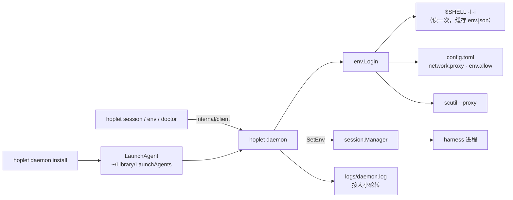

# M1 · PR5c CLI 与安装 · 详细计划

> **执行方式：** 按任务顺序逐步执行；每一步用 `- [ ]` 勾选。每个任务结束时 `go test -race ./...` 和 `golangci-lint run ./...` 都应通过。修改已有文件的步骤给出补丁：把代码块存成文件后在仓库根目录执行 `git apply <文件>`；新文件给出完整内容。

**目标：** 让 Hoplet 能在终端里真正用起来：`hoplet session …` 驱动会话，`hoplet daemon install` 把守护进程装成 LaunchAgent，守护进程用登录 shell 的环境（去掉凭证）和正确的代理启动 harness，`hoplet doctor` 一眼看出哪里不对。

**架构：**



- `internal/config`：读 `~/.hoplet/config.toml`（`[network] proxy / no_proxy`、`[env] allow`）；文件不存在即默认值；未知键报错。
- `internal/env`：以交互式登录 shell（`$SHELL -l -i -c`，最小环境、独立会话、15 秒超时）读出环境，用标记包住 `env -0` 的输出，忽略启动文件打印的杂讯；去掉 `PWD OLDPWD SHLVL _`、`HOPLET_*` 和名字像凭证的变量（`[env] allow` 放行的除外）；结果缓存在 `env.json`（0600，从不含凭证；放行的凭证每次重新读 shell）。代理每次计算：`config.toml` 的 `proxy`（`direct` 表示不用）→ 登录 shell 导出的代理 → macOS 系统代理；生效时写入 `HTTPS_PROXY HTTP_PROXY ALL_PROXY`（含小写）与 `NO_PROXY`。
- `internal/logfile`：按大小轮转的日志文件（默认 10 MiB、保留 3 份）。
- `internal/launchd`：生成 plist（`daemon --home H --log H/logs/daemon.log`，`RunAtLoad`，非正常退出才重启），`launchctl bootout/bootstrap/print`；命令执行可注入，便于测试。
- 守护进程：`Config.Env` 变为 `env.Source`；登录 shell 读不出来也照常启动（harness 用最小环境，doctor 报错，`env.refresh` 重试）；新方法 `sessions.get`、`env.refresh`、`system.doctor`；`session.Manager.SetEnv` 只影响之后启动的 harness。
- CLI：`session new/list/send/watch/wait/approve/archive`（会话 ID 可用 ≥4 位的唯一前缀；全部支持 `--json`）、`daemon install/uninstall/status`、`env refresh`、`doctor`。

**技术栈：** Go 1.27；新增依赖 `github.com/BurntSushi/toml v1.6.0`（已同意）。

**依据：** [M1 总计划](m1-overview.md)、[0002 进程模型](../design/0002-process-model.md)（LaunchAgent 托管）、[0003 Agent 驱动](../design/0003-agent-driving.md)（harness 环境规则）、[0006 连接与安全](../design/0006-connectivity-security.md)（代理）、[0012 编排与自动化接口](../design/0012-orchestration-api.md)（CLI、等待原语）、[0013 测试与发布](../design/0013-testing-release.md)（日志轮转、doctor）、[0004 会话数据模型](../design/0004-session-data-model.md)（目录布局）。

**本计划的裁决：**
- harness 环境 = 登录 shell 全量环境去掉凭证与内部变量（维护者 2026-10-31 选定）；配置格式 TOML（维护者同意新增依赖）；托管只做 macOS，Linux `systemd --user` 随 M2 的 VPS 守护进程一起做。
- 代理优先级在设计“默认读系统代理”之间加了一层“登录 shell 导出的代理”：在 shell 里配代理的人，harness 也走同一个；0006 一并更新。
- `session wait` 的条件：`idle` = 没有进行中的轮次、最新消息的轮次已结束、队列为空；`blocked` = 有待审批或提问，或队首发送失败；`done` = 以上任一，或出错、已归档。最新消息按“消息记在它开启的轮次下”判断，所以 `send` 之后立刻 `wait` 不会误判为空闲。
- CLI 不自动重连：`watch` 断线即退出 1；`wait` 超时退出 3；用法错误退出 2。
- CLI 以 `cli@<主机名>` 作为设备 ID，审批记录里可见。
- 安装用当前二进制的绝对路径（不解析符号链接，升级后链接仍有效），拒绝临时目录和 `go run` 产生的二进制；`daemon install` 等待守护进程开始服务后才返回（执行中改为不解析符号链接，见文末差异）。
- `doctor` 的网络检查默认访问 `https://api.anthropic.com`（任何 HTTP 响应都算通），可由 `daemon.Config.ProbeURL` 覆盖；`hoplet` 本身不注册 harness，PR6 / PR7 接入后 doctor 才会列出。

## 全局约束

- 新增依赖只有 `github.com/BurntSushi/toml v1.6.0`；代码、注释、commit 用英文；设计文档中文；导出标识符有文档注释；库代码不 panic；不用 lint 抑制注释（`.golangci.yml` 中按路径和规则号的排除需写明理由，且排除的文件只放那一处代码）。
- 凭证不进 harness 环境、不写入缓存或日志（放行的除外，且放行的也不缓存）；代理 URL 对外展示时隐去密码。
- 测试不读维护者真实的 shell 启动文件、不改真实的 LaunchAgent、不访问外网：shell 用假脚本或临时 `HOME`，launchctl 用注入的执行器，网络检查指向本地 httptest。
- 测试不泄漏进程；除“轮询直到条件成立”外不用 sleep 同步。
- CI 在 Linux 上运行：macOS 专属部分（scutil、plutil、launchctl）在 Linux 上跳过或返回明确错误，代码在两个平台都能编译。
- 分支 `feat/cli`；commit 带 DCO 签名（`git commit -s`）；完成前 `make check` 通过。

## 文件

| 文件 | 职责 |
|---|---|
| `go.mod`、`go.sum` | `github.com/BurntSushi/toml v1.6.0` |
| `internal/config/config.go`、`config_test.go` | `config.toml` |
| `internal/env/login.go`、`filter.go`、`proxy.go`、`source.go`、`env_test.go` | 登录 shell 环境、凭证过滤、代理、缓存与 `Source` |
| `internal/logfile/logfile.go`、`logfile_test.go` | 轮转日志 |
| `internal/launchd/launchd.go`、`launchd_test.go` | LaunchAgent |
| `proto/api.go` | `sessions.get` / `env.refresh` / `system.doctor` 及其类型 |
| `internal/session/manager.go`、`env_test.go` | `SetEnv`、`Env` |
| `internal/daemon/daemon.go`、`server.go`、`methods.go`、`system.go`、`probe.go`、`system_test.go`、`helpers_test.go`、`kill_test.go` | 环境来源、新方法、doctor |
| `internal/client/methods.go` | `Session`、`RefreshEnv`、`Doctor` |
| `cmd/hoplet/main.go`、`cli.go`、`daemon.go`、`launchctl.go`、`session.go`、`render.go`、`envdoctor.go` | 命令行 |
| `cmd/hoplet/shim_test.go`、`cli_test.go`、`e2e_test.go` | 命令行测试、终端端到端 |
| `.golangci.yml` | `launchctl.go` 的 G204、`probe.go` 的 G704 排除 |
| `docs/design/0003`、`0004`、`0006`，`docs/plans/m1-overview.md` | 设计与总计划同步 |

## 接口（后续 PR 依赖）

- `config.Load(home) (config.Config, error)`；`config.Config{Network{Proxy, NoProxy}, Env{Allow}}`；`config.ProxyDirect`
- `env.Source` 接口 `Environment(ctx, refresh bool) (env.Snapshot, error)`；`env.Login{Home, UserHome, Shell, SystemProxy}`；`env.Static`；`env.UserShell(ctx)`（执行中取代计划里的 `DefaultShell`）；`env.IsCredential(name)`；`env.ProxyURL`、`env.RedactProxy`；`env.Snapshot{…, Note, Stale}`；`proto.EnvInfo{…, Note, Warning}`
- `daemon.Config{…, Env env.Source, ProbeURL string}`；`daemon.DefaultProbeURL`
- `(*session.Manager).SetEnv([]string)`、`Env() []string`
- 协议：`sessions.get` → `proto.SessionState{Session, Pending, Queue}`；`env.refresh` → `proto.EnvInfo`；`system.doctor` → `proto.DoctorReport{Checks []proto.Check{Name, Status ok|warn|fail, Detail}}`；客户端 `Session`、`RefreshEnv`、`Doctor`
- `launchd.Manager{UserHome, UID, Run}.Install / Uninstall / Status`；`launchd.Label`、`launchd.Plist`、`launchd.LogFile`
- `logfile.Open(path, maxSize, keep) (*logfile.File, error)`

---

### 任务 0：建分支

- [ ] **步骤 1：**

```bash
git switch -c feat/cli
go get github.com/BurntSushi/toml@v1.6.0
```

### 任务 1：配置文件

**文件：** 创建 `internal/config/config.go`、`internal/config/config_test.go`

**接口：** 产生 `config.Load`、`Config`、`Network`、`Env`、`ProxyDirect`、`Path`、`FileName`。

- [ ] **步骤 1：写测试**


`internal/config/config_test.go`

```go
package config

import (
	"os"
	"path/filepath"
	"reflect"
	"strings"
	"testing"
)

func write(t *testing.T, body string) string {
	t.Helper()
	h := t.TempDir()
	if err := os.WriteFile(filepath.Join(h, FileName), []byte(body), 0o600); err != nil {
		t.Fatal(err)
	}
	return h
}

func TestLoadMissingFileIsDefaults(t *testing.T) {
	c, err := Load(t.TempDir())
	if err != nil || !reflect.DeepEqual(c, Config{}) {
		t.Fatalf("load %+v %v", c, err)
	}
}

func TestLoad(t *testing.T) {
	h := write(t, `
# comments are fine
[network]
proxy = "socks5h://127.0.0.1:7890"
no_proxy = [".corp", "10.0.0.0/8"]

[env]
allow = ["GH_TOKEN"]
`)
	c, err := Load(h)
	if err != nil {
		t.Fatal(err)
	}
	want := Config{
		Network: Network{Proxy: "socks5h://127.0.0.1:7890", NoProxy: []string{".corp", "10.0.0.0/8"}},
		Env:     Env{Allow: []string{"GH_TOKEN"}},
	}
	if !reflect.DeepEqual(c, want) {
		t.Fatalf("got %+v, want %+v", c, want)
	}
}

func TestLoadRejects(t *testing.T) {
	for name, tc := range map[string]struct{ body, inErr string }{
		"unknown key":   {"[network]\nproxi = \"x\"\n", "unknown keys network.proxi"},
		"bad syntax":    {"[network\n", "config.toml"},
		"bad scheme":    {"[network]\nproxy = \"ftp://x\"\n", "network.proxy"},
		"wrong type":    {"[env]\nallow = \"GH_TOKEN\"\n", "config.toml"},
		"unknown table": {"[nope]\nx = 1\n", "unknown keys nope"},
	} {
		_, err := Load(write(t, tc.body))
		if err == nil || !strings.Contains(err.Error(), tc.inErr) {
			t.Errorf("%s: %v, want an error containing %q", name, err, tc.inErr)
		}
	}
	if _, err := Load(write(t, "[network]\nproxy = \"direct\"\n")); err != nil {
		t.Errorf("direct: %v", err)
	}
}
```


- [ ] **步骤 2：运行，确认失败**

运行：`go test ./internal/config/`
预期：编译失败，`undefined: Load`

- [ ] **步骤 3：实现**


`internal/config/config.go`

```go
// Package config reads Hoplet's configuration file, config.toml in the home
// directory. A missing file means the defaults.
package config

import (
	"errors"
	"fmt"
	"io/fs"
	"os"
	"path/filepath"
	"strings"

	"github.com/BurntSushi/toml"
)

// FileName is the configuration file inside the home directory.
const FileName = "config.toml"

// Config is the whole configuration.
type Config struct {
	Network Network `toml:"network"`
	Env     Env     `toml:"env"`
}

// Network configures outbound connections of the daemon and its harnesses.
type Network struct {
	// Proxy is the proxy URL (http://, https://, socks5://, socks5h://).
	// Empty means: the proxy the login shell exports, else the macOS system
	// proxy. "direct" means no proxy at all.
	Proxy string `toml:"proxy"`
	// NoProxy lists hosts reached without the proxy, added to the defaults
	// (localhost and loopback addresses).
	NoProxy []string `toml:"no_proxy"`
}

// Env configures the environment of harness processes.
type Env struct {
	// Allow names variables passed to harnesses although their names look
	// like credentials.
	Allow []string `toml:"allow"`
}

// ProxyDirect is the Network.Proxy value that disables proxying.
const ProxyDirect = "direct"

// Path is the configuration file of a home directory.
func Path(home string) string { return filepath.Join(home, FileName) }

// Load reads home's configuration file. A missing file yields the zero
// Config; unknown keys are errors, so a typo never silently does nothing.
func Load(home string) (Config, error) {
	var c Config
	b, err := fs.ReadFile(os.DirFS(home), FileName)
	if errors.Is(err, fs.ErrNotExist) {
		return c, nil
	}
	if err != nil {
		return Config{}, fmt.Errorf("config: %w", err)
	}
	md, err := toml.Decode(string(b), &c)
	if err != nil {
		return Config{}, fmt.Errorf("config: %s: %w", Path(home), err)
	}
	if undecoded := md.Undecoded(); len(undecoded) > 0 {
		keys := make([]string, len(undecoded))
		for i, k := range undecoded {
			keys[i] = k.String()
		}
		return Config{}, fmt.Errorf("config: %s: unknown keys %s", Path(home), strings.Join(keys, ", "))
	}
	if err := c.validate(); err != nil {
		return Config{}, fmt.Errorf("config: %s: %w", Path(home), err)
	}
	return c, nil
}

func (c Config) validate() error {
	p := c.Network.Proxy
	if p == "" || p == ProxyDirect {
		return nil
	}
	for _, scheme := range []string{"http://", "https://", "socks5://", "socks5h://"} {
		if strings.HasPrefix(p, scheme) {
			return nil
		}
	}
	return fmt.Errorf("network.proxy %q: want an http, https, socks5 or socks5h URL, or %q", p, ProxyDirect)
}
```


- [ ] **步骤 4：运行，确认通过**

运行：`go mod tidy && go test -race ./internal/config/`
预期：`ok`；`go.mod` 的直接依赖里有 `github.com/BurntSushi/toml v1.6.0`

- [ ] **步骤 5：commit**

```bash
git add go.mod go.sum internal/config
git commit -s -m "feat(config): read config.toml"
```

### 任务 2：harness 环境

**文件：** 创建 `internal/env/login.go`、`filter.go`、`proxy.go`、`source.go`、`env_test.go`

**接口：** 消费任务 1 的 `config.Load`；产生 `env.Source`、`Snapshot`、`Login`、`Static`、`DefaultShell`、`IsCredential`、`ReadSystemProxy`、`SystemProxy`、`ProxySource` 及其常量、`CacheFile`。

| 要点 | 做法 |
|---|---|
| 读 shell | `shell -l -i -c "printf '%s\n' BEGIN; /usr/bin/env -0; printf '%s' END"`；只给 `HOME SHELL PATH TERM USER LOGNAME`；`Setsid`；超时杀整组；标记都在就算成功（启动文件末尾报错也接受） |
| 过滤 | 名字（大写后）含 `TOKEN SECRET PASSWORD PASSWD PASSPHRASE API_KEY APIKEY ACCESS_KEY PRIVATE_KEY CREDENTIAL` 即视为凭证 |
| 缓存 | `env.json` 只存过滤后的变量；shell 变了或 `refresh` 时重读；读不懂的缓存当作没有 |
| 代理 | 每次调用重新计算，配置改动在下次守护进程启动或 `env refresh` 时生效 |

- [ ] **步骤 1：写测试**

测试用一个假 shell 脚本（打印杂讯、导出变量后执行 `-c` 的命令）和一个指向临时 `HOME` 的真实 zsh（没有 zsh 就跳过），不碰维护者自己的启动文件。


`internal/env/env_test.go`

```go
package env

import (
	"context"
	"encoding/json"
	"errors"
	"os"
	"os/exec"
	"path/filepath"
	"slices"
	"strings"
	"testing"

	"github.com/yangflow/hoplet/internal/config"
)

// fakeShell writes a shell that, like a real login shell, prints noise
// from its startup files, exports variables and then runs the command it
// was given with -c. It counts its runs in dir/runs.
func fakeShell(t *testing.T, exports string) (shell, dir string) {
	t.Helper()
	dir = t.TempDir()
	shell = filepath.Join(dir, "fakesh")
	script := "#!/bin/sh\n" +
		"echo run >> " + filepath.Join(dir, "runs") + "\n" +
		"echo 'welcome from .zshrc'\n" +
		exports + "\n" +
		"export HOPLET_INTERNAL=1\n" +
		"[ \"$3\" = -c ] || exit 9\n" +
		"exec /bin/sh -c \"$4\"\n"
	if err := os.WriteFile(shell, []byte(script), 0o700); err != nil {
		t.Fatal(err)
	}
	return shell, dir
}

func runs(t *testing.T, dir string) int {
	t.Helper()
	b, err := os.ReadFile(filepath.Join(dir, "runs"))
	if errors.Is(err, os.ErrNotExist) {
		return 0
	}
	if err != nil {
		t.Fatal(err)
	}
	return strings.Count(string(b), "run\n")
}

func noProxy(context.Context) (SystemProxy, error) { return SystemProxy{}, nil }

func lookup(vars []string, k string) (string, bool) {
	for _, kv := range vars {
		if n, v, _ := strings.Cut(kv, "="); n == k {
			return v, true
		}
	}
	return "", false
}

func TestLoginReadsTheShellOnceAndWithholdsCredentials(t *testing.T) {
	shell, dir := fakeShell(t, `export GOPATH=/go
export MULTI='line one
line two'
export ANTHROPIC_API_KEY=sk-secret
export GITHUB_TOKEN=ghp_secret
export SSH_AUTH_SOCK=/tmp/agent`)
	h := t.TempDir()
	l := &Login{Home: h, UserHome: dir, Shell: shell, SystemProxy: noProxy}
	snap, err := l.Environment(context.Background(), false)
	if err != nil {
		t.Fatal(err)
	}
	for k, want := range map[string]string{"GOPATH": "/go", "MULTI": "line one\nline two", "SSH_AUTH_SOCK": "/tmp/agent", "HOME": dir, "SHELL": shell} {
		if v, ok := lookup(snap.Vars, k); !ok || v != want {
			t.Errorf("%s = %q (%v), want %q", k, v, ok, want)
		}
	}
	for _, k := range []string{"ANTHROPIC_API_KEY", "GITHUB_TOKEN", "HOPLET_INTERNAL", "PWD", "SHLVL", "_"} {
		if _, ok := lookup(snap.Vars, k); ok {
			t.Errorf("%s was passed on", k)
		}
	}
	if !slices.Equal(snap.Dropped, []string{"ANTHROPIC_API_KEY", "GITHUB_TOKEN"}) {
		t.Errorf("dropped %v", snap.Dropped)
	}
	if !slices.IsSorted(snap.Vars) || snap.ProxySource != ProxyNone || snap.Shell != shell || snap.ResolvedAt.IsZero() {
		t.Errorf("snapshot %+v", snap)
	}
	cache, err := os.ReadFile(filepath.Join(h, CacheFile))
	if err != nil {
		t.Fatal(err)
	}
	if strings.Contains(string(cache), "secret") {
		t.Fatalf("a credential reached the cache: %s", cache)
	}
	if fi, _ := os.Stat(filepath.Join(h, CacheFile)); fi.Mode().Perm() != 0o600 {
		t.Errorf("cache mode %v", fi.Mode().Perm())
	}

	again, err := l.Environment(context.Background(), false)
	if err != nil || !slices.Equal(again.Vars, snap.Vars) {
		t.Fatalf("cached read %v", err)
	}
	if n := runs(t, dir); n != 1 {
		t.Fatalf("the shell ran %d times, want once", n)
	}
	if _, err := l.Environment(context.Background(), true); err != nil {
		t.Fatal(err)
	}
	if n := runs(t, dir); n != 2 {
		t.Fatalf("refresh did not read the shell again: %d runs", n)
	}
}

func TestAllowedCredentialsPassButAreNotCached(t *testing.T) {
	shell, dir := fakeShell(t, "export GH_TOKEN=ghp_allowed\nexport NPM_TOKEN=npm_secret")
	h := t.TempDir()
	if err := os.WriteFile(config.Path(h), []byte("[env]\nallow = [\"GH_TOKEN\"]\n"), 0o600); err != nil {
		t.Fatal(err)
	}
	l := &Login{Home: h, UserHome: dir, Shell: shell, SystemProxy: noProxy}
	snap, err := l.Environment(context.Background(), false)
	if err != nil {
		t.Fatal(err)
	}
	if v, _ := lookup(snap.Vars, "GH_TOKEN"); v != "ghp_allowed" {
		t.Errorf("GH_TOKEN = %q", v)
	}
	if _, ok := lookup(snap.Vars, "NPM_TOKEN"); ok || !slices.Equal(snap.Dropped, []string{"NPM_TOKEN"}) {
		t.Errorf("NPM_TOKEN passed or not reported: %v", snap.Dropped)
	}
	if n := runs(t, dir); n != 1 {
		t.Errorf("the shell ran %d times on a first read, want once", n)
	}
	var c cached
	b, _ := os.ReadFile(filepath.Join(h, CacheFile))
	if err := json.Unmarshal(b, &c); err != nil || c.Vars["GH_TOKEN"] != "" {
		t.Fatalf("cache %s %v", b, err)
	}
}

func TestProxyPrecedence(t *testing.T) {
	system := func(context.Context) (SystemProxy, error) {
		return SystemProxy{URL: "http://127.0.0.1:7890", NoProxy: []string{".local"}}, nil
	}
	for name, tc := range map[string]struct {
		exports, config string
		source          ProxySource
		https, noProxy  string
	}{
		"system":        {"", "", ProxyFromSystem, "http://127.0.0.1:7890", "localhost,127.0.0.1,::1,.local"},
		"shell wins":    {"export https_proxy=http://10.0.0.1:3128\nexport NO_PROXY=corp", "", ProxyFromShell, "", "corp"},
		"config wins":   {"export HTTPS_PROXY=http://10.0.0.1:3128", "[network]\nproxy = \"socks5h://u:pw@127.0.0.1:1080\"\nno_proxy = [\".corp\"]\n", ProxyFromConfig, "socks5h://u:pw@127.0.0.1:1080", "localhost,127.0.0.1,::1,.corp"},
		"config direct": {"export HTTPS_PROXY=http://10.0.0.1:3128", "[network]\nproxy = \"direct\"\n", ProxyFromConfig, "", ""},
	} {
		shell, dir := fakeShell(t, tc.exports)
		h := t.TempDir()
		if tc.config != "" {
			if err := os.WriteFile(config.Path(h), []byte(tc.config), 0o600); err != nil {
				t.Fatal(err)
			}
		}
		l := &Login{Home: h, UserHome: dir, Shell: shell, SystemProxy: system}
		snap, err := l.Environment(context.Background(), false)
		if err != nil {
			t.Fatal(err)
		}
		if snap.ProxySource != tc.source {
			t.Errorf("%s: source %s, want %s", name, snap.ProxySource, tc.source)
		}
		if tc.https != "" {
			for _, k := range proxyVars {
				if v, _ := lookup(snap.Vars, k); v != tc.https {
					t.Errorf("%s: %s = %q, want %q", name, k, v, tc.https)
				}
			}
		}
		if v, _ := lookup(snap.Vars, "NO_PROXY"); v != tc.noProxy {
			t.Errorf("%s: NO_PROXY = %q, want %q", name, v, tc.noProxy)
		}
		if name == "config direct" {
			if _, ok := lookup(snap.Vars, "HTTPS_PROXY"); ok || snap.Proxy != "" {
				t.Errorf("direct kept a proxy: %+v", snap)
			}
		}
		if name == "config wins" && strings.Contains(snap.Proxy, "pw") {
			t.Errorf("proxy password not redacted: %q", snap.Proxy)
		}
	}
}

func TestLoginFailures(t *testing.T) {
	dir := t.TempDir()
	silent := filepath.Join(dir, "silent")
	if err := os.WriteFile(silent, []byte("#!/bin/sh\necho oops >&2\nexit 3\n"), 0o700); err != nil {
		t.Fatal(err)
	}
	if _, err := login(context.Background(), silent, dir); err == nil || !strings.Contains(err.Error(), "oops") {
		t.Fatalf("failing shell: %v", err)
	}
	if _, err := login(context.Background(), filepath.Join(dir, "missing"), dir); err == nil {
		t.Fatal("missing shell")
	}
	// A startup file that errors after the environment was printed is fine.
	late := filepath.Join(dir, "late")
	if err := os.WriteFile(late, []byte("#!/bin/sh\nexport X=1\n/bin/sh -c \"$4\"\nexit 1\n"), 0o700); err != nil {
		t.Fatal(err)
	}
	vars, err := login(context.Background(), late, dir)
	if err != nil || vars["X"] != "1" {
		t.Fatalf("late failure: %v %v", vars, err)
	}
}

// TestRealZsh reads a real zsh with throwaway startup files.
func TestRealZsh(t *testing.T) {
	zsh, err := exec.LookPath("zsh")
	if err != nil {
		t.Skip("no zsh")
	}
	dir := t.TempDir()
	for name, body := range map[string]string{
		".zprofile": "export FROM_ZPROFILE=yes\n",
		".zshrc":    "export FROM_ZSHRC=yes\necho rc noise\n",
	} {
		if err := os.WriteFile(filepath.Join(dir, name), []byte(body), 0o600); err != nil {
			t.Fatal(err)
		}
	}
	vars, err := login(context.Background(), zsh, dir)
	if err != nil {
		t.Fatal(err)
	}
	if vars["FROM_ZPROFILE"] != "yes" || vars["FROM_ZSHRC"] != "yes" {
		t.Fatalf("startup files not read: %v", vars)
	}
}

func TestParseScutil(t *testing.T) {
	out := []byte(`<dictionary> {
  ExceptionsList : <array> {
    0 : *.local
    1 : 169.254/16
    2 : 10.0.0.0/8
    3 : intranet
  }
  FTPPassive : 1
  HTTPEnable : 1
  HTTPPort : 8080
  HTTPProxy : 10.1.1.1
  HTTPSEnable : 0
  SOCKSEnable : 1
  SOCKSPort : 1080
  SOCKSProxy : 127.0.0.1
}`)
	p := parseScutil(out)
	if p.URL != "http://10.1.1.1:8080" || !slices.Equal(p.NoProxy, []string{".local", "10.0.0.0/8", "intranet"}) {
		t.Fatalf("parsed %+v", p)
	}
	if p := parseScutil([]byte("<dictionary> {\n  SOCKSEnable : 1\n  SOCKSPort : 1080\n  SOCKSProxy : 127.0.0.1\n}")); p.URL != "socks5h://127.0.0.1:1080" {
		t.Fatalf("socks only: %+v", p)
	}
	if p := parseScutil([]byte("<dictionary> {\n  FTPPassive : 1\n}")); p.URL != "" {
		t.Fatalf("none: %+v", p)
	}
}

func TestIsCredential(t *testing.T) {
	for name, want := range map[string]bool{
		"ANTHROPIC_API_KEY": true, "github_token": true, "AWS_SECRET_ACCESS_KEY": true, "PGPASSWORD": true,
		"SSH_AUTH_SOCK": false, "GOPATH": false, "KEYCHAIN": false, "TERM": false,
	} {
		if got := IsCredential(name); got != want {
			t.Errorf("%s: %v", name, got)
		}
	}
}

func TestStatic(t *testing.T) {
	s := Static{"PATH=/bin"}
	snap, err := s.Environment(context.Background(), true)
	if err != nil || !slices.Equal(snap.Vars, []string{"PATH=/bin"}) {
		t.Fatalf("%+v %v", snap, err)
	}
}
```


- [ ] **步骤 2：运行，确认失败**

运行：`go test ./internal/env/`
预期：编译失败，`undefined: Login` 等

- [ ] **步骤 3：实现**


`internal/env/login.go`

```go
// Package env builds the environment harness processes run with: the
// user's login-shell environment without credentials or Hoplet internals,
// plus the proxy variables of the configured or system proxy.
package env

import (
	"bytes"
	"context"
	"errors"
	"fmt"
	"os"
	"os/exec"
	"os/user"
	"strings"
	"syscall"
	"time"
)

const (
	beginMarker = "__HOPLET_ENV_BEGIN__"
	endMarker   = "__HOPLET_ENV_END__"
	// loginTimeout bounds how long the login shell may take to start.
	loginTimeout = 15 * time.Second
)

// DefaultShell returns the login shell to read the environment from:
// $SHELL, else /bin/zsh.
func DefaultShell() string {
	if s := os.Getenv("SHELL"); s != "" {
		return s
	}
	return "/bin/zsh"
}

// login starts shell as an interactive login shell in home and returns the
// environment its startup files build. The shell starts from a minimal
// environment, so nothing of the caller's leaks in; output the startup
// files print around the environment is ignored.
func login(ctx context.Context, shell, home string) (map[string]string, error) {
	ctx, cancel := context.WithTimeout(ctx, loginTimeout)
	defer cancel()
	script := "printf '%s\\n' " + beginMarker + "; /usr/bin/env -0; printf '%s' " + endMarker
	cmd := exec.CommandContext(ctx, shell, "-l", "-i", "-c", script)
	base := []string{"HOME=" + home, "SHELL=" + shell, "PATH=/usr/bin:/bin:/usr/sbin:/sbin", "TERM=dumb"}
	if u, err := user.Current(); err == nil {
		base = append(base, "USER="+u.Username, "LOGNAME="+u.Username)
	}
	cmd.Env = base
	cmd.Dir = home
	// Its own session: no controlling terminal to read from, and the whole
	// group can be killed if a startup file hangs.
	cmd.SysProcAttr = &syscall.SysProcAttr{Setsid: true}
	cmd.Cancel = func() error { return syscall.Kill(-cmd.Process.Pid, syscall.SIGKILL) }
	cmd.WaitDelay = time.Second
	out, err := cmd.Output()
	vars, perr := parseLogin(out)
	if perr == nil {
		// Startup files that end with an error still built the environment.
		return vars, nil
	}
	if ctx.Err() != nil {
		return nil, fmt.Errorf("env: %s did not finish starting within %v", shell, loginTimeout)
	}
	if err != nil {
		var ee *exec.ExitError
		if errors.As(err, &ee) && len(ee.Stderr) > 0 {
			return nil, fmt.Errorf("env: run %s: %w: %s", shell, err, lastLine(ee.Stderr))
		}
		return nil, fmt.Errorf("env: run %s: %w", shell, err)
	}
	return nil, perr
}

// parseLogin extracts the NUL-separated environment between the markers.
func parseLogin(out []byte) (map[string]string, error) {
	i := bytes.Index(out, []byte(beginMarker+"\n"))
	j := bytes.LastIndex(out, []byte(endMarker))
	if i < 0 || j < i {
		return nil, errors.New("env: the login shell printed no environment")
	}
	vars := map[string]string{}
	for _, kv := range bytes.Split(out[i+len(beginMarker)+1:j], []byte{0}) {
		k, v, ok := strings.Cut(string(kv), "=")
		if ok && k != "" {
			vars[k] = v
		}
	}
	return vars, nil
}

func lastLine(b []byte) string {
	lines := strings.Split(strings.TrimSpace(string(b)), "\n")
	return lines[len(lines)-1]
}
```


`internal/env/filter.go`

```go
package env

import (
	"slices"
	"strings"
)

// credentialParts are name fragments of variables that hold secrets; such
// variables are withheld from harnesses unless allowed. Harnesses keep their
// own credentials in their own stores.
var credentialParts = []string{
	"TOKEN", "SECRET", "PASSWORD", "PASSWD", "PASSPHRASE",
	"API_KEY", "APIKEY", "ACCESS_KEY", "PRIVATE_KEY", "CREDENTIAL",
}

// shellOnly are variables that describe the shell process itself, not the
// user's environment.
var shellOnly = []string{"PWD", "OLDPWD", "SHLVL", "_"}

// IsCredential reports whether a variable name looks like it holds a
// secret.
func IsCredential(name string) bool {
	up := strings.ToUpper(name)
	for _, p := range credentialParts {
		if strings.Contains(up, p) {
			return true
		}
	}
	return false
}

// filter drops shell-process variables, Hoplet's own variables and
// credentials not in allow, returning what is kept and the names of the
// credentials dropped, sorted.
func filter(vars map[string]string, allow []string) (kept map[string]string, dropped []string) {
	kept = map[string]string{}
	for k, v := range vars {
		switch {
		case slices.Contains(shellOnly, k), strings.HasPrefix(k, "HOPLET_"):
		case IsCredential(k) && !slices.Contains(allow, k):
			dropped = append(dropped, k)
		default:
			kept[k] = v
		}
	}
	slices.Sort(dropped)
	return kept, dropped
}
```


`internal/env/proxy.go`

```go
package env

import (
	"bufio"
	"bytes"
	"context"
	"net"
	"net/url"
	"os/exec"
	"runtime"
	"slices"
	"strings"
)

// ProxySource says where the effective proxy came from.
type ProxySource string

// Proxy sources.
const (
	ProxyFromConfig ProxySource = "config"
	ProxyFromShell  ProxySource = "shell"
	ProxyFromSystem ProxySource = "system"
	ProxyNone       ProxySource = "none"
)

// SystemProxy is the operating system's proxy setting.
type SystemProxy struct {
	URL     string   // "" when none is enabled
	NoProxy []string // hosts the system reaches directly
}

// proxyVars are the variables that carry a proxy, upper and lower case.
var proxyVars = []string{"HTTPS_PROXY", "HTTP_PROXY", "ALL_PROXY", "https_proxy", "http_proxy", "all_proxy"}

var noProxyVars = []string{"NO_PROXY", "no_proxy"}

// defaultNoProxy are always reached without a proxy.
var defaultNoProxy = []string{"localhost", "127.0.0.1", "::1"}

// shellProxy returns the proxy the login shell exports, if any.
func shellProxy(vars map[string]string) string {
	for _, k := range proxyVars {
		if v := vars[k]; v != "" {
			return v
		}
	}
	return ""
}

// setProxy replaces the proxy variables in vars with u (none when u is
// empty) and the no-proxy list.
func setProxy(vars map[string]string, u string, noProxy []string) {
	for _, k := range append(slices.Clone(proxyVars), noProxyVars...) {
		delete(vars, k)
	}
	if u == "" {
		return
	}
	for _, k := range proxyVars {
		vars[k] = u
	}
	list := strings.Join(noProxy, ",")
	for _, k := range noProxyVars {
		vars[k] = list
	}
}

// ReadSystemProxy reads the macOS system proxy with scutil; elsewhere there
// is none.
func ReadSystemProxy(ctx context.Context) (SystemProxy, error) {
	if runtime.GOOS != "darwin" {
		return SystemProxy{}, nil
	}
	out, err := exec.CommandContext(ctx, "/usr/sbin/scutil", "--proxy").Output()
	if err != nil {
		return SystemProxy{}, err
	}
	return parseScutil(out), nil
}

// parseScutil reads `scutil --proxy` output: HTTPS, then HTTP, then SOCKS
// is used, whichever is enabled first.
func parseScutil(out []byte) SystemProxy {
	kv := map[string]string{}
	var exceptions []string
	inList := false
	sc := bufio.NewScanner(bytes.NewReader(out))
	for sc.Scan() {
		line := strings.TrimSpace(sc.Text())
		switch {
		case strings.HasPrefix(line, "ExceptionsList"):
			inList = true
		case inList && line == "}":
			inList = false
		case inList:
			if _, v, ok := strings.Cut(line, " : "); ok {
				exceptions = append(exceptions, strings.TrimSpace(v))
			}
		default:
			if k, v, ok := strings.Cut(line, " : "); ok {
				kv[k] = strings.TrimSpace(v)
			}
		}
	}
	var p SystemProxy
	for _, c := range []struct{ prefix, scheme string }{{"HTTPS", "http"}, {"HTTP", "http"}, {"SOCKS", "socks5h"}} {
		host, port := kv[c.prefix+"Proxy"], kv[c.prefix+"Port"]
		if kv[c.prefix+"Enable"] == "1" && host != "" && port != "" {
			p.URL = (&url.URL{Scheme: c.scheme, Host: net.JoinHostPort(host, port)}).String()
			break
		}
	}
	for _, e := range exceptions {
		if h, ok := noProxyEntry(e); ok {
			p.NoProxy = append(p.NoProxy, h)
		}
	}
	return p
}

// noProxyEntry converts a system exception to a NO_PROXY entry; entries
// other tools would misread (a shortened CIDR such as 169.254/16) are
// skipped.
func noProxyEntry(e string) (string, bool) {
	if strings.HasPrefix(e, "*.") {
		e = e[1:]
	}
	if strings.Contains(e, "/") {
		_, _, err := net.ParseCIDR(e)
		return e, err == nil
	}
	if e == "" || strings.ContainsAny(e, " *") {
		return "", false
	}
	return e, true
}

// redact hides a proxy URL's password.
func redact(u string) string {
	p, err := url.Parse(u)
	if err != nil || p.User == nil {
		return u
	}
	return p.Redacted()
}
```


`internal/env/source.go`

```go
package env

import (
	"context"
	"encoding/json"
	"errors"
	"fmt"
	"io/fs"
	"os"
	"path/filepath"
	"slices"
	"sort"
	"sync"
	"time"

	"github.com/yangflow/hoplet/internal/config"
)

// Snapshot is a resolved harness environment.
type Snapshot struct {
	Shell string `json:"shell"`
	// Vars is the environment, KEY=VALUE, sorted.
	Vars []string `json:"vars"`
	// Dropped are the names of credential variables withheld.
	Dropped []string `json:"dropped,omitempty"`
	// Proxy is the effective proxy URL with any password redacted; empty
	// for none.
	Proxy       string      `json:"proxy,omitempty"`
	ProxySource ProxySource `json:"proxy_source"`
	ResolvedAt  time.Time   `json:"resolved_at"`
}

// Source provides the harness environment; refresh asks for the login
// shell to be read again.
type Source interface {
	Environment(ctx context.Context, refresh bool) (Snapshot, error)
}

// Static is a Source with a fixed environment (tests, and harnesses run
// without a login shell).
type Static []string

// Environment returns the fixed environment.
func (s Static) Environment(context.Context, bool) (Snapshot, error) {
	return Snapshot{Vars: slices.Clone(s), ProxySource: ProxyNone}, nil
}

// CacheFile is the file in the home directory that keeps the login-shell
// environment between daemon starts. It never holds withheld credentials.
const CacheFile = "env.json"

// Login is the Source of a real daemon: the login shell's environment,
// read once and kept in the home's cache file, with the proxy of the
// configuration, the login shell or the system applied on every call, so
// a configuration change takes effect at the next daemon start.
type Login struct {
	Home string // Hoplet's home directory (cache and configuration)
	// UserHome is the user's home directory the shell starts in.
	UserHome string
	Shell    string
	// SystemProxy reads the system proxy; nil means ReadSystemProxy.
	SystemProxy func(context.Context) (SystemProxy, error)

	mu sync.Mutex
}

// cached is the cache file's content: the filtered login environment.
type cached struct {
	Shell      string            `json:"shell"`
	Vars       map[string]string `json:"vars"`
	Dropped    []string          `json:"dropped,omitempty"`
	ResolvedAt time.Time         `json:"resolved_at"`
}

// Environment returns the harness environment, reading the login shell
// when refresh is set or nothing is cached.
func (l *Login) Environment(ctx context.Context, refresh bool) (Snapshot, error) {
	l.mu.Lock()
	defer l.mu.Unlock()
	cfg, err := config.Load(l.Home)
	if err != nil {
		return Snapshot{}, err
	}
	c, ok, err := l.load()
	var raw map[string]string // the shell's output, when read in this call
	if err != nil || !ok || refresh || c.Shell != l.Shell {
		if raw, err = login(ctx, l.Shell, l.UserHome); err != nil {
			return Snapshot{}, err
		}
		c = cached{Shell: l.Shell, ResolvedAt: time.Now().UTC().Truncate(time.Second)}
		c.Vars, c.Dropped = filter(raw, nil)
		if err := l.save(c); err != nil {
			return Snapshot{}, err
		}
	}
	// Allowed credentials are never cached: the shell is read again for
	// them whenever the configuration allows any.
	if len(cfg.Env.Allow) > 0 {
		if raw == nil {
			if raw, err = login(ctx, l.Shell, l.UserHome); err != nil {
				return Snapshot{}, err
			}
		}
		c.Vars, c.Dropped = filter(raw, cfg.Env.Allow)
	}
	read := l.SystemProxy
	if read == nil {
		read = ReadSystemProxy
	}
	return build(ctx, c, cfg, read)
}

// build applies the proxy and makes the snapshot.
func build(ctx context.Context, c cached, cfg config.Config, systemProxy func(context.Context) (SystemProxy, error)) (Snapshot, error) {
	vars := map[string]string{}
	for k, v := range c.Vars {
		vars[k] = v
	}
	noProxy := append(slices.Clone(defaultNoProxy), cfg.Network.NoProxy...)
	var src ProxySource
	var proxy string
	switch p := cfg.Network.Proxy; {
	case p == config.ProxyDirect:
		src = ProxyFromConfig
		setProxy(vars, "", nil)
	case p != "":
		src, proxy = ProxyFromConfig, p
		setProxy(vars, p, noProxy)
	case shellProxy(vars) != "":
		src, proxy = ProxyFromShell, shellProxy(vars)
	default:
		sp, err := systemProxy(ctx)
		if err != nil {
			return Snapshot{}, fmt.Errorf("env: read the system proxy: %w", err)
		}
		src, proxy = ProxyFromSystem, sp.URL
		if sp.URL == "" {
			src = ProxyNone
		}
		setProxy(vars, sp.URL, append(noProxy, sp.NoProxy...))
	}
	snap := Snapshot{Shell: c.Shell, Dropped: c.Dropped, Proxy: redact(proxy), ProxySource: src, ResolvedAt: c.ResolvedAt}
	for k, v := range vars {
		snap.Vars = append(snap.Vars, k+"="+v)
	}
	sort.Strings(snap.Vars)
	return snap, nil
}

func (l *Login) path() string { return filepath.Join(l.Home, CacheFile) }

func (l *Login) load() (cached, bool, error) {
	b, err := fs.ReadFile(os.DirFS(l.Home), CacheFile)
	if errors.Is(err, fs.ErrNotExist) {
		return cached{}, false, nil
	}
	if err != nil {
		return cached{}, false, fmt.Errorf("env: read cache: %w", err)
	}
	var c cached
	if err := json.Unmarshal(b, &c); err != nil {
		return cached{}, false, nil // unreadable: read the shell again
	}
	return c, true, nil
}

func (l *Login) save(c cached) error {
	b, err := json.MarshalIndent(c, "", "  ")
	if err != nil {
		return fmt.Errorf("env: encode cache: %w", err)
	}
	tmp, err := os.CreateTemp(l.Home, ".env-*")
	if err != nil {
		return fmt.Errorf("env: write cache: %w", err)
	}
	defer os.Remove(tmp.Name())
	_, werr := tmp.Write(b)
	if err := errors.Join(werr, tmp.Sync(), tmp.Close()); err != nil {
		return fmt.Errorf("env: write cache: %w", err)
	}
	if err := os.Rename(tmp.Name(), l.path()); err != nil {
		return fmt.Errorf("env: write cache: %w", err)
	}
	return nil
}
```


- [ ] **步骤 4：运行，确认通过**

运行：`go test -race ./internal/env/`
预期：`ok`

- [ ] **步骤 5：commit**

```bash
git add internal/env
git commit -s -m "feat(env): build harness environments from the login shell"
```

### 任务 3：轮转日志

**文件：** 创建 `internal/logfile/logfile.go`、`internal/logfile/logfile_test.go`

**接口：** 产生 `logfile.Open`、`File`（`io.WriteCloser`）、`DefaultMaxSize`、`DefaultKeep`。

- [ ] **步骤 1：写测试**


`internal/logfile/logfile_test.go`

```go
package logfile

import (
	"errors"
	"os"
	"path/filepath"
	"strconv"
	"strings"
	"sync"
	"testing"
)

func read(t *testing.T, path string) string {
	t.Helper()
	b, err := os.ReadFile(path)
	if errors.Is(err, os.ErrNotExist) {
		return ""
	}
	if err != nil {
		t.Fatal(err)
	}
	return string(b)
}

func TestRotatesAndKeepsN(t *testing.T) {
	p := filepath.Join(t.TempDir(), "logs", "d.log")
	l, err := Open(p, 10, 2)
	if err != nil {
		t.Fatal(err)
	}
	for _, s := range []string{"aaaa\n", "bbbb\n", "cccc\n", "dddd\n", "eeee\n"} {
		if _, err := l.Write([]byte(s)); err != nil {
			t.Fatal(err)
		}
	}
	if err := l.Close(); err != nil {
		t.Fatal(err)
	}
	if got := read(t, p); got != "eeee\n" {
		t.Errorf("current %q", got)
	}
	if got := read(t, p+".1"); got != "cccc\ndddd\n" {
		t.Errorf(".1 %q", got)
	}
	if got := read(t, p+".2"); got != "aaaa\nbbbb\n" {
		t.Errorf(".2 %q", got)
	}
	if _, err := os.Stat(p + ".3"); !errors.Is(err, os.ErrNotExist) {
		t.Errorf(".3 exists: %v", err)
	}
	fi, err := os.Stat(p)
	if err != nil || fi.Mode().Perm() != 0o600 {
		t.Fatalf("mode %v %v", fi.Mode().Perm(), err)
	}
	if _, err := l.Write([]byte("x")); !errors.Is(err, os.ErrClosed) {
		t.Fatalf("write after close: %v", err)
	}
}

func TestReopenAppendsAndCountsExistingSize(t *testing.T) {
	p := filepath.Join(t.TempDir(), "d.log")
	if err := os.WriteFile(p, []byte("12345678\n"), 0o600); err != nil {
		t.Fatal(err)
	}
	l, err := Open(p, 10, 3)
	if err != nil {
		t.Fatal(err)
	}
	defer l.Close()
	if _, err := l.Write([]byte("next\n")); err != nil {
		t.Fatal(err)
	}
	if read(t, p+".1") != "12345678\n" || read(t, p) != "next\n" {
		t.Fatalf("did not rotate a nearly full file: %q / %q", read(t, p+".1"), read(t, p))
	}
}

func TestOversizedWriteGoesWhole(t *testing.T) {
	p := filepath.Join(t.TempDir(), "d.log")
	l, err := Open(p, 4, 3)
	if err != nil {
		t.Fatal(err)
	}
	defer l.Close()
	big := strings.Repeat("z", 20)
	if _, err := l.Write([]byte(big)); err != nil {
		t.Fatal(err)
	}
	if read(t, p) != big {
		t.Fatal("an oversized write was split or dropped")
	}
}

func TestConcurrentWritesStayWhole(t *testing.T) {
	p := filepath.Join(t.TempDir(), "d.log")
	l, err := Open(p, 200, 50)
	if err != nil {
		t.Fatal(err)
	}
	var wg sync.WaitGroup
	for range 8 {
		wg.Add(1)
		go func() {
			defer wg.Done()
			for range 50 {
				if _, err := l.Write([]byte("0123456789\n")); err != nil {
					t.Error(err)
					return
				}
			}
		}()
	}
	wg.Wait()
	if err := l.Close(); err != nil {
		t.Fatal(err)
	}
	// Every line, across the current file and all kept copies, is whole,
	// and none is lost (50 copies are more than 400 lines need).
	lines := 0
	for i := 0; i <= 50; i++ {
		f := p
		if i > 0 {
			f = p + "." + strconv.Itoa(i)
		}
		body := read(t, f)
		if body == "" {
			continue
		}
		for _, line := range strings.Split(strings.TrimSuffix(body, "\n"), "\n") {
			if line != "0123456789" {
				t.Fatalf("torn line %q in %s", line, f)
			}
			lines++
		}
	}
	if lines != 400 {
		t.Fatalf("%d lines, want 400", lines)
	}
}
```


- [ ] **步骤 2：运行，确认失败**

运行：`go test ./internal/logfile/`
预期：编译失败，`undefined: Open`

- [ ] **步骤 3：实现**


`internal/logfile/logfile.go`

```go
// Package logfile is a size-rotated log file: when the file would grow past
// its limit it is renamed to <name>.1 (older copies shift up to <name>.N)
// and a new file is started.
package logfile

import (
	"errors"
	"fmt"
	"os"
	"path/filepath"
	"strconv"
	"sync"
)

// Defaults.
const (
	DefaultMaxSize = 10 << 20
	DefaultKeep    = 3
)

// File is a rotating log file. It is safe for concurrent use; each Write
// lands whole in one file.
type File struct {
	path    string
	maxSize int64
	keep    int

	mu   sync.Mutex
	f    *os.File
	size int64
}

// Open opens path for appending (mode 0600, creating its directory 0700).
// maxSize and keep of 0 mean the defaults.
func Open(path string, maxSize int64, keep int) (*File, error) {
	if maxSize <= 0 {
		maxSize = DefaultMaxSize
	}
	if keep <= 0 {
		keep = DefaultKeep
	}
	if err := os.MkdirAll(filepath.Dir(path), 0o700); err != nil {
		return nil, fmt.Errorf("logfile: %w", err)
	}
	l := &File{path: filepath.Clean(path), maxSize: maxSize, keep: keep}
	if err := l.open(); err != nil {
		return nil, err
	}
	return l, nil
}

func (l *File) open() error {
	f, err := os.OpenFile(l.path, os.O_CREATE|os.O_WRONLY|os.O_APPEND, 0o600)
	if err != nil {
		return fmt.Errorf("logfile: %w", err)
	}
	fi, err := f.Stat()
	if err != nil {
		return errors.Join(fmt.Errorf("logfile: %w", err), f.Close())
	}
	l.f, l.size = f, fi.Size()
	return nil
}

// Write appends p, rotating first if p would take the file past its limit.
func (l *File) Write(p []byte) (int, error) {
	l.mu.Lock()
	defer l.mu.Unlock()
	if l.f == nil {
		return 0, os.ErrClosed
	}
	if l.size > 0 && l.size+int64(len(p)) > l.maxSize {
		if err := l.rotate(); err != nil {
			return 0, err
		}
	}
	n, err := l.f.Write(p)
	l.size += int64(n)
	return n, err
}

func (l *File) rotate() error {
	if err := l.f.Close(); err != nil {
		return fmt.Errorf("logfile: %w", err)
	}
	l.f = nil
	for i := l.keep - 1; i >= 1; i-- {
		err := os.Rename(l.path+"."+strconv.Itoa(i), l.path+"."+strconv.Itoa(i+1))
		if err != nil && !errors.Is(err, os.ErrNotExist) {
			return fmt.Errorf("logfile: %w", err)
		}
	}
	if err := os.Rename(l.path, l.path+".1"); err != nil {
		return fmt.Errorf("logfile: %w", err)
	}
	return l.open()
}

// Close closes the file.
func (l *File) Close() error {
	l.mu.Lock()
	defer l.mu.Unlock()
	if l.f == nil {
		return nil
	}
	err := l.f.Close()
	l.f = nil
	return err
}
```


- [ ] **步骤 4：运行，确认通过**

运行：`go test -race ./internal/logfile/`
预期：`ok`

- [ ] **步骤 5：commit**

```bash
git add internal/logfile
git commit -s -m "feat(logfile): add a size-rotated log file"
```

### 任务 4：LaunchAgent

**文件：** 创建 `internal/launchd/launchd.go`、`internal/launchd/launchd_test.go`

**接口：** 产生 `launchd.Label`、`Agent`、`Plist`、`LogFile`、`Runner`、`Manager`（`Path`、`Install`、`Uninstall`、`Status`）、`Status`。

- [ ] **步骤 1：写测试**

launchctl 由注入的执行器代替；在 macOS 上额外用 `plutil -lint` 校验生成的 plist。


`internal/launchd/launchd_test.go`

```go
package launchd

import (
	"context"
	"errors"
	"os"
	"os/exec"
	"path/filepath"
	"runtime"
	"strings"
	"testing"
)

// recorder is a Runner that records commands and answers from a table.
type recorder struct {
	calls []string
	reply map[string]struct {
		out string
		err error
	}
}

func (r *recorder) run(_ context.Context, name string, args ...string) ([]byte, error) {
	cmd := name + " " + strings.Join(args, " ")
	r.calls = append(r.calls, cmd)
	for prefix, rep := range r.reply {
		if strings.HasPrefix(cmd, prefix) {
			return []byte(rep.out), rep.err
		}
	}
	return nil, nil
}

func TestPlist(t *testing.T) {
	p := string(Plist(Agent{Exe: "/opt/hoplet & co/hoplet", Home: "/Users/me/.hoplet"}))
	for _, want := range []string{
		"<key>Label</key><string>io.github.yangflow.hoplet</string>",
		"<string>/opt/hoplet &amp; co/hoplet</string>",
		"<string>daemon</string>",
		"<string>--home</string>\n\t\t<string>/Users/me/.hoplet</string>",
		"<string>--log</string>\n\t\t<string>/Users/me/.hoplet/logs/daemon.log</string>",
		"<key>SuccessfulExit</key>\n\t\t<false/>",
		"<key>StandardErrorPath</key>\n\t<string>/Users/me/.hoplet/logs/launchd.log</string>",
	} {
		if !strings.Contains(p, want) {
			t.Errorf("plist lacks %q:\n%s", want, p)
		}
	}
	if runtime.GOOS == "darwin" {
		f := filepath.Join(t.TempDir(), "x.plist")
		if err := os.WriteFile(f, []byte(p), 0o600); err != nil {
			t.Fatal(err)
		}
		if out, err := exec.Command("plutil", "-lint", f).CombinedOutput(); err != nil {
			t.Fatalf("plutil: %v: %s", err, out)
		}
	}
}

func TestInstallUninstall(t *testing.T) {
	user := t.TempDir()
	hoplet := filepath.Join(t.TempDir(), "home")
	r := &recorder{reply: map[string]struct {
		out string
		err error
	}{"launchctl bootout": {"Boot-out failed: 3: No such process", errors.New("exit status 3")}}}
	m := Manager{UserHome: user, UID: 501, Run: r.run}
	if err := m.Install(context.Background(), Agent{Exe: "/usr/local/bin/hoplet", Home: hoplet}); err != nil {
		t.Fatal(err)
	}
	want := []string{
		"launchctl bootout gui/501/io.github.yangflow.hoplet",
		"launchctl bootstrap gui/501 " + m.Path(),
	}
	if strings.Join(r.calls, "\n") != strings.Join(want, "\n") {
		t.Fatalf("calls:\n%s", strings.Join(r.calls, "\n"))
	}
	fi, err := os.Stat(m.Path())
	if err != nil || fi.Mode().Perm() != 0o644 {
		t.Fatalf("plist %v %v", fi, err)
	}
	if fi, err := os.Stat(filepath.Join(hoplet, "logs")); err != nil || !fi.IsDir() {
		t.Fatalf("log dir: %v", err)
	}
	s, err := m.Status(context.Background())
	if err != nil || !s.Installed || s.Program != "/usr/local/bin/hoplet" {
		t.Fatalf("status %+v %v", s, err)
	}

	r.calls = nil
	if err := m.Uninstall(context.Background()); err != nil {
		t.Fatal(err)
	}
	if _, err := os.Stat(m.Path()); !errors.Is(err, os.ErrNotExist) {
		t.Fatalf("plist left behind: %v", err)
	}
	if err := m.Uninstall(context.Background()); err != nil {
		t.Fatalf("second uninstall: %v", err)
	}
}

func TestInstallReportsBootstrapFailure(t *testing.T) {
	r := &recorder{reply: map[string]struct {
		out string
		err error
	}{"launchctl bootstrap": {"Bootstrap failed: 5: Input/output error\n", errors.New("exit status 5")}}}
	m := Manager{UserHome: t.TempDir(), UID: 501, Run: r.run}
	err := m.Install(context.Background(), Agent{Exe: "/bin/hoplet", Home: t.TempDir()})
	if err == nil || !strings.Contains(err.Error(), "Input/output error") {
		t.Fatalf("install: %v", err)
	}
	if err := m.Install(context.Background(), Agent{Exe: "hoplet", Home: "/h"}); err == nil {
		t.Fatal("relative binary accepted")
	}
}

func TestStatusParsesLaunchctl(t *testing.T) {
	r := &recorder{reply: map[string]struct {
		out string
		err error
	}{"launchctl print": {"gui/501/io.github.yangflow.hoplet = {\n\tactive count = 1\n\tstate = running\n\tprogram = /bin/hoplet\n\tpid = 4242\n\tlast exit code = 0\n}\n", nil}}}
	m := Manager{UserHome: t.TempDir(), UID: 501, Run: r.run}
	s, err := m.Status(context.Background())
	if err != nil {
		t.Fatal(err)
	}
	if s.Installed || !s.Loaded || s.State != "running" || s.PID != 4242 || s.LastExit != "0" {
		t.Fatalf("status %+v", s)
	}
	r.reply = map[string]struct {
		out string
		err error
	}{"launchctl print": {"Could not find service", errors.New("exit status 113")}}
	if s, err := m.Status(context.Background()); err != nil || s.Loaded {
		t.Fatalf("unloaded status %+v %v", s, err)
	}
}
```


- [ ] **步骤 2：运行，确认失败**

运行：`go test ./internal/launchd/`
预期：编译失败，`undefined: Plist`

- [ ] **步骤 3：实现**


`internal/launchd/launchd.go`

```go
// Package launchd installs the daemon as a macOS LaunchAgent: launchd
// starts it at login and restarts it when it exits abnormally.
package launchd

import (
	"bytes"
	"context"
	"encoding/xml"
	"errors"
	"fmt"
	"io/fs"
	"os"
	"path/filepath"
	"regexp"
	"strconv"
	"strings"
)

// Label is the LaunchAgent's label.
const Label = "io.github.yangflow.hoplet"

// Agent is what the LaunchAgent runs.
type Agent struct {
	Exe  string // absolute path of the hoplet binary
	Home string // Hoplet's home directory
}

// LogFile is the daemon's own rotated log; LaunchdLog catches what the
// process writes before its logger starts (crashes, flag errors).
func LogFile(home string) string    { return filepath.Join(home, "logs", "daemon.log") }
func launchdLog(home string) string { return filepath.Join(home, "logs", "launchd.log") }

// Plist renders the LaunchAgent property list.
func Plist(a Agent) []byte {
	var b bytes.Buffer
	str := func(s string) {
		b.WriteString("<string>")
		_ = xml.EscapeText(&b, []byte(s)) // a bytes.Buffer never fails
		b.WriteString("</string>")
	}
	b.WriteString(`<?xml version="1.0" encoding="UTF-8"?>
<!DOCTYPE plist PUBLIC "-//Apple//DTD PLIST 1.0//EN" "http://www.apple.com/DTDs/PropertyList-1.0.dtd">
<plist version="1.0">
<dict>
	<key>Label</key>`)
	str(Label)
	b.WriteString("\n\t<key>ProgramArguments</key>\n\t<array>")
	for _, arg := range []string{a.Exe, "daemon", "--home", a.Home, "--log", LogFile(a.Home)} {
		b.WriteString("\n\t\t")
		str(arg)
	}
	b.WriteString("\n\t</array>\n\t<key>RunAtLoad</key>\n\t<true/>\n")
	// Restarted unless it exited cleanly (a SIGTERM from launchctl, say).
	b.WriteString("\t<key>KeepAlive</key>\n\t<dict>\n\t\t<key>SuccessfulExit</key>\n\t\t<false/>\n\t</dict>\n")
	for _, k := range []string{"StandardOutPath", "StandardErrorPath"} {
		b.WriteString("\t<key>" + k + "</key>\n\t")
		str(launchdLog(a.Home))
		b.WriteString("\n")
	}
	b.WriteString("</dict>\n</plist>\n")
	return b.Bytes()
}

// Runner runs a command and returns its combined output.
type Runner func(ctx context.Context, name string, args ...string) ([]byte, error)

// Manager installs and inspects the LaunchAgent of one user.
type Manager struct {
	UserHome string // the user's home directory
	UID      int
	Run      Runner // launchctl invocations
}

// Path is the LaunchAgent's plist file.
func (m Manager) Path() string {
	return filepath.Join(m.UserHome, "Library", "LaunchAgents", Label+".plist")
}

func (m Manager) target() string { return "gui/" + strconv.Itoa(m.UID) + "/" + Label }

// Install writes the plist and (re)loads it, replacing a loaded agent: a
// running daemon is stopped and the new one takes over its socket.
func (m Manager) Install(ctx context.Context, a Agent) error {
	if !filepath.IsAbs(a.Exe) || !filepath.IsAbs(a.Home) {
		return errors.New("launchd: the binary and home must be absolute paths")
	}
	if err := os.MkdirAll(filepath.Dir(LogFile(a.Home)), 0o700); err != nil {
		return fmt.Errorf("launchd: create log dir: %w", err)
	}
	if err := os.MkdirAll(filepath.Dir(m.Path()), 0o700); err != nil {
		return fmt.Errorf("launchd: create LaunchAgents: %w", err)
	}
	if err := writeFile(m.Path(), Plist(a)); err != nil {
		return err
	}
	// bootout fails when nothing is loaded; that is the normal first install.
	_, _ = m.Run(ctx, "launchctl", "bootout", m.target())
	if out, err := m.Run(ctx, "launchctl", "bootstrap", "gui/"+strconv.Itoa(m.UID), m.Path()); err != nil {
		return fmt.Errorf("launchd: bootstrap: %w: %s", err, strings.TrimSpace(string(out)))
	}
	return nil
}

// Uninstall unloads the agent, which stops the daemon, and removes the
// plist. It is not an error if nothing is installed.
func (m Manager) Uninstall(ctx context.Context) error {
	_, _ = m.Run(ctx, "launchctl", "bootout", m.target())
	if err := os.Remove(m.Path()); err != nil && !errors.Is(err, fs.ErrNotExist) {
		return fmt.Errorf("launchd: remove plist: %w", err)
	}
	return nil
}

// Status is what launchd knows about the agent.
type Status struct {
	Installed bool   `json:"installed"`
	Program   string `json:"program,omitempty"` // the binary the plist runs
	Loaded    bool   `json:"loaded"`
	State     string `json:"state,omitempty"` // running, not running, …
	PID       int    `json:"pid,omitempty"`
	LastExit  string `json:"last_exit,omitempty"`
}

var (
	programRe = regexp.MustCompile(`<key>ProgramArguments</key>\s*<array>\s*<string>([^<]*)</string>`)
	stateRe   = regexp.MustCompile(`(?m)^\s*state = (.+)$`)
	pidRe     = regexp.MustCompile(`(?m)^\s*pid = (\d+)$`)
	exitRe    = regexp.MustCompile(`(?m)^\s*last exit code = (.+)$`)
)

// Status reads the plist and asks launchd about the agent.
func (m Manager) Status(ctx context.Context) (Status, error) {
	var s Status
	b, err := os.ReadFile(m.Path())
	switch {
	case errors.Is(err, fs.ErrNotExist):
	case err != nil:
		return Status{}, fmt.Errorf("launchd: read plist: %w", err)
	default:
		s.Installed = true
		if g := programRe.FindSubmatch(b); g != nil {
			s.Program = unescape(string(g[1]))
		}
	}
	out, err := m.Run(ctx, "launchctl", "print", m.target())
	if err != nil {
		return s, nil // not loaded
	}
	s.Loaded = true
	if g := stateRe.FindSubmatch(out); g != nil {
		s.State = strings.TrimSpace(string(g[1]))
	}
	if g := pidRe.FindSubmatch(out); g != nil {
		s.PID, _ = strconv.Atoi(string(g[1]))
	}
	if g := exitRe.FindSubmatch(out); g != nil {
		s.LastExit = strings.TrimSpace(string(g[1]))
	}
	return s, nil
}

func unescape(s string) string {
	var out string
	if err := xml.Unmarshal([]byte("<s>"+s+"</s>"), &out); err != nil {
		return s
	}
	return out
}

// writeFile replaces path with b (mode 0644, as launchd expects).
func writeFile(path string, b []byte) error {
	tmp, err := os.CreateTemp(filepath.Dir(path), ".hoplet-plist-*")
	if err != nil {
		return fmt.Errorf("launchd: write plist: %w", err)
	}
	defer os.Remove(tmp.Name())
	_, werr := tmp.Write(b)
	if err := errors.Join(werr, tmp.Chmod(0o644), tmp.Sync(), tmp.Close()); err != nil {
		return fmt.Errorf("launchd: write plist: %w", err)
	}
	if err := os.Rename(tmp.Name(), path); err != nil {
		return fmt.Errorf("launchd: write plist: %w", err)
	}
	return nil
}
```


- [ ] **步骤 4：运行，确认通过**

运行：`go test -race ./internal/launchd/`
预期：`ok`

- [ ] **步骤 5：commit**

```bash
git add internal/launchd
git commit -s -m "feat(launchd): install the daemon as a LaunchAgent"
```

### 任务 5：守护进程：环境、`sessions.get`、`env.refresh`、`system.doctor`

**文件：** 修改 `proto/api.go`、`internal/session/manager.go`、`internal/daemon/{daemon,server,methods,helpers_test,kill_test}.go`、`internal/client/methods.go`、`.golangci.yml`、`cmd/hoplet/daemon.go`（过渡补丁，任务 6 整体替换）；创建 `internal/session/env_test.go`、`internal/daemon/{system,probe,system_test}.go`

**接口：** 消费任务 2 的 `env.Source` / `env.Static` / `env.Snapshot`；产生 `daemon.Config.Env`（`env.Source`）、`daemon.Config.ProbeURL`、`daemon.DefaultProbeURL`、`(*session.Manager).SetEnv` / `Env`、`proto.SessionState` / `EnvInfo` / `Check` / `CheckStatus` / `DoctorReport`、三个方法常量、客户端 `Session` / `RefreshEnv` / `Doctor`。

| 场景 | 行为 |
|---|---|
| 启动时读不到登录 shell | 照常启动，harness 用守护进程自己的 `PATH HOME USER LOGNAME SHELL LANG TMPDIR`；`doctor` 的 environment 报 fail |
| `env.refresh` 成功 | 换掉之后启动的 harness 的环境；正在运行的不变 |
| `env.refresh` 失败 | 返回错误，环境不变 |
| doctor | environment、network（经 harness 的 `HTTPS_PROXY` 访问 `ProbeURL`，5 秒）、每个 harness 的 Probe；没有 harness 时报 warn |

- [ ] **步骤 1：写测试**


`internal/session/env_test.go`

```go
package session

import (
	"context"
	"slices"
	"sync"
	"testing"

	"github.com/yangflow/hoplet/internal/harness"
	"github.com/yangflow/hoplet/internal/harness/fake"
)

// envSpy is the fake harness, recording the environment of each launch.
type envSpy struct {
	*fake.Harness
	mu   sync.Mutex
	envs [][]string
}

func (s *envSpy) Launch(spec harness.Spec) (harness.Launch, error) {
	s.mu.Lock()
	s.envs = append(s.envs, slices.Clone(spec.Env))
	s.mu.Unlock()
	return s.Harness.Launch(spec)
}

func (s *envSpy) launched() [][]string {
	s.mu.Lock()
	defer s.mu.Unlock()
	return slices.Clone(s.envs)
}

func TestSetEnvAppliesToLaterStarts(t *testing.T) {
	e := newEnv(t, fake.Script{Session: "n1", Turns: []fake.Turn{{Steps: []fake.Step{{EchoPrompt: true}}}}})
	spy := &envSpy{Harness: &fake.Harness{Binary: fakeExe, Script: e.script}}
	m := e.managerWith(map[string]harness.Harness{"fake": spy})
	defer m.Close()
	ctx := context.Background()

	first := e.create(m)
	m.SetEnv([]string{"PATH=/bin", "FROM=refresh"})
	if _, err := m.Send(ctx, first.ID, "go", "k1"); err != nil {
		t.Fatal(err)
	}
	e.waitFor(first.ID, "turn end", turnEnded)
	got := spy.launched()
	if len(got) != 1 || !slices.Equal(got[0], []string{"PATH=/bin", "FROM=refresh"}) {
		t.Fatalf("launch environments %v", got)
	}

	// A caller changing its slice afterwards changes nothing.
	vars := []string{"PATH=/bin", "N=2"}
	m.SetEnv(vars)
	vars[1] = "N=changed"
	second := e.create(m)
	if _, err := m.Send(ctx, second.ID, "go", "k2"); err != nil {
		t.Fatal(err)
	}
	e.waitFor(second.ID, "turn end", turnEnded)
	if got := spy.launched(); len(got) != 2 || !slices.Equal(got[1], []string{"PATH=/bin", "N=2"}) {
		t.Fatalf("second launch environment %v", got)
	}
}
```


`internal/daemon/system_test.go`

```go
package daemon

import (
	"context"
	"errors"
	"net/http"
	"net/http/httptest"
	"os"
	"slices"
	"strings"
	"sync"
	"testing"

	"github.com/yangflow/hoplet/internal/env"
	"github.com/yangflow/hoplet/internal/harness/fake"
	"github.com/yangflow/hoplet/proto"
)

// countingSource is an env.Source that hands out a new environment on
// every refresh, or fails while fail is set.
type countingSource struct {
	mu    sync.Mutex
	n     int
	fail  bool
	reads []bool // the refresh flag of each call
}

func (s *countingSource) Environment(_ context.Context, refresh bool) (env.Snapshot, error) {
	s.mu.Lock()
	defer s.mu.Unlock()
	s.reads = append(s.reads, refresh)
	if s.fail {
		return env.Snapshot{}, errors.New("zsh: .zshrc: syntax error")
	}
	s.n++
	return env.Snapshot{
		Shell: "/bin/zsh", Vars: []string{"PATH=" + os.Getenv("PATH"), "GEN=" + strings.Repeat("x", s.n)},
		Dropped: []string{"GITHUB_TOKEN"}, Proxy: "http://127.0.0.1:7890", ProxySource: env.ProxyFromSystem,
	}, nil
}

func TestEnvRefresh(t *testing.T) {
	h, script := newHome(t, echoScript)
	cfg := testConfig(h, script)
	src := &countingSource{}
	cfg.Env = src
	d := start(t, cfg)
	c := dial(t, h, "device:a")

	info, err := c.RefreshEnv(timeout(t))
	if err != nil {
		t.Fatal(err)
	}
	if info.Shell != "/bin/zsh" || info.Vars != 2 || !slices.Equal(info.Withheld, []string{"GITHUB_TOKEN"}) ||
		info.ProxySource != "system" || info.Proxy != "http://127.0.0.1:7890" || info.Error != "" {
		t.Fatalf("info %+v", info)
	}
	if !slices.Equal(src.reads, []bool{false, true}) {
		t.Fatalf("source reads %v, want a cached read at start and one refresh", src.reads)
	}
	if got := d.mgr.Env(); !slices.Contains(got, "GEN=xx") {
		t.Fatalf("manager environment %v", got)
	}

	src.mu.Lock()
	src.fail = true
	src.mu.Unlock()
	if _, err := c.RefreshEnv(timeout(t)); apiCode(err) != proto.CodeInternal || !strings.Contains(err.Error(), "syntax error") {
		t.Fatalf("failed refresh: %v", err)
	}
	if got := d.mgr.Env(); !slices.Contains(got, "GEN=xx") {
		t.Fatalf("a failed refresh changed the environment: %v", got)
	}
}

func TestStartWithUnreadableShellUsesMinimalEnv(t *testing.T) {
	h, script := newHome(t, echoScript)
	cfg := testConfig(h, script)
	cfg.Env = &countingSource{fail: true}
	srv := httptest.NewServer(http.HandlerFunc(func(w http.ResponseWriter, _ *http.Request) { w.WriteHeader(http.StatusNotFound) }))
	defer srv.Close()
	cfg.ProbeURL = srv.URL
	d := start(t, cfg)
	if got := d.mgr.Env(); !slices.Equal(got, minimalEnv()) {
		t.Fatalf("environment %v, want the minimal one", got)
	}
	c := dial(t, h, "device:a")
	r, err := c.Doctor(timeout(t))
	if err != nil {
		t.Fatal(err)
	}
	checks := map[string]proto.Check{}
	for _, ch := range r.Checks {
		checks[ch.Name] = ch
	}
	if e := checks["environment"]; e.Status != proto.CheckFail || !strings.Contains(e.Detail, "syntax error") {
		t.Fatalf("environment check %+v", e)
	}
	if n := checks["network"]; n.Status != proto.CheckOK || !strings.Contains(n.Detail, "directly") || !strings.Contains(n.Detail, "HTTP 404") {
		t.Fatalf("network check %+v", n)
	}
	if f := checks["harness fake"]; f.Status != proto.CheckOK || f.Detail != "version 1" {
		t.Fatalf("harness check %+v", f)
	}
}

func TestDoctorReportsProxyFailureAndMissingHarnesses(t *testing.T) {
	h, script := newHome(t, echoScript)
	cfg := testConfig(h, script)
	cfg.Harnesses = nil
	// A proxy nobody listens on.
	ln := httptest.NewServer(http.NotFoundHandler())
	dead := ln.URL
	ln.Close()
	cfg.Env = env.Static{"HTTPS_PROXY=" + dead}
	cfg.ProbeURL = "https://api.example.invalid"
	start(t, cfg)
	c := dial(t, h, "device:a")
	r, err := c.Doctor(timeout(t))
	if err != nil {
		t.Fatal(err)
	}
	var names []string
	for _, ch := range r.Checks {
		names = append(names, ch.Name)
		switch ch.Name {
		case "network":
			if ch.Status != proto.CheckFail || !strings.Contains(ch.Detail, "cannot reach") {
				t.Errorf("network %+v", ch)
			}
		case "harnesses":
			if ch.Status != proto.CheckWarn {
				t.Errorf("harnesses %+v", ch)
			}
		}
	}
	if !slices.Equal(names, []string{"environment", "network", "harnesses"}) {
		t.Fatalf("checks %v", names)
	}
}

func TestSessionState(t *testing.T) {
	h, script := newHome(t, fake.Script{Session: "n1", Turns: []fake.Turn{approvalTurn}})
	start(t, testConfig(h, script))
	c := dial(t, h, "device:a")
	sess := create(t, c, h)
	st, err := c.Session(timeout(t), sess.ID)
	if err != nil || st.Session.ID != sess.ID || len(st.Pending) != 0 || st.Queue == nil {
		t.Fatalf("idle state %+v %v", st, err)
	}
	w := watch(t, c, sess.ID, 0)
	if _, err := c.Send(timeout(t), proto.SendParams{Session: sess.ID, Text: "go", Key: "k1"}); err != nil {
		t.Fatal(err)
	}
	w.until(func(w *watcher) bool { return w.count(proto.TypeApprovalRequest) == 1 })
	if _, err := c.Send(timeout(t), proto.SendParams{Session: sess.ID, Text: "next", Key: "k2"}); err != nil {
		t.Fatal(err)
	}
	st, err = c.Session(timeout(t), sess.ID)
	if err != nil || len(st.Pending) != 1 || st.Pending[0].ID != "a1" || len(st.Pending[0].Options) != 2 ||
		len(st.Queue) != 1 || st.Queue[0].Key != "k2" || st.Session.Status != proto.StatusWaiting {
		t.Fatalf("waiting state %+v %v", st, err)
	}
	if _, err := c.Session(timeout(t), "nope"); apiCode(err) != proto.CodeNotFound {
		t.Fatalf("unknown session: %v", err)
	}
}
```


- [ ] **步骤 2：应用已有文件的补丁**


````diff
diff --git a/.golangci.yml b/.golangci.yml
index c9a67ef..fa7d2c9 100644
--- a/.golangci.yml
+++ b/.golangci.yml
@@ -39,6 +39,14 @@ linters:
       - path: internal/harness/fake/fakeharness/main\.go
         linters: [gosec]
         text: G703
+      # runCommand runs launchctl with arguments package launchd builds.
+      - path: cmd/hoplet/launchctl\.go
+        linters: [gosec]
+        text: G204
+      # doctor requests the probe URL from the daemon's configuration.
+      - path: internal/daemon/probe\.go
+        linters: [gosec]
+        text: G704
       # G302 asks for 0600 or less; the daemon's home is a directory, which
       # needs the execute bit and is tightened to 0700.
       - path: internal/daemon/secure\.go
diff --git a/internal/client/methods.go b/internal/client/methods.go
index ef58f44..d54d77d 100644
--- a/internal/client/methods.go
+++ b/internal/client/methods.go
@@ -104,3 +104,25 @@ func (c *Client) SubscribeCatalog(ctx context.Context, afterVersion uint64) (*Su
 func (c *Client) SubscribeSession(ctx context.Context, p proto.SessionParams) (*Subscription, error) {
 	return c.Subscribe(ctx, proto.MethodSubscribeSession, p)
 }
+
+// Session returns a session's record, pending approvals and queue.
+func (c *Client) Session(ctx context.Context, id proto.SessionID) (proto.SessionState, error) {
+	var out proto.SessionState
+	err := c.Call(ctx, proto.MethodSessionsGet, proto.SessionRef{Session: id}, &out)
+	return out, err
+}
+
+// RefreshEnv makes the daemon read the login shell's environment again for
+// harnesses started from now on.
+func (c *Client) RefreshEnv(ctx context.Context) (proto.EnvInfo, error) {
+	var out proto.EnvInfo
+	err := c.Call(ctx, proto.MethodEnvRefresh, struct{}{}, &out)
+	return out, err
+}
+
+// Doctor returns the daemon's health checks.
+func (c *Client) Doctor(ctx context.Context) (proto.DoctorReport, error) {
+	var out proto.DoctorReport
+	err := c.Call(ctx, proto.MethodSystemDoctor, struct{}{}, &out)
+	return out, err
+}
diff --git a/internal/daemon/daemon.go b/internal/daemon/daemon.go
index b740ce6..8a2c134 100644
--- a/internal/daemon/daemon.go
+++ b/internal/daemon/daemon.go
@@ -16,6 +16,7 @@ import (
 	"syscall"
 	"time"
 
+	"github.com/yangflow/hoplet/internal/env"
 	"github.com/yangflow/hoplet/internal/harness"
 	"github.com/yangflow/hoplet/internal/home"
 	"github.com/yangflow/hoplet/internal/session"
@@ -36,10 +37,15 @@ type Config struct {
 	Exe string
 	// Harnesses are the available harnesses by kind.
 	Harnesses map[string]harness.Harness
-	// Env is the complete environment of harness processes.
-	Env    []string
+	// Env provides the environment of harness processes; nil means the
+	// daemon's own PATH, HOME, USER, LOGNAME, SHELL, LANG and TMPDIR.
+	Env    env.Source
 	Logger *slog.Logger
 
+	// ProbeURL is what doctor reaches to check the network path harnesses
+	// use; empty means DefaultProbeURL.
+	ProbeURL string
+
 	// lim overrides the protocol limits (tests); zero fields keep defaults.
 	lim limits
 }
@@ -103,14 +109,30 @@ func Start(ctx context.Context, cfg Config) (d *Daemon, err error) {
 		return nil, err
 	}
 	cleanup = append(cleanup, st.Close)
+	src := cfg.Env
+	if src == nil {
+		src = env.Static(minimalEnv())
+	}
+	// A login shell that cannot be read does not stop the daemon: harnesses
+	// get a minimal environment, doctor reports why, and env.refresh retries.
+	snap, envErr := resolve(ctx, src, false)
+	if envErr != nil {
+		log.Error("read the login shell environment", "err", envErr)
+	}
 	mgr, err := session.New(session.Config{
 		Store: st, Root: home.Sessions(cfg.Home), Spawner: session.ExecSpawner{Exe: cfg.Exe},
-		Harnesses: cfg.Harnesses, Env: cfg.Env, Logger: log,
+		Harnesses: cfg.Harnesses, Env: snap.Vars, Logger: log,
 	})
 	if err != nil {
 		return nil, err
 	}
 	cleanup = append(cleanup, mgr.Close)
+	probeURL := cfg.ProbeURL
+	if probeURL == "" {
+		probeURL = DefaultProbeURL
+	}
+	sys := &system{src: src, mgr: mgr, harnesses: cfg.Harnesses, probeURL: probeURL, log: log}
+	sys.set(snap, envErr)
 	// Recover before serving: a command must never reach a session whose
 	// shim the manager has not reattached to yet.
 	if err := mgr.Recover(ctx); err != nil {
@@ -126,7 +148,7 @@ func Start(ctx context.Context, cfg Config) (d *Daemon, err error) {
 	runCtx, cancel := context.WithCancel(context.Background())
 	q := &queuer{store: st, mgr: mgr, log: log, locks: map[proto.SessionID]*sync.Mutex{}, waiting: map[proto.SessionID]bool{}}
 	srv := &server{
-		ctx: runCtx, store: st, mgr: mgr, queue: q, token: token,
+		ctx: runCtx, store: st, mgr: mgr, queue: q, sys: sys, token: token,
 		host: host, version: cfg.Version, log: log, lim: cfg.lim.withDefaults(),
 	}
 	d = &Daemon{
diff --git a/internal/daemon/helpers_test.go b/internal/daemon/helpers_test.go
index ebb8dbb..5e56de9 100644
--- a/internal/daemon/helpers_test.go
+++ b/internal/daemon/helpers_test.go
@@ -11,6 +11,7 @@ import (
 	"time"
 
 	"github.com/yangflow/hoplet/internal/client"
+	"github.com/yangflow/hoplet/internal/env"
 	"github.com/yangflow/hoplet/internal/harness"
 	"github.com/yangflow/hoplet/internal/harness/fake"
 	"github.com/yangflow/hoplet/proto"
@@ -67,7 +68,7 @@ func fakeHarnesses(script string) map[string]harness.Harness {
 func testConfig(home, script string) Config {
 	return Config{
 		Home: home, Version: "test", Exe: hopletExe, Harnesses: fakeHarnesses(script),
-		Env: []string{"PATH=" + os.Getenv("PATH")},
+		Env: env.Static{"PATH=" + os.Getenv("PATH")},
 	}
 }
 
diff --git a/internal/daemon/kill_test.go b/internal/daemon/kill_test.go
index 8b87c49..46bfc08 100644
--- a/internal/daemon/kill_test.go
+++ b/internal/daemon/kill_test.go
@@ -14,6 +14,7 @@ import (
 	"time"
 
 	"github.com/yangflow/hoplet/internal/client"
+	"github.com/yangflow/hoplet/internal/env"
 	"github.com/yangflow/hoplet/internal/harness"
 	"github.com/yangflow/hoplet/internal/harness/fake"
 	"github.com/yangflow/hoplet/proto"
@@ -30,7 +31,7 @@ func runHelper() int {
 		Harnesses: map[string]harness.Harness{"fake": &fake.Harness{
 			Binary: os.Getenv("HOPLET_TEST_FAKE"), Script: os.Getenv("HOPLET_TEST_SCRIPT"),
 		}},
-		Env: []string{"PATH=" + os.Getenv("PATH")},
+		Env: env.Static{"PATH=" + os.Getenv("PATH")},
 	}
 	sig := make(chan os.Signal, 1)
 	signal.Notify(sig, syscall.SIGTERM, os.Interrupt)
diff --git a/internal/daemon/methods.go b/internal/daemon/methods.go
index 2500580..83c3292 100644
--- a/internal/daemon/methods.go
+++ b/internal/daemon/methods.go
@@ -86,6 +86,16 @@ func (c *conn) call(ctx context.Context, f proto.ClientFrame) (any, error) {
 			return nil, err
 		}
 		return c.eventsBefore(ctx, p)
+	case proto.MethodSessionsGet:
+		var p proto.SessionRef
+		if err := decode(f, &p); err != nil {
+			return nil, err
+		}
+		return c.sessionState(ctx, p.Session)
+	case proto.MethodEnvRefresh:
+		return s.sys.refresh(ctx)
+	case proto.MethodSystemDoctor:
+		return s.sys.doctor(ctx), nil
 	case proto.MethodQueueList:
 		var p proto.SessionRef
 		if err := decode(f, &p); err != nil {
@@ -161,3 +171,25 @@ func apiError(err error) *proto.APIError {
 	}
 	return &proto.APIError{Code: code, Message: err.Error()}
 }
+
+// sessionState reads a session with its pending approvals and queue.
+func (c *conn) sessionState(ctx context.Context, id proto.SessionID) (proto.SessionState, error) {
+	st := c.s.store
+	sess, err := st.Session(ctx, id)
+	if err != nil {
+		return proto.SessionState{}, err
+	}
+	pending, err := st.PendingApprovals(ctx, id)
+	if err != nil {
+		return proto.SessionState{}, err
+	}
+	q, err := st.Queue(ctx, id)
+	if err != nil {
+		return proto.SessionState{}, err
+	}
+	out := proto.SessionState{Session: sess, Pending: []proto.ApprovalRequested{}, Queue: nonNil(q)}
+	for _, p := range pending {
+		out.Pending = append(out.Pending, p.Request)
+	}
+	return out, nil
+}
diff --git a/internal/daemon/server.go b/internal/daemon/server.go
index 92c024b..761d02b 100644
--- a/internal/daemon/server.go
+++ b/internal/daemon/server.go
@@ -79,6 +79,7 @@ type server struct {
 	store   *store.Store
 	mgr     *session.Manager
 	queue   *queuer
+	sys     *system
 	token   string
 	host    string
 	version string
diff --git a/internal/session/manager.go b/internal/session/manager.go
index 0e08dfa..cba6adb 100644
--- a/internal/session/manager.go
+++ b/internal/session/manager.go
@@ -32,6 +32,7 @@ import (
 	"log/slog"
 	"os"
 	"path/filepath"
+	"slices"
 	"sync"
 	"sync/atomic"
 	"syscall"
@@ -86,7 +87,7 @@ type Config struct {
 	// Env is the complete, already-whitelisted environment of harness
 	// processes (login-shell environment, proxy variables, MCP token), built
 	// by the daemon. The session package never inherits the daemon's own
-	// environment.
+	// environment. SetEnv replaces it for harnesses started afterwards.
 	Env    []string
 	Logger *slog.Logger
 }
@@ -113,6 +114,9 @@ type Manager struct {
 	// streak counts consecutive failed ingest runs per session.
 	streak map[proto.SessionID]int
 
+	envMu sync.Mutex
+	env   []string // the environment of harnesses started from now on
+
 	mu      sync.Mutex
 	live    map[proto.SessionID]*live
 	locks   map[proto.SessionID]*sync.Mutex
@@ -192,7 +196,7 @@ func New(cfg Config) (*Manager, error) {
 	}
 	ctx, cancel := context.WithCancel(context.Background())
 	return &Manager{
-		cfg: cfg, log: log, ctx: ctx, cancel: cancel, closeCh: make(chan struct{}),
+		cfg: cfg, log: log, ctx: ctx, cancel: cancel, closeCh: make(chan struct{}), env: slices.Clone(cfg.Env),
 		appendFn: cfg.Store.Append, ready: readyTimeout, change: make(chan struct{}),
 		streak: map[proto.SessionID]int{}, live: map[proto.SessionID]*live{}, locks: map[proto.SessionID]*sync.Mutex{},
 	}, nil
@@ -583,9 +587,24 @@ func (m *Manager) ensure(ctx context.Context, id proto.SessionID) (*live, error)
 	return l, nil
 }
 
+// SetEnv replaces the environment of harnesses started from now on;
+// running harnesses keep theirs.
+func (m *Manager) SetEnv(env []string) {
+	m.envMu.Lock()
+	defer m.envMu.Unlock()
+	m.env = slices.Clone(env)
+}
+
+// Env returns the environment harnesses start with now.
+func (m *Manager) Env() []string {
+	m.envMu.Lock()
+	defer m.envMu.Unlock()
+	return slices.Clone(m.env)
+}
+
 func (m *Manager) specFor(sess proto.Session, inTurn bool) harness.Spec {
 	return harness.Spec{
-		Session: sess.ID, WorkDir: m.workDir(sess), Env: m.cfg.Env, Mode: sess.Permission,
+		Session: sess.ID, WorkDir: m.workDir(sess), Env: m.Env(), Mode: sess.Permission,
 		Resume: sess.Harness.NativeID,
 		State:  harness.State{InTurn: inTurn, Native: sess.Harness.NativeID},
 	}
diff --git a/proto/api.go b/proto/api.go
index 7c3febe..e3975ca 100644
--- a/proto/api.go
+++ b/proto/api.go
@@ -76,6 +76,9 @@ const (
 	MethodSessionsStop      = "sessions.stop"
 	MethodSessionsArchive   = "sessions.archive"
 	MethodSessionsEvents    = "sessions.events"
+	MethodSessionsGet       = "sessions.get"
+	MethodEnvRefresh        = "env.refresh"
+	MethodSystemDoctor      = "system.doctor"
 	MethodQueueList         = "queue.list"
 	MethodQueueEdit         = "queue.edit"
 	MethodQueueDelete       = "queue.delete"
@@ -247,3 +250,51 @@ type SessionSnapshot struct {
 	Events  []Event             `json:"events"`
 	More    bool                `json:"more,omitempty"`
 }
+
+// SessionState is a session's record with what waits on the user: its
+// pending approvals and its queue.
+type SessionState struct {
+	Session Session             `json:"session"`
+	Pending []ApprovalRequested `json:"pending"`
+	Queue   []QueuedMessage     `json:"queue"`
+}
+
+// EnvInfo describes the environment harnesses start with. It never carries
+// variable values.
+type EnvInfo struct {
+	Shell string `json:"shell"`
+	// Vars is how many variables are passed on.
+	Vars int `json:"vars"`
+	// Withheld are the names of credential variables not passed on.
+	Withheld []string `json:"withheld"`
+	// Proxy is the proxy URL harnesses use, password redacted; empty for
+	// none. ProxySource is config, shell, system or none.
+	Proxy       string    `json:"proxy,omitempty"`
+	ProxySource string    `json:"proxy_source"`
+	ResolvedAt  time.Time `json:"resolved_at"`
+	// Error, when set, says why the login shell could not be read; harnesses
+	// then start with a minimal environment.
+	Error string `json:"error,omitempty"`
+}
+
+// CheckStatus is the outcome of a doctor check.
+type CheckStatus string
+
+// Check outcomes.
+const (
+	CheckOK   CheckStatus = "ok"
+	CheckWarn CheckStatus = "warn"
+	CheckFail CheckStatus = "fail"
+)
+
+// Check is one doctor check.
+type Check struct {
+	Name   string      `json:"name"`
+	Status CheckStatus `json:"status"`
+	Detail string      `json:"detail"`
+}
+
+// DoctorReport is the daemon's view of its health.
+type DoctorReport struct {
+	Checks []Check `json:"checks"`
+}
````


`cmd/hoplet/daemon.go` 的过渡补丁（让命令行在任务 6 之前继续编译）：

````diff
--- a/cmd/hoplet/daemon.go
+++ b/cmd/hoplet/daemon.go
@@ -12,6 +12,7 @@
 	"syscall"
 
 	"github.com/yangflow/hoplet/internal/daemon"
+	"github.com/yangflow/hoplet/internal/env"
 	"github.com/yangflow/hoplet/internal/harness"
 	"github.com/yangflow/hoplet/internal/home"
 )
@@ -57,10 +58,10 @@
 		fmt.Fprintf(stderr, "hoplet daemon: %v\n", err)
 		return 1
 	}
-	var env []string
+	var vars []string
 	for _, k := range harnessEnvKeys {
 		if v, ok := os.LookupEnv(k); ok {
-			env = append(env, k+"="+v)
+			vars = append(vars, k+"="+v)
 		}
 	}
 	ctx, stop := signal.NotifyContext(context.Background(), syscall.SIGTERM, syscall.SIGINT)
@@ -69,7 +70,7 @@
 		Home: *dir, Version: version, Exe: exe,
 		// Adapters register here as they land.
 		Harnesses: map[string]harness.Harness{},
-		Env:       env,
+		Env:       env.Static(vars),
 		Logger:    slog.New(slog.NewJSONHandler(stderr, nil)),
 	})
 	if err != nil && ctx.Err() != nil {
````

- [ ] **步骤 3：运行，确认失败**

运行：`go test ./internal/daemon/`
预期：编译失败，`undefined: minimalEnv` 等

- [ ] **步骤 4：实现**


`internal/daemon/system.go`

```go
package daemon

import (
	"context"
	"fmt"
	"log/slog"
	"net/url"
	"os"
	"slices"
	"sort"
	"strings"
	"sync"

	"github.com/yangflow/hoplet/internal/env"
	"github.com/yangflow/hoplet/internal/harness"
	"github.com/yangflow/hoplet/internal/session"
	"github.com/yangflow/hoplet/proto"
)

// DefaultProbeURL is what doctor reaches to check the network path
// harnesses use.
const DefaultProbeURL = "https://api.anthropic.com"

// minimalEnvKeys are the daemon's own variables harnesses get when the
// login shell cannot be read.
var minimalEnvKeys = []string{"PATH", "HOME", "USER", "LOGNAME", "SHELL", "LANG", "TMPDIR"}

func minimalEnv() []string {
	var out []string
	for _, k := range minimalEnvKeys {
		if v, ok := os.LookupEnv(k); ok {
			out = append(out, k+"="+v)
		}
	}
	return out
}

// system keeps the harness environment and answers doctor.
type system struct {
	src       env.Source
	mgr       *session.Manager
	harnesses map[string]harness.Harness
	probeURL  string
	log       *slog.Logger

	mu   sync.Mutex
	snap env.Snapshot
	err  error // why the login shell could not be read
}

// resolve reads the environment; on failure the previous one stays, or the
// minimal one when there is none yet.
func resolve(ctx context.Context, src env.Source, refresh bool) (env.Snapshot, error) {
	snap, err := src.Environment(ctx, refresh)
	if err != nil {
		return env.Snapshot{Vars: minimalEnv(), ProxySource: env.ProxyNone}, err
	}
	return snap, nil
}

func (s *system) set(snap env.Snapshot, err error) {
	s.mu.Lock()
	defer s.mu.Unlock()
	s.snap, s.err = snap, err
}

// refresh reads the login shell again and gives harnesses started from now
// on the new environment. On failure nothing changes.
func (s *system) refresh(ctx context.Context) (proto.EnvInfo, error) {
	snap, err := s.src.Environment(ctx, true)
	if err != nil {
		return proto.EnvInfo{}, err
	}
	s.set(snap, nil)
	s.mgr.SetEnv(snap.Vars)
	s.log.Info("environment refreshed", "vars", len(snap.Vars), "withheld", snap.Dropped, "proxy", snap.Proxy)
	return s.info(), nil
}

func (s *system) info() proto.EnvInfo {
	s.mu.Lock()
	defer s.mu.Unlock()
	info := proto.EnvInfo{
		Shell: s.snap.Shell, Vars: len(s.snap.Vars), Withheld: nonNil(slices.Clone(s.snap.Dropped)),
		Proxy: s.snap.Proxy, ProxySource: string(s.snap.ProxySource), ResolvedAt: s.snap.ResolvedAt,
	}
	if s.err != nil {
		info.Error = s.err.Error()
	}
	return info
}

// proxyURL is the unredacted proxy harnesses use, nil for none.
func (s *system) proxyURL() *url.URL {
	s.mu.Lock()
	defer s.mu.Unlock()
	for _, kv := range s.snap.Vars {
		if v, ok := strings.CutPrefix(kv, "HTTPS_PROXY="); ok && v != "" {
			if u, err := url.Parse(v); err == nil {
				return u
			}
		}
	}
	return nil
}

// doctor checks the environment, the network path and the harnesses.
func (s *system) doctor(ctx context.Context) proto.DoctorReport {
	var r proto.DoctorReport
	info := s.info()
	if info.Error != "" {
		r.Checks = append(r.Checks, proto.Check{Name: "environment", Status: proto.CheckFail,
			Detail: "the login shell could not be read, so harnesses get a minimal environment: " + info.Error})
	} else {
		d := fmt.Sprintf("%s: %d variables", info.Shell, info.Vars)
		if len(info.Withheld) > 0 {
			d += "; credentials withheld: " + strings.Join(info.Withheld, ", ")
		}
		r.Checks = append(r.Checks, proto.Check{Name: "environment", Status: proto.CheckOK, Detail: d})
	}
	r.Checks = append(r.Checks, s.probe(ctx, info))
	kinds := make([]string, 0, len(s.harnesses))
	for k := range s.harnesses {
		kinds = append(kinds, k)
	}
	sort.Strings(kinds)
	if len(kinds) == 0 {
		r.Checks = append(r.Checks, proto.Check{Name: "harnesses", Status: proto.CheckWarn, Detail: "no harness adapters are registered yet"})
	}
	for _, k := range kinds {
		r.Checks = append(r.Checks, probeHarness(ctx, k, s.harnesses[k]))
	}
	return r
}

func probeHarness(ctx context.Context, kind string, h harness.Harness) proto.Check {
	name := "harness " + kind
	info, err := h.Probe(ctx)
	switch {
	case err != nil:
		return proto.Check{Name: name, Status: proto.CheckFail, Detail: err.Error()}
	case !info.Supported:
		return proto.Check{Name: name, Status: proto.CheckWarn, Detail: "version " + info.Version + " is outside the verified range; new turns are refused"}
	default:
		return proto.Check{Name: name, Status: proto.CheckOK, Detail: "version " + info.Version}
	}
}
```


`internal/daemon/probe.go`

```go
package daemon

import (
	"context"
	"fmt"
	"net/http"
	"time"

	"github.com/yangflow/hoplet/proto"
)

// probeTimeout bounds the network check.
const probeTimeout = 5 * time.Second

// probe reaches the configured probe URL the way harnesses would, through
// their proxy. It lives alone in this file so that the lint exclusion for
// requesting a URL from configuration covers nothing else.
func (s *system) probe(ctx context.Context, info proto.EnvInfo) proto.Check {
	via := "directly"
	if info.Proxy != "" {
		via = "through " + info.Proxy + " (" + info.ProxySource + ")"
	}
	tr := &http.Transport{Proxy: http.ProxyURL(s.proxyURL())}
	defer tr.CloseIdleConnections()
	ctx, cancel := context.WithTimeout(ctx, probeTimeout)
	defer cancel()
	req, err := http.NewRequestWithContext(ctx, http.MethodHead, s.probeURL, nil)
	if err != nil {
		return proto.Check{Name: "network", Status: proto.CheckFail, Detail: err.Error()}
	}
	resp, err := (&http.Client{Transport: tr}).Do(req)
	if err != nil {
		return proto.Check{Name: "network", Status: proto.CheckFail, Detail: fmt.Sprintf("cannot reach %s %s: %v", s.probeURL, via, err)}
	}
	resp.Body.Close()
	return proto.Check{Name: "network", Status: proto.CheckOK, Detail: fmt.Sprintf("reached %s %s (HTTP %d)", s.probeURL, via, resp.StatusCode)}
}
```


- [ ] **步骤 5：运行，确认通过**

运行：`go test -race ./internal/session/ ./internal/daemon/ ./internal/client/ && golangci-lint run ./...`
预期：`ok`；`0 issues.`

- [ ] **步骤 6：commit**

```bash
git add proto/api.go internal/session internal/daemon internal/client/methods.go .golangci.yml cmd/hoplet/daemon.go
git commit -s -m "feat(daemon): refresh the harness environment and report health"
```

### 任务 6：命令行

**文件：** 修改 `cmd/hoplet/main.go`、`cmd/hoplet/shim_test.go`；替换 `cmd/hoplet/daemon.go`；创建 `cmd/hoplet/{cli,launchctl,session,render,envdoctor}.go`、`cmd/hoplet/{cli_test,e2e_test}.go`

**接口：** 消费前面所有任务；产生命令 `hoplet session new|list|send|watch|wait|approve|archive`、`hoplet daemon [--home] [--log]`、`hoplet daemon install|uninstall|status`、`hoplet env refresh`、`hoplet doctor`。

| 命令 | 退出码 |
|---|---|
| 成功 | 0 |
| 失败（含守护进程未运行、`doctor` 有 fail） | 1 |
| 用法错误；`approve` 缺选项或有多个待审批 | 2 |
| `wait` 超时 | 3 |

测试二进制在 `HOPLET_TEST_MAIN` 下充当 `hoplet`：它的守护进程用固定环境（保留 `HOPLET_TEST_MAIN`，所以它启动的 shim 也是这个二进制），`HOPLET_TEST_FAKE` 指定时注册假 harness，`HOPLET_TEST_PROBE` 指定 doctor 的网络检查地址。

- [ ] **步骤 1：写测试**

`TestSessionInTheTerminal` 是本 PR 的验收：真实守护进程进程 + 假 harness，完整走一遍建会话、等审批、批准、发第二条、等空闲、watch、列表、归档、`env refresh`、`daemon status`、`doctor`。


`cmd/hoplet/cli_test.go`

```go
package main

import (
	"bytes"
	"flag"
	"io"
	"slices"
	"strings"
	"testing"
	"time"

	"github.com/yangflow/hoplet/proto"
)

func TestParseAcceptsFlagsAroundArguments(t *testing.T) {
	for name, tc := range map[string]struct {
		args     []string
		min, max int
		pos      []string
		json     bool
		code     int
		ok       bool
	}{
		"flags first":    {[]string{"--json", "id", "hello"}, 2, -1, []string{"id", "hello"}, true, 0, true},
		"flags after":    {[]string{"id", "hello", "--json"}, 2, -1, []string{"id", "hello"}, true, 0, true},
		"dash dash":      {[]string{"id", "--", "--json", "-x"}, 2, -1, []string{"id", "--json", "-x"}, false, 0, true},
		"too few":        {[]string{"id"}, 2, -1, nil, false, 2, false},
		"too many":       {[]string{"a", "b"}, 1, 1, nil, false, 2, false},
		"unknown flag":   {[]string{"--nope"}, 0, 0, nil, false, 2, false},
		"help":           {[]string{"--help"}, 0, 0, nil, false, 0, false},
		"no positionals": {nil, 0, 0, nil, false, 0, true},
	} {
		fs := flag.NewFlagSet(name, flag.ContinueOnError)
		fs.SetOutput(io.Discard)
		asJSON := fs.Bool("json", false, "")
		code, ok := parse(fs, tc.args, tc.min, tc.max)
		if code != tc.code || ok != tc.ok {
			t.Errorf("%s: (%d, %v), want (%d, %v)", name, code, ok, tc.code, tc.ok)
			continue
		}
		if ok && (!slices.Equal(fs.Args(), tc.pos) || *asJSON != tc.json) {
			t.Errorf("%s: args %q json %v", name, fs.Args(), *asJSON)
		}
	}
}

func event(t *testing.T, turn uint32, p proto.Payload) proto.Event {
	t.Helper()
	ev, err := proto.NewEvent("s", 1, turn, time.Now(), p)
	if err != nil {
		t.Fatal(err)
	}
	return ev
}

func TestRender(t *testing.T) {
	for want, p := range map[string]proto.Payload{
		"── turn 2 ──":             proto.TurnStarted{},
		"── turn 2 interrupted ──": proto.TurnEnded{Reason: proto.TurnInterrupted},
		"> fix it\n  please":       proto.Message{ID: "m", Role: proto.RoleUser, Text: "fix it\nplease"},
		"done":                     proto.Message{ID: "m", Role: proto.RoleAssistant, Text: "done"},
		"(thinking) first …":       proto.Thinking{Text: "first\nsecond"},
		"· bash go test [running]": proto.ToolCall{ID: "t", Kind: proto.ToolExec, Name: "bash", Summary: "go test", Status: proto.ToolRunning},
		"~ modified main.go":       proto.FileChange{Path: "main.go", Op: proto.FileModified},
		"! approval a1: Run go test\n  options: once, no": proto.ApprovalRequested{ID: "a1", Kind: proto.ApprovalCommand, Title: "Run go test",
			Options: []proto.ApprovalOption{{ID: "once", Label: "Allow once"}, {ID: "no", Label: "Deny"}}},
		"✓ approval a1 allowed (once) by cli@mac": proto.ApprovalResolved{ID: "a1", Outcome: proto.OutcomeAllowed, OptionID: "once", DecidedBy: "cli@mac"},
		"? question q1: Which?\n  options: a | b": proto.Question{ID: "q1", Text: "Which?", Options: []string{"a", "b"}},
		"error: boom": proto.Error{Message: "boom"},
		"":            proto.MessageDelta{MessageID: "m", Text: "par"},
	} {
		if got := render(event(t, 2, p)); got != want {
			t.Errorf("render %T: %q, want %q", p, got, want)
		}
	}
}

func TestReached(t *testing.T) {
	idle := proto.Session{Status: proto.StatusIdle}
	now := time.Now()
	for name, tc := range map[string]struct {
		st                  proto.SessionState
		p                   progress
		idle, blocked, done bool
	}{
		"idle":            {proto.SessionState{Session: idle}, progress{1, 1}, true, false, true},
		"message pending": {proto.SessionState{Session: idle}, progress{2, 1}, false, false, false},
		"queued":          {proto.SessionState{Session: idle, Queue: []proto.QueuedMessage{{Key: "k"}}}, progress{1, 1}, false, false, false},
		"failed head":     {proto.SessionState{Session: idle, Queue: []proto.QueuedMessage{{Key: "k", Error: "x"}}}, progress{1, 1}, false, true, true},
		"running":         {proto.SessionState{Session: proto.Session{Status: proto.StatusRunning}}, progress{1, 0}, false, false, false},
		"waiting":         {proto.SessionState{Session: proto.Session{Status: proto.StatusWaiting}}, progress{1, 0}, false, true, true},
		"errored":         {proto.SessionState{Session: proto.Session{Status: proto.StatusErrored}}, progress{1, 1}, false, false, true},
		"archived":        {proto.SessionState{Session: proto.Session{Status: proto.StatusRunning, ArchivedAt: &now}}, progress{1, 0}, false, false, true},
	} {
		got := [3]bool{reached(waitIdle, tc.st, tc.p), reached(waitBlocked, tc.st, tc.p), reached(waitDone, tc.st, tc.p)}
		if got != [3]bool{tc.idle, tc.blocked, tc.done} {
			t.Errorf("%s: idle/blocked/done %v", name, got)
		}
	}
}

func TestProgressTracksUserMessages(t *testing.T) {
	var p progress
	p.add([]proto.Event{
		event(t, 1, proto.Message{ID: "u", Role: proto.RoleUser, Text: "a"}),
		event(t, 1, proto.Message{ID: "x", Role: proto.RoleAssistant, Text: "b"}),
		event(t, 1, proto.TurnEnded{Reason: proto.TurnCompleted}),
		event(t, 2, proto.Message{ID: "u2", Role: proto.RoleUser, Text: "c"}),
	})
	if p != (progress{messageTurn: 2, endedTurn: 1}) {
		t.Fatalf("progress %+v", p)
	}
}

func TestDescribeEnv(t *testing.T) {
	got := describeEnv(proto.EnvInfo{Shell: "/bin/zsh", Vars: 40, Withheld: []string{"GITHUB_TOKEN"}, Proxy: "http://127.0.0.1:7890", ProxySource: "system"})
	if got != "/bin/zsh: 40 variables; withheld: GITHUB_TOKEN; proxy http://127.0.0.1:7890 (system)" {
		t.Fatalf("%q", got)
	}
	if got := describeEnv(proto.EnvInfo{Shell: "/bin/zsh", Vars: 3}); !strings.HasSuffix(got, "; no proxy") {
		t.Fatalf("%q", got)
	}
}

func TestSessionUsage(t *testing.T) {
	for args, code := range map[string]int{"": 2, "help": 0, "frob": 2, "send onlyid": 2, "new": 2, "wait id --for later": 2} {
		var out, errb bytes.Buffer
		argv := append([]string{"session"}, strings.Fields(args)...)
		if got := run(argv, &out, &errb); got != code {
			t.Errorf("session %s: exit %d, want %d (stderr %q)", args, got, code, errb.String())
		}
	}
}
```


`cmd/hoplet/e2e_test.go`

```go
package main

import (
	"bufio"
	"bytes"
	"context"
	"encoding/json"
	"net/http"
	"net/http/httptest"
	"os"
	"os/exec"
	"path/filepath"
	"strings"
	"syscall"
	"testing"
	"time"

	"github.com/yangflow/hoplet/internal/harness/fake"
	"github.com/yangflow/hoplet/proto"
)

// cli runs one command line in this process against the test's home.
func cli(t *testing.T, args ...string) (code int, stdout, stderr string) {
	t.Helper()
	var out, errb bytes.Buffer
	code = run(args, &out, &errb)
	return code, out.String(), errb.String()
}

func mustCLI(t *testing.T, args ...string) string {
	t.Helper()
	code, out, errs := cli(t, args...)
	if code != 0 {
		t.Fatalf("hoplet %s: exit %d\nstdout: %s\nstderr: %s", strings.Join(args, " "), code, out, errs)
	}
	return out
}

// startDaemonProcess runs `hoplet daemon` (this test binary) for home with
// the fake harness, and stops it when the test ends.
func startDaemonProcess(t *testing.T, home string, extraEnv ...string) {
	t.Helper()
	logf, err := os.Create(filepath.Join(home, "daemon.out"))
	if err != nil {
		t.Fatal(err)
	}
	t.Cleanup(func() { logf.Close() })
	cmd := exec.Command(os.Args[0], "daemon", "--home", home)
	cmd.Env = append(os.Environ(), append([]string{"HOPLET_TEST_MAIN=1"}, extraEnv...)...)
	cmd.Stdout, cmd.Stderr = logf, logf
	if err := cmd.Start(); err != nil {
		t.Fatal(err)
	}
	exited := make(chan error, 1)
	go func() { exited <- cmd.Wait() }()
	t.Cleanup(func() {
		_ = cmd.Process.Signal(syscall.SIGTERM)
		select {
		case err := <-exited:
			if err != nil {
				t.Errorf("daemon exit: %v", err)
			}
		case <-time.After(15 * time.Second):
			_ = cmd.Process.Kill()
			t.Error("the daemon did not stop on SIGTERM")
		}
		// Shims outlive the daemon by design; end them and their harnesses.
		_ = exec.Command("pkill", "-TERM", "-f", "shim --dir "+home).Run()
	})
	ctx, cancel := context.WithTimeout(context.Background(), 15*time.Second)
	defer cancel()
	c, err := waitServing(ctx, home)
	if err != nil {
		b, _ := os.ReadFile(filepath.Join(home, "daemon.out"))
		t.Fatalf("the daemon never served: %v\n%s", err, b)
	}
	c.Close()
}

// TestSessionInTheTerminal drives one session from the command line, end
// to end, against a real daemon process running the fake harness.
func TestSessionInTheTerminal(t *testing.T) {
	h, err := os.MkdirTemp("", "he") // short: Unix socket paths are limited
	if err != nil {
		t.Fatal(err)
	}
	t.Cleanup(func() { os.RemoveAll(h) })
	t.Setenv("HOPLET_HOME", h)
	work := filepath.Join(h, "work")
	if err := os.MkdirAll(work, 0o700); err != nil {
		t.Fatal(err)
	}
	fakeBin, err := fake.BuildBinary(context.Background(), h)
	if err != nil {
		t.Fatal(err)
	}
	script, err := fake.WriteScript(h, fake.Script{Session: "n1", Turns: []fake.Turn{
		{Steps: []fake.Step{
			{EchoPrompt: true},
			{Emit: &fake.Ev{Ev: "approval", ID: "a1", Kind: "command", Title: "Run go test", Options: []fake.Option{
				{ID: "once", Label: "Allow once", Scope: "once"}, {ID: "no", Label: "Deny", Scope: "deny"},
			}}},
			{AwaitApproval: "a1"},
		}},
		{Steps: []fake.Step{{SleepMS: 300}, {EchoPrompt: true}}},
	}})
	if err != nil {
		t.Fatal(err)
	}
	probe := httptest.NewServer(http.HandlerFunc(func(w http.ResponseWriter, _ *http.Request) { w.WriteHeader(http.StatusNoContent) }))
	defer probe.Close()
	startDaemonProcess(t, h, "HOPLET_TEST_FAKE="+fakeBin, "HOPLET_TEST_SCRIPT="+script, "HOPLET_TEST_PROBE="+probe.URL)

	id := strings.TrimSpace(mustCLI(t, "session", "new", "--harness", "fake", "--dir", work, "--title", "e2e", "first", "prompt"))
	if len(id) != 16 {
		t.Fatalf("session id %q", id)
	}
	short := id[:6]
	if out := mustCLI(t, "session", "wait", short, "--for", "blocked", "--timeout", "15s"); !strings.Contains(out, "approval a1: Run go test") {
		t.Fatalf("wait blocked: %q", out)
	}
	if code, _, errs := cli(t, "session", "approve", short); code != 2 || !strings.Contains(errs, "once (Allow once)") {
		t.Fatalf("approve without an option: exit %d, %q", code, errs)
	}
	if out := mustCLI(t, "session", "approve", short, "--option", "once"); out != "answered a1 with once\n" {
		t.Fatalf("approve: %q", out)
	}
	if code, _, errs := cli(t, "session", "approve", short, "--option", "once"); code != 1 || !strings.Contains(errs, "nothing waits") {
		t.Fatalf("approve again: exit %d, %q", code, errs)
	}
	mustCLI(t, "session", "wait", short, "--for", "idle", "--timeout", "15s")

	// wait right after send must not see the idle state before the turn.
	if out := mustCLI(t, "session", "send", short, "second"); out != "sent: turn 2\n" {
		t.Fatalf("send: %q", out)
	}
	mustCLI(t, "session", "wait", short, "--for", "idle", "--timeout", "15s")
	evs := watchAll(t, id)
	var texts []string
	for _, ev := range evs {
		if ev.Type == proto.TypeMessage && ev.Turn == 2 {
			p, _ := ev.Decode()
			texts = append(texts, p.(proto.Message).Text)
		}
	}
	if strings.Join(texts, "|") != "second|second" {
		t.Fatalf("turn 2 messages %q: wait returned before turn 2 ended", texts)
	}

	if out := mustCLI(t, "session", "list"); !strings.Contains(out, id) || !strings.Contains(out, "e2e") {
		t.Fatalf("list: %q", out)
	}
	var listed []proto.Session
	if err := json.Unmarshal([]byte(mustCLI(t, "session", "list", "--json")), &listed); err != nil || len(listed) != 1 {
		t.Fatalf("list --json: %v %v", listed, err)
	}
	mustCLI(t, "session", "archive", short)
	if out := mustCLI(t, "session", "list"); strings.Contains(out, id) {
		t.Fatalf("archived session still listed: %q", out)
	}
	if out := mustCLI(t, "session", "list", "--all"); !strings.Contains(out, "archived") {
		t.Fatalf("list --all: %q", out)
	}
	if out := mustCLI(t, "session", "wait", short, "--timeout", "15s"); !strings.Contains(out, "archived") {
		t.Fatalf("wait done on an archived session: %q", out)
	}

	if out := mustCLI(t, "env", "refresh"); !strings.Contains(out, "2 variables") || !strings.Contains(out, "no proxy") {
		t.Fatalf("env refresh: %q", out)
	}
	if out := mustCLI(t, "daemon", "status"); !strings.Contains(out, "daemon dev serving") {
		t.Fatalf("daemon status: %q", out)
	}
	code, out, _ := cli(t, "doctor", "--json")
	var rep proto.DoctorReport
	if err := json.Unmarshal([]byte(out), &rep); err != nil {
		t.Fatalf("doctor --json: %v\n%s", err, out)
	}
	statuses := map[string]proto.CheckStatus{}
	for _, ch := range rep.Checks {
		statuses[ch.Name] = ch.Status
	}
	for _, name := range []string{"home", "token", "daemon", "environment", "network", "harness fake"} {
		if statuses[name] != proto.CheckOK {
			t.Errorf("doctor %s: %s\n%s", name, statuses[name], out)
		}
	}
	if code != 0 {
		t.Errorf("doctor exit %d with no failing check\n%s", code, out)
	}
}

// watchAll runs `hoplet session watch --json` as its own process, reads
// every event of the session and then interrupts it like Ctrl-C would.
func watchAll(t *testing.T, id string) []proto.Event {
	t.Helper()
	ctx, cancel := context.WithTimeout(context.Background(), 15*time.Second)
	defer cancel()
	c, err := connect(ctx)
	if err != nil {
		t.Fatal(err)
	}
	defer c.Close()
	st, err := c.Session(ctx, proto.SessionID(id))
	if err != nil {
		t.Fatal(err)
	}
	cmd := exec.Command(os.Args[0], "session", "watch", id, "--json")
	cmd.Env = append(os.Environ(), "HOPLET_TEST_MAIN=1")
	stdout, err := cmd.StdoutPipe()
	if err != nil {
		t.Fatal(err)
	}
	var stderr bytes.Buffer
	cmd.Stderr = &stderr
	if err := cmd.Start(); err != nil {
		t.Fatal(err)
	}
	var evs []proto.Event
	sc := bufio.NewScanner(stdout)
	sc.Buffer(nil, 1<<20)
	for sc.Scan() {
		var ev proto.Event
		if err := json.Unmarshal(sc.Bytes(), &ev); err != nil {
			t.Fatalf("watch line %q: %v", sc.Text(), err)
		}
		evs = append(evs, ev)
		if ev.Seq == st.Session.LastSeq {
			break
		}
	}
	if err := cmd.Process.Signal(syscall.SIGINT); err != nil {
		t.Fatal(err)
	}
	if err := cmd.Wait(); err != nil {
		t.Fatalf("watch after SIGINT: %v\n%s", err, stderr.String())
	}
	if len(evs) == 0 || evs[len(evs)-1].Seq != st.Session.LastSeq {
		t.Fatalf("watch printed %d events, not up to seq %d", len(evs), st.Session.LastSeq)
	}
	return evs
}
```


`cmd/hoplet/shim_test.go` 的 `TestMain`：


````diff
diff --git a/cmd/hoplet/shim_test.go b/cmd/hoplet/shim_test.go
index b4c3416..f81c81a 100644
--- a/cmd/hoplet/shim_test.go
+++ b/cmd/hoplet/shim_test.go
@@ -9,14 +9,28 @@ import (
 	"testing"
 	"time"
 
+	"github.com/yangflow/hoplet/internal/env"
+	"github.com/yangflow/hoplet/internal/harness"
+	"github.com/yangflow/hoplet/internal/harness/fake"
 	"github.com/yangflow/hoplet/internal/shim"
 )
 
 // TestMain lets the test binary stand in for the hoplet binary: with
-// HOPLET_TEST_MAIN set it runs the command line it was given.
+// HOPLET_TEST_MAIN set it runs the command line it was given. Its daemon
+// starts harnesses with a fixed environment that keeps HOPLET_TEST_MAIN,
+// so the shims it starts (this binary again) run as shims too, and serves
+// the fake harness when HOPLET_TEST_FAKE names its binary.
 func TestMain(m *testing.M) {
 	if os.Getenv("HOPLET_TEST_MAIN") != "" {
-		os.Exit(run(os.Args[1:], os.Stdout, os.Stderr))
+		a := app{
+			stdout: os.Stdout, stderr: os.Stderr, harnesses: map[string]harness.Harness{},
+			env:      env.Static{"PATH=" + os.Getenv("PATH"), "HOPLET_TEST_MAIN=1"},
+			probeURL: os.Getenv("HOPLET_TEST_PROBE"),
+		}
+		if bin := os.Getenv("HOPLET_TEST_FAKE"); bin != "" {
+			a.harnesses["fake"] = &fake.Harness{Binary: bin, Script: os.Getenv("HOPLET_TEST_SCRIPT")}
+		}
+		os.Exit(a.run(os.Args[1:]))
 	}
 	os.Exit(m.Run())
 }
````


- [ ] **步骤 2：运行，确认失败**

运行：`go test ./cmd/hoplet/`
预期：编译失败，`undefined: app` 等

- [ ] **步骤 3：实现**

`cmd/hoplet/main.go`：


````diff
diff --git a/cmd/hoplet/main.go b/cmd/hoplet/main.go
index 6bdba79..e4f1bab 100644
--- a/cmd/hoplet/main.go
+++ b/cmd/hoplet/main.go
@@ -12,31 +12,70 @@ import (
 	"os/signal"
 	"syscall"
 
+	"github.com/yangflow/hoplet/internal/env"
+	"github.com/yangflow/hoplet/internal/harness"
 	"github.com/yangflow/hoplet/internal/shim"
 )
 
 // version is set at build time with -ldflags "-X main.version=v0.1.0".
 var version = "dev"
 
+const usage = `usage: hoplet <command>
+
+commands:
+  session   create, follow and drive sessions (hoplet session help)
+  daemon    run the daemon, or install, uninstall or inspect its LaunchAgent
+  env       refresh the environment harnesses start with
+  doctor    check the installation, the daemon and its environment
+  version   print the version
+  shim      run a session's harness process (started by the daemon)
+`
+
 func main() {
 	os.Exit(run(os.Args[1:], os.Stdout, os.Stderr))
 }
 
+// app is one invocation of the command line.
+type app struct {
+	stdout, stderr io.Writer
+	// harnesses are the adapters `hoplet daemon` serves; they register here
+	// as they land.
+	harnesses map[string]harness.Harness
+	// env, when set, replaces the login-shell environment of `hoplet daemon`
+	// (tests).
+	env env.Source
+	// probeURL, when set, replaces what the daemon's doctor reaches (tests).
+	probeURL string
+}
+
 func run(args []string, stdout, stderr io.Writer) int {
+	return app{stdout: stdout, stderr: stderr, harnesses: map[string]harness.Harness{}}.run(args)
+}
+
+func (a app) run(args []string) int {
 	if len(args) == 0 {
-		fmt.Fprintln(stderr, "usage: hoplet <command>\n\ncommands:\n  version  print the version\n  daemon   run the daemon\n  shim     run a session's harness process (started by the daemon)")
+		fmt.Fprint(a.stderr, usage)
 		return 2
 	}
 	switch args[0] {
 	case "version":
-		fmt.Fprintln(stdout, version)
+		fmt.Fprintln(a.stdout, version)
+		return 0
+	case "help", "-h", "--help":
+		fmt.Fprint(a.stdout, usage)
 		return 0
+	case "session":
+		return a.session(args[1:])
 	case "daemon":
-		return runDaemon(args[1:], stderr)
+		return a.daemon(args[1:])
+	case "env":
+		return a.envCmd(args[1:])
+	case "doctor":
+		return a.doctor(args[1:])
 	case "shim":
-		return runShim(args[1:], stderr)
+		return runShim(args[1:], a.stderr)
 	default:
-		fmt.Fprintf(stderr, "hoplet: unknown command %q\n", args[0])
+		fmt.Fprintf(a.stderr, "hoplet: unknown command %q\n", args[0])
 		return 2
 	}
 }
````


`cmd/hoplet/cli.go`

```go
package main

import (
	"context"
	"crypto/rand"
	"encoding/json"
	"errors"
	"flag"
	"fmt"
	"os"
	"strings"

	"github.com/yangflow/hoplet/internal/client"
	"github.com/yangflow/hoplet/internal/home"
	"github.com/yangflow/hoplet/proto"
)

// flags returns a flag set that prints usage to stderr.
func (a app) flags(name, usage string) *flag.FlagSet {
	fs := flag.NewFlagSet(name, flag.ContinueOnError)
	fs.SetOutput(a.stderr)
	fs.Usage = func() {
		fmt.Fprint(a.stderr, usage)
		fs.PrintDefaults()
	}
	return fs
}

// parse parses args, accepting flags before and after the positional
// arguments (everything after "--" is positional), and checks that there
// are between min and max positional arguments (max < 0: no limit). ok is
// false when the command must exit with code.
func parse(fs *flag.FlagSet, args []string, min, max int) (code int, ok bool) {
	var pos []string
	for {
		if err := fs.Parse(args); err != nil {
			if errors.Is(err, flag.ErrHelp) {
				return 0, false
			}
			return 2, false
		}
		rest := fs.Args()
		if len(rest) == 0 {
			break
		}
		if consumed := len(args) - len(rest); consumed > 0 && args[consumed-1] == "--" {
			pos = append(pos, rest...)
			break
		}
		pos = append(pos, rest[0])
		args = rest[1:]
	}
	if len(pos) < min || (max >= 0 && len(pos) > max) {
		fs.Usage()
		return 2, false
	}
	// Leave the positional arguments in fs.Args for the caller.
	if err := fs.Parse(append([]string{"--"}, pos...)); err != nil {
		return 2, false
	}
	return 0, true
}

// fail prints err and returns exit code 1.
func (a app) fail(cmd string, err error) int {
	fmt.Fprintf(a.stderr, "hoplet %s: %v\n", cmd, err)
	return 1
}

// deviceID names this command line to the daemon (it decides approvals).
func deviceID() string {
	h, err := os.Hostname()
	if err != nil || h == "" {
		h = "localhost"
	}
	return "cli@" + h
}

// errNoDaemon explains a failed connection.
var errNoDaemon = errors.New("the daemon is not running (start it with `hoplet daemon install`)")

func dialHome(ctx context.Context, h string) (*client.Client, error) {
	o, err := client.HomeOptions(h, deviceID())
	if errors.Is(err, os.ErrNotExist) {
		return nil, errNoDaemon
	}
	if err != nil {
		return nil, err
	}
	c, err := client.Dial(ctx, o)
	var ae *proto.APIError
	if err != nil && !errors.As(err, &ae) {
		return nil, fmt.Errorf("%w: %w", errNoDaemon, err)
	}
	return c, err
}

// connect dials the daemon of the default home.
func connect(ctx context.Context) (*client.Client, error) {
	h, err := home.Dir()
	if err != nil {
		return nil, err
	}
	return dialHome(ctx, h)
}

// newKey returns an idempotency key for one command.
func newKey() string { return "cli-" + rand.Text() }

func (a app) printJSON(v any) {
	enc := json.NewEncoder(a.stdout)
	enc.SetIndent("", "  ")
	_ = enc.Encode(v)
}

// resolveID accepts a session ID or a unique prefix of at least 4
// characters.
func resolveID(ctx context.Context, c *client.Client, arg string) (proto.SessionID, error) {
	ss, err := c.Sessions(ctx)
	if err != nil {
		return "", err
	}
	var matches []proto.SessionID
	for _, s := range ss {
		if string(s.ID) == arg {
			return s.ID, nil
		}
		if len(arg) >= 4 && strings.HasPrefix(string(s.ID), arg) {
			matches = append(matches, s.ID)
		}
	}
	switch len(matches) {
	case 1:
		return matches[0], nil
	case 0:
		return "", fmt.Errorf("no session %q", arg)
	default:
		return "", fmt.Errorf("%q matches %d sessions", arg, len(matches))
	}
}
```


`cmd/hoplet/daemon.go`

```go
package main

import (
	"context"
	"encoding/json"
	"errors"
	"fmt"
	"log/slog"
	"os"
	"os/signal"
	"path/filepath"
	"runtime"
	"syscall"
	"time"

	"github.com/yangflow/hoplet/internal/client"
	"github.com/yangflow/hoplet/internal/daemon"
	"github.com/yangflow/hoplet/internal/env"
	"github.com/yangflow/hoplet/internal/home"
	"github.com/yangflow/hoplet/internal/launchd"
	"github.com/yangflow/hoplet/internal/logfile"
)

const daemonUsage = `usage: hoplet daemon [--home DIR] [--log FILE]
       hoplet daemon install | uninstall
       hoplet daemon status [--json]

Without a subcommand, runs the daemon in the foreground until SIGTERM or
SIGINT, logging to stderr or, with --log, to a rotated file. The home
directory defaults to $HOPLET_HOME, else ~/.hoplet.

install   install this binary as a LaunchAgent (macOS) and start it
uninstall stop the LaunchAgent and remove it
status    show the LaunchAgent and whether the daemon serves
`

// readyWait bounds how long install waits for the daemon to serve.
const readyWait = 15 * time.Second

func (a app) daemon(args []string) int {
	if len(args) > 0 {
		switch args[0] {
		case "install":
			return a.daemonInstall(args[1:])
		case "uninstall":
			return a.daemonUninstall(args[1:])
		case "status":
			return a.daemonStatus(args[1:])
		}
	}
	return a.daemonRun(args)
}

func (a app) daemonRun(args []string) int {
	fs := a.flags("daemon", daemonUsage)
	dir := fs.String("home", "", "home directory")
	logPath := fs.String("log", "", "log to this file, rotated, instead of stderr")
	if code, ok := parse(fs, args, 0, 0); !ok {
		return code
	}
	if *dir == "" {
		d, err := home.Dir()
		if err != nil {
			return a.fail("daemon", err)
		}
		*dir = d
	}
	exe, err := os.Executable()
	if err != nil {
		return a.fail("daemon", err)
	}
	logw := a.stderr
	if *logPath != "" {
		f, err := logfile.Open(*logPath, 0, 0)
		if err != nil {
			return a.fail("daemon", err)
		}
		defer f.Close()
		logw = f
	}
	src := a.env
	if src == nil {
		userHome, err := os.UserHomeDir()
		if err != nil {
			return a.fail("daemon", err)
		}
		src = &env.Login{Home: *dir, UserHome: userHome, Shell: env.DefaultShell()}
	}
	ctx, stop := signal.NotifyContext(context.Background(), syscall.SIGTERM, syscall.SIGINT)
	defer stop()
	d, err := daemon.Start(ctx, daemon.Config{
		Home: *dir, Version: version, Exe: exe, Harnesses: a.harnesses, Env: src, ProbeURL: a.probeURL,
		Logger: slog.New(slog.NewJSONHandler(logw, nil)),
	})
	if err != nil && ctx.Err() != nil {
		return 0 // stopped by a signal before it began serving
	}
	if errors.Is(err, daemon.ErrRunning) {
		fmt.Fprintf(a.stderr, "hoplet daemon: a daemon is already running for %s\n", *dir)
		return 1
	}
	if err != nil {
		return a.fail("daemon", err)
	}
	select {
	case <-ctx.Done():
	case <-d.Done():
	}
	// A second signal while closing kills the process the default way.
	stop()
	if err := errors.Join(d.Close(), d.Err()); err != nil {
		return a.fail("daemon", err)
	}
	return 0
}

// agents returns the LaunchAgent manager of the current user.
func agents() (launchd.Manager, error) {
	if runtime.GOOS != "darwin" {
		return launchd.Manager{}, errors.New("installing the daemon is only supported on macOS for now")
	}
	userHome, err := os.UserHomeDir()
	if err != nil {
		return launchd.Manager{}, err
	}
	return launchd.Manager{UserHome: userHome, UID: os.Getuid(), Run: runCommand}, nil
}

func (a app) daemonInstall(args []string) int {
	fs := a.flags("daemon install", daemonUsage)
	if code, ok := parse(fs, args, 0, 0); !ok {
		return code
	}
	m, err := agents()
	if err != nil {
		return a.fail("daemon install", err)
	}
	h, err := home.Dir()
	if err != nil {
		return a.fail("daemon install", err)
	}
	exe, err := os.Executable()
	if err == nil {
		exe, err = filepath.EvalSymlinks(exe)
	}
	if err != nil {
		return a.fail("daemon install", err)
	}
	ctx, cancel := context.WithTimeout(context.Background(), readyWait+10*time.Second)
	defer cancel()
	if err := m.Install(ctx, launchd.Agent{Exe: exe, Home: h}); err != nil {
		return a.fail("daemon install", err)
	}
	c, err := waitServing(ctx, h)
	if err != nil {
		return a.fail("daemon install", fmt.Errorf("installed %s, but the daemon does not serve: %w (see %s)", m.Path(), err, launchd.LogFile(h)))
	}
	defer c.Close()
	fmt.Fprintf(a.stdout, "installed %s\ndaemon %s serving at %s\n", m.Path(), c.Hello().Version, home.Socket(h))
	return 0
}

// waitServing dials the home's daemon until it answers or ctx ends.
func waitServing(ctx context.Context, h string) (*client.Client, error) {
	ctx, cancel := context.WithTimeout(ctx, readyWait)
	defer cancel()
	for {
		c, err := dialHome(ctx, h)
		if err == nil {
			return c, nil
		}
		select {
		case <-ctx.Done():
			return nil, err
		case <-time.After(100 * time.Millisecond):
		}
	}
}

func (a app) daemonUninstall(args []string) int {
	fs := a.flags("daemon uninstall", daemonUsage)
	if code, ok := parse(fs, args, 0, 0); !ok {
		return code
	}
	m, err := agents()
	if err != nil {
		return a.fail("daemon uninstall", err)
	}
	if err := m.Uninstall(context.Background()); err != nil {
		return a.fail("daemon uninstall", err)
	}
	fmt.Fprintln(a.stdout, "uninstalled; running sessions keep their shims and resume when a daemon starts again")
	return 0
}

// daemonState is `hoplet daemon status`.
type daemonState struct {
	Socket      string          `json:"socket"`
	Serving     bool            `json:"serving"`
	Version     string          `json:"version,omitempty"`
	Host        string          `json:"host,omitempty"`
	Error       string          `json:"error,omitempty"`
	LaunchAgent *launchd.Status `json:"launch_agent,omitempty"`
}

func (a app) daemonStatus(args []string) int {
	fs := a.flags("daemon status", daemonUsage)
	asJSON := fs.Bool("json", false, "print JSON")
	if code, ok := parse(fs, args, 0, 0); !ok {
		return code
	}
	h, err := home.Dir()
	if err != nil {
		return a.fail("daemon status", err)
	}
	ctx, cancel := context.WithTimeout(context.Background(), 10*time.Second)
	defer cancel()
	st := daemonState{Socket: home.Socket(h)}
	if c, err := dialHome(ctx, h); err != nil {
		st.Error = err.Error()
	} else {
		st.Serving, st.Version, st.Host = true, c.Hello().Version, c.Hello().Host
		c.Close()
	}
	if m, err := agents(); err == nil {
		if s, err := m.Status(ctx); err == nil {
			st.LaunchAgent = &s
		}
	}
	if *asJSON {
		_ = json.NewEncoder(a.stdout).Encode(st)
	} else {
		if st.Serving {
			fmt.Fprintf(a.stdout, "daemon %s serving at %s (host %s)\n", st.Version, st.Socket, st.Host)
		} else {
			fmt.Fprintf(a.stdout, "daemon not serving at %s: %s\n", st.Socket, st.Error)
		}
		if s := st.LaunchAgent; s != nil {
			switch {
			case !s.Installed:
				fmt.Fprintln(a.stdout, "LaunchAgent not installed (hoplet daemon install)")
			case !s.Loaded:
				fmt.Fprintf(a.stdout, "LaunchAgent installed (%s) but not loaded\n", s.Program)
			default:
				fmt.Fprintf(a.stdout, "LaunchAgent %s, pid %d, last exit %s (%s)\n", s.State, s.PID, s.LastExit, s.Program)
			}
		}
	}
	if !st.Serving {
		return 1
	}
	return 0
}
```


`cmd/hoplet/launchctl.go`

```go
package main

import (
	"context"
	"os/exec"
)

// runCommand runs launchctl for package launchd, which builds its
// arguments from the agent's label and paths. It lives alone in this file
// so that the lint exclusion for running a command with variable
// arguments covers nothing else.
func runCommand(ctx context.Context, name string, args ...string) ([]byte, error) {
	return exec.CommandContext(ctx, name, args...).CombinedOutput()
}
```


`cmd/hoplet/session.go`

```go
package main

import (
	"context"
	"errors"
	"fmt"
	"os/signal"
	"path/filepath"
	"strings"
	"syscall"
	"text/tabwriter"
	"time"

	"github.com/yangflow/hoplet/internal/client"
	"github.com/yangflow/hoplet/proto"
)

const sessionUsage = `usage: hoplet session <command> [flags]

commands:
  new      [--mode code|personal] --harness KIND [--dir DIR] [--permission MODE] [--title T] [PROMPT]
  list     [--all]
  send     ID TEXT
  watch    ID [--after SEQ]
  wait     ID [--for idle|blocked|done] [--timeout D]
  approve  ID [APPROVAL] --option OPTION
  archive  ID

ID may be a unique prefix of at least 4 characters. Every command takes
--json for machine-readable output.

wait conditions: idle (no turn running and nothing queued), blocked
(an approval, a question or a failed queued message waits on you), done
(idle, blocked, errored or archived: nothing happens until you act).
`

// commandTimeout bounds one request of a command that does not follow a
// session.
const commandTimeout = 30 * time.Second

func (a app) session(args []string) int {
	if len(args) == 0 || args[0] == "help" || args[0] == "-h" || args[0] == "--help" {
		fmt.Fprint(a.stdout, sessionUsage)
		if len(args) == 0 {
			return 2
		}
		return 0
	}
	cmds := map[string]func([]string) int{
		"new": a.sessionNew, "list": a.sessionList, "send": a.sessionSend, "watch": a.sessionWatch,
		"wait": a.sessionWait, "approve": a.sessionApprove, "archive": a.sessionArchive,
	}
	cmd, ok := cmds[args[0]]
	if !ok {
		fmt.Fprintf(a.stderr, "hoplet session: unknown command %q\n", args[0])
		return 2
	}
	return cmd(args[1:])
}

// withClient runs fn with a connection to the daemon and a context that a
// SIGINT or SIGTERM cancels; timeout 0 means no deadline.
func (a app) withClient(name string, timeout time.Duration, fn func(ctx context.Context, c *client.Client) error) int {
	ctx, stop := signal.NotifyContext(context.Background(), syscall.SIGINT, syscall.SIGTERM)
	defer stop()
	if timeout > 0 {
		var cancel context.CancelFunc
		ctx, cancel = context.WithTimeout(ctx, timeout)
		defer cancel()
	}
	c, err := connect(ctx)
	if err != nil {
		return a.fail(name, err)
	}
	defer c.Close()
	if err := fn(ctx, c); err != nil {
		var ce codeError
		if errors.As(err, &ce) {
			fmt.Fprintf(a.stderr, "hoplet %s: %v\n", name, ce.err)
			return ce.code
		}
		return a.fail(name, err)
	}
	return 0
}

// codeError is an error that exits with a code other than 1.
type codeError struct {
	code int
	err  error
}

func (e codeError) Error() string { return e.err.Error() }

func (a app) sessionNew(args []string) int {
	fs := a.flags("session new", sessionUsage)
	mode := fs.String("mode", "code", "code or personal")
	kind := fs.String("harness", "", "harness kind")
	dir := fs.String("dir", ".", "working directory of a code session")
	perm := fs.String("permission", "", "read_only, confirm, auto_edit or full_auto (default: the mode's)")
	title := fs.String("title", "", "title")
	asJSON := fs.Bool("json", false, "print JSON")
	if code, ok := parse(fs, args, 0, -1); !ok {
		return code
	}
	if *kind == "" {
		fmt.Fprintln(a.stderr, "hoplet session new: --harness is required")
		return 2
	}
	p := proto.CreateParams{Mode: proto.Mode(*mode), Harness: *kind, Permission: proto.PermissionMode(*perm), Title: *title}
	if p.Mode == proto.ModeCode {
		abs, err := filepath.Abs(*dir)
		if err != nil {
			return a.fail("session new", err)
		}
		p.Directory = abs
	}
	prompt := strings.Join(fs.Args(), " ")
	return a.withClient("session new", commandTimeout, func(ctx context.Context, c *client.Client) error {
		sess, err := c.Create(ctx, p)
		if err != nil {
			return err
		}
		out := struct {
			Session proto.Session    `json:"session"`
			Sent    *proto.SendReply `json:"sent,omitempty"`
		}{Session: sess}
		if prompt != "" {
			r, err := c.Send(ctx, proto.SendParams{Session: sess.ID, Text: prompt, Key: newKey()})
			if err != nil {
				return fmt.Errorf("created %s, but sending the prompt failed: %w", sess.ID, err)
			}
			out.Sent = &r
		}
		if *asJSON {
			a.printJSON(out)
			return nil
		}
		fmt.Fprintln(a.stdout, sess.ID)
		return nil
	})
}

func (a app) sessionList(args []string) int {
	fs := a.flags("session list", sessionUsage)
	all := fs.Bool("all", false, "include archived sessions")
	asJSON := fs.Bool("json", false, "print JSON")
	if code, ok := parse(fs, args, 0, 0); !ok {
		return code
	}
	return a.withClient("session list", commandTimeout, func(ctx context.Context, c *client.Client) error {
		ss, err := c.Sessions(ctx)
		if err != nil {
			return err
		}
		shown := []proto.Session{}
		for _, s := range ss {
			if *all || s.ArchivedAt == nil {
				shown = append(shown, s)
			}
		}
		if *asJSON {
			a.printJSON(shown)
			return nil
		}
		tw := tabwriter.NewWriter(a.stdout, 0, 4, 2, ' ', 0)
		fmt.Fprintln(tw, "ID\tSTATUS\tMODE\tHARNESS\tUPDATED\tTITLE / DIRECTORY")
		for _, s := range shown {
			what := s.Title
			if what == "" {
				what = s.Directory
			}
			status := string(s.Status)
			if s.ArchivedAt != nil {
				status = "archived"
			}
			fmt.Fprintf(tw, "%s\t%s\t%s\t%s\t%s\t%s\n", s.ID, status, s.Mode, s.Harness.Kind, s.UpdatedAt.Local().Format("01-02 15:04"), what)
		}
		return tw.Flush()
	})
}

func (a app) sessionSend(args []string) int {
	fs := a.flags("session send", sessionUsage)
	asJSON := fs.Bool("json", false, "print JSON")
	if code, ok := parse(fs, args, 2, -1); !ok {
		return code
	}
	return a.withClient("session send", commandTimeout, func(ctx context.Context, c *client.Client) error {
		id, err := resolveID(ctx, c, fs.Arg(0))
		if err != nil {
			return err
		}
		r, err := c.Send(ctx, proto.SendParams{Session: id, Text: strings.Join(fs.Args()[1:], " "), Key: newKey()})
		if err != nil {
			return err
		}
		switch {
		case *asJSON:
			a.printJSON(r)
		case r.Queued:
			fmt.Fprintln(a.stdout, "queued behind the running turn")
		default:
			fmt.Fprintf(a.stdout, "sent: turn %d\n", r.Turn)
		}
		return nil
	})
}

func (a app) sessionWatch(args []string) int {
	fs := a.flags("session watch", sessionUsage)
	after := fs.Uint64("after", 0, "start after this event sequence number")
	asJSON := fs.Bool("json", false, "print each event as a JSON line")
	if code, ok := parse(fs, args, 1, 1); !ok {
		return code
	}
	return a.withClient("session watch", 0, func(ctx context.Context, c *client.Client) error {
		id, err := resolveID(ctx, c, fs.Arg(0))
		if err != nil {
			return err
		}
		sub, err := c.SubscribeSession(ctx, proto.SessionParams{Session: id, AfterSeq: *after})
		if err != nil {
			return err
		}
		for {
			var it proto.SessionItem
			if err := sub.Next(ctx, &it); err != nil {
				if ctx.Err() != nil {
					return nil // interrupted
				}
				return err
			}
			evs := it.Events
			if it.Snapshot != nil {
				evs = it.Snapshot.Events
				if it.Snapshot.More && !*asJSON {
					fmt.Fprintln(a.stdout, "(earlier events not shown)")
				}
			}
			for _, ev := range evs {
				if *asJSON {
					if err := writeJSONLine(a.stdout, ev); err != nil {
						return err
					}
				} else if line := render(ev); line != "" {
					fmt.Fprintln(a.stdout, line)
				}
			}
		}
	})
}

// waitCondition is a `session wait --for` value.
type waitCondition string

const (
	waitIdle    waitCondition = "idle"
	waitBlocked waitCondition = "blocked"
	waitDone    waitCondition = "done"
)

// progress tracks, from a session's events, whether the latest message
// still has a turn to run: a message is recorded under the turn it starts
// before that turn begins.
type progress struct {
	messageTurn, endedTurn uint32
}

func (p *progress) add(evs []proto.Event) {
	for _, ev := range evs {
		switch ev.Type {
		case proto.TypeMessage:
			if m, err := ev.Decode(); err == nil && m.(proto.Message).Role == proto.RoleUser {
				p.messageTurn = max(p.messageTurn, ev.Turn)
			}
		case proto.TypeTurnEnded:
			p.endedTurn = max(p.endedTurn, ev.Turn)
		}
	}
}

// reached reports whether the session meets cond.
func reached(cond waitCondition, st proto.SessionState, p progress) bool {
	s := st.Session
	failedHead := len(st.Queue) > 0 && st.Queue[0].Error != ""
	blocked := s.Status == proto.StatusWaiting || failedHead
	idle := s.Status == proto.StatusIdle && len(st.Queue) == 0 && p.endedTurn >= p.messageTurn
	switch cond {
	case waitIdle:
		return idle
	case waitBlocked:
		return blocked
	default:
		return idle || blocked || s.Status == proto.StatusErrored || s.ArchivedAt != nil
	}
}

func (a app) sessionWait(args []string) int {
	fs := a.flags("session wait", sessionUsage)
	forFlag := fs.String("for", string(waitDone), "idle, blocked or done")
	timeout := fs.Duration("timeout", 0, "give up after this long (exit 3); 0 waits forever")
	asJSON := fs.Bool("json", false, "print the final state as JSON")
	if code, ok := parse(fs, args, 1, 1); !ok {
		return code
	}
	cond := waitCondition(*forFlag)
	if cond != waitIdle && cond != waitBlocked && cond != waitDone {
		fmt.Fprintf(a.stderr, "hoplet session wait: --for %q: want idle, blocked or done\n", *forFlag)
		return 2
	}
	return a.withClient("session wait", *timeout, func(ctx context.Context, c *client.Client) error {
		id, err := resolveID(ctx, c, fs.Arg(0))
		if err != nil {
			return err
		}
		sub, err := c.SubscribeSession(ctx, proto.SessionParams{Session: id})
		if err != nil {
			return err
		}
		var p progress
		for {
			var it proto.SessionItem
			if err := sub.Next(ctx, &it); err != nil {
				if errors.Is(ctx.Err(), context.DeadlineExceeded) {
					return codeError{3, fmt.Errorf("timed out waiting for %s", cond)}
				}
				return err
			}
			if it.Snapshot != nil {
				p = progress{}
				p.add(it.Snapshot.Events)
			}
			p.add(it.Events)
			st, err := c.Session(ctx, id)
			if err != nil {
				return err
			}
			if !reached(cond, st, p) {
				continue
			}
			if *asJSON {
				a.printJSON(st)
			} else {
				fmt.Fprintln(a.stdout, describeState(st))
			}
			return nil
		}
	})
}

func describeState(st proto.SessionState) string {
	s := string(st.Session.Status)
	if st.Session.ArchivedAt != nil {
		s = "archived"
	}
	for _, p := range st.Pending {
		s += fmt.Sprintf("; approval %s: %s", p.ID, p.Title)
	}
	if n := len(st.Queue); n > 0 {
		s += fmt.Sprintf("; %d queued", n)
		if e := st.Queue[0].Error; e != "" {
			s += " (the next one failed: " + e + ")"
		}
	}
	return s
}

func (a app) sessionApprove(args []string) int {
	fs := a.flags("session approve", sessionUsage)
	option := fs.String("option", "", "the option to answer with")
	asJSON := fs.Bool("json", false, "print JSON")
	if code, ok := parse(fs, args, 1, 2); !ok {
		return code
	}
	return a.withClient("session approve", commandTimeout, func(ctx context.Context, c *client.Client) error {
		id, err := resolveID(ctx, c, fs.Arg(0))
		if err != nil {
			return err
		}
		st, err := c.Session(ctx, id)
		if err != nil {
			return err
		}
		var req *proto.ApprovalRequested
		switch {
		case fs.NArg() > 1:
			for i := range st.Pending {
				if st.Pending[i].ID == fs.Arg(1) {
					req = &st.Pending[i]
				}
			}
			if req == nil {
				return fmt.Errorf("no pending approval %q", fs.Arg(1))
			}
		case len(st.Pending) == 1:
			req = &st.Pending[0]
		case len(st.Pending) == 0:
			return errors.New("nothing waits for approval")
		default:
			ids := make([]string, len(st.Pending))
			for i, p := range st.Pending {
				ids[i] = p.ID
			}
			return codeError{2, fmt.Errorf("several approvals wait (%s); name one", strings.Join(ids, ", "))}
		}
		if *option == "" {
			opts := make([]string, len(req.Options))
			for i, o := range req.Options {
				opts[i] = fmt.Sprintf("%s (%s)", o.ID, o.Label)
			}
			return codeError{2, fmt.Errorf("approval %s: %s; choose --option from %s", req.ID, req.Title, strings.Join(opts, ", "))}
		}
		err = c.Respond(ctx, proto.RespondParams{Session: id, Approval: req.ID, Option: *option, Key: newKey()})
		var ae *proto.APIError
		if errors.As(err, &ae) && ae.Code == proto.CodeConflict {
			return fmt.Errorf("approval %s was already answered", req.ID)
		}
		if err != nil {
			return err
		}
		if *asJSON {
			a.printJSON(map[string]string{"session": string(id), "approval": req.ID, "option": *option})
		} else {
			fmt.Fprintf(a.stdout, "answered %s with %s\n", req.ID, *option)
		}
		return nil
	})
}

func (a app) sessionArchive(args []string) int {
	fs := a.flags("session archive", sessionUsage)
	asJSON := fs.Bool("json", false, "print JSON")
	if code, ok := parse(fs, args, 1, 1); !ok {
		return code
	}
	return a.withClient("session archive", commandTimeout, func(ctx context.Context, c *client.Client) error {
		id, err := resolveID(ctx, c, fs.Arg(0))
		if err != nil {
			return err
		}
		if err := c.Archive(ctx, id); err != nil {
			return err
		}
		if *asJSON {
			a.printJSON(map[string]string{"archived": string(id)})
		} else {
			fmt.Fprintln(a.stdout, "archived", id)
		}
		return nil
	})
}
```


`cmd/hoplet/render.go`

```go
package main

import (
	"fmt"
	"strings"

	"github.com/yangflow/hoplet/proto"
)

// render formats an event as one or more lines for `session watch`; it
// returns "" for events not worth a line (streaming deltas, usage).
func render(ev proto.Event) string {
	p, err := ev.Decode()
	if err != nil {
		return fmt.Sprintf("[%d] %s (cannot decode: %v)", ev.Seq, ev.Type, err)
	}
	var s string
	switch p := p.(type) {
	case proto.TurnStarted:
		s = fmt.Sprintf("── turn %d ──", ev.Turn)
	case proto.TurnEnded:
		s = fmt.Sprintf("── turn %d %s ──", ev.Turn, p.Reason)
		if p.Message != "" {
			s += " " + p.Message
		}
	case proto.Message:
		switch p.Role {
		case proto.RoleUser:
			s = "> " + indent(p.Text, "  ")
		default:
			s = p.Text
		}
	case proto.Thinking:
		s = "(thinking) " + firstLine(p.Text)
	case proto.ToolCall:
		s = fmt.Sprintf("· %s %s [%s]", p.Name, firstLine(p.Summary), p.Status)
	case proto.FileChange:
		s = fmt.Sprintf("~ %s %s", p.Op, p.Path)
	case proto.ApprovalRequested:
		opts := make([]string, len(p.Options))
		for i, o := range p.Options {
			opts[i] = o.ID
		}
		s = fmt.Sprintf("! approval %s: %s", p.ID, p.Title)
		if p.Detail != "" {
			s += "\n  " + indent(p.Detail, "  ")
		}
		s += "\n  options: " + strings.Join(opts, ", ")
	case proto.ApprovalResolved:
		s = fmt.Sprintf("✓ approval %s %s", p.ID, p.Outcome)
		if p.OptionID != "" {
			s += " (" + p.OptionID + ")"
		}
		if p.DecidedBy != "" {
			s += " by " + p.DecidedBy
		}
	case proto.Question:
		s = fmt.Sprintf("? question %s: %s", p.ID, p.Text)
		if len(p.Options) > 0 {
			s += "\n  options: " + strings.Join(p.Options, " | ")
		}
	case proto.Error:
		s = "error: " + p.Message
	case proto.MessageDelta, proto.Usage:
		return ""
	default:
		s = string(ev.Type)
	}
	return s
}

func firstLine(s string) string {
	line, _, more := strings.Cut(strings.TrimSpace(s), "\n")
	if more {
		return line + " …"
	}
	return line
}

func indent(s, prefix string) string { return strings.ReplaceAll(s, "\n", "\n"+prefix) }
```


`cmd/hoplet/envdoctor.go`

```go
package main

import (
	"context"
	"encoding/json"
	"fmt"
	"io"
	"os"
	"runtime"
	"strings"

	"github.com/yangflow/hoplet/internal/client"
	"github.com/yangflow/hoplet/internal/home"
	"github.com/yangflow/hoplet/proto"
)

const envUsage = `usage: hoplet env refresh [--json]

Makes the daemon read your login shell's environment again (after you
change your shell startup files or config.toml). Harnesses started from now
on get it; running ones keep theirs. Credential-looking variables are
withheld unless config.toml's [env] allow lists them.
`

func writeJSONLine(w io.Writer, v any) error { return json.NewEncoder(w).Encode(v) }

func (a app) envCmd(args []string) int {
	if len(args) == 0 || args[0] != "refresh" {
		fmt.Fprint(a.stderr, envUsage)
		return 2
	}
	fs := a.flags("env refresh", envUsage)
	asJSON := fs.Bool("json", false, "print JSON")
	if code, ok := parse(fs, args[1:], 0, 0); !ok {
		return code
	}
	return a.withClient("env refresh", commandTimeout, func(ctx context.Context, c *client.Client) error {
		info, err := c.RefreshEnv(ctx)
		if err != nil {
			return err
		}
		if *asJSON {
			a.printJSON(info)
			return nil
		}
		fmt.Fprintln(a.stdout, describeEnv(info))
		return nil
	})
}

func describeEnv(info proto.EnvInfo) string {
	s := fmt.Sprintf("%s: %d variables", info.Shell, info.Vars)
	if len(info.Withheld) > 0 {
		s += "; withheld: " + strings.Join(info.Withheld, ", ")
	}
	if info.Proxy != "" {
		s += fmt.Sprintf("; proxy %s (%s)", info.Proxy, info.ProxySource)
	} else {
		s += "; no proxy"
	}
	return s
}

const doctorUsage = `usage: hoplet doctor [--json]

Checks the home directory, the daemon, its LaunchAgent, the environment and
network path harnesses use, and the harness adapters. Exits 1 if any check
fails.
`

func (a app) doctor(args []string) int {
	fs := a.flags("doctor", doctorUsage)
	asJSON := fs.Bool("json", false, "print JSON")
	if code, ok := parse(fs, args, 0, 0); !ok {
		return code
	}
	ctx, cancel := context.WithTimeout(context.Background(), commandTimeout)
	defer cancel()
	checks := a.localChecks(ctx)
	failed := false
	for _, ch := range checks {
		failed = failed || ch.Status == proto.CheckFail
	}
	if *asJSON {
		a.printJSON(proto.DoctorReport{Checks: checks})
	} else {
		for _, ch := range checks {
			fmt.Fprintf(a.stdout, "%-4s  %-16s %s\n", ch.Status, ch.Name, ch.Detail)
		}
	}
	if failed {
		return 1
	}
	return 0
}

// localChecks checks what the command line can see itself, then appends
// the daemon's own report.
func (a app) localChecks(ctx context.Context) []proto.Check {
	var out []proto.Check
	add := func(name string, st proto.CheckStatus, detail string) {
		out = append(out, proto.Check{Name: name, Status: st, Detail: detail})
	}
	h, err := home.Dir()
	if err != nil {
		add("home", proto.CheckFail, err.Error())
		return out
	}
	switch fi, err := os.Stat(h); {
	case err != nil:
		add("home", proto.CheckFail, err.Error())
	case fi.Mode().Perm() != 0o700:
		add("home", proto.CheckFail, fmt.Sprintf("%s has mode %v; want 0700 (the daemon fixes it when it starts)", h, fi.Mode().Perm()))
	default:
		add("home", proto.CheckOK, h)
	}
	if _, err := home.ReadToken(h); err != nil {
		add("token", proto.CheckFail, err.Error())
	} else {
		add("token", proto.CheckOK, home.TokenFile(h))
	}
	if runtime.GOOS == "darwin" {
		out = append(out, launchAgentCheck(ctx))
	}
	c, err := dialHome(ctx, h)
	if err != nil {
		add("daemon", proto.CheckFail, err.Error())
		return out
	}
	defer c.Close()
	if v := c.Hello().Version; v != version {
		add("daemon", proto.CheckWarn, fmt.Sprintf("serving version %s, this command line is %s; reinstall with `hoplet daemon install`", v, version))
	} else {
		add("daemon", proto.CheckOK, "version "+v+" serving at "+home.Socket(h))
	}
	r, err := c.Doctor(ctx)
	if err != nil {
		add("daemon checks", proto.CheckFail, err.Error())
		return out
	}
	return append(out, r.Checks...)
}

func launchAgentCheck(ctx context.Context) proto.Check {
	m, err := agents()
	if err != nil {
		return proto.Check{Name: "launch agent", Status: proto.CheckFail, Detail: err.Error()}
	}
	s, err := m.Status(ctx)
	if err != nil {
		return proto.Check{Name: "launch agent", Status: proto.CheckFail, Detail: err.Error()}
	}
	exe, _ := os.Executable()
	switch {
	case !s.Installed:
		return proto.Check{Name: "launch agent", Status: proto.CheckWarn, Detail: "not installed; the daemon will not start at login (hoplet daemon install)"}
	case !s.Loaded:
		return proto.Check{Name: "launch agent", Status: proto.CheckFail, Detail: m.Path() + " is installed but not loaded (hoplet daemon install)"}
	case exe != "" && s.Program != exe && !sameFile(s.Program, exe):
		return proto.Check{Name: "launch agent", Status: proto.CheckWarn, Detail: fmt.Sprintf("runs %s, not this binary %s", s.Program, exe)}
	default:
		return proto.Check{Name: "launch agent", Status: proto.CheckOK, Detail: fmt.Sprintf("%s, pid %d", s.State, s.PID)}
	}
}

func sameFile(a, b string) bool {
	fa, err1 := os.Stat(a)
	fb, err2 := os.Stat(b)
	return err1 == nil && err2 == nil && os.SameFile(fa, fb)
}
```


- [ ] **步骤 4：运行，确认通过并重复**

运行：`go test -race ./cmd/hoplet/ && go test -race -count=4 ./cmd/hoplet/`
预期：`ok`

- [ ] **步骤 5：确认没有泄漏进程**

运行：`pgrep -f 'shim --dir|fakeharness|hoplet.test daemon' | wc -l`
预期：`0`

- [ ] **步骤 6：commit**

```bash
git add cmd/hoplet
git commit -s -m "feat(cli): drive sessions, install the daemon and run doctor"
```

### 任务 7：文档与全量检查

**文件：** 修改 `docs/design/0003-agent-driving.md`、`docs/design/0004-session-data-model.md`、`docs/design/0006-connectivity-security.md`、`docs/plans/m1-overview.md`

- [ ] **步骤 1：应用补丁**


````diff
diff --git a/docs/design/0003-agent-driving.md b/docs/design/0003-agent-driving.md
index 081cafe..08f9923 100644
--- a/docs/design/0003-agent-driving.md
+++ b/docs/design/0003-agent-driving.md
@@ -53,7 +53,7 @@ classDiagram
 | 1 | 轮次结束只认协议信号，不靠“安静多久”推断；进程崩溃 → 标记 `aborted` |
 | 2 | 身份以 Hoplet 会话 ID 为准；harness 的 session id 只是记录在案的指针 |
 | 3 | 凭证留在 harness 自己的存储（订阅登录或 API key 配置）；Hoplet 不保管，只用 `hoplet doctor` 检查 |
-| 4 | 启动 harness 用环境变量白名单：登录 shell 环境 + 代理变量 + Hoplet MCP token |
+| 4 | harness 环境 = 登录 shell 环境（去掉 `HOPLET_*` 与名字像凭证的变量，如 `*TOKEN*` `*SECRET*` `*PASSWORD*` `*API_KEY*`；`config.toml` 的 `[env] allow` 可逐个放行）+ 代理变量 + Hoplet MCP token；凭证类变量不写入缓存 |
 | 5 | 每个会话注入 Hoplet MCP（本机回环 HTTP，每会话一个 token） |
 | 6 | 版本区间外：已有会话只读回放，禁止开新轮次 |
 | 7 | 生成标题、转交摘要等小任务：一次性隔离运行，关工具、不持久化 |
diff --git a/docs/design/0004-session-data-model.md b/docs/design/0004-session-data-model.md
index 2aff97d..4663de0 100644
--- a/docs/design/0004-session-data-model.md
+++ b/docs/design/0004-session-data-model.md
@@ -74,14 +74,17 @@ flowchart LR
 ## 目录布局
 
 ```
-~/.hoplet/
+~/.hoplet/               0700
+  config.toml            配置（network.proxy、[env] allow 等）
+  daemon.sock            本机 API（0600）；daemon.lock 单例锁；token 本机 token（0600）
+  env.json               登录 shell 环境缓存（不含凭证）
   hoplet.db              结构化数据
   blobs/                 大载荷（内容寻址）
   sessions/<id>/         spool.jsonl、shim socket
   artifacts/<session>/   产物
   harness/<kind>/        各适配器私有数据与托管的 CLI 副本
   profile/               个人档案（见 0010）
-  logs/
+  logs/                  daemon.log（按大小轮转）、launchd.log
 ```
 
 ## 演进规则
diff --git a/docs/design/0006-connectivity-security.md b/docs/design/0006-connectivity-security.md
index cbaa80b..ff8ce41 100644
--- a/docs/design/0006-connectivity-security.md
+++ b/docs/design/0006-connectivity-security.md
@@ -55,7 +55,7 @@ sequenceDiagram
 
 ```mermaid
 flowchart LR
-    Cfg["network.proxy<br/>默认读 macOS 系统代理"] --> D["daemon 出站<br/>（连中继）"]
+    Cfg["network.proxy（config.toml）<br/>未配置：登录 shell 导出的代理 → macOS 系统代理<br/>direct：不用代理"] --> D["daemon 出站<br/>（连中继）"]
     Cfg --> Env["注入 harness 环境<br/>HTTPS_PROXY · ALL_PROXY · NO_PROXY"]
     Env --> H["claude / codex 访问 API"]
     Pre["启动前连通性预检"] --> H
diff --git a/docs/plans/m1-overview.md b/docs/plans/m1-overview.md
index 55e6c94..0108a14 100644
--- a/docs/plans/m1-overview.md
+++ b/docs/plans/m1-overview.md
@@ -17,6 +17,7 @@
 |---|---|---|---|
 | `modernc.org/sqlite` | v1.61.0 | 纯 Go SQLite（无 cgo） | PR2 |
 | `github.com/coder/websocket` | v1.8.15 | 客户端协议的 WebSocket | PR5b |
+| `github.com/BurntSushi/toml` | v1.6.0 | 配置文件（`config.toml`，以及后续的 `rules.toml`、`hoplet.toml`、`mcp.toml`） | PR5c |
 | `github.com/egoist/mygo` | v0.7.3 | 桌面端 | PR9 |
 
 ## PR 拆分与顺序
@@ -49,7 +50,7 @@ PR2、PR3、PR4 互不依赖，可以并行开发；PR6、PR7、PR8 也一样。
 | 4 | `feat(harness): add harness interfaces and scriptable fake harness` | `Harness` / `Run` 接口、能力位、归一化事件映射约定；`internal/harness/fake`：按剧本输出 Claude stream-json 子集的假 harness 二进制 | 剧本能产生：流式文本、工具调用、审批请求、中途崩溃、慢输出 |
 | 5a | `feat(session): run sessions behind shims and ingest into the store` | `internal/session`：shim 版 Stdio、shim 启动器、会话管理器（创建、发送、审批先答者生效、中断、续接、脱离）、入库循环；存储补轮次状态与会话权限模式 | **验证假设：** 管理器在轮次中途走开，新管理器续接后本轮完整入库、每个事件恰好一次；两个客户端抢答同一审批只有一个生效 |
 | 5b | `feat(daemon): add daemon and local API` | `hoplet daemon`：flock 单例、原子接管 socket；客户端协议（hello、目录 / 会话订阅、命令及回执、审批）；持久化消息队列；`internal/client`；守护进程先运行 `session.Manager.Recover`，再开始服务任何命令 | **验证假设：** 真实守护进程在轮次中途 `kill -9` 后重启，会话续接、事件不缺 |
-| 5c | `feat(cli): add session CLI, daemon install and doctor` | CLI：`session new/send/watch/wait/approve/archive`、`daemon install/status`（LaunchAgent）、`env refresh`；登录 shell 环境解析；代理注入；`doctor`（M1 子集） | 在终端里用假 harness 跑通一次会话（真实 harness 随 PR6 / PR7 接入） |
+| 5c | `feat(cli): add session CLI, daemon install and doctor` | CLI：`session new/list/send/watch/wait/approve/archive`、`daemon install/uninstall/status`（macOS LaunchAgent；Linux systemd 随 M2）、`env refresh`；`config.toml`；登录 shell 环境解析（去凭证）与缓存；代理注入；日志轮转；`doctor`（M1 子集） | 在终端里用假 harness 跑通一次会话（真实 harness 随 PR6 / PR7 接入） |
 | 6 | `feat(harness/claude): add Claude Code adapter` | **第一步验证假设：** `hoplet dev record` 录制真实 stream-json 会话，确认审批（control_request）、中断、切换权限模式都能走通；随后实现适配器：事件映射、四档会话模式映射、审批转发、版本区间门控；契约测试（录制回放） | 用真实 Claude Code 完成一次“改文件 + 执行命令需审批”的会话；契约测试在 CI 中离线通过 |
 | 7 | `feat(harness/hermes): add Hermes adapter for Personal mode` | **第一步验证假设：** 用 TUI-gateway JSON-RPC 驱动 Hermes（独立 `HERMES_HOME`），确认流式、审批、steer、interrupt；随后实现适配器、gateway 生命周期管理、契约测试 | 用真实 Hermes 完成一次 Personal 对话；守护进程重启后 Hermes 会话能续上 |
 | 8 | `feat(workspace): discover repos and show session diff` | 扫描工作目录下的仓库；会话开始时用私有 index 记录基线（不写用户仓库）；按仓库给出“会话累计”diff（只读） | 多仓库目录下改动能按仓库正确汇总；用户仓库 `.git` 无任何新增 ref / 对象 |
@@ -73,4 +74,5 @@ PR2、PR3、PR4 互不依赖，可以并行开发；PR6、PR7、PR8 也一样。
 - [PR3：shim](m1-pr3-shim.md)（已合并）
 - [PR4：harness 接口与假 harness](m1-pr4-harness.md)（已合并）
 - [PR5a：会话管理器](m1-pr5a-session.md)（已合并）
-- [PR5b：守护进程与本机 API](m1-pr5b-daemon.md)
+- [PR5b：守护进程与本机 API](m1-pr5b-daemon.md)（已合并）
+- [PR5c：CLI 与安装](m1-pr5c-cli.md)
````


- [ ] **步骤 2：commit**

```bash
git add docs/design docs/plans/m1-overview.md
git commit -s -m "docs(design): record the harness environment rule and the home layout"
```

- [ ] **步骤 3：全量检查**

运行：`make check`，以及 `go test -race -count=4 ./cmd/hoplet/ ./internal/env/ ./internal/daemon/`
预期：lint `0 issues.`；所有包 `ok`；`pgrep -f 'shim --dir|fakeharness'` 没有输出。

- [ ] **步骤 4：手动验收（维护者在自己的 Mac 上）**

```bash
go build -o /tmp/hoplet ./cmd/hoplet && /tmp/hoplet daemon install && /tmp/hoplet daemon status && /tmp/hoplet doctor
/tmp/hoplet daemon uninstall
```

预期：安装后守护进程在服务；`doctor` 显示 home、token、launch agent、daemon、environment（真实 zsh、被扣下的凭证名）、network（经系统或配置的代理）均为 ok，harnesses 为 warn（适配器随 PR6 / PR7）；卸载后 `daemon status` 退出 1。

- [ ] **步骤 5：推送并开 PR（需维护者同意）**

```bash
git push -u origin feat/cli
gh pr create --title "feat(cli): add session CLI, daemon install and doctor" --fill
```

## 完成标准

- 在终端里用假 harness 跑通一次会话：新建、等待审批、批准、再发一条、等到空闲、watch、归档，全部通过 `hoplet session …`。
- `send` 之后立刻 `wait --for idle` 等到这一轮结束才返回。
- harness 的环境来自登录 shell，凭证类变量被扣下（可放行），`env.json` 里没有凭证；代理按配置 → shell → 系统的顺序生效并写入代理变量。
- 登录 shell 读不出来时守护进程仍能启动，`doctor` 指出原因，`env refresh` 可重试。
- `daemon install` 生成的 plist 通过 `plutil -lint`，安装后守护进程开始服务；`uninstall` 卸干净。
- 日志写入轮转文件；`doctor` 覆盖 home、token、LaunchAgent、守护进程版本、环境、网络、harness。
- `make check` 本地和 CI（Linux）通过；测试不泄漏进程、不读真实启动文件、不改真实 LaunchAgent、不访问外网。

## 实现与计划的差异（评审后追加）

任务评审、整分支终审及各轮复审之后，合并前在计划之外补了以下内容；后续 PR 以 `main` 上的真实代码为准：

| 方面 | 变化 |
|---|---|
| 登录 shell | 取用户数据库里的 shell（macOS `dscl`，其他平台 `/etc/passwd`），再退到 `$SHELL`、`/bin/zsh`：launchd 下守护进程的 `$SHELL` 不可靠；`UserShell(ctx)` 取代 `DefaultShell`。启动时带上守护进程自己的 `LANG` `LC_*` `TMPDIR` `SSH_AUTH_SOCK` `XDG_*` `__CF_USER_TEXT_ENCODING`，结果去掉 `TERM`；标记带随机数；失败时 stderr 末行若含凭证类名字则换成中性提示 |
| 秘密不落盘 | 放行的凭证、带用户信息（任何 `@`）的代理值、值为带密码 URL 的变量都只留在内存（每个进程最多重读一次 shell），`env.json` 标记 `needs_shell`；读缓存时重新过滤；凭证名单增加 `*_KEY` `*_PAT` `*_DSN` `*_AUTH` `*_PWD` `*COOKIE*` `OP_SESSION_*` `BW_SESSION` |
| 代理 | 无 scheme 的代理按 `http://` 解析（`env.ProxyURL`）；展示时整个用户信息都隐去（`env.RedactProxy`），日志、doctor、`env refresh` 同一规则；shell 代理也统一写入大小写各变量并合并 `NO_PROXY`；`scutil` 只读顶层、识别 PAC（`Snapshot.Note` → doctor 网络检查 warn） |
| 降级 | 被迫重读 shell 失败或缓存写不进去时沿用已读到 / 已缓存的环境，原因放在 `Snapshot.Stale` → `EnvInfo.Warning`（doctor 环境检查 warn）；只有确实没有可用环境时才用最小环境 |
| doctor | 整体 15 秒、每个 harness 5 秒超时并发探测；网络检查按探测 URL 的 scheme 选代理变量并遵守 `NO_PROXY`；新增 `config` 检查（`config.toml` 可被他人读取时 warn）、无语言环境时 warn；刷新环境串行化 |
| 日志 | 轮转失败后继续写当前文件，第一次失败在 stderr（`launchd.log`）报告一次，之后按增长 `maxSize/10` 退避重试 |
| LaunchAgent | 只把 launchctl 的"未加载"当作可忽略；`bootstrap` 遇 I/O 错误重试一次；卸载失败保留 plist；plist 加 `ThrottleInterval 30`（另一个守护进程持锁时每 30 秒重试，对方退出后接管，已写入 0002）；安装记录不解析符号链接的绝对路径，拒绝临时 / `go run` 二进制，等待服务 30 秒，服务的若不是 LaunchAgent 的守护进程则提示 |
| 命令行 | 测试里 LaunchAgent 管理器可注入（不碰真实 launchctl 与 `~/Library`），网络检查默认指向不可达地址；`wait` 在任何一步超时都退出 3、每 2 秒复查状态、负超时为用法错误；ID 前缀少于 4 位给出提示；`install/uninstall` 支持 `--json`；用法错误输出到 stderr；`env refresh` 显示提示与警告 |
| 设计文档 | 0003 规则 4（shell 来源、会话变量、秘密只在内存、名字判断的剩余风险、launchd 下的语言环境）、0002（LaunchAgent 重试与接管）、0012（CLI 新增 `session list`、`daemon uninstall`、`doctor`） |
| 已接受 | Linux 上通过 NSS / LDAP 的账户退到 `$SHELL`（`getent` 随 M2）；名字不像凭证但值里带密码的变量会传给 harness（不写缓存）；`wait --for idle` 在出错的会话上不会返回（用 `done`） |
