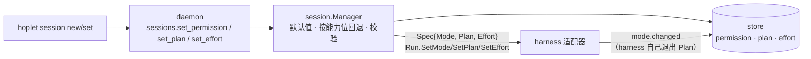

# M1 · PR6a 审批档位、Plan 与思考强度 · 详细计划

> **执行方式：** 按任务顺序逐步执行；每一步用 `- [ ]` 勾选。每个任务结束时 `go test -race ./...` 和 `golangci-lint run ./...` 都应通过。修改已有文件的步骤给出补丁：把代码块存成文件后在仓库根目录执行 `git apply <文件>`；新文件给出完整内容。

**目标：** 把会话的"模式"拆成三个独立设置：审批档位（需确认 / 自动编辑 / 智能审批 / 全自动）、Plan 开关、思考强度；上下文窗口归入模型选择（PR9 的模型列表）。为 PR6b 的 Claude Code 适配器和之后的 Codex 适配器准备好统一的接口。

**架构：**



- `proto`：`PermissionMode` 改为 `confirm / auto_edit / auto_review / full_auto`（去掉 `read_only`），带 `Valid`；新增 `Effort`（`low / medium / high / xhigh / max`）；`Capabilities` 加 `Modes`（harness 原生具备的档位）与 `Efforts`，`Fallback` 取最近的更严档位；`Session` 加 `Plan`、`Effort`；新事件 `mode.changed`（`ModeChanged{Permission, Plan}`）；`CreateParams` 加 `Plan`、`Effort`；新方法 `sessions.set_plan`、`sessions.set_effort`。
- `store`：迁移 0004 加 `plan`、`effort` 两列，并把旧的 `read_only` 改成 `confirm + plan`；`SessionUpdate` 加 `Plan`、`Effort`；`mode.changed` 投影到会话记录。
- `harness`：`Spec` 加 `Plan`、`Effort`；`Run` 加 `SetPlan`、`SetEffort`。假 harness 支持 `set_plan`、`set_effort` 与 `mode_changed` 事件，默认声明全部档位。
- `session.Manager`：新建会话的默认档位为 Code 智能审批、Personal 需确认，存储的是 harness 实际运行的档位（`Fallback`）；Plan、思考强度在 harness 不支持时返回 `harness.ErrUnsupported`；`SetPermission` 也按能力位回退；新增 `SetPlan`、`SetEffort`。
- 守护进程、客户端、CLI：`session new --plan --effort`，`session set ID [--permission] [--plan on|off] [--effort]`。

**技术栈：** Go 1.27；不新增依赖。

**依据：** [M1 总计划](m1-overview.md)、[0007 命令与审批](../design/0007-commands-approvals.md)（会话模式，本 PR 一并改写）、[0003 Agent 驱动](../design/0003-agent-driving.md)（Run 接口与能力位）、[0004 会话数据模型](../design/0004-session-data-model.md)（事件只增不改、迁移只向前）。

**本计划的裁决：**
- 维护者 2026-10-31 定：四档 + 独立 Plan 开关，去掉"只读"；默认 Code 智能审批、Personal 需确认；思考强度单设，上下文窗口归入模型选择。
- 档位严格程度：需确认 > 自动编辑 > 智能审批 > 全自动；缺档取更严的最近一档，一档都没有时用需确认。智能审批比自动编辑宽：它可能自动放行命令。
- 存储记录 harness 实际运行的档位，而不是请求的档位：界面看到的就是真实状态。
- harness 自己改变模式（批准方案后退出 Plan）用新事件 `mode.changed` 上报，由存储投影到会话记录；这是追加事件类型，旧事件解码不受影响。
- `set_effort` 不接受空值：恢复 harness 默认只在新建会话时可选（各 harness 没有统一的"恢复默认"命令）。
- 上下文窗口与模型列表放到 PR9 设计桌面时做（届时从 harness 的初始化信息读取模型及其变体）。

## 全局约束

- 不新增依赖；代码、注释、commit 用英文；设计文档中文；导出标识符有文档注释；库代码不 panic；不用 lint 抑制注释。
- 已持久化的事件永远可解码：新增事件类型须在 `proto/testdata/events.jsonl` 追加一行。
- 迁移只向前；旧数据必须被正确迁移。
- 测试不泄漏进程；除"轮询直到条件成立"外不用 sleep 同步。
- 分支 `feat/modes`；commit 带 DCO 签名（`git commit -s`）；完成前 `make check` 通过。

## 接口（后续 PR 依赖）

- `proto.PermissionMode`：`ModeConfirm`、`ModeAutoEdit`、`ModeAutoReview`、`ModeFullAuto`，`(PermissionMode).Valid()`
- `proto.Effort`：`EffortLow` … `EffortMax`、`EffortUltra`，`(Effort).Valid()`
- `proto.Capabilities{…, Modes []PermissionMode, Efforts []Effort, Fast bool}`、`(Capabilities).Fallback(m)`、`HasEffort(e)`
- `proto.Session{…, Plan, Fast bool, Effort Effort}`；`proto.ModeChanged{Permission, Plan}`（`mode.changed` v1）
- `proto.CreateParams{…, Plan, Fast, Effort}`；`sessions.set_plan`、`sessions.set_fast`、`sessions.set_effort`（`SetPlanParams`、`SetFastParams`、`SetEffortParams`）；客户端 `SetPlan`、`SetFast`、`SetEffort`
- `harness.Spec{…, Plan, Fast, Effort}`（Plan 与 Mode 同时给出时，以 Plan 启动，Mode 是退出 Plan 后要恢复的档位）；`harness.Run.SetPlan`、`SetFast`、`SetEffort`；Plan 开着时 `SetMode` 只记下要恢复的档位
- `(*session.Manager).SetPlan`、`SetFast`、`SetEffort`；`session.CreateRequest{…, Plan, Fast, Effort}`
- `store.SessionUpdate{…, Plan, Fast *bool, Effort *proto.Effort}`
- `harness.Harness.Probe` 会被频繁调用，代价高的适配器自行缓存

---

### 任务 0：建分支

- [ ] **步骤 1：**

```bash
git switch -c feat/modes
```

### 任务 1：协议与存储

**文件：** 修改 `proto/{harness,session,payloads,api}.go`、`proto/harness_test.go`、`proto/testdata/events.jsonl`、`internal/store/{session,append}.go`、`internal/harness/fake/fake_test.go`；创建 `internal/store/migrations/0004_plan_effort.sql`、`internal/store/mode_test.go`

**接口：** 产生上面列出的 proto 与 store 接口。去掉 `ModeReadOnly` 会让引用它的代码编译失败，所以协议与存储放在同一任务里一起改。

- [ ] **步骤 1：写测试**

`proto/harness_test.go` 的新增部分和 `proto/testdata/events.jsonl` 的新行包含在步骤 3 的补丁里。


`internal/store/mode_test.go`

```go
package store

import (
	"context"
	"errors"
	"io/fs"
	"testing"
	"testing/fstest"

	"github.com/yangflow/hoplet/proto"
)

// TestReadOnlyBecomesPlanMode checks migration 4 on a store that has a
// session in the retired read_only mode.
func TestReadOnlyBecomesPlanMode(t *testing.T) {
	ctx := context.Background()
	dir := t.TempDir()
	upTo := func(n int) fstest.MapFS {
		out := fstest.MapFS{}
		names, err := fs.Glob(migrations, "migrations/*.sql")
		if err != nil {
			t.Fatal(err)
		}
		for i, name := range names {
			if i >= n {
				break
			}
			b, err := fs.ReadFile(migrations, name)
			if err != nil {
				t.Fatal(err)
			}
			out[name[len("migrations/"):]] = &fstest.MapFile{Data: b}
		}
		return out
	}
	s, err := open(ctx, dir, upTo(3))
	if err != nil {
		t.Fatal(err)
	}
	// Written as a schema-3 build wrote them: this build's CreateSession
	// knows columns schema 3 lacks.
	for id, perm := range map[string]string{"old": "read_only", "kept": "confirm"} {
		if _, err := s.db.ExecContext(ctx, `INSERT INTO sessions (id, mode, harness_kind, owner, origin, status,
			created_at, updated_at, version, permission) VALUES (?, 'code', 'claude', 'me', 'me', 'idle', 0, 0, 1, ?)`, id, perm); err != nil {
			t.Fatal(err)
		}
	}
	if err := s.Close(); err != nil {
		t.Fatal(err)
	}
	s, err = Open(ctx, dir)
	if err != nil {
		t.Fatal(err)
	}
	defer s.Close()
	old, err := s.Session(ctx, "old")
	if err != nil || old.Permission != proto.ModeConfirm || !old.Plan || old.Effort != "" {
		t.Fatalf("migrated session %+v %v", old, err)
	}
	if kept, _ := s.Session(ctx, "kept"); kept.Permission != proto.ModeConfirm || kept.Plan {
		t.Fatalf("untouched session %+v", kept)
	}
}

func TestSessionPlanAndEffort(t *testing.T) {
	ctx := context.Background()
	s := newStore(t)
	sess, err := s.CreateSession(ctx, proto.Session{
		ID: "p", Mode: proto.ModeCode, Harness: proto.HarnessRef{Kind: "claude"}, Directory: "/work",
		Isolation: proto.InPlace, Owner: proto.OwnerMe, Origin: proto.OriginMe, CreatedAt: t0,
		Permission: proto.ModeAutoReview, Plan: true, Effort: proto.EffortHigh,
	})
	if err != nil || sess.Permission != proto.ModeAutoReview || !sess.Plan || sess.Effort != proto.EffortHigh {
		t.Fatalf("create %+v %v", sess, err)
	}
	off, low := false, proto.EffortLow
	got, err := s.UpdateSession(ctx, "p", SessionUpdate{Plan: &off, Effort: &low})
	if err != nil || got.Plan || got.Effort != proto.EffortLow || got.Version <= sess.Version {
		t.Fatalf("update %+v %v", got, err)
	}
	none := proto.Effort("")
	if got, err := s.UpdateSession(ctx, "p", SessionUpdate{Effort: &none}); err != nil || got.Effort != "" {
		t.Fatalf("restore default effort %+v %v", got, err)
	}
	bogus := proto.Effort("huge")
	if _, err := s.UpdateSession(ctx, "p", SessionUpdate{Effort: &bogus}); !errors.Is(err, ErrInvalid) {
		t.Fatalf("bogus effort: %v", err)
	}
	if _, err := s.CreateSession(ctx, proto.Session{
		ID: "q", Mode: proto.ModePersonal, Harness: proto.HarnessRef{Kind: "x"}, Owner: proto.OwnerMe, Origin: proto.OriginMe, Effort: bogus,
	}); !errors.Is(err, ErrInvalid) {
		t.Fatalf("create with bogus effort: %v", err)
	}
	old := proto.PermissionMode("read_only")
	if _, err := s.UpdateSession(ctx, "p", SessionUpdate{Permission: &old}); !errors.Is(err, ErrInvalid) {
		t.Fatalf("retired mode accepted: %v", err)
	}
}

func TestModeChangedUpdatesTheSession(t *testing.T) {
	ctx := context.Background()
	s := newStore(t)
	newSession(t, s, "s")
	on := true
	before, err := s.UpdateSession(ctx, "s", SessionUpdate{Plan: &on})
	if err != nil {
		t.Fatal(err)
	}
	appendOK(t, s, AppendRequest{Session: "s", Turn: 1, Entries: []Entry{
		{Payload: proto.TurnStarted{}},
		{Payload: proto.ModeChanged{Permission: proto.ModeAutoEdit, Plan: false}},
	}})
	after, err := s.Session(ctx, "s")
	if err != nil || after.Permission != proto.ModeAutoEdit || after.Plan || after.Version <= before.Version {
		t.Fatalf("after the change %+v %v", after, err)
	}
}
```


- [ ] **步骤 2：运行，确认失败**

运行：`go test ./internal/store/`
预期：编译失败，`unknown field Plan` 等

- [ ] **步骤 3：应用补丁并创建迁移**


````diff
diff --git a/internal/harness/fake/fake_test.go b/internal/harness/fake/fake_test.go
index 1d3c8d9..ed619b0 100644
--- a/internal/harness/fake/fake_test.go
+++ b/internal/harness/fake/fake_test.go
@@ -411,7 +411,7 @@ func TestUnsupportedCapabilities(t *testing.T) {
 	if err := r.Steer(ctx, "x"); !errors.Is(err, harness.ErrUnsupported) {
 		t.Fatalf("Steer: %v", err)
 	}
-	if err := r.SetMode(ctx, proto.ModeReadOnly); !errors.Is(err, harness.ErrUnsupported) {
+	if err := r.SetMode(ctx, proto.ModeAutoReview); !errors.Is(err, harness.ErrUnsupported) {
 		t.Fatalf("SetMode: %v", err)
 	}
 	if err := r.SetModel(ctx, "m"); !errors.Is(err, harness.ErrUnsupported) {
diff --git a/internal/store/append.go b/internal/store/append.go
index 9cad676..77ff3ed 100644
--- a/internal/store/append.go
+++ b/internal/store/append.go
@@ -373,7 +373,8 @@ func insertEvent(ctx context.Context, tx *sql.Tx, ev proto.Event, p proto.Payloa
 	return nil
 }
 
-// project applies one event to the turn and approval projections.
+// project applies one event to the turn and approval projections and, for
+// a mode change, to the session record.
 func project(ctx context.Context, tx *sql.Tx, ev proto.Event, p proto.Payload) error {
 	var q string
 	var args []any
@@ -391,6 +392,11 @@ func project(ctx context.Context, tx *sql.Tx, ev proto.Event, p proto.Payload) e
 		q = `UPDATE approvals SET status = ?, option_id = ?, decided_by = ?, resolved_seq = ?
 			WHERE session_id = ? AND id = ? AND status = 'pending'`
 		args = []any{p.Outcome, p.OptionID, p.DecidedBy, ev.Seq, ev.Session, p.ID}
+	case proto.ModeChanged:
+		// The harness changed its mode itself; the session record follows.
+		// The append that carries it bumps the catalog version.
+		q = `UPDATE sessions SET permission = ?, plan = ? WHERE id = ?`
+		args = []any{p.Permission, p.Plan, ev.Session}
 	default:
 		return nil
 	}
diff --git a/internal/store/session.go b/internal/store/session.go
index 28976cc..91383dc 100644
--- a/internal/store/session.go
+++ b/internal/store/session.go
@@ -14,7 +14,7 @@ import (
 )
 
 const sessionColumns = `id, mode, harness_kind, harness_version, native_id, directory, isolation,
-	owner, origin, status, title, created_at, updated_at, archived_at, last_seq, version, permission`
+	owner, origin, status, title, created_at, updated_at, archived_at, last_seq, version, permission, plan, effort`
 
 // CreateSession stores a new session. Status defaults to idle and
 // CreatedAt to now; UpdatedAt equals CreatedAt. The write is durable.
@@ -37,10 +37,10 @@ func (s *Store) CreateSession(ctx context.Context, sess proto.Session) (proto.Se
 	sess.LastSeq = 0
 	err := s.tx(ctx, true, func(tx *sql.Tx) error {
 		_, err := tx.ExecContext(ctx, `INSERT INTO sessions (`+sessionColumns+`)
-			VALUES (?, ?, ?, ?, ?, ?, ?, ?, ?, ?, ?, ?, ?, NULL, 0, 0, ?)`,
+			VALUES (?, ?, ?, ?, ?, ?, ?, ?, ?, ?, ?, ?, ?, NULL, 0, 0, ?, ?, ?)`,
 			sess.ID, sess.Mode, sess.Harness.Kind, sess.Harness.Version, sess.Harness.NativeID,
 			sess.Directory, sess.Isolation, sess.Owner, sess.Origin, sess.Status, sess.Title,
-			sess.CreatedAt.UnixMilli(), sess.UpdatedAt.UnixMilli(), sess.Permission)
+			sess.CreatedAt.UnixMilli(), sess.UpdatedAt.UnixMilli(), sess.Permission, sess.Plan, sess.Effort)
 		var serr *sqlite.Error
 		if errors.As(err, &serr) && serr.Code() == sqlite3.SQLITE_CONSTRAINT_PRIMARYKEY {
 			return fmt.Errorf("%w: session %s", ErrExists, sess.ID)
@@ -96,18 +96,13 @@ func validateSession(sess proto.Session) error {
 	default:
 		return bad("status %q", sess.Status)
 	}
-	if !validPermission(sess.Permission) {
+	if !sess.Permission.Valid() {
 		return bad("permission %q", sess.Permission)
 	}
-	return nil
-}
-
-func validPermission(m proto.PermissionMode) bool {
-	switch m {
-	case proto.ModeReadOnly, proto.ModeConfirm, proto.ModeAutoEdit, proto.ModeFullAuto:
-		return true
+	if sess.Effort != "" && !sess.Effort.Valid() {
+		return bad("effort %q", sess.Effort)
 	}
-	return false
+	return nil
 }
 
 // Session returns one session, or ErrNotFound.
@@ -183,22 +178,29 @@ type SessionUpdate struct {
 	NativeID   *string
 	Title      *string
 	Permission *proto.PermissionMode
+	Plan       *bool
+	Effort     *proto.Effort // an empty effort restores the harness default
 }
 
-// UpdateSession changes a session's harness-native ID, title and/or
-// permission mode and returns the updated session. The write is durable; with nothing to change
-// it writes nothing and returns the current session.
+// UpdateSession changes a session's harness-native ID, title, permission
+// mode, plan mode and/or effort and returns the updated session. The write
+// is durable; with nothing to change it writes nothing and returns the
+// current session.
 func (s *Store) UpdateSession(ctx context.Context, id proto.SessionID, u SessionUpdate) (proto.Session, error) {
-	if u.NativeID == nil && u.Title == nil && u.Permission == nil {
+	if u.NativeID == nil && u.Title == nil && u.Permission == nil && u.Plan == nil && u.Effort == nil {
 		return s.Session(ctx, id)
 	}
-	if u.Permission != nil && !validPermission(*u.Permission) {
+	if u.Permission != nil && !u.Permission.Valid() {
 		return proto.Session{}, fmt.Errorf("%w: permission %q", ErrInvalid, *u.Permission)
 	}
+	if u.Effort != nil && *u.Effort != "" && !u.Effort.Valid() {
+		return proto.Session{}, fmt.Errorf("%w: effort %q", ErrInvalid, *u.Effort)
+	}
 	var out proto.Session
 	err := s.tx(ctx, true, func(tx *sql.Tx) error {
 		res, err := tx.ExecContext(ctx, `UPDATE sessions SET native_id = COALESCE(?, native_id), title = COALESCE(?, title),
-			permission = COALESCE(?, permission) WHERE id = ?`, u.NativeID, u.Title, u.Permission, id)
+			permission = COALESCE(?, permission), plan = COALESCE(?, plan), effort = COALESCE(?, effort) WHERE id = ?`,
+			u.NativeID, u.Title, u.Permission, u.Plan, u.Effort, id)
 		if err != nil {
 			return fmt.Errorf("store: update session %s: %w", id, err)
 		}
@@ -246,7 +248,7 @@ func scanSession(r scanner) (proto.Session, error) {
 	)
 	err := r.Scan(&sess.ID, &sess.Mode, &sess.Harness.Kind, &sess.Harness.Version, &sess.Harness.NativeID,
 		&sess.Directory, &sess.Isolation, &sess.Owner, &sess.Origin, &sess.Status, &sess.Title,
-		&created, &updated, &archived, &sess.LastSeq, &sess.Version, &sess.Permission)
+		&created, &updated, &archived, &sess.LastSeq, &sess.Version, &sess.Permission, &sess.Plan, &sess.Effort)
 	if err != nil {
 		if errors.Is(err, sql.ErrNoRows) {
 			return proto.Session{}, err
diff --git a/proto/api.go b/proto/api.go
index 3540b54..6eafb29 100644
--- a/proto/api.go
+++ b/proto/api.go
@@ -73,6 +73,8 @@ const (
 	MethodSessionsSteer     = "sessions.steer"
 	MethodSessionsAnswer    = "sessions.answer"
 	MethodSessionsSetPerm   = "sessions.set_permission"
+	MethodSessionsSetPlan   = "sessions.set_plan"
+	MethodSessionsSetEffort = "sessions.set_effort"
 	MethodSessionsStop      = "sessions.stop"
 	MethodSessionsArchive   = "sessions.archive"
 	MethodSessionsEvents    = "sessions.events"
@@ -108,11 +110,16 @@ type SessionRef struct {
 
 // CreateParams creates a session.
 type CreateParams struct {
-	Mode       Mode           `json:"mode"`
-	Harness    string         `json:"harness"`
-	Directory  string         `json:"directory,omitempty"`
-	Isolation  Isolation      `json:"isolation,omitempty"`
+	Mode      Mode      `json:"mode"`
+	Harness   string    `json:"harness"`
+	Directory string    `json:"directory,omitempty"`
+	Isolation Isolation `json:"isolation,omitempty"`
+	// Permission defaults to auto_review for code sessions and confirm for
+	// personal ones; the harness runs the nearest mode it has (see
+	// Capabilities.Fallback), which the created session reports.
 	Permission PermissionMode `json:"permission,omitempty"`
+	Plan       bool           `json:"plan,omitempty"`
+	Effort     Effort         `json:"effort,omitempty"`
 	Title      string         `json:"title,omitempty"`
 }
 
@@ -158,6 +165,18 @@ type SetPermissionParams struct {
 	Permission PermissionMode `json:"permission"`
 }
 
+// SetPlanParams turns a session's plan mode on or off.
+type SetPlanParams struct {
+	Session SessionID `json:"session"`
+	Plan    bool      `json:"plan"`
+}
+
+// SetEffortParams changes how hard a session's harness thinks.
+type SetEffortParams struct {
+	Session SessionID `json:"session"`
+	Effort  Effort    `json:"effort"`
+}
+
 // QueuedMessage is a message waiting for the running turn to end. Error,
 // when set, says why the daemon could not send it; the queue then waits
 // until the message is edited, moved or deleted.
diff --git a/proto/harness.go b/proto/harness.go
index 8bd13ca..f00fd3b 100644
--- a/proto/harness.go
+++ b/proto/harness.go
@@ -1,21 +1,58 @@
 package proto
 
-// PermissionMode is a session's permission level, mapped by each harness
-// adapter onto that harness's native permission settings. A harness lacking
-// a level uses the nearest stricter one.
+// PermissionMode is how much a session may do without asking, mapped by
+// each harness adapter onto that harness's native permission settings. It is
+// independent of plan mode (Session.Plan), which stops all changes until the
+// user approves a plan.
 type PermissionMode string
 
 // Permission modes, from strictest to most permissive.
 const (
-	ModeReadOnly PermissionMode = "read_only" // read only; no file changes
-	ModeConfirm  PermissionMode = "confirm"   // ask before file changes and commands
-	ModeAutoEdit PermissionMode = "auto_edit" // edit inside the workdir freely; ask before commands
-	ModeFullAuto PermissionMode = "full_auto" // never ask; the harness's own forced checks still surface
+	ModeConfirm    PermissionMode = "confirm"     // ask before file changes and commands
+	ModeAutoEdit   PermissionMode = "auto_edit"   // edit inside the workdir freely; ask before commands
+	ModeAutoReview PermissionMode = "auto_review" // the harness judges each action's risk and asks only for risky ones
+	ModeFullAuto   PermissionMode = "full_auto"   // never ask; the harness's own forced checks still surface
 )
 
+// permissionOrder lists the modes from strictest to most permissive.
+var permissionOrder = []PermissionMode{ModeConfirm, ModeAutoEdit, ModeAutoReview, ModeFullAuto}
+
+// Valid reports whether m is a known mode.
+func (m PermissionMode) Valid() bool {
+	for _, k := range permissionOrder {
+		if m == k {
+			return true
+		}
+	}
+	return false
+}
+
+// Effort is how hard a harness thinks, on one scale for all harnesses;
+// each adapter maps it onto its harness's own levels. Empty means the
+// harness's default.
+type Effort string
+
+// Effort levels, from least to most.
+const (
+	EffortLow    Effort = "low"
+	EffortMedium Effort = "medium"
+	EffortHigh   Effort = "high"
+	EffortXHigh  Effort = "xhigh"
+	EffortMax    Effort = "max"
+)
+
+// Valid reports whether e is a known level.
+func (e Effort) Valid() bool {
+	switch e {
+	case EffortLow, EffortMedium, EffortHigh, EffortXHigh, EffortMax:
+		return true
+	}
+	return false
+}
+
 // Capabilities says which optional operations a harness supports; clients
-// hide controls for the rest. Fork, Rewind and PlanMode have no Run methods
-// yet; they arrive with M3.
+// hide controls for the rest. Fork and Rewind have no Run methods yet; they
+// arrive with M3.
 type Capabilities struct {
 	Steer         bool `json:"steer,omitempty"`
 	Resume        bool `json:"resume,omitempty"`
@@ -26,4 +63,40 @@ type Capabilities struct {
 	PlanMode      bool `json:"plan_mode,omitempty"`
 	PartialStream bool `json:"partial_stream,omitempty"`
 	MCPInject     bool `json:"mcp_inject,omitempty"`
+	// Modes are the permission modes the harness has natively; others fall
+	// back to the nearest stricter one (see Fallback).
+	Modes []PermissionMode `json:"modes,omitempty"`
+	// Efforts are the effort levels the harness accepts; none means effort
+	// cannot be set.
+	Efforts []Effort `json:"efforts,omitempty"`
+}
+
+// Fallback returns the mode a harness with these capabilities runs for m:
+// m itself when the harness has it, else the nearest stricter mode it has,
+// else ModeConfirm.
+func (c Capabilities) Fallback(m PermissionMode) PermissionMode {
+	at := -1
+	for i, k := range permissionOrder {
+		if k == m {
+			at = i
+		}
+	}
+	for i := at; i >= 0; i-- {
+		for _, have := range c.Modes {
+			if have == permissionOrder[i] {
+				return have
+			}
+		}
+	}
+	return ModeConfirm
+}
+
+// HasEffort reports whether the harness accepts effort level e.
+func (c Capabilities) HasEffort(e Effort) bool {
+	for _, have := range c.Efforts {
+		if have == e {
+			return true
+		}
+	}
+	return false
 }
diff --git a/proto/harness_test.go b/proto/harness_test.go
index f4700ce..84ca70b 100644
--- a/proto/harness_test.go
+++ b/proto/harness_test.go
@@ -2,7 +2,9 @@ package proto
 
 import (
 	"encoding/json"
+	"errors"
 	"testing"
+	"time"
 )
 
 func TestCapabilitiesJSON(t *testing.T) {
@@ -31,3 +33,58 @@ func TestCapabilitiesSetModeModelJSON(t *testing.T) {
 		t.Fatalf("got %s, want %s", got, want)
 	}
 }
+
+func TestFallback(t *testing.T) {
+	all := Capabilities{Modes: []PermissionMode{ModeConfirm, ModeAutoEdit, ModeAutoReview, ModeFullAuto}}
+	noReview := Capabilities{Modes: []PermissionMode{ModeConfirm, ModeAutoEdit, ModeFullAuto}}
+	confirmOnly := Capabilities{Modes: []PermissionMode{ModeConfirm}}
+	for name, tc := range map[string]struct {
+		caps     Capabilities
+		in, want PermissionMode
+	}{
+		"has it":             {all, ModeAutoReview, ModeAutoReview},
+		"stricter neighbour": {noReview, ModeAutoReview, ModeAutoEdit},
+		"full auto kept":     {noReview, ModeFullAuto, ModeFullAuto},
+		"only confirm":       {confirmOnly, ModeFullAuto, ModeConfirm},
+		"no modes declared":  {Capabilities{}, ModeAutoEdit, ModeConfirm},
+		"unknown mode":       {all, "bogus", ModeConfirm},
+	} {
+		if got := tc.caps.Fallback(tc.in); got != tc.want {
+			t.Errorf("%s: Fallback(%s) = %s, want %s", name, tc.in, got, tc.want)
+		}
+	}
+}
+
+func TestModeAndEffortValidity(t *testing.T) {
+	for _, m := range []PermissionMode{ModeConfirm, ModeAutoEdit, ModeAutoReview, ModeFullAuto} {
+		if !m.Valid() {
+			t.Errorf("%s invalid", m)
+		}
+	}
+	for _, m := range []PermissionMode{"", "read_only", "plan"} {
+		if m.Valid() {
+			t.Errorf("%q valid", m)
+		}
+	}
+	for _, e := range []Effort{EffortLow, EffortMedium, EffortHigh, EffortXHigh, EffortMax} {
+		if !e.Valid() {
+			t.Errorf("%s invalid", e)
+		}
+	}
+	if Effort("").Valid() || Effort("huge").Valid() {
+		t.Error("an unknown effort is valid")
+	}
+	c := Capabilities{Efforts: []Effort{EffortLow, EffortHigh}}
+	if !c.HasEffort(EffortHigh) || c.HasEffort(EffortMax) {
+		t.Errorf("HasEffort on %v", c.Efforts)
+	}
+}
+
+func TestModeChangedValidates(t *testing.T) {
+	if _, err := NewEvent("s", 1, 1, time.Now(), ModeChanged{Permission: "read_only"}); !errors.Is(err, ErrInvalidPayload) {
+		t.Fatalf("unknown mode: %v", err)
+	}
+	if _, err := NewEvent("s", 1, 1, time.Now(), ModeChanged{Permission: ModeAutoEdit, Plan: true}); err != nil {
+		t.Fatal(err)
+	}
+}
diff --git a/proto/payloads.go b/proto/payloads.go
index 99c5bc0..cdc2fe2 100644
--- a/proto/payloads.go
+++ b/proto/payloads.go
@@ -16,6 +16,7 @@ const (
 	TypeQuestion         EventType = "question"
 	TypeUsage            EventType = "usage"
 	TypeError            EventType = "error"
+	TypeModeChanged      EventType = "mode.changed"
 )
 
 // TurnStarted marks the start of a turn.
@@ -196,6 +197,21 @@ type Error struct {
 	Message string `json:"message"`
 }
 
+// ModeChanged records the harness changing the session's permission mode
+// or plan mode by itself, as when the user approves a plan and the harness
+// leaves plan mode. The store applies it to the session record.
+type ModeChanged struct {
+	Permission PermissionMode `json:"permission"`
+	Plan       bool           `json:"plan"`
+}
+
+func (m ModeChanged) validate() error {
+	if !m.Permission.Valid() {
+		return fmt.Errorf("%w: unknown permission mode %q", ErrInvalidPayload, m.Permission)
+	}
+	return nil
+}
+
 func (r ApprovalResolved) validate() error {
 	switch r.Outcome {
 	case OutcomeAllowed, OutcomeDenied:
@@ -224,6 +240,7 @@ func (ApprovalResolved) eventType() EventType  { return TypeApprovalResolved }
 func (Question) eventType() EventType          { return TypeQuestion }
 func (Usage) eventType() EventType             { return TypeUsage }
 func (Error) eventType() EventType             { return TypeError }
+func (ModeChanged) eventType() EventType       { return TypeModeChanged }
 
 func (TurnStarted) eventVersion() uint16       { return 1 }
 func (TurnEnded) eventVersion() uint16         { return 1 }
@@ -237,6 +254,7 @@ func (ApprovalResolved) eventVersion() uint16  { return 1 }
 func (Question) eventVersion() uint16          { return 1 }
 func (Usage) eventVersion() uint16             { return 1 }
 func (Error) eventVersion() uint16             { return 1 }
+func (ModeChanged) eventVersion() uint16       { return 1 }
 
 func init() {
 	register[TurnStarted]()
@@ -251,4 +269,5 @@ func init() {
 	register[Question]()
 	register[Usage]()
 	register[Error]()
+	register[ModeChanged]()
 }
diff --git a/proto/session.go b/proto/session.go
index 10a19f8..7caae05 100644
--- a/proto/session.go
+++ b/proto/session.go
@@ -67,16 +67,20 @@ type Session struct {
 	Harness HarnessRef `json:"harness"`
 	// Permission is the session's permission mode; empty means confirm.
 	Permission PermissionMode `json:"permission,omitempty"`
-	Directory  string         `json:"directory,omitempty"`
-	Isolation  Isolation      `json:"isolation,omitempty"`
-	Owner      Owner          `json:"owner"`
-	Origin     Origin         `json:"origin"`
-	Status     SessionStatus  `json:"status"`
-	Title      string         `json:"title,omitempty"`
-	CreatedAt  time.Time      `json:"created_at"`
-	UpdatedAt  time.Time      `json:"updated_at"`
-	ArchivedAt *time.Time     `json:"archived_at,omitempty"`
-	LastSeq    uint64         `json:"last_seq"`
+	// Plan stops all changes until the user approves the harness's plan.
+	Plan bool `json:"plan,omitempty"`
+	// Effort is how hard the harness thinks; empty means its default.
+	Effort     Effort        `json:"effort,omitempty"`
+	Directory  string        `json:"directory,omitempty"`
+	Isolation  Isolation     `json:"isolation,omitempty"`
+	Owner      Owner         `json:"owner"`
+	Origin     Origin        `json:"origin"`
+	Status     SessionStatus `json:"status"`
+	Title      string        `json:"title,omitempty"`
+	CreatedAt  time.Time     `json:"created_at"`
+	UpdatedAt  time.Time     `json:"updated_at"`
+	ArchivedAt *time.Time    `json:"archived_at,omitempty"`
+	LastSeq    uint64        `json:"last_seq"`
 	// Version is the store's catalog counter value at this session's last
 	// change; it grows with every change to the session record.
 	Version uint64 `json:"version"`
diff --git a/proto/testdata/events.jsonl b/proto/testdata/events.jsonl
index af2517e..b575f82 100644
--- a/proto/testdata/events.jsonl
+++ b/proto/testdata/events.jsonl
@@ -13,3 +13,4 @@
 {"session":"s1","seq":13,"ts":"2026-10-31T08:00:12Z","turn":2,"type":"turn.ended","v":1,"payload":{"reason":"failed","message":"harness exited"}}
 {"session":"s1","seq":14,"ts":"2026-10-31T08:00:13Z","turn":3,"type":"approval.requested","v":1,"payload":{"id":"a2","kind":"tool","title":"Run tool","tool_call_id":"t1","options":[{"id":"deny","label":"Deny","scope":"deny"}]}}
 {"session":"s1","seq":15,"ts":"2026-10-31T08:00:14Z","turn":3,"type":"approval.resolved","v":1,"payload":{"id":"a2","outcome":"expired"}}
+{"session":"s1","seq":16,"ts":"2026-10-31T08:00:15Z","turn":3,"type":"mode.changed","v":1,"payload":{"permission":"auto_edit","plan":false}}
````


`internal/store/migrations/0004_plan_effort.sql`

```sql
ALTER TABLE sessions ADD COLUMN plan INTEGER NOT NULL DEFAULT 0;
ALTER TABLE sessions ADD COLUMN effort TEXT NOT NULL DEFAULT '';
-- read_only was a permission mode; it is now plan mode over the strictest mode.
UPDATE sessions SET plan = 1, permission = 'confirm' WHERE permission = 'read_only';
```


- [ ] **步骤 4：运行，确认通过**

运行：`go build ./... && go test -race ./proto/ ./internal/store/`
预期：`ok`

- [ ] **步骤 5：commit**

```bash
git add proto internal/store internal/harness/fake/fake_test.go
git commit -s -m "feat(proto): add auto review, plan mode and effort to sessions"
```

### 任务 2：harness 接口与假 harness

**文件：** 修改 `internal/harness/harness.go`、`internal/harness/fake/{adapter,protocol}.go`、`internal/harness/fake/fakeharness/main.go`

**接口：** 产生 `harness.Spec.Plan / Effort`、`Run.SetPlan / SetEffort`；假 harness 的 `set_plan`、`set_effort` 操作（回一条 `plan:on|off` / `effort:<级别>` 消息）与 `mode_changed` 事件（`Text` 为档位，`Status` 为 `plan` 表示 Plan 开）。

- [ ] **步骤 1：应用补丁**


````diff
diff --git a/internal/harness/fake/adapter.go b/internal/harness/fake/adapter.go
index 71f0c27..f4459ef 100644
--- a/internal/harness/fake/adapter.go
+++ b/internal/harness/fake/adapter.go
@@ -17,7 +17,8 @@ const Kind = "fake"
 
 // Harness drives the fakeharness binary at Binary with the script at Script.
 // Capabilities overrides what the fake reports and supports; nil means
-// Steer, PartialStream, Resume, SetMode and SetModel.
+// Steer, PartialStream, Resume, SetMode, SetModel, PlanMode, every
+// permission mode and every effort level.
 type Harness struct {
 	Binary       string
 	Script       string
@@ -30,7 +31,11 @@ func (h *Harness) caps() proto.Capabilities {
 	if h.Capabilities != nil {
 		return *h.Capabilities
 	}
-	return proto.Capabilities{Steer: true, PartialStream: true, Resume: true, SetMode: true, SetModel: true}
+	return proto.Capabilities{
+		Steer: true, PartialStream: true, Resume: true, SetMode: true, SetModel: true, PlanMode: true,
+		Modes:   []proto.PermissionMode{proto.ModeConfirm, proto.ModeAutoEdit, proto.ModeAutoReview, proto.ModeFullAuto},
+		Efforts: []proto.Effort{proto.EffortLow, proto.EffortMedium, proto.EffortHigh, proto.EffortXHigh, proto.EffortMax},
+	}
 }
 
 // Kind reports "fake".
@@ -214,6 +219,8 @@ func translate(line []byte) (proto.Payload, string) {
 		return proto.Usage{InputTokens: ev.In, OutputTokens: ev.Out}, ""
 	case "file_change":
 		return proto.FileChange{Path: ev.Name, Op: proto.FileOp(ev.Kind)}, ""
+	case "mode_changed":
+		return proto.ModeChanged{Permission: proto.PermissionMode(ev.Text), Plan: ev.Status == "plan"}, ""
 	case "error":
 		return proto.Error{Message: ev.Text}, ""
 	}
@@ -256,6 +263,24 @@ func (r *run) SetMode(ctx context.Context, mode proto.PermissionMode) error {
 	return r.send(ctx, Op{Op: "set_mode", Text: string(mode)})
 }
 
+func (r *run) SetPlan(ctx context.Context, on bool) error {
+	if !r.caps.PlanMode {
+		return harness.ErrUnsupported
+	}
+	text := "off"
+	if on {
+		text = "on"
+	}
+	return r.send(ctx, Op{Op: "set_plan", Text: text})
+}
+
+func (r *run) SetEffort(ctx context.Context, effort proto.Effort) error {
+	if !r.caps.HasEffort(effort) {
+		return harness.ErrUnsupported
+	}
+	return r.send(ctx, Op{Op: "set_effort", Text: string(effort)})
+}
+
 func (r *run) SetModel(ctx context.Context, model string) error {
 	if !r.caps.SetModel {
 		return harness.ErrUnsupported
diff --git a/internal/harness/fake/fakeharness/main.go b/internal/harness/fake/fakeharness/main.go
index f7557a1..f403d8a 100644
--- a/internal/harness/fake/fakeharness/main.go
+++ b/internal/harness/fake/fakeharness/main.go
@@ -51,6 +51,10 @@ func main() {
 			next++
 		case "set_mode":
 			h.emit(fake.Ev{Ev: "message", ID: "mode", Text: "mode:" + op.Text})
+		case "set_plan":
+			h.emit(fake.Ev{Ev: "message", ID: "plan", Text: "plan:" + op.Text})
+		case "set_effort":
+			h.emit(fake.Ev{Ev: "message", ID: "effort", Text: "effort:" + op.Text})
 		case "set_model":
 			h.emit(fake.Ev{Ev: "message", ID: "model", Text: "model:" + op.Text})
 		case "interrupt":
@@ -211,6 +215,10 @@ func (h *harness) wait(timer <-chan time.Time, done func(fake.Op) bool) bool {
 				h.emit(fake.Ev{Ev: "message", ID: "steer", Text: "steer:" + op.Text})
 			case op.Op == "set_mode":
 				h.emit(fake.Ev{Ev: "message", ID: "mode", Text: "mode:" + op.Text})
+			case op.Op == "set_plan":
+				h.emit(fake.Ev{Ev: "message", ID: "plan", Text: "plan:" + op.Text})
+			case op.Op == "set_effort":
+				h.emit(fake.Ev{Ev: "message", ID: "effort", Text: "effort:" + op.Text})
 			case op.Op == "set_model":
 				h.emit(fake.Ev{Ev: "message", ID: "model", Text: "model:" + op.Text})
 			case done != nil && done(op):
diff --git a/internal/harness/fake/protocol.go b/internal/harness/fake/protocol.go
index 7575bfe..43ba70a 100644
--- a/internal/harness/fake/protocol.go
+++ b/internal/harness/fake/protocol.go
@@ -7,7 +7,7 @@ package fake
 
 // Op is one line Hoplet writes to the fake harness.
 type Op struct {
-	Op     string `json:"op"` // prompt, steer, interrupt, respond, answer, set_mode, set_model
+	Op     string `json:"op"` // prompt, steer, interrupt, respond, answer, set_mode, set_plan, set_effort, set_model
 	Text   string `json:"text,omitempty"`
 	ID     string `json:"id,omitempty"`
 	Option string `json:"option,omitempty"`
@@ -15,9 +15,10 @@ type Op struct {
 
 // Ev is one line the fake harness writes. In and Out are the token counts of
 // a usage event; a file_change event uses Name as the path and Kind as the
-// operation.
+// operation; a mode_changed event uses Text as the permission mode and
+// Status "plan" for plan mode.
 type Ev struct {
-	Ev      string   `json:"ev"` // session, turn_started, delta, message, thinking, tool, approval, question, usage, file_change, turn_ended, error
+	Ev      string   `json:"ev"` // session, turn_started, delta, message, thinking, tool, approval, question, usage, file_change, mode_changed, turn_ended, error
 	ID      string   `json:"id,omitempty"`
 	Text    string   `json:"text,omitempty"`
 	Kind    string   `json:"kind,omitempty"`
diff --git a/internal/harness/harness.go b/internal/harness/harness.go
index 4cdfe08..c49fcc7 100644
--- a/internal/harness/harness.go
+++ b/internal/harness/harness.go
@@ -71,8 +71,12 @@ type Spec struct {
 	WorkDir string
 	// Env is the complete child environment; nil means empty, never
 	// "inherit".
-	Env       []string
-	Mode      proto.PermissionMode
+	Env  []string
+	Mode proto.PermissionMode
+	// Plan starts the session in plan mode; Effort is the thinking effort,
+	// empty for the harness default.
+	Plan      bool
+	Effort    proto.Effort
 	Model     string // empty: the harness default
 	Resume    string // native session ID to resume; empty starts fresh
 	State     State
@@ -201,6 +205,11 @@ type Run interface {
 	Respond(ctx context.Context, approvalID, optionID string) error
 	Answer(ctx context.Context, questionID, answer string) error
 	SetMode(ctx context.Context, mode proto.PermissionMode) error
+	// SetPlan turns plan mode on or off; turning it off restores the
+	// session's permission mode, which the adapter remembers from Spec.Mode
+	// and SetMode.
+	SetPlan(ctx context.Context, on bool) error
+	SetEffort(ctx context.Context, effort proto.Effort) error
 	SetModel(ctx context.Context, model string) error
 	Events() <-chan Event
 	NativeSession() string
````


- [ ] **步骤 2：运行，确认通过**

运行：`go build ./... && go test -race ./internal/harness/...`
预期：`ok`

- [ ] **步骤 3：commit**

```bash
git add internal/harness
git commit -s -m "feat(harness): carry plan mode and effort to harnesses"
```

### 任务 3：会话管理器

**文件：** 修改 `internal/session/manager.go`；创建 `internal/session/mode_test.go`

**接口：** 消费任务 1、2；产生 `CreateRequest.Plan / Effort`、`(*Manager).SetPlan / SetEffort`，`Create` 与 `SetPermission` 按能力位回退。

- [ ] **步骤 1：写测试**


`internal/session/mode_test.go`

```go
package session

import (
	"context"
	"errors"
	"sync"
	"testing"

	"github.com/yangflow/hoplet/internal/harness"
	"github.com/yangflow/hoplet/internal/harness/fake"
	"github.com/yangflow/hoplet/proto"
)

// specSpy is the fake harness, recording the spec of each launch.
type specSpy struct {
	*fake.Harness
	mu    sync.Mutex
	specs []harness.Spec
}

func (s *specSpy) Launch(spec harness.Spec) (harness.Launch, error) {
	s.mu.Lock()
	s.specs = append(s.specs, spec)
	s.mu.Unlock()
	return s.Harness.Launch(spec)
}

func (s *specSpy) launched() []harness.Spec {
	s.mu.Lock()
	defer s.mu.Unlock()
	return append([]harness.Spec(nil), s.specs...)
}

func TestCreateDefaultsAndFallback(t *testing.T) {
	e := newEnv(t, fake.Script{Session: "n1"})
	ctx := context.Background()
	full := e.manager()
	defer full.Close()
	code := e.create(full)
	personal, err := full.Create(ctx, CreateRequest{Mode: proto.ModePersonal, Harness: "fake"})
	if err != nil {
		t.Fatal(err)
	}
	if code.Permission != proto.ModeAutoReview || personal.Permission != proto.ModeConfirm {
		t.Fatalf("defaults: code %s, personal %s", code.Permission, personal.Permission)
	}

	// A harness with only confirm and auto_edit, one effort level and no
	// plan mode.
	limited := e.managerWith(map[string]harness.Harness{"fake": &fake.Harness{Binary: fakeExe, Script: e.script, Capabilities: &proto.Capabilities{
		SetMode: true, Modes: []proto.PermissionMode{proto.ModeConfirm, proto.ModeAutoEdit}, Efforts: []proto.Effort{proto.EffortHigh},
	}}})
	defer limited.Close()
	sess, err := limited.Create(ctx, CreateRequest{Mode: proto.ModeCode, Harness: "fake", Directory: e.work, Effort: proto.EffortHigh})
	if err != nil || sess.Permission != proto.ModeAutoEdit || sess.Effort != proto.EffortHigh {
		t.Fatalf("fallback create %+v %v", sess, err)
	}
	if err := limited.SetPermission(ctx, sess.ID, proto.ModeFullAuto); err != nil {
		t.Fatal(err)
	}
	if got, _ := e.store.Session(ctx, sess.ID); got.Permission != proto.ModeAutoEdit {
		t.Fatalf("full_auto on a harness without it stored %s", got.Permission)
	}
	for name, err := range map[string]error{
		"plan at create":   errOf(limited.Create(ctx, CreateRequest{Mode: proto.ModeCode, Harness: "fake", Directory: e.work, Plan: true})),
		"effort at create": errOf(limited.Create(ctx, CreateRequest{Mode: proto.ModeCode, Harness: "fake", Directory: e.work, Effort: proto.EffortMax})),
		"set plan":         limited.SetPlan(ctx, sess.ID, true),
		"set effort":       limited.SetEffort(ctx, sess.ID, proto.EffortLow),
	} {
		if !errors.Is(err, harness.ErrUnsupported) {
			t.Errorf("%s: %v, want ErrUnsupported", name, err)
		}
	}
	if _, err := full.Create(ctx, CreateRequest{Mode: proto.ModeCode, Harness: "fake", Directory: e.work, Permission: "read_only"}); err == nil {
		t.Error("the retired read_only mode was accepted")
	}
	if err := full.SetEffort(ctx, code.ID, "huge"); err == nil {
		t.Error("an unknown effort was accepted")
	}
}

func errOf(_ proto.Session, err error) error { return err }

func TestPlanAndEffortReachTheHarness(t *testing.T) {
	e := newEnv(t, fake.Script{Session: "n1", Turns: []fake.Turn{{Steps: []fake.Step{
		{AwaitApproval: "hold"},
	}}}})
	spy := &specSpy{Harness: &fake.Harness{Binary: fakeExe, Script: e.script}}
	m := e.managerWith(map[string]harness.Harness{"fake": spy})
	defer m.Close()
	ctx := context.Background()
	sess, err := m.Create(ctx, CreateRequest{Mode: proto.ModeCode, Harness: "fake", Directory: e.work, Plan: true, Effort: proto.EffortMedium})
	if err != nil {
		t.Fatal(err)
	}
	if _, err := m.Send(ctx, sess.ID, "go", "k1"); err != nil {
		t.Fatal(err)
	}
	e.waitFor(sess.ID, "the turn to start", func(evs []proto.Event) bool { return count(evs, proto.TypeTurnStarted) == 1 })
	if got := spy.launched(); len(got) != 1 || !got[0].Plan || got[0].Effort != proto.EffortMedium || got[0].Mode != proto.ModeAutoReview {
		t.Fatalf("launch specs %+v", got)
	}
	if err := m.SetPlan(ctx, sess.ID, false); err != nil {
		t.Fatal(err)
	}
	if err := m.SetEffort(ctx, sess.ID, proto.EffortXHigh); err != nil {
		t.Fatal(err)
	}
	evs := e.waitFor(sess.ID, "the harness to see both changes", func(evs []proto.Event) bool { return count(evs, proto.TypeMessage) >= 3 })
	var texts []string
	for _, p := range payloads(t, evs) {
		if msg, ok := p.(proto.Message); ok && msg.Role == proto.RoleAssistant {
			texts = append(texts, msg.Text)
		}
	}
	if len(texts) != 2 || texts[0] != "plan:off" || texts[1] != "effort:xhigh" {
		t.Fatalf("harness messages %q", texts)
	}
	got, err := e.store.Session(ctx, sess.ID)
	if err != nil || got.Plan || got.Effort != proto.EffortXHigh {
		t.Fatalf("stored %+v %v", got, err)
	}
}

func TestHarnessModeChangeUpdatesTheSession(t *testing.T) {
	e := newEnv(t, fake.Script{Session: "n1", Turns: []fake.Turn{{Steps: []fake.Step{
		{Emit: &fake.Ev{Ev: "mode_changed", Text: "auto_edit"}},
	}}}})
	m := e.manager()
	defer m.Close()
	ctx := context.Background()
	sess, err := m.Create(ctx, CreateRequest{Mode: proto.ModeCode, Harness: "fake", Directory: e.work, Plan: true})
	if err != nil {
		t.Fatal(err)
	}
	if _, err := m.Send(ctx, sess.ID, "go", "k1"); err != nil {
		t.Fatal(err)
	}
	e.waitFor(sess.ID, "turn end", turnEnded)
	got, err := e.store.Session(ctx, sess.ID)
	if err != nil || got.Plan || got.Permission != proto.ModeAutoEdit {
		t.Fatalf("after the harness left plan mode %+v %v", got, err)
	}
}
```


- [ ] **步骤 2：运行，确认失败**

运行：`go test ./internal/session/`
预期：编译失败，`unknown field Plan in struct literal of type CreateRequest` 等

- [ ] **步骤 3：应用补丁**


````diff
diff --git a/internal/session/manager.go b/internal/session/manager.go
index cba6adb..5c750d0 100644
--- a/internal/session/manager.go
+++ b/internal/session/manager.go
@@ -204,11 +204,15 @@ func New(cfg Config) (*Manager, error) {
 
 // CreateRequest describes a new session.
 type CreateRequest struct {
-	Mode       proto.Mode
-	Harness    string
-	Directory  string // working directory; required for code sessions
-	Isolation  proto.Isolation
+	Mode      proto.Mode
+	Harness   string
+	Directory string // working directory; required for code sessions
+	Isolation proto.Isolation
+	// Permission defaults to auto_review for code sessions and confirm for
+	// personal ones; either way the harness runs the nearest mode it has.
 	Permission proto.PermissionMode
+	Plan       bool
+	Effort     proto.Effort // empty: the harness default
 	Title      string
 	Origin     proto.Origin
 }
@@ -232,6 +236,21 @@ func (m *Manager) Create(ctx context.Context, req CreateRequest) (proto.Session,
 	if req.Mode == proto.ModeCode && req.Isolation == "" {
 		req.Isolation = proto.InPlace
 	}
+	if req.Permission == "" {
+		req.Permission = proto.ModeConfirm
+		if req.Mode == proto.ModeCode {
+			req.Permission = proto.ModeAutoReview
+		}
+	}
+	if !req.Permission.Valid() {
+		return proto.Session{}, fmt.Errorf("%w: permission %q", store.ErrInvalid, req.Permission)
+	}
+	if req.Plan && !info.Capabilities.PlanMode {
+		return proto.Session{}, fmt.Errorf("%w: %s has no plan mode", harness.ErrUnsupported, req.Harness)
+	}
+	if req.Effort != "" && !info.Capabilities.HasEffort(req.Effort) {
+		return proto.Session{}, fmt.Errorf("%w: %s has no effort %q", harness.ErrUnsupported, req.Harness, req.Effort)
+	}
 	if req.Origin == "" {
 		req.Origin = proto.OriginMe
 	}
@@ -245,7 +264,8 @@ func (m *Manager) Create(ctx context.Context, req CreateRequest) (proto.Session,
 	}
 	sess, err := m.cfg.Store.CreateSession(ctx, proto.Session{
 		ID: id, Mode: req.Mode, Harness: proto.HarnessRef{Kind: req.Harness, Version: info.Version},
-		Directory: req.Directory, Isolation: req.Isolation, Permission: req.Permission,
+		Directory: req.Directory, Isolation: req.Isolation, Permission: info.Capabilities.Fallback(req.Permission),
+		Plan: req.Plan, Effort: req.Effort,
 		Owner: proto.OwnerMe, Origin: req.Origin, Title: req.Title,
 	})
 	if err != nil {
@@ -512,21 +532,17 @@ func (m *Manager) Answer(ctx context.Context, id proto.SessionID, questionID, an
 // (the harness starts with it next time) and applies it to a running
 // harness. It refuses, writing nothing, when the harness cannot change mode.
 func (m *Manager) SetPermission(ctx context.Context, id proto.SessionID, mode proto.PermissionMode) error {
-	sess, err := m.cfg.Store.Session(ctx, id)
-	if err != nil {
-		return err
-	}
-	h, ok := m.cfg.Harnesses[sess.Harness.Kind]
-	if !ok {
-		return fmt.Errorf("%w: %q", ErrUnknownHarness, sess.Harness.Kind)
+	if !mode.Valid() {
+		return fmt.Errorf("%w: permission %q", store.ErrInvalid, mode)
 	}
-	info, err := h.Probe(ctx)
+	caps, err := m.capabilities(ctx, id)
 	if err != nil {
-		return fmt.Errorf("session: probe %s: %w", sess.Harness.Kind, err)
+		return err
 	}
-	if !info.Capabilities.SetMode {
+	if !caps.SetMode {
 		return harness.ErrUnsupported
 	}
+	mode = caps.Fallback(mode)
 	if _, err := m.cfg.Store.UpdateSession(ctx, id, store.SessionUpdate{Permission: &mode}); err != nil {
 		return err
 	}
@@ -537,6 +553,64 @@ func (m *Manager) SetPermission(ctx context.Context, id proto.SessionID, mode pr
 	return l.run.SetMode(ctx, mode)
 }
 
+// SetPlan turns plan mode on or off.
+func (m *Manager) SetPlan(ctx context.Context, id proto.SessionID, on bool) error {
+	caps, err := m.capabilities(ctx, id)
+	if err != nil {
+		return err
+	}
+	if !caps.PlanMode {
+		return harness.ErrUnsupported
+	}
+	if _, err := m.cfg.Store.UpdateSession(ctx, id, store.SessionUpdate{Plan: &on}); err != nil {
+		return err
+	}
+	l, err := m.attached(id)
+	if err != nil {
+		return nil // not running: the stored setting applies at the next start
+	}
+	return l.run.SetPlan(ctx, on)
+}
+
+// SetEffort changes how hard the harness thinks.
+func (m *Manager) SetEffort(ctx context.Context, id proto.SessionID, effort proto.Effort) error {
+	if !effort.Valid() {
+		return fmt.Errorf("%w: effort %q", store.ErrInvalid, effort)
+	}
+	caps, err := m.capabilities(ctx, id)
+	if err != nil {
+		return err
+	}
+	if !caps.HasEffort(effort) {
+		return harness.ErrUnsupported
+	}
+	if _, err := m.cfg.Store.UpdateSession(ctx, id, store.SessionUpdate{Effort: &effort}); err != nil {
+		return err
+	}
+	l, err := m.attached(id)
+	if err != nil {
+		return nil // not running: the stored setting applies at the next start
+	}
+	return l.run.SetEffort(ctx, effort)
+}
+
+// capabilities probes the harness of a session.
+func (m *Manager) capabilities(ctx context.Context, id proto.SessionID) (proto.Capabilities, error) {
+	sess, err := m.cfg.Store.Session(ctx, id)
+	if err != nil {
+		return proto.Capabilities{}, err
+	}
+	h, ok := m.cfg.Harnesses[sess.Harness.Kind]
+	if !ok {
+		return proto.Capabilities{}, fmt.Errorf("%w: %q", ErrUnknownHarness, sess.Harness.Kind)
+	}
+	info, err := h.Probe(ctx)
+	if err != nil {
+		return proto.Capabilities{}, fmt.Errorf("session: probe %s: %w", sess.Harness.Kind, err)
+	}
+	return info.Capabilities, nil
+}
+
 func (m *Manager) attached(id proto.SessionID) (*live, error) {
 	m.mu.Lock()
 	defer m.mu.Unlock()
@@ -604,7 +678,7 @@ func (m *Manager) Env() []string {
 
 func (m *Manager) specFor(sess proto.Session, inTurn bool) harness.Spec {
 	return harness.Spec{
-		Session: sess.ID, WorkDir: m.workDir(sess), Env: m.Env(), Mode: sess.Permission,
+		Session: sess.ID, WorkDir: m.workDir(sess), Env: m.Env(), Mode: sess.Permission, Plan: sess.Plan, Effort: sess.Effort,
 		Resume: sess.Harness.NativeID,
 		State:  harness.State{InTurn: inTurn, Native: sess.Harness.NativeID},
 	}
````


- [ ] **步骤 4：运行，确认通过**

运行：`go test -race ./internal/session/`
预期：`ok`

- [ ] **步骤 5：commit**

```bash
git add internal/session
git commit -s -m "feat(session): default, fall back and switch modes, plan and effort"
```

### 任务 4：守护进程、客户端与 CLI

**文件：** 修改 `internal/daemon/{methods,daemon_test}.go`、`internal/client/methods.go`、`cmd/hoplet/{session,e2e_test}.go`

**接口：** 产生 `sessions.set_plan`、`sessions.set_effort`，客户端 `SetPlan`、`SetEffort`，CLI `session new --plan --effort` 与 `session set`。

- [ ] **步骤 1：应用补丁（含测试）**


````diff
diff --git a/cmd/hoplet/e2e_test.go b/cmd/hoplet/e2e_test.go
index 2deac67..2c78463 100644
--- a/cmd/hoplet/e2e_test.go
+++ b/cmd/hoplet/e2e_test.go
@@ -155,6 +155,13 @@ func TestSessionInTheTerminal(t *testing.T) {
 		t.Fatalf("approve again: exit %d, %q", code, errs)
 	}
 	mustCLI(t, "session", "wait", short, "--for", "idle", "--timeout", "15s")
+	if out := mustCLI(t, "session", "set", short, "--plan", "on", "--effort", "high"); out != "permission auto_review, plan mode on, effort high\n" {
+		t.Fatalf("session set: %q", out)
+	}
+	if code, _, _ := cli(t, "session", "set", short); code != 2 {
+		t.Fatalf("session set with nothing to change: exit %d", code)
+	}
+	mustCLI(t, "session", "set", short, "--plan", "off")
 	if code, _, errs := cli(t, "session", "wait", short, "--for", "blocked", "--timeout", "300ms"); code != 3 || !strings.Contains(errs, "timed out") {
 		t.Fatalf("wait blocked on an idle session: exit %d, %q", code, errs)
 	}
diff --git a/cmd/hoplet/session.go b/cmd/hoplet/session.go
index 557e05b..ef670e2 100644
--- a/cmd/hoplet/session.go
+++ b/cmd/hoplet/session.go
@@ -18,12 +18,14 @@ import (
 const sessionUsage = `usage: hoplet session <command> [flags]
 
 commands:
-  new      [--mode code|personal] --harness KIND [--dir DIR] [--permission MODE] [--title T] [PROMPT]
+  new      [--mode code|personal] --harness KIND [--dir DIR] [--permission MODE] [--plan]
+           [--effort LEVEL] [--title T] [PROMPT]
   list     [--all]
   send     ID TEXT
   watch    ID [--after SEQ]
   wait     ID [--for idle|blocked|done] [--timeout D]
   approve  ID [APPROVAL] --option OPTION
+  set      ID [--permission MODE] [--plan on|off] [--effort LEVEL]
   archive  ID
 
 ID may be a unique prefix of at least 4 characters. Every command takes
@@ -33,6 +35,12 @@ wait conditions: idle (no turn running and nothing queued), blocked
 (an approval, a question or a failed queued message waits on you), done
 (idle, blocked, errored or archived: nothing happens until you act).
 idle never comes for an errored session; use done.
+
+permission modes: confirm (ask before changes and commands), auto_edit (edit
+freely, ask before commands), auto_review (the harness asks only for risky
+actions), full_auto (never ask). A harness lacking a mode runs the nearest
+stricter one. Plan mode stops all changes until you approve a plan. Effort
+levels: low, medium, high, xhigh, max.
 `
 
 // commandTimeout bounds one request of a command that does not follow a
@@ -50,7 +58,7 @@ func (a app) session(args []string) int {
 	}
 	cmds := map[string]func([]string) int{
 		"new": a.sessionNew, "list": a.sessionList, "send": a.sessionSend, "watch": a.sessionWatch,
-		"wait": a.sessionWait, "approve": a.sessionApprove, "archive": a.sessionArchive,
+		"wait": a.sessionWait, "approve": a.sessionApprove, "set": a.sessionSet, "archive": a.sessionArchive,
 	}
 	cmd, ok := cmds[args[0]]
 	if !ok {
@@ -115,7 +123,9 @@ func (a app) sessionNew(args []string) int {
 	mode := fs.String("mode", "code", "code or personal")
 	kind := fs.String("harness", "", "harness kind")
 	dir := fs.String("dir", ".", "working directory of a code session")
-	perm := fs.String("permission", "", "read_only, confirm, auto_edit or full_auto (default: the mode's)")
+	perm := fs.String("permission", "", "confirm, auto_edit, auto_review or full_auto (default: auto_review for code, confirm for personal)")
+	plan := fs.Bool("plan", false, "start in plan mode")
+	effort := fs.String("effort", "", "low, medium, high, xhigh or max (default: the harness's)")
 	title := fs.String("title", "", "title")
 	asJSON := fs.Bool("json", false, "print JSON")
 	if code, ok := parse(fs, args, 0, -1); !ok {
@@ -125,7 +135,10 @@ func (a app) sessionNew(args []string) int {
 		fmt.Fprintln(a.stderr, "hoplet session new: --harness is required")
 		return 2
 	}
-	p := proto.CreateParams{Mode: proto.Mode(*mode), Harness: *kind, Permission: proto.PermissionMode(*perm), Title: *title}
+	p := proto.CreateParams{
+		Mode: proto.Mode(*mode), Harness: *kind, Permission: proto.PermissionMode(*perm),
+		Plan: *plan, Effort: proto.Effort(*effort), Title: *title,
+	}
 	if p.Mode == proto.ModeCode {
 		abs, err := filepath.Abs(*dir)
 		if err != nil {
@@ -484,3 +497,65 @@ func (a app) sessionArchive(args []string) int {
 		return nil
 	})
 }
+
+func (a app) sessionSet(args []string) int {
+	fs := a.flags("session set", sessionUsage)
+	perm := fs.String("permission", "", "confirm, auto_edit, auto_review or full_auto")
+	plan := fs.String("plan", "", "on or off")
+	effort := fs.String("effort", "", "low, medium, high, xhigh or max")
+	asJSON := fs.Bool("json", false, "print the session as JSON")
+	if code, ok := parse(fs, args, 1, 1); !ok {
+		return code
+	}
+	if *plan != "" && *plan != "on" && *plan != "off" {
+		fmt.Fprintf(a.stderr, "hoplet session set: --plan %q: want on or off\n", *plan)
+		return 2
+	}
+	if *perm == "" && *plan == "" && *effort == "" {
+		fmt.Fprintln(a.stderr, "hoplet session set: nothing to change; give --permission, --plan or --effort")
+		return 2
+	}
+	return a.withClient("session set", commandTimeout, func(ctx context.Context, c *client.Client) error {
+		id, err := resolveID(ctx, c, fs.Arg(0))
+		if err != nil {
+			return err
+		}
+		if *perm != "" {
+			if err := c.SetPermission(ctx, proto.SetPermissionParams{Session: id, Permission: proto.PermissionMode(*perm)}); err != nil {
+				return err
+			}
+		}
+		if *plan != "" {
+			if err := c.SetPlan(ctx, proto.SetPlanParams{Session: id, Plan: *plan == "on"}); err != nil {
+				return err
+			}
+		}
+		if *effort != "" {
+			if err := c.SetEffort(ctx, proto.SetEffortParams{Session: id, Effort: proto.Effort(*effort)}); err != nil {
+				return err
+			}
+		}
+		st, err := c.Session(ctx, id)
+		if err != nil {
+			return err
+		}
+		if *asJSON {
+			a.printJSON(st.Session)
+			return nil
+		}
+		fmt.Fprintln(a.stdout, describeMode(st.Session))
+		return nil
+	})
+}
+
+// describeMode is a session's permission mode, plan mode and effort.
+func describeMode(s proto.Session) string {
+	out := "permission " + string(s.Permission)
+	if s.Plan {
+		out += ", plan mode on"
+	}
+	if s.Effort != "" {
+		out += ", effort " + string(s.Effort)
+	}
+	return out
+}
diff --git a/internal/client/methods.go b/internal/client/methods.go
index d54d77d..a4ab8e1 100644
--- a/internal/client/methods.go
+++ b/internal/client/methods.go
@@ -53,6 +53,16 @@ func (c *Client) SetPermission(ctx context.Context, p proto.SetPermissionParams)
 	return c.Call(ctx, proto.MethodSessionsSetPerm, p, nil)
 }
 
+// SetPlan turns a session's plan mode on or off.
+func (c *Client) SetPlan(ctx context.Context, p proto.SetPlanParams) error {
+	return c.Call(ctx, proto.MethodSessionsSetPlan, p, nil)
+}
+
+// SetEffort changes how hard a session's harness thinks.
+func (c *Client) SetEffort(ctx context.Context, p proto.SetEffortParams) error {
+	return c.Call(ctx, proto.MethodSessionsSetEffort, p, nil)
+}
+
 // Stop stops a session's harness.
 func (c *Client) Stop(ctx context.Context, id proto.SessionID) error {
 	return c.Call(ctx, proto.MethodSessionsStop, proto.SessionRef{Session: id}, nil)
diff --git a/internal/daemon/daemon_test.go b/internal/daemon/daemon_test.go
index dab20e8..801105b 100644
--- a/internal/daemon/daemon_test.go
+++ b/internal/daemon/daemon_test.go
@@ -7,6 +7,7 @@ import (
 	"net"
 	"net/http"
 	"os"
+	"path/filepath"
 	"strings"
 	"testing"
 	"time"
@@ -739,3 +740,30 @@ func TestSlowClientIsDisconnected(t *testing.T) {
 		t.Fatal(err)
 	}
 }
+
+func TestPlanAndEffortCommands(t *testing.T) {
+	h, script := newHome(t, echoScript)
+	start(t, testConfig(h, script))
+	c := dial(t, h, "device:a")
+	ctx := timeout(t)
+	sess, err := c.Create(ctx, proto.CreateParams{Mode: proto.ModeCode, Harness: "fake", Directory: filepath.Join(h, "work"), Plan: true, Effort: proto.EffortLow})
+	if err != nil || !sess.Plan || sess.Effort != proto.EffortLow || sess.Permission != proto.ModeAutoReview {
+		t.Fatalf("create %+v %v", sess, err)
+	}
+	if err := c.SetPlan(ctx, proto.SetPlanParams{Session: sess.ID, Plan: false}); err != nil {
+		t.Fatal(err)
+	}
+	if err := c.SetEffort(ctx, proto.SetEffortParams{Session: sess.ID, Effort: proto.EffortMax}); err != nil {
+		t.Fatal(err)
+	}
+	st, err := c.Session(ctx, sess.ID)
+	if err != nil || st.Session.Plan || st.Session.Effort != proto.EffortMax {
+		t.Fatalf("after the commands %+v %v", st.Session, err)
+	}
+	if err := c.SetEffort(ctx, proto.SetEffortParams{Session: sess.ID, Effort: "huge"}); apiCode(err) != proto.CodeInvalid {
+		t.Fatalf("unknown effort: %v", err)
+	}
+	if err := c.SetPermission(ctx, proto.SetPermissionParams{Session: sess.ID, Permission: "read_only"}); apiCode(err) != proto.CodeInvalid {
+		t.Fatalf("retired mode: %v", err)
+	}
+}
diff --git a/internal/daemon/methods.go b/internal/daemon/methods.go
index eefefed..46c4bbe 100644
--- a/internal/daemon/methods.go
+++ b/internal/daemon/methods.go
@@ -34,7 +34,7 @@ func (c *conn) call(ctx context.Context, f proto.ClientFrame) (any, error) {
 		}
 		return s.mgr.Create(ctx, session.CreateRequest{
 			Mode: p.Mode, Harness: p.Harness, Directory: p.Directory, Isolation: p.Isolation,
-			Permission: p.Permission, Title: p.Title, Origin: proto.OriginMe,
+			Permission: p.Permission, Plan: p.Plan, Effort: p.Effort, Title: p.Title, Origin: proto.OriginMe,
 		})
 	case proto.MethodSessionsSend:
 		var p proto.SendParams
@@ -80,6 +80,18 @@ func (c *conn) call(ctx context.Context, f proto.ClientFrame) (any, error) {
 			return nil, err
 		}
 		return done, s.mgr.SetPermission(ctx, p.Session, p.Permission)
+	case proto.MethodSessionsSetPlan:
+		var p proto.SetPlanParams
+		if err := decode(f, &p); err != nil {
+			return nil, err
+		}
+		return done, s.mgr.SetPlan(ctx, p.Session, p.Plan)
+	case proto.MethodSessionsSetEffort:
+		var p proto.SetEffortParams
+		if err := decode(f, &p); err != nil {
+			return nil, err
+		}
+		return done, s.mgr.SetEffort(ctx, p.Session, p.Effort)
 	case proto.MethodSessionsEvents:
 		var p proto.EventsParams
 		if err := decode(f, &p); err != nil {
````


- [ ] **步骤 2：运行，确认通过**

运行：`go test -race ./internal/daemon/ ./internal/client/ ./cmd/hoplet/`
预期：`ok`

- [ ] **步骤 3：commit**

```bash
git add internal/daemon internal/client cmd/hoplet
git commit -s -m "feat(cli): set plan mode and effort"
```

### 任务 5：文档与全量检查

**文件：** 修改 `docs/design/0007-commands-approvals.md`、`docs/design/0003-agent-driving.md`、`docs/design/0012-orchestration-api.md`、`docs/README.md`、`docs/plans/m1-overview.md`

- [ ] **步骤 1：应用补丁**


````diff
diff --git a/docs/README.md b/docs/README.md
index 51364d7..39d228f 100644
--- a/docs/README.md
+++ b/docs/README.md
@@ -113,5 +113,5 @@ flowchart LR
 | 会话 Session | 一段对话 + 选定的 harness + 可选工作目录；一等实体 |
 | shim | 每个活跃会话一个的小进程，托管 harness 和终端，守护进程重启不影响它 |
 | 主宿主 | 常驻在线、跑 Personal 会话的主机（默认 VPS） |
-| 会话模式 | 只读 / 需确认 / 自动编辑 / 全自动，由适配器映射到各 harness 的原生权限 |
+| 会话模式 | 审批档位（需确认 / 自动编辑 / 智能审批 / 全自动）+ Plan 开关 + 思考强度，由适配器映射到各 harness 的原生设置 |
 | 底线 | Hoplet 能真正强制执行的少数规则（见 0007） |
diff --git a/docs/design/0003-agent-driving.md b/docs/design/0003-agent-driving.md
index 2354e33..307015e 100644
--- a/docs/design/0003-agent-driving.md
+++ b/docs/design/0003-agent-driving.md
@@ -27,6 +27,7 @@ classDiagram
         Steer(text)
         Interrupt()
         Respond(approval)
+        SetMode / SetPlan / SetEffort / SetModel
         Events() 事件流
         Close()
     }
@@ -36,6 +37,8 @@ classDiagram
         fork
         rewind
         planMode
+        modes 原生审批档位
+        efforts 思考强度档位
         partialStream
         mcpInject
         models
diff --git a/docs/design/0007-commands-approvals.md b/docs/design/0007-commands-approvals.md
index c555164..b45f914 100644
--- a/docs/design/0007-commands-approvals.md
+++ b/docs/design/0007-commands-approvals.md
@@ -38,12 +38,20 @@ flowchart TB
 
 ## 会话模式
 
-| 模式 | 改文件 | 执行命令 | 默认用于 |
-|---|---|---|---|
-| 只读 | 不允许 | 只读命令 | — |
-| 需确认 | 问 | 问 | Personal |
-| 自动编辑 | 工作目录内不问 | 问 | Code |
-| 全自动 | 不问 | 不问（harness 自身的强制检查仍会弹出） | — |
+审批档位、Plan 开关、思考强度是三个独立的设置，都可以在会话中途切换。
+
+| 审批档位 | 改文件 | 执行命令 | Claude Code | Codex | 默认用于 |
+|---|---|---|---|---|---|
+| 需确认 | 问 | 问 | `default` | 请求批准 | Personal |
+| 自动编辑 | 工作目录内不问 | 问 | `acceptEdits` | 工作区可写 + 命令要问 | — |
+| 智能审批 | harness 判断风险，只问有风险的 | 同左 | `auto` | 帮我批准 | Code |
+| 全自动 | 不问 | 不问（harness 自身的强制检查仍会弹出） | `bypassPermissions` | 完全访问 | — |
+
+| 设置 | 说明 |
+|---|---|
+| Plan 开关 | 开启时 harness 只探索、出方案，不改任何东西；批准方案后由 harness 自己退出 Plan，并上报 `mode.changed`，会话记录随之更新（Claude Code：`plan` 模式与 `ExitPlanMode`） |
+| 思考强度 | 统一刻度 low / medium / high / xhigh / max，空表示 harness 默认；各 harness 用能力位声明支持的档位，不支持的隐藏 |
+| 上下文窗口 | 不单设开关：作为模型变体出现在模型列表里（如 Opus · 1M） |
 
 - 某个 harness 缺少某一档时，取更严的最近一档，并在界面标注。
 - harness 支持 OS 沙箱时默认开启（如 Codex 用 `workspace-write`）。
diff --git a/docs/design/0012-orchestration-api.md b/docs/design/0012-orchestration-api.md
index 9ac9702..1ad497a 100644
--- a/docs/design/0012-orchestration-api.md
+++ b/docs/design/0012-orchestration-api.md
@@ -52,7 +52,7 @@ sequenceDiagram
 
 ```
 hoplet session new --mode code --dir . --harness claude "prompt"
-hoplet session list | send | watch | wait | approve | archive
+hoplet session list | send | watch | wait | approve | set | archive
 hoplet pair · hoplet device list | revoke · hoplet daemon install | uninstall | status · hoplet doctor
 hoplet relay · hoplet env refresh · hoplet trigger list | add
 hoplet api schema        # 全部方法的 JSON Schema，给 agent 自己读
diff --git a/docs/plans/m1-overview.md b/docs/plans/m1-overview.md
index 0108a14..48ac68b 100644
--- a/docs/plans/m1-overview.md
+++ b/docs/plans/m1-overview.md
@@ -32,7 +32,8 @@ flowchart LR
     P4 --> P5
     P5 --> P5b["PR5b 守护进程 + 本机 API"]
     P5b --> P5c["PR5c CLI 与安装"]
-    P5b --> P6["PR6 Claude Code 适配"]
+    P5b --> P6a["PR6a 审批档位 · Plan · 思考强度"]
+    P6a --> P6["PR6b Claude Code 适配"]
     P5b --> P7["PR7 Hermes 适配"]
     P5 --> P8["PR8 工作目录 + 会话累计 diff"]
     P6 --> P9["PR9 最简桌面端"]
@@ -51,7 +52,8 @@ PR2、PR3、PR4 互不依赖，可以并行开发；PR6、PR7、PR8 也一样。
 | 5a | `feat(session): run sessions behind shims and ingest into the store` | `internal/session`：shim 版 Stdio、shim 启动器、会话管理器（创建、发送、审批先答者生效、中断、续接、脱离）、入库循环；存储补轮次状态与会话权限模式 | **验证假设：** 管理器在轮次中途走开，新管理器续接后本轮完整入库、每个事件恰好一次；两个客户端抢答同一审批只有一个生效 |
 | 5b | `feat(daemon): add daemon and local API` | `hoplet daemon`：flock 单例、原子接管 socket；客户端协议（hello、目录 / 会话订阅、命令及回执、审批）；持久化消息队列；`internal/client`；守护进程先运行 `session.Manager.Recover`，再开始服务任何命令 | **验证假设：** 真实守护进程在轮次中途 `kill -9` 后重启，会话续接、事件不缺 |
 | 5c | `feat(cli): add session CLI, daemon install and doctor` | CLI：`session new/list/send/watch/wait/approve/archive`、`daemon install/uninstall/status`（macOS LaunchAgent；Linux systemd 随 M2）、`env refresh`；`config.toml`；登录 shell 环境解析（去凭证）与缓存；代理注入；日志轮转；`doctor`（M1 子集） | 在终端里用假 harness 跑通一次会话（真实 harness 随 PR6 / PR7 接入） |
-| 6 | `feat(harness/claude): add Claude Code adapter` | **第一步验证假设：** `hoplet dev record` 录制真实 stream-json 会话，确认审批（control_request）、中断、切换权限模式都能走通；随后实现适配器：事件映射、四档会话模式映射、审批转发、版本区间门控；契约测试（录制回放） | 用真实 Claude Code 完成一次“改文件 + 执行命令需审批”的会话；契约测试在 CI 中离线通过 |
+| 6a | `feat(session): add auto review, plan mode and effort` | 审批档位改为 需确认 / 自动编辑 / 智能审批 / 全自动（缺档取更严的最近一档），去掉"只读"，加独立的 Plan 开关与思考强度；`mode.changed` 事件；存储迁移（只读 → 需确认 + Plan）；守护进程 `sessions.set_plan` / `set_effort`；CLI `session set` | 假 harness 下默认值、回退、中途切换与 harness 自行退出 Plan 均正确；旧数据迁移正确 |
+| 6b | `feat(harness/claude): add Claude Code adapter` | **第一步验证假设（已完成）：** 录制真实 stream-json 会话，确认审批（control_request）、中断、切换权限模式与模型、续接都能走通；随后实现适配器：事件映射、审批档位 / Plan / 思考强度映射、审批转发、版本门控；Hoplet 托管的 claude 副本（`hoplet harness install claude`）；`hoplet dev record`；契约测试（录制回放） | 用真实 Claude Code 完成一次“改文件 + 执行命令需审批”的会话；契约测试在 CI 中离线通过 |
 | 7 | `feat(harness/hermes): add Hermes adapter for Personal mode` | **第一步验证假设：** 用 TUI-gateway JSON-RPC 驱动 Hermes（独立 `HERMES_HOME`），确认流式、审批、steer、interrupt；随后实现适配器、gateway 生命周期管理、契约测试 | 用真实 Hermes 完成一次 Personal 对话；守护进程重启后 Hermes 会话能续上 |
 | 8 | `feat(workspace): discover repos and show session diff` | 扫描工作目录下的仓库；会话开始时用私有 index 记录基线（不写用户仓库）；按仓库给出“会话累计”diff（只读） | 多仓库目录下改动能按仓库正确汇总；用户仓库 `.git` 无任何新增 ref / 对象 |
 | 9 | `feat(desktop): add minimal desktop app` | 先用 Design 出桌面设计稿；MyGO 实现：侧栏（模式切换、收件箱入口、会话按主机·目录分组）、对话流、待审批固定在输入框上方、输入框（队列、插话、停止）、只读 diff 检查器 | 桌面端完成：新建 Code 会话 → 审批 → 看 diff；新建 Personal 会话 → 对话 |
@@ -75,4 +77,5 @@ PR2、PR3、PR4 互不依赖，可以并行开发；PR6、PR7、PR8 也一样。
 - [PR4：harness 接口与假 harness](m1-pr4-harness.md)（已合并）
 - [PR5a：会话管理器](m1-pr5a-session.md)（已合并）
 - [PR5b：守护进程与本机 API](m1-pr5b-daemon.md)（已合并）
-- [PR5c：CLI 与安装](m1-pr5c-cli.md)
+- [PR5c：CLI 与安装](m1-pr5c-cli.md)（已合并）
+- [PR6a：审批档位、Plan 与思考强度](m1-pr6a-modes.md)
````


- [ ] **步骤 2：commit**

```bash
git add docs
git commit -s -m "docs(design): split session modes into permission, plan and effort"
```

- [ ] **步骤 3：全量检查**

运行：`make check`
预期：lint `0 issues.`；所有包 `ok`；`pgrep -f 'shim --dir|fakeharness'` 没有输出。

- [ ] **步骤 4：推送并开 PR（需维护者同意）**

```bash
git push -u origin feat/modes
gh pr create --title "feat(session): add auto review, plan mode and effort" --fill
```

## 完成标准

- 新建 Code 会话默认智能审批、Personal 默认需确认；harness 缺档时存储并运行最近的更严档位。
- Plan 开关、思考强度可在新建时设置、可中途切换，都送达 harness 并写入会话记录；harness 不支持时返回 `unsupported`，非法值返回 `invalid`。
- harness 自己退出 Plan 时（`mode.changed`），会话记录随之更新。
- 旧数据库里的"只读"会话迁移为"需确认 + Plan 开"。
- `hoplet session set` 能改三项设置并显示结果。
- `make check` 本地和 CI 通过。

## 实现与计划的差异（评审后追加）

整分支评审之后，合并前在计划之外补了以下内容；后续 PR 以 `main` 上的真实代码为准：

| 方面 | 变化 |
|---|---|
| 维护者追加 | 思考强度加 `ultra`（排在 `max` 之上）；新增独立的 Fast 开关（能力位 `Capabilities.Fast`、会话字段、迁移 0004 加 `fast` 列、`sessions.set_fast`、CLI `--fast`） |
| 竞态 | `SetPermission` / `SetPlan` / `SetFast` / `SetEffort` 在会话锁内写存储并交给 harness，与启动 harness 互斥：启动中途改设置，harness 要么按新值启动、要么启动后立即收到新值 |
| 档位 | 启动 harness 时再按当时的能力位回退一次档位（harness 升级或降级后能力可能变化） |
| 接口语义 | Plan 开着时 `SetMode` 只记下退出 Plan 后要恢复的档位；`Spec.Plan` 与 `Spec.Mode` 同时给出时以 Plan 启动；`Probe` 会被频繁调用，代价高的适配器自行缓存；`mode.changed` 只记 harness 自己的改动，用户的改动直接写会话记录 |
| 错误码 | 新建会话时未知的思考强度返回 `invalid`（与 `set_effort` 一致）；CLI `session set` 在本地校验档位与强度，用法错误退出 2，按 档位 → Plan → Fast → 强度 的顺序执行，遇错即停 |
| 总计划 | PR6b 与 PR7 都依赖 6a |
