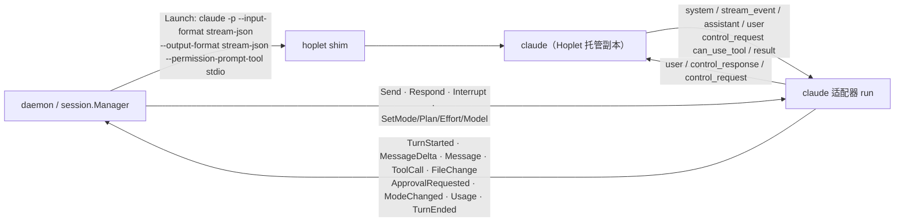

# M1 · PR6b Claude Code 适配 · 详细计划

> **执行方式：** 按任务顺序逐步执行；每一步用 `- [ ]` 勾选。每个任务结束时 `go test -race ./...` 和 `golangci-lint run ./...` 都应通过。修改已有文件的步骤给出补丁：把代码块存成文件后在仓库根目录执行 `git apply <文件>`；新文件给出完整内容。

**目标：** 让 Hoplet 用真实的 Claude Code 跑 Code 会话：事件归一化、审批转发、审批档位 / Plan / 思考强度 / 模型的映射与中途切换、续接、版本门控；Hoplet 托管 claude 副本，新版本先过本机自检再跟进；用录制回放做离线契约测试。

**架构：**



**第一步验证假设（已完成，2026-10-31）：** 在维护者的终端里用真实 Claude Code 2.1.312 录了 11 段会话。

| 能力 | 结论 |
|---|---|
| 审批 | 必须加 `--permission-prompt-tool stdio`，审批以 `control_request{can_use_tool}` 发给宿主（带 `tool_use_id`、`permission_suggestions`）；回 `allow` 可不带原始输入（守护进程重启后照样能答）；"始终允许"把 claude 的建议原样回传（`updatedPermissions`） |
| 中断 | `control_request{interrupt}`；本轮以 `result{error_during_execution, terminal_reason: aborted_streaming}` 结束，会话继续可用 |
| 切换 | `set_permission_mode`（default / acceptEdits / auto / bypassPermissions / plan）、`set_model` 生效；思考强度用 `apply_flag_settings{effortLevel}`（没有 `set_effort`）；Fast 经协议无法开启 |
| Plan | claude 在 Plan 中只写方案并以 `ExitPlanMode` 请求批准；批准后它切回 **default**（不是原档位），所以适配器要恢复原档位并上报 `mode.changed` |
| 续接 | `--resume <id>` 保持同一会话 ID 与上下文 |
| 初始化 | 不发 `initialize` 也能走通审批；重复发无害——适配器不需要区分新启动与重连 |
| 环境 | 继承宿主的 `CLAUDECODE` / `CLAUDE_CODE_*` 会被当成子会话而无法登录；`--setting-sources project` 会丢掉登录 |

**本计划的裁决：**
- 维护者定：全自动 ↔ `bypassPermissions`（启动时总带 `--allow-dangerously-skip-permissions`，便于中途切换）；Hoplet 用托管副本 `~/.hoplet/harness/claude/bin/claude`，关闭 claude 自身更新（`DISABLE_AUTOUPDATER=1`），登录沿用 `~/.claude`。
- 维护者定（升级）：副本可用的版本 = 契约测试覆盖的版本（`verifiedVersions`）∪ 在本机通过自检的版本（记在副本旁的 `verified.json`）。`hoplet harness install / upgrade claude` 遇到两者之外的版本先跑自检，不过就保留旧副本；守护进程启动 10 分钟后、之后每天一次跟进 harness 环境 PATH 上的 claude（只跟进已有的副本；同一失败版本不再重试；`config.toml` 的 `[harness.claude] follow = false` 关闭），结果写进 `update.json`，由 `Probe` 的 `Notice` / `Attention` 带到 doctor。只有协议真的变了才需要录制新版本、发布 Hoplet。
- 自检（`SelfCheck`）在临时目录用 haiku 经适配器本身跑：命令审批并拒绝 → 切到自动编辑后免审批写文件 → 中断长回复 → 新进程续接同一会话；每步限 90 秒。它要用真实 claude 与订阅额度，所以没有单元测试，靠验收步骤真跑（计划编写时 2.1.312 → 2.1.316 实测通过，约 30 秒）；安装与跟进的逻辑用假的自检函数测试。
- 切换后删除旧副本（每份约 300 MB）；正在运行的会话已打开旧文件，不受影响。
- 档位映射：需确认 → `default`，自动编辑 → `acceptEdits`，智能审批 → `auto`，全自动 → `bypassPermissions`；Plan 开关 → `plan`。claude 报来的其他模式（`manual`、`dontAsk`）按最严的需确认处理。
- 适配器只把 claude 自己做的模式变化上报为 `mode.changed`：它记住自己请求的模式，claude 报来的模式与之相同就不上报。
- claude 2.1.312 不支持 ultra 与 Fast：能力位不声明，守护进程据此拒绝并在界面隐藏。插话（steer）和提问未验证，能力位也不声明。
- `Probe` 按二进制（解析后的路径、大小、修改时间）缓存：守护进程每次新建会话、切换设置都会探测。
- 契约测试回放录制：把录到的 claude 输出逐行喂给适配器，在录到的输入处发出对应的 Hoplet 命令，比较写出的内容与录到的输入，并把归一化事件与 golden 文件比对（`go test -update` 重新生成后人工审阅 diff）。
- 录制是用户数据：`hoplet dev sanitize` 去掉个人路径、账号、技能列表、签名和会把路径拆散的片段后才能入库。
- 协议变化时的流程：`hoplet dev record` 录新版本 → 修适配器 → 加进 `verifiedVersions` 与 `testdata/<版本>/` → 契约测试通过 → 发布 Hoplet。

## 全局约束

- 不新增依赖；代码、注释、commit 用英文；设计文档中文；导出标识符有文档注释；库代码不 panic；不用 lint 抑制注释（路径 + 规则号的排除写明理由，且被排除的文件只放那一段代码）。
- 永不读取或修改 harness 的凭证（`~/.claude` 由 claude 自己读）；测试不运行真实 claude、不访问网络、不碰真实的 `~/.hoplet`。
- 录制入库前必须脱敏。
- 测试不泄漏进程；除"轮询直到条件成立"外不用 sleep 同步。
- 分支 `feat/claude`；commit 带 DCO 签名（`git commit -s`）；完成前 `make check` 通过。

## 文件

| 文件 | 职责 |
|---|---|
| `internal/harness/claude/claude.go` | `Harness`（Kind、带缓存的 Probe、Launch、Attach）、版本门控、档位映射 |
| `internal/harness/claude/wire.go`、`tools.go` | stream-json 线格式、工具分类与摘要 |
| `internal/harness/claude/run.go` | 事件翻译、审批、命令、模式跟踪 |
| `internal/harness/claude/state.go` | 副本旁的本机记录：自检通过的版本、最近一次跟进结果 |
| `internal/harness/claude/install.go`、`check.go` | 托管副本的安装与跟进、本机自检 |
| `internal/harness/harness.go`、`internal/daemon/{daemon,system}.go`、`internal/config/config.go` 及测试 | `Info.Notice / Attention` 与 doctor 展示；守护进程每日维护钩子；`[harness.claude] follow` |
| `internal/harness/claude/record.go`、`launch_exec.go` | 录制与脱敏 |
| `internal/harness/claude/*_test.go`、`testdata/2.1.312/` | 单元测试、录制回放契约测试与 golden |
| `cmd/hoplet/main.go`、`daemon.go`、`harness.go`、`dev.go` 及测试 | 生产环境注册 claude；`hoplet harness install / upgrade claude`；守护进程每日跟进；`hoplet dev record / sanitize` |
| `.golangci.yml` | `launch_exec.go` 的 G204 排除 |
| `docs/design/0003`、`0004`、`0013`，`docs/plans/m1-overview.md` | 设计与总计划同步 |

## 接口（后续 PR 依赖）

- `claude.Harness{Binary}`（`harness.StdioHarness`）、`claude.Kind`、`claude.BinaryPath(home)`、`claude.ErrNotInstalled`
- `claude.Install(ctx, src, home, check Checker) (Installed, error)`、`claude.Follow(ctx, home, path, check) (Update, bool)`、`claude.SelfCheck(ctx, bin, env) error`、`claude.Checker`
- `harness.Info.Notice`、`harness.Info.Attention`；`daemon.Config.Maintenance`、`daemon.Config.MaintenanceEvery`；`config.Config.Harness.Claude.Follows()`
- `claude.Record(ctx, RecordConfig, out)`、`claude.Sanitize(in, out, dir, home)`、`claude.Step`、`claude.Entry`
- 审批选项 ID：`allow`、`always`（有建议时）、`deny`；`ExitPlanMode` 为"Start / Keep planning"
- CLI：`hoplet harness install | upgrade claude [--from PATH] [--json]`、`hoplet dev record …`、`hoplet dev sanitize …`

---

### 任务 0：建分支并放入录制

- [ ] **步骤 1：建分支**

```bash
git switch -c feat/claude
```

- [ ] **步骤 2：放入录制与 golden**

录制是真实 claude 的输出（已脱敏），不是手写代码；golden 由任务 2 的契约测试生成并经人工审阅。从录制目录复制（`$RECORDINGS` 是维护者本机存放已脱敏录制的目录；录制与脱敏用任务 3 的 `hoplet dev record / sanitize`）：

```bash
mkdir -p internal/harness/claude/testdata
cp -R "$RECORDINGS"/2.1.312 internal/harness/claude/testdata/
git add internal/harness/claude/testdata
git commit -s -m "test(claude): add recorded Claude Code 2.1.312 sessions"
```

预期：`testdata/2.1.312/` 下 10 个 `.jsonl` 与 10 个 `.golden`；`grep -rhoE '/Users/[^/\"]+' internal/harness/claude/testdata | sort -u` 只输出 `/Users/me`，`grep -rl signature internal/harness/claude/testdata` 无输出。

### 任务 1：harness 提示与守护进程每日维护

**文件：** 修改 `internal/harness/harness.go`、`internal/daemon/{daemon,system,system_test}.go`、`internal/config/{config,config_test}.go`；创建 `internal/daemon/maintain_test.go`

**接口：** 产生 `harness.Info.Notice`、`Attention`（doctor 把 Notice 接在版本后面，Attention 时告警）；`daemon.Config.Maintenance func(ctx, env []string)`、`MaintenanceEvery`（默认一天，首次在启动后 10 分钟或更短的间隔后，参数为当前 harness 环境）；`config.Harness.Claude.Follow *bool` 与 `Follows()`（未设置为 true）。

- [ ] **步骤 1：写测试**


````diff
diff --git a/internal/config/config_test.go b/internal/config/config_test.go
index ebf30db..e68bc2e 100644
--- a/internal/config/config_test.go
+++ b/internal/config/config_test.go
@@ -47,6 +47,19 @@ allow = ["GH_TOKEN"]
 	}
 }
 
+func TestHarnessFollow(t *testing.T) {
+	for body, want := range map[string]bool{
+		"":                                   true,
+		"[harness.claude]\nfollow = true\n":  true,
+		"[harness.claude]\nfollow = false\n": false,
+	} {
+		c, err := Load(write(t, body))
+		if err != nil || c.Harness.Claude.Follows() != want {
+			t.Errorf("%q: follows %v %v, want %v", body, c.Harness.Claude.Follows(), err, want)
+		}
+	}
+}
+
 func TestLoadRejects(t *testing.T) {
 	for name, tc := range map[string]struct{ body, inErr string }{
 		"unknown key":     {"[network]\nproxi = \"x\"\n", "unknown keys network.proxi"},
@@ -59,6 +72,7 @@ func TestLoadRejects(t *testing.T) {
 		"empty no_proxy":  {"[network]\nno_proxy = [\"\"]\n", "no_proxy"},
 		"spaced no_proxy": {"[network]\nno_proxy = [\"a b\"]\n", "no_proxy"},
 		"comma no_proxy":  {"[network]\nno_proxy = [\"a,b\"]\n", "no_proxy"},
+		"unknown harness": {"[harness.codex]\nfollow = false\n", "unknown keys harness.codex"},
 	} {
 		_, err := Load(write(t, tc.body))
 		if err == nil || !strings.Contains(err.Error(), tc.inErr) {
diff --git a/internal/daemon/system_test.go b/internal/daemon/system_test.go
index fc91991..9620cc4 100644
--- a/internal/daemon/system_test.go
+++ b/internal/daemon/system_test.go
@@ -239,6 +239,8 @@ func TestDoctorHarnessProbeResults(t *testing.T) {
 		harnesses: map[string]harness.Harness{
 			"broken": stubHarness{&fake.Harness{}, harness.Info{}, errors.New("binary missing")},
 			"old":    stubHarness{&fake.Harness{}, harness.Info{Version: "0.1", Supported: false}, nil},
+			"moved":  stubHarness{&fake.Harness{}, harness.Info{Version: "2", Supported: true, Notice: "followed from 1"}, nil},
+			"stuck":  stubHarness{&fake.Harness{}, harness.Info{Version: "1", Supported: true, Notice: "2 failed", Attention: true}, nil},
 		},
 		probeURL: srv.URL,
 	}
@@ -250,6 +252,12 @@ func TestDoctorHarnessProbeResults(t *testing.T) {
 	if o := c["harness old"]; o.Status != proto.CheckWarn || !strings.Contains(o.Detail, "0.1") {
 		t.Errorf("old %+v", o)
 	}
+	if m := c["harness moved"]; m.Status != proto.CheckOK || m.Detail != "version 2; followed from 1" {
+		t.Errorf("moved %+v", m)
+	}
+	if s := c["harness stuck"]; s.Status != proto.CheckWarn || s.Detail != "version 1; 2 failed" {
+		t.Errorf("stuck %+v", s)
+	}
 }
 
 func TestDoctorWarnsWhenTheSystemProxyIsAPACFile(t *testing.T) {
````


`internal/daemon/maintain_test.go`

```go
package daemon

import (
	"context"
	"slices"
	"strings"
	"testing"
	"time"

	"github.com/yangflow/hoplet/internal/harness/fake"
)

func TestMaintenanceRunsWithTheHarnessEnvironment(t *testing.T) {
	cfg := testConfig(newHome(t, fake.Script{}))
	ran := make(chan []string, 4)
	cfg.MaintenanceEvery = time.Millisecond
	cfg.Maintenance = func(ctx context.Context, env []string) {
		select {
		case ran <- env:
		case <-ctx.Done():
		}
	}
	start(t, cfg) // closing it waits for the maintenance goroutine
	for range 2 {
		if env := <-ran; !slices.ContainsFunc(env, func(kv string) bool { return strings.HasPrefix(kv, "PATH=") }) {
			t.Fatalf("maintenance env %v", env)
		}
	}
}

func TestMaintainStopsWithItsContext(t *testing.T) {
	ctx, cancel := context.WithCancel(context.Background())
	done := make(chan struct{})
	n := 0
	go func() {
		defer close(done)
		maintain(ctx, func(context.Context, []string) {
			if n++; n == 3 {
				cancel()
			}
		}, time.Millisecond, func() []string { return nil })
	}()
	<-done
	if n != 3 {
		t.Fatalf("ran %d times", n)
	}
}
```


- [ ] **步骤 2：运行，确认失败**

运行：`go test ./internal/daemon/ ./internal/config/`
预期：编译失败，`unknown field Notice`、`undefined: maintain`、`c.Harness undefined` 等

- [ ] **步骤 3：实现**


````diff
diff --git a/internal/config/config.go b/internal/config/config.go
index 45530f6..cd0d17a 100644
--- a/internal/config/config.go
+++ b/internal/config/config.go
@@ -21,8 +21,24 @@ const FileName = "config.toml"
 type Config struct {
 	Network Network `toml:"network"`
 	Env     Env     `toml:"env"`
+	Harness Harness `toml:"harness"`
 }
 
+// Harness configures the harnesses Hoplet runs.
+type Harness struct {
+	Claude HarnessOptions `toml:"claude"`
+}
+
+// HarnessOptions configures one harness.
+type HarnessOptions struct {
+	// Follow, when false, stops the daemon from moving Hoplet's copy to
+	// the version on the user's PATH each day; unset means true.
+	Follow *bool `toml:"follow"`
+}
+
+// Follows reports whether the daemon follows the user's version.
+func (o HarnessOptions) Follows() bool { return o.Follow == nil || *o.Follow }
+
 // Network configures outbound connections of the daemon and its harnesses.
 type Network struct {
 	// Proxy is the proxy URL (http://, https://, socks5://, socks5h://).
diff --git a/internal/daemon/daemon.go b/internal/daemon/daemon.go
index 73ea3d1..3109014 100644
--- a/internal/daemon/daemon.go
+++ b/internal/daemon/daemon.go
@@ -46,6 +46,13 @@ type Config struct {
 	// use; empty means DefaultProbeURL.
 	ProbeURL string
 
+	// Maintenance, when set, runs MaintenanceEvery (default a day) with the
+	// harness environment, first ten minutes after the start (or after
+	// MaintenanceEvery when that is shorter): harness upgrades that check
+	// themselves.
+	Maintenance      func(ctx context.Context, env []string)
+	MaintenanceEvery time.Duration
+
 	// lim overrides the protocol limits (tests); zero fields keep defaults.
 	lim limits
 }
@@ -161,6 +168,13 @@ func Start(ctx context.Context, cfg Config) (d *Daemon, err error) {
 		defer d.wg.Done()
 		q.run(runCtx)
 	}()
+	if cfg.Maintenance != nil {
+		d.wg.Add(1)
+		go func() {
+			defer d.wg.Done()
+			maintain(runCtx, cfg.Maintenance, cfg.MaintenanceEvery, func() []string { return sys.vars() })
+		}()
+	}
 	go func() {
 		defer d.wg.Done()
 		defer close(d.done)
@@ -257,3 +271,22 @@ func listen(sock string) (net.Listener, error) {
 	}
 	return ln, nil
 }
+
+// maintain runs fn ten minutes after the start (or after every, when that
+// is shorter) and then every interval, until ctx ends.
+func maintain(ctx context.Context, fn func(context.Context, []string), every time.Duration, env func() []string) {
+	if every <= 0 {
+		every = 24 * time.Hour
+	}
+	t := time.NewTimer(min(10*time.Minute, every))
+	defer t.Stop()
+	for {
+		select {
+		case <-ctx.Done():
+			return
+		case <-t.C:
+		}
+		fn(ctx, env())
+		t.Reset(every)
+	}
+}
diff --git a/internal/daemon/system.go b/internal/daemon/system.go
index bae9a03..b2e2ce1 100644
--- a/internal/daemon/system.go
+++ b/internal/daemon/system.go
@@ -219,9 +219,22 @@ func (s *system) probeHarness(ctx context.Context, kind string, h harness.Harnes
 		return proto.Check{Name: name, Status: proto.CheckFail, Detail: fmt.Sprintf("did not answer within %v", s.timeout())}
 	case res.err != nil:
 		return proto.Check{Name: name, Status: proto.CheckFail, Detail: res.err.Error()}
-	case !res.info.Supported:
-		return proto.Check{Name: name, Status: proto.CheckWarn, Detail: "version " + res.info.Version + " is outside the verified range; new turns are refused"}
-	default:
-		return proto.Check{Name: name, Status: proto.CheckOK, Detail: "version " + res.info.Version}
 	}
+	c := proto.Check{Name: name, Status: proto.CheckOK, Detail: "version " + res.info.Version}
+	if !res.info.Supported {
+		c.Status, c.Detail = proto.CheckWarn, c.Detail+" is not verified; new turns are refused"
+	}
+	if res.info.Notice != "" {
+		c.Detail += "; " + res.info.Notice
+		if res.info.Attention {
+			c.Status = proto.CheckWarn
+		}
+	}
+	return c
+}
+
+// vars is the environment harnesses start with now.
+func (s *system) vars() []string {
+	snap, _ := s.state()
+	return slices.Clone(snap.Vars)
 }
diff --git a/internal/harness/harness.go b/internal/harness/harness.go
index 2922e9a..d845d78 100644
--- a/internal/harness/harness.go
+++ b/internal/harness/harness.go
@@ -45,6 +45,10 @@ type Info struct {
 	// Supported is false when Version is outside the verified range. The
 	// daemon then keeps existing sessions read-only and starts no new turns.
 	Supported bool
+	// Notice is something about the installed harness worth showing in
+	// doctor (an automatic upgrade, say); Attention marks it as a problem.
+	Notice    string
+	Attention bool
 }
 
 // State is the resume state the daemon reads from its store when it attaches
````


- [ ] **步骤 4：运行，确认通过**

运行：`go test -race ./internal/daemon/ ./internal/config/ ./internal/harness/`
预期：`ok`

- [ ] **步骤 5：commit**

```bash
git add internal/harness/harness.go internal/daemon internal/config
git commit -s -m "feat(daemon): show harness notices and run daily maintenance"
```

### 任务 2：适配器

**文件：** 创建 `internal/harness/claude/{claude,wire,tools,run,state}.go`、`contract_test.go`、`adapter_test.go`

**接口：** 消费任务 1 的 `harness.Info.Notice / Attention`。产生 `claude.Harness`、`Kind`、`BinaryPath`、`ErrNotInstalled`；内部 `newRun`、`verifiedVersions`、`nativeMode`、`hopletMode`；`state.go` 的 `localVerified`、`readVerified`、`Update`、`lastUpdate`（`Probe` 用 `localVerified` 判断是否支持、用 `lastUpdate` 填提示）；写这两个文件的 `addVerified`、`writeAtomic` 在任务 3 的 `install.go`。

- [ ] **步骤 1：写测试**


`internal/harness/claude/contract_test.go`

```go
package claude

import (
	"bufio"
	"context"
	"encoding/json"
	"flag"
	"fmt"
	"os"
	"path/filepath"
	"reflect"
	"strings"
	"sync"
	"testing"
	"time"

	"github.com/yangflow/hoplet/internal/harness"
	"github.com/yangflow/hoplet/proto"
)

var update = flag.Bool("update", false, "rewrite the golden files")

// recordedVersion is the claude version the fixtures were recorded with
// (`hoplet dev record`); they are claude's real output, sanitized.
const recordedVersion = "2.1.312"

// fakeStdio feeds lines to a run and records what it writes.
type fakeStdio struct {
	lines  chan harness.Line
	mu     sync.Mutex
	writes [][]byte
}

func newFakeStdio() *fakeStdio { return &fakeStdio{lines: make(chan harness.Line)} }

func (f *fakeStdio) WriteLine(_ context.Context, line []byte) error {
	f.mu.Lock()
	defer f.mu.Unlock()
	f.writes = append(f.writes, append([]byte(nil), line...))
	return nil
}

func (f *fakeStdio) written() [][]byte {
	f.mu.Lock()
	defer f.mu.Unlock()
	return append([][]byte(nil), f.writes...)
}

func (f *fakeStdio) Lines() <-chan harness.Line { return f.lines }
func (f *fakeStdio) Signal(string) error        { return nil }
func (f *fakeStdio) Close() error               { return nil }

type entry struct {
	Dir  string `json:"dir"`
	Line string `json:"line"`
}

func readFixture(t *testing.T, path string) []entry {
	t.Helper()
	f, err := os.Open(path)
	if err != nil {
		t.Fatal(err)
	}
	defer f.Close()
	var out []entry
	sc := bufio.NewScanner(f)
	sc.Buffer(nil, 4<<20)
	for sc.Scan() {
		var e entry
		if err := json.Unmarshal(sc.Bytes(), &e); err != nil {
			t.Fatal(err)
		}
		out = append(out, e)
	}
	return out
}

// replayer drives a run through a recording.
type replayer struct {
	t      *testing.T
	io     *fakeStdio
	run    *run
	offset int64
	golden []string
}

// push feeds one stdout line and waits until the run has handled it: the
// position line after it is handled only once everything before it is.
func (p *replayer) push(kind harness.LineKind, data []byte) {
	p.t.Helper()
	p.offset += 2
	p.io.lines <- harness.Line{Kind: kind, Data: data, Offset: p.offset}
	p.io.lines <- harness.Line{Kind: harness.Position, Offset: p.offset + 1}
	for {
		select {
		case ev := <-p.run.Events():
			if ev.Offset == p.offset+1 {
				return
			}
			p.record(ev)
		case <-time.After(10 * time.Second):
			p.t.Fatalf("the run did not handle line %d", p.offset)
		}
	}
}

func (p *replayer) record(ev harness.Event) {
	if ev.Payload == nil && ev.Native == "" {
		return
	}
	line := ""
	if ev.Native != "" {
		line = "native " + ev.Native + " "
	}
	if ev.Payload != nil {
		b, err := json.Marshal(ev.Payload)
		if err != nil {
			p.t.Fatal(err)
		}
		line += fmt.Sprintf("%T %s", ev.Payload, b)
	}
	p.golden = append(p.golden, strings.TrimSpace(line))
}

// command issues the Hoplet command a recorded input line stands for and
// checks the run wrote the same thing; it reports false for recorder-only
// probes no Hoplet command produces.
func (p *replayer) command(in string) bool {
	p.t.Helper()
	ctx := context.Background()
	var msg struct {
		Type    string `json:"type"`
		Message struct {
			Content string `json:"content"`
		} `json:"message"`
		Request  map[string]any `json:"request"`
		Response struct {
			RequestID string         `json:"request_id"`
			Response  map[string]any `json:"response"`
		} `json:"response"`
	}
	if err := json.Unmarshal([]byte(in), &msg); err != nil {
		p.t.Fatal(err)
	}
	var err error
	switch msg.Type {
	case "user":
		err = p.run.Send(ctx, msg.Message.Content)
	case "control_response":
		r := msg.Response.Response
		option := optionAllow
		switch {
		case r["behavior"] == "deny":
			option = optionDeny
		case r["updatedPermissions"] != nil:
			option = optionAlways
		}
		err = p.run.Respond(ctx, msg.Response.RequestID, option)
	case "control_request":
		switch sub := msg.Request["subtype"]; sub {
		case "interrupt":
			err = p.run.Interrupt(ctx)
		case "set_model":
			err = p.run.SetModel(ctx, msg.Request["model"].(string))
		case "set_permission_mode":
			mode := msg.Request["mode"].(string)
			p.run.mu.Lock()
			inPlan := p.run.plan
			p.run.mu.Unlock()
			switch {
			case mode == planMode:
				err = p.run.SetPlan(ctx, true)
			case inPlan:
				if err = p.run.SetMode(ctx, hopletMode(mode)); err == nil {
					err = p.run.SetPlan(ctx, false)
				}
			default:
				err = p.run.SetMode(ctx, hopletMode(mode))
			}
		case "apply_flag_settings":
			settings := msg.Request["settings"].(map[string]any)
			effort, ok := settings["effortLevel"].(string)
			if !ok {
				return false
			}
			err = p.run.SetEffort(ctx, proto.Effort(effort))
		default:
			return false // initialize and the recorder's own probes
		}
	default:
		p.t.Fatalf("unexpected input %s", in)
	}
	if err != nil {
		p.t.Fatalf("command for %s: %v", in, err)
	}
	writes := p.io.written()
	got := writes[len(writes)-1]
	if !sameInput(p.t, got, []byte(in)) {
		p.t.Fatalf("for recorded input\n  %s\nthe run wrote\n  %s", in, got)
	}
	p.golden = append(p.golden, "write "+strings.ReplaceAll(string(got), p.run.prefix, "hoplet-x"))
	return true
}

// sameInput compares what the run wrote with what the recorder wrote,
// ignoring the IDs of requests and the text of a denial. An answer must
// carry the same behavior, and every permission update the recorder sent:
// the adapter sends all of claude's suggestions, where one early
// recording sent only some.
func sameInput(t *testing.T, got, want []byte) bool {
	t.Helper()
	var g, w map[string]any
	if json.Unmarshal(got, &g) != nil || json.Unmarshal(want, &w) != nil {
		return false
	}
	if g["type"] == "control_response" {
		gr := g["response"].(map[string]any)
		wr := w["response"].(map[string]any)
		gp, _ := gr["response"].(map[string]any)
		wp, _ := wr["response"].(map[string]any)
		if gr["request_id"] != wr["request_id"] || gp["behavior"] != wp["behavior"] {
			return false
		}
		gu, _ := gp["updatedPermissions"].([]any)
		wu, _ := wp["updatedPermissions"].([]any)
		if (len(gu) == 0) != (len(wu) == 0) {
			return false
		}
		for _, u := range wu {
			found := false
			for _, v := range gu {
				found = found || reflect.DeepEqual(u, v)
			}
			if !found {
				return false
			}
		}
		return true
	}
	delete(g, "request_id")
	delete(w, "request_id")
	return reflect.DeepEqual(g, w)
}

// specs are the settings each recording was made with.
var specs = map[string]harness.Spec{
	"auto_effort": {Mode: proto.ModeConfirm, Effort: proto.EffortHigh},
}

// TestRecordings replays claude's recorded output through the adapter,
// issues the Hoplet commands behind the recorded inputs, and compares the
// normalized events and written lines with the golden files.
func TestRecordings(t *testing.T) {
	files, err := filepath.Glob(filepath.Join("testdata", recordedVersion, "*.jsonl"))
	if err != nil || len(files) == 0 {
		t.Fatalf("no recordings: %v", err)
	}
	for _, file := range files {
		name := strings.TrimSuffix(filepath.Base(file), ".jsonl")
		t.Run(name, func(t *testing.T) {
			spec, ok := specs[name]
			if !ok {
				spec = harness.Spec{Mode: proto.ModeConfirm}
			}
			io := newFakeStdio()
			p := &replayer{t: t, io: io, run: newRun(io, spec)}
			defer p.run.Close()
			for _, e := range readFixture(t, file) {
				switch e.Dir {
				case "out":
					p.push(harness.Stdout, []byte(e.Line))
				case "in":
					p.command(e.Line)
				}
			}
			golden := filepath.Join("testdata", recordedVersion, name+".golden")
			got := strings.Join(p.golden, "\n") + "\n"
			if *update {
				if err := os.WriteFile(golden, []byte(got), 0o600); err != nil {
					t.Fatal(err)
				}
				return
			}
			want, err := os.ReadFile(golden)
			if err != nil {
				t.Fatalf("%v (run with -update to create it)", err)
			}
			if got != string(want) {
				t.Fatalf("events differ from %s (run with -update and review the diff):\n%s", golden, got)
			}
		})
	}
}
```


`internal/harness/claude/adapter_test.go`

```go
package claude

import (
	"context"
	"encoding/json"
	"errors"
	"os"
	"path/filepath"
	"slices"
	"strings"
	"testing"
	"time"

	"github.com/yangflow/hoplet/internal/harness"
	"github.com/yangflow/hoplet/proto"
)

// fakeClaude writes a script that answers --version like claude and counts
// its runs in dir/runs.
func fakeClaude(t *testing.T, version string) (bin, dir string) {
	t.Helper()
	dir = t.TempDir()
	bin = filepath.Join(dir, "claude")
	script := "#!/bin/sh\necho run >> " + filepath.Join(dir, "runs") + "\necho '" + version + " (Claude Code)'\n"
	if err := os.WriteFile(bin, []byte(script), 0o700); err != nil {
		t.Fatal(err)
	}
	return bin, dir
}

func runs(t *testing.T, dir string) int {
	t.Helper()
	b, err := os.ReadFile(filepath.Join(dir, "runs"))
	if err != nil {
		return 0
	}
	return strings.Count(string(b), "run\n")
}

func TestProbeCachesPerBinary(t *testing.T) {
	bin, dir := fakeClaude(t, "2.1.312")
	h := &Harness{Binary: bin}
	ctx := context.Background()
	for range 3 {
		info, err := h.Probe(ctx)
		if err != nil || info.Version != "2.1.312" || !info.Supported || !info.Capabilities.PlanMode || info.Capabilities.Fast {
			t.Fatalf("probe %+v %v", info, err)
		}
	}
	if n := runs(t, dir); n != 1 {
		t.Fatalf("claude ran %d times for 3 probes", n)
	}
	// A new binary in its place is probed again.
	if err := os.WriteFile(bin, []byte("#!/bin/sh\necho '9.0.0 (Claude Code)'\n"), 0o700); err != nil {
		t.Fatal(err)
	}
	later := time.Now().Add(time.Hour)
	if err := os.Chtimes(bin, later, later); err != nil {
		t.Fatal(err)
	}
	if info, err := h.Probe(ctx); err != nil || info.Version != "9.0.0" || info.Supported {
		t.Fatalf("probe after replacing the binary %+v %v", info, err)
	}
	if _, err := (&Harness{Binary: filepath.Join(dir, "missing")}).Probe(ctx); !errors.Is(err, ErrNotInstalled) {
		t.Fatalf("missing binary: %v", err)
	}
	if _, err := parseVersion([]byte("hello")); err == nil {
		t.Fatal("parsed a non-claude version")
	}
}

func TestLaunch(t *testing.T) {
	h := &Harness{Binary: "/h/claude"}
	for name, tc := range map[string]struct {
		spec harness.Spec
		want []string
		bad  bool
	}{
		"confirm":     {spec: harness.Spec{Mode: proto.ModeConfirm}, want: []string{"--permission-mode", "default"}},
		"auto review": {spec: harness.Spec{Mode: proto.ModeAutoReview}, want: []string{"--permission-mode", "auto"}},
		"full auto":   {spec: harness.Spec{Mode: proto.ModeFullAuto}, want: []string{"--permission-mode", "bypassPermissions"}},
		"plan":        {spec: harness.Spec{Mode: proto.ModeAutoEdit, Plan: true}, want: []string{"--permission-mode", "plan"}},
		"effort":      {spec: harness.Spec{Mode: proto.ModeConfirm, Effort: proto.EffortXHigh}, want: []string{"--effort", "xhigh"}},
		"resume":      {spec: harness.Spec{Mode: proto.ModeConfirm, Resume: "abc", Model: "sonnet"}, want: []string{"--model", "sonnet", "--resume", "abc"}},
		"ultra":       {spec: harness.Spec{Mode: proto.ModeConfirm, Effort: proto.EffortUltra}, bad: true},
		"fast":        {spec: harness.Spec{Mode: proto.ModeConfirm, Fast: true}, bad: true},
		"bogus mode":  {spec: harness.Spec{Mode: "read_only"}, bad: true},
	} {
		tc.spec.WorkDir = "/work"
		tc.spec.Env = []string{"PATH=/bin", "CLAUDECODE=1", "CLAUDE_CODE_ENTRYPOINT=desktop", "ANTHROPIC_BASE_URL=https://gw", "DISABLE_AUTOUPDATER=0"}
		l, err := h.Launch(tc.spec)
		if tc.bad {
			if err == nil {
				t.Errorf("%s: launched %v", name, l.Command)
			}
			continue
		}
		if err != nil {
			t.Fatalf("%s: %v", name, err)
		}
		cmd := strings.Join(l.Command, " ")
		for _, must := range []string{"/h/claude -p", "--input-format stream-json", "--output-format stream-json", "--permission-prompt-tool stdio", strings.Join(tc.want, " ")} {
			if !strings.Contains(cmd, must) {
				t.Errorf("%s: %q lacks %q", name, cmd, must)
			}
		}
		if l.Dir != "/work" || !slices.Equal(l.Env, []string{"PATH=/bin", "ANTHROPIC_BASE_URL=https://gw", "DISABLE_AUTOUPDATER=1"}) {
			t.Errorf("%s: dir %q env %v", name, l.Dir, l.Env)
		}
	}
}

// liveRun is a run over a fake stdio, for driving it line by line.
func liveRun(t *testing.T, spec harness.Spec) (*replayer, *fakeStdio) {
	t.Helper()
	io := newFakeStdio()
	p := &replayer{t: t, io: io, run: newRun(io, spec)}
	t.Cleanup(func() { p.run.Close() })
	return p, io
}

func lastWrite(t *testing.T, io *fakeStdio) map[string]any {
	t.Helper()
	w := io.written()
	if len(w) == 0 {
		t.Fatal("nothing written")
	}
	var m map[string]any
	if err := json.Unmarshal(w[len(w)-1], &m); err != nil {
		t.Fatal(err)
	}
	return m
}

func TestPlanAndModeTracking(t *testing.T) {
	ctx := context.Background()
	p, io := liveRun(t, harness.Spec{Mode: proto.ModeAutoReview, Plan: true})
	// Changing the mode in plan mode only changes what is restored.
	if err := p.run.SetMode(ctx, proto.ModeFullAuto); err != nil || len(io.written()) != 0 {
		t.Fatalf("SetMode in plan mode wrote %d lines (%v)", len(io.written()), err)
	}
	// claude leaves plan mode by itself after a plan is approved, back to
	// its default: the session's mode is restored and the change reported.
	p.push(harness.Stdout, []byte(`{"type":"system","subtype":"status","permissionMode":"default"}`))
	if want := `proto.ModeChanged {"permission":"full_auto","plan":false}`; len(p.golden) != 1 || p.golden[0] != want {
		t.Fatalf("events %q, want %q", p.golden, want)
	}
	if req := lastWrite(t, io)["request"].(map[string]any); req["mode"] != "bypassPermissions" {
		t.Fatalf("restore wrote %v", req)
	}
	// claude confirming the restored mode is not a change.
	p.push(harness.Stdout, []byte(`{"type":"system","subtype":"status","permissionMode":"bypassPermissions"}`))
	// An approval answered with a session-wide mode change.
	p.push(harness.Stdout, []byte(`{"type":"system","subtype":"status","permissionMode":"acceptEdits"}`))
	// claude entering plan mode by itself.
	p.push(harness.Stdout, []byte(`{"type":"system","subtype":"status","permissionMode":"plan"}`))
	want := []string{
		`proto.ModeChanged {"permission":"full_auto","plan":false}`,
		`proto.ModeChanged {"permission":"auto_edit","plan":false}`,
		`proto.ModeChanged {"permission":"auto_edit","plan":true}`,
	}
	if !slices.Equal(p.golden, want) {
		t.Fatalf("events %q", p.golden)
	}
	// Hoplet turning plan mode off restores auto_edit, and claude's
	// confirmation is not reported back.
	if err := p.run.SetPlan(ctx, false); err != nil {
		t.Fatal(err)
	}
	if req := lastWrite(t, io)["request"].(map[string]any); req["mode"] != "acceptEdits" {
		t.Fatalf("SetPlan(false) wrote %v", req)
	}
	p.push(harness.Stdout, []byte(`{"type":"system","subtype":"status","permissionMode":"acceptEdits"}`))
	if len(p.golden) != 3 {
		t.Fatalf("Hoplet's own change was reported: %q", p.golden)
	}
}

func TestCommandsAndRefusals(t *testing.T) {
	ctx := context.Background()
	p, io := liveRun(t, harness.Spec{Mode: proto.ModeConfirm})
	if err := p.run.SetEffort(ctx, proto.EffortMax); err != nil {
		t.Fatal(err)
	}
	if req := lastWrite(t, io)["request"].(map[string]any); req["subtype"] != "apply_flag_settings" || req["settings"].(map[string]any)["effortLevel"] != "max" {
		t.Fatalf("SetEffort wrote %v", req)
	}
	for name, err := range map[string]error{
		"ultra":  p.run.SetEffort(ctx, proto.EffortUltra),
		"fast":   p.run.SetFast(ctx, true),
		"steer":  p.run.Steer(ctx, "x"),
		"answer": p.run.Answer(ctx, "q", "a"),
	} {
		if !errors.Is(err, harness.ErrUnsupported) {
			t.Errorf("%s: %v", name, err)
		}
	}
	if err := p.run.Respond(ctx, "a1", "maybe"); err == nil {
		t.Fatal("unknown option accepted")
	}
	// An approval the run never saw (a daemon that reattached after it was
	// asked) is answered without its input.
	if err := p.run.Respond(ctx, "unseen", optionAllow); err != nil {
		t.Fatal(err)
	}
	if resp := lastWrite(t, io)["response"].(map[string]any); resp["request_id"] != "unseen" || len(resp["response"].(map[string]any)) != 1 {
		t.Fatalf("answer to an unseen approval %v", resp)
	}
	// A control request Hoplet does not handle is refused, not left waiting.
	p.push(harness.Stdout, []byte(`{"type":"control_request","request_id":"r9","request":{"subtype":"hook_callback"}}`))
	if resp := lastWrite(t, io)["response"].(map[string]any); resp["subtype"] != "error" || resp["request_id"] != "r9" {
		t.Fatalf("refusal %v", resp)
	}
	if len(p.golden) != 1 || !strings.HasPrefix(p.golden[0], "proto.Error") {
		t.Fatalf("events %q", p.golden)
	}
}

func TestApprovalOptionsAndCancel(t *testing.T) {
	p, _ := liveRun(t, harness.Spec{Mode: proto.ModeConfirm})
	p.push(harness.Stdout, []byte(`{"type":"control_request","request_id":"s1","request":{"subtype":"can_use_tool","tool_name":"Write","input":{"file_path":"/w/a"},"permission_suggestions":[{"type":"setMode","mode":"acceptEdits","destination":"session"}],"tool_use_id":"t1"}}`))
	p.push(harness.Stdout, []byte(`{"type":"control_request","request_id":"s2","request":{"subtype":"can_use_tool","tool_name":"Bash","input":{"command":"ls"},"permission_suggestions":[{"type":"addRules","destination":"localSettings"}]}}`))
	p.push(harness.Stdout, []byte(`{"type":"control_request","request_id":"s3","request":{"subtype":"can_use_tool","tool_name":"WebFetch","input":{"url":"https://x"}}}`))
	p.push(harness.Stdout, []byte(`{"type":"control_cancel_request","request_id":"s3"}`))
	p.push(harness.Stdout, []byte(`{"type":"control_cancel_request","request_id":"unknown"}`))
	want := []string{
		`proto.ApprovalRequested {"id":"s1","kind":"file_change","title":"Write /w/a","tool_call_id":"t1","options":[{"id":"allow","label":"Allow once","scope":"once"},{"id":"always","label":"Allow for this session","scope":"session"},{"id":"deny","label":"Deny","scope":"deny"}]}`,
		`proto.ApprovalRequested {"id":"s2","kind":"command","title":"Bash ls","options":[{"id":"allow","label":"Allow once","scope":"once"},{"id":"always","label":"Always allow","scope":"always"},{"id":"deny","label":"Deny","scope":"deny"}]}`,
		`proto.ApprovalRequested {"id":"s3","kind":"tool","title":"WebFetch https://x","options":[{"id":"allow","label":"Allow once","scope":"once"},{"id":"deny","label":"Deny","scope":"deny"}]}`,
		`proto.ApprovalResolved {"id":"s3","outcome":"expired"}`,
	}
	if !slices.Equal(p.golden, want) {
		t.Fatalf("events:\n%s", strings.Join(p.golden, "\n"))
	}
}

func TestExitMidTurnAborts(t *testing.T) {
	p, _ := liveRun(t, harness.Spec{Mode: proto.ModeConfirm})
	p.push(harness.Stdout, []byte(`{"type":"system","subtype":"init","session_id":"n1","permissionMode":"default"}`))
	p.offset += 2
	p.io.lines <- harness.Line{Kind: harness.Exit, Code: 1, Offset: p.offset}
	for ev := range p.run.Events() {
		p.record(ev)
	}
	want := []string{"native n1 proto.TurnStarted {}", `proto.TurnEnded {"reason":"aborted","message":"claude exited with code 1"}`}
	if !slices.Equal(p.golden, want) {
		t.Fatalf("events %q", p.golden)
	}
	if err := p.run.Err(); err != nil {
		t.Fatalf("err after an exit: %v", err)
	}
}
```


- [ ] **步骤 2：运行，确认失败**

运行：`go test ./internal/harness/claude/`
预期：编译失败，`undefined: newRun` 等

- [ ] **步骤 3：实现**


`internal/harness/claude/claude.go`

```go
// Package claude drives Claude Code through its stream-json protocol:
// `claude -p --input-format stream-json --output-format stream-json`, with
// permission prompts routed to Hoplet over the same stdio
// (`--permission-prompt-tool stdio`) as control requests.
//
// Hoplet runs its own copy of claude (see Install), pinned to a version
// this adapter is verified against; logins stay shared through ~/.claude.
package claude

import (
	"context"
	"errors"
	"fmt"
	"os"
	"os/exec"
	"path/filepath"
	"slices"
	"strings"
	"sync"
	"time"

	"github.com/yangflow/hoplet/internal/harness"
	"github.com/yangflow/hoplet/proto"
)

// Kind is the harness kind.
const Kind = "claude"

// probeTimeout bounds `claude --version`.
const probeTimeout = 10 * time.Second

// verifiedVersions are the claude versions this adapter's contract tests
// cover. Add a version only together with its recordings in testdata.
// Other versions run once they pass SelfCheck on the user's machine (see
// Install).
func verifiedVersions() []string { return []string{"2.1.312"} }

func verified(v string) bool { return slices.Contains(verifiedVersions(), v) }

// BinaryPath is the managed claude binary in Hoplet's home.
func BinaryPath(home string) string { return filepath.Join(home, "harness", Kind, "bin", "claude") }

// Harness is Claude Code.
type Harness struct {
	// Binary is the claude executable Hoplet runs (BinaryPath).
	Binary string

	mu     sync.Mutex
	cached harness.Info
	stamp  stamp // the binary the cached info is for
}

// stamp identifies a binary's contents cheaply: its resolved path, size
// and modification time.
type stamp struct {
	path string
	size int64
	mod  time.Time
}

var _ harness.StdioHarness = (*Harness)(nil)

// Kind reports "claude".
func (h *Harness) Kind() string { return Kind }

// caps is what this adapter supports. Steering, questions and fast mode
// are not verified yet (claude 2.1.312 keeps fast mode off through its
// stdio protocol), and claude has no ultra effort.
func caps() proto.Capabilities {
	return proto.Capabilities{
		Resume: true, SetMode: true, SetModel: true, PlanMode: true, PartialStream: true,
		Modes:   []proto.PermissionMode{proto.ModeConfirm, proto.ModeAutoEdit, proto.ModeAutoReview, proto.ModeFullAuto},
		Efforts: []proto.Effort{proto.EffortLow, proto.EffortMedium, proto.EffortHigh, proto.EffortXHigh, proto.EffortMax},
	}
}

// ErrNotInstalled says Hoplet's copy of claude is missing.
var ErrNotInstalled = errors.New("claude: Hoplet's copy of claude is not installed (run `hoplet harness install claude`)")

// Probe runs `claude --version`, once per installed binary: the daemon
// probes on every session creation and setting change.
func (h *Harness) Probe(ctx context.Context) (harness.Info, error) {
	st, err := binaryStamp(h.Binary)
	if err != nil {
		return harness.Info{}, err
	}
	h.mu.Lock()
	defer h.mu.Unlock()
	if st != h.stamp {
		v, err := version(ctx, h.Binary)
		if err != nil {
			return harness.Info{}, err
		}
		h.cached = harness.Info{Version: v, Capabilities: caps(), Supported: verified(v) || localVerified(h.Binary, v)}
		h.stamp = st
	}
	info := h.cached
	// Not cached: a failed follow-up leaves the binary as it was.
	if u, ok := lastUpdate(h.Binary); ok {
		info.Notice, info.Attention = u.notice(info.Version)
	}
	return info, nil
}

func binaryStamp(bin string) (stamp, error) {
	path, err := filepath.EvalSymlinks(bin)
	if errors.Is(err, os.ErrNotExist) {
		return stamp{}, ErrNotInstalled
	}
	if err != nil {
		return stamp{}, fmt.Errorf("claude: %w", err)
	}
	fi, err := os.Stat(path)
	if err != nil {
		return stamp{}, fmt.Errorf("claude: %w", err)
	}
	return stamp{path: path, size: fi.Size(), mod: fi.ModTime()}, nil
}

// version runs bin --version and parses "2.1.312 (Claude Code)".
func version(ctx context.Context, bin string) (string, error) {
	ctx, cancel := context.WithTimeout(ctx, probeTimeout)
	defer cancel()
	out, err := exec.CommandContext(ctx, bin, "--version").Output()
	if err != nil {
		return "", fmt.Errorf("claude: %s --version: %w", bin, err)
	}
	return parseVersion(out)
}

func parseVersion(out []byte) (string, error) {
	fields := strings.Fields(string(out))
	if len(fields) == 0 || !strings.Contains(string(out), "Claude Code") {
		return "", fmt.Errorf("claude: unexpected --version output %q", strings.TrimSpace(string(out)))
	}
	return fields[0], nil
}

// planMode is claude's plan mode, which Hoplet keeps as a separate toggle.
const planMode = "plan"

// nativeMode maps Hoplet's permission mode to claude's.
func nativeMode(m proto.PermissionMode) (string, error) {
	switch m {
	case proto.ModeConfirm, "":
		return "default", nil
	case proto.ModeAutoEdit:
		return "acceptEdits", nil
	case proto.ModeAutoReview:
		return "auto", nil
	case proto.ModeFullAuto:
		return "bypassPermissions", nil
	}
	return "", fmt.Errorf("claude: unknown permission mode %q", m)
}

// hopletMode maps a claude permission mode other than plan back to
// Hoplet's; modes Hoplet has no level for count as confirm, the strictest.
func hopletMode(native string) proto.PermissionMode {
	switch native {
	case "acceptEdits":
		return proto.ModeAutoEdit
	case "auto":
		return proto.ModeAutoReview
	case "bypassPermissions":
		return proto.ModeFullAuto
	}
	return proto.ModeConfirm
}

// Launch returns the claude command line. The environment is the session's
// minus the variables that make claude think it runs inside another Claude
// Code session (which breaks its login), with claude's own updater off:
// Hoplet's copy is pinned.
func (h *Harness) Launch(spec harness.Spec) (harness.Launch, error) {
	if h.Binary == "" {
		return harness.Launch{}, errors.New("claude: no binary")
	}
	mode, err := nativeMode(spec.Mode)
	if err != nil {
		return harness.Launch{}, err
	}
	if spec.Plan {
		mode = planMode // spec.Mode is restored when plan mode ends
	}
	if spec.Effort != "" && !caps().HasEffort(spec.Effort) {
		return harness.Launch{}, fmt.Errorf("%w: effort %s", harness.ErrUnsupported, spec.Effort)
	}
	if spec.Fast {
		return harness.Launch{}, fmt.Errorf("%w: fast mode", harness.ErrUnsupported)
	}
	args := []string{
		h.Binary, "-p",
		"--input-format", "stream-json", "--output-format", "stream-json", "--verbose",
		"--include-partial-messages", "--permission-prompt-tool", "stdio",
		// Allows switching to bypassPermissions later in the session; it
		// does not bypass anything by itself.
		"--allow-dangerously-skip-permissions",
		"--permission-mode", mode,
	}
	if spec.Model != "" {
		args = append(args, "--model", spec.Model)
	}
	if spec.Effort != "" {
		args = append(args, "--effort", string(spec.Effort))
	}
	if spec.Resume != "" {
		args = append(args, "--resume", spec.Resume)
	}
	if spec.Ephemeral {
		args = append(args, "--no-session-persistence")
	}
	return harness.Launch{Command: args, Env: launchEnv(spec.Env), Dir: spec.WorkDir}, nil
}

func launchEnv(env []string) []string {
	out := make([]string, 0, len(env)+1)
	for _, kv := range env {
		name, _, _ := strings.Cut(kv, "=")
		if name == "CLAUDECODE" || strings.HasPrefix(name, "CLAUDE_CODE_") || name == "DISABLE_AUTOUPDATER" {
			continue
		}
		out = append(out, kv)
	}
	return append(out, "DISABLE_AUTOUPDATER=1")
}

// Attach starts translating io's lines into events.
func (h *Harness) Attach(_ context.Context, spec harness.Spec, io harness.Stdio) (harness.Run, error) {
	return newRun(io, spec), nil
}
```


`internal/harness/claude/wire.go`

```go
package claude

import "encoding/json"

// line is one stdout line of claude's stream-json output; only the fields
// the adapter reads are declared.
type line struct {
	Type      string `json:"type"`
	Subtype   string `json:"subtype"`
	SessionID string `json:"session_id"`
	// PermissionMode is claude's mode, on system init and status lines.
	PermissionMode string          `json:"permissionMode"`
	Message        *message        `json:"message"`
	Event          *streamEvent    `json:"event"`
	RequestID      string          `json:"request_id"`
	Request        *controlRequest `json:"request"`
	Response       *controlResult  `json:"response"`

	// result fields
	IsError        bool     `json:"is_error"`
	TerminalReason string   `json:"terminal_reason"`
	Result         string   `json:"result"`
	Errors         []string `json:"errors"`
	Usage          *usage   `json:"usage"`
}

type message struct {
	ID      string  `json:"id"`
	Content content `json:"content"`
}

// content is a message's content: a list of blocks, or (for user
// messages) a plain string.
type content []block

func (c *content) UnmarshalJSON(b []byte) error {
	if len(b) > 0 && b[0] == '"' {
		var s string
		if err := json.Unmarshal(b, &s); err != nil {
			return err
		}
		*c = content{{Type: "text", Text: s}}
		return nil
	}
	return json.Unmarshal(b, (*[]block)(c))
}

type block struct {
	Type      string          `json:"type"`
	Text      string          `json:"text"`
	Thinking  string          `json:"thinking"`
	ID        string          `json:"id"`
	Name      string          `json:"name"`
	Input     json.RawMessage `json:"input"`
	ToolUseID string          `json:"tool_use_id"`
	IsError   bool            `json:"is_error"`
	Content   json.RawMessage `json:"content"`
}

type streamEvent struct {
	Type    string   `json:"type"`
	Index   int      `json:"index"`
	Message *message `json:"message"`
	Delta   *struct {
		Type string `json:"type"`
		Text string `json:"text"`
	} `json:"delta"`
}

type controlRequest struct {
	Subtype     string          `json:"subtype"`
	ToolName    string          `json:"tool_name"`
	DisplayName string          `json:"display_name"`
	Input       json.RawMessage `json:"input"`
	Description string          `json:"description"`
	Suggestions json.RawMessage `json:"permission_suggestions"`
	ToolUseID   string          `json:"tool_use_id"`
}

type controlResult struct {
	Subtype   string `json:"subtype"`
	RequestID string `json:"request_id"`
	Error     string `json:"error"`
}

type usage struct {
	InputTokens              int64 `json:"input_tokens"`
	OutputTokens             int64 `json:"output_tokens"`
	CacheCreationInputTokens int64 `json:"cache_creation_input_tokens"`
	CacheReadInputTokens     int64 `json:"cache_read_input_tokens"`
}

// Outgoing lines.

type userLine struct {
	Type    string      `json:"type"`
	Message userMessage `json:"message"`
}

type userMessage struct {
	Role    string `json:"role"`
	Content string `json:"content"`
}

type requestLine struct {
	Type      string `json:"type"`
	RequestID string `json:"request_id"`
	Request   any    `json:"request"`
}

type responseLine struct {
	Type     string        `json:"type"`
	Response responseInner `json:"response"`
}

type responseInner struct {
	Subtype   string `json:"subtype"`
	RequestID string `json:"request_id"`
	Response  any    `json:"response,omitempty"`
	Error     string `json:"error,omitempty"`
}

// permission is the answer to a can_use_tool request.
type permission struct {
	Behavior           string          `json:"behavior"`
	UpdatedInput       json.RawMessage `json:"updatedInput,omitempty"`
	UpdatedPermissions json.RawMessage `json:"updatedPermissions,omitempty"`
	Message            string          `json:"message,omitempty"`
}

type suggestion struct {
	Destination string `json:"destination"`
}
```


`internal/harness/claude/tools.go`

```go
package claude

import (
	"encoding/json"
	"strings"

	"github.com/yangflow/hoplet/proto"
)

// toolKind classifies claude's built-in tools.
func toolKind(name string) proto.ToolKind {
	switch name {
	case "Bash", "BashOutput", "KillShell", "KillBash":
		return proto.ToolExec
	case "Read", "Glob", "Grep", "LS":
		return proto.ToolRead
	case "Edit", "MultiEdit", "Write", "NotebookEdit":
		return proto.ToolEdit
	case "WebFetch", "WebSearch":
		return proto.ToolWeb
	}
	return proto.ToolOther
}

// inputField reads one string field of a tool input.
func inputField(input json.RawMessage, key string) string {
	var m map[string]any
	if json.Unmarshal(input, &m) != nil {
		return ""
	}
	s, _ := m[key].(string)
	return s
}

// summary is a one-line description of a tool call.
func summary(name string, input json.RawMessage) string {
	key := map[string]string{
		"Bash": "command", "Read": "file_path", "Write": "file_path", "Edit": "file_path", "MultiEdit": "file_path",
		"NotebookEdit": "notebook_path", "Grep": "pattern", "Glob": "pattern", "WebFetch": "url", "WebSearch": "query",
		"Task": "description", "Agent": "description",
	}[name]
	if key == "" {
		return ""
	}
	s, _, _ := strings.Cut(inputField(input, key), "\n")
	return s
}

// filePath is the file a successful file tool changed.
func filePath(name string, input json.RawMessage) string {
	switch name {
	case "Write", "Edit", "MultiEdit":
		return inputField(input, "file_path")
	case "NotebookEdit":
		return inputField(input, "notebook_path")
	}
	return ""
}

// resultText is a tool result's text, whether a string or text blocks.
func resultText(raw json.RawMessage) string {
	var s string
	if json.Unmarshal(raw, &s) == nil {
		return s
	}
	var blocks []struct {
		Text string `json:"text"`
	}
	if json.Unmarshal(raw, &blocks) == nil {
		var b strings.Builder
		for _, x := range blocks {
			b.WriteString(x.Text)
		}
		return b.String()
	}
	return ""
}
```


`internal/harness/claude/run.go`

```go
package claude

import (
	"context"
	"crypto/rand"
	"encoding/json"
	"fmt"
	"strconv"
	"strings"
	"sync"

	"github.com/yangflow/hoplet/internal/harness"
	"github.com/yangflow/hoplet/proto"
)

// Approval option IDs. "always" is offered when claude suggests permission
// updates; answering with it applies them all, as claude proposed them.
const (
	optionAllow  = "allow"
	optionAlways = "always"
	optionDeny   = "deny"
)

// denyMessage is what claude is told when the user denies a tool.
const denyMessage = "The user denied this in Hoplet."

// pending is an approval request the adapter has seen and not answered.
type pending struct {
	input       json.RawMessage
	suggestions json.RawMessage
}

// tool is a tool call the adapter has seen start.
type tool struct {
	name  string
	kind  proto.ToolKind
	input json.RawMessage
}

type run struct {
	io       harness.Stdio
	events   chan harness.Event
	done     chan struct{} // closed by Close
	finished chan struct{} // closed when loop has returned
	once     sync.Once

	// Owned by loop.
	inTurn bool
	blocks map[string]int // content blocks seen per assistant message ID
	msgID  string         // the message being streamed
	tools  map[string]tool

	prefix string // makes this run's control request IDs unique
	seq    sync.Mutex
	n      int

	mu        sync.Mutex
	native    string // claude's session ID
	err       error
	approvals map[string]pending
	// The session's permission mode and plan toggle as Hoplet sees them, and
	// the claude mode they currently mean. A mode claude reports that differs
	// from want is a change claude made itself.
	base proto.PermissionMode
	plan bool
	want string
}

func newRun(io harness.Stdio, spec harness.Spec) *run {
	r := &run{
		io: io, events: make(chan harness.Event, 64), done: make(chan struct{}), finished: make(chan struct{}),
		inTurn: spec.State.InTurn, native: spec.State.Native, blocks: map[string]int{}, tools: map[string]tool{},
		prefix: "hoplet-" + rand.Text()[:8], approvals: map[string]pending{},
		base: spec.Mode, plan: spec.Plan,
	}
	r.want = r.wanted()
	go r.loop()
	return r
}

// emit delivers ev unless Close has been called.
func (r *run) emit(ev harness.Event) bool {
	select {
	case r.events <- ev:
		return true
	case <-r.done:
		return false
	}
}

func (r *run) loop() {
	defer close(r.finished)
	defer close(r.events)
	lines := r.io.Lines()
	for {
		var l harness.Line
		select {
		case got, ok := <-lines:
			if !ok {
				select {
				case <-r.done:
					return // the caller closed the run; that is not a detach
				default:
				}
				r.mu.Lock()
				r.err = harness.ErrDetached
				r.mu.Unlock()
				return
			}
			l = got
		case <-r.done:
			return
		}
		evs, final := r.handle(l)
		for _, ev := range evs {
			if !r.emit(ev) {
				return
			}
		}
		if final {
			return
		}
	}
}

// handle turns one line into one or more events, all carrying the line's
// offset; final reports the harness has exited.
func (r *run) handle(l harness.Line) (evs []harness.Event, final bool) {
	base := harness.Event{Raw: l.Data, Offset: l.Offset}
	switch l.Kind {
	case harness.Stderr:
		base.Stderr = true
	case harness.Stdin:
	case harness.Position:
		base.Raw = nil
	case harness.StdinError:
		base.Payload = proto.Error{Message: "harness stdin write failed: " + string(l.Data)}
		base.StdinError = true
	case harness.Exit:
		base.Raw = nil
		base.Exit = &harness.ExitStatus{Code: l.Code, Signal: l.Signal}
		if r.inTurn {
			r.inTurn = false
			base.Payload = proto.TurnEnded{Reason: proto.TurnAborted, Message: exitMessage(l)}
		}
		return []harness.Event{base}, true
	case harness.Stdout:
		payloads, native := r.translate(l.Data)
		if native != "" {
			base.Native = native
			r.mu.Lock()
			r.native = native
			r.mu.Unlock()
		}
		if len(payloads) == 0 {
			return []harness.Event{base}, false
		}
		for i, p := range payloads {
			ev := base
			if i > 0 {
				ev.Native = "" // announced once
			}
			ev.Payload = p
			evs = append(evs, ev)
		}
		return evs, false
	}
	return []harness.Event{base}, false
}

func exitMessage(l harness.Line) string {
	if l.Signal != "" {
		return "claude killed by SIG" + strings.TrimPrefix(l.Signal, "SIG")
	}
	return fmt.Sprintf("claude exited with code %d", l.Code)
}

// translate maps one stdout line to payloads; the second result is the
// native session ID when the line carries it.
func (r *run) translate(data []byte) ([]proto.Payload, string) {
	var ln line
	if err := json.Unmarshal(data, &ln); err != nil {
		return []proto.Payload{proto.Error{Message: "unparseable claude output"}}, ""
	}
	switch ln.Type {
	case "system":
		var out []proto.Payload
		if ln.Subtype == "init" && !r.inTurn {
			r.inTurn = true
			out = append(out, proto.TurnStarted{})
		}
		if ln.PermissionMode != "" {
			out = append(out, r.observeMode(ln.PermissionMode)...)
		}
		if ln.Subtype == "init" {
			return out, ln.SessionID // claude announces its session on every turn
		}
		return out, ""
	case "stream_event":
		return r.stream(ln.Event), ""
	case "assistant":
		return r.assistant(ln.Message), ""
	case "user":
		return r.toolResults(ln.Message), ""
	case "control_request":
		return r.controlRequest(ln.RequestID, ln.Request), ""
	case "control_response":
		if ln.Response != nil && ln.Response.Subtype == "error" {
			return []proto.Payload{proto.Error{Message: "claude refused a request: " + ln.Response.Error}}, ""
		}
		return nil, ""
	case "control_cancel_request":
		r.mu.Lock()
		_, ok := r.approvals[ln.RequestID]
		delete(r.approvals, ln.RequestID)
		r.mu.Unlock()
		if ok {
			return []proto.Payload{proto.ApprovalResolved{ID: ln.RequestID, Outcome: proto.OutcomeExpired}}, ""
		}
		return nil, ""
	case "result":
		return r.result(ln), ""
	}
	// rate_limit_event and kinds added in later versions carry nothing
	// Hoplet shows; the raw line is still recorded.
	return nil, ""
}

func (r *run) stream(e *streamEvent) []proto.Payload {
	if e == nil {
		return nil
	}
	switch e.Type {
	case "message_start":
		if e.Message != nil {
			r.msgID = e.Message.ID
		}
	case "content_block_delta":
		if e.Delta != nil && e.Delta.Type == "text_delta" && e.Delta.Text != "" {
			return []proto.Payload{proto.MessageDelta{MessageID: blockID(r.msgID, e.Index), Text: e.Delta.Text}}
		}
	}
	return nil
}

func blockID(msg string, i int) string { return msg + "/" + strconv.Itoa(i) }

// assistant maps a message's blocks. claude writes one line per content
// block, in block order, so a block's index is the count seen so far.
func (r *run) assistant(m *message) []proto.Payload {
	if m == nil {
		return nil
	}
	var out []proto.Payload
	for _, b := range m.Content {
		i := r.blocks[m.ID]
		r.blocks[m.ID] = i + 1
		switch b.Type {
		case "text":
			out = append(out, proto.Message{ID: blockID(m.ID, i), Role: proto.RoleAssistant, Text: b.Text})
		case "thinking":
			if b.Thinking != "" {
				out = append(out, proto.Thinking{Text: b.Thinking})
			}
		case "tool_use":
			kind := toolKind(b.Name)
			r.tools[b.ID] = tool{name: b.Name, kind: kind, input: b.Input}
			out = append(out, proto.ToolCall{ID: b.ID, Kind: kind, Name: b.Name, Summary: summary(b.Name, b.Input), Status: proto.ToolRunning})
		}
	}
	return out
}

// toolResults maps the results of tool calls; a successful file tool also
// reports the file it changed.
func (r *run) toolResults(m *message) []proto.Payload {
	if m == nil {
		return nil
	}
	var out []proto.Payload
	for _, b := range m.Content {
		if b.Type != "tool_result" {
			continue
		}
		t, ok := r.tools[b.ToolUseID]
		delete(r.tools, b.ToolUseID)
		status := proto.ToolDone
		if b.IsError {
			status = proto.ToolFailed
		}
		out = append(out, proto.ToolCall{ID: b.ToolUseID, Kind: t.kind, Name: t.name, Summary: summary(t.name, t.input), Status: status})
		if !ok || b.IsError {
			continue
		}
		if path := filePath(t.name, t.input); path != "" {
			op := proto.FileModified
			if t.name == "Write" && strings.HasPrefix(resultText(b.Content), "File created") {
				op = proto.FileCreated
			}
			out = append(out, proto.FileChange{Path: path, Op: op})
		}
	}
	if len(m.Content) > 0 && len(out) == 0 {
		return nil // an interrupt marker or an echoed prompt
	}
	return out
}

func (r *run) controlRequest(id string, req *controlRequest) []proto.Payload {
	if req == nil {
		return nil
	}
	if req.Subtype != "can_use_tool" {
		// Nothing else is registered with claude, so nothing else should
		// ask; refuse it rather than leave claude waiting.
		_ = r.write(context.Background(), responseLine{Type: "control_response", Response: responseInner{
			Subtype: "error", RequestID: id, Error: "Hoplet does not handle " + req.Subtype,
		}})
		return []proto.Payload{proto.Error{Message: "claude sent an unsupported control request: " + req.Subtype}}
	}
	r.mu.Lock()
	r.approvals[id] = pending{input: req.Input, suggestions: req.Suggestions}
	r.mu.Unlock()
	return []proto.Payload{approval(id, req)}
}

// exitPlanTool is the tool claude calls to ask for its plan to be approved.
const exitPlanTool = "ExitPlanMode"

func approval(id string, req *controlRequest) proto.ApprovalRequested {
	if req.ToolName == exitPlanTool {
		return proto.ApprovalRequested{
			ID: id, Kind: proto.ApprovalTool, Title: "Start with this plan", Detail: inputField(req.Input, "plan"),
			ToolCallID: req.ToolUseID, Options: []proto.ApprovalOption{
				{ID: optionAllow, Label: "Start", Scope: proto.ScopeOnce},
				{ID: optionDeny, Label: "Keep planning", Scope: proto.ScopeDeny},
			},
		}
	}
	kind := toolKind(req.ToolName)
	a := proto.ApprovalRequested{ID: id, Title: title(req), Detail: req.Description, ToolCallID: req.ToolUseID}
	switch kind {
	case proto.ToolExec:
		a.Kind = proto.ApprovalCommand
	case proto.ToolEdit:
		a.Kind = proto.ApprovalFileChange
	default:
		a.Kind = proto.ApprovalTool
	}
	if a.Detail == title(req) || strings.HasSuffix(a.Title, " "+a.Detail) {
		a.Detail = ""
	}
	a.Options = []proto.ApprovalOption{{ID: optionAllow, Label: "Allow once", Scope: proto.ScopeOnce}}
	if scope, ok := suggestionScope(req.Suggestions); ok {
		label := "Allow for this session"
		if scope == proto.ScopeAlways {
			label = "Always allow"
		}
		a.Options = append(a.Options, proto.ApprovalOption{ID: optionAlways, Label: label, Scope: scope})
	}
	a.Options = append(a.Options, proto.ApprovalOption{ID: optionDeny, Label: "Deny", Scope: proto.ScopeDeny})
	return a
}

// suggestionScope says how far claude's suggested permission updates reach:
// the session only, or beyond it (settings files).
func suggestionScope(raw json.RawMessage) (proto.ApprovalScope, bool) {
	var ss []suggestion
	if len(raw) == 0 || json.Unmarshal(raw, &ss) != nil || len(ss) == 0 {
		return "", false
	}
	for _, s := range ss {
		if s.Destination != "session" {
			return proto.ScopeAlways, true
		}
	}
	return proto.ScopeSession, true
}

func title(req *controlRequest) string {
	name := req.DisplayName
	if name == "" {
		name = req.ToolName
	}
	if s := summary(req.ToolName, req.Input); s != "" {
		return name + " " + s
	}
	return name
}

func (r *run) result(ln line) []proto.Payload {
	var out []proto.Payload
	if u := ln.Usage; u != nil && (u.InputTokens+u.OutputTokens+u.CacheCreationInputTokens+u.CacheReadInputTokens) > 0 {
		out = append(out, proto.Usage{InputTokens: u.InputTokens + u.CacheCreationInputTokens + u.CacheReadInputTokens, OutputTokens: u.OutputTokens})
	}
	end := proto.TurnEnded{Reason: proto.TurnCompleted}
	switch {
	case ln.TerminalReason == "aborted_streaming" || ln.TerminalReason == "aborted_tools":
		end.Reason = proto.TurnInterrupted
	case ln.IsError:
		end.Reason = proto.TurnFailed
		end.Message = ln.Result
		if end.Message == "" {
			end.Message = strings.Join(ln.Errors, "; ")
		}
	}
	if !r.inTurn {
		// A result outside a turn (claude never sent init) still ends one;
		// the daemon ignores ends of turns it never opened.
		return append(out, end)
	}
	r.inTurn = false
	r.msgID = ""
	clear(r.blocks)
	clear(r.tools)
	r.mu.Lock()
	clear(r.approvals) // the store expires what is still pending
	r.mu.Unlock()
	return append(out, end)
}

// wanted is the claude mode the session's settings mean; call with mu held
// or before the run is shared.
func (r *run) wanted() string {
	if r.plan {
		return planMode
	}
	m, err := nativeMode(r.base)
	if err != nil {
		return "default"
	}
	return m
}

// observeMode compares a mode claude reports with the one Hoplet asked for
// and reports what claude changed by itself: entering plan mode, leaving
// it (after the user approves a plan), or switching modes (an approval
// answered with a session-wide permission update). When claude leaves plan
// mode it returns to its own default, so the session's mode is restored.
func (r *run) observeMode(mode string) []proto.Payload {
	r.mu.Lock()
	if mode == r.want {
		r.mu.Unlock()
		return nil
	}
	var restore string
	switch {
	case mode == planMode:
		r.plan = true
	case r.plan:
		r.plan = false
		if target := r.wanted(); target != mode {
			restore = target
		}
	default:
		r.base = hopletMode(mode)
	}
	r.want = r.wanted()
	changed := proto.ModeChanged{Permission: r.base, Plan: r.plan}
	r.mu.Unlock()
	if restore != "" {
		if err := r.control(context.Background(), map[string]string{"subtype": "set_permission_mode", "mode": restore}); err != nil {
			return []proto.Payload{changed, proto.Error{Message: "could not restore the permission mode after plan mode: " + err.Error()}}
		}
	}
	return []proto.Payload{changed}
}

// setMode sends claude the mode the session's settings mean.
func (r *run) setMode(ctx context.Context) error {
	r.mu.Lock()
	r.want = r.wanted()
	m := r.want
	r.mu.Unlock()
	return r.control(ctx, map[string]string{"subtype": "set_permission_mode", "mode": m})
}

// Commands.

func (r *run) write(ctx context.Context, v any) error {
	b, err := json.Marshal(v)
	if err != nil {
		return fmt.Errorf("claude: encode: %w", err)
	}
	return r.io.WriteLine(ctx, b)
}

func (r *run) requestID() string {
	r.seq.Lock()
	defer r.seq.Unlock()
	r.n++
	return r.prefix + "-" + strconv.Itoa(r.n)
}

func (r *run) control(ctx context.Context, req any) error {
	return r.write(ctx, requestLine{Type: "control_request", RequestID: r.requestID(), Request: req})
}

// Send sends a user message.
func (r *run) Send(ctx context.Context, text string) error {
	return r.write(ctx, userLine{Type: "user", Message: userMessage{Role: "user", Content: text}})
}

// Steer is not verified for claude yet.
func (r *run) Steer(context.Context, string) error { return harness.ErrUnsupported }

// Interrupt ends the running turn.
func (r *run) Interrupt(ctx context.Context) error {
	return r.control(ctx, map[string]string{"subtype": "interrupt"})
}

// Respond answers a permission request. An approval the adapter has not
// seen (a daemon that reattached after the request) is answered without
// the original input or suggestions, which claude accepts.
func (r *run) Respond(ctx context.Context, approvalID, optionID string) error {
	r.mu.Lock()
	p := r.approvals[approvalID]
	r.mu.Unlock()
	var perm permission
	switch optionID {
	case optionAllow:
		perm = permission{Behavior: "allow", UpdatedInput: p.input}
	case optionAlways:
		perm = permission{Behavior: "allow", UpdatedInput: p.input, UpdatedPermissions: p.suggestions}
	case optionDeny:
		perm = permission{Behavior: "deny", Message: denyMessage}
	default:
		return fmt.Errorf("claude: unknown approval option %q", optionID)
	}
	err := r.write(ctx, responseLine{Type: "control_response", Response: responseInner{Subtype: "success", RequestID: approvalID, Response: perm}})
	if err == nil {
		r.mu.Lock()
		delete(r.approvals, approvalID)
		r.mu.Unlock()
	}
	return err
}

// Answer is not supported: claude's questions are not verified yet.
func (r *run) Answer(context.Context, string, string) error { return harness.ErrUnsupported }

// SetMode changes the permission mode. While plan mode is on it only
// changes the mode restored when plan mode ends.
func (r *run) SetMode(ctx context.Context, mode proto.PermissionMode) error {
	if _, err := nativeMode(mode); err != nil {
		return err
	}
	r.mu.Lock()
	r.base = mode
	inPlan := r.plan
	r.mu.Unlock()
	if inPlan {
		return nil
	}
	return r.setMode(ctx)
}

// SetPlan turns claude's plan mode on or off; off restores the session's
// permission mode.
func (r *run) SetPlan(ctx context.Context, on bool) error {
	r.mu.Lock()
	r.plan = on
	r.mu.Unlock()
	return r.setMode(ctx)
}

// SetEffort changes claude's thinking effort for the following turns.
func (r *run) SetEffort(ctx context.Context, effort proto.Effort) error {
	if !caps().HasEffort(effort) {
		return harness.ErrUnsupported
	}
	return r.control(ctx, map[string]any{"subtype": "apply_flag_settings", "settings": map[string]string{"effortLevel": string(effort)}})
}

// SetFast is not supported: claude 2.1.312 keeps fast mode off when asked
// through its stdio protocol.
func (r *run) SetFast(context.Context, bool) error { return harness.ErrUnsupported }

// SetModel changes the model for the following turns.
func (r *run) SetModel(ctx context.Context, model string) error {
	return r.control(ctx, map[string]string{"subtype": "set_model", "model": model})
}

// Events is the normalized event stream.
func (r *run) Events() <-chan harness.Event { return r.events }

// NativeSession is claude's session ID.
func (r *run) NativeSession() string {
	r.mu.Lock()
	defer r.mu.Unlock()
	return r.native
}

// Err says why Events closed.
func (r *run) Err() error {
	r.mu.Lock()
	defer r.mu.Unlock()
	return r.err
}

// Close stops translating, releases the transport and waits for the loop.
func (r *run) Close() error {
	var err error
	r.once.Do(func() {
		close(r.done)
		err = r.io.Close()
	})
	<-r.finished
	return err
}
```


`internal/harness/claude/state.go`

```go
package claude

import (
	"encoding/json"
	"errors"
	"fmt"
	"io/fs"
	"os"
	"path/filepath"
	"slices"
	"time"
)

// Hoplet keeps two small files next to its copy of claude: the versions
// that passed the self-check on this machine, and the outcome of the last
// automatic follow-up. Install and Follow write them.

// verifiedFile lists, next to the managed binary, the versions that passed
// the self-check on this machine.
func verifiedFile(binary string) string { return filepath.Join(filepath.Dir(binary), "verified.json") }

// localVerified reports whether version v passed the self-check here.
func localVerified(binary, v string) bool {
	vs, _ := readVerified(binary)
	return slices.Contains(vs, v)
}

func readVerified(binary string) ([]string, error) {
	b, err := fs.ReadFile(os.DirFS(filepath.Dir(binary)), filepath.Base(verifiedFile(binary)))
	if errors.Is(err, fs.ErrNotExist) {
		return nil, nil
	}
	if err != nil {
		return nil, err
	}
	var f struct {
		Versions []string `json:"versions"`
	}
	if err := json.Unmarshal(b, &f); err != nil {
		return nil, fmt.Errorf("claude: %s: %w", verifiedFile(binary), err)
	}
	return f.Versions, nil
}

// Update is the outcome of the last automatic follow-up, kept next to the
// managed binary for doctor.
type Update struct {
	At      time.Time `json:"at"`
	From    string    `json:"from,omitempty"`
	Version string    `json:"version,omitempty"`
	Error   string    `json:"error,omitempty"`
}

func updateFile(binary string) string { return filepath.Join(filepath.Dir(binary), "update.json") }

// notice is what doctor says about u while Hoplet runs version current:
// a follow-up to current, or a newer version that failed (a problem).
func (u Update) notice(current string) (string, bool) {
	day := u.At.Format(time.DateOnly)
	switch {
	case u.Error != "" && u.Version != current:
		return fmt.Sprintf("claude %s on your PATH failed the self-check on %s, so Hoplet stays on %s: %s", u.Version, day, current, u.Error), true
	case u.Error == "" && u.Version == current:
		return fmt.Sprintf("followed from %s on %s after a self-check", u.From, day), false
	}
	return "", false
}

// lastUpdate reads the outcome of the last automatic follow-up of the
// managed binary, if any.
func lastUpdate(bin string) (Update, bool) {
	b, err := fs.ReadFile(os.DirFS(filepath.Dir(bin)), filepath.Base(updateFile(bin)))
	if err != nil {
		return Update{}, false
	}
	var u Update
	if json.Unmarshal(b, &u) != nil {
		return Update{}, false
	}
	return u, true
}
```


- [ ] **步骤 4：运行，确认通过**

运行：`go test -race ./internal/harness/claude/`
预期：`ok`（golden 与任务 0 放入的一致；若不一致，先审阅 `go test -run TestRecordings -update` 产生的 diff）

- [ ] **步骤 5：commit**

```bash
git add internal/harness/claude/claude.go internal/harness/claude/wire.go internal/harness/claude/tools.go internal/harness/claude/run.go internal/harness/claude/state.go internal/harness/claude/contract_test.go internal/harness/claude/adapter_test.go
git commit -s -m "feat(harness/claude): drive Claude Code over stream-json"
```

### 任务 3：托管副本、自检与录制

**文件：** 创建 `internal/harness/claude/{install,check,record,launch_exec}.go`、`install_test.go`、`record_test.go`；修改 `.golangci.yml`

**接口：** 产生 `claude.Checker`、`Installed`、`Install`、`Follow`、`SelfCheck`、`Record`、`RecordConfig`、`Step`、`Entry`、`Sanitize`。`SelfCheck` 没有单元测试（要真实 claude），在任务 5 的验收中真跑。

- [ ] **步骤 1：写测试**


`internal/harness/claude/install_test.go`

```go
package claude

import (
	"context"
	"errors"
	"os"
	"path/filepath"
	"strings"
	"testing"
)

// checker is a fake self-check that records the binaries it checked.
type checker struct {
	err     error
	checked []string
}

func (c *checker) check(_ context.Context, bin string) error {
	c.checked = append(c.checked, bin)
	return c.err
}

func link(t *testing.T, home string) string {
	t.Helper()
	target, err := os.Readlink(BinaryPath(home))
	if err != nil {
		t.Fatal(err)
	}
	return target
}

func TestInstallVerifiedVersionSkipsTheSelfCheck(t *testing.T) {
	bin, _ := fakeClaude(t, "2.1.312")
	home := t.TempDir()
	c := &checker{}
	got, err := Install(context.Background(), bin, home, c.check)
	if err != nil || got != (Installed{Version: "2.1.312"}) || len(c.checked) != 0 {
		t.Fatalf("install %+v %v, checked %v", got, err, c.checked)
	}
	if target := link(t, home); target != "claude-2.1.312" {
		t.Fatalf("link %q", target)
	}
	fi, err := os.Stat(BinaryPath(home))
	if err != nil || fi.Mode().Perm()&0o100 == 0 {
		t.Fatalf("installed binary %v %v", fi, err)
	}
	if info, err := (&Harness{Binary: BinaryPath(home)}).Probe(context.Background()); err != nil || info.Version != "2.1.312" || !info.Supported {
		t.Fatalf("probe of the installed copy %+v %v", info, err)
	}
	// Installing again replaces the link in place.
	if _, err := Install(context.Background(), bin, home, c.check); err != nil {
		t.Fatal(err)
	}
}

func TestInstallChecksAnUnknownVersionOnce(t *testing.T) {
	bin, _ := fakeClaude(t, "2.1.400")
	home := t.TempDir()
	c := &checker{}
	got, err := Install(context.Background(), bin, home, c.check)
	if err != nil || got != (Installed{Version: "2.1.400", Checked: true}) || len(c.checked) != 1 {
		t.Fatalf("install %+v %v, checked %v", got, err, c.checked)
	}
	if info, err := (&Harness{Binary: BinaryPath(home)}).Probe(context.Background()); err != nil || !info.Supported {
		t.Fatalf("a version that passed here is unsupported: %+v %v", info, err)
	}
	// The pass is remembered.
	got, err = Install(context.Background(), bin, home, c.check)
	if err != nil || got.Checked || len(c.checked) != 1 {
		t.Fatalf("second install %+v %v, checked %v", got, err, c.checked)
	}
}

func TestInstallRefusesAVersionThatFailsTheSelfCheck(t *testing.T) {
	good, _ := fakeClaude(t, "2.1.312")
	home := t.TempDir()
	if _, err := Install(context.Background(), good, home, (&checker{}).check); err != nil {
		t.Fatal(err)
	}
	bad, _ := fakeClaude(t, "2.1.400")
	c := &checker{err: errors.New("no approval came")}
	if _, err := Install(context.Background(), bad, home, c.check); err == nil || !strings.Contains(err.Error(), "failed the self-check") || !strings.Contains(err.Error(), "no approval came") {
		t.Fatalf("failed check installed: %v", err)
	}
	if target := link(t, home); target != "claude-2.1.312" {
		t.Fatalf("a refused install changed the link to %q", target)
	}
	if _, err := os.Stat(BinaryPath(home) + "-2.1.400"); !errors.Is(err, os.ErrNotExist) {
		t.Fatalf("a refused version was copied: %v", err)
	}
}

func TestFollow(t *testing.T) {
	ctx := context.Background()
	home := t.TempDir()
	user, dir := fakeClaude(t, "2.1.312")
	c := &checker{}

	if _, ok := Follow(ctx, home, dir, c.check); ok {
		t.Fatal("followed without a copy of Hoplet's")
	}
	if _, err := Install(ctx, user, home, c.check); err != nil {
		t.Fatal(err)
	}
	if _, ok := Follow(ctx, home, "/nonexistent:"+dir, c.check); ok {
		t.Fatal("followed the same version")
	}

	// The user's claude updates itself; the follow-up checks and moves.
	newer, newerDir := fakeClaude(t, "2.1.400")
	newer, err := filepath.EvalSymlinks(newer) // what Install checks
	if err != nil {
		t.Fatal(err)
	}
	u, ok := Follow(ctx, home, newerDir, c.check)
	if !ok || u.Error != "" || u.From != "2.1.312" || u.Version != "2.1.400" || len(c.checked) != 1 || c.checked[0] != newer {
		t.Fatalf("follow %+v %v, checked %v", u, ok, c.checked)
	}
	if target := link(t, home); target != "claude-2.1.400" {
		t.Fatalf("link %q", target)
	}
	if _, err := os.Stat(BinaryPath(home) + "-2.1.312"); !errors.Is(err, os.ErrNotExist) {
		t.Fatalf("the old copy is still there: %v", err)
	}
	info, err := (&Harness{Binary: BinaryPath(home)}).Probe(ctx)
	if err != nil || !info.Supported || info.Attention || !strings.Contains(info.Notice, "followed from 2.1.312") {
		t.Fatalf("probe after follow %+v %v", info, err)
	}

	// A version that fails stays out, once.
	_, brokenDir := fakeClaude(t, "2.1.500")
	c.err = errors.New("interrupt ignored")
	u, ok = Follow(ctx, home, brokenDir, c.check)
	if !ok || !strings.Contains(u.Error, "interrupt ignored") || len(c.checked) != 2 {
		t.Fatalf("failed follow %+v %v, checked %v", u, ok, c.checked)
	}
	if target := link(t, home); target != "claude-2.1.400" {
		t.Fatalf("a failed follow moved the link to %q", target)
	}
	info, err = (&Harness{Binary: BinaryPath(home)}).Probe(ctx)
	if err != nil || !info.Attention || !strings.Contains(info.Notice, "2.1.500") || !strings.Contains(info.Notice, "stays on 2.1.400") {
		t.Fatalf("probe after a failed follow %+v %v", info, err)
	}
	if _, ok := Follow(ctx, home, brokenDir, c.check); ok || len(c.checked) != 2 {
		t.Fatalf("a failed version was checked again: %v", c.checked)
	}
}
```


`internal/harness/claude/record_test.go`

```go
package claude

import (
	"bytes"
	"context"
	"encoding/json"
	"os"
	"path/filepath"
	"strings"
	"testing"

	"github.com/yangflow/hoplet/internal/harness"
	"github.com/yangflow/hoplet/proto"
)

// scriptedClaude is a stand-in for claude's stream-json mode: a user
// message mentioning "tool" asks for approval, anything else gets a result;
// an answer gets a result.
const scriptedClaude = `#!/bin/sh
while IFS= read -r line; do
  case "$line" in
    *'"type":"user"'*tool*)
      echo '{"type":"system","subtype":"init","session_id":"s1","permissionMode":"default","skills":["mine"]}'
      echo '{"type":"control_request","request_id":"r1","request":{"subtype":"can_use_tool","tool_name":"Bash","input":{"command":"ls"},"permission_suggestions":[{"type":"addRules","destination":"localSettings"}]}}'
      ;;
    *'"type":"user"'*)
      echo '{"type":"system","subtype":"init","session_id":"s1","permissionMode":"default"}'
      echo '{"type":"result","subtype":"success","result":"ok"}'
      ;;
    *'"type":"control_response"'*)
      echo "got $line" >&2
      echo '{"type":"result","subtype":"success","result":"done"}'
      ;;
  esac
done
`

func TestRecord(t *testing.T) {
	dir := t.TempDir()
	bin := filepath.Join(dir, "claude")
	if err := os.WriteFile(bin, []byte(scriptedClaude), 0o700); err != nil {
		t.Fatal(err)
	}
	var out bytes.Buffer
	err := Record(context.Background(), RecordConfig{
		Binary: bin, Dir: dir, Env: []string{"PATH=/usr/bin:/bin"}, Spec: harness.Spec{Mode: proto.ModeConfirm},
		Steps: []Step{
			{Do: "user", Text: "hello"}, {Do: "wait", For: "result"},
			{Do: "user", Text: "use a tool"}, {Do: "wait", For: "can_use_tool", Answer: "always"}, {Do: "wait", For: "result"},
		},
	}, &out)
	if err != nil {
		t.Fatalf("record: %v\n%s", err, out.String())
	}
	var dirs []string
	var answer string
	for _, l := range strings.Split(strings.TrimSpace(out.String()), "\n") {
		var e Entry
		if err := json.Unmarshal([]byte(l), &e); err != nil {
			t.Fatal(err)
		}
		dirs = append(dirs, e.Dir)
		if e.Dir == "in" && strings.Contains(e.Line, "control_response") {
			answer = e.Line
		}
	}
	// stderr is read on its own, so only stdout and stdin keep their order.
	var ordered []string
	for _, d := range dirs {
		if d != "err" {
			ordered = append(ordered, d)
		}
	}
	if got := strings.Join(ordered, " "); got != "in out out in out out in out exit" || strings.Count(strings.Join(dirs, " "), "err") != 1 {
		t.Fatalf("directions %q", dirs)
	}
	if !strings.Contains(answer, `"updatedPermissions":[{"destination":"localSettings","type":"addRules"}]`) && !strings.Contains(answer, `"updatedPermissions":[{"type":"addRules","destination":"localSettings"}]`) {
		t.Fatalf("always answer %s", answer)
	}

	if err := Record(context.Background(), RecordConfig{
		Binary: bin, Dir: dir, Env: []string{"PATH=/usr/bin:/bin"}, Spec: harness.Spec{Mode: proto.ModeConfirm},
		Steps: []Step{{Do: "wait", For: "result", Timeout: 1}},
	}, &bytes.Buffer{}); err == nil || !strings.Contains(err.Error(), "no result within") {
		t.Fatalf("a wait that never ends: %v", err)
	}
}

func TestSanitize(t *testing.T) {
	entries := []Entry{
		{Dir: "in", Line: `{"type":"user","message":{"role":"user","content":"edit /home/me/proj/a.go"}}`},
		{Dir: "out", Line: `{"type":"control_response","response":{"subtype":"success","request_id":"h1","response":{"commands":[1],"account":{"email":"x"}}}}`},
		{Dir: "out", Line: `{"type":"system","subtype":"init","session_id":"s","cwd":"/home/me/proj","skills":["mine"],"memory_paths":{"auto":"/home/me/.claude"}}`},
		{Dir: "out", Line: `{"type":"rate_limit_event"}`},
		{Dir: "out", Line: `{"type":"stream_event","event":{"type":"content_block_delta","delta":{"type":"input_json_delta","partial_json":"/home/m"}}}`},
		{Dir: "out", Line: `{"type":"assistant","message":{"content":[{"type":"thinking","thinking":"","signature":"abc"}]}}`},
		{Dir: "err", Line: "debug /home/me"},
		{Dir: "exit", Line: "0"},
	}
	var in bytes.Buffer
	for _, e := range entries {
		b, _ := json.Marshal(e)
		in.Write(append(b, '\n'))
	}
	var out bytes.Buffer
	if err := Sanitize(&in, &out, "/home/me/proj", "/home/me"); err != nil {
		t.Fatal(err)
	}
	// Check what the lines say, not their escaped form.
	var lines []string
	for _, l := range strings.Split(strings.TrimSpace(out.String()), "\n") {
		var e Entry
		if err := json.Unmarshal([]byte(l), &e); err != nil {
			t.Fatal(err)
		}
		lines = append(lines, e.Dir+" "+e.Line)
	}
	got := strings.Join(lines, "\n") + "\n"
	for _, bad := range []string{"/home/me", "account", "skills", "memory_paths", "rate_limit", "input_json_delta", "signature", "debug"} {
		if strings.Contains(got, bad) {
			t.Errorf("sanitized recording still has %q:\n%s", bad, got)
		}
	}
	for _, want := range []string{"edit /work/a.go", `"cwd":"/work"`, `"response":{}`, "exit 0"} {
		if !strings.Contains(got, want) {
			t.Errorf("sanitized recording lacks %q:\n%s", want, got)
		}
	}
	if n := strings.Count(got, "\n"); n != 5 {
		t.Errorf("%d lines kept, want 5:\n%s", n, got)
	}
}
```


- [ ] **步骤 2：运行，确认失败**

运行：`go test ./internal/harness/claude/`
预期：编译失败，`undefined: Install` 等

- [ ] **步骤 3：实现**


`internal/harness/claude/install.go`

```go
package claude

import (
	"context"
	"encoding/json"
	"errors"
	"fmt"
	"io"
	"os"
	"os/exec"
	"path/filepath"
	"slices"
	"time"
)

// Checker verifies a claude binary on this machine; SelfCheck is the real
// one.
type Checker func(ctx context.Context, bin string) error

// Installed describes an install.
type Installed struct {
	Version string `json:"version"`
	// Checked is set when the version passed the self-check here, because
	// this adapter has no recordings of it.
	Checked bool `json:"checked,omitempty"`
}

// Install copies the claude binary at src into Hoplet's home as
// harness/claude/bin/claude-<version>, points harness/claude/bin/claude at
// it and removes older copies. A version this adapter has no recordings
// of, and that has not passed the self-check here before, is installed
// only after check passes; the pass is remembered. Hoplet's copy is
// pinned: claude's own updater is off for it.
func Install(ctx context.Context, src, home string, check Checker) (Installed, error) {
	src, err := filepath.EvalSymlinks(src)
	if err != nil {
		return Installed{}, fmt.Errorf("claude: %w", err)
	}
	v, err := version(ctx, src)
	if err != nil {
		return Installed{}, err
	}
	out := Installed{Version: v}
	bin := BinaryPath(home)
	if !verified(v) && !localVerified(bin, v) {
		if err := check(ctx, src); err != nil {
			return Installed{}, fmt.Errorf("claude %s failed the self-check, so Hoplet keeps its current copy: %w", v, err)
		}
		out.Checked = true
	}
	dir := filepath.Dir(bin)
	if err := os.MkdirAll(dir, 0o700); err != nil {
		return Installed{}, fmt.Errorf("claude: %w", err)
	}
	dst := filepath.Join(dir, "claude-"+v)
	if err := copyFile(src, dst); err != nil {
		return Installed{}, err
	}
	if out.Checked {
		if err := addVerified(bin, v); err != nil {
			return Installed{}, err
		}
	}
	// Publish the link atomically: a daemon starting a session meanwhile
	// sees the old binary or the new one, never neither.
	tmp := bin + ".new"
	if err := os.Remove(tmp); err != nil && !errors.Is(err, os.ErrNotExist) {
		return Installed{}, fmt.Errorf("claude: %w", err)
	}
	if err := os.Symlink(filepath.Base(dst), tmp); err != nil {
		return Installed{}, fmt.Errorf("claude: %w", err)
	}
	if err := os.Rename(tmp, bin); err != nil {
		return Installed{}, errors.Join(fmt.Errorf("claude: %w", err), os.Remove(tmp))
	}
	prune(dir, filepath.Base(dst))
	return out, nil
}

// prune removes the copies other than keep, each hundreds of megabytes;
// processes still running one keep it open until they exit. It is best
// effort: the install is done, and a leftover copy only costs disk.
func prune(dir, keep string) {
	old, _ := filepath.Glob(filepath.Join(dir, "claude-*"))
	for _, p := range old {
		if filepath.Base(p) != keep {
			_ = os.Remove(p)
		}
	}
}

// Follow moves Hoplet's copy to the claude the user runs: the claude found
// on path (the harness environment's PATH), when Hoplet has a copy, the
// versions differ and the user's passes the self-check (unless this
// adapter is verified against it). A version that failed is not checked
// again. It records the outcome for
// doctor and returns it; nothing to do is not an outcome.
func Follow(ctx context.Context, home, path string, check Checker) (Update, bool) {
	src, err := lookPath(path)
	if err != nil {
		return Update{}, false // no claude of the user's: nothing to follow
	}
	v, err := version(ctx, src)
	if err != nil {
		return Update{}, false
	}
	info, err := (&Harness{Binary: BinaryPath(home)}).Probe(ctx)
	if err != nil {
		return Update{}, false // no copy of Hoplet's yet: installing is the user's call
	}
	current := info.Version
	if v == current {
		return Update{}, false
	}
	if last, ok := lastUpdate(BinaryPath(home)); ok && last.Version == v && last.Error != "" {
		return Update{}, false // this version already failed; don't spend quota again
	}
	u := Update{At: time.Now().UTC().Truncate(time.Second), From: current, Version: v}
	if _, err := Install(ctx, src, home, check); err != nil {
		u.Error = err.Error()
	}
	if b, err := json.MarshalIndent(u, "", "  "); err == nil {
		_ = writeAtomic(updateFile(BinaryPath(home)), b, 0o600) // doctor shows it; losing it costs a re-check
	}
	return u, true
}

// lookPath finds claude in a PATH value.
func lookPath(path string) (string, error) {
	for _, dir := range filepath.SplitList(path) {
		if dir == "" {
			continue
		}
		p := filepath.Join(dir, "claude")
		if fi, err := os.Stat(p); err == nil && !fi.IsDir() && fi.Mode()&0o111 != 0 {
			return p, nil
		}
	}
	return "", exec.ErrNotFound
}

// copyFile copies src to dst through a temporary file, executable.
func copyFile(src, dst string) error {
	in, err := os.Open(filepath.Clean(src))
	if err != nil {
		return fmt.Errorf("claude: %w", err)
	}
	defer in.Close()
	out, err := os.CreateTemp(filepath.Dir(dst), ".claude-*")
	if err != nil {
		return fmt.Errorf("claude: %w", err)
	}
	defer os.Remove(out.Name())
	_, cerr := io.Copy(out, in)
	if err := errors.Join(cerr, out.Chmod(0o755), out.Sync(), out.Close()); err != nil {
		return fmt.Errorf("claude: copy %s: %w", src, err)
	}
	if err := os.Rename(out.Name(), dst); err != nil {
		return fmt.Errorf("claude: %w", err)
	}
	return nil
}

func addVerified(binary, v string) error {
	vs, err := readVerified(binary)
	if err != nil {
		return err
	}
	if slices.Contains(vs, v) {
		return nil
	}
	b, err := json.MarshalIndent(struct {
		Versions []string `json:"versions"`
	}{append(vs, v)}, "", "  ")
	if err != nil {
		return err
	}
	return writeAtomic(verifiedFile(binary), b, 0o600)
}

func writeAtomic(path string, b []byte, mode os.FileMode) error {
	tmp, err := os.CreateTemp(filepath.Dir(path), ".tmp-*")
	if err != nil {
		return fmt.Errorf("claude: %w", err)
	}
	defer os.Remove(tmp.Name())
	_, werr := tmp.Write(b)
	if err := errors.Join(werr, tmp.Chmod(mode), tmp.Sync(), tmp.Close()); err != nil {
		return fmt.Errorf("claude: %w", err)
	}
	if err := os.Rename(tmp.Name(), path); err != nil {
		return fmt.Errorf("claude: %w", err)
	}
	return nil
}
```


`internal/harness/claude/check.go`

```go
package claude

import (
	"context"
	"errors"
	"fmt"
	"os"
	"path/filepath"
	"time"

	"github.com/yangflow/hoplet/internal/harness"
	"github.com/yangflow/hoplet/proto"
)

// checkModel is the model the self-check runs: the cheapest, since only
// the protocol is under test.
const checkModel = "haiku"

// checkStepTimeout bounds each step of the self-check.
const checkStepTimeout = 90 * time.Second

// SelfCheck drives the claude binary at bin through this adapter on this
// machine, in a throwaway directory with the cheapest model, and returns
// nil when every step behaves as the adapter expects: a turn, a command
// approval and its denial, a permission mode change, an edit, an interrupt
// and a resume. It uses the user's claude login and a little of its quota.
func SelfCheck(ctx context.Context, bin string, env []string) (err error) {
	dir, err := os.MkdirTemp("", "hoplet-check-")
	if err != nil {
		return fmt.Errorf("claude: self-check: %w", err)
	}
	defer os.RemoveAll(dir)
	h := &Harness{Binary: bin}
	c, err := startCheck(ctx, h, harness.Spec{Mode: proto.ModeConfirm, WorkDir: dir, Env: env, Model: checkModel})
	if err != nil {
		return err
	}
	defer func() { err = errors.Join(err, c.close()) }()

	// A command needs approval in confirm mode; denying it ends the turn.
	if err := c.run.Send(ctx, "Use the Bash tool to run exactly this command: touch denied.txt"); err != nil {
		return c.fail("send", err)
	}
	a, err := c.until("a command approval", func(p proto.Payload) bool {
		r, ok := p.(proto.ApprovalRequested)
		return ok && r.Kind == proto.ApprovalCommand
	})
	if err != nil {
		return err
	}
	if err := c.run.Respond(ctx, a.(proto.ApprovalRequested).ID, optionDeny); err != nil {
		return c.fail("deny", err)
	}
	if err := c.turnEnd(proto.TurnCompleted); err != nil {
		return err
	}
	if _, statErr := os.Stat(filepath.Join(dir, "denied.txt")); statErr == nil {
		return errors.New("claude: self-check: a denied command ran")
	}
	native := c.run.NativeSession()
	if native == "" {
		return errors.New("claude: self-check: claude announced no session ID")
	}

	// After switching to auto_edit an edit needs no approval.
	if err := c.run.SetMode(ctx, proto.ModeAutoEdit); err != nil {
		return c.fail("set mode", err)
	}
	if err := c.run.Send(ctx, "Use the Write tool to create a file named check.txt containing the word ok. Do nothing else."); err != nil {
		return c.fail("send", err)
	}
	if _, err := c.until("a file change", func(p proto.Payload) bool {
		if _, ok := p.(proto.ApprovalRequested); ok {
			return true // reported below as the failure it is
		}
		_, ok := p.(proto.FileChange)
		return ok
	}); err != nil {
		return err
	}
	if c.last != nil {
		if _, ok := c.last.(proto.ApprovalRequested); ok {
			return errors.New("claude: self-check: an edit asked for approval after switching to auto_edit")
		}
	}
	if err := c.turnEnd(proto.TurnCompleted); err != nil {
		return err
	}

	// An interrupt ends a long turn.
	if err := c.run.Send(ctx, "Write the numbers from 1 to 400 as English words, one per line. Use no tools."); err != nil {
		return c.fail("send", err)
	}
	if _, err := c.until("streamed text", func(p proto.Payload) bool { _, ok := p.(proto.MessageDelta); return ok }); err != nil {
		return err
	}
	if err := c.run.Interrupt(ctx); err != nil {
		return c.fail("interrupt", err)
	}
	if err := c.turnEnd(proto.TurnInterrupted); err != nil {
		return err
	}
	if err := c.close(); err != nil {
		return err
	}

	// A new process resumes the same session.
	c, err = startCheck(ctx, h, harness.Spec{Mode: proto.ModeConfirm, WorkDir: dir, Env: env, Model: checkModel, Resume: native})
	if err != nil {
		return err
	}
	if err := c.run.Send(ctx, "Reply with exactly the word: resumed"); err != nil {
		return c.fail("send", err)
	}
	if err := c.turnEnd(proto.TurnCompleted); err != nil {
		return err
	}
	if got := c.run.NativeSession(); got != native {
		return fmt.Errorf("claude: self-check: resuming %s continued session %q", native, got)
	}
	return nil
}

// check is one claude process under self-check.
type check struct {
	ctx  context.Context
	io   *harness.ExecStdio
	run  harness.Run
	last proto.Payload
}

func startCheck(ctx context.Context, h *Harness, spec harness.Spec) (*check, error) {
	l, err := h.Launch(spec)
	if err != nil {
		return nil, fmt.Errorf("claude: self-check: %w", err)
	}
	io, err := harness.StartExec(ctx, l.Command, l.Env, l.Dir)
	if err != nil {
		return nil, fmt.Errorf("claude: self-check: %w", err)
	}
	run, err := h.Attach(ctx, spec, io)
	if err != nil {
		return nil, errors.Join(fmt.Errorf("claude: self-check: %w", err), io.Close())
	}
	return &check{ctx: ctx, io: io, run: run}, nil
}

func (c *check) close() error {
	if c.run == nil {
		return nil
	}
	err := c.run.Close()
	c.run = nil
	return err
}

func (c *check) fail(step string, err error) error {
	return fmt.Errorf("claude: self-check: %s: %w", step, err)
}

// until reads events until match accepts one (returned) or a turn ends.
func (c *check) until(what string, match func(proto.Payload) bool) (proto.Payload, error) {
	timer := time.NewTimer(checkStepTimeout)
	defer timer.Stop()
	for {
		select {
		case <-c.ctx.Done():
			return nil, c.ctx.Err()
		case <-timer.C:
			return nil, fmt.Errorf("claude: self-check: no %s within %v", what, checkStepTimeout)
		case ev, ok := <-c.run.Events():
			if !ok {
				return nil, fmt.Errorf("claude: self-check: claude stopped before %s: %w", what, c.run.Err())
			}
			if ev.Payload == nil {
				continue
			}
			c.last = ev.Payload
			if e, isErr := ev.Payload.(proto.Error); isErr {
				return nil, fmt.Errorf("claude: self-check: before %s: %s", what, e.Message)
			}
			if match(ev.Payload) {
				return ev.Payload, nil
			}
			if end, ended := ev.Payload.(proto.TurnEnded); ended {
				return nil, fmt.Errorf("claude: self-check: the turn ended (%s %s) before %s", end.Reason, end.Message, what)
			}
		}
	}
}

func (c *check) turnEnd(want proto.TurnEndReason) error {
	p, err := c.until("the turn end", func(p proto.Payload) bool { _, ok := p.(proto.TurnEnded); return ok })
	if err != nil {
		return err
	}
	if got := p.(proto.TurnEnded); got.Reason != want {
		return fmt.Errorf("claude: self-check: the turn ended %s (%s), want %s", got.Reason, got.Message, want)
	}
	return nil
}
```


`internal/harness/claude/record.go`

```go
package claude

import (
	"bufio"
	"context"
	"encoding/json"
	"errors"
	"fmt"
	"io"
	"os/exec"
	"strings"
	"sync"
	"time"

	"github.com/yangflow/hoplet/internal/harness"
)

// Step is one step of a recording script.
//
//	{"do":"user","text":"..."}                        send a user message
//	{"do":"control","request":{"subtype":"interrupt"}} send a control request
//	{"do":"wait","for":"result"}                      wait for a line: result,
//	    control_response, or can_use_tool (answered with "answer": allow,
//	    always or deny); "timeout" is in seconds, default 120
type Step struct {
	Do      string          `json:"do"`
	Text    string          `json:"text,omitempty"`
	Request json.RawMessage `json:"request,omitempty"`
	For     string          `json:"for,omitempty"`
	Answer  string          `json:"answer,omitempty"`
	Timeout int             `json:"timeout,omitempty"`
}

// Entry is one recorded line: "in" (written to claude), "out" (claude's
// stdout), "err" (its stderr) or "exit" (its exit code).
type Entry struct {
	T    float64 `json:"t"`
	Dir  string  `json:"dir"`
	Line string  `json:"line"`
}

// RecordConfig configures a recording.
type RecordConfig struct {
	Binary string // the claude binary
	Dir    string // working directory
	Env    []string
	Spec   harness.Spec // mode, plan, effort... of the session; WorkDir and Env are filled in
	Steps  []Step
}

// Record runs claude as the adapter launches it, plays the steps and
// writes every line in both directions to out as JSON lines. The recording
// holds what claude printed, personal paths included: Sanitize it before
// committing it as a fixture.
func Record(ctx context.Context, cfg RecordConfig, out io.Writer) error {
	spec := cfg.Spec
	spec.WorkDir, spec.Env = cfg.Dir, cfg.Env
	l, err := (&Harness{Binary: cfg.Binary}).Launch(spec)
	if err != nil {
		return err
	}
	cmd := launchCommand(ctx, l)
	stdin, err := cmd.StdinPipe()
	if err != nil {
		return fmt.Errorf("claude: %w", err)
	}
	stdout, err := cmd.StdoutPipe()
	if err != nil {
		return fmt.Errorf("claude: %w", err)
	}
	stderr, err := cmd.StderrPipe()
	if err != nil {
		return fmt.Errorf("claude: %w", err)
	}
	if err := cmd.Start(); err != nil {
		return fmt.Errorf("claude: %w", err)
	}
	rec := &recorder{start: time.Now(), out: out, lines: make(chan []byte, 256)}
	var wg sync.WaitGroup
	wg.Add(2)
	go func() {
		defer wg.Done()
		defer close(rec.lines)
		sc := bufio.NewScanner(stdout)
		sc.Buffer(nil, harness.MaxLine)
		for sc.Scan() {
			line := append([]byte(nil), sc.Bytes()...)
			rec.write("out", string(line))
			rec.lines <- line
		}
	}()
	go func() {
		defer wg.Done()
		sc := bufio.NewScanner(stderr)
		for sc.Scan() {
			rec.write("err", sc.Text())
		}
	}()
	playErr := rec.play(ctx, stdin, cfg.Steps)
	// Closing stdin ends claude's input; it exits once it has answered.
	closeErr := stdin.Close()
	for range rec.lines {
	}
	wg.Wait()
	waitErr := cmd.Wait()
	code := 0
	var ee *exec.ExitError
	if errors.As(waitErr, &ee) {
		code, waitErr = ee.ExitCode(), nil
	}
	rec.write("exit", fmt.Sprint(code))
	return errors.Join(playErr, closeErr, waitErr, rec.err)
}

type recorder struct {
	start time.Time
	out   io.Writer
	lines chan []byte
	n     int

	mu  sync.Mutex
	err error
}

func (r *recorder) write(dir, line string) {
	r.mu.Lock()
	defer r.mu.Unlock()
	b, err := json.Marshal(Entry{T: float64(time.Since(r.start).Milliseconds()) / 1000, Dir: dir, Line: line})
	if err == nil {
		_, err = r.out.Write(append(b, '\n'))
	}
	if err != nil && r.err == nil {
		r.err = err
	}
}

func (r *recorder) send(stdin io.Writer, v any) error {
	b, err := json.Marshal(v)
	if err != nil {
		return err
	}
	r.write("in", string(b))
	_, err = stdin.Write(append(b, '\n'))
	return err
}

func (r *recorder) play(ctx context.Context, stdin io.Writer, steps []Step) error {
	for i, st := range steps {
		var err error
		switch st.Do {
		case "user":
			err = r.send(stdin, userLine{Type: "user", Message: userMessage{Role: "user", Content: st.Text}})
		case "control":
			r.n++
			err = r.send(stdin, requestLine{Type: "control_request", RequestID: fmt.Sprintf("rec-%d", r.n), Request: st.Request})
		case "wait":
			err = r.wait(ctx, stdin, st)
		default:
			err = fmt.Errorf("unknown step %q", st.Do)
		}
		if err != nil {
			return fmt.Errorf("claude: step %d: %w", i+1, err)
		}
	}
	return nil
}

func (r *recorder) wait(ctx context.Context, stdin io.Writer, st Step) error {
	timeout := time.Duration(st.Timeout) * time.Second
	if timeout <= 0 {
		timeout = 2 * time.Minute
	}
	deadline := time.NewTimer(timeout)
	defer deadline.Stop()
	for {
		var data []byte
		select {
		case <-ctx.Done():
			return ctx.Err()
		case <-deadline.C:
			return fmt.Errorf("no %s within %v", st.For, timeout)
		case l, ok := <-r.lines:
			if !ok {
				return fmt.Errorf("claude exited before %s", st.For)
			}
			data = l
		}
		var ln line
		if json.Unmarshal(data, &ln) != nil {
			continue
		}
		switch {
		case st.For == "result" && ln.Type == "result",
			st.For == "control_response" && ln.Type == "control_response":
			return nil
		case st.For == "can_use_tool" && ln.Type == "control_request" && ln.Request != nil && ln.Request.Subtype == "can_use_tool":
			if st.Answer == "" {
				return nil
			}
			perm := permission{Behavior: "allow", UpdatedInput: ln.Request.Input}
			switch st.Answer {
			case optionAllow:
			case optionAlways:
				perm.UpdatedPermissions = ln.Request.Suggestions
			case optionDeny:
				perm = permission{Behavior: "deny", Message: denyMessage}
			default:
				return fmt.Errorf("unknown answer %q", st.Answer)
			}
			return r.send(stdin, responseLine{Type: "control_response", Response: responseInner{Subtype: "success", RequestID: ln.RequestID, Response: perm}})
		}
	}
}

// Sanitize turns a recording into a fixture: it drops stderr and noise
// (rate limit events, partial tool input and signatures, which can split
// or hide paths), reduces claude's initialize answer and init lines to the
// fields the adapter reads (they list the user's account, skills and
// plugins), removes thinking signatures, and replaces dir and home with
// /work and /Users/me. Timestamps are dropped.
func Sanitize(in io.Reader, out io.Writer, dir, home string) error {
	sc := bufio.NewScanner(in)
	sc.Buffer(nil, harness.MaxLine)
	enc := json.NewEncoder(out)
	enc.SetEscapeHTML(false)
	scrub := func(s string) string {
		if dir != "" {
			s = strings.ReplaceAll(s, dir, "/work")
		}
		if home != "" {
			s = strings.ReplaceAll(s, home, "/Users/me")
		}
		return s
	}
	for sc.Scan() {
		var e Entry
		if err := json.Unmarshal(sc.Bytes(), &e); err != nil {
			return fmt.Errorf("claude: recording line: %w", err)
		}
		if e.Dir == "err" {
			continue
		}
		if e.Dir == "exit" {
			if err := enc.Encode(map[string]string{"dir": e.Dir, "line": e.Line}); err != nil {
				return err
			}
			continue
		}
		var v map[string]any
		if err := json.Unmarshal([]byte(e.Line), &v); err != nil {
			return fmt.Errorf("claude: recorded line: %w", err)
		}
		if keep := reduce(e.Dir, v); !keep {
			continue
		}
		var b strings.Builder
		le := json.NewEncoder(&b)
		le.SetEscapeHTML(false)
		if err := le.Encode(stripKey(v, "signature")); err != nil {
			return err
		}
		if err := enc.Encode(map[string]string{"dir": e.Dir, "line": scrub(strings.TrimSpace(b.String()))}); err != nil {
			return err
		}
	}
	return sc.Err()
}

// reduce trims a recorded line in place and reports whether to keep it.
func reduce(dir string, v map[string]any) bool {
	switch v["type"] {
	case "rate_limit_event":
		return false
	case "stream_event":
		ev, _ := v["event"].(map[string]any)
		delta, _ := ev["delta"].(map[string]any)
		if t := delta["type"]; t == "input_json_delta" || t == "signature_delta" {
			return false
		}
	case "control_response":
		if dir == "out" {
			if resp, ok := v["response"].(map[string]any); ok {
				if inner, ok := resp["response"].(map[string]any); ok && inner["commands"] != nil {
					resp["response"] = map[string]any{}
				}
			}
		}
	case "system":
		if v["subtype"] == "init" {
			for k := range v {
				switch k {
				case "type", "subtype", "cwd", "session_id", "model", "permissionMode", "claude_code_version", "uuid":
				default:
					delete(v, k)
				}
			}
		}
	}
	return true
}

func stripKey(v any, key string) any {
	switch x := v.(type) {
	case map[string]any:
		for k, e := range x {
			if k == key {
				delete(x, k)
				continue
			}
			x[k] = stripKey(e, key)
		}
	case []any:
		for i, e := range x {
			x[i] = stripKey(e, key)
		}
	}
	return v
}
```


`internal/harness/claude/launch_exec.go`

```go
package claude

import (
	"context"
	"os/exec"

	"github.com/yangflow/hoplet/internal/harness"
)

// launchCommand builds the process for a launch, for recordings (the
// daemon starts harnesses through a shim instead). It lives alone in this
// file so that the lint exclusion for running a command the adapter
// assembled covers nothing else.
func launchCommand(ctx context.Context, l harness.Launch) *exec.Cmd {
	cmd := exec.CommandContext(ctx, l.Command[0], l.Command[1:]...)
	cmd.Dir, cmd.Env = l.Dir, l.Env
	return cmd
}
```


````diff
diff --git a/.golangci.yml b/.golangci.yml
index 972612d..d782379 100644
--- a/.golangci.yml
+++ b/.golangci.yml
@@ -39,6 +39,10 @@ linters:
       - path: internal/harness/fake/fakeharness/main\.go
         linters: [gosec]
         text: G703
+      # launchCommand runs the claude command line the adapter assembled.
+      - path: internal/harness/claude/launch_exec\.go
+        linters: [gosec]
+        text: G204
       # runCommand runs launchctl with arguments package launchd builds.
       - path: cmd/hoplet/launchctl\.go
         linters: [gosec]
````


- [ ] **步骤 4：运行，确认通过**

运行：`go test -race ./internal/harness/claude/ && golangci-lint run ./...`
预期：`ok`；`0 issues.`

- [ ] **步骤 5：commit**

```bash
git add internal/harness/claude/install.go internal/harness/claude/check.go internal/harness/claude/record.go internal/harness/claude/launch_exec.go internal/harness/claude/install_test.go internal/harness/claude/record_test.go .golangci.yml
git commit -s -m "feat(harness/claude): install, self-check and follow claude"
```

### 任务 4：命令行

**文件：** 修改 `cmd/hoplet/{main,daemon,shim_test,e2e_test}.go`；创建 `cmd/hoplet/{harness,dev,harness_test}.go`

**接口：** 生产守护进程注册 `claude`（`app.harnesses` 改为按主目录返回适配器的函数）；`app.selfCheck`（生产为 `claude.SelfCheck`，测试注入假的；为 nil 时不做每日跟进）；`hoplet harness install / upgrade claude`（自检用守护进程同样的 harness 环境）；守护进程的 `Maintenance` 读配置后调 `claude.Follow`；`hoplet dev record / sanitize`。

- [ ] **步骤 1：写测试**


`cmd/hoplet/harness_test.go`

```go
package main

import (
	"bytes"
	"context"
	"encoding/json"
	"errors"
	"log/slog"
	"os"
	"path/filepath"
	"slices"
	"strings"
	"testing"

	"github.com/yangflow/hoplet/internal/config"
	"github.com/yangflow/hoplet/internal/env"
	"github.com/yangflow/hoplet/internal/harness/claude"
)

// harnessApp is a command line whose self-check succeeds unless fail is
// set, counting the binaries it checked.
func harnessApp(out, errb *bytes.Buffer, checked *[]string, fail error) app {
	a := testApp(out, errb)
	a.env = env.Static{"PATH=/usr/bin:/bin"}
	a.selfCheck = func(_ context.Context, bin string, vars []string) error {
		if !slices.Contains(vars, "PATH=/usr/bin:/bin") {
			return errors.New("the self-check did not get the harness environment")
		}
		*checked = append(*checked, bin)
		return fail
	}
	return a
}

func fakeClaudeBin(t *testing.T, version string) string {
	t.Helper()
	bin := filepath.Join(t.TempDir(), "claude")
	if err := os.WriteFile(bin, []byte("#!/bin/sh\necho '"+version+" (Claude Code)'\n"), 0o700); err != nil {
		t.Fatal(err)
	}
	return bin
}

func TestHarnessInstall(t *testing.T) {
	h := t.TempDir()
	t.Setenv("HOPLET_HOME", h)
	var checked []string
	hoplet := func(fail error, args ...string) (int, string, string) {
		var out, errb bytes.Buffer
		code := harnessApp(&out, &errb, &checked, fail).run(args)
		return code, out.String(), errb.String()
	}
	bin := fakeClaudeBin(t, "2.1.312")
	if code, out, errs := hoplet(nil, "harness", "install", "claude", "--from", bin); code != 0 || out != "installed claude 2.1.312 at "+claude.BinaryPath(h)+"\n" || len(checked) != 0 {
		t.Fatalf("install: exit %d %q %q, checked %v", code, out, errs, checked)
	}
	var got map[string]any
	_, out, _ := hoplet(nil, "harness", "upgrade", "claude", "--from", bin, "--json")
	if err := json.Unmarshal([]byte(out), &got); err != nil || got["version"] != "2.1.312" || got["checked"] != false {
		t.Fatalf("upgrade --json %v %v", got, err)
	}

	// A version without recordings needs the self-check.
	bad := fakeClaudeBin(t, "2.1.400")
	if code, _, errs := hoplet(errors.New("no approval came"), "harness", "upgrade", "claude", "--from", bad); code != 1 || !strings.Contains(errs, "failed the self-check") || len(checked) != 1 {
		t.Fatalf("failing upgrade: exit %d %q, checked %v", code, errs, checked)
	}
	if code, out, errs := hoplet(nil, "harness", "upgrade", "claude", "--from", bad); code != 0 || out != "claude 2.1.400 passed the self-check\ninstalled claude 2.1.400 at "+claude.BinaryPath(h)+"\n" || !strings.Contains(errs, "self-check") {
		t.Fatalf("passing upgrade: exit %d %q %q", code, out, errs)
	}

	for _, args := range [][]string{{"harness"}, {"harness", "install"}, {"harness", "install", "codex"}, {"harness", "remove", "claude"}} {
		if code, _, _ := cli(t, args...); code != 2 {
			t.Errorf("%v: exit %d, want 2", args, code)
		}
	}
	if code, out, _ := cli(t, "harness", "help"); code != 0 || !strings.Contains(out, "self-check") {
		t.Errorf("harness help: exit %d %q", code, out)
	}
}

func TestDaemonFollowsTheUsersClaude(t *testing.T) {
	h := t.TempDir()
	var checked []string
	var out, errb bytes.Buffer
	a := harnessApp(&out, &errb, &checked, nil)
	if _, err := claude.Install(context.Background(), fakeClaudeBin(t, "2.1.312"), h, nil); err != nil {
		t.Fatal(err)
	}
	newer := fakeClaudeBin(t, "2.1.400")
	vars := []string{"PATH=" + filepath.Dir(newer) + ":/usr/bin:/bin"}
	logs := &bytes.Buffer{}
	work := a.maintenance(h, slog.New(slog.NewTextHandler(logs, nil)))

	// Turned off in the configuration: nothing happens.
	if err := os.WriteFile(config.Path(h), []byte("[harness.claude]\nfollow = false\n"), 0o600); err != nil {
		t.Fatal(err)
	}
	work(context.Background(), vars)
	if len(checked) != 0 {
		t.Fatalf("followed although turned off: %v", checked)
	}

	if err := os.Remove(config.Path(h)); err != nil {
		t.Fatal(err)
	}
	a.selfCheck = func(_ context.Context, bin string, _ []string) error {
		checked = append(checked, bin)
		return nil
	}
	work = a.maintenance(h, slog.New(slog.NewTextHandler(logs, nil)))
	work(context.Background(), vars)
	if len(checked) != 1 || !strings.Contains(logs.String(), "claude followed") {
		t.Fatalf("checked %v, log %s", checked, logs)
	}
	if target, err := os.Readlink(claude.BinaryPath(h)); err != nil || target != "claude-2.1.400" {
		t.Fatalf("link %q %v", target, err)
	}
}

func TestMaintenanceIsOffWithoutASelfCheck(t *testing.T) {
	var out, errb bytes.Buffer
	if testApp(&out, &errb).maintenance(t.TempDir(), slog.Default()) != nil {
		t.Fatal("maintenance without a self-check")
	}
}

func TestDevSanitize(t *testing.T) {
	dir := t.TempDir()
	in := filepath.Join(dir, "rec.jsonl")
	userHome, err := os.UserHomeDir()
	if err != nil {
		t.Fatal(err)
	}
	line, _ := json.Marshal(claude.Entry{Dir: "in", Line: `{"type":"user","message":{"role":"user","content":"look at ` + dir + `/a and ` + userHome + `/b"}}`})
	if err := os.WriteFile(in, append(line, '\n'), 0o600); err != nil {
		t.Fatal(err)
	}
	out := filepath.Join(dir, "fixture.jsonl")
	mustCLI(t, "dev", "sanitize", "--in", in, "--out", out, "--dir", dir)
	b, err := os.ReadFile(out)
	if err != nil {
		t.Fatal(err)
	}
	if bytes.Contains(b, []byte(dir)) || bytes.Contains(b, []byte(userHome)) || !bytes.Contains(b, []byte("/work/a")) || !bytes.Contains(b, []byte("/Users/me/b")) {
		t.Fatalf("fixture %s", b)
	}
	for _, args := range [][]string{{"dev"}, {"dev", "record"}, {"dev", "sanitize", "--in", in}} {
		if code, _, _ := cli(t, args...); code != 2 {
			t.Errorf("%v: exit %d, want 2", args, code)
		}
	}
}
```


- [ ] **步骤 2：应用补丁并创建文件**


````diff
diff --git a/cmd/hoplet/daemon.go b/cmd/hoplet/daemon.go
index a665f86..18972f7 100644
--- a/cmd/hoplet/daemon.go
+++ b/cmd/hoplet/daemon.go
@@ -14,8 +14,10 @@ import (
 	"time"
 
 	"github.com/yangflow/hoplet/internal/client"
+	"github.com/yangflow/hoplet/internal/config"
 	"github.com/yangflow/hoplet/internal/daemon"
 	"github.com/yangflow/hoplet/internal/env"
+	"github.com/yangflow/hoplet/internal/harness/claude"
 	"github.com/yangflow/hoplet/internal/home"
 	"github.com/yangflow/hoplet/internal/launchd"
 	"github.com/yangflow/hoplet/internal/logfile"
@@ -91,9 +93,10 @@ func (a app) daemonRun(args []string) int {
 		}
 		src = &env.Login{Home: *dir, UserHome: userHome, Shell: env.UserShell(ctx)}
 	}
+	logger := slog.New(slog.NewJSONHandler(logw, nil))
 	d, err := daemon.Start(ctx, daemon.Config{
-		Home: *dir, Version: version, Exe: exe, Harnesses: a.harnesses, Env: src, ProbeURL: a.probeURL,
-		Logger: slog.New(slog.NewJSONHandler(logw, nil)),
+		Home: *dir, Version: version, Exe: exe, Harnesses: a.harnesses(*dir), Env: src, ProbeURL: a.probeURL,
+		Logger: logger, Maintenance: a.maintenance(*dir, logger),
 	})
 	if err != nil && ctx.Err() != nil {
 		return 0 // stopped by a signal before it began serving
@@ -300,3 +303,42 @@ func (a app) daemonStatus(args []string) int {
 	}
 	return 0
 }
+
+// maintenance is the daemon's daily work: follow the user's claude, unless
+// the configuration turns that off. It is nil without a self-check.
+func (a app) maintenance(h string, logger *slog.Logger) func(context.Context, []string) {
+	if a.selfCheck == nil {
+		return nil
+	}
+	return func(ctx context.Context, vars []string) {
+		cfg, err := config.Load(h)
+		if err != nil {
+			logger.Warn("harness follow-up skipped", "err", err)
+			return
+		}
+		if !cfg.Harness.Claude.Follows() {
+			return
+		}
+		check := func(ctx context.Context, bin string) error { return a.selfCheck(ctx, bin, vars) }
+		ctx, cancel := context.WithTimeout(ctx, selfCheckTimeout)
+		defer cancel()
+		u, ok := claude.Follow(ctx, h, envValue(vars, "PATH"), check)
+		switch {
+		case !ok:
+		case u.Error != "":
+			logger.Warn("claude follow-up failed", "from", u.From, "version", u.Version, "err", u.Error)
+		default:
+			logger.Info("claude followed", "from", u.From, "version", u.Version)
+		}
+	}
+}
+
+// envValue is the value of name in vars.
+func envValue(vars []string, name string) string {
+	for _, kv := range vars {
+		if k, v, ok := strings.Cut(kv, "="); ok && k == name {
+			return v
+		}
+	}
+	return ""
+}
diff --git a/cmd/hoplet/e2e_test.go b/cmd/hoplet/e2e_test.go
index d1d72df..3bd9a30 100644
--- a/cmd/hoplet/e2e_test.go
+++ b/cmd/hoplet/e2e_test.go
@@ -33,7 +33,7 @@ func cli(t *testing.T, args ...string) (code int, stdout, stderr string) {
 
 // testApp is a command line whose LaunchAgent is the fake one.
 func testApp(out, errb io.Writer) app {
-	return app{stdout: out, stderr: errb, harnesses: map[string]harness.Harness{}, agents: fakeAgents, allowTempBinary: true}
+	return app{stdout: out, stderr: errb, harnesses: func(string) map[string]harness.Harness { return nil }, agents: fakeAgents, allowTempBinary: true}
 }
 
 // testHome makes a short temporary Hoplet home (Unix socket paths are
diff --git a/cmd/hoplet/main.go b/cmd/hoplet/main.go
index 6a969b4..f3ef11c 100644
--- a/cmd/hoplet/main.go
+++ b/cmd/hoplet/main.go
@@ -14,6 +14,7 @@ import (
 
 	"github.com/yangflow/hoplet/internal/env"
 	"github.com/yangflow/hoplet/internal/harness"
+	"github.com/yangflow/hoplet/internal/harness/claude"
 	"github.com/yangflow/hoplet/internal/launchd"
 	"github.com/yangflow/hoplet/internal/shim"
 )
@@ -26,6 +27,7 @@ const usage = `usage: hoplet <command>
 commands:
   session   create, follow and drive sessions (hoplet session help)
   daemon    run the daemon, or install, uninstall or inspect its LaunchAgent
+  harness   install or upgrade Hoplet's copy of a harness (hoplet harness help)
   env       refresh the environment harnesses start with
   doctor    check the installation, the daemon and its environment
   version   print the version
@@ -39,9 +41,8 @@ func main() {
 // app is one invocation of the command line.
 type app struct {
 	stdout, stderr io.Writer
-	// harnesses are the adapters `hoplet daemon` serves; they register here
-	// as they land.
-	harnesses map[string]harness.Harness
+	// harnesses returns the adapters `hoplet daemon` serves for a home.
+	harnesses func(home string) map[string]harness.Harness
 	// env, when set, replaces the login-shell environment of `hoplet daemon`
 	// (tests).
 	env env.Source
@@ -52,10 +53,19 @@ type app struct {
 	// allowTempBinary lets `daemon install` use a binary under the temp
 	// directory (tests).
 	allowTempBinary bool
+	// selfCheck checks a claude binary before Hoplet switches to it; nil
+	// also turns the daemon's daily follow-up off (tests).
+	selfCheck func(ctx context.Context, bin string, env []string) error
 }
 
 func run(args []string, stdout, stderr io.Writer) int {
-	return app{stdout: stdout, stderr: stderr, harnesses: map[string]harness.Harness{}, agents: realAgents}.run(args)
+	return app{stdout: stdout, stderr: stderr, harnesses: harnesses, agents: realAgents, selfCheck: claude.SelfCheck}.run(args)
+}
+
+// harnesses are the adapters a production daemon serves: each runs
+// Hoplet's own, version-pinned copy of its harness (hoplet harness install).
+func harnesses(home string) map[string]harness.Harness {
+	return map[string]harness.Harness{claude.Kind: &claude.Harness{Binary: claude.BinaryPath(home)}}
 }
 
 func (a app) run(args []string) int {
@@ -74,6 +84,10 @@ func (a app) run(args []string) int {
 		return a.session(args[1:])
 	case "daemon":
 		return a.daemon(args[1:])
+	case "harness":
+		return a.harnessCmd(args[1:])
+	case "dev":
+		return a.dev(args[1:])
 	case "env":
 		return a.envCmd(args[1:])
 	case "doctor":
diff --git a/cmd/hoplet/shim_test.go b/cmd/hoplet/shim_test.go
index a3f9e13..f32b734 100644
--- a/cmd/hoplet/shim_test.go
+++ b/cmd/hoplet/shim_test.go
@@ -73,14 +73,16 @@ func probeURL() string {
 func TestMain(m *testing.M) {
 	if os.Getenv("HOPLET_TEST_MAIN") != "" {
 		a := app{
-			stdout: os.Stdout, stderr: os.Stderr, harnesses: map[string]harness.Harness{},
+			stdout: os.Stdout, stderr: os.Stderr,
 			env:      env.Static{"PATH=" + os.Getenv("PATH"), "LANG=en_US.UTF-8", "HOPLET_TEST_MAIN=1"},
 			probeURL: probeURL(),
 			agents:   fakeAgents, allowTempBinary: true,
 		}
+		hs := map[string]harness.Harness{}
 		if bin := os.Getenv("HOPLET_TEST_FAKE"); bin != "" {
-			a.harnesses["fake"] = &fake.Harness{Binary: bin, Script: os.Getenv("HOPLET_TEST_SCRIPT")}
+			hs["fake"] = &fake.Harness{Binary: bin, Script: os.Getenv("HOPLET_TEST_SCRIPT")}
 		}
+		a.harnesses = func(string) map[string]harness.Harness { return hs }
 		os.Exit(a.run(os.Args[1:]))
 	}
 	os.Exit(m.Run())
````


`cmd/hoplet/harness.go`

```go
package main

import (
	"context"
	"errors"
	"fmt"
	"os"
	"os/exec"
	"time"

	"github.com/yangflow/hoplet/internal/env"
	"github.com/yangflow/hoplet/internal/harness/claude"
	"github.com/yangflow/hoplet/internal/home"
)

const harnessUsage = `usage: hoplet harness install | upgrade claude [--from PATH] [--json]

Copies the claude binary (by default the one on your PATH) into Hoplet's
home and points Hoplet at it; your logins in ~/.claude stay shared and
claude's own updater is off for Hoplet's copy. A version the Claude Code
adapter has no recordings of is first run through a self-check on this
machine (a few short turns on the cheapest model, using your claude login);
if it fails, Hoplet keeps its current copy. A running daemon picks the copy
up for new sessions.

The daemon also does this once a day for the claude on your PATH, unless
config.toml sets [harness.claude] follow = false. hoplet doctor shows the
outcome.
`

// selfCheckTimeout bounds install and upgrade, self-check included.
const selfCheckTimeout = 10 * time.Minute

func (a app) harnessCmd(args []string) int {
	if len(args) < 2 || (args[0] != "install" && args[0] != "upgrade") || args[1] != claude.Kind {
		if len(args) > 0 && (args[0] == "help" || args[0] == "-h" || args[0] == "--help") {
			fmt.Fprint(a.stdout, harnessUsage)
			return 0
		}
		fmt.Fprint(a.stderr, harnessUsage)
		return 2
	}
	name := "harness " + args[0]
	fs := a.flags(name, harnessUsage)
	from := fs.String("from", "", "the claude binary to copy (default: claude on PATH)")
	asJSON := fs.Bool("json", false, "print JSON")
	if code, ok := parse(fs, args[2:], 0, 0); !ok {
		return code
	}
	if *from == "" {
		p, err := exec.LookPath("claude")
		if err != nil {
			return a.fail(name, errors.New("no claude on PATH; give --from"))
		}
		*from = p
	}
	h, err := home.Dir()
	if err != nil {
		return a.fail(name, err)
	}
	if err := os.MkdirAll(h, 0o700); err != nil {
		return a.fail(name, err)
	}
	ctx, cancel := context.WithTimeout(context.Background(), selfCheckTimeout)
	defer cancel()
	check := func(ctx context.Context, bin string) error {
		if a.selfCheck == nil {
			return errors.New("this build has no self-check")
		}
		vars, err := a.harnessEnv(ctx, h)
		if err != nil {
			return err
		}
		fmt.Fprintln(a.stderr, "running the self-check (about a minute)...")
		return a.selfCheck(ctx, bin, vars)
	}
	got, err := claude.Install(ctx, *from, h, check)
	if err != nil {
		return a.fail(name, err)
	}
	if *asJSON {
		a.printJSON(map[string]any{"harness": claude.Kind, "version": got.Version, "checked": got.Checked, "path": claude.BinaryPath(h)})
		return 0
	}
	if got.Checked {
		fmt.Fprintf(a.stdout, "claude %s passed the self-check\n", got.Version)
	}
	fmt.Fprintf(a.stdout, "installed claude %s at %s\n", got.Version, claude.BinaryPath(h))
	return 0
}

// harnessEnv is the environment the daemon of home starts harnesses with.
func (a app) harnessEnv(ctx context.Context, h string) ([]string, error) {
	src := a.env
	if src == nil {
		userHome, err := os.UserHomeDir()
		if err != nil {
			return nil, err
		}
		src = &env.Login{Home: h, UserHome: userHome, Shell: env.UserShell(ctx)}
	}
	snap, err := src.Environment(ctx, false)
	if err != nil {
		return nil, err
	}
	return snap.Vars, nil
}
```


`cmd/hoplet/dev.go`

```go
package main

import (
	"context"
	"encoding/json"
	"errors"
	"fmt"
	"os"
	"os/exec"
	"os/signal"
	"path/filepath"
	"strings"
	"syscall"

	"github.com/yangflow/hoplet/internal/harness"
	"github.com/yangflow/hoplet/internal/harness/claude"
	"github.com/yangflow/hoplet/proto"
)

const devUsage = `usage: hoplet dev record --steps FILE --out FILE [--dir DIR] [--bin PATH]
                         [--permission MODE] [--plan] [--effort LEVEL]
       hoplet dev sanitize --in FILE --out FILE --dir DIR

record runs claude the way Hoplet does, plays the steps (a JSON list, see
the Claude Code adapter's Step) and writes every line both ways to --out.
It uses your claude login and quota. The recording holds personal paths:
sanitize it (with the --dir it was recorded in) before committing it as a
contract-test fixture.
`

func (a app) dev(args []string) int {
	if len(args) == 0 {
		fmt.Fprint(a.stderr, devUsage)
		return 2
	}
	switch args[0] {
	case "record":
		return a.devRecord(args[1:])
	case "sanitize":
		return a.devSanitize(args[1:])
	case "help", "-h", "--help":
		fmt.Fprint(a.stdout, devUsage)
		return 0
	}
	fmt.Fprint(a.stderr, devUsage)
	return 2
}

func (a app) devRecord(args []string) int {
	fs := a.flags("dev record", devUsage)
	stepsPath := fs.String("steps", "", "the steps file")
	outPath := fs.String("out", "", "where to write the recording")
	dir := fs.String("dir", ".", "working directory of the session")
	bin := fs.String("bin", "", "the claude binary (default: claude on PATH)")
	perm := fs.String("permission", "confirm", "permission mode")
	plan := fs.Bool("plan", false, "start in plan mode")
	effort := fs.String("effort", "", "effort level")
	if code, ok := parse(fs, args, 0, 0); !ok {
		return code
	}
	if *stepsPath == "" || *outPath == "" {
		fs.Usage()
		return 2
	}
	b, err := os.ReadFile(*stepsPath)
	if err != nil {
		return a.fail("dev record", err)
	}
	var steps []claude.Step
	if err := json.Unmarshal(b, &steps); err != nil {
		return a.fail("dev record", fmt.Errorf("%s: %w", *stepsPath, err))
	}
	if *bin == "" {
		if *bin, err = exec.LookPath("claude"); err != nil {
			return a.fail("dev record", errors.New("no claude on PATH; give --bin"))
		}
	}
	abs, err := filepath.Abs(*dir)
	if err != nil {
		return a.fail("dev record", err)
	}
	out, err := os.Create(*outPath)
	if err != nil {
		return a.fail("dev record", err)
	}
	defer out.Close()
	ctx, stop := signal.NotifyContext(context.Background(), syscall.SIGINT, syscall.SIGTERM)
	defer stop()
	err = claude.Record(ctx, claude.RecordConfig{
		Binary: *bin, Dir: abs, Env: recordEnv(),
		Spec:  harness.Spec{Mode: proto.PermissionMode(*perm), Plan: *plan, Effort: proto.Effort(*effort)},
		Steps: steps,
	}, out)
	if err != nil {
		return a.fail("dev record", err)
	}
	fmt.Fprintf(a.stdout, "recorded %s\n", *outPath)
	return 0
}

// recordEnv is this process's environment minus what the adapter drops
// itself; a recording runs where its user runs it, logged in as them.
func recordEnv() []string {
	var out []string
	for _, kv := range os.Environ() {
		if !strings.HasPrefix(kv, "HOPLET_") {
			out = append(out, kv)
		}
	}
	return out
}

func (a app) devSanitize(args []string) int {
	fs := a.flags("dev sanitize", devUsage)
	inPath := fs.String("in", "", "the recording")
	outPath := fs.String("out", "", "where to write the fixture")
	dir := fs.String("dir", "", "the working directory the recording was made in")
	if code, ok := parse(fs, args, 0, 0); !ok {
		return code
	}
	if *inPath == "" || *outPath == "" || *dir == "" {
		fs.Usage()
		return 2
	}
	userHome, err := os.UserHomeDir()
	if err != nil {
		return a.fail("dev sanitize", err)
	}
	in, err := os.Open(*inPath)
	if err != nil {
		return a.fail("dev sanitize", err)
	}
	defer in.Close()
	out, err := os.Create(*outPath)
	if err != nil {
		return a.fail("dev sanitize", err)
	}
	defer out.Close()
	abs, err := filepath.Abs(*dir)
	if err != nil {
		return a.fail("dev sanitize", err)
	}
	if err := claude.Sanitize(in, out, abs, userHome); err != nil {
		return a.fail("dev sanitize", err)
	}
	fmt.Fprintf(a.stdout, "sanitized %s\n", *outPath)
	return 0
}
```


- [ ] **步骤 3：运行，确认通过**

运行：`go test -race ./cmd/hoplet/`
预期：`ok`

- [ ] **步骤 4：commit**

```bash
git add cmd/hoplet
git commit -s -m "feat(cli): install Claude Code for Hoplet and record sessions"
```

### 任务 5：文档、全量检查与真实验收

**文件：** 修改 `docs/design/0003-agent-driving.md`、`docs/design/0004-session-data-model.md`、`docs/design/0013-testing-release.md`、`docs/plans/m1-overview.md`

- [ ] **步骤 1：应用补丁并 commit**


````diff
diff --git a/docs/design/0003-agent-driving.md b/docs/design/0003-agent-driving.md
index dc2854a..5f95325 100644
--- a/docs/design/0003-agent-driving.md
+++ b/docs/design/0003-agent-driving.md
@@ -9,7 +9,7 @@
 
 | harness | 接入方式 | 备注 |
 |---|---|---|
-| Claude Code | 启动 CLI：`--input-format stream-json --output-format stream-json`，stdio 控制协议做审批 / 中断 / 切模式 | 与官方 Agent SDK 同一线协议，不引入 Node 运行时；锁版本 + 契约测试；备选 `--permission-prompt-tool <MCP 工具>` |
+| Claude Code | 启动 CLI：`-p --input-format stream-json --output-format stream-json --permission-prompt-tool stdio`，stdio 控制协议做审批 / 中断 / 切模式 / 切模型 / 改思考强度（`apply_flag_settings`）；`--resume` 续接 | 与官方 Agent SDK 同一线协议，不引入 Node 运行时；Hoplet 托管副本：仓库契约测试（2.1.312 已录制验证）+ 新版本先过本机自检再跟进（[0013](0013-testing-release.md)）；启动环境不得带 `CLAUDECODE` / `CLAUDE_CODE_*`（会被当成子会话而无法登录）；Fast 模式经协议无法开启，暂不支持 |
 | Codex | `codex app-server`（stdio JSON-RPC） | 用其 JSON Schema 生成 Go 类型 |
 | Hermes | 连其 gateway：TUI-gateway JSON-RPC（WebSocket），ACP 备选 | 会话状态由 Hermes gateway 持有，无需 shim |
 | 其他 | Go 自写 ACP 客户端 | 新增一家 ≈ 一份配置 |
@@ -64,4 +64,4 @@ classDiagram
 
 ## 风险与兜底
 
-Claude Code 的 stdio 控制协议在锁定版本下稳定。若变化：该 harness 的会话降级只读，契约测试在升级前拦截。
+Claude Code 的 stdio 控制协议在托管版本下稳定。若新版本改变协议：本机自检不通过，Hoplet 停在旧副本并在 doctor 中告警；修好适配器、录制新版本后再发布 Hoplet。
diff --git a/docs/design/0004-session-data-model.md b/docs/design/0004-session-data-model.md
index 4663de0..620efdf 100644
--- a/docs/design/0004-session-data-model.md
+++ b/docs/design/0004-session-data-model.md
@@ -75,7 +75,7 @@ flowchart LR
 
 ```
 ~/.hoplet/               0700
-  config.toml            配置（network.proxy、[env] allow 等）
+  config.toml            配置（network.proxy、[env] allow、[harness.claude] follow 等）
   daemon.sock            本机 API（0600）；daemon.lock 单例锁；token 本机 token（0600）
   env.json               登录 shell 环境缓存（不含凭证）
   hoplet.db              结构化数据
diff --git a/docs/design/0013-testing-release.md b/docs/design/0013-testing-release.md
index fca5311..d123026 100644
--- a/docs/design/0013-testing-release.md
+++ b/docs/design/0013-testing-release.md
@@ -53,15 +53,20 @@ flowchart BT
 ## harness 版本托管（修订 0003）
 
 ```mermaid
-flowchart LR
-    New["harness 发布新版本"] --> Rec["hoplet dev record 录制"]
-    Rec --> Test{"契约测试通过？"}
-    Test -- 是 --> Up["hoplet harness upgrade<br/>更新 ~/.hoplet/harness/{kind}/bin 副本"]
-    Test -- 否 --> Fix["先修适配器"]
+flowchart TB
+    U["我终端里的 CLI 自行升级"] --> F["守护进程每天跟进<br/>（或手动 hoplet harness upgrade {kind}）"]
+    F --> K{"版本已验证？<br/>仓库录制过 / 本机自检通过过"}
+    K -- 是 --> Up["更新 ~/.hoplet/harness/{kind}/bin 副本"]
+    K -- 否 --> C{"本机自检通过？"}
+    C -- 是 --> M["记入本机已验证版本"] --> Up
+    C -- 否 --> Stay["保留旧副本；doctor 告警<br/>同一版本不再重试"]
 ```
 
-- Hoplet 使用**自己锁定版本的 CLI 副本**，关闭其自动更新；登录与配置沿用我全局的 `~/.claude`、`CODEX_HOME`。
-- 我在终端里用的 CLI 不受影响。
+- Hoplet 使用**自己托管的 CLI 副本**，关闭其自动更新；登录与配置沿用我全局的 `~/.claude`、`CODEX_HOME`。我在终端里用的 CLI 不受影响，Hoplet 也不替我升级它。
+- **跟进**：守护进程启动 10 分钟后、之后每天一次，查看 harness 环境 PATH 上的 CLI；版本与副本不同就按上图处理。只跟进已安装的副本，首次安装由我执行 `hoplet harness install {kind}`。`config.toml` 中 `[harness.{kind}] follow = false` 可关闭跟进。
+- **本机自检**：用该版本、最便宜的模型、临时目录，经适配器本身走一遍：一轮对话、命令审批与拒绝、切换权限模式后免审批编辑、中断、新进程续接。消耗少量订阅额度，约一分钟。
+- **录制**：`hoplet dev record` 录制真实会话，作为仓库内的契约测试（离线回放 + golden）。只在协议真的变化、需要改适配器时才录新版本并发布 Hoplet；平时的 CLI 小版本靠本机自检跟进，不需要发版。
+- 正在运行的会话继续用启动时的副本；新会话用新副本。
 
 ## 升级
 
@@ -86,4 +91,4 @@ flowchart LR
 
 ## 风险与兜底
 
-录制回放能覆盖 harness 的真实行为。录制只覆盖走过的路径；每次升级额外跑一次手动冒烟测试（需真实订阅）。
+录制回放能覆盖 harness 的真实行为。录制只覆盖走过的路径；本机自检只覆盖核心路径（审批、切模式、中断、续接），Plan 批准等其余行为的变化要靠契约测试或使用中发现。自检失败时停在旧副本，不会让会话坏掉。
diff --git a/docs/plans/m1-overview.md b/docs/plans/m1-overview.md
index 0e41256..628c376 100644
--- a/docs/plans/m1-overview.md
+++ b/docs/plans/m1-overview.md
@@ -53,7 +53,7 @@ PR2、PR3、PR4 互不依赖，可以并行开发。PR6b 与 PR7 都要实现 6a
 | 5b | `feat(daemon): add daemon and local API` | `hoplet daemon`：flock 单例、原子接管 socket；客户端协议（hello、目录 / 会话订阅、命令及回执、审批）；持久化消息队列；`internal/client`；守护进程先运行 `session.Manager.Recover`，再开始服务任何命令 | **验证假设：** 真实守护进程在轮次中途 `kill -9` 后重启，会话续接、事件不缺 |
 | 5c | `feat(cli): add session CLI, daemon install and doctor` | CLI：`session new/list/send/watch/wait/approve/archive`、`daemon install/uninstall/status`（macOS LaunchAgent；Linux systemd 随 M2）、`env refresh`；`config.toml`；登录 shell 环境解析（去凭证）与缓存；代理注入；日志轮转；`doctor`（M1 子集） | 在终端里用假 harness 跑通一次会话（真实 harness 随 PR6 / PR7 接入） |
 | 6a | `feat(session): add auto review, plan and fast modes and effort` | 审批档位改为 需确认 / 自动编辑 / 智能审批 / 全自动（缺档取更严的最近一档），去掉"只读"，加独立的 Plan 开关、Fast 开关与思考强度（含 ultra）；`mode.changed` 事件；存储迁移（只读 → 需确认 + Plan）；守护进程 `sessions.set_plan` / `set_fast` / `set_effort`；CLI `session set` | 假 harness 下默认值、回退、中途切换与 harness 自行退出 Plan 均正确；旧数据迁移正确 |
-| 6b | `feat(harness/claude): add Claude Code adapter` | **第一步验证假设（已完成）：** 录制真实 stream-json 会话，确认审批（control_request）、中断、切换权限模式与模型、续接都能走通；随后实现适配器：事件映射、审批档位 / Plan / 思考强度映射、审批转发、版本门控；Hoplet 托管的 claude 副本（`hoplet harness install claude`）；`hoplet dev record`；契约测试（录制回放） | 用真实 Claude Code 完成一次“改文件 + 执行命令需审批”的会话；契约测试在 CI 中离线通过 |
+| 6b | `feat(harness/claude): add Claude Code adapter` | **第一步验证假设（已完成）：** 录制真实 stream-json 会话，确认审批（control_request）、中断、切换权限模式与模型、思考强度、Plan 批准、续接都能走通（Fast 无法经协议开启）；随后实现适配器：事件映射、审批档位 / Plan / 思考强度映射、审批转发、版本门控与 Probe 缓存；Hoplet 托管的 claude 副本（`hoplet harness install / upgrade claude`，未录制的版本先过本机自检；守护进程每天跟进我 PATH 上的 claude，doctor 显示结果）；`hoplet dev record / sanitize`；契约测试（录制回放 + golden） | 用真实 Claude Code 完成一次“改文件 + 执行命令需审批”的会话；契约测试在 CI 中离线通过 |
 | 7 | `feat(harness/hermes): add Hermes adapter for Personal mode` | **第一步验证假设：** 用 TUI-gateway JSON-RPC 驱动 Hermes（独立 `HERMES_HOME`），确认流式、审批、steer、interrupt；随后实现适配器、gateway 生命周期管理、契约测试 | 用真实 Hermes 完成一次 Personal 对话；守护进程重启后 Hermes 会话能续上 |
 | 8 | `feat(workspace): discover repos and show session diff` | 扫描工作目录下的仓库；会话开始时用私有 index 记录基线（不写用户仓库）；按仓库给出“会话累计”diff（只读） | 多仓库目录下改动能按仓库正确汇总；用户仓库 `.git` 无任何新增 ref / 对象 |
 | 9 | `feat(desktop): add minimal desktop app` | 先用 Design 出桌面设计稿；MyGO 实现：侧栏（模式切换、收件箱入口、会话按主机·目录分组）、对话流、待审批固定在输入框上方、输入框（队列、插话、停止）、只读 diff 检查器 | 桌面端完成：新建 Code 会话 → 审批 → 看 diff；新建 Personal 会话 → 对话 |
@@ -78,4 +78,5 @@ PR2、PR3、PR4 互不依赖，可以并行开发。PR6b 与 PR7 都要实现 6a
 - [PR5a：会话管理器](m1-pr5a-session.md)（已合并）
 - [PR5b：守护进程与本机 API](m1-pr5b-daemon.md)（已合并）
 - [PR5c：CLI 与安装](m1-pr5c-cli.md)（已合并）
-- [PR6a：审批档位、Plan 与思考强度](m1-pr6a-modes.md)
+- [PR6a：审批档位、Plan 与思考强度](m1-pr6a-modes.md)（已合并）
+- [PR6b：Claude Code 适配](m1-pr6b-claude.md)
````


```bash
git add docs
git commit -s -m "docs(design): record how Hoplet drives Claude Code"
```

- [ ] **步骤 2：全量检查**

运行：`make check`
预期：lint `0 issues.`；所有包 `ok`；没有泄漏进程。

- [ ] **步骤 3：真实验收（维护者终端，计划编写时已做过一次）**

用临时主目录（路径要短，Unix socket 有长度上限），不碰 `~/.hoplet`：

```bash
go build -o /tmp/hoplet ./cmd/hoplet
HOPLET_HOME=/tmp/hacc /tmp/hoplet harness install claude --from ~/.local/share/claude/versions/2.1.312
HOPLET_HOME=/tmp/hacc /tmp/hoplet daemon
```

另一个终端：

```bash
export HOPLET_HOME=/tmp/hacc
ID=$(/tmp/hoplet session new --harness claude --dir "$PWD/work" --permission confirm "Use the Write tool to create hello.txt containing hi.")
/tmp/hoplet session wait "$ID" --for done && /tmp/hoplet session approve "$ID" --option allow
/tmp/hoplet session send "$ID" "Use the Bash tool to run exactly: touch made.txt"
/tmp/hoplet session wait "$ID" --for done && /tmp/hoplet session approve "$ID" --option allow
/tmp/hoplet session wait "$ID" --for idle && ls work && /tmp/hoplet session watch "$ID"
```

预期：两次审批都经 Hoplet 送达并生效，`work/` 下有 `hello.txt`（内容 `hi`）和 `made.txt`；`watch` 显示两轮的工具调用、审批、文件变更、回复与轮次结束；`doctor` 显示 `harness claude version 2.1.312`。结束后停掉守护进程与 `shim --dir /tmp/hacc` 进程，删除 `/tmp/hacc`。

然后验证本机自检与升级（PATH 上的 claude 需比 2.1.312 新；消耗少量订阅额度）：

```bash
export HOPLET_HOME=$(mktemp -d /tmp/hsc.XXXX)
/tmp/hoplet harness install claude --from ~/.local/share/claude/versions/2.1.312
/tmp/hoplet harness upgrade claude
ls $HOPLET_HOME/harness/claude/bin && cat $HOPLET_HOME/harness/claude/bin/verified.json
rm -rf $HOPLET_HOME
```

预期：`claude <新版本> passed the self-check` 与 `installed claude <新版本>`；目录里只剩新副本、指向它的 `claude` 链接与 `verified.json`（列出新版本）。

计划编写时的验收结果（2026-10-31）：以上全部符合；自检从 2.1.312 升到 2.1.316，用时约 28 秒。

- [ ] **步骤 4：推送并开 PR（需维护者同意）**

```bash
git push -u origin feat/claude
gh pr create --title "feat(harness/claude): add Claude Code adapter" --fill
```

## 完成标准

- 用真实 Claude Code 完成一次"改文件 + 执行命令需审批"的会话，审批经 Hoplet 转发并生效（已验证）。
- 契约测试离线回放 10 段录制，归一化事件与 golden 一致，写出的内容与录到的输入一致。
- 审批档位、Plan（含批准方案后恢复原档位并上报）、思考强度、模型可在新建时设置与中途切换；不支持的 ultra / Fast 被拒绝。
- `hoplet harness install / upgrade claude` 对未录制的版本先跑本机自检，不过则保留旧副本；守护进程每天跟进 PATH 上的 claude，结果在 doctor 中可见，可在配置中关闭；`Probe` 缓存，换了二进制才重新探测。
- `make check` 本地和 CI 通过。

## 实现与计划的差异（执行中追加）

逐任务评审后在计划代码之外做了以下修改；后续 PR 以 `main` 上的真实代码为准：

| 方面 | 变化 |
|---|---|
| 录制 | 原有 4 段录制（`auto_effort`、`no_initialize`、`plan_approve`、`set_model`）实际是 claude 自动更新到 2.1.316 后录的，已用 2.1.312 的二进制重录；10 段录制全部由仓库的 `Sanitize` 从原始录制生成（原有 6 段内容不变，仅键序不同），golden 重新生成并审阅 |
| 契约测试 | 每条录到的输入必须恰好产生一次写入；适配器自己发出的写入（退出 Plan 后恢复档位、拒绝未知控制请求）写进 golden；`control_response` 还比较 `updatedInput` |
| 适配器 | claude 报来无法映射的模式（如 `dontAsk`）只上报一次；读循环自己的写入限时 10 秒；没有建议时"始终允许"返回错误而不是悄悄降级；`result` 的 `errors` 字段类型变化不再导致整行解析失败 |
| 安装与跟进 | 同一主目录的安装用文件锁串行（CLI 升级与守护进程跟进可能同时发生）；先复制到临时文件再对副本做版本检查与自检，最后改名；清理崩溃残留的临时文件；跟进失败按天重试，同一版本连续 3 次失败才放弃，守护进程关闭打断的检查不计入；记录实际安装的版本 |
| 自检 | 修复续接步骤失败时的空指针；等待轮次结束时遇到的任何审批都拒绝并继续等，切到自动编辑后只有文件修改类审批算失败 |
| 脱敏 | 路径按边界替换（后面不是字母数字就算结束，宁多勿少）；同时替换给定路径与解析符号链接后的路径、两种项目目录 slug 形式；丢弃 hook 类 system 行；在第一条既未回答也未被 claude 撤回的审批处截断录制 |
| 命令行 | `hoplet dev record` 用守护进程同样的 harness 环境（过滤凭证）；安装前先读环境，读失败不再被误报为自检失败；输出文件关闭失败时删除半成品 |
| 已知未处理 | 连续快速切换档位时 claude 的过期回显可能多报一次 `mode.changed`（没有回显时序的录制依据，不做猜测性修复）；安装锁等待不响应 ctx（等待上限是对方的一次自检） |

