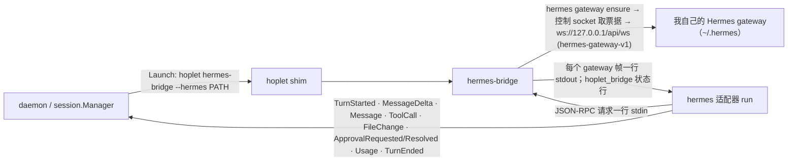

# M1 · PR7 Hermes 适配 · 详细计划

> **执行方式：** 按任务顺序逐步执行；每一步用 `- [ ]` 勾选。每个任务结束时 `go test -race ./...` 和 `golangci-lint run ./...` 都应通过。修改已有文件的步骤给出补丁：把代码块存成文件后在仓库根目录执行 `git apply <文件>`；新文件给出完整内容。

**目标：** 让 Hoplet 用我本机的 Hermes Agent 跑 Personal 会话：经 Hermes gateway 的原生 WebSocket 协议驱动，桥接进程放在 shim 后面，守护进程重启不丢事件；审批档位 / 思考强度 / Fast / 模型映射与中途切换、插话、中断、审批转发、断线续接；版本门控与本机自检；用真实会话的 spool 做离线契约测试。

**架构：**



**第一步验证假设（已完成，2026-11-01）：** 读 Hermes v0.22.5 源码，并对本机 gateway 录制真实会话。

| 能力 | 结论 |
|---|---|
| 进程 | 0.22.5 起 TUI、桌面端、`hermes acp` 都连同一个 gateway（每个 HERMES_HOME 一个），协议 `hermes-gateway-v1`：`hermes gateway ensure --json` 找到或启动它；控制 socket（`$HERMES_HOME/gateway.sock`）发一次性票据（30 秒）；WebSocket 只接受回环地址、不能带 `Origin` |
| 会话 | `session.create`：`request_id` 相同则拿回同一会话；带标题会接上同名旧会话，所以不带标题；`source:"acp"` + 编辑策略 `ask` 时每次编辑都请求审批（选项 once / deny，带路径与前后内容） |
| 档位 | yolo 管不住编辑审批，全自动 = yolo + 编辑策略全部放行；命令是否询问由 Hermes 的危险识别与全局审批模式决定（我的是 smart，`rm -r ./junk` 被其辅助模型直接放行）；`/plan` 只是提示词；`acp` 来源的会话没有 clarify 工具 |
| 设置 | `session.mutate`（编辑策略、思考强度、模型）要带 `expected_revision` 和 `expected_generation`，轮次中被拒；连续两个会互相作废，必须一次一个；yolo、`service_tier`（`fast` → priority / `normal`）用 `config.set` 即时生效 |
| 轮次 | `message.start` … `message.complete`（`status`: complete / interrupted / error）；用量是会话累计，本轮用量从 `prompt.receipt` 取 |
| 断线 | 轮次在 gateway 上继续；`session.events.since` 的缓冲 512 帧，流式输出 4 秒就溢出，基本只能拿到"需要快照"；改用 `session.resume`（不带历史）+ `prompt.receipt`（最终回复、完成 / 中断、本轮消息），从不加载全量历史 |
| ACP | `hermes acp` 只是同一 gateway 的薄客户端：`session/load` 与 `session/resume` 都全量回放历史，没有 steer，yolo 不能中途切换——不用 |

**本计划的裁决：**
- 维护者定：接入用 gateway 原生 WebSocket；共用默认 `~/.hermes`（规则同 Claude：配置与数据共用，只有程序版本由 Hoplet 管）；Hoplet 不改 Hermes 的全局设置、不碰凭证；Hoplet 建的会话在 Hermes 桌面端可见；档位三档（需确认 / 自动编辑 / 全自动），智能审批与 Plan 不声明，选了按最近的更严档位回退；命令审批跟随 Hermes 自己的判断。
- 维护者定（传输）：桥接进程 `hoplet hermes-bridge` 放在 shim 后面，Hermes 成为与 Claude 一样的 stdio harness：守护进程重启时桥接进程照常运行、事件留在 spool；只有 gateway 自己重启才会丢失进行中的轮次（Hermes 本身也会丢），这时用 receipt 补齐。
- 桥接进程只做搬运：连接、心跳（应答不进 spool）、断线重连（写 `hoplet_bridge` 状态行）、断线期间的请求先留着；收到 SIGTERM 时先中断它看到的进行中轮次再退出。协议逻辑全部在适配器里。
- 适配器在一个连接拿到会话快照之前不发其他请求（gateway 会以 permission_denied 拒绝）；重新接上已在运行的桥接进程（守护进程重启）时连接本来就已接上。
- 设置排队：一次只发一个 `session.mutate`，轮次中等轮次结束；同一操作只保留最新的；设置未生效时发出的消息排在设置之后，保证"先设置后消息"的顺序。
- 轮次结束：`message.complete` 后取 receipt，先报本轮用量再报 `TurnEnded`（守护进程把轮次结束后的事件记到会话级）。连接恢复后若本轮已结束而不知道是哪一轮，记为 aborted 并说明原因，不让轮次悬着。
- 审批在 Hermes 别处（桌面端）被回答或超时：记为 expired、decided_by `hermes`。
- 版本门控：录制覆盖的版本（0.22.5）或本机自检通过的版本才开新轮次；`hoplet harness verify hermes` 手动自检，守护进程每天自动检查新版本（`[harness.hermes] follow = false` 关闭），尝试规则与 Claude 相同（每天至多一次、连续 3 次失败后停止、非自检原因的失败与守护进程关闭打断的检查不计入）。
- 自检、录制、"本机已验证"的记录逻辑与 Claude 共用：抽出 `internal/harness/verified`（已验证版本、最近一次检查结果、尝试规则）与 `internal/harness/scrub`（按边界替换路径），Claude 改用它们。
- 守护进程把当前 harness 环境交给需要它的适配器（新接口 `harness.EnvUser`）：Hermes 在 Probe 时从 PATH（再找 `~/.local/bin`）定位 `hermes`。
- 命令行补上 `session interrupt / steer / stop`（守护进程早已支持，之前没有命令）。
- 录制就是真实 Hoplet 会话的 spool：`hoplet dev sanitize --harness hermes` 脱敏（去掉界面类事件，裁掉会话信息里的工具 / MCP 列表与历史消息，路径替换为 `/work`、`/Users/me`）。契约测试按 spool 回放：录到的请求若适配器已自行写出就对比，否则发出对应的 Hoplet 命令再对比；请求 ID 按顺序映射。

## 全局约束

- 不新增依赖（WebSocket 用仓库已有的 `github.com/coder/websocket`）；代码、注释、commit 用英文；设计文档中文；导出标识符有文档注释；库代码不 panic；不用 lint 抑制注释。
- 永不读取或修改 harness 的凭证与全局设置（`~/.hermes` 的配置由 Hermes 自己读）；测试不运行真实 Hermes、不访问网络、不碰真实的 `~/.hoplet`、不读真实 shell 启动文件。
- 录制入库前必须脱敏；任何文件与 commit 都不得出现个人用户名或本机路径。
- 测试不泄漏进程；除"轮询直到条件成立"外不用 sleep 同步。
- 分支 `feat/hermes`；commit 带 DCO 签名（`git commit -s`），标题不超过 72 字符；完成前 `make check` 通过。

## 文件

| 文件 | 职责 |
|---|---|
| `internal/harness/scrub/` | 录制脱敏：按边界替换路径（从 claude 抽出） |
| `internal/harness/verified/` | 本机已验证版本、最近一次检查结果、尝试规则（从 claude 抽出） |
| `internal/harness/claude/` | 改用上面两个包；`verified()` 改名 `recorded()` |
| `internal/harness/harness.go`、`internal/daemon/daemon.go` | `EnvUser` 接口；守护进程启动时交出 harness 环境 |
| `internal/config/config.go` 及测试 | `[harness.hermes] follow` |
| `internal/harness/hermes/gateway.go`、`bridge.go` 及测试 | 连接 gateway；桥接进程 |
| `internal/harness/hermes/hermes.go`、`wire.go`、`tools.go`、`run.go`、`record.go` 及测试、`testdata/0.22.5/` | 适配器、脱敏、契约测试 |
| `internal/harness/hermes/check.go` 及测试 | 本机自检与版本检查 |
| `cmd/hoplet/` | `hermes-bridge`；`harness verify hermes`；注册 Hermes；每日检查；`session interrupt / steer / stop`；`dev sanitize --harness` |
| `docs/design/0003`、`0004`、`0007`、`0013`，`docs/plans/m1-overview.md` | 设计与总计划同步 |

## 接口（后续 PR 依赖）

- `harness.EnvUser{UseEnv(func() []string)}`
- `verified.Has / Add / Last / Save / Due / Next`、`verified.Outcome`、`verified.ErrSelfCheck`、`verified.MaxAttempts`、`verified.RetryAfter`；`scrub.New / ReplacePath / StripKey / IsAlnum`
- `hermes.Harness{Exe, Dir}`（`StdioHarness` + `EnvUser`）、`hermes.Kind`、`hermes.StateDir(home)`、`hermes.Find(env)`、`hermes.Bridge(ctx, BridgeConfig)`、`hermes.SelfCheck`、`hermes.Verify`、`hermes.Checker`、`hermes.Sanitize`、`hermes.Entry`
- 审批选项 ID 即 Hermes 的选项：`once`、`session`、`always`、`deny`
- CLI：`hoplet hermes-bridge --hermes PATH`、`hoplet harness verify hermes [--json]`、`hoplet session interrupt | steer | stop`、`hoplet dev sanitize --harness hermes …`

---

### 任务 0：建分支并放入录制

- [ ] **步骤 1：建分支**

```bash
git switch -c feat/hermes
```

- [ ] **步骤 2：放入录制与 golden**

录制是真实 Hoplet 会话（Hermes 0.22.5）的 spool，已脱敏；golden 由任务 3 的契约测试生成并经人工审阅。从录制目录复制（`$RECORDINGS` 是维护者本机存放已脱敏录制的目录）：

```bash
mkdir -p internal/harness/hermes/testdata
cp -R "$RECORDINGS"/0.22.5 internal/harness/hermes/testdata/
git add internal/harness/hermes/testdata
git commit -s -m "test(hermes): add recorded Hermes 0.22.5 sessions"
```

预期：`testdata/0.22.5/` 下 5 个 `.jsonl`（approve、interrupt、steer、modes、resume）与 5 个 `.golden`；`grep -rhoE '/Users/[^/\"]+' internal/harness/hermes/testdata | sort -u` 只输出 `/Users/me`（或无输出）。

### 任务 1：共用的脱敏与版本记录，harness 环境

**文件：** 创建 `internal/harness/scrub/{scrub,scrub_test}.go`、`internal/harness/verified/{verified,verified_test}.go`；修改 `internal/harness/claude/{claude,install,install_test,record,record_test,state}.go`、`internal/harness/harness.go`、`internal/daemon/daemon.go`、`internal/config/{config,config_test}.go`

**接口：** 产生 `scrub.*`、`verified.*`、`harness.EnvUser`、`config.Harness.Hermes`。claude 的行为不变：已验证版本与跟进结果的文件名、内容、尝试规则都与之前一致。

- [ ] **步骤 1：创建两个共用包（含测试）**


`internal/harness/scrub/scrub.go`

```go
// Package scrub replaces personal paths in recorded harness sessions so
// they can be committed as test fixtures.
package scrub

import (
	"path/filepath"
	"slices"
	"strings"
)

// New returns the function that replaces dir and home in a line. For
// each it covers the given and the symlink-resolved path (macOS temporary
// directories live under /var, a link to /private/var) and the dash slug
// claude derives project directory names from. Longer paths go first, as
// dir may be inside home.
func New(dir, home string) func(string) string {
	type pair struct{ from, to string }
	var pairs []pair
	add := func(p, to string) {
		if p == "" {
			return
		}
		forms := []string{p}
		if r, err := filepath.EvalSymlinks(p); err == nil && r != p {
			forms = append(forms, r)
		}
		for _, f := range forms {
			pairs = append(pairs, pair{f, to})
			for _, slug := range []func(string) string{
				func(p string) string { return strings.ReplaceAll(p, "/", "-") },
				func(p string) string { // claude's project directory names
					return strings.Map(func(r rune) rune {
						if IsAlnum(r) {
							return r
						}
						return '-'
					}, p)
				},
			} {
				if from := slug(f); from != to && !slices.ContainsFunc(pairs, func(p pair) bool { return p.from == from }) {
					pairs = append(pairs, pair{from, slug(to)})
				}
			}
		}
	}
	add(dir, "/work")
	add(home, "/Users/me")
	slices.SortStableFunc(pairs, func(a, b pair) int { return len(b.from) - len(a.from) })
	return func(s string) string {
		for _, p := range pairs {
			s = ReplacePath(s, p.from, p.to)
		}
		return s
	}
}

// ReplacePath replaces the occurrences of the path from in s, except those
// followed by an ASCII letter or digit, which continue into a longer name:
// from "/Users/ann" leaves "/Users/anna/x" alone. Anything else after
// it (a slash, a quote, a period, "-", "_", the end) ends the path; erring
// toward scrubbing too much is intended.
func ReplacePath(s, from, to string) string {
	var b strings.Builder
	for {
		i := strings.Index(s, from)
		if i < 0 {
			break
		}
		end := i + len(from)
		b.WriteString(s[:i])
		if end < len(s) && IsAlnum(rune(s[end])) {
			b.WriteString(from) // part of a longer name
		} else {
			b.WriteString(to)
		}
		s = s[end:]
	}
	b.WriteString(s)
	return b.String()
}

// IsAlnum reports whether c is an ASCII letter or digit.
func IsAlnum(c rune) bool {
	return c >= 'a' && c <= 'z' || c >= 'A' && c <= 'Z' || c >= '0' && c <= '9'
}

// StripKey removes key from every object inside v, in place.
func StripKey(v any, key string) any {
	switch x := v.(type) {
	case map[string]any:
		for k, e := range x {
			if k == key {
				delete(x, k)
				continue
			}
			x[k] = StripKey(e, key)
		}
	case []any:
		for i, e := range x {
			x[i] = StripKey(e, key)
		}
	}
	return v
}
```

`internal/harness/scrub/scrub_test.go`

```go
package scrub

import "testing"

func TestReplacePath(t *testing.T) {
	for _, tt := range []struct{ s, from, to, want string }{
		{"/Users/ann/x and /Users/anna/x", "/Users/ann", "/Users/me", "/Users/me/x and /Users/anna/x"},
		{`"/Users/ann"`, "/Users/ann", "/Users/me", `"/Users/me"`},
		{"/Users/ann", "/Users/ann", "/Users/me", "/Users/me"},
		{"/Users/ann-old", "/Users/ann", "/Users/me", "/Users/me-old"},
		{"/Users/ann_x. /Users/ann.", "/Users/ann", "/Users/me", "/Users/me_x. /Users/me."},
		{"/w1 /w11", "/w1", "/work", "/work /w11"},
		{"-Users-ann-proj", "-Users-ann", "-Users-me", "-Users-me-proj"},
		{"-Users-anna", "-Users-ann", "-Users-me", "-Users-anna"},
	} {
		if got := ReplacePath(tt.s, tt.from, tt.to); got != tt.want {
			t.Errorf("ReplacePath(%q, %q) = %q, want %q", tt.s, tt.from, got, tt.want)
		}
	}
}
```

`internal/harness/verified/verified.go`

```go
// Package verified keeps, in a harness adapter's own directory, the
// harness versions that passed Hoplet's self-check on this machine and the
// outcome of the last automatic check of a new version, and decides when a
// version that failed may be checked again.
package verified

import (
	"encoding/json"
	"errors"
	"fmt"
	"io/fs"
	"os"
	"path/filepath"
	"slices"
	"time"
)

// The files kept in an adapter's directory.
const (
	versionsFile = "verified.json"
	outcomeFile  = "update.json"
)

// MaxAttempts is how many self-check failures in a row a version gets
// before Hoplet stops checking it: three daily tries, as one failure may
// be transient.
const MaxAttempts = 3

// RetryAfter is how long a version that just failed is left alone; it
// keeps a daemon that restarts often from checking the same version more
// than once a day.
const RetryAfter = 20 * time.Hour

// ErrSelfCheck marks a failure of the self-check itself, as opposed to a
// failure around it (copying a binary, say); only these count as attempts.
var ErrSelfCheck = errors.New("self-check failed")

// Has reports whether version v passed the self-check here.
func Has(dir, v string) bool {
	vs, _ := read(dir)
	return slices.Contains(vs, v)
}

func read(dir string) ([]string, error) {
	b, err := fs.ReadFile(os.DirFS(dir), versionsFile)
	if errors.Is(err, fs.ErrNotExist) {
		return nil, nil
	}
	if err != nil {
		return nil, err
	}
	var f struct {
		Versions []string `json:"versions"`
	}
	if err := json.Unmarshal(b, &f); err != nil {
		return nil, fmt.Errorf("verified: %s: %w", filepath.Join(dir, versionsFile), err)
	}
	return f.Versions, nil
}

// Add records that version v passed the self-check here.
func Add(dir, v string) error {
	vs, err := read(dir)
	if err != nil {
		return err
	}
	if slices.Contains(vs, v) {
		return nil
	}
	b, err := json.MarshalIndent(struct {
		Versions []string `json:"versions"`
	}{append(vs, v)}, "", "  ")
	if err != nil {
		return err
	}
	return writeAtomic(filepath.Join(dir, versionsFile), b, 0o600)
}

// Outcome is the record of the last automatic check of a new version, kept
// for doctor.
type Outcome struct {
	At      time.Time `json:"at"`
	From    string    `json:"from,omitempty"`
	Version string    `json:"version,omitempty"`
	Error   string    `json:"error,omitempty"`
	// Attempts counts the consecutive checks of Version that failed the
	// self-check; other failures leave it zero.
	Attempts int `json:"attempts,omitempty"`
}

// Last reads the outcome of the last automatic check, if any.
func Last(dir string) (Outcome, bool) {
	b, err := fs.ReadFile(os.DirFS(dir), outcomeFile)
	if err != nil {
		return Outcome{}, false
	}
	var o Outcome
	if json.Unmarshal(b, &o) != nil {
		return Outcome{}, false
	}
	return o, true
}

// Save records an outcome; losing it only costs a check.
func Save(dir string, o Outcome) error {
	b, err := json.MarshalIndent(o, "", "  ")
	if err != nil {
		return err
	}
	return writeAtomic(filepath.Join(dir, outcomeFile), b, 0o600)
}

// Due reports whether version v may be checked at now, given the last
// outcome (ok false: none), and whether that outcome was a failure of v.
func Due(last Outcome, ok bool, v string, now time.Time) (due, failedBefore bool) {
	failedBefore = ok && last.Version == v && last.Error != ""
	switch {
	case failedBefore && last.Attempts >= MaxAttempts:
		return false, true // given up on this version
	case failedBefore && now.Sub(last.At) < RetryAfter && !last.At.After(now):
		return false, true // tried recently, perhaps by a previous daemon
	}
	return true, failedBefore
}

// Next is the record of a check of v (moving from version from) at now
// that ended with err (nil: passed). last is the previous record, and
// failedBefore says it was a failure of the same version. Only an error
// wrapping ErrSelfCheck counts as an attempt; any other records zero, so
// it is retried.
func Next(last Outcome, failedBefore bool, from, v string, err error, now time.Time) Outcome {
	o := Outcome{At: now.UTC().Truncate(time.Second), From: from, Version: v}
	if err == nil {
		return o
	}
	o.Error = err.Error()
	if errors.Is(err, ErrSelfCheck) {
		o.Attempts = 1
		if failedBefore {
			o.Attempts = last.Attempts + 1
		}
	}
	return o
}

func writeAtomic(path string, b []byte, mode os.FileMode) error {
	if err := os.MkdirAll(filepath.Dir(path), 0o700); err != nil {
		return fmt.Errorf("verified: %w", err)
	}
	tmp, err := os.CreateTemp(filepath.Dir(path), ".tmp-*")
	if err != nil {
		return fmt.Errorf("verified: %w", err)
	}
	defer os.Remove(tmp.Name())
	_, werr := tmp.Write(b)
	if err := errors.Join(werr, tmp.Chmod(mode), tmp.Sync(), tmp.Close()); err != nil {
		return fmt.Errorf("verified: %w", err)
	}
	if err := os.Rename(tmp.Name(), path); err != nil {
		return fmt.Errorf("verified: %w", err)
	}
	return nil
}
```

`internal/harness/verified/verified_test.go`

```go
package verified

import (
	"errors"
	"fmt"
	"testing"
	"time"
)

func TestVersions(t *testing.T) {
	dir := t.TempDir() + "/nested" // created on first write
	if Has(dir, "1.0") {
		t.Fatal("an empty directory has versions")
	}
	for range 2 {
		if err := Add(dir, "1.0"); err != nil {
			t.Fatal(err)
		}
	}
	if err := Add(dir, "1.1"); err != nil {
		t.Fatal(err)
	}
	if vs, err := read(dir); err != nil || fmt.Sprint(vs) != "[1.0 1.1]" {
		t.Fatalf("versions %v %v", vs, err)
	}
}

func TestOutcomes(t *testing.T) {
	dir := t.TempDir()
	if _, ok := Last(dir); ok {
		t.Fatal("an outcome before any check")
	}
	o := Outcome{At: time.Date(2026, 11, 1, 0, 0, 0, 0, time.UTC), Version: "2", Error: "x", Attempts: 1}
	if err := Save(dir, o); err != nil {
		t.Fatal(err)
	}
	if got, ok := Last(dir); !ok || got != o {
		t.Fatalf("last %+v %v", got, ok)
	}
}

func TestDue(t *testing.T) {
	now := time.Date(2026, 11, 2, 12, 0, 0, 0, time.UTC)
	failed := func(attempts int, ago time.Duration) Outcome {
		return Outcome{At: now.Add(-ago), Version: "2", Error: "x", Attempts: attempts}
	}
	for _, tt := range []struct {
		name        string
		last        Outcome
		ok          bool
		v           string
		due, before bool
	}{
		{"no record", Outcome{}, false, "2", true, false},
		{"another version failed", failed(1, time.Minute), true, "3", true, false},
		{"failed a minute ago", failed(1, time.Minute), true, "2", false, true},
		{"failed a day ago", failed(1, 21*time.Hour), true, "2", true, true},
		{"failed in the future (clock set back)", failed(1, -48*time.Hour), true, "2", true, true},
		{"given up", failed(MaxAttempts, 72*time.Hour), true, "2", false, true},
		{"passed", Outcome{At: now, Version: "2"}, true, "2", true, false},
	} {
		t.Run(tt.name, func(t *testing.T) {
			due, before := Due(tt.last, tt.ok, tt.v, now)
			if due != tt.due || before != tt.before {
				t.Fatalf("due %v before %v", due, before)
			}
		})
	}
}

func TestNextCountsOnlySelfCheckFailures(t *testing.T) {
	now := time.Date(2026, 11, 1, 12, 0, 0, 0, time.UTC)
	check := errors.Join(ErrSelfCheck, errors.New("no approval"))
	other := errors.New("disk full")
	prior := Outcome{Version: "2", Error: "x", Attempts: 2}
	for _, tt := range []struct {
		name         string
		last         Outcome
		failedBefore bool
		err          error
		wantAttempts int
	}{
		{"success", prior, true, nil, 0},
		{"first check failure", Outcome{}, false, check, 1},
		{"repeated check failure", prior, true, check, 3},
		{"other failure is not counted", Outcome{}, false, other, 0},
		{"other failure resets the count", prior, true, other, 0},
		{"check failure after an uncounted one", Outcome{Version: "2", Error: "x"}, true, check, 1},
	} {
		t.Run(tt.name, func(t *testing.T) {
			o := Next(tt.last, tt.failedBefore, "1", "2", tt.err, now)
			if o.Attempts != tt.wantAttempts || (o.Error != "") != (tt.err != nil) || o.From != "1" || o.Version != "2" || !o.At.Equal(now) {
				t.Fatalf("%+v", o)
			}
		})
	}
}
```


- [ ] **步骤 2：claude 改用它们，加 EnvUser 与配置项**


````diff
diff --git a/internal/config/config.go b/internal/config/config.go
index cd0d17a..8f6a029 100644
--- a/internal/config/config.go
+++ b/internal/config/config.go
@@ -27,12 +27,14 @@ type Config struct {
 // Harness configures the harnesses Hoplet runs.
 type Harness struct {
 	Claude HarnessOptions `toml:"claude"`
+	Hermes HarnessOptions `toml:"hermes"`
 }
 
 // HarnessOptions configures one harness.
 type HarnessOptions struct {
-	// Follow, when false, stops the daemon from moving Hoplet's copy to
-	// the version on the user's PATH each day; unset means true.
+	// Follow, when false, stops the daemon from following the version on
+	// the user's PATH each day: moving Hoplet's copy of claude to it, or
+	// checking a new Hermes version. Unset means true.
 	Follow *bool `toml:"follow"`
 }
 
diff --git a/internal/config/config_test.go b/internal/config/config_test.go
index e68bc2e..38a45f1 100644
--- a/internal/config/config_test.go
+++ b/internal/config/config_test.go
@@ -54,10 +54,14 @@ func TestHarnessFollow(t *testing.T) {
 		"[harness.claude]\nfollow = false\n": false,
 	} {
 		c, err := Load(write(t, body))
-		if err != nil || c.Harness.Claude.Follows() != want {
+		if err != nil || c.Harness.Claude.Follows() != want || !c.Harness.Hermes.Follows() {
 			t.Errorf("%q: follows %v %v, want %v", body, c.Harness.Claude.Follows(), err, want)
 		}
 	}
+	c, err := Load(write(t, "[harness.hermes]\nfollow = false\n"))
+	if err != nil || c.Harness.Hermes.Follows() || !c.Harness.Claude.Follows() {
+		t.Fatalf("hermes off: %+v %v", c.Harness, err)
+	}
 }
 
 func TestLoadRejects(t *testing.T) {
diff --git a/internal/daemon/daemon.go b/internal/daemon/daemon.go
index bb6d6a0..c0fabe8 100644
--- a/internal/daemon/daemon.go
+++ b/internal/daemon/daemon.go
@@ -140,6 +140,11 @@ func Start(ctx context.Context, cfg Config) (d *Daemon, err error) {
 	}
 	sys := &system{src: src, mgr: mgr, harnesses: cfg.Harnesses, probeURL: probeURL, probeTimeout: defaultProbeTimeout, log: log}
 	sys.set(snap, envErr)
+	for _, h := range cfg.Harnesses {
+		if u, ok := h.(harness.EnvUser); ok {
+			u.UseEnv(sys.vars)
+		}
+	}
 	// Recover before serving: a command must never reach a session whose
 	// shim the manager has not reattached to yet.
 	if err := mgr.Recover(ctx); err != nil {
diff --git a/internal/harness/claude/claude.go b/internal/harness/claude/claude.go
index 8e23374..ac48e3a 100644
--- a/internal/harness/claude/claude.go
+++ b/internal/harness/claude/claude.go
@@ -35,7 +35,7 @@ const probeTimeout = 10 * time.Second
 // Install).
 func verifiedVersions() []string { return []string{"2.1.312"} }
 
-func verified(v string) bool { return slices.Contains(verifiedVersions(), v) }
+func recorded(v string) bool { return slices.Contains(verifiedVersions(), v) }
 
 // BinaryPath is the managed claude binary in Hoplet's home.
 func BinaryPath(home string) string { return filepath.Join(home, "harness", Kind, "bin", "claude") }
@@ -91,13 +91,13 @@ func (h *Harness) Probe(ctx context.Context) (harness.Info, error) {
 		if err != nil {
 			return harness.Info{}, err
 		}
-		h.cached = harness.Info{Version: v, Capabilities: caps(), Supported: verified(v) || localVerified(h.Binary, v)}
+		h.cached = harness.Info{Version: v, Capabilities: caps(), Supported: recorded(v) || localVerified(h.Binary, v)}
 		h.stamp = st
 	}
 	info := h.cached
 	// Not cached: a failed follow-up leaves the binary as it was.
 	if u, ok := lastUpdate(h.Binary); ok {
-		info.Notice, info.Attention = u.notice(info.Version)
+		info.Notice, info.Attention = notice(u, info.Version)
 	}
 	return info, nil
 }
diff --git a/internal/harness/claude/install.go b/internal/harness/claude/install.go
index 697f474..39fb7ae 100644
--- a/internal/harness/claude/install.go
+++ b/internal/harness/claude/install.go
@@ -2,16 +2,16 @@ package claude
 
 import (
 	"context"
-	"encoding/json"
 	"errors"
 	"fmt"
 	"io"
 	"os"
 	"os/exec"
 	"path/filepath"
-	"slices"
 	"syscall"
 	"time"
+
+	"github.com/yangflow/hoplet/internal/harness/verified"
 )
 
 // Checker verifies a claude binary on this machine; SelfCheck is the real
@@ -21,7 +21,7 @@ type Checker func(ctx context.Context, bin string) error
 // ErrSelfCheck marks an install refused because the claude binary failed
 // the self-check (errors.Is). Other install errors are not the version's
 // fault.
-var ErrSelfCheck = errors.New("claude: self-check failed")
+var ErrSelfCheck = verified.ErrSelfCheck
 
 // selfCheckError is a failed self-check of one version.
 type selfCheckError struct {
@@ -85,7 +85,7 @@ func Install(ctx context.Context, src, home string, check Checker) (Installed, e
 		return Installed{}, err
 	}
 	out := Installed{Version: v}
-	if !verified(v) && !localVerified(bin, v) {
+	if !recorded(v) && !localVerified(bin, v) {
 		if check == nil {
 			return Installed{}, fmt.Errorf("claude: claude %s is not verified and no self-check was given", v)
 		}
@@ -99,7 +99,7 @@ func Install(ctx context.Context, src, home string, check Checker) (Installed, e
 		return Installed{}, fmt.Errorf("claude: %w", err)
 	}
 	if out.Checked {
-		if err := addVerified(bin, v); err != nil {
+		if err := verified.Add(stateDir(bin), v); err != nil {
 			return Installed{}, err
 		}
 	}
@@ -153,21 +153,12 @@ func prune(dir, keep string) {
 	}
 }
 
-// maxFollowAttempts is how many daily tries Follow gives a version that
-// fails the self-check before giving up on it: three daily tries.
-const maxFollowAttempts = 3
-
-// followRetryAfter is how long Follow leaves a version that just failed
-// alone; it keeps a daemon that restarts often from spending quota on the
-// same version more than once a day.
-const followRetryAfter = 20 * time.Hour
-
 // Follow moves Hoplet's copy to the claude the user runs: the claude found
 // on path (the harness environment's PATH), when Hoplet has a copy, the
 // versions differ and the user's passes the self-check (unless this
 // adapter is verified against it). A version that failed is tried at most
 // once a day, even across daemon restarts, and not again after
-// maxFollowAttempts self-check failures in a row; one failure may be
+// verified.MaxAttempts self-check failures in a row; one failure may be
 // transient. Only self-check failures count: any other failure is retried.
 // It records the outcome for doctor and returns it; nothing to
 // do is not an outcome, and neither is a cancelled run.
@@ -190,12 +181,9 @@ func Follow(ctx context.Context, home, path string, check Checker) (Update, bool
 	}
 	last, hasLast := lastUpdate(BinaryPath(home))
 	now := time.Now()
-	failedBefore := hasLast && last.Version == v && last.Error != ""
-	if failedBefore && last.Attempts >= maxFollowAttempts {
-		return Update{}, false // given up on this version; don't spend quota again
-	}
-	if failedBefore && now.Sub(last.At) < followRetryAfter && !last.At.After(now) {
-		return Update{}, false // tried recently, perhaps by a previous daemon
+	due, failedBefore := verified.Due(last, hasLast, v, now)
+	if !due {
+		return Update{}, false
 	}
 	inst, err := Install(ctx, src, home, check)
 	if err != nil && ctx.Err() != nil {
@@ -204,33 +192,11 @@ func Follow(ctx context.Context, home, path string, check Checker) (Update, bool
 	if err == nil {
 		v = inst.Version // what was installed, in case src changed since it was read
 	}
-	u := nextUpdate(last, failedBefore, current, v, err, now)
-	if b, err := json.MarshalIndent(u, "", "  "); err == nil {
-		_ = writeAtomic(updateFile(BinaryPath(home)), b, 0o600) // doctor shows it; losing it costs a re-check
-	}
+	u := verified.Next(last, failedBefore, current, v, err, now)
+	_ = verified.Save(stateDir(BinaryPath(home)), u) // doctor shows it; losing it costs a re-check
 	return u, true
 }
 
-// nextUpdate is the record of a follow-up of current to v at now that
-// ended with err (nil: installed). last is the previous record, and
-// failedBefore says it was a failure of the same version. Only a failed
-// self-check counts as an attempt; any other failure records zero, so it
-// is retried.
-func nextUpdate(last Update, failedBefore bool, current, v string, err error, now time.Time) Update {
-	u := Update{At: now.UTC().Truncate(time.Second), From: current, Version: v}
-	if err == nil {
-		return u
-	}
-	u.Error = err.Error()
-	if errors.Is(err, ErrSelfCheck) {
-		u.Attempts = 1
-		if failedBefore {
-			u.Attempts = last.Attempts + 1
-		}
-	}
-	return u
-}
-
 // lookPath finds claude in a PATH value.
 func lookPath(path string) (string, error) {
 	for _, dir := range filepath.SplitList(path) {
@@ -263,36 +229,3 @@ func copyFile(src, dir string) (string, error) {
 	}
 	return out.Name(), nil
 }
-
-func addVerified(binary, v string) error {
-	vs, err := readVerified(binary)
-	if err != nil {
-		return err
-	}
-	if slices.Contains(vs, v) {
-		return nil
-	}
-	b, err := json.MarshalIndent(struct {
-		Versions []string `json:"versions"`
-	}{append(vs, v)}, "", "  ")
-	if err != nil {
-		return err
-	}
-	return writeAtomic(verifiedFile(binary), b, 0o600)
-}
-
-func writeAtomic(path string, b []byte, mode os.FileMode) error {
-	tmp, err := os.CreateTemp(filepath.Dir(path), ".tmp-*")
-	if err != nil {
-		return fmt.Errorf("claude: %w", err)
-	}
-	defer os.Remove(tmp.Name())
-	_, werr := tmp.Write(b)
-	if err := errors.Join(werr, tmp.Chmod(mode), tmp.Sync(), tmp.Close()); err != nil {
-		return fmt.Errorf("claude: %w", err)
-	}
-	if err := os.Rename(tmp.Name(), path); err != nil {
-		return fmt.Errorf("claude: %w", err)
-	}
-	return nil
-}
diff --git a/internal/harness/claude/install_test.go b/internal/harness/claude/install_test.go
index a5f92e3..6d19aaa 100644
--- a/internal/harness/claude/install_test.go
+++ b/internal/harness/claude/install_test.go
@@ -3,13 +3,14 @@ package claude
 import (
 	"bytes"
 	"context"
-	"encoding/json"
 	"errors"
 	"os"
 	"path/filepath"
 	"strings"
 	"testing"
 	"time"
+
+	"github.com/yangflow/hoplet/internal/harness/verified"
 )
 
 // ageUpdate moves the recorded follow-up back in time.
@@ -20,11 +21,7 @@ func ageUpdate(t *testing.T, home string, by time.Duration) {
 		t.Fatal("no update.json")
 	}
 	u.At = u.At.Add(-by)
-	b, err := json.Marshal(u)
-	if err != nil {
-		t.Fatal(err)
-	}
-	if err := writeAtomic(updateFile(BinaryPath(home)), b, 0o600); err != nil {
+	if err := verified.Save(stateDir(BinaryPath(home)), u); err != nil {
 		t.Fatal(err)
 	}
 }
@@ -300,39 +297,9 @@ func TestSelfCheckFailureIsMarked(t *testing.T) {
 	}
 }
 
-func TestNextUpdateCountsOnlySelfCheckFailures(t *testing.T) {
-	now := time.Date(2026, 11, 1, 12, 0, 0, 0, time.UTC)
-	check := (&selfCheckError{version: "2.1.500", err: errors.New("no approval")})
-	other := errors.New("claude: disk full")
-	prior := Update{Version: "2.1.500", Error: "x", Attempts: 2}
-	tests := []struct {
-		name         string
-		last         Update
-		failedBefore bool
-		err          error
-		wantAttempts int
-		wantErr      bool
-	}{
-		{"success", prior, true, nil, 0, false},
-		{"first check failure", Update{}, false, check, 1, true},
-		{"repeated check failure", prior, true, check, 3, true},
-		{"other failure is not counted", Update{}, false, other, 0, true},
-		{"other failure resets the count", prior, true, other, 0, true},
-		{"check failure after an uncounted one", Update{Version: "2.1.500", Error: "x"}, true, check, 1, true},
-	}
-	for _, tt := range tests {
-		t.Run(tt.name, func(t *testing.T) {
-			u := nextUpdate(tt.last, tt.failedBefore, "2.1.400", "2.1.500", tt.err, now)
-			if u.Attempts != tt.wantAttempts || (u.Error != "") != tt.wantErr || u.From != "2.1.400" || u.Version != "2.1.500" || !u.At.Equal(now) {
-				t.Fatalf("%+v", u)
-			}
-		})
-	}
-}
-
 func TestNoticeForAnUncountedFailure(t *testing.T) {
 	u := Update{At: time.Date(2026, 11, 1, 0, 0, 0, 0, time.UTC), Version: "2.1.500", Error: "claude: disk full"}
-	got, attention := u.notice("2.1.400")
+	got, attention := notice(u, "2.1.400")
 	if !attention || !strings.Contains(got, "could not move to claude 2.1.500 on 2026-11-01: claude: disk full; it will try again") || strings.Contains(got, "attempt") {
 		t.Fatalf("notice %q %v", got, attention)
 	}
diff --git a/internal/harness/claude/record.go b/internal/harness/claude/record.go
index aacf1d9..9355693 100644
--- a/internal/harness/claude/record.go
+++ b/internal/harness/claude/record.go
@@ -8,13 +8,12 @@ import (
 	"fmt"
 	"io"
 	"os/exec"
-	"path/filepath"
-	"slices"
 	"strings"
 	"sync"
 	"time"
 
 	"github.com/yangflow/hoplet/internal/harness"
+	"github.com/yangflow/hoplet/internal/harness/scrub"
 )
 
 // Step is one step of a recording script.
@@ -241,7 +240,7 @@ func Sanitize(in io.Reader, out io.Writer, dir, home string) error {
 	sc.Buffer(nil, harness.MaxLine)
 	enc := json.NewEncoder(out)
 	enc.SetEscapeHTML(false)
-	scrub := scrubber(dir, home)
+	clean := scrub.New(dir, home)
 	type kept struct {
 		dir, line, requestID string
 		// resolves is the approval this line settles: the request an
@@ -271,10 +270,10 @@ func Sanitize(in io.Reader, out io.Writer, dir, home string) error {
 		var b strings.Builder
 		le := json.NewEncoder(&b)
 		le.SetEscapeHTML(false)
-		if err := le.Encode(stripKey(v, "signature")); err != nil {
+		if err := le.Encode(scrub.StripKey(v, "signature")); err != nil {
 			return err
 		}
-		k := kept{dir: e.Dir, line: scrub(strings.TrimSpace(b.String()))}
+		k := kept{dir: e.Dir, line: clean(strings.TrimSpace(b.String()))}
 		if req, _ := v["request"].(map[string]any); e.Dir == "out" && v["type"] == "control_request" && req["subtype"] == "can_use_tool" {
 			k.requestID, _ = v["request_id"].(string)
 		}
@@ -314,81 +313,6 @@ func Sanitize(in io.Reader, out io.Writer, dir, home string) error {
 	return nil
 }
 
-// scrubber returns the function that replaces dir and home in a line. For
-// each it covers the given and the symlink-resolved path (macOS temporary
-// directories live under /var, a link to /private/var) and the dash slug
-// claude derives project directory names from. Longer paths go first, as
-// dir may be inside home.
-func scrubber(dir, home string) func(string) string {
-	type pair struct{ from, to string }
-	var pairs []pair
-	add := func(p, to string) {
-		if p == "" {
-			return
-		}
-		forms := []string{p}
-		if r, err := filepath.EvalSymlinks(p); err == nil && r != p {
-			forms = append(forms, r)
-		}
-		for _, f := range forms {
-			pairs = append(pairs, pair{f, to})
-			for _, slug := range []func(string) string{
-				func(p string) string { return strings.ReplaceAll(p, "/", "-") },
-				func(p string) string { // claude's project directory names
-					return strings.Map(func(r rune) rune {
-						if isAlnum(r) {
-							return r
-						}
-						return '-'
-					}, p)
-				},
-			} {
-				if from := slug(f); from != to && !slices.ContainsFunc(pairs, func(p pair) bool { return p.from == from }) {
-					pairs = append(pairs, pair{from, slug(to)})
-				}
-			}
-		}
-	}
-	add(dir, "/work")
-	add(home, "/Users/me")
-	slices.SortStableFunc(pairs, func(a, b pair) int { return len(b.from) - len(a.from) })
-	return func(s string) string {
-		for _, p := range pairs {
-			s = replacePath(s, p.from, p.to)
-		}
-		return s
-	}
-}
-
-// replacePath replaces the occurrences of the path from in s, except those
-// followed by an ASCII letter or digit, which continue into a longer name:
-// from "/Users/ann" leaves "/Users/anna/x" alone. Anything else after
-// it (a slash, a quote, a period, "-", "_", the end) ends the path; erring
-// toward scrubbing too much is intended.
-func replacePath(s, from, to string) string {
-	var b strings.Builder
-	for {
-		i := strings.Index(s, from)
-		if i < 0 {
-			break
-		}
-		end := i + len(from)
-		b.WriteString(s[:i])
-		if end < len(s) && isAlnum(rune(s[end])) {
-			b.WriteString(from) // part of a longer name
-		} else {
-			b.WriteString(to)
-		}
-		s = s[end:]
-	}
-	b.WriteString(s)
-	return b.String()
-}
-
-func isAlnum(c rune) bool {
-	return c >= 'a' && c <= 'z' || c >= 'A' && c <= 'Z' || c >= '0' && c <= '9'
-}
-
 // reduce trims a recorded line in place and reports whether to keep it.
 func reduce(dir string, v map[string]any) bool {
 	switch v["type"] {
@@ -424,21 +348,3 @@ func reduce(dir string, v map[string]any) bool {
 	}
 	return true
 }
-
-func stripKey(v any, key string) any {
-	switch x := v.(type) {
-	case map[string]any:
-		for k, e := range x {
-			if k == key {
-				delete(x, k)
-				continue
-			}
-			x[k] = stripKey(e, key)
-		}
-	case []any:
-		for i, e := range x {
-			x[i] = stripKey(e, key)
-		}
-	}
-	return v
-}
diff --git a/internal/harness/claude/record_test.go b/internal/harness/claude/record_test.go
index cda5b78..6be6b59 100644
--- a/internal/harness/claude/record_test.go
+++ b/internal/harness/claude/record_test.go
@@ -10,6 +10,7 @@ import (
 	"testing"
 
 	"github.com/yangflow/hoplet/internal/harness"
+	"github.com/yangflow/hoplet/internal/harness/scrub"
 	"github.com/yangflow/hoplet/proto"
 )
 
@@ -157,23 +158,6 @@ func sanitized(t *testing.T, dir, home string, entries ...Entry) []string {
 	return lines
 }
 
-func TestReplacePath(t *testing.T) {
-	for _, tt := range []struct{ s, from, to, want string }{
-		{"/Users/ann/x and /Users/anna/x", "/Users/ann", "/Users/me", "/Users/me/x and /Users/anna/x"},
-		{`"/Users/ann"`, "/Users/ann", "/Users/me", `"/Users/me"`},
-		{"/Users/ann", "/Users/ann", "/Users/me", "/Users/me"},
-		{"/Users/ann-old", "/Users/ann", "/Users/me", "/Users/me-old"},
-		{"/Users/ann_x. /Users/ann.", "/Users/ann", "/Users/me", "/Users/me_x. /Users/me."},
-		{"/w1 /w11", "/w1", "/work", "/work /w11"},
-		{"-Users-ann-proj", "-Users-ann", "-Users-me", "-Users-me-proj"},
-		{"-Users-anna", "-Users-ann", "-Users-me", "-Users-anna"},
-	} {
-		if got := replacePath(tt.s, tt.from, tt.to); got != tt.want {
-			t.Errorf("replacePath(%q, %q) = %q, want %q", tt.s, tt.from, got, tt.want)
-		}
-	}
-}
-
 func TestSanitizeScrubsPathForms(t *testing.T) {
 	dir := t.TempDir()
 	resolved, err := filepath.EvalSymlinks(dir)
@@ -235,7 +219,7 @@ func TestSanitizeScrubsNonAlnumSlug(t *testing.T) {
 		t.Fatal(err)
 	}
 	slug := strings.Map(func(r rune) rune {
-		if isAlnum(r) {
+		if scrub.IsAlnum(r) {
 			return r
 		}
 		return '-'
diff --git a/internal/harness/claude/state.go b/internal/harness/claude/state.go
index 5d934d4..dc2354e 100644
--- a/internal/harness/claude/state.go
+++ b/internal/harness/claude/state.go
@@ -1,64 +1,33 @@
 package claude
 
 import (
-	"encoding/json"
-	"errors"
 	"fmt"
-	"io/fs"
-	"os"
 	"path/filepath"
-	"slices"
 	"time"
+
+	"github.com/yangflow/hoplet/internal/harness/verified"
 )
 
-// Hoplet keeps two small files next to its copy of claude: the versions
-// that passed the self-check on this machine, and the outcome of the last
-// automatic follow-up. Install and Follow write them.
+// Hoplet keeps, next to its copy of claude, the versions that passed the
+// self-check on this machine and the outcome of the last automatic
+// follow-up (package verified). Install and Follow write them.
 
-// verifiedFile lists, next to the managed binary, the versions that passed
-// the self-check on this machine.
-func verifiedFile(binary string) string { return filepath.Join(filepath.Dir(binary), "verified.json") }
+// stateDir is where they live: the directory of the managed binary.
+func stateDir(binary string) string { return filepath.Dir(binary) }
 
 // localVerified reports whether version v passed the self-check here.
-func localVerified(binary, v string) bool {
-	vs, _ := readVerified(binary)
-	return slices.Contains(vs, v)
-}
+func localVerified(binary, v string) bool { return verified.Has(stateDir(binary), v) }
 
-func readVerified(binary string) ([]string, error) {
-	b, err := fs.ReadFile(os.DirFS(filepath.Dir(binary)), filepath.Base(verifiedFile(binary)))
-	if errors.Is(err, fs.ErrNotExist) {
-		return nil, nil
-	}
-	if err != nil {
-		return nil, err
-	}
-	var f struct {
-		Versions []string `json:"versions"`
-	}
-	if err := json.Unmarshal(b, &f); err != nil {
-		return nil, fmt.Errorf("claude: %s: %w", verifiedFile(binary), err)
-	}
-	return f.Versions, nil
-}
-
-// Update is the outcome of the last automatic follow-up, kept next to the
-// managed binary for doctor.
-type Update struct {
-	At      time.Time `json:"at"`
-	From    string    `json:"from,omitempty"`
-	Version string    `json:"version,omitempty"`
-	Error   string    `json:"error,omitempty"`
-	// Attempts counts the consecutive follow-ups to Version that failed the
-	// self-check; other failures leave it zero.
-	Attempts int `json:"attempts,omitempty"`
-}
+// Update is the outcome of the last automatic follow-up.
+type Update = verified.Outcome
 
-func updateFile(binary string) string { return filepath.Join(filepath.Dir(binary), "update.json") }
+// lastUpdate reads the outcome of the last automatic follow-up of the
+// managed binary, if any.
+func lastUpdate(binary string) (Update, bool) { return verified.Last(stateDir(binary)) }
 
 // notice is what doctor says about u while Hoplet runs version current:
 // a follow-up to current, or a newer version that failed (a problem).
-func (u Update) notice(current string) (string, bool) {
+func notice(u Update, current string) (string, bool) {
 	day := u.At.Format(time.DateOnly)
 	switch {
 	case u.Error != "" && u.Version != current && u.Attempts == 0:
@@ -66,27 +35,13 @@ func (u Update) notice(current string) (string, bool) {
 		return fmt.Sprintf("Hoplet could not move to claude %s on %s: %s; it will try again", u.Version, day, u.Error), true
 	case u.Error != "" && u.Version != current:
 		again := "Hoplet will try again"
-		if u.Attempts >= maxFollowAttempts {
+		if u.Attempts >= verified.MaxAttempts {
 			again = "Hoplet will not try this version again"
 		}
 		return fmt.Sprintf("claude %s on your PATH failed the self-check on %s (attempt %d of %d), so Hoplet stays on %s: %s; %s",
-			u.Version, day, u.Attempts, maxFollowAttempts, current, u.Error, again), true
+			u.Version, day, u.Attempts, verified.MaxAttempts, current, u.Error, again), true
 	case u.Error == "" && u.Version == current:
 		return fmt.Sprintf("followed from %s on %s after a self-check", u.From, day), false
 	}
 	return "", false
 }
-
-// lastUpdate reads the outcome of the last automatic follow-up of the
-// managed binary, if any.
-func lastUpdate(bin string) (Update, bool) {
-	b, err := fs.ReadFile(os.DirFS(filepath.Dir(bin)), filepath.Base(updateFile(bin)))
-	if err != nil {
-		return Update{}, false
-	}
-	var u Update
-	if json.Unmarshal(b, &u) != nil {
-		return Update{}, false
-	}
-	return u, true
-}
diff --git a/internal/harness/harness.go b/internal/harness/harness.go
index d845d78..6e8a4b5 100644
--- a/internal/harness/harness.go
+++ b/internal/harness/harness.go
@@ -183,6 +183,13 @@ type Harness interface {
 	Probe(ctx context.Context) (Info, error)
 }
 
+// EnvUser is a harness that needs the environment harnesses start with
+// outside a session, to find its executable when probing, say. The daemon
+// hands it a function returning the current one before using the harness.
+type EnvUser interface {
+	UseEnv(env func() []string)
+}
+
 // StdioHarness is a harness spoken to over a child process's stdio. ctx in
 // Attach covers only the attaching.
 type StdioHarness interface {
````


- [ ] **步骤 3：运行，确认通过**

运行：`go test -race ./internal/harness/... ./internal/daemon/ ./internal/config/ && golangci-lint run ./...`
预期：`ok`；`0 issues.`

- [ ] **步骤 4：commit**

```bash
git add internal/harness internal/daemon internal/config
git commit -s -m "refactor(harness): share version records and path scrubbing"
```

### 任务 2：连接 gateway 与桥接进程

**文件：** 创建 `internal/harness/hermes/{gateway,bridge,bridge_test}.go`

**接口：** 产生 `hermes.Protocol`、`Endpoint`、`Ensure`、`Home`、`Ticket`、`Dial`、`Bridge`、`BridgeConfig`、`BridgeConnected`、`BridgeDisconnected`。

- [ ] **步骤 1：写测试**

测试用一个假的 Hermes：脚本回答 `gateway ensure`，Unix socket 发票据，本地 WebSocket 服务检查子协议、票据与"没有 Origin"。


`internal/harness/hermes/bridge_test.go`

```go
package hermes

import (
	"bufio"
	"context"
	"encoding/json"
	"io"
	"net"
	"net/http"
	"net/http/httptest"
	"os"
	"path/filepath"
	"slices"
	"strings"
	"sync"
	"testing"
	"time"

	"github.com/coder/websocket"
)

// fakeGateway is a Hermes gateway: a `hermes` script answering `gateway
// ensure`, a control socket minting tickets and a WebSocket endpoint.
type fakeGateway struct {
	t     *testing.T
	home  string
	bin   string
	conns chan *websocket.Conn
}

func newFakeGateway(t *testing.T) *fakeGateway {
	t.Helper()
	home, err := os.MkdirTemp("", "hg") // short: Unix socket paths are limited
	if err != nil {
		t.Fatal(err)
	}
	t.Cleanup(func() { os.RemoveAll(home) })
	g := &fakeGateway{t: t, home: home, conns: make(chan *websocket.Conn, 4)}
	stop := make(chan struct{})
	srv := httptest.NewServer(http.HandlerFunc(func(w http.ResponseWriter, r *http.Request) {
		offered := strings.Split(strings.ReplaceAll(r.Header.Get("Sec-WebSocket-Protocol"), " ", ""), ",")
		if r.Header.Get("Origin") != "" || !slices.Contains(offered, ticketPrefix+"t1") {
			http.Error(w, "refused", http.StatusForbidden)
			return
		}
		c, err := websocket.Accept(w, r, &websocket.AcceptOptions{Subprotocols: []string{Protocol}})
		if err != nil {
			return
		}
		g.conns <- c
		<-stop // a hijacked request's context never ends
	}))
	t.Cleanup(srv.Close)
	t.Cleanup(func() { close(stop) }) // runs first
	ln, err := net.Listen("unix", filepath.Join(home, "gateway.sock"))
	if err != nil {
		t.Fatal(err)
	}
	t.Cleanup(func() { ln.Close() })
	go func() {
		for {
			c, err := ln.Accept()
			if err != nil {
				return
			}
			_, _ = bufio.NewReader(c).ReadBytes('\n')
			_, _ = c.Write([]byte(`{"ok":true,"protocol":1,"id":1,"result":{"ticket":"t1","instance_id":"i1","profile_id":"p1"}}` + "\n"))
			c.Close()
		}
	}()
	ensure, _ := json.Marshal(map[string]any{"state": "ready", "endpoint": map[string]any{
		"profile_id": "p1", "instance_id": "i1", "runtime_protocol": 1, "api_origin": srv.URL,
		"capabilities": []string{"session-authority-v1"}, "control_home": home,
	}})
	g.bin = filepath.Join(home, "hermes")
	script := "#!/bin/sh\necho '" + string(ensure) + "'\n"
	if err := os.WriteFile(g.bin, []byte(script), 0o700); err != nil {
		t.Fatal(err)
	}
	return g
}

func (g *fakeGateway) accept() *websocket.Conn {
	g.t.Helper()
	select {
	case c := <-g.conns:
		return c
	case <-time.After(10 * time.Second):
		g.t.Fatal("the bridge never connected")
		return nil
	}
}

func readFrame(t *testing.T, c *websocket.Conn) map[string]any {
	t.Helper()
	ctx, cancel := context.WithTimeout(context.Background(), 10*time.Second)
	defer cancel()
	_, b, err := c.Read(ctx)
	if err != nil {
		t.Fatal(err)
	}
	var v map[string]any
	if err := json.Unmarshal(b, &v); err != nil {
		t.Fatal(err)
	}
	return v
}

func writeFrame(t *testing.T, c *websocket.Conn, frame string) {
	t.Helper()
	if err := c.Write(context.Background(), websocket.MessageText, []byte(frame)); err != nil {
		t.Fatal(err)
	}
}

// startBridge runs a bridge against g and returns its input, its output
// lines and a stop function that waits for it to return.
func startBridge(t *testing.T, g *fakeGateway, heartbeat time.Duration) (io.Writer, <-chan string, func() error) {
	t.Helper()
	inR, inW := io.Pipe()
	outR, outW := io.Pipe()
	lines := make(chan string, 64)
	go func() {
		sc := bufio.NewScanner(outR)
		for sc.Scan() {
			lines <- sc.Text()
		}
		close(lines)
	}()
	ctx, cancel := context.WithCancel(context.Background())
	done := make(chan error, 1)
	go func() {
		done <- Bridge(ctx, BridgeConfig{
			Hermes: g.bin, Env: []string{"HOME=" + g.home}, In: inR, Out: outW,
			Backoff: time.Millisecond, Heartbeat: heartbeat,
		})
		outW.Close()
	}()
	var once sync.Once
	var stopErr error
	stop := func() error {
		once.Do(func() {
			cancel()
			stopErr = <-done
			inW.Close()
		})
		return stopErr
	}
	t.Cleanup(func() { _ = stop() })
	return inW, lines, stop
}

func nextLine(t *testing.T, lines <-chan string) map[string]any {
	t.Helper()
	select {
	case l, ok := <-lines:
		if !ok {
			t.Fatal("the bridge output ended")
		}
		var v map[string]any
		if err := json.Unmarshal([]byte(l), &v); err != nil {
			t.Fatalf("line %q: %v", l, err)
		}
		return v
	case <-time.After(10 * time.Second):
		t.Fatal("no line from the bridge")
		return nil
	}
}

func TestBridgeRelaysBothWays(t *testing.T) {
	g := newFakeGateway(t)
	in, lines, _ := startBridge(t, g, time.Hour)
	c := g.accept()
	if l := nextLine(t, lines); l["hoplet_bridge"] != BridgeConnected || l["instance_id"] != "i1" {
		t.Fatalf("first line %v", l)
	}
	writeFrame(t, c, `{"jsonrpc":"2.0", "method":"event", "params":{"type":"message.start","session_id":"s","payload":{}}}`)
	if l := nextLine(t, lines); l["method"] != "event" {
		t.Fatalf("relayed %v", l)
	}
	if _, err := io.WriteString(in, `{"jsonrpc":"2.0","id":"r1","method":"ping","params":{}}`+"\n"); err != nil {
		t.Fatal(err)
	}
	if f := readFrame(t, c); f["id"] != "r1" {
		t.Fatalf("sent %v", f)
	}
}

func TestBridgeKeepsHeartbeatsToItself(t *testing.T) {
	g := newFakeGateway(t)
	_, lines, _ := startBridge(t, g, 10*time.Millisecond)
	c := g.accept()
	nextLine(t, lines) // connected
	ping := readFrame(t, c)
	if id, _ := ping["id"].(string); !strings.HasPrefix(id, heartbeatID) || ping["method"] != "ping" {
		t.Fatalf("heartbeat %v", ping)
	}
	writeFrame(t, c, `{"jsonrpc":"2.0","id":"`+ping["id"].(string)+`","result":{"pong":true}}`)
	writeFrame(t, c, `{"jsonrpc":"2.0","method":"event","params":{"type":"after"}}`)
	if l := nextLine(t, lines); l["method"] != "event" {
		t.Fatalf("a heartbeat answer was relayed: %v", l)
	}
}

func TestBridgeReconnects(t *testing.T) {
	g := newFakeGateway(t)
	_, lines, _ := startBridge(t, g, time.Hour)
	c := g.accept()
	nextLine(t, lines)
	_ = c.CloseNow()
	if l := nextLine(t, lines); l["hoplet_bridge"] != BridgeDisconnected {
		t.Fatalf("after a drop %v", l)
	}
	g.accept()
	if l := nextLine(t, lines); l["hoplet_bridge"] != BridgeConnected {
		t.Fatalf("after reconnecting %v", l)
	}
}

func TestBridgeInterruptsTheRunningTurnWhenStopped(t *testing.T) {
	g := newFakeGateway(t)
	_, lines, stop := startBridge(t, g, time.Hour)
	c := g.accept()
	nextLine(t, lines)
	writeFrame(t, c, `{"jsonrpc":"2.0","method":"event","params":{"type":"message.start","session_id":"s1","execution_generation":3,"payload":{}}}`)
	nextLine(t, lines)
	stopped := make(chan error, 1)
	go func() { stopped <- stop() }()
	f := readFrame(t, c)
	params, _ := f["params"].(map[string]any)
	if f["method"] != "session.interrupt" || params["session_id"] != "s1" || params["execution_generation"] != float64(3) {
		t.Fatalf("on stop %v", f)
	}
	if err := <-stopped; err != nil {
		t.Fatal(err)
	}
}

func TestBridgeEndsWithItsInput(t *testing.T) {
	g := newFakeGateway(t)
	in, lines, stop := startBridge(t, g, time.Hour)
	g.accept()
	nextLine(t, lines)
	in.(io.Closer).Close()
	for range lines {
	}
	if err := stop(); err != nil {
		t.Fatal(err)
	}
}
```


- [ ] **步骤 2：运行，确认失败**

运行：`go test ./internal/harness/hermes/`
预期：编译失败，`undefined: Bridge` 等

- [ ] **步骤 3：实现**


`internal/harness/hermes/gateway.go`

```go
package hermes

import (
	"bufio"
	"bytes"
	"context"
	"encoding/json"
	"errors"
	"fmt"
	"io/fs"
	"net"
	"net/http"
	"net/url"
	"os"
	"os/exec"
	"path/filepath"
	"strings"
	"time"

	"github.com/coder/websocket"
)

// Protocol is the gateway's WebSocket subprotocol.
const Protocol = "hermes-gateway-v1"

// ticketPrefix prefixes the single-use ticket offered as a second
// subprotocol.
const ticketPrefix = "hermes-gateway-ticket."

// Endpoint is a running gateway, as `hermes gateway ensure --json` reports
// it.
type Endpoint struct {
	ProfileID       string   `json:"profile_id"`
	InstanceID      string   `json:"instance_id"`
	AuthorityEpoch  int64    `json:"authority_epoch"`
	RuntimeProtocol int      `json:"runtime_protocol"`
	APIOrigin       string   `json:"api_origin"`
	Capabilities    []string `json:"capabilities"`
	ControlHome     string   `json:"control_home"`
	CodeSHA         string   `json:"code_sha"`
}

type ensureResult struct {
	State      string    `json:"state"`
	ReasonCode string    `json:"reason_code"`
	Detail     string    `json:"detail"`
	Endpoint   *Endpoint `json:"endpoint"`
}

// Ensure starts the gateway of the Hermes home the environment names (or
// finds the one running) and returns its endpoint.
func Ensure(ctx context.Context, bin string, env []string) (Endpoint, error) {
	cmd := exec.CommandContext(ctx, bin, "gateway", "ensure", "--json")
	cmd.Env = env
	var stderr bytes.Buffer
	cmd.Stderr = &stderr
	out, runErr := cmd.Output()
	var res ensureResult
	if err := json.Unmarshal(bytes.TrimSpace(lastLine(out)), &res); err != nil {
		return Endpoint{}, fmt.Errorf("hermes: gateway ensure: %w (%s)", errors.Join(runErr, err), strings.TrimSpace(stderr.String()))
	}
	if res.State != "ready" || res.Endpoint == nil {
		return Endpoint{}, fmt.Errorf("hermes: gateway is %s: %s %s", res.State, res.ReasonCode, res.Detail)
	}
	ep := *res.Endpoint
	if ep.ControlHome == "" {
		ep.ControlHome = Home(env)
	}
	if ep.RuntimeProtocol != 1 {
		return Endpoint{}, fmt.Errorf("hermes: gateway runtime protocol %d, want 1", ep.RuntimeProtocol)
	}
	u, err := url.Parse(ep.APIOrigin)
	if err != nil || (u.Hostname() != "127.0.0.1" && u.Hostname() != "::1") {
		return Endpoint{}, fmt.Errorf("hermes: gateway origin %q is not loopback", ep.APIOrigin)
	}
	return ep, nil
}

// Home is the Hermes home an environment names: HERMES_HOME, else
// ~/.hermes.
func Home(env []string) string {
	home := ""
	for _, kv := range env {
		if k, v, ok := strings.Cut(kv, "="); ok {
			switch k {
			case "HERMES_HOME":
				if v != "" {
					return v
				}
			case "HOME":
				home = v
			}
		}
	}
	return filepath.Join(home, ".hermes")
}

func lastLine(b []byte) []byte {
	b = bytes.TrimRight(b, "\n")
	if i := bytes.LastIndexByte(b, '\n'); i >= 0 {
		return b[i+1:]
	}
	return b
}

// controlSocket is where the gateway of home listens for control requests:
// home/gateway.sock, or the path its pointer file names when that is too
// long for a Unix socket.
func controlSocket(home string) (string, error) {
	direct := filepath.Join(home, "gateway.sock")
	if _, err := os.Stat(direct); err == nil {
		return direct, nil
	}
	b, err := fs.ReadFile(os.DirFS(home), "gateway.sock.path")
	if err != nil {
		return "", fmt.Errorf("hermes: no gateway control socket in %s: %w", home, err)
	}
	return strings.TrimSpace(string(b)), nil
}

// Ticket mints a single-use, short-lived ticket for one WebSocket
// connection over the gateway's control socket.
func Ticket(ctx context.Context, ep Endpoint) (string, error) {
	path, err := controlSocket(ep.ControlHome)
	if err != nil {
		return "", err
	}
	var d net.Dialer
	conn, err := d.DialContext(ctx, "unix", path)
	if err != nil {
		return "", fmt.Errorf("hermes: control socket: %w", err)
	}
	defer conn.Close()
	if dl, ok := ctx.Deadline(); ok {
		_ = conn.SetDeadline(dl)
	} else {
		_ = conn.SetDeadline(time.Now().Add(5 * time.Second))
	}
	req, err := json.Marshal(map[string]any{"protocol": 1, "id": 1, "verb": "session-ticket", "params": map[string]string{
		"profile_id": ep.ProfileID, "instance_id": ep.InstanceID, "purpose": "interactive",
	}})
	if err != nil {
		return "", err
	}
	if _, err := conn.Write(append(req, '\n')); err != nil {
		return "", fmt.Errorf("hermes: control socket: %w", err)
	}
	line, err := bufio.NewReaderSize(conn, 64<<10).ReadBytes('\n')
	if err != nil {
		return "", fmt.Errorf("hermes: control socket: %w", err)
	}
	var resp struct {
		OK     bool `json:"ok"`
		Result struct {
			Ticket     string `json:"ticket"`
			InstanceID string `json:"instance_id"`
			ProfileID  string `json:"profile_id"`
		} `json:"result"`
		Error json.RawMessage `json:"error"`
	}
	if err := json.Unmarshal(line, &resp); err != nil {
		return "", fmt.Errorf("hermes: ticket response: %w", err)
	}
	if !resp.OK || resp.Result.Ticket == "" {
		return "", fmt.Errorf("hermes: ticket refused: %s", resp.Error)
	}
	if resp.Result.InstanceID != ep.InstanceID || resp.Result.ProfileID != ep.ProfileID {
		return "", errors.New("hermes: the gateway changed while minting a ticket")
	}
	return resp.Result.Ticket, nil
}

// Dial opens a WebSocket to the gateway with a fresh ticket. It sends no
// Origin header (the gateway refuses one) and never goes through a proxy.
func Dial(ctx context.Context, ep Endpoint) (*websocket.Conn, error) {
	t, err := Ticket(ctx, ep)
	if err != nil {
		return nil, err
	}
	u := strings.Replace(ep.APIOrigin, "http://", "ws://", 1) + "/api/ws"
	c, _, err := websocket.Dial(ctx, u, &websocket.DialOptions{
		Subprotocols: []string{Protocol, ticketPrefix + t},
		HTTPClient:   &http.Client{Transport: &http.Transport{Proxy: nil}},
	})
	if err != nil {
		return nil, fmt.Errorf("hermes: dial gateway: %w", err)
	}
	if c.Subprotocol() != Protocol {
		_ = c.Close(websocket.StatusProtocolError, "")
		return nil, fmt.Errorf("hermes: gateway speaks %q, want %q", c.Subprotocol(), Protocol)
	}
	c.SetReadLimit(8 << 20)
	return c, nil
}
```

`internal/harness/hermes/bridge.go`

```go
package hermes

import (
	"bufio"
	"bytes"
	"context"
	"encoding/json"
	"errors"
	"fmt"
	"io"
	"strings"
	"sync"
	"time"

	"github.com/coder/websocket"
)

// BridgeStatus is the "hoplet_bridge" field of the lines the bridge writes
// about itself, as opposed to the gateway frames it relays.
const (
	BridgeConnected    = "connected"
	BridgeDisconnected = "disconnected"
)

// bridgeLine is a line the bridge writes about itself.
type bridgeLine struct {
	Bridge     string   `json:"hoplet_bridge"`
	InstanceID string   `json:"instance_id,omitempty"`
	CodeSHA    string   `json:"code_sha,omitempty"`
	Caps       []string `json:"capabilities,omitempty"`
	Error      string   `json:"error,omitempty"`
}

// heartbeat is how often the bridge pings the gateway by default, and the
// ID prefix of those pings, whose answers it does not relay.
const (
	heartbeat   = 15 * time.Second
	heartbeatID = "hoplet-hb-"
)

// maxHeld bounds the commands the bridge holds while it reconnects.
const maxHeld = 256

// BridgeConfig configures a bridge.
type BridgeConfig struct {
	Hermes string   // the hermes executable
	Env    []string // its environment; names the Hermes home
	In     io.Reader
	Out    io.Writer
	// Backoff is the first reconnect delay, doubled up to 30 s; zero means
	// one second.
	Backoff time.Duration
	// Heartbeat is how often the bridge pings the gateway; zero means 15 s.
	Heartbeat time.Duration
}

// Bridge connects to the Hermes gateway and relays: every gateway frame
// becomes a line on Out, every line on In is sent to the gateway. It
// reconnects when the connection drops, writing a "disconnected" and then a
// "connected" line, and holds the lines it reads meanwhile. When ctx ends
// it interrupts a turn it saw start and not end, then returns nil; it also
// returns when In ends.
func Bridge(ctx context.Context, cfg BridgeConfig) error {
	b := &bridge{cfg: cfg, held: make(chan []byte, maxHeld)}
	inDone := make(chan error, 1)
	go func() { inDone <- b.readIn() }()
	backoff := cfg.Backoff
	if backoff <= 0 {
		backoff = time.Second
	}
	delay := backoff
	reported := false // a "disconnected" line is written once per outage
	for {
		connected, err := b.session(ctx, inDone)
		switch {
		case ctx.Err() != nil:
			return nil
		case errors.Is(err, errInputEnded):
			return nil
		}
		if connected {
			delay, reported = backoff, false
		}
		if !reported {
			if err := b.status(bridgeLine{Bridge: BridgeDisconnected, Error: err.Error()}); err != nil {
				return err
			}
			reported = true
		}
		select {
		case <-ctx.Done():
			return nil
		case err := <-inDone:
			return err
		case <-time.After(delay):
		}
		delay = min(delay*2, 30*time.Second)
	}
}

var errInputEnded = errors.New("hermes: bridge input ended")

type bridge struct {
	cfg  BridgeConfig
	held chan []byte // lines from In

	outMu sync.Mutex

	// The turn the bridge last saw start and not end.
	turnMu      sync.Mutex
	turnSession string
	gen         json.RawMessage
	running     bool
}

func (b *bridge) readIn() error {
	sc := bufio.NewScanner(b.cfg.In)
	sc.Buffer(nil, 16<<20)
	for sc.Scan() {
		line := bytes.TrimSpace(sc.Bytes())
		if len(line) == 0 {
			continue
		}
		b.held <- append([]byte(nil), line...)
	}
	close(b.held)
	return sc.Err()
}

func (b *bridge) write(line []byte) error {
	b.outMu.Lock()
	defer b.outMu.Unlock()
	if _, err := b.cfg.Out.Write(append(line, '\n')); err != nil {
		return fmt.Errorf("hermes: bridge output: %w", err)
	}
	return nil
}

func (b *bridge) status(l bridgeLine) error {
	line, err := json.Marshal(l)
	if err != nil {
		return err
	}
	return b.write(line)
}

// session runs one connection until it fails, ctx ends or In ends;
// connected reports it got as far as connecting.
func (b *bridge) session(ctx context.Context, inDone <-chan error) (connected bool, err error) {
	ep, err := Ensure(ctx, b.cfg.Hermes, b.cfg.Env)
	if err != nil {
		return false, err
	}
	conn, err := Dial(ctx, ep)
	if err != nil {
		return false, err
	}
	defer func() { _ = conn.CloseNow() }()
	if err := b.status(bridgeLine{Bridge: BridgeConnected, InstanceID: ep.InstanceID, CodeSHA: ep.CodeSHA, Caps: ep.Capabilities}); err != nil {
		return true, err
	}
	return true, b.pump(ctx, conn, inDone)
}

// pump relays in both directions over one connection.
func (b *bridge) pump(ctx context.Context, conn *websocket.Conn, inDone <-chan error) error {
	readErr := make(chan error, 1)
	// Reads end when the connection closes, not when ctx does: stopping
	// must still reach the step that interrupts the running turn.
	go func() { readErr <- b.relay(context.WithoutCancel(ctx), conn) }()
	every := b.cfg.Heartbeat
	if every <= 0 {
		every = heartbeat
	}
	tick := time.NewTicker(every)
	defer tick.Stop()
	n := 0
	for {
		select {
		case <-ctx.Done():
			b.interrupt(conn)
			_ = conn.CloseNow() // the gateway needs no closing handshake
			return ctx.Err()
		case err := <-readErr:
			return err
		case line, ok := <-b.held:
			if !ok {
				_ = conn.CloseNow() // the gateway needs no closing handshake
				return errInputEnded
			}
			if err := conn.Write(ctx, websocket.MessageText, line); err != nil {
				// Not sent: keep it for the next connection.
				b.requeue(line)
				return fmt.Errorf("hermes: send: %w", err)
			}
		case <-tick.C:
			n++
			ping := fmt.Sprintf(`{"jsonrpc":"2.0","id":"%s%d","method":"ping","params":{}}`, heartbeatID, n)
			if err := conn.Write(ctx, websocket.MessageText, []byte(ping)); err != nil {
				return fmt.Errorf("hermes: heartbeat: %w", err)
			}
		case err := <-inDone:
			_ = conn.CloseNow() // the gateway needs no closing handshake
			if err != nil {
				return err
			}
			return errInputEnded
		}
	}
}

// requeue puts a line that was not sent back in front of the queue, as far
// as a channel allows: it goes to the back, which only reorders lines that
// raced a dropped connection.
func (b *bridge) requeue(line []byte) {
	select {
	case b.held <- line:
	default:
	}
}

// relay copies gateway frames to Out, one line each, until the connection
// ends.
func (b *bridge) relay(ctx context.Context, conn *websocket.Conn) error {
	for {
		_, frame, err := conn.Read(ctx)
		if err != nil {
			return fmt.Errorf("hermes: gateway connection: %w", err)
		}
		var compact bytes.Buffer
		if json.Compact(&compact, frame) != nil {
			continue // not JSON: nothing a client can use
		}
		if b.observe(compact.Bytes()) {
			continue
		}
		if err := b.write(compact.Bytes()); err != nil {
			return err
		}
	}
}

// observe tracks the running turn from a frame and reports whether the
// frame is a heartbeat answer, which is not relayed.
func (b *bridge) observe(frame []byte) (heartbeatAnswer bool) {
	var f struct {
		ID     json.RawMessage `json:"id"`
		Method string          `json:"method"`
		Params struct {
			Type    string          `json:"type"`
			Session string          `json:"session_id"`
			Gen     json.RawMessage `json:"execution_generation"`
		} `json:"params"`
	}
	if json.Unmarshal(frame, &f) != nil {
		return false
	}
	if f.Method == "" && strings.HasPrefix(strings.Trim(string(f.ID), `"`), heartbeatID) {
		return true
	}
	if f.Method != "event" {
		return false
	}
	b.turnMu.Lock()
	defer b.turnMu.Unlock()
	switch f.Params.Type {
	case "message.start":
		b.turnSession, b.gen, b.running = f.Params.Session, f.Params.Gen, true
	case "message.complete":
		if f.Params.Session == b.turnSession {
			b.running = false
		}
	}
	return false
}

// interrupt asks the gateway to stop the turn the bridge saw start, so a
// stopped session does not keep working.
func (b *bridge) interrupt(conn *websocket.Conn) {
	b.turnMu.Lock()
	running, session, gen := b.running, b.turnSession, b.gen
	b.turnMu.Unlock()
	if !running || len(gen) == 0 {
		return
	}
	req := fmt.Sprintf(`{"jsonrpc":"2.0","id":"hoplet-stop","method":"session.interrupt","params":{"session_id":%q,"execution_generation":%s}}`, session, gen)
	ctx, cancel := context.WithTimeout(context.Background(), 2*time.Second)
	defer cancel()
	_ = conn.Write(ctx, websocket.MessageText, []byte(req))
}
```


- [ ] **步骤 4：运行，确认通过**

运行：`go test -race ./internal/harness/hermes/ && golangci-lint run ./...`
预期：`ok`；`0 issues.`

- [ ] **步骤 5：commit**

```bash
git add internal/harness/hermes
git commit -s -m "feat(harness/hermes): bridge the Hermes gateway over stdio"
```

### 任务 3：适配器与契约测试

**文件：** 创建 `internal/harness/hermes/{hermes,wire,tools,run,record,adapter_test,contract_test}.go`

**接口：** 消费任务 1 的 `verified`、`scrub`、`harness.EnvUser`，任务 2 的桥接行。产生 `hermes.Harness`、`Kind`、`StateDir`、`Find`、`ErrNotInstalled`、`Sanitize`、`Entry`；内部 `newRun`、`recorded`、`version`、`notice`。

- [ ] **步骤 1：写测试**


`internal/harness/hermes/adapter_test.go`

```go
package hermes

import (
	"context"
	"encoding/json"
	"errors"
	"fmt"
	"os"
	"path/filepath"
	"strings"
	"testing"
	"time"

	"github.com/yangflow/hoplet/internal/harness"
	"github.com/yangflow/hoplet/proto"
)

// fakeHermes writes a hermes executable into a new directory that prints
// version and counts its runs.
func fakeHermes(t *testing.T, version string) (bin, dir string) {
	t.Helper()
	dir = t.TempDir()
	bin = filepath.Join(dir, "hermes")
	script := "#!/bin/sh\necho run >> " + filepath.Join(dir, "runs") + "\necho 'Hermes Agent v" + version + " (2026.9.24) · stable'\n"
	if err := os.WriteFile(bin, []byte(script), 0o700); err != nil {
		t.Fatal(err)
	}
	return bin, dir
}

func runs(t *testing.T, dir string) int {
	t.Helper()
	b, err := os.ReadFile(filepath.Join(dir, "runs"))
	if err != nil {
		return 0
	}
	return strings.Count(string(b), "run\n")
}

func TestFind(t *testing.T) {
	bin, dir := fakeHermes(t, "0.22.5")
	if got, err := Find([]string{"PATH=/nonexistent:" + dir}); err != nil || got != bin {
		t.Fatalf("on PATH: %q %v", got, err)
	}
	home := t.TempDir()
	local := filepath.Join(home, ".local", "bin")
	if err := os.MkdirAll(local, 0o700); err != nil {
		t.Fatal(err)
	}
	if err := os.Symlink(bin, filepath.Join(local, "hermes")); err != nil {
		t.Fatal(err)
	}
	if got, err := Find([]string{"PATH=/usr/bin", "HOME=" + home}); err != nil || got != filepath.Join(local, "hermes") {
		t.Fatalf("in ~/.local/bin: %q %v", got, err)
	}
	if _, err := Find([]string{"PATH=/nonexistent"}); !errors.Is(err, ErrNotInstalled) {
		t.Fatalf("missing: %v", err)
	}
}

func TestProbeIsReusedForAMinute(t *testing.T) {
	_, dir := fakeHermes(t, "0.22.5")
	now := time.Date(2026, 11, 1, 0, 0, 0, 0, time.UTC)
	h := &Harness{nowFunc: func() time.Time { return now }}
	h.UseEnv(func() []string { return []string{"PATH=" + dir} })
	ctx := context.Background()
	for range 3 {
		info, err := h.Probe(ctx)
		if err != nil || info.Version != "0.22.5" || !info.Supported || !info.Capabilities.Steer || info.Capabilities.PlanMode {
			t.Fatalf("probe %+v %v", info, err)
		}
	}
	if n := runs(t, dir); n != 1 {
		t.Fatalf("hermes ran %d times", n)
	}
	now = now.Add(probeTTL + time.Second)
	if _, err := h.Probe(ctx); err != nil || runs(t, dir) != 2 {
		t.Fatalf("after a minute: %v, %d runs", err, runs(t, dir))
	}
	_, other := fakeHermes(t, "0.30.0")
	h.UseEnv(func() []string { return []string{"PATH=" + other} })
	if info, err := h.Probe(ctx); err != nil || info.Supported {
		t.Fatalf("an unrecorded version is supported: %+v %v", info, err)
	}
}

func TestLaunch(t *testing.T) {
	bin, dir := fakeHermes(t, "0.22.5")
	h := &Harness{Exe: "/opt/hoplet"}
	env := []string{"PATH=" + dir, "HOME=/home/me"}
	l, err := h.Launch(harness.Spec{Mode: proto.ModeConfirm, Env: env, WorkDir: "/work"})
	if err != nil {
		t.Fatal(err)
	}
	if strings.Join(l.Command, " ") != "/opt/hoplet hermes-bridge --hermes "+bin || l.Dir != "/work" || len(l.Env) != 2 {
		t.Fatalf("launch %+v", l)
	}
	if _, err := h.Launch(harness.Spec{Mode: proto.ModeAutoReview, Env: env}); err == nil {
		t.Fatal("a mode Hermes lacks launched")
	}
	if _, err := h.Attach(context.Background(), harness.Spec{Mode: proto.ModeConfirm, Plan: true}, newFakeStdio()); !errors.Is(err, harness.ErrUnsupported) {
		t.Fatalf("plan mode: %v", err)
	}
}

// tester drives one run line by line.
type tester struct {
	t      *testing.T
	io     *fakeStdio
	run    *run
	offset int64
}

func newTester(t *testing.T, spec harness.Spec) *tester {
	t.Helper()
	if spec.Mode == "" {
		spec.Mode = proto.ModeConfirm
	}
	if spec.Session == "" {
		spec.Session = "hs1"
	}
	x := &tester{t: t, io: newFakeStdio()}
	x.run = newRun(x.io, spec)
	t.Cleanup(func() { _ = x.run.Close() })
	return x
}

// push feeds a stdout line and returns the payloads it produced.
func (x *tester) push(line string) []proto.Payload {
	x.t.Helper()
	x.offset += 2
	x.io.lines <- harness.Line{Kind: harness.Stdout, Data: []byte(line), Offset: x.offset - 1}
	x.io.lines <- harness.Line{Kind: harness.Position, Offset: x.offset}
	var out []proto.Payload
	timeout := time.After(10 * time.Second)
	for {
		select {
		case ev := <-x.run.Events():
			if ev.Payload != nil {
				out = append(out, ev.Payload)
			}
			if ev.Offset == x.offset && ev.Raw == nil && ev.Payload == nil {
				return out
			}
		case <-timeout:
			x.t.Fatalf("no events for %s", line)
		}
	}
}

// writes returns the requests the run wrote, from the n-th on.
func (x *tester) writes(from int) []rpc {
	var out []rpc
	for _, w := range x.io.written()[from:] {
		out = append(out, parseRPC(x.t, w))
	}
	return out
}

// answer pushes a result for the i-th write.
func (x *tester) answer(i int, result string) []proto.Payload {
	x.t.Helper()
	return x.push(fmt.Sprintf(`{"jsonrpc":"2.0","id":%q,"result":%s}`, x.writes(i)[0].ID, result))
}

// attach connects the run to session native.
func (x *tester) attach(native string, running bool) {
	x.t.Helper()
	n := len(x.io.written())
	x.push(`{"hoplet_bridge":"connected"}`)
	x.answer(n, fmt.Sprintf(`{"session_id":%q,"stored_session_id":%q,"running":%v,"revision":1,"execution_generation":1,"pending":[],"prompts":[]}`, native, native, running))
}

func eventLine(typ, payload string) string {
	return fmt.Sprintf(`{"jsonrpc":"2.0","method":"event","params":{"type":%q,"session_id":"s1","execution_generation":1,"admission_id":"a1","payload":%s}}`, typ, payload)
}

func TestRequestsWaitForTheSnapshot(t *testing.T) {
	x := newTester(t, harness.Spec{Resume: "s1"})
	if err := x.run.Send(context.Background(), "hi"); err != nil {
		t.Fatal(err)
	}
	if n := len(x.io.written()); n != 0 {
		t.Fatalf("wrote before attaching: %d", n)
	}
	x.push(`{"hoplet_bridge":"connected"}`)
	if w := x.writes(0); len(w) != 1 || w[0].Method != "session.resume" {
		t.Fatalf("on connecting %+v", w)
	}
	x.answer(0, `{"session_id":"s1","stored_session_id":"s1","running":false,"revision":1,"execution_generation":1}`)
	if w := x.writes(1); len(w) != 1 || w[0].Method != "prompt.submit" || w[0].Params["text"] != "hi" || w[0].Params["session_id"] != "s1" {
		t.Fatalf("after attaching %+v", w)
	}
}

func TestCreateUsesTheHopletSessionAndThenItsMode(t *testing.T) {
	x := newTester(t, harness.Spec{Session: "hop1", Mode: proto.ModeFullAuto, WorkDir: "/work", Effort: proto.EffortLow, Fast: true})
	x.push(`{"hoplet_bridge":"connected"}`)
	w := x.writes(0)
	if len(w) != 1 || w[0].Method != "session.create" || w[0].Params["request_id"] != "hop1" || w[0].Params["yolo"] != true ||
		w[0].Params["reasoning"] != "low" || w[0].Params["service_tier"] != "fast" || w[0].Params["title"] != nil {
		t.Fatalf("create %+v", w)
	}
	payloads := x.answer(0, `{"session_id":"s1","stored_session_id":"s1","running":false,"revision":0,"execution_generation":0}`)
	_ = payloads
	if w := x.writes(1); len(w) != 1 || w[0].Method != "session.mutate" || w[0].Params["operation"] != "edit_policy" {
		t.Fatalf("after creating %+v", w)
	}
	if x.run.NativeSession() != "s1" {
		t.Fatalf("native %q", x.run.NativeSession())
	}
}

func TestStaleGenerationIsRetriedOnce(t *testing.T) {
	x := newTester(t, harness.Spec{Resume: "s1"})
	x.attach("s1", true)
	n := len(x.io.written())
	if err := x.run.Interrupt(context.Background()); err != nil {
		t.Fatal(err)
	}
	stale := func(i int) []proto.Payload {
		return x.push(fmt.Sprintf(`{"jsonrpc":"2.0","id":%q,"error":{"code":4001,"message":"stale_generation","data":{"reason":"stale_generation","execution_generation":5}}}`, x.writes(i)[0].ID))
	}
	if p := stale(n); len(p) != 0 {
		t.Fatalf("first refusal %v", p)
	}
	if w := x.writes(n + 1); len(w) != 1 || w[0].Params["execution_generation"] != float64(5) {
		t.Fatalf("retry %+v", w)
	}
	if p := stale(n + 1); len(p) != 1 || !strings.Contains(p[0].(proto.Error).Message, "stale_generation") {
		t.Fatalf("second refusal %v", p)
	}
}

func TestApprovals(t *testing.T) {
	x := newTester(t, harness.Spec{Resume: "s1"})
	x.attach("s1", true)
	x.push(eventLine("message.start", `{}`))
	x.push(eventLine("tool.start", `{"tool_id":"t1","name":"terminal","context":"rm -r x","args":{"command":"rm -r x"}}`))
	p := x.push(eventLine("approval.request", `{"kind":"approval","prompt_id":"p1","execution_generation":1,"command":"rm -r x","description":"recursive delete","choices":["once","session","always","deny"]}`))
	a, ok := p[0].(proto.ApprovalRequested)
	if !ok || a.Kind != proto.ApprovalCommand || a.ToolCallID != "t1" || len(a.Options) != 4 || a.Options[2].Scope != proto.ScopeAlways {
		t.Fatalf("request %+v", p)
	}
	// Settled elsewhere (Hermes's own UI, or its timeout): expired here.
	x.push(eventLine("approval.request", `{"kind":"approval","prompt_id":"p2","execution_generation":1,"command":"x","choices":["once","deny"]}`))
	if p := x.push(eventLine("approval.settled", `{"prompt_id":"p2"}`)); len(p) != 1 || p[0].(proto.ApprovalResolved).Outcome != proto.OutcomeExpired {
		t.Fatalf("settled elsewhere %v", p)
	}
	// Answered here: Hoplet records it, the settlement adds nothing.
	n := len(x.io.written())
	if err := x.run.Respond(context.Background(), "p1", "session"); err != nil {
		t.Fatal(err)
	}
	if w := x.writes(n); w[0].Method != "approval.respond" || w[0].Params["choice"] != "session" || w[0].Params["prompt_id"] != "p1" {
		t.Fatalf("respond %+v", w)
	}
	if p := x.push(eventLine("approval.settled", `{"prompt_id":"p1"}`)); len(p) != 0 {
		t.Fatalf("settled here %v", p)
	}
	edit := x.push(eventLine("approval.request", `{"kind":"approval","prompt_id":"p3","execution_generation":1,"command":"Edit /work/a","choices":["once","deny"],"edit":{"tool_name":"write_file","path":"/work/a"}}`))
	if a := edit[0].(proto.ApprovalRequested); a.Kind != proto.ApprovalFileChange || a.Title != "Edit /work/a" {
		t.Fatalf("edit approval %+v", a)
	}
}

func TestTurnEndsWithItsReceipt(t *testing.T) {
	x := newTester(t, harness.Spec{Resume: "s1", WorkDir: t.TempDir()})
	x.attach("s1", false)
	x.push(eventLine("message.start", `{}`))
	x.push(eventLine("message.delta", `{"text":"he"}`))
	x.push(eventLine("message.delta", `{"text":"llo"}`))
	n := len(x.io.written())
	p := x.push(eventLine("message.complete", `{"text":"hello","admission_id":"a1","status":"complete"}`))
	if len(p) != 1 || p[0].(proto.Message).Text != "hello" || p[0].(proto.Message).ID != "a1/0" {
		t.Fatalf("complete %v", p)
	}
	if w := x.writes(n); w[0].Method != "prompt.receipt" || w[0].Params["admission_id"] != "a1" {
		t.Fatalf("receipt request %+v", w)
	}
	p = x.answer(n, `{"admission_id":"a1","status":"terminal","outcome":"completed","result":{"final_response":"hello","completed":true},"usage":{"input_tokens":10,"output_tokens":2}}`)
	if len(p) != 2 || p[0] != (proto.Usage{InputTokens: 10, OutputTokens: 2}) || p[1] != (proto.TurnEnded{Reason: proto.TurnCompleted}) {
		t.Fatalf("receipt %v", p)
	}
}

func TestATurnThatEndedWhileAwayIsRecovered(t *testing.T) {
	x := newTester(t, harness.Spec{Resume: "s1"})
	x.attach("s1", true)
	x.push(eventLine("message.start", `{}`))
	x.push(`{"hoplet_bridge":"disconnected","error":"gone"}`)
	n := len(x.io.written())
	x.push(`{"hoplet_bridge":"connected"}`)
	x.answer(n, `{"session_id":"s1","stored_session_id":"s1","running":false,"revision":2,"execution_generation":1}`)
	if w := x.writes(n + 1); len(w) != 1 || w[0].Method != "prompt.receipt" {
		t.Fatalf("after reconnecting %+v", w)
	}
	p := x.answer(n+1, `{"admission_id":"a1","status":"terminal","outcome":"cancelled","result":{"final_response":"partial","interrupted":true},"usage":{"input_tokens":1,"output_tokens":1}}`)
	if len(p) != 3 || p[0].(proto.Message).Text != "partial" || p[2] != (proto.TurnEnded{Reason: proto.TurnInterrupted}) {
		t.Fatalf("recovered %v", p)
	}
}

func TestATurnNothingNamesIsAborted(t *testing.T) {
	x := newTester(t, harness.Spec{Resume: "s1", State: harness.State{InTurn: true, Native: "s1"}})
	x.push(`{"hoplet_bridge":"connected"}`)
	p := x.answer(0, `{"session_id":"s1","stored_session_id":"s1","running":false,"revision":2,"execution_generation":1}`)
	if len(p) != 1 || p[0].(proto.TurnEnded).Reason != proto.TurnAborted {
		t.Fatalf("unnamed turn %v", p)
	}
}

func TestSettingsWaitForTheTurnAndGoOneAtATime(t *testing.T) {
	x := newTester(t, harness.Spec{Resume: "s1"})
	x.attach("s1", false)
	x.push(eventLine("message.start", `{}`))
	ctx := context.Background()
	n := len(x.io.written())
	if err := x.run.SetMode(ctx, proto.ModeFullAuto); err != nil {
		t.Fatal(err)
	}
	if err := x.run.SetEffort(ctx, proto.EffortLow); err != nil {
		t.Fatal(err)
	}
	if w := x.writes(n); len(w) != 1 || w[0].Method != "config.set" || w[0].Params["value"] != "1" {
		t.Fatalf("mid-turn %+v", w)
	}
	x.push(eventLine("message.complete", `{"text":"","admission_id":"a1","status":"complete"}`))
	r := len(x.io.written()) - 1
	x.answer(r, `{"admission_id":"a1","status":"terminal","outcome":"completed","result":{}}`)
	w := x.writes(r + 1)
	if len(w) != 1 || w[0].Params["operation"] != "edit_policy" {
		t.Fatalf("after the turn %+v", w)
	}
	x.answer(r+1, `{"revision":7,"execution_generation":3}`)
	w = x.writes(r + 2)
	if len(w) != 1 || w[0].Params["operation"] != "reasoning" || w[0].Params["expected_revision"] != float64(7) {
		t.Fatalf("second setting %+v", w)
	}
	if err := x.run.SetMode(ctx, proto.ModeAutoReview); err == nil {
		t.Fatal("auto_review set")
	}
	if err := x.run.SetPlan(ctx, true); !errors.Is(err, harness.ErrUnsupported) {
		t.Fatalf("plan: %v", err)
	}
	if err := x.run.Answer(ctx, "q", "a"); !errors.Is(err, harness.ErrUnsupported) {
		t.Fatalf("answer: %v", err)
	}
}

func TestEditsReportTheirFiles(t *testing.T) {
	dir := t.TempDir()
	if err := os.WriteFile(filepath.Join(dir, "old.txt"), []byte("x"), 0o600); err != nil {
		t.Fatal(err)
	}
	x := newTester(t, harness.Spec{Resume: "s1", WorkDir: dir})
	x.attach("s1", false)
	x.push(eventLine("message.start", `{}`))
	for name, op := range map[string]proto.FileOp{"old.txt": proto.FileModified, "new.txt": proto.FileCreated} {
		args, _ := json.Marshal(map[string]string{"path": name})
		x.push(eventLine("tool.start", fmt.Sprintf(`{"tool_id":%q,"name":"write_file","context":%q,"args":%s}`, name, name, args)))
		p := x.push(eventLine("tool.complete", fmt.Sprintf(`{"tool_id":%q,"name":"write_file","context":%q,"args":%s,"is_error":false}`, name, name, args)))
		if len(p) != 2 || p[1] != (proto.FileChange{Path: filepath.Join(dir, name), Op: op}) {
			t.Fatalf("%s: %v", name, p)
		}
	}
}

func TestBridgeExitMidTurnAborts(t *testing.T) {
	x := newTester(t, harness.Spec{Resume: "s1"})
	x.attach("s1", false)
	x.push(eventLine("message.start", `{}`))
	x.io.lines <- harness.Line{Kind: harness.Exit, Offset: 99}
	var got []proto.Payload
	for ev := range x.run.Events() {
		if ev.Payload != nil {
			got = append(got, ev.Payload)
		}
	}
	if len(got) != 1 || got[0].(proto.TurnEnded).Reason != proto.TurnAborted {
		t.Fatalf("exit %v", got)
	}
}

func TestUnreadableLine(t *testing.T) {
	x := newTester(t, harness.Spec{Resume: "s1"})
	if p := x.push(`not json`); len(p) != 1 {
		t.Fatalf("unreadable %v", p)
	}
}

func TestMessagesWaitForSettings(t *testing.T) {
	x := newTester(t, harness.Spec{Resume: "s1"})
	x.attach("s1", false)
	ctx := context.Background()
	n := len(x.io.written())
	if err := x.run.SetEffort(ctx, proto.EffortHigh); err != nil {
		t.Fatal(err)
	}
	if err := x.run.Send(ctx, "go"); err != nil {
		t.Fatal(err)
	}
	if w := x.writes(n); len(w) != 1 || w[0].Method != "session.mutate" {
		t.Fatalf("before the setting is applied %+v", w)
	}
	x.answer(n, `{"revision":2,"execution_generation":1}`)
	if w := x.writes(n + 1); len(w) != 1 || w[0].Method != "prompt.submit" || w[0].Params["text"] != "go" {
		t.Fatalf("after it %+v", w)
	}
}

func TestTheFirstMessageWaitsForTheCreatedSessionsMode(t *testing.T) {
	x := newTester(t, harness.Spec{Mode: proto.ModeAutoEdit})
	if err := x.run.Send(context.Background(), "go"); err != nil {
		t.Fatal(err)
	}
	x.push(`{"hoplet_bridge":"connected"}`)
	x.answer(0, `{"session_id":"s1","stored_session_id":"s1","running":false,"revision":0,"execution_generation":0}`)
	if w := x.writes(1); len(w) != 1 || w[0].Params["operation"] != "edit_policy" {
		t.Fatalf("after creating %+v", w)
	}
	x.answer(1, `{"revision":1,"execution_generation":1}`)
	if w := x.writes(2); len(w) != 1 || w[0].Method != "prompt.submit" {
		t.Fatalf("after the mode %+v", w)
	}
}

func TestAttachingToARunningBridgeNeedsNoNewConnection(t *testing.T) {
	x := newTester(t, harness.Spec{State: harness.State{Native: "s1"}})
	if err := x.run.Send(context.Background(), "hi"); err != nil {
		t.Fatal(err)
	}
	if w := x.writes(0); len(w) != 1 || w[0].Method != "prompt.submit" {
		t.Fatalf("after a daemon restart %+v", w)
	}
}
```

`internal/harness/hermes/contract_test.go`

```go
package hermes

import (
	"bufio"
	"context"
	"encoding/json"
	"flag"
	"fmt"
	"os"
	"path/filepath"
	"reflect"
	"strconv"
	"strings"
	"sync"
	"testing"
	"time"

	"github.com/yangflow/hoplet/internal/harness"
	"github.com/yangflow/hoplet/proto"
)

var update = flag.Bool("update", false, "rewrite the golden files")

// recordedVersion is the Hermes version the fixtures were recorded with:
// spools of real Hoplet sessions, sanitized (`hoplet dev sanitize
// --harness hermes`).
const recordedVersion = "0.22.5"

// fakeStdio feeds lines to a run and records what it writes.
type fakeStdio struct {
	lines  chan harness.Line
	mu     sync.Mutex
	writes [][]byte
}

func newFakeStdio() *fakeStdio { return &fakeStdio{lines: make(chan harness.Line)} }

func (f *fakeStdio) WriteLine(_ context.Context, line []byte) error {
	f.mu.Lock()
	defer f.mu.Unlock()
	f.writes = append(f.writes, append([]byte(nil), line...))
	return nil
}

func (f *fakeStdio) written() [][]byte {
	f.mu.Lock()
	defer f.mu.Unlock()
	return append([][]byte(nil), f.writes...)
}

func (f *fakeStdio) Lines() <-chan harness.Line { return f.lines }
func (f *fakeStdio) Signal(string) error        { return nil }
func (f *fakeStdio) Close() error               { return nil }

func readFixture(t *testing.T, path string) []Entry {
	t.Helper()
	f, err := os.Open(path)
	if err != nil {
		t.Fatal(err)
	}
	defer f.Close()
	var out []Entry
	sc := bufio.NewScanner(f)
	sc.Buffer(nil, 16<<20)
	for sc.Scan() {
		var e Entry
		if err := json.Unmarshal(sc.Bytes(), &e); err != nil {
			t.Fatal(err)
		}
		out = append(out, e)
	}
	return out
}

// rpc is a request line, recorded or written by the run.
type rpc struct {
	ID     string         `json:"id"`
	Method string         `json:"method"`
	Params map[string]any `json:"params"`
}

func parseRPC(t *testing.T, line []byte) rpc {
	t.Helper()
	var r rpc
	if err := json.Unmarshal(line, &r); err != nil {
		t.Fatalf("request %s: %v", line, err)
	}
	return r
}

// replayer drives runs through a recording.
type replayer struct {
	t       *testing.T
	spec    harness.Spec
	io      *fakeStdio
	run     *run
	offset  int64
	golden  []string
	ids     map[string]string // recorded request ID -> the run's
	matched int               // writes of the current run already matched
	entries []Entry
	at      int // the entry being replayed
}

func (p *replayer) start() {
	p.io = newFakeStdio()
	p.run = newRun(p.io, p.spec)
	p.matched = 0
}

// push feeds one bridge line and waits until the run has handled it: the
// position line after it is handled only once everything before it is.
func (p *replayer) push(kind harness.LineKind, data []byte, code int) {
	p.t.Helper()
	before := len(p.io.written())
	p.offset += 2
	p.io.lines <- harness.Line{Kind: kind, Data: data, Offset: p.offset - 1, Code: code}
	final := kind == harness.Exit
	if !final {
		p.io.lines <- harness.Line{Kind: harness.Position, Offset: p.offset}
	}
	timeout := time.After(10 * time.Second)
	for {
		select {
		case ev, ok := <-p.run.Events():
			if !ok {
				if final {
					return
				}
				p.t.Fatalf("events closed: %v", p.run.Err())
			}
			if ev.Native != "" {
				p.golden = append(p.golden, "native "+ev.Native)
			}
			if ev.Payload != nil {
				b, _ := json.Marshal(ev.Payload)
				p.golden = append(p.golden, fmt.Sprintf("%T %s", ev.Payload, b))
			}
			if final && ev.Exit != nil {
				p.drain()
				return
			}
			if !final && ev.Offset == p.offset && ev.Payload == nil && ev.Raw == nil {
				p.noteWrites(before)
				return
			}
		case <-timeout:
			p.t.Fatalf("no event for line %s", data)
		}
	}
}

func (p *replayer) drain() {
	for range p.run.Events() {
	}
}

// noteWrites records the writes the run made by itself while handling a
// line; they must each match a later recorded request.
func (p *replayer) noteWrites(before int) {
	for _, w := range p.io.written()[before:] {
		p.golden = append(p.golden, "write "+p.normalize(w))
	}
}

// normalize hides what differs from run to run: request IDs and the random
// keys Hermes uses for idempotency.
func (p *replayer) normalize(line []byte) string {
	var v map[string]any
	if json.Unmarshal(line, &v) != nil {
		return string(line)
	}
	v["id"] = "x"
	if params, ok := v["params"].(map[string]any); ok {
		for _, k := range []string{"submission_id"} {
			if _, ok := params[k]; ok {
				params[k] = "x"
			}
		}
		if v["method"] == "session.mutate" {
			params["request_id"] = "x"
		}
	}
	b, _ := json.Marshal(v)
	return string(b)
}

// rewriteID gives a recorded response the ID the run used for the request.
func (p *replayer) rewriteID(line []byte) []byte {
	var v map[string]json.RawMessage
	if json.Unmarshal(line, &v) != nil || v["id"] == nil || v["method"] != nil {
		return line
	}
	var id string
	if json.Unmarshal(v["id"], &id) != nil {
		return line
	}
	ours, ok := p.ids[id]
	if !ok {
		return line
	}
	v["id"], _ = json.Marshal(ours)
	b, _ := json.Marshal(v)
	return b
}

// request handles a recorded request: one the run already wrote, or one a
// Hoplet command makes it write.
func (p *replayer) request(line []byte) {
	p.t.Helper()
	want := parseRPC(p.t, line)
	writes := p.io.written()
	if p.matched == len(writes) {
		p.command(want)
		writes = p.io.written()
		if p.matched == len(writes) {
			p.t.Fatalf("no write for recorded request %s", line)
		}
		for _, w := range writes[p.matched:] {
			p.golden = append(p.golden, "write "+p.normalize(w))
		}
	}
	got := parseRPC(p.t, writes[p.matched])
	p.matched++
	if !sameRequest(got, want) {
		p.t.Fatalf("for recorded request\n  %s\nthe run wrote\n  %s", line, writes[p.matched-1])
	}
	p.ids[want.ID] = got.ID
}

// command issues the Hoplet command that produced a recorded request.
func (p *replayer) command(want rpc) {
	p.t.Helper()
	ctx := context.Background()
	str := func(k string) string { s, _ := want.Params[k].(string); return s }
	var err error
	switch want.Method {
	case "prompt.submit":
		err = p.run.Send(ctx, str("text"))
	case "approval.respond":
		err = p.run.Respond(ctx, str("prompt_id"), str("choice"))
	case "session.interrupt":
		err = p.run.Interrupt(ctx)
	case "session.steer":
		err = p.run.Steer(ctx, str("text"))
	case "config.set":
		switch str("key") {
		case "yolo":
			err = p.run.SetMode(ctx, p.modeAt(str("value") == "1"))
		case "service_tier":
			err = p.run.SetFast(ctx, str("value") == "fast")
		default:
			p.t.Fatalf("unexpected config.set %v", want.Params)
		}
	case "session.mutate":
		payload, _ := want.Params["payload"].(map[string]any)
		switch str("operation") {
		case "reasoning":
			effort, _ := payload["effort"].(string)
			err = p.run.SetEffort(ctx, proto.Effort(effort))
		case "model":
			model, _ := payload["model"].(string)
			err = p.run.SetModel(ctx, model)
		default:
			p.t.Fatalf("unexpected session.mutate %v", want.Params)
		}
	default:
		p.t.Fatalf("the run never wrote recorded request %s", want.Method)
	}
	if err != nil {
		p.t.Fatalf("command for %s: %v", want.Method, err)
	}
}

// modeAt is the permission mode a recorded yolo switch belongs to: the
// edit policy the next recorded request sets, or the run's current one.
func (p *replayer) modeAt(yolo bool) proto.PermissionMode {
	policy := p.run.policy
	for _, e := range p.entries[p.at+1:] {
		if e.Dir != "in" {
			continue
		}
		r := parseRPC(p.t, []byte(e.Line))
		if r.Method == "session.mutate" && r.Params["operation"] == "edit_policy" {
			payload, _ := r.Params["payload"].(map[string]any)
			policy, _ = payload["policy"].(string)
		}
		break
	}
	switch {
	case yolo:
		return proto.ModeFullAuto
	case policy == editWorkspace:
		return proto.ModeAutoEdit
	}
	return proto.ModeConfirm
}

// sameRequest compares what the run wrote with what was recorded, except
// the request ID and the keys that are random per write.
func sameRequest(got, want rpc) bool {
	if got.Method != want.Method {
		return false
	}
	clean := func(m map[string]any) map[string]any {
		out := map[string]any{}
		for k, v := range m {
			switch k {
			case "submission_id":
				continue
			case "request_id":
				if want.Method == "session.mutate" {
					continue
				}
			}
			out[k] = v
		}
		return out
	}
	return reflect.DeepEqual(clean(got.Params), clean(want.Params))
}

// specs are the settings each recording's session was created with.
var specs = map[string]harness.Spec{
	"modes": {Mode: proto.ModeAutoEdit},
}

// TestRecordings replays the bridge's recorded output through the adapter,
// issues the Hoplet command behind each recorded request it did not write
// by itself, checks every write against the recording, and compares the
// events with a golden file (go test -update rewrites them).
func TestRecordings(t *testing.T) {
	files, err := filepath.Glob(filepath.Join("testdata", recordedVersion, "*.jsonl"))
	if err != nil || len(files) == 0 {
		t.Fatalf("no recordings: %v", err)
	}
	for _, path := range files {
		name := strings.TrimSuffix(filepath.Base(path), ".jsonl")
		t.Run(name, func(t *testing.T) {
			entries := readFixture(t, path)
			spec, ok := specs[name]
			if !ok {
				spec = harness.Spec{Mode: proto.ModeConfirm}
			}
			spec.WorkDir = "/work"
			spec.Session = recordedSession(t, entries)
			p := &replayer{t: t, spec: spec, ids: map[string]string{}, entries: entries}
			p.start()
			for i, e := range entries {
				p.at = i
				switch e.Dir {
				case "out":
					p.push(harness.Stdout, p.rewriteID([]byte(e.Line)), 0)
				case "in":
					p.request([]byte(e.Line))
				case "exit":
					code, _ := strconv.Atoi(e.Line)
					p.push(harness.Exit, nil, code)
					if writes := p.io.written(); p.matched != len(writes) {
						t.Fatalf("unrecorded writes: %s", writes[p.matched:])
					}
					if i == len(entries)-1 {
						break
					}
					// The manager starts a new bridge that resumes.
					p.run.mu.Lock()
					native, inTurn := p.run.native, p.run.busy
					p.run.mu.Unlock()
					_ = p.run.Close()
					p.spec.Resume, p.spec.State = native, harness.State{Native: native, InTurn: inTurn}
					p.golden = append(p.golden, "-- new bridge")
					p.start()
				}
			}
			if writes := p.io.written(); p.matched != len(writes) {
				t.Fatalf("unrecorded writes: %s", writes[p.matched:])
			}
			_ = p.run.Close()
			golden := strings.TrimSuffix(path, ".jsonl") + ".golden"
			got := strings.Join(p.golden, "\n") + "\n"
			if *update {
				if err := os.WriteFile(golden, []byte(got), 0o600); err != nil {
					t.Fatal(err)
				}
				return
			}
			b, err := os.ReadFile(golden)
			if err != nil {
				t.Fatal(err)
			}
			if string(b) != got {
				t.Fatalf("events differ from %s (go test -update rewrites it):\n%s", golden, diff(string(b), got))
			}
		})
	}
}

// recordedSession is the Hoplet session ID a recording's session.create
// used as its request ID.
func recordedSession(t *testing.T, entries []Entry) proto.SessionID {
	t.Helper()
	for _, e := range entries {
		if e.Dir != "in" {
			continue
		}
		r := parseRPC(t, []byte(e.Line))
		if r.Method == "session.create" {
			id, _ := r.Params["request_id"].(string)
			return proto.SessionID(id)
		}
	}
	return "recorded"
}

func diff(want, got string) string {
	w, g := strings.Split(want, "\n"), strings.Split(got, "\n")
	for i := range max(len(w), len(g)) {
		var a, b string
		if i < len(w) {
			a = w[i]
		}
		if i < len(g) {
			b = g[i]
		}
		if a != b {
			return fmt.Sprintf("line %d:\n- %s\n+ %s", i+1, a, b)
		}
	}
	return ""
}
```


- [ ] **步骤 2：运行，确认失败**

运行：`go test ./internal/harness/hermes/`
预期：编译失败，`undefined: newRun` 等

- [ ] **步骤 3：实现**


`internal/harness/hermes/hermes.go`

```go
// Package hermes drives Hermes Agent through its gateway. A small bridge
// process (`hoplet hermes-bridge`) holds the gateway's WebSocket and runs
// behind a shim like any stdio harness: every gateway frame is a stdout
// line, every request a stdin line. The gateway owns the session; the
// bridge only carries it, so a daemon restart loses no events.
package hermes

import (
	"context"
	"errors"
	"fmt"
	"os"
	"os/exec"
	"path/filepath"
	"regexp"
	"slices"
	"sync"
	"time"

	"github.com/yangflow/hoplet/internal/harness"
	"github.com/yangflow/hoplet/internal/harness/verified"
	"github.com/yangflow/hoplet/proto"
)

// Kind is this adapter's harness kind.
const Kind = "hermes"

// recordedVersions are the Hermes versions this adapter's recordings
// cover; other versions need to pass the self-check on this machine.
func recordedVersions() []string { return []string{"0.22.5"} }

func recorded(v string) bool { return slices.Contains(recordedVersions(), v) }

// StateDir is Hoplet's directory for this adapter in a Hoplet home.
func StateDir(home string) string { return filepath.Join(home, "harness", Kind) }

// probeTTL is how long a probe is reused: `hermes --version` takes a
// moment, and `hermes update` changes the version in place.
const probeTTL = time.Minute

// probeTimeout bounds `hermes --version`.
const probeTimeout = 20 * time.Second

// Harness is Hermes Agent, reached through the gateway of the Hermes home
// its environment names (by default ~/.hermes, shared with the user's own
// Hermes).
type Harness struct {
	// Exe is the hoplet executable, which runs the bridge.
	Exe string
	// Dir is Hoplet's directory for this adapter, where the versions that
	// passed the self-check here are kept.
	Dir string

	mu sync.Mutex
	// env returns the environment harnesses start with (see UseEnv);
	// Hermes is looked up on its PATH, else in ~/.local/bin.
	envFunc func() []string
	cached  harness.Info
	path    string
	probed  time.Time
	nowFunc func() time.Time
}

var (
	_ harness.StdioHarness = (*Harness)(nil)
	_ harness.EnvUser      = (*Harness)(nil)
)

// Kind reports "hermes".
func (h *Harness) Kind() string { return Kind }

// ErrNotInstalled says no hermes executable was found.
var ErrNotInstalled = errors.New("hermes: Hermes Agent is not installed (no hermes on PATH or in ~/.local/bin)")

// caps is what this adapter supports. Hermes asks before edits per
// session, and its yolo skips command approvals; whether a command asks
// otherwise is Hermes's own judgment, so there is no separate auto-review
// level. Plan mode is only a prompt in Hermes, and its sessions created
// here have no question tool.
func caps() proto.Capabilities {
	return proto.Capabilities{
		Steer: true, Resume: true, SetMode: true, SetModel: true, PartialStream: true, Fast: true,
		Modes:   []proto.PermissionMode{proto.ModeConfirm, proto.ModeAutoEdit, proto.ModeFullAuto},
		Efforts: []proto.Effort{proto.EffortLow, proto.EffortMedium, proto.EffortHigh, proto.EffortXHigh, proto.EffortMax, proto.EffortUltra},
	}
}

// UseEnv sets where the harness environment comes from.
func (h *Harness) UseEnv(env func() []string) {
	h.mu.Lock()
	defer h.mu.Unlock()
	h.envFunc = env
}

func (h *Harness) env() []string {
	h.mu.Lock()
	f := h.envFunc
	h.mu.Unlock()
	if f == nil {
		return nil
	}
	return f()
}

func (h *Harness) now() time.Time {
	if h.nowFunc != nil {
		return h.nowFunc()
	}
	return time.Now()
}

// Find returns the hermes executable: on the environment's PATH, else in
// ~/.local/bin, where Hermes installs itself.
func Find(env []string) (string, error) {
	path, home := "", ""
	for _, kv := range env {
		switch {
		case len(kv) > 5 && kv[:5] == "PATH=":
			path = kv[5:]
		case len(kv) > 5 && kv[:5] == "HOME=":
			home = kv[5:]
		}
	}
	dirs := filepath.SplitList(path)
	if home != "" {
		dirs = append(dirs, filepath.Join(home, ".local", "bin"))
	}
	for _, dir := range dirs {
		if dir == "" || !filepath.IsAbs(dir) {
			continue
		}
		p := filepath.Join(dir, "hermes")
		if fi, err := os.Stat(p); err == nil && !fi.IsDir() && fi.Mode()&0o111 != 0 {
			return p, nil
		}
	}
	return "", ErrNotInstalled
}

// Probe runs `hermes --version`, reusing the answer for a minute.
func (h *Harness) Probe(ctx context.Context) (harness.Info, error) {
	env := h.env()
	path, err := Find(env)
	if err != nil {
		return harness.Info{}, err
	}
	h.mu.Lock()
	defer h.mu.Unlock()
	if path != h.path || h.now().Sub(h.probed) >= probeTTL {
		v, err := version(ctx, path, env)
		if err != nil {
			return harness.Info{}, err
		}
		h.cached = harness.Info{Version: v, Capabilities: caps()}
		h.path, h.probed = path, h.now()
	}
	return h.withState(h.cached), nil
}

// withState adds what Hoplet knows about the version on this machine:
// whether it passed the self-check, and the last check's outcome. Both are
// read each time, as a check may have run since the probe.
func (h *Harness) withState(info harness.Info) harness.Info {
	info.Supported = recorded(info.Version) || (h.Dir != "" && verified.Has(h.Dir, info.Version))
	if h.Dir != "" {
		if o, ok := verified.Last(h.Dir); ok {
			info.Notice, info.Attention = notice(o, info.Version)
		}
	}
	if !info.Supported && info.Notice == "" {
		info.Notice = "run `hoplet harness verify hermes` to check it on this machine"
	}
	return info
}

var versionRe = regexp.MustCompile(`Hermes Agent v(\d+\.\d+\.\d+)`)

// version runs hermes --version with only PATH and HOME from env, and
// parses "Hermes Agent v0.22.5 (...)".
func version(ctx context.Context, bin string, env []string) (string, error) {
	ctx, cancel := context.WithTimeout(ctx, probeTimeout)
	defer cancel()
	cmd := exec.CommandContext(ctx, bin, "--version")
	for _, kv := range env {
		if len(kv) > 5 && (kv[:5] == "PATH=" || kv[:5] == "HOME=") {
			cmd.Env = append(cmd.Env, kv)
		}
	}
	out, err := cmd.Output()
	if err != nil {
		return "", fmt.Errorf("hermes: %s --version: %w", bin, err)
	}
	m := versionRe.FindSubmatch(out)
	if m == nil {
		return "", fmt.Errorf("hermes: unexpected --version output %q", firstLine(out))
	}
	return string(m[1]), nil
}

func firstLine(b []byte) string {
	for i, c := range b {
		if c == '\n' {
			return string(b[:i])
		}
	}
	return string(b)
}

// Launch runs the bridge, which finds the gateway through the Hermes on the
// session's PATH.
func (h *Harness) Launch(spec harness.Spec) (harness.Launch, error) {
	if h.Exe == "" {
		return harness.Launch{}, errors.New("hermes: no hoplet executable to run the bridge")
	}
	bin, err := Find(spec.Env)
	if err != nil {
		return harness.Launch{}, err
	}
	if _, err := nativeMode(spec.Mode); err != nil {
		return harness.Launch{}, err
	}
	return harness.Launch{Command: []string{h.Exe, "hermes-bridge", "--hermes", bin}, Env: spec.Env, Dir: spec.WorkDir}, nil
}

// nativeMode checks that Hermes has m.
func nativeMode(m proto.PermissionMode) (string, error) {
	if !slices.Contains(caps().Modes, m) {
		return "", fmt.Errorf("hermes: no permission mode %q", m)
	}
	policy, _ := editPolicy(m)
	return policy, nil
}

// Attach starts translating the bridge's lines into events.
func (h *Harness) Attach(_ context.Context, spec harness.Spec, io harness.Stdio) (harness.Run, error) {
	if spec.Plan {
		return nil, harness.ErrUnsupported
	}
	return newRun(io, spec), nil
}

// notice is what doctor says about the last check while Hoplet sees
// version current.
func notice(o verified.Outcome, current string) (string, bool) {
	if o.Version != current {
		return "", false
	}
	day := o.At.Format(time.DateOnly)
	switch {
	case o.Error == "":
		return "verified on this machine on " + day, false
	case o.Attempts == 0:
		return fmt.Sprintf("could not check Hermes %s on %s: %s; Hoplet will try again", o.Version, day, o.Error), true
	case o.Attempts >= verified.MaxAttempts:
		return fmt.Sprintf("Hermes %s failed the self-check on %s (attempt %d of %d): %s; run `hoplet harness verify hermes` to try again",
			o.Version, day, o.Attempts, verified.MaxAttempts, o.Error), true
	}
	return fmt.Sprintf("Hermes %s failed the self-check on %s (attempt %d of %d): %s; Hoplet will try again",
		o.Version, day, o.Attempts, verified.MaxAttempts, o.Error), true
}
```

`internal/harness/hermes/wire.go`

```go
package hermes

import "encoding/json"

// frame is one line from the bridge: a gateway frame (a response or a
// notification) or a line about the bridge itself.
type frame struct {
	Bridge string          `json:"hoplet_bridge"`
	Caps   []string        `json:"capabilities"`
	ID     json.RawMessage `json:"id"`
	Method string          `json:"method"`
	Params json.RawMessage `json:"params"`
	Result json.RawMessage `json:"result"`
	Error  *rpcError       `json:"error"`
}

type rpcError struct {
	Code    int    `json:"code"`
	Message string `json:"message"`
	Data    struct {
		Reason     string `json:"reason"`
		Detail     string `json:"detail"`
		Revision   *int64 `json:"revision"`
		Generation *int64 `json:"execution_generation"`
	} `json:"data"`
}

// event is the params of an "event" notification.
type event struct {
	Type       string          `json:"type"`
	Session    string          `json:"session_id"`
	Payload    json.RawMessage `json:"payload"`
	Generation *int64          `json:"execution_generation"`
	Admission  string          `json:"admission_id"`
}

// snapshot is the result of session.create and session.resume.
type snapshot struct {
	Session    string     `json:"session_id"`
	Stored     string     `json:"stored_session_id"`
	Running    bool       `json:"running"`
	Revision   int64      `json:"revision"`
	Generation int64      `json:"execution_generation"`
	Pending    []admitted `json:"pending"`
	Prompts    []prompt   `json:"prompts"`
}

// admitted is an admission status: prompt.submit's result, a snapshot's
// pending entry and prompt.receipt's result.
type admitted struct {
	Admission  string          `json:"admission_id"`
	Status     string          `json:"status"` // queued, started, unknown, terminal
	Outcome    string          `json:"outcome"`
	Generation *int64          `json:"execution_generation"`
	Result     *turnResult     `json:"result"`
	Usage      *receiptUsage   `json:"usage"`
	Ref        json.RawMessage `json:"ref"`
}

// turnResult is the part of a terminal admission's result Hoplet reads.
type turnResult struct {
	FinalResponse string `json:"final_response"`
	Completed     bool   `json:"completed"`
	Interrupted   bool   `json:"interrupted"`
	Failed        bool   `json:"failed"`
	FailureReason string `json:"failure_reason"`
	Error         string `json:"error"`
}

type receiptUsage struct {
	Input  int64 `json:"input_tokens"`
	Output int64 `json:"output_tokens"`
}

// prompt is an open approval in a snapshot.
type prompt struct {
	Kind        string    `json:"kind"`
	ID          string    `json:"prompt_id"`
	Generation  int64     `json:"execution_generation"`
	Choices     []string  `json:"choices"`
	Command     string    `json:"command"`
	Description string    `json:"description"`
	Edit        *editInfo `json:"edit"`
}

type editInfo struct {
	Tool string `json:"tool_name"`
	Path string `json:"path"`
}

// mutated is the part of a session.mutate result Hoplet reads.
type mutated struct {
	Revision   *int64 `json:"revision"`
	Generation *int64 `json:"execution_generation"`
	Status     string `json:"status"`
	Confirm    string `json:"confirm"`
}

type deltaPayload struct {
	Text *string `json:"text"`
}

type interimPayload struct {
	Text            string `json:"text"`
	AlreadyStreamed bool   `json:"already_streamed"`
}

type toolPayload struct {
	ID      string          `json:"tool_id"`
	Name    string          `json:"name"`
	Context string          `json:"context"`
	Args    json.RawMessage `json:"args"`
	IsError bool            `json:"is_error"`
}

type completePayload struct {
	Text      string `json:"text"`
	Admission string `json:"admission_id"`
	Outcome   string `json:"outcome"`
	Status    string `json:"status"` // complete, interrupted, error
	Failure   string `json:"failure_reason"`
	Surface   *struct {
		Code string `json:"code"`
	} `json:"error_surface"`
}

type messagePayload struct {
	Message string `json:"message"`
}

type settledPayload struct {
	ID string `json:"prompt_id"`
}

type infoPayload struct {
	Revision   *int64 `json:"revision"`
	Generation *int64 `json:"execution_generation"`
}
```

`internal/harness/hermes/tools.go`

```go
package hermes

import (
	"encoding/json"
	"strings"

	"github.com/yangflow/hoplet/proto"
)

// toolKind classifies Hermes's built-in tools.
func toolKind(name string) proto.ToolKind {
	switch name {
	case "terminal", "execute_code", "process":
		return proto.ToolExec
	case "read_file", "search_files":
		return proto.ToolRead
	case "write_file", "patch":
		return proto.ToolEdit
	case "web_search", "web_extract", "browser_exec":
		return proto.ToolWeb
	}
	return proto.ToolOther
}

// editPath is the file an edit tool writes, as its arguments name it.
func editPath(name string, args json.RawMessage) string {
	if name != "write_file" && name != "patch" {
		return ""
	}
	var a struct {
		Path string `json:"path"`
	}
	if json.Unmarshal(args, &a) != nil {
		return ""
	}
	return a.Path
}

// oneLine is the first line of s.
func oneLine(s string) string {
	first, _, _ := strings.Cut(s, "\n")
	return first
}
```

`internal/harness/hermes/run.go`

```go
package hermes

import (
	"context"
	"crypto/rand"
	"encoding/json"
	"fmt"
	"os"
	"path/filepath"
	"slices"
	"strconv"
	"strings"
	"sync"
	"time"

	"github.com/yangflow/hoplet/internal/harness"
	"github.com/yangflow/hoplet/proto"
)

// writeTimeout bounds the requests the read loop sends by itself, so a
// stuck transport cannot stall it.
const writeTimeout = 10 * time.Second

// Hermes's edit approval policies.
const (
	editAsk       = "ask"
	editWorkspace = "workspace_session"
	editAll       = "session"
)

// editPolicy and yolo are what a permission mode means to Hermes: edits
// ask, are allowed inside the working directory, or are all allowed; yolo
// also skips Hermes's command approvals. Commands Hermes judges safe never
// ask, whatever the mode.
func editPolicy(m proto.PermissionMode) (policy string, yolo bool) {
	switch m {
	case proto.ModeAutoEdit:
		return editWorkspace, false
	case proto.ModeFullAuto:
		return editAll, true
	}
	return editAsk, false
}

// mutation is a session setting waiting to be sent.
type mutation struct {
	operation string
	payload   map[string]any
	retried   bool // refused once for stale values already
}

// request is a request the adapter sent and has no answer to yet.
type request struct {
	method  string
	params  map[string]any
	retried bool
}

type approval struct {
	generation int64
	answered   bool
}

type tool struct {
	name    string
	kind    proto.ToolKind
	path    string // the file an edit tool writes, absolute
	existed bool   // that file existed when the tool started
}

type run struct {
	io       harness.Stdio
	spec     harness.Spec
	events   chan harness.Event
	done     chan struct{}
	finished chan struct{}
	once     sync.Once

	// Owned by loop.
	inTurn    bool
	segment   int             // the assistant message being streamed in this turn
	text      strings.Builder // its text so far
	tools     map[string]tool
	lastTool  string
	ending    *completePayload // a turn whose message.complete arrived, awaiting its receipt
	toolsSeen bool

	prefix string
	seqMu  sync.Mutex
	n      int

	mu         sync.Mutex
	native     string
	err        error
	generation int64
	revision   int64
	admission  string // the current or last turn's admission
	approvals  map[string]*approval
	requests   map[string]*request
	// attached is true once this connection has a snapshot of the session:
	// the gateway refuses anything else before that, so requests wait.
	attached bool
	waiting  []*request
	mode     proto.PermissionMode
	policy   string // the edit policy Hermes has
	effort   proto.Effort
	model    string
	// Session settings go one at a time (each changes the revision the
	// next must name) and never mid-turn (Hermes refuses them): they queue,
	// the latest per operation.
	mutations []mutation
	mutating  bool
	// afterSettings are messages sent while settings wait: they go once
	// the settings are applied, in the order the user gave them.
	afterSettings []*request
	// busy mirrors inTurn for the command methods.
	busy bool
}

func newRun(io harness.Stdio, spec harness.Spec) *run {
	native := spec.Resume
	if native == "" {
		native = spec.State.Native
	}
	r := &run{
		io: io, spec: spec, events: make(chan harness.Event, 64), done: make(chan struct{}), finished: make(chan struct{}),
		inTurn: spec.State.InTurn, busy: spec.State.InTurn, tools: map[string]tool{},
		prefix: "hoplet-" + rand.Text()[:8], native: native,
		approvals: map[string]*approval{}, requests: map[string]*request{},
		mode: spec.Mode, policy: editAsk, effort: spec.Effort, model: spec.Model,
	}
	if native != "" {
		// An attached session already has the mode Hoplet set.
		r.policy, _ = editPolicy(spec.Mode)
	}
	// Attaching to a bridge that is already running (the daemon restarted)
	// finds its connection attached to the session; a new bridge attaches
	// when it connects.
	r.attached = native != "" && spec.Resume == ""
	go r.loop()
	return r
}

func (r *run) emit(ev harness.Event) bool {
	select {
	case r.events <- ev:
		return true
	case <-r.done:
		return false
	}
}

func (r *run) loop() {
	defer close(r.finished)
	defer close(r.events)
	lines := r.io.Lines()
	for {
		var l harness.Line
		select {
		case got, ok := <-lines:
			if !ok {
				select {
				case <-r.done:
					return
				default:
				}
				r.mu.Lock()
				r.err = harness.ErrDetached
				r.mu.Unlock()
				return
			}
			l = got
		case <-r.done:
			return
		}
		evs, final := r.handle(l)
		for _, ev := range evs {
			if !r.emit(ev) {
				return
			}
		}
		if final {
			return
		}
	}
}

func (r *run) handle(l harness.Line) (evs []harness.Event, final bool) {
	base := harness.Event{Raw: l.Data, Offset: l.Offset}
	switch l.Kind {
	case harness.Stderr:
		base.Stderr = true
	case harness.Stdin:
	case harness.Position:
		base.Raw = nil
	case harness.StdinError:
		base.Payload = proto.Error{Message: "harness stdin write failed: " + string(l.Data)}
		base.StdinError = true
	case harness.Exit:
		base.Raw = nil
		base.Exit = &harness.ExitStatus{Code: l.Code, Signal: l.Signal}
		if r.inTurn {
			r.setInTurn(false)
			base.Payload = proto.TurnEnded{Reason: proto.TurnAborted, Message: "the Hermes bridge exited"}
		}
		return []harness.Event{base}, true
	case harness.Stdout:
		payloads, native := r.translate(l.Data)
		if native != "" {
			base.Native = native
		}
		if len(payloads) == 0 {
			return []harness.Event{base}, false
		}
		for i, p := range payloads {
			ev := base
			if i > 0 {
				ev.Native = ""
			}
			ev.Payload = p
			evs = append(evs, ev)
		}
		return evs, false
	}
	return []harness.Event{base}, false
}

// translate turns one bridge line into payloads; native is set when the
// line names the Hermes session.
func (r *run) translate(line []byte) (out []proto.Payload, native string) {
	var f frame
	if err := json.Unmarshal(line, &f); err != nil {
		return []proto.Payload{proto.Error{Message: "unreadable line from the Hermes bridge: " + err.Error()}}, ""
	}
	switch {
	case f.Bridge == BridgeConnected:
		r.attachSession()
		return nil, ""
	case f.Bridge == BridgeDisconnected:
		r.mu.Lock()
		r.attached = false
		r.mu.Unlock()
		return nil, ""
	case f.Bridge != "":
		return nil, ""
	case f.Method == "event":
		var ev event
		if json.Unmarshal(f.Params, &ev) != nil {
			return nil, ""
		}
		return r.onEvent(ev), ""
	case f.Method != "":
		return nil, "" // a request from the gateway: none is enabled for these sessions
	}
	return r.onResponse(f)
}

// attachSession creates the session (idempotently: its request ID is the
// Hoplet session ID) or resumes it on a new connection.
func (r *run) attachSession() {
	r.mu.Lock()
	native := r.native
	r.mu.Unlock()
	ctx, cancel := context.WithTimeout(context.Background(), writeTimeout)
	defer cancel()
	if native == "" {
		params := map[string]any{
			"request_id": string(r.spec.Session), "source": "acp", "cwd": r.spec.WorkDir,
			"editor": map[string]any{"edit_approval_policy": editAsk},
		}
		if r.spec.Model != "" {
			params["model"] = r.spec.Model
		}
		if r.spec.Effort != "" {
			params["reasoning"] = string(r.spec.Effort)
		}
		if _, yolo := editPolicy(r.spec.Mode); yolo {
			params["yolo"] = true
		}
		if r.spec.Fast {
			params["service_tier"] = "fast"
		}
		_ = r.call(ctx, "session.create", params)
		return
	}
	_ = r.call(ctx, "session.resume", map[string]any{"session_id": native, "omit_messages": true})
}

func (r *run) onResponse(f frame) (out []proto.Payload, native string) {
	id := strings.Trim(string(f.ID), `"`)
	r.mu.Lock()
	req := r.requests[id]
	delete(r.requests, id)
	r.mu.Unlock()
	if f.Error != nil {
		return r.onError(req, f.Error), ""
	}
	method := ""
	if req != nil {
		method = req.method
	}
	switch method {
	case "session.create", "session.resume":
		return r.onSnapshot(f.Result, method == "session.create")
	case "prompt.submit":
		var a admitted
		if json.Unmarshal(f.Result, &a) == nil && a.Admission != "" {
			r.mu.Lock()
			r.admission = a.Admission
			r.mu.Unlock()
		}
		return nil, ""
	case "prompt.receipt":
		var a admitted
		if json.Unmarshal(f.Result, &a) != nil {
			return nil, ""
		}
		return r.onReceipt(a), ""
	case "session.mutate":
		return r.onMutated(req, f.Result), ""
	case "":
		// An answer to a request an earlier daemon sent: only what it
		// says about itself counts.
		return r.onOrphan(f.Result)
	}
	return nil, ""
}

// onOrphan reads a response whose request this run did not send: after a
// daemon restart the shim replays answers to its predecessor's requests.
func (r *run) onOrphan(result json.RawMessage) (out []proto.Payload, native string) {
	var probe struct {
		Stored    *string     `json:"stored_session_id"`
		Admission string      `json:"admission_id"`
		Status    string      `json:"status"`
		Result    *turnResult `json:"result"`
	}
	if json.Unmarshal(result, &probe) != nil {
		return nil, ""
	}
	switch {
	case probe.Stored != nil:
		return r.onSnapshot(result, false)
	case probe.Admission != "" && probe.Status == "terminal" && probe.Result != nil:
		var a admitted
		_ = json.Unmarshal(result, &a)
		return r.onReceipt(a), ""
	case probe.Admission != "":
		r.mu.Lock()
		r.admission = probe.Admission
		r.mu.Unlock()
	}
	return nil, ""
}

func (r *run) onSnapshot(result json.RawMessage, created bool) (out []proto.Payload, native string) {
	var s snapshot
	if json.Unmarshal(result, &s) != nil || s.Session == "" {
		return []proto.Payload{proto.Error{Message: "Hermes answered without a session"}}, ""
	}
	r.mu.Lock()
	known := r.native
	r.native = s.Session
	r.revision, r.generation = s.Revision, s.Generation
	r.attached = true
	waiting := r.waiting
	r.waiting = nil
	admission := r.admission
	for _, p := range s.Pending {
		if p.Status == "started" {
			admission = p.Admission
		}
	}
	r.admission = admission
	r.mu.Unlock()
	if known != s.Session {
		native = s.Session
	}
	ctx, cancel := context.WithTimeout(context.Background(), writeTimeout)
	defer cancel()
	if created {
		// Hermes takes only "ask" at creation; anything looser is a change.
		policy, _ := editPolicy(r.spec.Mode)
		r.setPolicy(ctx, policy)
	}
	for _, req := range waiting {
		r.fillSession(req, s.Session)
		if req.method == "prompt.submit" {
			_ = r.submitRequest(ctx, req)
			continue
		}
		_ = r.send(ctx, req)
	}
	// Approvals still open in Hermes are known again (their answers need
	// their generation).
	r.mu.Lock()
	for _, p := range s.Prompts {
		if p.Kind == "approval" {
			if _, ok := r.approvals[p.ID]; !ok {
				r.approvals[p.ID] = &approval{generation: p.Generation}
			}
		}
	}
	r.mu.Unlock()
	r.pumpMutations(ctx)
	if r.inTurn && !s.Running {
		if admission == "" {
			// Nothing names the turn that ended: say so rather than keep
			// it open.
			r.setInTurn(false)
			return []proto.Payload{proto.TurnEnded{Reason: proto.TurnAborted, Message: "the turn ended while Hoplet was not connected"}}, native
		}
		// The turn ended while the connection was down: its receipt says
		// how, and carries its final answer.
		_ = r.call(ctx, "prompt.receipt", map[string]any{"session_id": s.Session, "admission_id": admission, "include_result": true})
	}
	return nil, native
}

func (r *run) onReceipt(a admitted) []proto.Payload {
	if a.Status != "terminal" || !r.inTurn {
		return nil
	}
	var out []proto.Payload
	ending := r.ending
	r.ending = nil
	if ending == nil && a.Result != nil && a.Result.FinalResponse != "" {
		// Recovered after a lost connection: the answer was never streamed
		// here.
		out = append(out, proto.Message{ID: r.messageID(a.Admission), Role: proto.RoleAssistant, Text: a.Result.FinalResponse})
	}
	if a.Usage != nil {
		out = append(out, proto.Usage{InputTokens: a.Usage.Input, OutputTokens: a.Usage.Output})
	}
	r.setInTurn(false)
	r.segment, r.toolsSeen = 0, false
	r.text.Reset()
	return append(out, turnEnd(ending, a))
}

// turnEnd classifies a finished turn from its message.complete, when seen,
// else from its receipt.
func turnEnd(c *completePayload, a admitted) proto.TurnEnded {
	status, failure := "", ""
	if c != nil {
		status, failure = c.Status, c.Failure
		if failure == "" && c.Surface != nil {
			failure = c.Surface.Code
		}
	}
	if status == "" {
		switch {
		case a.Result != nil && a.Result.Interrupted, a.Outcome == "cancelled":
			status = "interrupted"
		case a.Result != nil && a.Result.Failed, a.Outcome == "failed":
			status = "error"
		default:
			status = "complete"
		}
		if a.Result != nil {
			failure = a.Result.FailureReason
			if failure == "" {
				failure = a.Result.Error
			}
		}
	}
	switch status {
	case "complete":
		return proto.TurnEnded{Reason: proto.TurnCompleted}
	case "interrupted":
		return proto.TurnEnded{Reason: proto.TurnInterrupted}
	}
	if failure == "" {
		failure = "Hermes reported an error"
	}
	return proto.TurnEnded{Reason: proto.TurnFailed, Message: failure}
}

func (r *run) onMutated(req *request, result json.RawMessage) []proto.Payload {
	ctx, cancel := context.WithTimeout(context.Background(), writeTimeout)
	defer cancel()
	defer r.pumpMutations(ctx)
	var m mutated
	_ = json.Unmarshal(result, &m)
	r.mu.Lock()
	r.mutating = false
	if m.Revision != nil {
		r.revision = *m.Revision
	}
	if m.Generation != nil {
		r.generation = *m.Generation
	}
	r.mu.Unlock()
	if m.Status == "confirmation_required" && req != nil && m.Confirm != "" {
		// A guarded model: the user picked it, so confirm it.
		payload, _ := req.params["payload"].(map[string]any)
		next := map[string]any{}
		for k, v := range payload {
			next[k] = v
		}
		next["confirm"] = m.Confirm
		r.queueMutation(req.params["operation"].(string), next, true)
	}
	if req != nil && req.params["operation"] == "edit_policy" {
		if p, ok := req.params["payload"].(map[string]any); ok {
			r.mu.Lock()
			r.policy, _ = p["policy"].(string)
			r.mu.Unlock()
		}
	}
	return nil
}

// onError retries a request refused for a stale generation or revision
// once with the fresh values the refusal carries; other refusals become
// errors.
func (r *run) onError(req *request, e *rpcError) []proto.Payload {
	reason := e.Data.Reason
	if reason == "" {
		reason = e.Message
	}
	if req != nil && req.method == "session.mutate" {
		return r.onMutateRefused(req, reason, e)
	}
	if req != nil && !req.retried && (reason == "stale_generation" || reason == "revision_conflict") {
		r.mu.Lock()
		if e.Data.Generation != nil {
			r.generation = *e.Data.Generation
		}
		if e.Data.Revision != nil {
			r.revision = *e.Data.Revision
		}
		gen, rev := r.generation, r.revision
		r.mu.Unlock()
		params := req.params
		if _, ok := params["execution_generation"]; ok && req.method != "approval.respond" {
			params["execution_generation"] = gen
		}
		if req.method == "approval.respond" && e.Data.Generation != nil {
			params["execution_generation"] = gen
		}
		_ = rev
		ctx, cancel := context.WithTimeout(context.Background(), writeTimeout)
		defer cancel()
		if err := r.send(ctx, &request{method: req.method, params: params, retried: true}); err == nil {
			return nil
		}
	}
	method := "a request"
	if req != nil {
		method = req.method
	}
	msg := fmt.Sprintf("Hermes refused %s: %s", method, reason)
	if e.Data.Detail != "" {
		msg += " (" + e.Data.Detail + ")"
	}
	return []proto.Payload{proto.Error{Message: msg}}
}

func (r *run) onEvent(ev event) []proto.Payload {
	r.mu.Lock()
	native := r.native
	if ev.Generation != nil {
		r.generation = *ev.Generation
	}
	if ev.Admission != "" && (ev.Session == "" || ev.Session == native) {
		r.admission = ev.Admission
	}
	r.mu.Unlock()
	if ev.Session != "" && native != "" && ev.Session != native {
		return nil
	}
	switch ev.Type {
	case "message.start":
		var out []proto.Payload
		r.setInTurn(true)
		r.ending = nil
		r.segment, r.toolsSeen = 0, false
		r.text.Reset()
		if ev.Admission != "" {
			r.mu.Lock()
			r.admission = ev.Admission
			r.mu.Unlock()
		}
		return append(out, proto.TurnStarted{})
	case "message.delta":
		var p deltaPayload
		if json.Unmarshal(ev.Payload, &p) != nil {
			return nil
		}
		if p.Text == nil {
			return r.closeSegment()
		}
		if *p.Text == "" {
			return nil
		}
		r.text.WriteString(*p.Text)
		return []proto.Payload{proto.MessageDelta{MessageID: r.currentID(), Text: *p.Text}}
	case "message.interim":
		var p interimPayload
		if json.Unmarshal(ev.Payload, &p) != nil {
			return nil
		}
		if p.AlreadyStreamed {
			return r.closeSegment()
		}
		out := r.closeSegment()
		out = append(out, proto.Message{ID: r.currentID(), Role: proto.RoleAssistant, Text: p.Text})
		r.segment++
		return out
	case "tool.start":
		var p toolPayload
		if json.Unmarshal(ev.Payload, &p) != nil || p.ID == "" {
			return nil
		}
		out := r.closeSegment()
		t := tool{name: p.Name, kind: toolKind(p.Name)}
		if path := editPath(p.Name, p.Args); path != "" {
			t.path = r.absolute(path)
			_, err := os.Stat(t.path)
			t.existed = err == nil
		}
		r.tools[p.ID] = t
		r.lastTool, r.toolsSeen = p.ID, true
		return append(out, proto.ToolCall{ID: p.ID, Kind: t.kind, Name: p.Name, Summary: oneLine(p.Context), Status: proto.ToolRunning})
	case "tool.complete":
		var p toolPayload
		if json.Unmarshal(ev.Payload, &p) != nil || p.ID == "" {
			return nil
		}
		t, ok := r.tools[p.ID]
		if !ok {
			t = tool{name: p.Name, kind: toolKind(p.Name)}
		}
		delete(r.tools, p.ID)
		status := proto.ToolDone
		if p.IsError {
			status = proto.ToolFailed
		}
		out := []proto.Payload{proto.ToolCall{ID: p.ID, Kind: t.kind, Name: p.Name, Summary: oneLine(p.Context), Status: status}}
		if !p.IsError && t.path != "" {
			op := proto.FileModified
			if !t.existed {
				op = proto.FileCreated
			}
			out = append(out, proto.FileChange{Path: t.path, Op: op})
		}
		return out
	case "approval.request":
		var p prompt
		if json.Unmarshal(ev.Payload, &p) != nil || p.ID == "" {
			return nil
		}
		r.mu.Lock()
		r.approvals[p.ID] = &approval{generation: p.Generation}
		r.mu.Unlock()
		return []proto.Payload{r.approvalRequested(p)}
	case "approval.settled":
		var p settledPayload
		if json.Unmarshal(ev.Payload, &p) != nil {
			return nil
		}
		r.mu.Lock()
		a := r.approvals[p.ID]
		delete(r.approvals, p.ID)
		r.mu.Unlock()
		if a == nil || a.answered {
			return nil
		}
		// Settled without an answer from Hoplet: in another Hermes client,
		// or by Hermes's own timeout.
		return []proto.Payload{proto.ApprovalResolved{ID: p.ID, Outcome: proto.OutcomeExpired, DecidedBy: "hermes"}}
	case "message.complete":
		var p completePayload
		if json.Unmarshal(ev.Payload, &p) != nil {
			return nil
		}
		if !r.inTurn {
			return nil
		}
		var out []proto.Payload
		if p.Text != "" {
			out = append(out, proto.Message{ID: r.currentID(), Role: proto.RoleAssistant, Text: p.Text})
		}
		r.ending = &p
		admission := p.Admission
		if admission == "" {
			r.mu.Lock()
			admission = r.admission
			r.mu.Unlock()
		}
		ctx, cancel := context.WithTimeout(context.Background(), writeTimeout)
		defer cancel()
		r.mu.Lock()
		native := r.native
		r.mu.Unlock()
		if err := r.call(ctx, "prompt.receipt", map[string]any{"session_id": native, "admission_id": admission, "include_result": true}); err != nil {
			// No receipt coming: end the turn without its usage.
			r.setInTurn(false)
			r.ending = nil
			out = append(out, turnEnd(&p, admitted{}))
		}
		return out
	case "error":
		var p messagePayload
		if json.Unmarshal(ev.Payload, &p) != nil || p.Message == "" {
			return nil
		}
		return []proto.Payload{proto.Error{Message: p.Message}}
	case "session.info", "session.updated":
		var p infoPayload
		if json.Unmarshal(ev.Payload, &p) == nil {
			r.mu.Lock()
			if p.Revision != nil {
				r.revision = *p.Revision
			}
			if p.Generation != nil {
				r.generation = *p.Generation
			}
			r.mu.Unlock()
		}
		return nil
	case "session.replay_gap":
		// The gateway dropped this subscription: attach again.
		r.attachSession()
		return nil
	}
	return nil
}

// closeSegment ends the streamed message: a Message with its whole text
// supersedes its deltas, and the next text is a new message.
func (r *run) closeSegment() []proto.Payload {
	if r.text.Len() == 0 {
		return nil
	}
	out := []proto.Payload{proto.Message{ID: r.currentID(), Role: proto.RoleAssistant, Text: r.text.String()}}
	r.text.Reset()
	r.segment++
	return out
}

func (r *run) currentID() string {
	r.mu.Lock()
	admission := r.admission
	r.mu.Unlock()
	return r.messageID(admission)
}

func (r *run) messageID(admission string) string {
	return admission + "/" + strconv.Itoa(r.segment)
}

func (r *run) absolute(path string) string {
	if filepath.IsAbs(path) || r.spec.WorkDir == "" {
		return path
	}
	return filepath.Join(r.spec.WorkDir, path)
}

func (r *run) approvalRequested(p prompt) proto.ApprovalRequested {
	a := proto.ApprovalRequested{ID: p.ID, Kind: proto.ApprovalCommand, Title: p.Command, Detail: p.Description, ToolCallID: r.lastTool}
	if p.Edit != nil {
		a.Kind = proto.ApprovalFileChange
		a.Title = "Edit " + p.Edit.Path
		a.Detail = p.Edit.Path
	}
	for _, c := range p.Choices {
		a.Options = append(a.Options, option(c))
	}
	return a
}

// option labels one of Hermes's approval choices.
func option(choice string) proto.ApprovalOption {
	switch choice {
	case "once":
		return proto.ApprovalOption{ID: choice, Label: "Allow once", Scope: proto.ScopeOnce}
	case "session":
		return proto.ApprovalOption{ID: choice, Label: "Allow for this session", Scope: proto.ScopeSession}
	case "always":
		return proto.ApprovalOption{ID: choice, Label: "Always allow", Scope: proto.ScopeAlways}
	case "deny":
		return proto.ApprovalOption{ID: choice, Label: "Deny", Scope: proto.ScopeDeny}
	}
	return proto.ApprovalOption{ID: choice, Label: choice}
}

// call sends a request.
func (r *run) call(ctx context.Context, method string, params map[string]any) error {
	return r.send(ctx, &request{method: method, params: params})
}

func (r *run) send(ctx context.Context, req *request) error {
	if req.method != "session.create" && req.method != "session.resume" {
		r.mu.Lock()
		if !r.attached {
			r.waiting = append(r.waiting, req)
			r.mu.Unlock()
			return nil
		}
		r.mu.Unlock()
	}
	r.seqMu.Lock()
	r.n++
	id := r.prefix + "-" + strconv.Itoa(r.n)
	r.seqMu.Unlock()
	b, err := json.Marshal(map[string]any{"jsonrpc": "2.0", "id": id, "method": req.method, "params": req.params})
	if err != nil {
		return fmt.Errorf("hermes: encode: %w", err)
	}
	r.mu.Lock()
	r.requests[id] = req
	r.mu.Unlock()
	if err := r.io.WriteLine(ctx, b); err != nil {
		r.mu.Lock()
		delete(r.requests, id)
		r.mu.Unlock()
		return err
	}
	return nil
}

// session returns the Hermes session ID (empty before the session
// exists; a waiting request gets it when it does) and current generation.
func (r *run) session() (string, int64, error) {
	r.mu.Lock()
	defer r.mu.Unlock()
	return r.native, r.generation, nil
}

// fillSession names the session in a request written before it existed.
func (r *run) fillSession(req *request, native string) {
	if s, ok := req.params["session_id"].(string); ok && s == "" {
		req.params["session_id"] = native
	}
}

func (r *run) submit(ctx context.Context, text string) error {
	native, _, _ := r.session()
	return r.submitRequest(ctx, &request{method: "prompt.submit", params: map[string]any{"session_id": native, "text": text, "submission_id": rand.Text()}})
}

// submitRequest sends a message, after the settings still waiting.
func (r *run) submitRequest(ctx context.Context, req *request) error {
	r.mu.Lock()
	if r.attached && (r.mutating || len(r.mutations) > 0) {
		r.afterSettings = append(r.afterSettings, req)
		r.mu.Unlock()
		return nil
	}
	r.mu.Unlock()
	return r.send(ctx, req)
}

// mutate queues a session setting and sends it when nothing else is in
// flight and no turn runs.
func (r *run) mutate(ctx context.Context, operation string, payload map[string]any) error {
	r.queueMutation(operation, payload, false)
	r.pumpMutations(ctx)
	return nil
}

// queueMutation queues a setting, replacing a waiting one of the same
// operation; first puts it at the front (a retry).
func (r *run) queueMutation(operation string, payload map[string]any, first bool) {
	r.requeue(mutation{operation: operation, payload: payload}, first)
}

func (r *run) requeue(m mutation, first bool) {
	r.mu.Lock()
	defer r.mu.Unlock()
	r.mutations = slices.DeleteFunc(r.mutations, func(q mutation) bool { return q.operation == m.operation })
	if first {
		r.mutations = slices.Insert(r.mutations, 0, m)
	} else {
		r.mutations = append(r.mutations, m)
	}
}

// pumpMutations sends the next waiting setting if it can go now.
func (r *run) pumpMutations(ctx context.Context) {
	r.mu.Lock()
	if !r.mutating && len(r.mutations) == 0 && len(r.afterSettings) > 0 {
		// The settings are applied: the messages that waited go now.
		held := r.afterSettings
		r.afterSettings = nil
		native := r.native
		r.mu.Unlock()
		for _, req := range held {
			r.fillSession(req, native)
			_ = r.send(ctx, req)
		}
		return
	}
	if r.mutating || r.busy || !r.attached || r.native == "" || len(r.mutations) == 0 {
		r.mu.Unlock()
		return
	}
	m := r.mutations[0]
	r.mutations = r.mutations[1:]
	r.mutating = true
	native, gen, rev := r.native, r.generation, r.revision
	r.mu.Unlock()
	err := r.send(ctx, &request{method: "session.mutate", retried: m.retried, params: map[string]any{
		"session_id": native, "request_id": rand.Text(), "expected_revision": rev,
		"operation": m.operation, "payload": m.payload, "expected_generation": gen,
	}})
	if err != nil {
		r.mu.Lock()
		r.mutating = false
		r.mu.Unlock()
	}
}

// onMutateRefused handles a refused setting: a stale revision or
// generation, or a turn that started first, puts it back to go again with
// fresh values; anything else is an error.
func (r *run) onMutateRefused(req *request, reason string, e *rpcError) []proto.Payload {
	ctx, cancel := context.WithTimeout(context.Background(), writeTimeout)
	defer cancel()
	defer r.pumpMutations(ctx)
	r.mu.Lock()
	r.mutating = false
	if e.Data.Generation != nil {
		r.generation = *e.Data.Generation
	}
	if e.Data.Revision != nil {
		r.revision = *e.Data.Revision
	}
	r.mu.Unlock()
	operation, _ := req.params["operation"].(string)
	payload, _ := req.params["payload"].(map[string]any)
	switch reason {
	case "stale_generation", "revision_conflict", "session_busy":
		switch {
		case r.isBusy():
			// A turn started first: the setting waits for it to end.
			r.requeue(mutation{operation: operation, payload: payload}, true)
			return nil
		case !req.retried:
			r.requeue(mutation{operation: operation, payload: payload, retried: true}, true)
			return nil
		}
	}
	msg := fmt.Sprintf("Hermes refused setting %s: %s", operation, reason)
	if e.Data.Detail != "" {
		msg += " (" + e.Data.Detail + ")"
	}
	return []proto.Payload{proto.Error{Message: msg}}
}

func (r *run) isBusy() bool {
	r.mu.Lock()
	defer r.mu.Unlock()
	return r.busy
}

// setPolicy changes Hermes's edit approval policy (see mutate).
func (r *run) setPolicy(ctx context.Context, policy string) {
	r.mu.Lock()
	same := r.policy == policy && !slices.ContainsFunc(r.mutations, func(m mutation) bool { return m.operation == "edit_policy" })
	r.mu.Unlock()
	if same {
		return
	}
	_ = r.mutate(ctx, "edit_policy", map[string]any{"policy": policy})
}

// setInTurn is the loop's way to change inTurn, keeping busy in step; a
// turn's end sends the settings that waited for it.
func (r *run) setInTurn(v bool) {
	r.inTurn = v
	r.mu.Lock()
	r.busy = v
	r.mu.Unlock()
	if !v {
		ctx, cancel := context.WithTimeout(context.Background(), writeTimeout)
		defer cancel()
		r.pumpMutations(ctx)
	}
}

// Send sends a user message; Hermes queues it if a turn is running.
func (r *run) Send(ctx context.Context, text string) error { return r.submit(ctx, text) }

// Steer adds text to the running turn after its current tool calls.
func (r *run) Steer(ctx context.Context, text string) error {
	native, gen, err := r.session()
	if err != nil {
		return err
	}
	return r.call(ctx, "session.steer", map[string]any{"session_id": native, "execution_generation": gen, "text": text})
}

// Interrupt ends the running turn.
func (r *run) Interrupt(ctx context.Context) error {
	native, gen, err := r.session()
	if err != nil {
		return err
	}
	return r.call(ctx, "session.interrupt", map[string]any{"session_id": native, "execution_generation": gen})
}

// Respond answers an approval with one of Hermes's choices.
func (r *run) Respond(ctx context.Context, approvalID, optionID string) error {
	native, gen, err := r.session()
	if err != nil {
		return err
	}
	r.mu.Lock()
	if a := r.approvals[approvalID]; a != nil {
		gen = a.generation
		a.answered = true
	}
	r.mu.Unlock()
	return r.call(ctx, "approval.respond", map[string]any{
		"session_id": native, "execution_generation": gen, "prompt_id": approvalID, "choice": optionID,
	})
}

// Answer is not supported: Hermes sessions Hoplet creates have no
// question tool.
func (r *run) Answer(context.Context, string, string) error { return harness.ErrUnsupported }

// SetMode changes the permission mode: yolo now, the edit policy now or
// when the running turn ends.
func (r *run) SetMode(ctx context.Context, mode proto.PermissionMode) error {
	policy, yolo := editPolicy(mode)
	if mode != proto.ModeConfirm && policy == editAsk {
		return fmt.Errorf("hermes: no permission mode %q", mode)
	}
	native, _, err := r.session()
	if err != nil {
		return err
	}
	r.mu.Lock()
	r.mode = mode
	r.mu.Unlock()
	value := "0"
	if yolo {
		value = "1"
	}
	if err := r.call(ctx, "config.set", map[string]any{"session_id": native, "key": "yolo", "value": value}); err != nil {
		return err
	}
	r.setPolicy(ctx, policy)
	return nil
}

// SetPlan is not supported: Hermes's plan mode is only a prompt.
func (r *run) SetPlan(context.Context, bool) error { return harness.ErrUnsupported }

// SetEffort changes the reasoning effort, now or when the running turn
// ends.
func (r *run) SetEffort(ctx context.Context, effort proto.Effort) error {
	r.mu.Lock()
	r.effort = effort
	r.mu.Unlock()
	return r.mutate(ctx, "reasoning", map[string]any{"effort": string(effort)})
}

// SetFast turns Hermes's fast service tier on or off from the next turn.
func (r *run) SetFast(ctx context.Context, on bool) error {
	native, _, err := r.session()
	if err != nil {
		return err
	}
	value := "normal"
	if on {
		value = "fast"
	}
	return r.call(ctx, "config.set", map[string]any{"session_id": native, "key": "service_tier", "value": value})
}

// SetModel changes the model; Hermes applies it from the next turn.
func (r *run) SetModel(ctx context.Context, model string) error {
	r.mu.Lock()
	r.model = model
	r.mu.Unlock()
	return r.mutate(ctx, "model", map[string]any{"model": model})
}

func (r *run) Events() <-chan harness.Event { return r.events }

func (r *run) NativeSession() string {
	r.mu.Lock()
	defer r.mu.Unlock()
	return r.native
}

func (r *run) Err() error {
	r.mu.Lock()
	defer r.mu.Unlock()
	return r.err
}

// Close stops translating and releases the transport; the bridge keeps
// running behind its shim.
func (r *run) Close() error {
	var err error
	r.once.Do(func() {
		close(r.done)
		err = r.io.Close()
		<-r.finished
	})
	return err
}
```

`internal/harness/hermes/record.go`

```go
package hermes

import (
	"bufio"
	"encoding/json"
	"fmt"
	"io"
	"strconv"
	"strings"

	"github.com/yangflow/hoplet/internal/harness"
	"github.com/yangflow/hoplet/internal/harness/scrub"
)

// Entry is one line of a fixture: "in" (written to the bridge), "out"
// (the bridge's stdout) or "exit" (its exit code).
type Entry struct {
	Dir  string `json:"dir"`
	Line string `json:"line"`
}

// spoolRecord is the part of a shim spool record a fixture keeps.
type spoolRecord struct {
	Kind string `json:"k"`
	Data string `json:"d"`
	More bool   `json:"more"`
	Code int    `json:"code"`
}

// Sanitize turns the spool of a real Hermes session into a contract-test
// fixture: it keeps the bridge's input and output, drops events that only
// dress a user interface, cuts what a snapshot, a receipt or session info
// carries about the user's own setup (tools, MCP servers, history) and
// replaces dir and home with /work and /Users/me.
func Sanitize(in io.Reader, out io.Writer, dir, home string) error {
	sc := bufio.NewScanner(in)
	sc.Buffer(nil, harness.MaxLine+1<<20)
	enc := json.NewEncoder(out)
	enc.SetEscapeHTML(false)
	clean := scrub.New(dir, home)
	var pending strings.Builder // a line continued over several records
	for sc.Scan() {
		var r spoolRecord
		if err := json.Unmarshal(sc.Bytes(), &r); err != nil {
			return fmt.Errorf("hermes: spool record: %w", err)
		}
		var e Entry
		switch r.Kind {
		case "stdout", "stdin":
			pending.WriteString(r.Data)
			if r.More {
				continue
			}
			line := pending.String()
			pending.Reset()
			reduced, keep, err := reduce(line)
			if err != nil {
				return err
			}
			if !keep {
				continue
			}
			e = Entry{Dir: map[string]string{"stdout": "out", "stdin": "in"}[r.Kind], Line: clean(reduced)}
		case "exit":
			e = Entry{Dir: "exit", Line: strconv.Itoa(r.Code)}
		default:
			continue
		}
		if err := enc.Encode(e); err != nil {
			return err
		}
	}
	return sc.Err()
}

// dropped are events Hoplet ignores that only describe a user interface.
var dropped = map[string]bool{
	"gateway.ready": true, "sessions.changed": true, "platforms.changed": true, "status.update": true,
}

// kept are the session info fields the adapter reads.
var kept = []string{
	"session_id", "stored_session_id", "running", "revision", "execution_generation", "authority_epoch",
	"last_sequence", "replay_epoch", "pending", "prompts",
}

// reduce trims one line; keep is false for a line to drop.
func reduce(line string) (string, bool, error) {
	var v map[string]any
	if err := json.Unmarshal([]byte(line), &v); err != nil {
		return "", false, fmt.Errorf("hermes: recorded line: %w", err)
	}
	if p, ok := v["params"].(map[string]any); ok && v["method"] == "event" {
		typ, _ := p["type"].(string)
		if dropped[typ] {
			return "", false, nil
		}
		if typ == "session.info" {
			p["payload"] = only(p["payload"], kept)
		}
	}
	if res, ok := v["result"].(map[string]any); ok {
		switch {
		case res["stored_session_id"] != nil: // a snapshot
			v["result"] = only(res, kept)
		case res["tools"] != nil: // session.info
			v["result"] = map[string]any{}
		case res["result"] != nil: // a receipt
			res["result"] = only(res["result"], []string{
				"final_response", "completed", "interrupted", "failed", "failure_reason", "error",
			})
		}
	}
	b, err := json.Marshal(v)
	if err != nil {
		return "", false, err
	}
	return string(b), true, nil
}

// only keeps the named fields of an object.
func only(v any, keys []string) map[string]any {
	m, _ := v.(map[string]any)
	out := map[string]any{}
	for _, k := range keys {
		if x, ok := m[k]; ok {
			out[k] = x
		}
	}
	return out
}
```


- [ ] **步骤 4：运行，确认通过**

运行：`go test -race ./internal/harness/hermes/ && golangci-lint run ./...`
预期：`ok`（golden 与任务 0 放入的一致；若不一致，先审阅 `go test -run TestRecordings ./internal/harness/hermes/ -args -update` 产生的 diff）；`0 issues.`

- [ ] **步骤 5：commit**

```bash
git add internal/harness/hermes
git commit -s -m "feat(harness/hermes): drive Hermes sessions through the gateway"
```

### 任务 4：本机自检与版本检查

**文件：** 创建 `internal/harness/hermes/{check,check_test}.go`

**接口：** 产生 `hermes.Checker`、`SelfCheck`、`Verify`。`SelfCheck` 要真实 Hermes 与模型，没有单元测试，在任务 6 的验收中真跑（计划编写时实测通过，约 30 秒）；`Verify` 用假的自检函数测试。

- [ ] **步骤 1：写测试**


`internal/harness/hermes/check_test.go`

```go
package hermes

import (
	"context"
	"errors"
	"strings"
	"testing"
	"time"

	"github.com/yangflow/hoplet/internal/harness/verified"
)

// checker is a fake self-check that counts its runs.
type checker struct {
	err  error
	runs int
}

func (c *checker) check(context.Context, string, []string) error {
	c.runs++
	return c.err
}

func TestVerify(t *testing.T) {
	ctx := context.Background()
	dir := t.TempDir()
	_, recordedDir := fakeHermes(t, "0.22.5")
	c := &checker{}
	if _, checked, err := Verify(ctx, dir, []string{"PATH=" + recordedDir}, c.check, true); err != nil || checked || c.runs != 0 {
		t.Fatalf("a recorded version: %v %v, %d runs", checked, err, c.runs)
	}

	_, newDir := fakeHermes(t, "0.23.0")
	env := []string{"PATH=" + newDir}
	c.err = errors.New("no approval came")
	o, checked, err := Verify(ctx, dir, env, c.check, false)
	if err != nil || !checked || o.Attempts != 1 || !strings.Contains(o.Error, "no approval came") || verified.Has(dir, "0.23.0") {
		t.Fatalf("a failing version: %+v %v %v", o, checked, err)
	}
	if _, checked, _ := Verify(ctx, dir, env, c.check, false); checked || c.runs != 1 {
		t.Fatalf("checked again the same day: %d runs", c.runs)
	}
	c.err = nil
	o, checked, err = Verify(ctx, dir, env, c.check, true) // forced, as `hoplet harness verify` does
	if err != nil || !checked || o.Error != "" || !verified.Has(dir, "0.23.0") {
		t.Fatalf("a passing version: %+v %v %v", o, checked, err)
	}
	if _, checked, _ := Verify(ctx, dir, env, c.check, true); checked || c.runs != 2 {
		t.Fatalf("a version that passed was checked again: %d runs", c.runs)
	}
}

func TestVerifyRecordsNothingWhenCancelled(t *testing.T) {
	dir := t.TempDir()
	_, newDir := fakeHermes(t, "0.23.0")
	ctx, cancel := context.WithCancel(context.Background())
	check := func(context.Context, string, []string) error { cancel(); return context.Canceled }
	if _, checked, err := Verify(ctx, dir, []string{"PATH=" + newDir}, check, true); checked || err == nil {
		t.Fatalf("cancelled: %v %v", checked, err)
	}
	if _, ok := verified.Last(dir); ok {
		t.Fatal("a cancelled check was recorded")
	}
}

func TestProbeSeesAVersionVerifiedHere(t *testing.T) {
	dir := t.TempDir()
	_, newDir := fakeHermes(t, "0.23.0")
	h := &Harness{Dir: dir}
	h.UseEnv(func() []string { return []string{"PATH=" + newDir} })
	info, err := h.Probe(context.Background())
	if err != nil || info.Supported || !strings.Contains(info.Notice, "hoplet harness verify hermes") {
		t.Fatalf("before the check %+v %v", info, err)
	}
	if err := verified.Add(dir, "0.23.0"); err != nil {
		t.Fatal(err)
	}
	if err := verified.Save(dir, verified.Outcome{At: time.Date(2026, 11, 1, 0, 0, 0, 0, time.UTC), Version: "0.23.0"}); err != nil {
		t.Fatal(err)
	}
	info, err = h.Probe(context.Background()) // within the probe's minute: state is read anyway
	if err != nil || !info.Supported || info.Attention || !strings.Contains(info.Notice, "verified on this machine") {
		t.Fatalf("after the check %+v %v", info, err)
	}
}

func TestNotice(t *testing.T) {
	day := time.Date(2026, 11, 1, 0, 0, 0, 0, time.UTC)
	for _, tt := range []struct {
		o         verified.Outcome
		want      string
		attention bool
	}{
		{verified.Outcome{At: day, Version: "1"}, "verified on this machine on 2026-11-01", false},
		{verified.Outcome{At: day, Version: "1", Error: "x"}, "could not check Hermes 1", true},
		{verified.Outcome{At: day, Version: "1", Error: "x", Attempts: 1}, "attempt 1 of 3", true},
		{verified.Outcome{At: day, Version: "1", Error: "x", Attempts: 3}, "hoplet harness verify hermes", true},
		{verified.Outcome{At: day, Version: "2"}, "", false}, // about another version
	} {
		got, attention := notice(tt.o, "1")
		if !strings.Contains(got, tt.want) || (tt.want == "" && got != "") || attention != tt.attention {
			t.Errorf("%+v: %q %v", tt.o, got, attention)
		}
	}
}
```


- [ ] **步骤 2：运行，确认失败**

运行：`go test ./internal/harness/hermes/`
预期：编译失败，`undefined: Verify` 等

- [ ] **步骤 3：实现**


`internal/harness/hermes/check.go`

```go
package hermes

import (
	"bufio"
	"context"
	"crypto/rand"
	"errors"
	"fmt"
	"io"
	"os"
	"path/filepath"
	"sync"
	"time"

	"github.com/yangflow/hoplet/internal/harness"
	"github.com/yangflow/hoplet/internal/harness/verified"
	"github.com/yangflow/hoplet/proto"
)

// checkStepTimeout bounds each step of the self-check.
const checkStepTimeout = 3 * time.Minute

// Checker checks a hermes executable on this machine; SelfCheck is the
// real one.
type Checker func(ctx context.Context, bin string, env []string) error

// SelfCheck drives the user's Hermes through this adapter, over a bridge
// run in this process, in a throwaway directory: an edit asks and is
// denied, the same edit goes through without asking in full_auto, and a
// long answer is interrupted. It uses the user's Hermes model and leaves a
// short session in Hermes's history.
func SelfCheck(ctx context.Context, bin string, env []string) (err error) {
	dir, err := os.MkdirTemp("", "hoplet-check-")
	if err != nil {
		return fmt.Errorf("hermes: self-check: %w", err)
	}
	defer os.RemoveAll(dir)
	io := startPipe(ctx, BridgeConfig{Hermes: bin, Env: env})
	c := &check{ctx: ctx, run: newRun(io, harness.Spec{
		Session: proto.SessionID("hoplet-check-" + rand.Text()[:12]), WorkDir: dir, Env: env, Mode: proto.ModeConfirm,
	})}
	defer func() { err = errors.Join(err, c.run.Close()) }()
	file := filepath.Join(dir, "check.txt")
	const edit = "Use the write_file tool to create check.txt containing ok. Do nothing else."

	if err := c.run.Send(ctx, edit); err != nil {
		return c.fail("send", err)
	}
	p, err := c.until("an edit approval", func(p proto.Payload) bool {
		a, ok := p.(proto.ApprovalRequested)
		return ok && a.Kind == proto.ApprovalFileChange
	})
	if err != nil {
		return err
	}
	if err := c.run.Respond(ctx, p.(proto.ApprovalRequested).ID, "deny"); err != nil {
		return c.fail("deny", err)
	}
	if err := c.turnEnd(proto.TurnCompleted); err != nil {
		return err
	}
	if _, err := os.Stat(file); err == nil {
		return errors.New("hermes: self-check: a denied edit was made")
	}

	if err := c.run.SetMode(ctx, proto.ModeFullAuto); err != nil {
		return c.fail("set mode", err)
	}
	if err := c.run.Send(ctx, edit); err != nil {
		return c.fail("send", err)
	}
	p, err = c.until("a file change", func(p proto.Payload) bool {
		switch v := p.(type) {
		case proto.FileChange:
			return true
		case proto.ApprovalRequested:
			return v.Kind == proto.ApprovalFileChange
		}
		return false
	})
	if err != nil {
		return err
	}
	if _, asked := p.(proto.ApprovalRequested); asked {
		return errors.New("hermes: self-check: an edit asked for approval in full_auto")
	}
	if err := c.turnEnd(proto.TurnCompleted); err != nil {
		return err
	}

	if err := c.run.Send(ctx, "Write the numbers from 1 to 300 as English words, one per line. Use no tools."); err != nil {
		return c.fail("send", err)
	}
	if _, err := c.until("streamed text", func(p proto.Payload) bool { _, ok := p.(proto.MessageDelta); return ok }); err != nil {
		return err
	}
	if err := c.run.Interrupt(ctx); err != nil {
		return c.fail("interrupt", err)
	}
	return c.turnEnd(proto.TurnInterrupted)
}

type check struct {
	ctx context.Context
	run *run
}

func (c *check) fail(step string, err error) error {
	return fmt.Errorf("hermes: self-check: %s: %w", step, err)
}

// until reads events until match accepts one, denying any other approval
// on the way; a turn that ends first is a failure.
func (c *check) until(what string, match func(proto.Payload) bool) (proto.Payload, error) {
	timer := time.NewTimer(checkStepTimeout)
	defer timer.Stop()
	for {
		select {
		case <-c.ctx.Done():
			return nil, fmt.Errorf("hermes: self-check: %w", c.ctx.Err())
		case <-timer.C:
			return nil, fmt.Errorf("hermes: self-check: no %s within %v", what, checkStepTimeout)
		case ev, ok := <-c.run.Events():
			if !ok {
				return nil, fmt.Errorf("hermes: self-check: the bridge stopped before %s: %w", what, c.run.Err())
			}
			if ev.Payload == nil {
				continue
			}
			if match(ev.Payload) {
				return ev.Payload, nil
			}
			switch p := ev.Payload.(type) {
			case proto.Error:
				return nil, fmt.Errorf("hermes: self-check: before %s: %s", what, p.Message)
			case proto.ApprovalRequested:
				_ = c.run.Respond(c.ctx, p.ID, "deny")
			case proto.TurnEnded:
				return nil, fmt.Errorf("hermes: self-check: the turn ended (%s %s) before %s", p.Reason, p.Message, what)
			}
		}
	}
}

func (c *check) turnEnd(want proto.TurnEndReason) error {
	p, err := c.until("the turn end", func(p proto.Payload) bool { _, ok := p.(proto.TurnEnded); return ok })
	if err != nil {
		return err
	}
	if got := p.(proto.TurnEnded); got.Reason != want {
		return fmt.Errorf("hermes: self-check: the turn ended %s (%s), want %s", got.Reason, got.Message, want)
	}
	return nil
}

// pipe is a bridge run in this process, seen as a Stdio.
type pipe struct {
	in     *io.PipeWriter
	lines  chan harness.Line
	cancel context.CancelFunc
	done   chan struct{}
	once   sync.Once
}

func startPipe(ctx context.Context, cfg BridgeConfig) *pipe {
	ctx, cancel := context.WithCancel(ctx)
	inR, inW := io.Pipe()
	outR, outW := io.Pipe()
	p := &pipe{in: inW, lines: make(chan harness.Line, 64), cancel: cancel, done: make(chan struct{})}
	cfg.In, cfg.Out = inR, outW
	go func() {
		err := Bridge(ctx, cfg)
		outW.CloseWithError(err)
		inR.Close()
	}()
	go func() {
		defer close(p.done)
		defer close(p.lines)
		sc := bufio.NewScanner(outR)
		sc.Buffer(nil, harness.MaxLine)
		for sc.Scan() {
			p.lines <- harness.Line{Kind: harness.Stdout, Data: append([]byte(nil), sc.Bytes()...)}
		}
		p.lines <- harness.Line{Kind: harness.Exit}
	}()
	return p
}

func (p *pipe) WriteLine(_ context.Context, line []byte) error {
	_, err := p.in.Write(append(append([]byte(nil), line...), '\n'))
	return err
}

func (p *pipe) Lines() <-chan harness.Line { return p.lines }
func (p *pipe) Signal(string) error        { return nil }

// Close stops the bridge, interrupting a turn it saw start.
func (p *pipe) Close() error {
	p.once.Do(func() {
		p.cancel()
		p.in.Close()
		for range p.lines {
		}
		<-p.done
	})
	return nil
}

// Verify checks the Hermes the environment finds with check, unless its
// version is covered by this adapter's recordings or passed here before,
// and records the outcome in dir (Hoplet's directory for this adapter). A
// version that failed is checked at most once a day and not after
// verified.MaxAttempts self-check failures, unless force is set. It
// reports whether it checked; a cancelled check records nothing.
func Verify(ctx context.Context, dir string, env []string, check Checker, force bool) (verified.Outcome, bool, error) {
	bin, err := Find(env)
	if err != nil {
		return verified.Outcome{}, false, err
	}
	v, err := version(ctx, bin, env)
	if err != nil {
		return verified.Outcome{}, false, err
	}
	if recorded(v) || verified.Has(dir, v) {
		return verified.Outcome{Version: v}, false, nil
	}
	last, ok := verified.Last(dir)
	now := time.Now()
	due, failedBefore := verified.Due(last, ok, v, now)
	if !due && !force {
		return last, false, nil
	}
	err = check(ctx, bin, env)
	if err != nil && ctx.Err() != nil {
		return verified.Outcome{}, false, ctx.Err() // shutting down: not the version's fault
	}
	if err != nil {
		err = errors.Join(verified.ErrSelfCheck, err)
	} else if err := verified.Add(dir, v); err != nil {
		return verified.Outcome{}, false, err
	}
	o := verified.Next(last, failedBefore, "", v, err, now)
	if serr := verified.Save(dir, o); serr != nil {
		return o, true, serr
	}
	return o, true, nil
}
```


- [ ] **步骤 4：运行，确认通过**

运行：`go test -race ./internal/harness/hermes/ && golangci-lint run ./...`
预期：`ok`；`0 issues.`

- [ ] **步骤 5：commit**

```bash
git add internal/harness/hermes
git commit -s -m "feat(harness/hermes): verify Hermes versions on this machine"
```

### 任务 5：命令行

**文件：** 创建 `cmd/hoplet/{bridge,bridge_test}.go`；修改 `cmd/hoplet/{main,daemon,harness,harness_test,dev,session,e2e_test}.go`

**接口：** 生产守护进程注册 `hermes`（`Exe` 为本可执行文件、`Dir` 为 `StateDir(home)`）；`app.hermesCheck`（生产为 `hermes.SelfCheck`，测试注入假的；为 nil 时不做每日检查）；`hoplet hermes-bridge`；`hoplet harness verify hermes`；每日维护在 claude 跟进之外检查新的 Hermes 版本；`hoplet session interrupt / steer / stop`；`hoplet dev sanitize --harness hermes`。

- [ ] **步骤 1：写测试**


`cmd/hoplet/bridge_test.go`

```go
package main

import (
	"bytes"
	"testing"
)

func TestBridgeUsage(t *testing.T) {
	for args, want := range map[string]int{"--help": 0, "": 2, "extra": 2} {
		var out, errb bytes.Buffer
		argv := []string{}
		if args != "" {
			argv = append(argv, args)
		}
		if code := runBridge(argv, &bytes.Buffer{}, &out, &errb); code != want {
			t.Errorf("hermes-bridge %q: exit %d, want %d", args, code, want)
		}
		if out.Len() != 0 {
			t.Errorf("hermes-bridge %q wrote to stdout: %q", args, out.String())
		}
	}
}
```


````diff
diff --git a/cmd/hoplet/e2e_test.go b/cmd/hoplet/e2e_test.go
index 3bd9a30..fbed924 100644
--- a/cmd/hoplet/e2e_test.go
+++ b/cmd/hoplet/e2e_test.go
@@ -427,3 +427,64 @@ func TestDaemonLogFile(t *testing.T) {
 		time.Sleep(50 * time.Millisecond)
 	}
 }
+
+func TestSessionSteerInterruptStop(t *testing.T) {
+	h, _ := testHome(t)
+	work := filepath.Join(h, "work")
+	if err := os.MkdirAll(work, 0o700); err != nil {
+		t.Fatal(err)
+	}
+	fakeBin, err := fake.BuildBinary(context.Background(), h)
+	if err != nil {
+		t.Fatal(err)
+	}
+	script, err := fake.WriteScript(h, fake.Script{Session: "n1", Turns: []fake.Turn{
+		{Steps: []fake.Step{{SleepMS: 60_000}}},
+	}})
+	if err != nil {
+		t.Fatal(err)
+	}
+	startDaemonProcess(t, h, "HOPLET_TEST_FAKE="+fakeBin, "HOPLET_TEST_SCRIPT="+script)
+	id := strings.TrimSpace(mustCLI(t, "session", "new", "--harness", "fake", "--dir", work, "slow"))
+	// The turn starts once the harness reads the prompt: steer until it is
+	// running.
+	deadline := time.Now().Add(15 * time.Second)
+	for {
+		code, out, _ := cli(t, "session", "steer", id, "faster")
+		if code == 0 {
+			if out != "steered "+id+"\n" {
+				t.Fatalf("steer: %q", out)
+			}
+			break
+		}
+		if time.Now().After(deadline) {
+			t.Fatal("steer never reached a running turn")
+		}
+		time.Sleep(50 * time.Millisecond)
+	}
+	if out := mustCLI(t, "session", "interrupt", id); out != "interrupted "+id+"\n" {
+		t.Fatalf("interrupt: %q", out)
+	}
+	mustCLI(t, "session", "wait", id, "--for", "idle", "--timeout", "15s")
+	var steered, interrupted bool
+	for _, ev := range watchAll(t, id) {
+		p, _ := ev.Decode()
+		switch v := p.(type) {
+		case proto.Message:
+			steered = steered || v.Text == "steer:faster"
+		case proto.TurnEnded:
+			interrupted = interrupted || v.Reason == proto.TurnInterrupted
+		}
+	}
+	if !steered || !interrupted {
+		t.Fatalf("steered %v, interrupted %v", steered, interrupted)
+	}
+	if out := mustCLI(t, "session", "stop", id); out != "stopped "+id+"\n" {
+		t.Fatalf("stop: %q", out)
+	}
+	for _, args := range [][]string{{"steer", id}, {"interrupt"}, {"stop", id, "extra"}} {
+		if code, _, _ := cli(t, append([]string{"session"}, args...)...); code != 2 {
+			t.Errorf("session %v: exit %d, want 2", args, code)
+		}
+	}
+}
diff --git a/cmd/hoplet/harness_test.go b/cmd/hoplet/harness_test.go
index 32ee2bd..aa8b2a5 100644
--- a/cmd/hoplet/harness_test.go
+++ b/cmd/hoplet/harness_test.go
@@ -177,3 +177,73 @@ func TestDevRecordUsesTheHarnessEnvironment(t *testing.T) {
 		t.Fatalf("recorder environment:\n%s", b)
 	}
 }
+
+// fakeHermesDir writes a hermes executable printing version into a new
+// directory.
+func fakeHermesDir(t *testing.T, version string) string {
+	t.Helper()
+	dir := t.TempDir()
+	if err := os.WriteFile(filepath.Join(dir, "hermes"), []byte("#!/bin/sh\necho 'Hermes Agent v"+version+" (2026.9.24)'\n"), 0o700); err != nil {
+		t.Fatal(err)
+	}
+	return dir
+}
+
+func TestHarnessVerifyHermes(t *testing.T) {
+	h := t.TempDir()
+	t.Setenv("HOPLET_HOME", h)
+	dir := fakeHermesDir(t, "0.23.0")
+	var out, errb bytes.Buffer
+	var fail error
+	runs := 0
+	a := testApp(&out, &errb)
+	a.env = env.Static{"PATH=" + dir}
+	a.hermesCheck = func(_ context.Context, bin string, vars []string) error {
+		if bin != filepath.Join(dir, "hermes") || !slices.Contains(vars, "PATH="+dir) {
+			return errors.New("the self-check did not get the harness environment")
+		}
+		runs++
+		return fail
+	}
+	verify := func() (int, string) {
+		out.Reset()
+		return a.run([]string{"harness", "verify", "hermes"}), out.String()
+	}
+	fail = errors.New("no approval came")
+	if code, got := verify(); code != 1 || !strings.Contains(got, "failed the self-check") {
+		t.Fatalf("failing: exit %d %q", code, got)
+	}
+	fail = nil
+	if code, got := verify(); code != 0 || got != "hermes 0.23.0 passed the self-check\n" {
+		t.Fatalf("passing: exit %d %q", code, got)
+	}
+	if code, got := verify(); code != 0 || !strings.Contains(got, "needs no check") || runs != 2 {
+		t.Fatalf("again: exit %d %q, %d runs", code, got, runs)
+	}
+}
+
+func TestDaemonChecksANewHermes(t *testing.T) {
+	h := t.TempDir()
+	dir := fakeHermesDir(t, "0.23.0")
+	var out, errb bytes.Buffer
+	runs := 0
+	a := testApp(&out, &errb)
+	a.hermesCheck = func(context.Context, string, []string) error { runs++; return nil }
+	logs := &bytes.Buffer{}
+	work := a.maintenance(h, slog.New(slog.NewTextHandler(logs, nil)))
+	vars := []string{"PATH=" + dir}
+	if err := os.WriteFile(config.Path(h), []byte("[harness.hermes]\nfollow = false\n"), 0o600); err != nil {
+		t.Fatal(err)
+	}
+	work(context.Background(), vars)
+	if runs != 0 || logs.Len() != 0 {
+		t.Fatalf("checked although turned off: %d runs, log %s", runs, logs)
+	}
+	if err := os.Remove(config.Path(h)); err != nil {
+		t.Fatal(err)
+	}
+	work(context.Background(), vars)
+	if runs != 1 || !strings.Contains(logs.String(), "hermes passed the self-check") {
+		t.Fatalf("%d runs, log %s", runs, logs)
+	}
+}
````


- [ ] **步骤 2：应用补丁并创建文件**


`cmd/hoplet/bridge.go`

```go
package main

import (
	"context"
	"errors"
	"flag"
	"fmt"
	"io"
	"os"
	"os/signal"
	"syscall"

	"github.com/yangflow/hoplet/internal/harness/hermes"
)

const bridgeUsage = `usage: hoplet hermes-bridge --hermes PATH

Connects to the Hermes gateway of the Hermes home the environment names and
relays it over stdio: each gateway frame is a line on stdout, each line on
stdin is sent to the gateway. The daemon runs it behind a shim for a Hermes
session; it stops on SIGTERM, interrupting a turn it saw start.
`

// runBridge runs `hoplet hermes-bridge`.
func runBridge(args []string, stdin io.Reader, stdout, stderr io.Writer) int {
	fs := flag.NewFlagSet("hermes-bridge", flag.ContinueOnError)
	fs.SetOutput(stderr)
	fs.Usage = func() {
		fmt.Fprint(stderr, bridgeUsage)
		fs.PrintDefaults()
	}
	bin := fs.String("hermes", "", "the hermes executable")
	if err := fs.Parse(args); err != nil {
		if errors.Is(err, flag.ErrHelp) {
			return 0
		}
		return 2
	}
	if *bin == "" || fs.NArg() != 0 {
		fs.Usage()
		return 2
	}
	ctx, stop := signal.NotifyContext(context.Background(), syscall.SIGTERM, syscall.SIGINT)
	defer stop()
	err := hermes.Bridge(ctx, hermes.BridgeConfig{Hermes: *bin, Env: os.Environ(), In: stdin, Out: stdout})
	if err != nil {
		fmt.Fprintf(stderr, "hoplet hermes-bridge: %v\n", err)
		return 1
	}
	return 0
}
```


````diff
diff --git a/cmd/hoplet/daemon.go b/cmd/hoplet/daemon.go
index d8f4074..46a5363 100644
--- a/cmd/hoplet/daemon.go
+++ b/cmd/hoplet/daemon.go
@@ -18,6 +18,7 @@ import (
 	"github.com/yangflow/hoplet/internal/daemon"
 	"github.com/yangflow/hoplet/internal/env"
 	"github.com/yangflow/hoplet/internal/harness/claude"
+	"github.com/yangflow/hoplet/internal/harness/hermes"
 	"github.com/yangflow/hoplet/internal/home"
 	"github.com/yangflow/hoplet/internal/launchd"
 	"github.com/yangflow/hoplet/internal/logfile"
@@ -307,7 +308,7 @@ func (a app) daemonStatus(args []string) int {
 // maintenance is the daemon's daily work: follow the user's claude, unless
 // the configuration turns that off. It is nil without a self-check.
 func (a app) maintenance(h string, logger *slog.Logger) func(context.Context, []string) {
-	if a.selfCheck == nil {
+	if a.selfCheck == nil && a.hermesCheck == nil {
 		return nil
 	}
 	return func(ctx context.Context, vars []string) {
@@ -316,24 +317,50 @@ func (a app) maintenance(h string, logger *slog.Logger) func(context.Context, []
 			logger.Warn("harness follow-up skipped", "err", err)
 			return
 		}
-		if !cfg.Harness.Claude.Follows() {
-			return
+		if a.selfCheck != nil && cfg.Harness.Claude.Follows() {
+			a.followClaude(ctx, h, vars, logger)
 		}
-		check := func(ctx context.Context, bin string) error { return a.selfCheck(ctx, bin, vars) }
-		ctx, cancel := context.WithTimeout(ctx, selfCheckTimeout)
-		defer cancel()
-		u, ok := claude.Follow(ctx, h, envValue(vars, "PATH"), check)
-		switch {
-		case !ok:
-			logger.Debug("claude follow-up: nothing to do")
-		case u.Error != "":
-			logger.Warn("claude follow-up failed", "from", u.From, "version", u.Version, "err", u.Error)
-		default:
-			logger.Info("claude followed", "from", u.From, "version", u.Version)
+		if a.hermesCheck != nil && cfg.Harness.Hermes.Follows() {
+			a.checkHermes(ctx, h, vars, logger)
 		}
 	}
 }
 
+// checkHermes checks the Hermes on the harness PATH if its version is new
+// here.
+func (a app) checkHermes(ctx context.Context, h string, vars []string, logger *slog.Logger) {
+	ctx, cancel := context.WithTimeout(ctx, selfCheckTimeout)
+	defer cancel()
+	o, checked, err := hermes.Verify(ctx, hermes.StateDir(h), vars, a.hermesCheck, false)
+	switch {
+	case err != nil:
+		logger.Debug("hermes check skipped", "err", err)
+	case !checked:
+		logger.Debug("hermes check: nothing to do", "version", o.Version)
+	case o.Error != "":
+		logger.Warn("hermes failed the self-check", "version", o.Version, "err", o.Error)
+	default:
+		logger.Info("hermes passed the self-check", "version", o.Version)
+	}
+}
+
+// followClaude moves Hoplet's copy of claude to the one on the harness
+// PATH if it is new and passes the self-check.
+func (a app) followClaude(ctx context.Context, h string, vars []string, logger *slog.Logger) {
+	check := func(ctx context.Context, bin string) error { return a.selfCheck(ctx, bin, vars) }
+	ctx, cancel := context.WithTimeout(ctx, selfCheckTimeout)
+	defer cancel()
+	u, ok := claude.Follow(ctx, h, envValue(vars, "PATH"), check)
+	switch {
+	case !ok:
+		logger.Debug("claude follow-up: nothing to do")
+	case u.Error != "":
+		logger.Warn("claude follow-up failed", "from", u.From, "version", u.Version, "err", u.Error)
+	default:
+		logger.Info("claude followed", "from", u.From, "version", u.Version)
+	}
+}
+
 // envValue is the value of the first name entry in vars; environment
 // snapshots hold each name once.
 func envValue(vars []string, name string) string {
diff --git a/cmd/hoplet/dev.go b/cmd/hoplet/dev.go
index cc7f2c5..7956d5c 100644
--- a/cmd/hoplet/dev.go
+++ b/cmd/hoplet/dev.go
@@ -5,6 +5,7 @@ import (
 	"encoding/json"
 	"errors"
 	"fmt"
+	"io"
 	"os"
 	"os/exec"
 	"os/signal"
@@ -13,19 +14,21 @@ import (
 
 	"github.com/yangflow/hoplet/internal/harness"
 	"github.com/yangflow/hoplet/internal/harness/claude"
+	"github.com/yangflow/hoplet/internal/harness/hermes"
 	"github.com/yangflow/hoplet/internal/home"
 	"github.com/yangflow/hoplet/proto"
 )
 
 const devUsage = `usage: hoplet dev record --steps FILE --out FILE [--dir DIR] [--bin PATH]
                          [--permission MODE] [--plan] [--effort LEVEL]
-       hoplet dev sanitize --in FILE --out FILE --dir DIR
+       hoplet dev sanitize [--harness claude|hermes] --in FILE --out FILE --dir DIR
 
 record runs claude the way Hoplet does, plays the steps (a JSON list, see
 the Claude Code adapter's Step) and writes every line both ways to --out.
-It uses your claude login and quota. The recording holds personal paths:
-sanitize it (with the --dir it was recorded in) before committing it as a
-contract-test fixture.
+It uses your claude login and quota. A Hermes recording is the spool of a
+real Hoplet session (sessions/ID/spool.jsonl in Hoplet's home). Recordings
+hold personal paths: sanitize them (with the --dir they were made in)
+before committing them as contract-test fixtures.
 `
 
 func (a app) dev(args []string) int {
@@ -114,10 +117,14 @@ func (a app) devSanitize(args []string) int {
 	inPath := fs.String("in", "", "the recording")
 	outPath := fs.String("out", "", "where to write the fixture")
 	dir := fs.String("dir", "", "the working directory the recording was made in")
+	kind := fs.String("harness", claude.Kind, "claude or hermes")
 	if code, ok := parse(fs, args, 0, 0); !ok {
 		return code
 	}
-	if *inPath == "" || *outPath == "" || *dir == "" {
+	sanitize := map[string]func(io.Reader, io.Writer, string, string) error{
+		claude.Kind: claude.Sanitize, hermes.Kind: hermes.Sanitize,
+	}[*kind]
+	if *inPath == "" || *outPath == "" || *dir == "" || sanitize == nil {
 		fs.Usage()
 		return 2
 	}
@@ -138,7 +145,7 @@ func (a app) devSanitize(args []string) int {
 	if err != nil {
 		return a.fail("dev sanitize", err)
 	}
-	err = claude.Sanitize(in, out, abs, userHome)
+	err = sanitize(in, out, abs, userHome)
 	if cerr := out.Close(); err == nil {
 		err = cerr
 	}
diff --git a/cmd/hoplet/harness.go b/cmd/hoplet/harness.go
index c2beba2..44ec2fe 100644
--- a/cmd/hoplet/harness.go
+++ b/cmd/hoplet/harness.go
@@ -10,10 +10,12 @@ import (
 
 	"github.com/yangflow/hoplet/internal/env"
 	"github.com/yangflow/hoplet/internal/harness/claude"
+	"github.com/yangflow/hoplet/internal/harness/hermes"
 	"github.com/yangflow/hoplet/internal/home"
 )
 
 const harnessUsage = `usage: hoplet harness install | upgrade claude [--from PATH] [--json]
+       hoplet harness verify hermes [--json]
 
 The harness name comes before the flags: hoplet harness install claude --from PATH
 
@@ -30,12 +32,22 @@ up for new sessions.
 The daemon also does this once a day for the claude on your PATH, unless
 config.toml sets [harness.claude] follow = false. hoplet doctor shows the
 outcome.
+
+verify hermes runs a similar self-check on the Hermes your PATH finds (an
+edit asked and denied, the same edit in full_auto, an interrupt; on your
+Hermes model, leaving a short session in its history). Hoplet starts new
+Hermes turns only on versions its recordings cover or that passed here.
+The daemon checks a new Hermes version once a day by itself, unless
+config.toml sets [harness.hermes] follow = false.
 `
 
 // selfCheckTimeout bounds install and upgrade, self-check included.
 const selfCheckTimeout = 10 * time.Minute
 
 func (a app) harnessCmd(args []string) int {
+	if len(args) >= 2 && args[0] == "verify" && args[1] == hermes.Kind {
+		return a.harnessVerify(args[2:])
+	}
 	if len(args) < 2 || (args[0] != "install" && args[0] != "upgrade") || args[1] != claude.Kind {
 		if len(args) > 0 && (args[0] == "help" || args[0] == "-h" || args[0] == "--help") {
 			fmt.Fprint(a.stdout, harnessUsage)
@@ -109,3 +121,47 @@ func (a app) harnessEnv(ctx context.Context, h string) ([]string, error) {
 	}
 	return snap.Vars, nil
 }
+
+// harnessVerify runs `hoplet harness verify hermes`.
+func (a app) harnessVerify(args []string) int {
+	const name = "harness verify"
+	fs := a.flags(name, harnessUsage)
+	asJSON := fs.Bool("json", false, "print JSON")
+	if code, ok := parse(fs, args, 0, 0); !ok {
+		return code
+	}
+	if a.hermesCheck == nil {
+		return a.fail(name, errors.New("this build has no self-check"))
+	}
+	h, err := home.Dir()
+	if err != nil {
+		return a.fail(name, err)
+	}
+	ctx, cancel := context.WithTimeout(context.Background(), selfCheckTimeout)
+	defer cancel()
+	vars, err := a.harnessEnv(ctx, h)
+	if err != nil {
+		return a.fail(name, fmt.Errorf("read the harness environment: %w", err))
+	}
+	fmt.Fprintln(a.stderr, "checking Hermes (a few minutes at most)...")
+	o, checked, err := hermes.Verify(ctx, hermes.StateDir(h), vars, a.hermesCheck, true)
+	if err != nil {
+		return a.fail(name, err)
+	}
+	if *asJSON {
+		a.printJSON(map[string]any{"harness": hermes.Kind, "version": o.Version, "checked": checked, "error": o.Error})
+	} else {
+		switch {
+		case !checked:
+			fmt.Fprintf(a.stdout, "hermes %s needs no check: Hoplet's recordings cover it, or it passed here before\n", o.Version)
+		case o.Error == "":
+			fmt.Fprintf(a.stdout, "hermes %s passed the self-check\n", o.Version)
+		default:
+			fmt.Fprintf(a.stdout, "hermes %s failed the self-check: %s\n", o.Version, o.Error)
+		}
+	}
+	if o.Error != "" {
+		return 1
+	}
+	return 0
+}
diff --git a/cmd/hoplet/main.go b/cmd/hoplet/main.go
index f3ef11c..7d29eeb 100644
--- a/cmd/hoplet/main.go
+++ b/cmd/hoplet/main.go
@@ -15,6 +15,7 @@ import (
 	"github.com/yangflow/hoplet/internal/env"
 	"github.com/yangflow/hoplet/internal/harness"
 	"github.com/yangflow/hoplet/internal/harness/claude"
+	"github.com/yangflow/hoplet/internal/harness/hermes"
 	"github.com/yangflow/hoplet/internal/launchd"
 	"github.com/yangflow/hoplet/internal/shim"
 )
@@ -32,6 +33,7 @@ commands:
   doctor    check the installation, the daemon and its environment
   version   print the version
   shim      run a session's harness process (started by the daemon)
+  hermes-bridge  relay a Hermes session's gateway over stdio (started by the daemon)
 `
 
 func main() {
@@ -56,16 +58,27 @@ type app struct {
 	// selfCheck checks a claude binary before Hoplet switches to it; nil
 	// also turns the daemon's daily follow-up off (tests).
 	selfCheck func(ctx context.Context, bin string, env []string) error
+	// hermesCheck checks a Hermes version before Hoplet starts turns on
+	// it; nil also turns the daemon's daily check off (tests).
+	hermesCheck hermes.Checker
 }
 
 func run(args []string, stdout, stderr io.Writer) int {
-	return app{stdout: stdout, stderr: stderr, harnesses: harnesses, agents: realAgents, selfCheck: claude.SelfCheck}.run(args)
+	return app{stdout: stdout, stderr: stderr, harnesses: harnesses, agents: realAgents, selfCheck: claude.SelfCheck, hermesCheck: hermes.SelfCheck}.run(args)
 }
 
-// harnesses are the adapters a production daemon serves: each runs
-// Hoplet's own, version-pinned copy of its harness (hoplet harness install).
+// harnesses are the adapters a production daemon serves: claude runs
+// Hoplet's own copy (hoplet harness install); Hermes runs through the
+// user's own gateway, reached by a bridge this executable provides.
 func harnesses(home string) map[string]harness.Harness {
-	return map[string]harness.Harness{claude.Kind: &claude.Harness{Binary: claude.BinaryPath(home)}}
+	exe, err := os.Executable()
+	if err != nil {
+		exe = "" // Launch reports it
+	}
+	return map[string]harness.Harness{
+		claude.Kind: &claude.Harness{Binary: claude.BinaryPath(home)},
+		hermes.Kind: &hermes.Harness{Exe: exe, Dir: hermes.StateDir(home)},
+	}
 }
 
 func (a app) run(args []string) int {
@@ -94,6 +107,8 @@ func (a app) run(args []string) int {
 		return a.doctor(args[1:])
 	case "shim":
 		return runShim(args[1:], a.stderr)
+	case "hermes-bridge":
+		return runBridge(args[1:], os.Stdin, a.stdout, a.stderr)
 	default:
 		fmt.Fprintf(a.stderr, "hoplet: unknown command %q\n", args[0])
 		return 2
diff --git a/cmd/hoplet/session.go b/cmd/hoplet/session.go
index 2d72881..3ea0ed8 100644
--- a/cmd/hoplet/session.go
+++ b/cmd/hoplet/session.go
@@ -26,6 +26,9 @@ commands:
   wait     ID [--for idle|blocked|done] [--timeout D]
   approve  ID [APPROVAL] --option OPTION
   set      ID [--permission MODE] [--plan on|off] [--fast on|off] [--effort LEVEL]
+  interrupt ID     end the running turn
+  steer    ID TEXT  add TEXT to the running turn (harnesses that support it)
+  stop     ID      stop the session's harness process
   archive  ID
 
 ID may be a unique prefix of at least 4 characters. Every command takes
@@ -61,6 +64,7 @@ func (a app) session(args []string) int {
 	cmds := map[string]func([]string) int{
 		"new": a.sessionNew, "list": a.sessionList, "send": a.sessionSend, "watch": a.sessionWatch,
 		"wait": a.sessionWait, "approve": a.sessionApprove, "set": a.sessionSet, "archive": a.sessionArchive,
+		"interrupt": a.sessionInterrupt, "steer": a.sessionSteer, "stop": a.sessionStop,
 	}
 	cmd, ok := cmds[args[0]]
 	if !ok {
@@ -582,3 +586,50 @@ func describeMode(s proto.Session) string {
 	}
 	return out
 }
+
+// sessionOneShot runs a command that takes only a session ID (and, with
+// text, one more argument) and prints done.
+func (a app) sessionOneShot(name string, args []string, withText bool, call func(ctx context.Context, c *client.Client, id proto.SessionID, text string) error, done string) int {
+	fs := a.flags(name, sessionUsage)
+	asJSON := fs.Bool("json", false, "print JSON")
+	n := 1
+	if withText {
+		n = 2
+	}
+	if code, ok := parse(fs, args, n, n); !ok {
+		return code
+	}
+	return a.withClient(name, commandTimeout, func(ctx context.Context, c *client.Client) error {
+		id, err := resolveID(ctx, c, fs.Arg(0))
+		if err != nil {
+			return err
+		}
+		if err := call(ctx, c, id, fs.Arg(1)); err != nil {
+			return err
+		}
+		if *asJSON {
+			a.printJSON(map[string]string{done: string(id)})
+		} else {
+			fmt.Fprintln(a.stdout, done, id)
+		}
+		return nil
+	})
+}
+
+func (a app) sessionInterrupt(args []string) int {
+	return a.sessionOneShot("session interrupt", args, false, func(ctx context.Context, c *client.Client, id proto.SessionID, _ string) error {
+		return c.Interrupt(ctx, id)
+	}, "interrupted")
+}
+
+func (a app) sessionSteer(args []string) int {
+	return a.sessionOneShot("session steer", args, true, func(ctx context.Context, c *client.Client, id proto.SessionID, text string) error {
+		return c.Steer(ctx, proto.SteerParams{Session: id, Text: text})
+	}, "steered")
+}
+
+func (a app) sessionStop(args []string) int {
+	return a.sessionOneShot("session stop", args, false, func(ctx context.Context, c *client.Client, id proto.SessionID, _ string) error {
+		return c.Stop(ctx, id)
+	}, "stopped")
+}
````


- [ ] **步骤 3：运行，确认通过**

运行：`go test -race ./cmd/hoplet/ && golangci-lint run ./...`
预期：`ok`；`0 issues.`

- [ ] **步骤 4：commit**

```bash
git add cmd/hoplet
git commit -s -m "feat(cli): run Hermes sessions and steer, interrupt or stop them"
```

### 任务 6：文档、全量检查与真实验收

**文件：** 修改 `docs/design/0003-agent-driving.md`、`docs/design/0004-session-data-model.md`、`docs/design/0007-commands-approvals.md`、`docs/design/0013-testing-release.md`、`docs/plans/m1-overview.md`

- [ ] **步骤 1：应用补丁并 commit**


````diff
diff --git a/docs/design/0003-agent-driving.md b/docs/design/0003-agent-driving.md
index 5f95325..91fbbeb 100644
--- a/docs/design/0003-agent-driving.md
+++ b/docs/design/0003-agent-driving.md
@@ -1,6 +1,6 @@
 # 0003 Agent 驱动
 
-状态：已采纳 · 2026-10-31（版本托管部分由 [0013](0013-testing-release.md) 修订）
+状态：已采纳 · 2026-10-31（版本托管部分由 [0013](0013-testing-release.md) 修订；Hermes 接入 2026-11-01 修订）
 
 ## 决策
 
@@ -11,9 +11,21 @@
 |---|---|---|
 | Claude Code | 启动 CLI：`-p --input-format stream-json --output-format stream-json --permission-prompt-tool stdio`，stdio 控制协议做审批 / 中断 / 切模式 / 切模型 / 改思考强度（`apply_flag_settings`）；`--resume` 续接 | 与官方 Agent SDK 同一线协议，不引入 Node 运行时；Hoplet 托管副本：仓库契约测试（2.1.312 已录制验证）+ 新版本先过本机自检再跟进（[0013](0013-testing-release.md)）；启动环境不得带 `CLAUDECODE` / `CLAUDE_CODE_*`（会被当成子会话而无法登录）；Fast 模式经协议无法开启，暂不支持 |
 | Codex | `codex app-server`（stdio JSON-RPC） | 用其 JSON Schema 生成 Go 类型 |
-| Hermes | 连其 gateway：TUI-gateway JSON-RPC（WebSocket），ACP 备选 | 会话状态由 Hermes gateway 持有，无需 shim |
+| Hermes | 连其 gateway 的原生协议 `hermes-gateway-v1`（JSON-RPC over WebSocket）；小桥接进程 `hoplet hermes-bridge` 放在 shim 后面：每个 gateway 帧是一行 stdout，每个请求是一行 stdin，断线自行重连 | 共用默认 `~/.hermes`（登录、人格、记忆、技能与我自己的 Hermes 一致；Hoplet 不改其全局设置、不碰凭证）；会话由 gateway 持有，守护进程重启不丢事件；版本门控同 Claude（录制 0.22.5 + 本机自检）；不用 ACP（续接要全量回放、没有 steer） |
 | 其他 | Go 自写 ACP 客户端 | 新增一家 ≈ 一份配置 |
 
+## Hermes 细节
+
+| 项 | 做法 |
+|---|---|
+| 会话 | `session.create` 用 Hoplet 会话 ID 作 `request_id`（重复创建拿回同一会话），来源 `acp`，不带标题（带标题会接上同名旧会话）；会话在 Hermes 桌面端也可见 |
+| 档位 | 需确认 = 编辑逐个确认（编辑策略 `ask`）；自动编辑 = 工作目录内的编辑放行（`workspace_session`）；全自动 = 本会话 yolo + 编辑全部放行（yolo 管不住编辑审批）。命令是否询问始终由 Hermes 自己的危险识别与全局审批模式（manual / smart / off）决定，Hoplet 不改；智能审批与 Plan 不声明（前者是 Hermes 的全局设置，后者只是提示词），选了按最近的更严档位回退 |
+| 设置 | 编辑策略、思考强度（low…ultra）、模型用 `session.mutate`：一次只发一个，轮次中等轮次结束再发；设置未生效前发的消息排在设置之后。yolo、Fast（`service_tier`）用 `config.set`，即时生效 |
+| 轮次 | `message.start` 开始；`message.complete` 后取 `prompt.receipt`：带本轮用量（gateway 的计数是会话累计）与结束原因，再结束轮次 |
+| 断线 | 守护进程重启：桥接进程与 shim 照常运行，事件留在 spool。gateway 重启或桥接进程重启：用 `session.resume`（不带历史）重新接上；本轮已结束就用 receipt 补齐最终回复，始终不加载全量历史（gateway 的事件补发缓冲只有 512 帧，流式输出几秒就溢出） |
+| 停止 | 桥接进程收到 SIGTERM 时先中断它看到的进行中轮次 |
+| 不支持 | 提问（`acp` 来源的会话没有 clarify 工具）、Plan |
+
 ## 统一抽象
 
 ```mermaid
diff --git a/docs/design/0004-session-data-model.md b/docs/design/0004-session-data-model.md
index 620efdf..1e055ac 100644
--- a/docs/design/0004-session-data-model.md
+++ b/docs/design/0004-session-data-model.md
@@ -75,7 +75,7 @@ flowchart LR
 
 ```
 ~/.hoplet/               0700
-  config.toml            配置（network.proxy、[env] allow、[harness.claude] follow 等）
+  config.toml            配置（network.proxy、[env] allow、[harness.claude] / [harness.hermes] follow 等）
   daemon.sock            本机 API（0600）；daemon.lock 单例锁；token 本机 token（0600）
   env.json               登录 shell 环境缓存（不含凭证）
   hoplet.db              结构化数据
diff --git a/docs/design/0007-commands-approvals.md b/docs/design/0007-commands-approvals.md
index 1dd1fb7..6bd9feb 100644
--- a/docs/design/0007-commands-approvals.md
+++ b/docs/design/0007-commands-approvals.md
@@ -29,7 +29,7 @@ Hoplet 不自建通用权限引擎：harness 自带工具（读写文件、执
 
 ```mermaid
 flowchart TB
-    Mode["会话模式（Hoplet 统一）"] -- 适配器映射 --> Native["harness 原生权限<br/>Claude：permission mode<br/>Codex：approvalPolicy + sandbox<br/>Hermes：自身审批"]
+    Mode["会话模式（Hoplet 统一）"] -- 适配器映射 --> Native["harness 原生权限<br/>Claude：permission mode<br/>Codex：approvalPolicy + sandbox<br/>Hermes：编辑策略 + yolo"]
     Native -- "需要问" --> Relay["Hoplet 审批转发<br/>推送所有设备 · 先答者生效 · 锁屏可批 · 审计"]
     Native -- "不需要问" --> Run["直接执行"]
     MCP["Hoplet MCP 工具<br/>替我发消息 · 建触发器 · run_on · 改配置"] --> Rules["Hoplet 规则<br/>（真正强制执行）"]
diff --git a/docs/design/0013-testing-release.md b/docs/design/0013-testing-release.md
index d730cf4..334f066 100644
--- a/docs/design/0013-testing-release.md
+++ b/docs/design/0013-testing-release.md
@@ -67,6 +67,8 @@ flowchart TB
 - **本机自检**：用该版本、最便宜的模型、临时目录，经适配器本身走一遍：一轮对话、命令审批与拒绝、切换权限模式后免审批编辑、中断、新进程续接。消耗少量订阅额度，约一分钟。自检要求 claude 在执行 shell 命令前先询问：若用户自己的设置或钩子自动放行了该命令，自检会失败，Hoplet 安全地留在当前副本。守护进程被 SIGKILL 杀死时，正在进行的自检可能留下临时目录（检查所用的 claude 进程组只在正常关闭时随守护进程清理）。
 - **录制**：`hoplet dev record` 录制真实会话，作为仓库内的契约测试（离线回放 + golden）。只在协议真的变化、需要改适配器时才录新版本并发布 Hoplet；平时的 CLI 小版本靠本机自检跟进，不需要发版。
 - 切换后删除旧副本（每份约 300 MB）；正在运行的会话已打开旧文件，继续用到结束；新会话用新副本。
+- **Hermes**：Python 安装，无法复制托管副本，只做版本门控，规则同上：仓库录制过的版本或本机自检通过的版本才开新轮次，其余版本拒绝并在 doctor 中提示。自检（`hoplet harness verify hermes`）经适配器与进程内的桥接进程走一遍：编辑审批与拒绝、全自动下免审批编辑、中断，用我配置的 Hermes 模型，在其历史里留下一个短会话。守护进程每天检查新版本（`[harness.hermes] follow = false` 可关闭），尝试规则与 Claude 相同。升级仍由我 `hermes update`。
+- **Hermes 录制**：就是真实 Hoplet 会话的 shim spool（`~/.hoplet/sessions/<id>/spool.jsonl`），`hoplet dev sanitize --harness hermes` 脱敏：去掉界面类事件，裁掉会话信息里的工具 / MCP 列表与历史消息，路径替换为 `/work`、`/Users/me`。
 
 ## 升级
 
diff --git a/docs/plans/m1-overview.md b/docs/plans/m1-overview.md
index 628c376..a9e2c54 100644
--- a/docs/plans/m1-overview.md
+++ b/docs/plans/m1-overview.md
@@ -54,7 +54,7 @@ PR2、PR3、PR4 互不依赖，可以并行开发。PR6b 与 PR7 都要实现 6a
 | 5c | `feat(cli): add session CLI, daemon install and doctor` | CLI：`session new/list/send/watch/wait/approve/archive`、`daemon install/uninstall/status`（macOS LaunchAgent；Linux systemd 随 M2）、`env refresh`；`config.toml`；登录 shell 环境解析（去凭证）与缓存；代理注入；日志轮转；`doctor`（M1 子集） | 在终端里用假 harness 跑通一次会话（真实 harness 随 PR6 / PR7 接入） |
 | 6a | `feat(session): add auto review, plan and fast modes and effort` | 审批档位改为 需确认 / 自动编辑 / 智能审批 / 全自动（缺档取更严的最近一档），去掉"只读"，加独立的 Plan 开关、Fast 开关与思考强度（含 ultra）；`mode.changed` 事件；存储迁移（只读 → 需确认 + Plan）；守护进程 `sessions.set_plan` / `set_fast` / `set_effort`；CLI `session set` | 假 harness 下默认值、回退、中途切换与 harness 自行退出 Plan 均正确；旧数据迁移正确 |
 | 6b | `feat(harness/claude): add Claude Code adapter` | **第一步验证假设（已完成）：** 录制真实 stream-json 会话，确认审批（control_request）、中断、切换权限模式与模型、思考强度、Plan 批准、续接都能走通（Fast 无法经协议开启）；随后实现适配器：事件映射、审批档位 / Plan / 思考强度映射、审批转发、版本门控与 Probe 缓存；Hoplet 托管的 claude 副本（`hoplet harness install / upgrade claude`，未录制的版本先过本机自检；守护进程每天跟进我 PATH 上的 claude，doctor 显示结果）；`hoplet dev record / sanitize`；契约测试（录制回放 + golden） | 用真实 Claude Code 完成一次“改文件 + 执行命令需审批”的会话；契约测试在 CI 中离线通过 |
-| 7 | `feat(harness/hermes): add Hermes adapter for Personal mode` | **第一步验证假设：** 用 TUI-gateway JSON-RPC 驱动 Hermes（独立 `HERMES_HOME`），确认流式、审批、steer、interrupt；随后实现适配器、gateway 生命周期管理、契约测试 | 用真实 Hermes 完成一次 Personal 对话；守护进程重启后 Hermes 会话能续上 |
+| 7 | `feat(harness/hermes): add Hermes adapter for Personal mode` | **第一步验证假设（已完成）：** 对本机 Hermes 0.22.5 的 gateway 录制真实会话，确认流式、编辑审批、steer、中断、设置切换、断线续接（gateway 原生 WebSocket，共用默认 `~/.hermes`）；随后实现：`hoplet hermes-bridge` 桥接进程（放在 shim 后面）、适配器（事件映射、档位 / 思考强度 / Fast / 模型、审批转发、设置排队、断线后用 receipt 补齐）、版本门控与本机自检（`hoplet harness verify hermes`，守护进程每天检查）、CLI `session interrupt / steer / stop`、契约测试（真实会话 spool 回放 + golden） | 用真实 Hermes 完成一次带编辑审批的对话；守护进程重启后 Hermes 会话能续上 |
 | 8 | `feat(workspace): discover repos and show session diff` | 扫描工作目录下的仓库；会话开始时用私有 index 记录基线（不写用户仓库）；按仓库给出“会话累计”diff（只读） | 多仓库目录下改动能按仓库正确汇总；用户仓库 `.git` 无任何新增 ref / 对象 |
 | 9 | `feat(desktop): add minimal desktop app` | 先用 Design 出桌面设计稿；MyGO 实现：侧栏（模式切换、收件箱入口、会话按主机·目录分组）、对话流、待审批固定在输入框上方、输入框（队列、插话、停止）、只读 diff 检查器 | 桌面端完成：新建 Code 会话 → 审批 → 看 diff；新建 Personal 会话 → 对话 |
 
@@ -64,7 +64,7 @@ PR2、PR3、PR4 互不依赖，可以并行开发。PR6b 与 PR7 都要实现 6a
 |---|---|---|
 | shim 托管 stdio 后，守护进程重启不影响 harness | PR3、PR5a、PR5b | 停下，重新讨论 0002 |
 | Claude Code stream-json 控制协议覆盖审批、中断、切模式 | PR6 第一步 | 改用 `--permission-prompt-tool <MCP 工具>` 做审批 |
-| Hermes 能通过 TUI-gateway 稳定驱动 | PR7 第一步 | 改用 ACP |
+| Hermes 能通过 gateway 原生 WebSocket 稳定驱动 | PR7 第一步（已验证） | 改用 ACP |
 | 纯 Go SQLite 性能够用 | PR2 基准 | 换 cgo 版本（需同意） |
 
 ## 每个 PR 的详细计划
@@ -80,3 +80,4 @@ PR2、PR3、PR4 互不依赖，可以并行开发。PR6b 与 PR7 都要实现 6a
 - [PR5c：CLI 与安装](m1-pr5c-cli.md)（已合并）
 - [PR6a：审批档位、Plan 与思考强度](m1-pr6a-modes.md)（已合并）
 - [PR6b：Claude Code 适配](m1-pr6b-claude.md)
+- [PR7：Hermes 适配](m1-pr7-hermes.md)
````


```bash
git add docs
git commit -s -m "docs(design): record how Hoplet drives Hermes"
```

- [ ] **步骤 2：全量检查**

运行：`make check`
预期：lint `0 issues.`；所有包 `ok`；没有泄漏进程。

- [ ] **步骤 3：真实验收（维护者终端，计划编写时已做过）**

需要本机 Hermes 0.22.5 与它的 gateway；用临时主目录，不碰 `~/.hoplet`。先验收会话：

```bash
go build -o /tmp/hoplet ./cmd/hoplet
export HOPLET_HOME=$(mktemp -d /tmp/hh.XXXX); mkdir -p $HOPLET_HOME/work
/tmp/hoplet daemon --log $HOPLET_HOME/daemon.log &
/tmp/hoplet doctor | grep hermes
ID=$(/tmp/hoplet session new --harness hermes --dir $HOPLET_HOME/work --permission confirm "Use the write_file tool to create hello.txt containing hi. Do nothing else.")
/tmp/hoplet session wait $ID --for done && /tmp/hoplet session approve $ID --option once
/tmp/hoplet session wait $ID --for idle && ls $HOPLET_HOME/work
```

然后重启守护进程（`kill` 它再按上面启动），接着：

```bash
/tmp/hoplet session send $ID "Reply with exactly the word: again"
/tmp/hoplet session wait $ID --for idle && /tmp/hoplet session watch $ID
```

预期：doctor 显示 `harness hermes version 0.22.5`；编辑审批经 Hoplet 送达并生效，`work/` 下有 `hello.txt`；守护进程重启后第二轮正常完成，`watch` 显示两轮完整的工具调用、审批、文件变更（created）、回复与轮次结束。结束后停掉守护进程与 `shim --dir $HOPLET_HOME` 进程，删除 `$HOPLET_HOME`。会话会出现在 Hermes 桌面端的历史里，可在那里删除。

自检（0.22.5 已录制，`verify` 会直接说不需要检查；要真跑自检，可写一次性程序调用 `hermes.SelfCheck`）：预期返回 nil。

计划编写时的验收结果（2026-11-01）：以上全部符合；`SelfCheck` 对本机 Hermes 用时约 30 秒通过。

- [ ] **步骤 4：推送并开 PR（需维护者同意）**

```bash
git push -u origin feat/hermes
gh pr create --title "feat(harness/hermes): add Hermes adapter for Personal mode" --fill
```

## 完成标准

- 用真实 Hermes 完成一次带编辑审批的 Personal 对话，审批经 Hoplet 转发并生效（已验证）。
- 守护进程重启后 Hermes 会话能续上，不丢事件（已验证）。
- 契约测试离线回放 5 段真实会话 spool，事件与 golden 一致，写出的请求与录到的一致。
- 档位（需确认 / 自动编辑 / 全自动）、思考强度、Fast、模型可在新建时设置与中途切换，设置一次一个、先于随后的消息生效；插话、中断可用；智能审批与 Plan 回退或拒绝，提问不支持。
- 未验证的 Hermes 版本拒绝新轮次，`hoplet harness verify hermes` 与每日检查可以验证它。
- `make check` 本地和 CI 通过。
