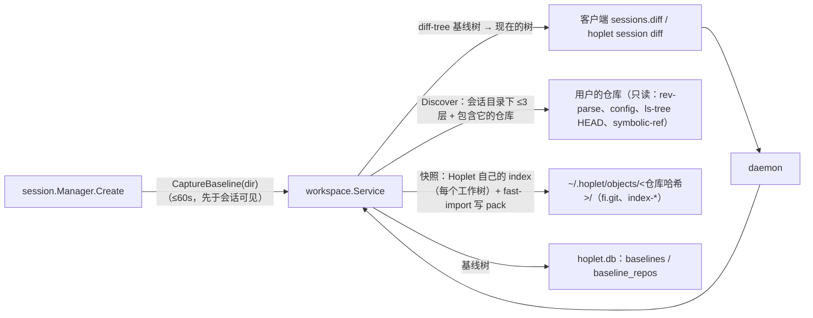

# M1 · PR8 工作目录与会话累计 diff · 详细计划

> **执行方式：** 按任务顺序逐步执行；每一步用 `- [ ]` 勾选。每个任务结束时 `go test -race ./...` 和 `golangci-lint run ./...` 都应通过。修改已有文件的步骤给出补丁：把代码块存成文件后在仓库根目录执行 `git apply <文件>`；新文件给出完整内容。

**目标：** 会话能看到自己在工作目录下各 git 仓库里改了什么：建会话时（启动 harness 前）给每个仓库记一份基线，之后按需请求“会话累计”diff，按仓库汇总文件、增删行数与 patch。全程不读用户的 index、不往用户仓库写任何东西（只读其 HEAD 的提交与树、配置），用户的 `.git` 下没有任何文件被新建、修改、删除或改动时间戳。

**架构：**



**维护者定的裁决：**
- 基线在建会话时、启动 harness 前拍：先快照，再创建会话（此后别的客户端才看得到），最后存基线；限时 60 秒，失败或超时不影响创建，原因记入基线。
- 交付：按需请求 `sessions.diff`，不新增事件；客户端在 `TurnEnded` / `FileChange` 后重新请求，每个仓库的 `sha` 不变就不重绘。
- 只做 git 仓库；工作目录里非 git 的文件不在 PR8 范围。
- Hoplet 的对象每个仓库一个目录、跨会话共用；index 每个工作树一个。清理（归档时）留到以后，PR8 只清导入 / repack 的残留并在 pack 多时合并。
- 会话中途新出现的仓库从空树算起（`new`），消失的标 `missing`。
- 会话目录在某个仓库内部时，diff 整个外层仓库。
- 不读用户的 index、不引用用户的对象做快照（复制用户 index 的做法会经钩子、filter、split index 写进 `.git`，且用户 gc 后旧基线失效）：Hoplet 维护自己的 index 当 stat 缓存，内容按磁盘原始字节比较；每个仓库第一次快照要哈希整个工作区。
- 不过度设计：罕见布局（`.git` 是符号链接、`core.worktree` 指到别处、partial clone、仓库顶层是主目录或其上层）不支持，该仓库报 `error`“unsupported repository layout”，各有测试证明它不碰 `.git`；只是“包含”会话目录的主目录仓库静默忽略。

**做法要点**（详见 `docs/design/0008` 新增的“会话基线与累计 diff”一节）：
- 每条 git 命令：去掉环境里的 `GIT_*`；`core.hooksPath=/dev/null`、`core.ignoreStat=false`、关掉 gc / maintenance / fsmonitor / untracked cache / split index；配置里每个 filter 驱动的 clean / smudge / process 覆盖为空；`GIT_NO_LAZY_FETCH=1`、`GIT_OPTIONAL_LOCKS=0`；在工作目录下找到的仓库用 `GIT_CEILING_DIRECTORIES` 不让 git 往上找。
- 文件集合 = HEAD 中跟踪的 ∪ 未跟踪且未忽略的（遵守 `status.showUntrackedFiles=no`）∪ Hoplet index 里已有的；子模块与嵌入仓库记为其 HEAD 提交；父目录是符号链接的路径视为不存在；> 50MB 或读不了的文件沿用旧版本并列入 `skipped`；只打开普通文件（`O_NOFOLLOW|O_NONBLOCK` + fstat）。
- 内容经 `git fast-import` 写成 pack（在 Hoplet 自己的裸仓库 `fi.git` 里），每 10000 个文件或 256MiB 一轮并保存 index，被打断后下次接着做；单次快照读超过 4GiB 为 `error`。
- 响应按 JSON 编码合计 ≤ 6MiB，每仓库 ≤ 5000 个文件、合计 ≤ 20000，skipped ≤ 1000；每个会话同时最多一次计算，进行中到达的请求共用下一次计算；每个请求 60 秒时限从到达算起。

## 全局约束

- 不新增依赖（调用用户的 `git`，要求 ≥ 2.38）；代码、注释、commit 用英文；设计文档中文；导出标识符有文档注释；库代码不 panic；错误用 `%w` 包装；不用 lint 抑制注释（`.golangci.yml` 里按文件、带理由的 G204 排除是本仓库既有做法）。
- 不读用户的 index、不往用户仓库写任何东西；用户 `.git`（含 common dir、子模块的 git 目录、linked worktree 的管理目录）下不得有任何改动：每个碰仓库的测试都用 `assertGitUntouched` 检查。
- 测试用 `t.TempDir()` 里的真实 git（缺 git 或版本低于 2.38 时跳过）；不访问网络、不碰真实的 `~/.hoplet`；除“轮询直到条件成立”外不用 sleep 同步；不泄漏进程。
- 任何文件与 commit 都不得出现个人用户名或本机路径。
- 分支 `feat/workspace-diff`；commit 带 DCO 签名（`git commit -s`），标题不超过 72 字符；完成前 `make check` 通过。

## 文件

| 文件 | 职责 |
|---|---|
| `proto/api.go` 及测试 | `sessions.diff` 请求与响应类型 |
| `internal/store/baseline.go`、`migrations/0005_baselines.sql` 及测试 | 存取会话基线 |
| `internal/workspace/` | 发现仓库、快照、diff、`Service`（基线、按需 diff、合并请求、清理与 repack） |
| `internal/session/manager.go` 及测试 | 建会话时拍基线 |
| `internal/daemon/`、`internal/client/methods.go`、`.golangci.yml` | `sessions.diff`、doctor 的 git 检查、客户端方法 |
| `cmd/hoplet/session.go` 及测试 | `hoplet session diff` |
| `docs/design/0008`、`docs/plans/m1-overview.md` | 设计与总计划同步 |

## 接口（后续 PR 依赖）

- `proto.MethodSessionsDiff`、`proto.DiffParams{Session, Repo, Patch}`、`proto.SessionDiff`、`proto.RepoDiff`、`proto.RepoState`（`ok` / `new` / `missing` / `error`）、`proto.FileDiff`、`proto.FileStatus`、`proto.SkippedFile`
- `store.Baseline`、`store.BaselineRepo`、`(*Store).SaveBaseline / Baseline`
- `workspace.FindGit(env)`、`workspace.Git`、`workspace.Repo`、`workspace.Discover`、`workspace.ObjectDir`、`(Git).Snapshot / EmptyTree / Diff / DiffFiles`、`workspace.Service{…}`、`(*Service).CaptureBaseline / Diff / Close`
- `session.Config.Baseline func(ctx, dir) (save func(ctx, id) error)`
- `client.(*Client).Diff(ctx, proto.DiffParams)`；CLI `hoplet session diff ID [--stat] [--json] [--repo PATH]`

---

### 任务 0：建分支

- [ ] **步骤 1：建分支**

```bash
git switch -c feat/workspace-diff
```

### 任务 1：协议类型

**文件：** 修改 `proto/api.go`、`proto/api_test.go`

**接口：** 产生 `proto.MethodSessionsDiff`、`DiffParams`、`SessionDiff`、`RepoDiff`、`RepoState`、`FileDiff`、`FileStatus`、`SkippedFile`。

- [ ] **步骤 1：加类型与测试**


````diff
diff --git a/proto/api.go b/proto/api.go
index 44eca11..1011d9b 100644
--- a/proto/api.go
+++ b/proto/api.go
@@ -80,6 +80,7 @@ const (
 	MethodSessionsArchive   = "sessions.archive"
 	MethodSessionsEvents    = "sessions.events"
 	MethodSessionsGet       = "sessions.get"
+	MethodSessionsDiff      = "sessions.diff"
 	MethodEnvRefresh        = "env.refresh"
 	MethodSystemDoctor      = "system.doctor"
 	MethodQueueList         = "queue.list"
@@ -331,3 +332,98 @@ type Check struct {
 type DoctorReport struct {
 	Checks []Check `json:"checks"`
 }
+
+// DiffParams asks for a session's changes since its baseline. Repo limits
+// the answer to one repository (by its path under the working directory);
+// Patch asks for the patch text as well as the file list.
+type DiffParams struct {
+	Session SessionID `json:"session"`
+	Repo    string    `json:"repo,omitempty"`
+	Patch   bool      `json:"patch,omitempty"`
+}
+
+// SessionDiff is everything a session changed in the git repositories under
+// its working directory, per repository. Clients ask again after a turn
+// ends or files change, and skip redrawing a repository whose SHA is
+// unchanged. BaselineAt is when the baseline was taken, absent when there is
+// none; BaselineError says why it is missing or incomplete.
+type SessionDiff struct {
+	Session       SessionID  `json:"session"`
+	BaselineAt    *time.Time `json:"baseline_at,omitempty"`
+	BaselineError string     `json:"baseline_error,omitempty"`
+	Repos         []RepoDiff `json:"repos"`
+}
+
+// RepoState says how a repository's diff was made.
+type RepoState string
+
+// Repository states.
+const (
+	// RepoOK is a repository present at the baseline and now.
+	RepoOK RepoState = "ok"
+	// RepoNew is a repository that appeared after the baseline; its diff
+	// is against the empty tree.
+	RepoNew RepoState = "new"
+	// RepoMissing is a repository the baseline had that is gone.
+	RepoMissing RepoState = "missing"
+	// RepoError is a repository whose diff could not be made; Error says why.
+	RepoError RepoState = "error"
+)
+
+// RepoDiff is one repository's change since the baseline. Path is relative
+// to the working directory ("." for the directory itself); Parent is the
+// path of the repository that contains this one (a submodule or nested
+// repository), empty otherwise. Patch is set only when asked for and is cut
+// at a line boundary, with Truncated set, when it is too large (a response
+// is limited to a few MiB as encoded, so later repositories may get no patch,
+// or no file list). SHA changes whenever anything shown does.
+type RepoDiff struct {
+	Path   string     `json:"path"`
+	Parent string     `json:"parent,omitempty"`
+	Branch string     `json:"branch,omitempty"`
+	State  RepoState  `json:"state"`
+	Error  string     `json:"error,omitempty"`
+	Files  []FileDiff `json:"files"`
+	// FilesTruncated says Files holds only the first files by path.
+	FilesTruncated bool          `json:"files_truncated,omitempty"`
+	Patch          string        `json:"patch,omitempty"`
+	Truncated      bool          `json:"truncated,omitempty"`
+	Skipped        []SkippedFile `json:"skipped,omitempty"`
+	// SkippedTruncated says Skipped holds only the first files by path.
+	SkippedTruncated bool   `json:"skipped_truncated,omitempty"`
+	SHA              string `json:"sha,omitempty"`
+}
+
+// FileStatus is how a file changed.
+type FileStatus string
+
+// File statuses.
+const (
+	FileStatusAdded       FileStatus = "added"
+	FileStatusModified    FileStatus = "modified"
+	FileStatusDeleted     FileStatus = "deleted"
+	FileStatusRenamed     FileStatus = "renamed"
+	FileStatusTypeChanged FileStatus = "type_changed"
+)
+
+// FileDiff is one changed file. OldPath is set for a rename. Binary files
+// have no line counts. Filter names the git clean/smudge filter the file's
+// attributes select; such a file is listed without patch text.
+type FileDiff struct {
+	Path      string     `json:"path"`
+	OldPath   string     `json:"old_path,omitempty"`
+	Status    FileStatus `json:"status"`
+	Additions int        `json:"additions"`
+	Deletions int        `json:"deletions"`
+	Binary    bool       `json:"binary,omitempty"`
+	Filter    string     `json:"filter,omitempty"`
+}
+
+// SkippedFile is a file left out of a repository's snapshots; the version
+// recorded before, if any, is compared instead. Reason is "too large" or
+// "unreadable".
+type SkippedFile struct {
+	Path   string `json:"path"`
+	Size   int64  `json:"size,omitempty"`
+	Reason string `json:"reason,omitempty"`
+}
diff --git a/proto/api_test.go b/proto/api_test.go
index d199968..a284326 100644
--- a/proto/api_test.go
+++ b/proto/api_test.go
@@ -22,6 +22,12 @@ func TestFrameWireFormat(t *testing.T) {
 		"recorded":    {SendReply{Seq: 7, Turn: 2}, `{"seq":7,"turn":2}`},
 		"empty queue": {SessionItem{Queue: &Queue{Messages: []QueuedMessage{}}}, `{"queue":{"messages":[]}}`},
 		"events page": {EventsPage{Events: []Event{}, More: true}, `{"events":[],"more":true}`},
+		"diff args":   {DiffParams{Session: "s", Repo: "api", Patch: true}, `{"session":"s","repo":"api","patch":true}`},
+		"diff none":   {SessionDiff{Session: "s", Repos: []RepoDiff{}}, `{"session":"s","repos":[]}`},
+		"repo diff": {RepoDiff{Path: ".", State: RepoNew, Files: []FileDiff{{Path: "a", Status: FileStatusAdded, Additions: 2}}, Skipped: []SkippedFile{{Path: "big", Size: 9, Reason: "too large"}}, SHA: "h"},
+			`{"path":".","state":"new","files":[{"path":"a","status":"added","additions":2,"deletions":0}],"skipped":[{"path":"big","size":9,"reason":"too large"}],"sha":"h"}`},
+		"renamed binary": {FileDiff{Path: "b", OldPath: "a", Status: FileStatusRenamed, Binary: true, Filter: "lfs"},
+			`{"path":"b","old_path":"a","status":"renamed","additions":0,"deletions":0,"binary":true,"filter":"lfs"}`},
 		"events args": {EventsParams{Session: "s", BeforeSeq: 11, Limit: 5}, `{"session":"s","before_seq":11,"limit":5}`},
 	} {
 		b, err := json.Marshal(tc.v)
````


- [ ] **步骤 2：运行，确认通过**

运行：`go test -race ./proto/ && golangci-lint run ./...`
预期：`ok`；`0 issues.`

- [ ] **步骤 3：commit**

```bash
git add proto
git commit -s -m "feat(proto): add the session diff request"
```

### 任务 2：存储基线

**文件：** 创建 `internal/store/baseline.go`、`internal/store/baseline_test.go`、`internal/store/migrations/0005_baselines.sql`

**接口：** 消费 `proto.SkippedFile`；产生 `store.Baseline{TakenAt, Error, Repos}`、`store.BaselineRepo`、`SaveBaseline`（整体替换）、`Baseline`（没有时 ok 为 false）。

- [ ] **步骤 1：迁移、实现与测试**


`internal/store/migrations/0005_baselines.sql`

```sql
CREATE TABLE baselines (
    session_id TEXT NOT NULL REFERENCES sessions(id),
    taken_at   INTEGER NOT NULL,
    error      TEXT NOT NULL DEFAULT '',
    PRIMARY KEY (session_id)
) STRICT, WITHOUT ROWID;

CREATE TABLE baseline_repos (
    session_id TEXT NOT NULL REFERENCES sessions(id),
    repo       TEXT NOT NULL,
    tree       TEXT NOT NULL,
    skipped    TEXT NOT NULL DEFAULT '[]',
    error      TEXT NOT NULL DEFAULT '',
    PRIMARY KEY (session_id, repo)
) STRICT, WITHOUT ROWID;
```

`internal/store/baseline.go`

```go
package store

import (
	"context"
	"database/sql"
	"encoding/json"
	"errors"
	"fmt"
	"time"

	"github.com/yangflow/hoplet/proto"
)

// BaselineRepo is one repository's content when a session began: Tree is a
// tree id in Hoplet's own object directory for the repository. Error, when
// set, says why no snapshot could be taken; Tree is then empty.
type BaselineRepo struct {
	Path    string // relative to the session's working directory
	Tree    string
	Error   string
	Skipped []proto.SkippedFile
}

// Baseline is a session's starting point. Error, when set, says why it is
// incomplete (repositories could not be found, or time ran out); the
// repositories it does hold are still good.
type Baseline struct {
	TakenAt time.Time
	Error   string
	Repos   []BaselineRepo
}

// SaveBaseline records the session's baseline, replacing any earlier one.
func (s *Store) SaveBaseline(ctx context.Context, id proto.SessionID, b Baseline) error {
	return s.tx(ctx, false, func(tx *sql.Tx) error {
		if err := requireSession(ctx, tx, id); err != nil {
			return err
		}
		// A new baseline replaces the old one's repositories.
		if _, err := tx.ExecContext(ctx, `DELETE FROM baseline_repos WHERE session_id = ?`, id); err != nil {
			return fmt.Errorf("store: clear baseline: %w", err)
		}
		_, err := tx.ExecContext(ctx, `INSERT INTO baselines (session_id, taken_at, error) VALUES (?, ?, ?)
			ON CONFLICT (session_id) DO UPDATE SET taken_at = excluded.taken_at, error = excluded.error`,
			id, b.TakenAt.UnixMilli(), b.Error)
		if err != nil {
			return fmt.Errorf("store: save baseline: %w", err)
		}
		for _, r := range b.Repos {
			skipped, err := json.Marshal(append([]proto.SkippedFile{}, r.Skipped...))
			if err != nil {
				return fmt.Errorf("store: encode skipped files: %w", err)
			}
			_, err = tx.ExecContext(ctx, `INSERT INTO baseline_repos (session_id, repo, tree, skipped, error)
				VALUES (?, ?, ?, ?, ?)`, id, r.Path, r.Tree, string(skipped), r.Error)
			if err != nil {
				return fmt.Errorf("store: save baseline repo %s: %w", r.Path, err)
			}
		}
		return nil
	})
}

// Baseline returns the session's baseline, with ok false when none was
// recorded. It returns ErrNotFound for an unknown session.
func (s *Store) Baseline(ctx context.Context, id proto.SessionID) (b Baseline, ok bool, err error) {
	err = s.readTx(ctx, func(tx *sql.Tx) error {
		if err := requireSession(ctx, tx, id); err != nil {
			return err
		}
		var taken int64
		err := tx.QueryRowContext(ctx, `SELECT taken_at, error FROM baselines WHERE session_id = ?`, id).Scan(&taken, &b.Error)
		if errors.Is(err, sql.ErrNoRows) {
			return nil
		}
		if err != nil {
			return fmt.Errorf("store: read baseline: %w", err)
		}
		ok = true
		b.TakenAt = time.UnixMilli(taken).UTC()
		rows, err := tx.QueryContext(ctx, `SELECT repo, tree, skipped, error FROM baseline_repos
			WHERE session_id = ? ORDER BY repo`, id)
		if err != nil {
			return fmt.Errorf("store: read baseline repos: %w", err)
		}
		defer rows.Close()
		for rows.Next() {
			var r BaselineRepo
			var skipped string
			if err := rows.Scan(&r.Path, &r.Tree, &skipped, &r.Error); err != nil {
				return fmt.Errorf("store: read baseline repo: %w", err)
			}
			if err := json.Unmarshal([]byte(skipped), &r.Skipped); err != nil {
				return fmt.Errorf("store: decode skipped files of %s: %w", r.Path, err)
			}
			if len(r.Skipped) == 0 {
				r.Skipped = nil
			}
			b.Repos = append(b.Repos, r)
		}
		if err := rows.Err(); err != nil {
			return fmt.Errorf("store: read baseline repos: %w", err)
		}
		return nil
	})
	if err != nil {
		return Baseline{}, false, err
	}
	return b, ok, nil
}
```

`internal/store/baseline_test.go`

```go
package store

import (
	"context"
	"errors"
	"reflect"
	"testing"
	"time"

	"github.com/yangflow/hoplet/proto"
)

func TestBaselineRoundTrip(t *testing.T) {
	ctx := context.Background()
	s := newStore(t)
	newSession(t, s, "a")
	newSession(t, s, "b")
	if _, ok, err := s.Baseline(ctx, "a"); err != nil || ok {
		t.Fatalf("baseline before saving: %v %v", ok, err)
	}
	if _, _, err := s.Baseline(ctx, "nope"); !errors.Is(err, ErrNotFound) {
		t.Fatalf("baseline of an unknown session: %v", err)
	}
	first := Baseline{TakenAt: t0, Repos: []BaselineRepo{
		{Path: "web", Tree: "t2", Skipped: []proto.SkippedFile{{Path: "big.bin", Size: 99, Reason: "too large"}}},
		{Path: ".", Tree: "t1"},
		{Path: "api", Error: "boom"},
	}}
	if err := s.SaveBaseline(ctx, "a", first); err != nil {
		t.Fatal(err)
	}
	got, ok, err := s.Baseline(ctx, "a")
	if err != nil || !ok {
		t.Fatalf("baseline: %v %v", ok, err)
	}
	want := Baseline{TakenAt: t0, Repos: []BaselineRepo{
		{Path: ".", Tree: "t1"},
		{Path: "api", Error: "boom"},
		{Path: "web", Tree: "t2", Skipped: []proto.SkippedFile{{Path: "big.bin", Size: 99, Reason: "too large"}}},
	}}
	if got.Error != "" || !got.TakenAt.Equal(want.TakenAt) || !reflect.DeepEqual(got.Repos, want.Repos) {
		t.Fatalf("baseline %+v, want %+v", got, want)
	}

	// Saving again replaces the baseline and its repositories.
	second := Baseline{TakenAt: t0.Add(time.Minute), Error: "timed out", Repos: []BaselineRepo{{Path: "x", Tree: "t9"}}}
	if err := s.SaveBaseline(ctx, "a", second); err != nil {
		t.Fatal(err)
	}
	got, _, err = s.Baseline(ctx, "a")
	if err != nil || got.Error != "timed out" || len(got.Repos) != 1 || got.Repos[0].Path != "x" {
		t.Fatalf("replaced baseline %+v %v", got, err)
	}
	if _, ok, _ := s.Baseline(ctx, "b"); ok {
		t.Fatal("another session's baseline changed")
	}
	if err := s.SaveBaseline(ctx, "nope", first); !errors.Is(err, ErrNotFound) {
		t.Fatalf("save for an unknown session: %v", err)
	}
}

func TestBaselineWithoutRepos(t *testing.T) {
	ctx := context.Background()
	s := newStore(t)
	newSession(t, s, "a")
	if err := s.SaveBaseline(ctx, "a", Baseline{TakenAt: t0, Error: "no git"}); err != nil {
		t.Fatal(err)
	}
	got, ok, err := s.Baseline(ctx, "a")
	if err != nil || !ok || got.Error != "no git" || len(got.Repos) != 0 {
		t.Fatalf("baseline %+v %v %v", got, ok, err)
	}
}
```


- [ ] **步骤 2：运行，确认通过**

运行：`go test -race ./internal/store/ && golangci-lint run ./...`
预期：`ok`；`0 issues.`

- [ ] **步骤 3：commit**

```bash
git add internal/store
git commit -s -m "feat(store): store session baselines"
```

### 任务 3：发现仓库、快照与 diff

**文件：** 创建 `internal/workspace/` 下全部文件；修改 `.golangci.yml`

**接口：** 消费 `store.Baseline*`、`proto.*Diff*`；产生 `workspace.FindGit`、`Git`、`Repo`、`Discover`、`ObjectDir`、`Snapshot`、`Service`（`CaptureBaseline` / `Diff` / `Close`）、`BaselineStore`。

先写测试（帮助函数里的 `assertGitUntouched` 记录用户 git 目录下每个文件的路径、大小、权限、修改时间和 sha256，调用时比对），确认它们因缺少实现而无法编译，再加实现。

- [ ] **步骤 1：测试**


`internal/workspace/helpers_test.go`

```go
package workspace

import (
	"context"
	"crypto/sha256"
	"fmt"
	"io/fs"
	"os"
	"os/exec"
	"path/filepath"
	"slices"
	"strings"
	"testing"
	"time"

	"github.com/yangflow/hoplet/internal/store"
	"github.com/yangflow/hoplet/proto"
)

// testEnv is the environment of git in tests: the PATH, and an empty home
// so that no user configuration applies.
func testEnv(t testing.TB) []string {
	t.Helper()
	return []string{"PATH=" + os.Getenv("PATH"), "HOME=" + t.TempDir()}
}

// newGit returns the git under test, or skips the test when git 2.38 or
// newer is missing.
func newGit(t testing.TB) Git {
	t.Helper()
	g, err := FindGit(testEnv(t))
	if err != nil {
		t.Skipf("git 2.38 or newer is needed: %v", err)
	}
	return g
}

// git runs plain git in dir, as the user would, and returns its output.
func git(t testing.TB, g Git, dir string, args ...string) string {
	t.Helper()
	cmd := exec.Command(g.Bin, append([]string{"-c", "maintenance.auto=false", "-c", "gc.auto=0", "-C", dir}, args...)...)
	cmd.Env = append(slices.Clone(g.Env), "GIT_AUTHOR_NAME=t", "GIT_AUTHOR_EMAIL=t@example.com",
		"GIT_COMMITTER_NAME=t", "GIT_COMMITTER_EMAIL=t@example.com", "GIT_CONFIG_NOSYSTEM=1")
	out, err := cmd.CombinedOutput()
	if err != nil {
		t.Fatalf("git %s: %v\n%s", strings.Join(args, " "), err, out)
	}
	return string(out)
}

// initRepo creates a repository at dir with the given files, committed.
func initRepo(t testing.TB, g Git, dir string, files map[string]string, extra ...string) {
	t.Helper()
	if err := os.MkdirAll(dir, 0o755); err != nil {
		t.Fatal(err)
	}
	git(t, g, dir, append([]string{"init", "-q", "-b", "main"}, extra...)...)
	for name, content := range files {
		write(t, dir, name, content)
	}
	if len(files) > 0 {
		git(t, g, dir, "add", "-A")
		git(t, g, dir, "commit", "-q", "-m", "init")
	}
}

func write(t testing.TB, dir, name, content string) {
	t.Helper()
	p := filepath.Join(dir, filepath.FromSlash(name))
	if err := os.MkdirAll(filepath.Dir(p), 0o755); err != nil {
		t.Fatal(err)
	}
	if err := os.WriteFile(p, []byte(content), 0o644); err != nil {
		t.Fatal(err)
	}
}

// assertGitUntouched records every file and directory under the repository's
// git dir and common git dir (and its .git file, if any) with size, mode,
// modification time and content hash, and returns a function that fails the
// test when anything differs: nothing created, changed or removed. Call it
// before the code under test runs and the result after: defer
// assertGitUntouched(t, g, repo)().
func assertGitUntouched(t testing.TB, g Git, repoAbs string) func() {
	t.Helper()
	roots := []string{filepath.Join(repoAbs, ".git")}
	out := git(t, g, repoAbs, "rev-parse", "--path-format=absolute", "--git-dir", "--git-common-dir")
	roots = append(roots, strings.Fields(out)...)
	record := func() map[string]string {
		state := map[string]string{}
		for _, root := range roots {
			err := filepath.WalkDir(root, func(p string, d fs.DirEntry, err error) error {
				if err != nil {
					return err
				}
				fi, err := d.Info()
				if err != nil {
					return err
				}
				if fi.IsDir() {
					state[p] = fmt.Sprintf("dir %o %d", fi.Mode(), fi.ModTime().UnixNano())
					return nil
				}
				sum := ""
				if fi.Mode().IsRegular() {
					b, err := os.ReadFile(p)
					if err != nil {
						return err
					}
					sum = fmt.Sprintf("%x", sha256.Sum256(b))
				}
				state[p] = fmt.Sprintf("file %o %d %d %s", fi.Mode(), fi.Size(), fi.ModTime().UnixNano(), sum)
				return nil
			})
			if err != nil && !os.IsNotExist(err) {
				t.Fatalf("record %s: %v", root, err)
			}
		}
		return state
	}
	before := record()
	return func() {
		t.Helper()
		after := record()
		for p, v := range before {
			if w, ok := after[p]; !ok {
				t.Errorf("git dir: %s was removed", p)
			} else if w != v {
				t.Errorf("git dir: %s changed: %s -> %s", p, v, w)
			}
		}
		for p := range after {
			if _, ok := before[p]; !ok {
				t.Errorf("git dir: %s was created", p)
			}
		}
	}
}

// guard is assertGitUntouched for several repositories at once.
func guard(t testing.TB, g Git, repos ...string) func() {
	t.Helper()
	var checks []func()
	for _, r := range repos {
		checks = append(checks, assertGitUntouched(t, g, r))
	}
	return func() {
		t.Helper()
		for _, c := range checks {
			c()
		}
	}
}

// fixture is a Service over a real store with one session.
type fixture struct {
	svc  *Service
	st   *store.Store
	home string
	id   proto.SessionID
}

func newFixture(t testing.TB, g Git) fixture {
	t.Helper()
	st, err := store.Open(context.Background(), t.TempDir())
	if err != nil {
		t.Fatal(err)
	}
	t.Cleanup(func() { st.Close() })
	id := proto.SessionID("s1")
	_, err = st.CreateSession(context.Background(), proto.Session{
		ID: id, Mode: proto.ModeCode, Harness: proto.HarnessRef{Kind: "fake"}, Directory: "/work",
		Isolation: proto.InPlace, Owner: proto.OwnerMe, Origin: proto.OriginMe,
	})
	if err != nil {
		t.Fatal(err)
	}
	home := t.TempDir()
	now := time.Date(2026, 11, 1, 9, 0, 0, 0, time.UTC)
	return fixture{svc: &Service{Git: g, Home: home, Store: st, Now: func() time.Time { return now }}, st: st, home: home, id: id}
}

func (f fixture) baseline(t testing.TB, dir string) {
	t.Helper()
	if err := f.svc.CaptureBaseline(context.Background(), dir)(context.Background(), f.id); err != nil {
		t.Fatal(err)
	}
}

func (f fixture) diff(t testing.TB, dir string, p proto.DiffParams) proto.SessionDiff {
	t.Helper()
	p.Session = f.id
	d, err := f.svc.Diff(context.Background(), f.id, dir, p)
	if err != nil {
		t.Fatal(err)
	}
	return d
}

// repoByPath finds a repository in a diff.
func repoByPath(t testing.TB, d proto.SessionDiff, path string) proto.RepoDiff {
	t.Helper()
	for _, r := range d.Repos {
		if r.Path == path {
			return r
		}
	}
	t.Fatalf("no repo %q in %+v", path, d.Repos)
	return proto.RepoDiff{}
}

// fileSummary renders a file list as "status:path" items, sorted by path.
func fileSummary(files []proto.FileDiff) []string {
	out := []string{}
	for _, f := range files {
		s := string(f.Status) + ":" + f.Path
		if f.OldPath != "" {
			s += "<-" + f.OldPath
		}
		out = append(out, s)
	}
	return out
}

func expectFiles(t testing.TB, got []proto.FileDiff, want ...string) {
	t.Helper()
	if g := fileSummary(got); !slices.Equal(g, want) {
		t.Fatalf("files %v, want %v", g, want)
	}
}

// tryInit makes an empty repository with the object format, failing instead
// of stopping the test.
func tryInit(g Git, dir, format string) (string, error) {
	cmd := exec.Command(g.Bin, "-C", dir, "init", "-q", "-b", "main", "--object-format="+format)
	cmd.Env = g.Env
	out, err := cmd.CombinedOutput()
	return string(out), err
}
```

`internal/workspace/discover_test.go`

```go
package workspace

import (
	"context"
	"os"
	"path/filepath"
	"slices"
	"testing"

	"github.com/yangflow/hoplet/proto"
)

func TestDiscover(t *testing.T) {
	g := newGit(t)
	root := t.TempDir()
	for _, r := range []string{"api", "web", "shared", "api/tools/gen", "a/b/c", "a/b/c/d/e", "node_modules/dep", "vendor/lib", "notes/old/repo"} {
		initRepo(t, g, filepath.Join(root, r), nil)
	}
	write(t, root, "notes/todo.txt", "x")
	other := t.TempDir()
	initRepo(t, g, filepath.Join(other, "linked"), nil)
	if err := os.Symlink(filepath.Join(other, "linked"), filepath.Join(root, "link")); err != nil {
		t.Fatal(err)
	}
	if err := os.Mkdir(filepath.Join(root, "locked"), 0o000); err != nil {
		t.Fatal(err)
	}
	t.Cleanup(func() { _ = os.Chmod(filepath.Join(root, "locked"), 0o755) })

	defer guard(t, g, filepath.Join(root, "api"), filepath.Join(root, "a", "b", "c"))()
	repos, err := Discover(context.Background(), root)
	if err != nil {
		t.Fatal(err)
	}
	var got []string
	parents := map[string]string{}
	for _, r := range repos {
		got = append(got, r.Path)
		parents[r.Path] = r.Parent
		if r.Abs != filepath.Join(root, filepath.FromSlash(r.Path)) {
			t.Errorf("abs path %s for %s", r.Abs, r.Path)
		}
	}
	want := []string{"a/b/c", "api", "api/tools/gen", "notes/old/repo", "shared", "web"}
	if !slices.Equal(got, want) {
		t.Fatalf("repos %v, want %v", got, want)
	}
	if parents["api/tools/gen"] != "api" || parents["api"] != "" {
		t.Fatalf("parents %v", parents)
	}

	// The directory itself being a repository comes first and parents the rest.
	initRepo(t, g, root, nil)
	repos, err = Discover(context.Background(), root)
	if err != nil {
		t.Fatal(err)
	}
	if repos[0].Path != "." || repos[0].Parent != "" || repos[1].Path != "a/b/c" || repos[1].Parent != "." {
		t.Fatalf("repos %+v", repos[:2])
	}
	if _, err := Discover(context.Background(), filepath.Join(root, "missing")); err == nil {
		t.Fatal("discovered a missing directory")
	}
	ctx, cancel := context.WithCancel(context.Background())
	cancel()
	if _, err := Discover(ctx, root); err == nil {
		t.Fatal("discovery ignored a cancelled context")
	}
}

func TestEnclosingRepositoryIsFoundFromASubdirectory(t *testing.T) {
	g := newGit(t)
	repo := t.TempDir()
	initRepo(t, g, repo, map[string]string{"top.txt": "t\n", "services/api/main.go": "package main\n"})
	dir := filepath.Join(repo, "services", "api")
	initRepo(t, g, filepath.Join(dir, "vendored"), map[string]string{"v.txt": "v\n"})
	found, err := g.Discover(context.Background(), dir)
	if err != nil {
		t.Fatal(err)
	}
	if len(found) != 2 || found[0].Path != "../.." || found[0].Parent != "" || found[1].Path != "vendored" || found[1].Parent != "../.." {
		t.Fatalf("repos %+v", found)
	}
	if real, _ := filepath.EvalSymlinks(repo); found[0].Abs != real {
		t.Fatalf("abs %s, want %s", found[0].Abs, real)
	}
	f := newFixture(t, g)
	defer guard(t, g, repo, filepath.Join(dir, "vendored"))()
	f.baseline(t, dir)
	write(t, repo, "top.txt", "t2\n") // outside the directory, inside the repository
	write(t, dir, "main.go", "package main\n\nfunc main() {}\n")
	d := f.diff(t, dir, proto.DiffParams{})
	expectFiles(t, repoByPath(t, d, "../..").Files, "modified:services/api/main.go", "modified:top.txt")
	if repoByPath(t, d, "vendored").State != proto.RepoOK {
		t.Fatalf("diff %+v", d)
	}
	// At the top of the repository nothing is added.
	if top, err := g.Discover(context.Background(), repo); err != nil || top[0].Path != "." || len(top) != 2 {
		t.Fatalf("at the top: %+v %v", top, err)
	}
}

func TestInvalidDotGitIsNotARepository(t *testing.T) {
	g := newGit(t)
	repo := t.TempDir()
	initRepo(t, g, repo, map[string]string{"a": "1\n"})
	if err := os.MkdirAll(filepath.Join(repo, "x", ".git"), 0o755); err != nil { // empty: not a git dir
		t.Fatal(err)
	}
	if err := os.MkdirAll(filepath.Join(repo, "z"), 0o755); err != nil {
		t.Fatal(err)
	}
	if err := os.WriteFile(filepath.Join(repo, "z", ".git"), []byte("gitdir: /nonexistent/elsewhere\n"), 0o644); err != nil { // broken gitfile
		t.Fatal(err)
	}
	found, err := g.Discover(context.Background(), repo)
	if err != nil || len(found) != 1 || found[0].Path != "." {
		t.Fatalf("repos %+v %v", found, err)
	}
	// An embedded directory like that is no commit either.
	f := newFixture(t, g)
	defer guard(t, g, repo)()
	f.baseline(t, repo)
	write(t, repo, "a", "2\n")
	expectFiles(t, f.diff(t, repo, proto.DiffParams{}).Repos[0].Files, "modified:a")
}
```

`internal/workspace/snapshot_test.go`

```go
package workspace

import (
	"context"
	"errors"
	"os"
	"path/filepath"
	"strings"
	"syscall"
	"testing"
	"time"

	"github.com/yangflow/hoplet/proto"
)

func TestFindGit(t *testing.T) {
	g := newGit(t)
	v, err := g.Version(context.Background())
	if err != nil || !versionAtLeast(v, 38) {
		t.Fatalf("version %q %v", v, err)
	}
	if _, err := FindGit([]string{"PATH=" + t.TempDir()}); !errors.Is(err, ErrNoGit) {
		t.Fatalf("git on an empty PATH: %v", err)
	}
	if _, err := FindGit(nil); !errors.Is(err, ErrNoGit) {
		t.Fatalf("git without PATH: %v", err)
	}
	// An old git is refused.
	dir := t.TempDir()
	script := "#!/bin/sh\necho 'git version 2.30.1'\n"
	if err := os.WriteFile(filepath.Join(dir, "git"), []byte(script), 0o755); err != nil {
		t.Fatal(err)
	}
	if _, err := FindGit([]string{"PATH=" + dir}); !errors.Is(err, ErrNoGit) || !strings.Contains(err.Error(), "2.30.1") {
		t.Fatalf("old git: %v", err)
	}
	if _, err := (Git{}).Version(context.Background()); !errors.Is(err, ErrNoGit) {
		t.Fatalf("zero Git: %v", err)
	}
}

func TestVersionAtLeast(t *testing.T) {
	for v, want := range map[string]bool{
		"2.38.0": true, "2.54.0": true, "2.39.5.windows.1": true, "3.0.0": true, "10.1": true,
		"2.37.9": false, "1.99.0": false, "2": false, "x.y.z": false, "": false,
	} {
		if got := versionAtLeast(v, 38); got != want {
			t.Errorf("versionAtLeast(%q) = %v, want %v", v, got, want)
		}
	}
}

func TestEnvironmentVariablesOfGitAreIgnored(t *testing.T) {
	g := newGit(t)
	repo := t.TempDir()
	initRepo(t, g, repo, map[string]string{"a": "1\n"})
	defer guard(t, g, repo)()
	g.Env = append(g.Env, "GIT_DIR=/nonexistent", "GIT_INDEX_FILE=/nonexistent/index", "GIT_WORK_TREE=/nonexistent", "GIT_OBJECT_DIRECTORY=/nonexistent")
	f := newFixture(t, g)
	f.baseline(t, repo)
	write(t, repo, "a", "2\n")
	d := f.diff(t, repo, proto.DiffParams{})
	expectFiles(t, repoByPath(t, d, ".").Files, "modified:a")
}

func TestEmptyTree(t *testing.T) {
	g := newGit(t)
	for format, want := range map[string]string{
		"sha1":   "4b825dc642cb6eb9a060e54bf8d69288fbee4904",
		"sha256": "6ef19b41225c5369f1c104d45d8d85efa9b057b53b14b4b9b939dd74decc5321",
	} {
		repo := t.TempDir()
		if out, err := tryInit(g, repo, format); err != nil {
			t.Skipf("git cannot make a %s repository: %v %s", format, err, out)
		}
		r := Repo{Path: ".", Abs: repo}
		check := guard(t, g, repo)
		objects, err := ObjectDir(context.Background(), t.TempDir(), r, g)
		if err != nil {
			t.Fatal(err)
		}
		got, err := g.EmptyTree(context.Background(), r, objects)
		check()
		if err != nil || got != want {
			t.Errorf("%s empty tree %q %v, want %s", format, got, err, want)
		}
	}
}

func TestSnapshotProgressSurvivesCancellation(t *testing.T) {
	g := newGit(t)
	files := map[string]string{}
	for _, n := range []string{"a", "b", "c", "d", "e", "f", "g"} {
		files[n] = n + "\n"
	}
	repo := t.TempDir()
	initRepo(t, g, repo, files)
	r := Repo{Path: ".", Abs: repo}
	objects, err := ObjectDir(context.Background(), t.TempDir(), r, g)
	if err != nil {
		t.Fatal(err)
	}
	defer guard(t, g, repo)()

	g.filesPerChunk = 2
	ctx, cancel := context.WithCancel(context.Background())
	var first []string
	g.hashed = func(p []string) { first = append(first, p...) }
	g.afterChunk = func(n int) {
		if n == 1 {
			cancel()
		}
	}
	if _, err := g.Snapshot(ctx, r, objects); err == nil {
		t.Fatal("a cancelled snapshot succeeded")
	}
	if len(first) != 2 {
		t.Fatalf("first attempt hashed %v", first)
	}
	var second []string
	g.hashed = func(p []string) { second = append(second, p...) }
	g.afterChunk = nil
	snap, err := g.Snapshot(context.Background(), r, objects)
	if err != nil {
		t.Fatal(err)
	}
	if len(second) != 5 {
		t.Fatalf("second attempt hashed %v, want the 5 files the first did not reach", second)
	}
	for _, p := range second {
		if p == first[0] || p == first[1] {
			t.Fatalf("%s was hashed twice", p)
		}
	}
	// Chunking does not change the tree.
	g.filesPerChunk = 0
	whole, err := g.Snapshot(context.Background(), r, t.TempDir())
	if err == nil && whole.Tree != "" && whole.Tree != snap.Tree {
		t.Fatalf("trees differ: %s %s", whole.Tree, snap.Tree)
	}
}

func TestRepositoryTooLargeToSnapshot(t *testing.T) {
	g := newGit(t)
	g.snapshotLimit = 50
	repo := t.TempDir()
	initRepo(t, g, repo, map[string]string{"small": "s\n"})
	for i := 0; i < 10; i++ {
		write(t, repo, "data"+string(rune('a'+i)), strings.Repeat("x", 20))
	}
	r := Repo{Path: ".", Abs: repo}
	objects, err := ObjectDir(context.Background(), t.TempDir(), r, g)
	if err != nil {
		t.Fatal(err)
	}
	defer guard(t, g, repo)()
	if _, err := g.Snapshot(context.Background(), r, objects); !errors.Is(err, ErrTooLarge) {
		t.Fatalf("snapshot: %v", err)
	}
	f := newFixture(t, g)
	f.baseline(t, repo)
	d := f.diff(t, repo, proto.DiffParams{})
	if rd := d.Repos[0]; rd.State != proto.RepoError || !strings.Contains(rd.Error, "too large to snapshot") {
		t.Fatalf("repo %+v", rd)
	}
}

func TestFileGrownPastTheLimitIsSkippedNotDeleted(t *testing.T) {
	g := newGit(t)
	g.MaxFile = 5
	repo := t.TempDir()
	initRepo(t, g, repo, map[string]string{"a": "1\n"})
	write(t, repo, "a", "grown past the limit\n")
	defer guard(t, g, repo)()
	r := Repo{Path: ".", Abs: repo}
	objects, err := ObjectDir(context.Background(), t.TempDir(), r, g)
	if err != nil {
		t.Fatal(err)
	}
	info, _ := g.repoInfo(context.Background(), r)
	importDir, err := g.importRepo(context.Background(), objects, info)
	if err != nil {
		t.Fatal(err)
	}
	// classify saw it small; by the time it is read it is not.
	ch, skipped, err := g.hashItems(context.Background(), runOpts{Dir: repo}, objects, importDir, t.TempDir(),
		map[string]indexEntry{"a": {mode: modeFile}}, []item{{path: "a", size: 2, mode: modeFile}})
	if err != nil || len(ch) != 0 || len(skipped) != 1 || skipped[0].Reason != ReasonTooLarge || skipped[0].Size != 0 {
		t.Fatalf("changes %+v, skipped %+v, error %v", ch, skipped, err)
	}
}

func TestAFifoNeverBlocksTheSnapshot(t *testing.T) {
	g := newGit(t)
	repo := t.TempDir()
	initRepo(t, g, repo, map[string]string{"ok": "fine\n"})
	if err := syscall.Mkfifo(filepath.Join(repo, "pipe"), 0o600); err != nil {
		t.Fatal(err)
	}
	r := Repo{Path: ".", Abs: repo}
	objects, err := ObjectDir(context.Background(), t.TempDir(), r, g)
	if err != nil {
		t.Fatal(err)
	}
	defer guard(t, g, repo)()
	info, err := g.repoInfo(context.Background(), r)
	if err != nil {
		t.Fatal(err)
	}
	importDir, err := g.importRepo(context.Background(), objects, info)
	if err != nil {
		t.Fatal(err)
	}
	tmp := t.TempDir()
	type result struct {
		changes []change
		err     error
	}
	done := make(chan result, 1)
	go func() {
		// The classification saw regular files; one became a FIFO since.
		items := []item{{path: "pipe", size: 1, mode: modeFile}, {path: "ok", size: 5, mode: modeFile}}
		o := runOpts{Dir: repo}
		ch, _, err := g.hashItems(context.Background(), o, objects, importDir, tmp, map[string]indexEntry{"pipe": {mode: modeFile}}, items)
		done <- result{ch, err}
	}()
	select {
	case res := <-done:
		if res.err != nil || len(res.changes) != 2 {
			t.Fatalf("changes %+v, error %v", res.changes, res.err)
		}
		var stored, removed int
		for _, c := range res.changes {
			if c.path == "ok" && c.id != "" {
				stored++
			}
			if c.path == "pipe" && c.mode == "" {
				removed++
			}
		}
		if stored != 1 || removed != 1 {
			t.Fatalf("changes %+v", res.changes)
		}
	case <-time.After(30 * time.Second):
		t.Fatal("hashing a FIFO blocked")
	}
}

func TestObjectDirStartsAfreshWhenTheFormatChanges(t *testing.T) {
	g := newGit(t)
	repo := t.TempDir()
	initRepo(t, g, repo, map[string]string{"a": "1\n"})
	home := t.TempDir()
	r := Repo{Path: ".", Abs: repo}
	objects, err := ObjectDir(context.Background(), home, r, g)
	if err != nil {
		t.Fatal(err)
	}
	check := guard(t, g, repo)
	first, err := g.Snapshot(context.Background(), r, objects)
	check()
	if err != nil || len(first.Tree) != 40 {
		t.Fatalf("sha1 snapshot %+v %v", first, err)
	}
	// The repository is deleted and created again with the other format.
	if err := os.RemoveAll(repo); err != nil {
		t.Fatal(err)
	}
	if err := os.MkdirAll(repo, 0o755); err != nil {
		t.Fatal(err)
	}
	if out, err := tryInit(g, repo, "sha256"); err != nil {
		t.Skipf("git cannot make a sha256 repository: %v %s", err, out)
	}
	write(t, repo, "a", "1\n")
	again, err := ObjectDir(context.Background(), home, r, g)
	if err != nil || again != objects {
		t.Fatalf("object dir %s %v", again, err)
	}
	defer guard(t, g, repo)()
	second, err := g.Snapshot(context.Background(), r, objects)
	if err != nil || len(second.Tree) != 64 {
		t.Fatalf("sha256 snapshot %+v %v", second, err)
	}
}

func TestObjectDirIsSharedPerRepository(t *testing.T) {
	g := newGit(t)
	repo := t.TempDir()
	initRepo(t, g, repo, map[string]string{"a": "1\n"})
	other := t.TempDir()
	initRepo(t, g, other, map[string]string{"a": "1\n"})
	home := t.TempDir()
	ctx := context.Background()
	r := Repo{Path: ".", Abs: repo}
	a, err := ObjectDir(ctx, home, r, g)
	if err != nil {
		t.Fatal(err)
	}
	b, _ := ObjectDir(ctx, home, Repo{Path: "elsewhere", Abs: repo}, g)
	c, _ := ObjectDir(ctx, home, Repo{Path: ".", Abs: other}, g)
	if a != b || a == c || filepath.Dir(a) != filepath.Join(home, "objects") || len(filepath.Base(a)) != 16 {
		t.Fatalf("object dirs %s %s %s", a, b, c)
	}
	if fi, err := os.Stat(a); err != nil || fi.Mode().Perm() != 0o700 {
		t.Fatalf("object dir: %v %v", fi, err)
	}
	// A linked worktree shares its repository's object directory.
	wt := filepath.Join(t.TempDir(), "wt")
	git(t, g, repo, "worktree", "add", "-q", "-b", "other", wt)
	d, err := ObjectDir(ctx, home, Repo{Path: "wt", Abs: wt}, g)
	if err != nil || d != a {
		t.Fatalf("worktree object dir %s %v, want %s", d, err, a)
	}
	// The worktree's own index and git dir are left alone by snapshots.
	defer guard(t, g, wt)()
	write(t, wt, "w.txt", "w\n")
	if _, err := g.Snapshot(ctx, Repo{Path: "wt", Abs: wt}, d); err != nil {
		t.Fatal(err)
	}
}

func TestSymlinkBlobIsTheLinkText(t *testing.T) {
	g := newGit(t)
	repo := t.TempDir()
	initRepo(t, g, repo, map[string]string{"a": "1\n"})
	if err := os.Symlink("../outside/target", filepath.Join(repo, "dangling")); err != nil {
		t.Fatal(err)
	}
	if err := os.Symlink("a", filepath.Join(repo, "ok")); err != nil {
		t.Fatal(err)
	}
	r := Repo{Path: ".", Abs: repo}
	objects, err := ObjectDir(context.Background(), t.TempDir(), r, g)
	if err != nil {
		t.Fatal(err)
	}
	defer guard(t, g, repo)()
	snap, err := g.Snapshot(context.Background(), r, objects)
	if err != nil {
		t.Fatal(err)
	}
	empty, err := g.EmptyTree(context.Background(), r, objects)
	if err != nil {
		t.Fatal(err)
	}
	_, patch, _, err := g.Diff(context.Background(), r, objects, empty, snap.Tree)
	if err != nil {
		t.Fatal(err)
	}
	if !strings.Contains(patch, "+../outside/target") || !strings.Contains(patch, "new file mode 120000") {
		t.Fatalf("patch:\n%s", patch)
	}
}

// TestRacilyCleanEditIsSeen covers a file edited without a change in its
// size or modification time, while that time is not older than Hoplet's
// index: git must compare content, not trust the stat data.
func TestRacilyCleanEditIsSeen(t *testing.T) {
	g := newGit(t)
	repo := t.TempDir()
	initRepo(t, g, repo, map[string]string{"a": "1\n"})
	git(t, g, repo, "config", "core.trustctime", "false")
	future := time.Now().Add(time.Hour)
	a := filepath.Join(repo, "a")
	if err := os.Chtimes(a, future, future); err != nil {
		t.Fatal(err)
	}
	r := Repo{Path: ".", Abs: repo}
	objects, err := ObjectDir(context.Background(), t.TempDir(), r, g)
	if err != nil {
		t.Fatal(err)
	}
	defer assertGitUntouched(t, g, repo)()
	before, err := g.Snapshot(context.Background(), r, objects)
	if err != nil {
		t.Fatal(err)
	}
	write(t, repo, "a", "2\n")
	if err := os.Chtimes(a, future, future); err != nil {
		t.Fatal(err)
	}
	after, err := g.Snapshot(context.Background(), r, objects)
	if err != nil {
		t.Fatal(err)
	}
	if before.Tree == after.Tree {
		t.Fatal("an edit that kept the file's size and time was missed")
	}
}

func TestSymlinkedDirectoryIsNeverReadThrough(t *testing.T) {
	g := newGit(t)
	repo := t.TempDir()
	outside := t.TempDir()
	write(t, outside, "f", "SECRET OUTSIDE\n")
	initRepo(t, g, repo, map[string]string{"d/f": "inside\n", "keep": "k\n"})
	f := newFixture(t, g)
	f.baseline(t, repo)
	if err := os.RemoveAll(filepath.Join(repo, "d")); err != nil {
		t.Fatal(err)
	}
	if err := os.Symlink(outside, filepath.Join(repo, "d")); err != nil {
		t.Fatal(err)
	}
	defer guard(t, g, repo)()
	r := f.diff(t, repo, proto.DiffParams{Patch: true}).Repos[0]
	expectFiles(t, r.Files, "added:d", "deleted:d/f")
	if strings.Contains(r.Patch, "SECRET") {
		t.Fatalf("content from outside the repository:\n%s", r.Patch)
	}
	// Edits behind the link are not the session's.
	write(t, outside, "f", "changed\n")
	again := f.diff(t, repo, proto.DiffParams{Patch: true}).Repos[0]
	if again.SHA != r.SHA {
		t.Fatal("a change outside the repository changed the diff")
	}
	// The same from the very first snapshot.
	f2 := newFixture(t, g)
	f2.baseline(t, repo)
	if r := f2.diff(t, repo, proto.DiffParams{Patch: true}).Repos[0]; len(r.Files) != 0 || strings.Contains(r.Patch, "changed") {
		t.Fatalf("link in place before the baseline: %+v", r)
	}
}

func TestSHA256Repo(t *testing.T) {
	g := newGit(t)
	repo := t.TempDir()
	if out, err := tryInit(g, repo, "sha256"); err != nil {
		t.Skipf("git cannot make a sha256 repository: %v %s", err, out)
	}
	write(t, repo, "a.txt", "a\n")
	git(t, g, repo, "add", "-A")
	git(t, g, repo, "commit", "-q", "-m", "init")
	f := newFixture(t, g)
	check := guard(t, g, repo)
	f.baseline(t, repo)
	write(t, repo, "a.txt", "b\n")
	write(t, repo, "c.txt", "c\n")
	if err := os.Remove(filepath.Join(repo, "a.txt")); err != nil {
		t.Fatal(err)
	}
	d := f.diff(t, repo, proto.DiffParams{Patch: true})
	check()
	r := d.Repos[0]
	expectFiles(t, r.Files, "deleted:a.txt", "added:c.txt")
	if len(r.SHA) != 64 || !strings.Contains(r.Patch, "c.txt") {
		t.Fatalf("repo %+v", r)
	}
}

func TestShowUntrackedFilesNoSnapshotsTrackedFilesOnly(t *testing.T) {
	g := newGit(t)
	repo := t.TempDir()
	initRepo(t, g, repo, map[string]string{"tracked": "1\n"})
	git(t, g, repo, "config", "status.showUntrackedFiles", "no")
	f := newFixture(t, g)
	defer guard(t, g, repo)()
	f.baseline(t, repo)
	write(t, repo, "tracked", "2\n")
	write(t, repo, "private.txt", "not mine to copy\n")
	expectFiles(t, f.diff(t, repo, proto.DiffParams{}).Repos[0].Files, "modified:tracked")
}

func TestShowUntrackedFilesSpellings(t *testing.T) {
	for v, no := range map[string]bool{"no": true, "No": true, "false": true, "OFF": true, "0": true, "normal": false, "all": false, "yes": false} {
		if isNo(v) != no {
			t.Errorf("isNo(%q) = %v", v, !no)
		}
	}
}

func TestIgnoredButTrackedFilesAreIncluded(t *testing.T) {
	g := newGit(t)
	repo := t.TempDir()
	initRepo(t, g, repo, map[string]string{".gitignore": "*.gen\n", "x.txt": "x\n"})
	write(t, repo, "kept.gen", "1\n")
	git(t, g, repo, "add", "-f", "kept.gen")
	git(t, g, repo, "commit", "-q", "-m", "tracked despite the ignore")
	write(t, repo, "loose.gen", "ignored\n")
	f := newFixture(t, g)
	f.baseline(t, repo)
	write(t, repo, "kept.gen", "2\n")
	write(t, repo, "loose.gen", "still ignored\n")
	defer guard(t, g, repo)()
	expectFiles(t, f.diff(t, repo, proto.DiffParams{}).Repos[0].Files, "modified:kept.gen")
}

func TestExecBitIsTheOwnersBit(t *testing.T) {
	g := newGit(t)
	repo := t.TempDir()
	initRepo(t, g, repo, map[string]string{"a.sh": "x\n"})
	f := newFixture(t, g)
	f.baseline(t, repo)
	if err := os.Chmod(filepath.Join(repo, "a.sh"), 0o654); err != nil { // group may execute, the owner may not
		t.Fatal(err)
	}
	check := guard(t, g, repo)
	if files := f.diff(t, repo, proto.DiffParams{}).Repos[0].Files; len(files) != 0 {
		t.Fatalf("0654 shows a change: %+v", files)
	}
	check()
}

func TestUnreadableFileIsSkipped(t *testing.T) {
	if os.Geteuid() == 0 {
		t.Skip("root reads everything")
	}
	g := newGit(t)
	repo := t.TempDir()
	initRepo(t, g, repo, map[string]string{"a": "1\n"})
	write(t, repo, "secret", "hidden\n")
	if err := os.Chmod(filepath.Join(repo, "secret"), 0o000); err != nil {
		t.Fatal(err)
	}
	t.Cleanup(func() { _ = os.Chmod(filepath.Join(repo, "secret"), 0o644) })
	f := newFixture(t, g)
	defer guard(t, g, repo)()
	f.baseline(t, repo)
	write(t, repo, "a", "2\n")
	r := f.diff(t, repo, proto.DiffParams{}).Repos[0]
	expectFiles(t, r.Files, "modified:a")
	if r.State != proto.RepoOK || len(r.Skipped) != 1 || r.Skipped[0].Path != "secret" || r.Skipped[0].Reason != ReasonUnreadable {
		t.Fatalf("repo %+v", r)
	}
}

func TestLargeFilesAreSkipped(t *testing.T) {
	g := newGit(t)
	g.MaxFile = 100
	repo := t.TempDir()
	big := strings.Repeat("x", 150)
	initRepo(t, g, repo, map[string]string{"small.txt": "s\n", "tracked.bin": big})
	f := newFixture(t, g)
	f.baseline(t, repo)
	b, _, _ := f.st.Baseline(context.Background(), f.id)
	if sk := b.Repos[0].Skipped; len(sk) != 1 || sk[0].Path != "tracked.bin" || sk[0].Reason != ReasonTooLarge || sk[0].Size != 150 {
		t.Fatalf("baseline skipped files: %+v", sk)
	}
	write(t, repo, "tracked.bin", big+big) // changed, and too large
	write(t, repo, "untracked.bin", big)
	write(t, repo, "small.txt", "s2\n")
	check := guard(t, g, repo)
	d := f.diff(t, repo, proto.DiffParams{Patch: true})
	check()
	r := d.Repos[0]
	expectFiles(t, r.Files, "modified:small.txt")
	if len(r.Skipped) != 2 || r.Skipped[0].Path != "tracked.bin" || r.Skipped[0].Size != 300 || r.Skipped[0].Reason != ReasonTooLarge || r.Skipped[1].Path != "untracked.bin" {
		t.Fatalf("skipped %+v", r.Skipped)
	}
	if strings.Contains(r.Patch, "bin") {
		t.Errorf("skipped files in the patch:\n%s", r.Patch)
	}
	// The skipped list is part of the SHA.
	write(t, repo, "other.bin", big)
	if again := f.diff(t, repo, proto.DiffParams{}).Repos[0]; again.SHA == r.SHA || len(again.Skipped) != 3 {
		t.Errorf("SHA ignores skipped files: %+v", again)
	}
}

func TestEmbeddedRepositoryIsRecordedAsItsCommit(t *testing.T) {
	g := newGit(t)
	root := t.TempDir()
	initRepo(t, g, root, map[string]string{"a": "1\n"})
	emb := filepath.Join(root, "emb")
	initRepo(t, g, emb, map[string]string{"e": "1\n"})
	initRepo(t, g, filepath.Join(root, "empty"), nil) // no commits: skipped
	f := newFixture(t, g)
	f.baseline(t, root)
	write(t, emb, "e", "2\n")
	git(t, g, emb, "commit", "-q", "-am", "next")
	defer guard(t, g, root, emb)()
	d := f.diff(t, root, proto.DiffParams{})
	expectFiles(t, repoByPath(t, d, ".").Files, "modified:emb")
	expectFiles(t, repoByPath(t, d, "emb").Files, "modified:e")
}

func TestCRLFEditIsOneLine(t *testing.T) {
	g := newGit(t)
	repo := t.TempDir()
	initRepo(t, g, repo, map[string]string{".gitattributes": "* text=auto\n"})
	write(t, repo, "w.txt", "one\r\ntwo\r\nthree\r\n")
	git(t, g, repo, "add", "-A")
	git(t, g, repo, "commit", "-q", "-m", "crlf")
	f := newFixture(t, g)
	f.baseline(t, repo)
	write(t, repo, "w.txt", "one\r\nTWO\r\nthree\r\n")
	defer guard(t, g, repo)()
	files := f.diff(t, repo, proto.DiffParams{}).Repos[0].Files
	if len(files) != 1 || files[0].Additions != 1 || files[0].Deletions != 1 {
		t.Fatalf("files %+v", files)
	}
}

func TestFilteredFilesAreComparedAsRawBytes(t *testing.T) {
	g := newGit(t)
	repo := t.TempDir()
	initRepo(t, g, repo, map[string]string{".gitattributes": "*.u filter=up\n", "f.u": "text\n"})
	git(t, g, repo, "config", "filter.up.clean", "tr a-z A-Z")
	git(t, g, repo, "config", "filter.up.smudge", "tr A-Z a-z")
	f := newFixture(t, g)
	f.baseline(t, repo)
	// A touch changes the stat data and nothing else.
	later := time.Now().Add(-time.Hour)
	if err := os.Chtimes(filepath.Join(repo, "f.u"), later, later); err != nil {
		t.Fatal(err)
	}
	defer guard(t, g, repo)()
	if files := f.diff(t, repo, proto.DiffParams{}).Repos[0].Files; len(files) != 0 {
		t.Fatalf("touch-only change: %+v", files)
	}
	write(t, repo, "f.u", "text2\n")
	files := f.diff(t, repo, proto.DiffParams{}).Repos[0].Files
	if len(files) != 1 || files[0].Filter != "up" {
		t.Fatalf("edit: %+v", files)
	}
}

func TestLinkedWorktreesHaveTheirOwnIndex(t *testing.T) {
	g := newGit(t)
	repo := t.TempDir()
	initRepo(t, g, repo, map[string]string{"a": "1\n"})
	wt := filepath.Join(t.TempDir(), "wt")
	git(t, g, repo, "worktree", "add", "-q", "-b", "other", wt)
	write(t, wt, "a", "other branch edit\n")
	f := newFixture(t, g)
	defer guard(t, g, repo, wt)()
	// Two sessions, one per worktree, working on the same repository.
	f2 := newFixture(t, g)
	f2.svc.Home = f.home
	f.baseline(t, repo)
	f2.baseline(t, wt)
	write(t, repo, "main-only", "m\n")
	write(t, wt, "wt-only", "w\n")
	main := f.diff(t, repo, proto.DiffParams{}).Repos[0]
	linked := f2.diff(t, wt, proto.DiffParams{}).Repos[0]
	expectFiles(t, main.Files, "added:main-only")
	expectFiles(t, linked.Files, "added:wt-only")
	objs, _ := filepath.Glob(filepath.Join(f.home, "objects", "*"))
	idx, _ := filepath.Glob(filepath.Join(f.home, "objects", "*", "index-*"))
	if len(objs) != 1 || len(idx) != 2 {
		t.Fatalf("object dirs %v, indexes %v", objs, idx)
	}
	if indexPath(objs[0], Repo{Abs: repo}) == indexPath(objs[0], Repo{Abs: wt}) {
		t.Fatal("worktrees share an index")
	}
}

func TestIgnoreStatInTheUsersConfigDoesNotHideEdits(t *testing.T) {
	g := newGit(t)
	repo := t.TempDir()
	initRepo(t, g, repo, map[string]string{"a": "1\n"})
	git(t, g, repo, "config", "core.ignoreStat", "true")
	f := newFixture(t, g)
	defer guard(t, g, repo)()
	f.baseline(t, repo)
	write(t, repo, "a", "2\n")
	write(t, repo, "b", "new\n")
	expectFiles(t, f.diff(t, repo, proto.DiffParams{}).Repos[0].Files, "modified:a", "added:b")
}

// TestCommittedCaseOnlyRenameIsARename: where the filesystem ignores case,
// git finds a file under either spelling, so the old spelling must be
// removed from Hoplet's index when the new one is added.
func TestCommittedCaseOnlyRenameIsARename(t *testing.T) {
	g := newGit(t)
	repo := t.TempDir()
	body := strings.Repeat("a line of the readme\n", 20)
	initRepo(t, g, repo, map[string]string{"README": body})
	if _, err := os.Stat(filepath.Join(repo, "readme")); err != nil {
		t.Skip("the filesystem is case-sensitive")
	}
	f := newFixture(t, g)
	f.baseline(t, repo)
	if err := os.Rename(filepath.Join(repo, "README"), filepath.Join(repo, "readme")); err != nil {
		t.Fatal(err)
	}
	git(t, g, repo, "rm", "-q", "--cached", "README")
	git(t, g, repo, "add", "readme")
	git(t, g, repo, "commit", "-q", "-m", "rename")
	write(t, repo, "readme", body+"one more line\n")
	defer guard(t, g, repo)()
	expectFiles(t, f.diff(t, repo, proto.DiffParams{}).Repos[0].Files, "renamed:readme<-README")
}
```

`internal/workspace/diff_test.go`

```go
package workspace

import (
	"context"
	"encoding/json"
	"os"
	"path/filepath"
	"strconv"
	"strings"
	"testing"

	"github.com/yangflow/hoplet/proto"
)

func TestSingleRepoAtTheRoot(t *testing.T) {
	g := newGit(t)
	repo := t.TempDir()
	body := strings.Repeat("a line of text that is long enough\n", 20)
	initRepo(t, g, repo, map[string]string{
		"keep.txt": "keep\n", "edit.txt": "one\ntwo\n", "gone.txt": "bye\n", "move-me.txt": body,
		".gitignore": "*.log\nbuild/\n", "run.sh": "#!/bin/sh\n",
	})
	f := newFixture(t, g)
	check := guard(t, g, repo)
	f.baseline(t, repo)
	check()

	// The session's changes.
	write(t, repo, "edit.txt", "one\ntwo\nthree\n")
	if err := os.Remove(filepath.Join(repo, "gone.txt")); err != nil {
		t.Fatal(err)
	}
	if err := os.Rename(filepath.Join(repo, "move-me.txt"), filepath.Join(repo, "moved.txt")); err != nil {
		t.Fatal(err)
	}
	write(t, repo, "new/dir/file.txt", "fresh\n")
	write(t, repo, "debug.log", "ignored\n")
	write(t, repo, "build/out.o", "ignored\n")
	write(t, repo, "with space.txt", "x\n")
	write(t, repo, "\"quoted\".txt", "q\n")
	write(t, repo, "line\nbreak.txt", "nl\n")
	write(t, repo, "image.bin", "\x00\x01\x02\x03binary")
	write(t, repo, "tool.sh", "#!/bin/sh\necho hi\n")
	if err := os.Chmod(filepath.Join(repo, "tool.sh"), 0o755); err != nil {
		t.Fatal(err)
	}
	if err := os.Chmod(filepath.Join(repo, "run.sh"), 0o755); err != nil {
		t.Fatal(err)
	}
	if err := os.Symlink("keep.txt", filepath.Join(repo, "link")); err != nil {
		t.Fatal(err)
	}

	check = guard(t, g, repo)
	d := f.diff(t, repo, proto.DiffParams{Patch: true})
	check()
	if d.BaselineAt == nil || d.BaselineError != "" || len(d.Repos) != 1 {
		t.Fatalf("diff %+v", d)
	}
	r := d.Repos[0]
	if r.Path != "." || r.State != proto.RepoOK || r.Branch != "main" || r.Error != "" || r.SHA == "" || r.Truncated {
		t.Fatalf("repo %+v", r)
	}
	expectFiles(t, r.Files,
		"added:\"quoted\".txt", "modified:edit.txt", "deleted:gone.txt", "added:image.bin", "added:line\nbreak.txt",
		"added:link", "renamed:moved.txt<-move-me.txt", "added:new/dir/file.txt", "modified:run.sh", "added:tool.sh",
		"added:with space.txt")
	byPath := map[string]proto.FileDiff{}
	for _, f := range r.Files {
		byPath[f.Path] = f
	}
	if e := byPath["edit.txt"]; e.Additions != 1 || e.Deletions != 0 || e.Binary {
		t.Errorf("edit.txt %+v", e)
	}
	if !byPath["image.bin"].Binary {
		t.Errorf("image.bin %+v", byPath["image.bin"])
	}
	for _, want := range []string{
		"+three", "new file mode 100755", "new mode 100755", "new file mode 120000", "\n+keep.txt",
		"rename from move-me.txt", "deleted file mode 100644", "Binary files /dev/null and b/image.bin differ",
	} {
		if !strings.Contains(r.Patch, want) {
			t.Errorf("patch lacks %q:\n%s", want, r.Patch)
		}
	}
	if strings.Contains(r.Patch, "debug.log") || strings.Contains(r.Patch, "out.o") {
		t.Errorf("ignored files in the patch:\n%s", r.Patch)
	}

	// Without a patch the files are the same and the SHA does not change.
	nop := f.diff(t, repo, proto.DiffParams{}).Repos[0]
	if nop.Patch != "" || nop.SHA != r.SHA || len(nop.Files) != len(r.Files) {
		t.Errorf("files only: %+v", nop)
	}
	// A change shows up in the SHA, and undoing it brings the old one back.
	write(t, repo, "edit.txt", "one\ntwo\nthree\nfour\n")
	if again := f.diff(t, repo, proto.DiffParams{}).Repos[0]; again.SHA == r.SHA {
		t.Error("SHA did not change with the content")
	}
	write(t, repo, "edit.txt", "one\ntwo\nthree\n")
	if again := f.diff(t, repo, proto.DiffParams{}).Repos[0]; again.SHA != r.SHA {
		t.Error("SHA changed although the content did not")
	}
}

func TestNoChangesAndUnbornRepo(t *testing.T) {
	g := newGit(t)
	root := t.TempDir()
	initRepo(t, g, filepath.Join(root, "clean"), map[string]string{"a": "1\n"})
	initRepo(t, g, filepath.Join(root, "unborn"), nil)
	write(t, filepath.Join(root, "unborn"), "pre.txt", "before\n")
	f := newFixture(t, g)
	check := guard(t, g, filepath.Join(root, "clean"), filepath.Join(root, "unborn"))
	f.baseline(t, root)
	d := f.diff(t, root, proto.DiffParams{Patch: true})
	check()
	for _, r := range d.Repos {
		if r.State != proto.RepoOK || len(r.Files) != 0 || r.Patch != "" {
			t.Errorf("unchanged repo %+v", r)
		}
	}
	write(t, filepath.Join(root, "unborn"), "post.txt", "after\n")
	d = f.diff(t, root, proto.DiffParams{})
	u := repoByPath(t, d, "unborn")
	expectFiles(t, u.Files, "added:post.txt")
	if u.Branch != "main" {
		t.Errorf("branch of an unborn repository: %q", u.Branch)
	}
	git(t, g, filepath.Join(root, "clean"), "checkout", "-q", "--detach")
	if b := repoByPath(t, f.diff(t, root, proto.DiffParams{}), "clean").Branch; b != "HEAD" {
		t.Errorf("branch of a detached HEAD: %q", b)
	}
}

func TestSeveralRepos(t *testing.T) {
	g := newGit(t)
	root := t.TempDir()
	for _, n := range []string{"api", "web", "shared"} {
		initRepo(t, g, filepath.Join(root, n), map[string]string{n + ".txt": n + "\n"})
	}
	write(t, root, "notes/todo.txt", "not in a repo\n")
	f := newFixture(t, g)
	repos := []string{"api", "web", "shared"}
	var abs []string
	for _, n := range repos {
		abs = append(abs, filepath.Join(root, n))
	}
	check := guard(t, g, abs...)
	f.baseline(t, root)
	check()

	write(t, root, "api/api.txt", "changed\n")
	write(t, root, "shared/new.go", "package shared\n")
	write(t, root, "notes/todo.txt", "edited, but outside any repo\n")
	// A repo that appears and one that goes away.
	initRepo(t, g, filepath.Join(root, "fresh"), map[string]string{"f.txt": "f\n"})
	if err := os.RemoveAll(filepath.Join(root, "web")); err != nil {
		t.Fatal(err)
	}
	check = guard(t, g, filepath.Join(root, "api"), filepath.Join(root, "shared"), filepath.Join(root, "fresh"))
	d := f.diff(t, root, proto.DiffParams{})
	check()
	var seen []string
	for _, r := range d.Repos {
		seen = append(seen, r.Path+":"+string(r.State))
	}
	if strings.Join(seen, " ") != "api:ok fresh:new shared:ok web:missing" {
		t.Fatalf("repos %v", seen)
	}
	expectFiles(t, repoByPath(t, d, "api").Files, "modified:api.txt")
	expectFiles(t, repoByPath(t, d, "shared").Files, "added:new.go")
	expectFiles(t, repoByPath(t, d, "fresh").Files, "added:f.txt")
	if w := repoByPath(t, d, "web"); len(w.Files) != 0 || w.Error != "" {
		t.Errorf("missing repo %+v", w)
	}

	// Asking for one repository.
	one := f.diff(t, root, proto.DiffParams{Repo: "shared"})
	if len(one.Repos) != 1 || one.Repos[0].Path != "shared" {
		t.Fatalf("one repo: %+v", one.Repos)
	}
	if none := f.diff(t, root, proto.DiffParams{Repo: "nope"}); len(none.Repos) != 0 {
		t.Fatalf("unknown repo: %+v", none.Repos)
	}
	// The working directory itself gone: every repository is missing.
	if err := os.RemoveAll(root); err != nil {
		t.Fatal(err)
	}
	gone := f.diff(t, root, proto.DiffParams{})
	for _, r := range gone.Repos {
		if r.State != proto.RepoMissing {
			t.Errorf("after removing the directory: %+v", r)
		}
	}
}

func TestPatchIsCutAtALine(t *testing.T) {
	g := newGit(t)
	g.MaxPatch = 300
	repo := t.TempDir()
	initRepo(t, g, repo, map[string]string{"a": "x\n"})
	f := newFixture(t, g)
	f.baseline(t, repo)
	write(t, repo, "big.txt", strings.Repeat("0123456789 0123456789\n", 100))
	check := guard(t, g, repo)
	r := f.diff(t, repo, proto.DiffParams{Patch: true}).Repos[0]
	check()
	if !r.Truncated || len(r.Patch) == 0 || len(r.Patch) > 300 || !strings.HasSuffix(r.Patch, "\n") {
		t.Fatalf("patch of %d bytes, truncated %v:\n%s", len(r.Patch), r.Truncated, r.Patch)
	}
	if len(r.Files) != 1 || r.Files[0].Additions != 100 {
		t.Fatalf("files %+v", r.Files)
	}
	// One line longer than the cap leaves no patch at all.
	g.MaxPatch = 10
	f.svc.Git = g
	write(t, repo, "long.txt", strings.Repeat("x", 1000)+"\n")
	if r := f.diff(t, repo, proto.DiffParams{Patch: true}).Repos[0]; !r.Truncated || r.Patch != "" {
		t.Fatalf("patch of a line longer than the cap: truncated %v, %d bytes", r.Truncated, len(r.Patch))
	}
	if err := os.Remove(filepath.Join(repo, "long.txt")); err != nil {
		t.Fatal(err)
	}
	// A patch that fits is not marked.
	g.MaxPatch = 0
	f.svc.Git = g
	if r := f.diff(t, repo, proto.DiffParams{Patch: true}).Repos[0]; r.Truncated {
		t.Fatal("patch marked truncated")
	}
}

func TestNestedRepoAndSubmodule(t *testing.T) {
	g := newGit(t)
	root := t.TempDir()
	lib := filepath.Join(t.TempDir(), "lib")
	initRepo(t, g, lib, map[string]string{"lib.go": "package lib\n"})
	parent := filepath.Join(root, "app")
	initRepo(t, g, parent, map[string]string{"main.go": "package main\n"})
	git(t, g, parent, "-c", "protocol.file.allow=always", "submodule", "add", "-q", lib, "deps/lib")
	git(t, g, parent, "commit", "-q", "-m", "add submodule")
	// An embedded repository the parent does not track.
	initRepo(t, g, filepath.Join(parent, "scratch"), map[string]string{"s.txt": "s\n"})

	sub := filepath.Join(parent, "deps", "lib")
	f := newFixture(t, g)
	check := guard(t, g, parent, sub, filepath.Join(parent, "scratch"))
	f.baseline(t, root)
	check()
	b, _, _ := f.st.Baseline(context.Background(), f.id)
	if len(b.Repos) != 3 {
		t.Fatalf("baseline repos %+v", b.Repos)
	}

	// The submodule moves to a new commit; the parent also changes a file.
	write(t, sub, "lib.go", "package lib\n\nfunc F() {}\n")
	git(t, g, sub, "commit", "-q", "-am", "work in the submodule")
	write(t, sub, "extra.go", "package lib\n")
	write(t, parent, "main.go", "package main\n\nfunc main() {}\n")
	write(t, parent, "scratch/s.txt", "s2\n")

	check = guard(t, g, parent, sub, filepath.Join(parent, "scratch"))
	d := f.diff(t, root, proto.DiffParams{Patch: true})
	check()
	app := repoByPath(t, d, "app")
	expectFiles(t, app.Files, "modified:deps/lib", "modified:main.go")
	if !strings.Contains(app.Patch, "Subproject commit") {
		t.Errorf("no submodule change in the patch:\n%s", app.Patch)
	}
	if l := repoByPath(t, d, "app/deps/lib"); l.Parent != "app" {
		t.Errorf("submodule parent %q", l.Parent)
	} else {
		expectFiles(t, l.Files, "added:extra.go", "modified:lib.go")
	}
	if s := repoByPath(t, d, "app/scratch"); s.Parent != "app" {
		t.Errorf("nested repo parent %q", s.Parent)
	} else {
		expectFiles(t, s.Files, "modified:s.txt")
	}
	// Nothing of the nested repositories leaks into the parent's files.
	for _, file := range app.Files {
		if strings.HasPrefix(file.Path, "scratch") {
			t.Errorf("nested repository content in the parent: %+v", file)
		}
	}
}

func TestResponseIsBounded(t *testing.T) {
	g := newGit(t)
	root := t.TempDir()
	for _, n := range []string{"r1", "r2", "r3"} {
		initRepo(t, g, filepath.Join(root, n), map[string]string{"base": "x\n"})
	}
	f := newFixture(t, g)
	f.svc.maxBytes = 6000
	f.svc.maxFiles = 4
	defer guard(t, g, filepath.Join(root, "r1"), filepath.Join(root, "r2"), filepath.Join(root, "r3"))()
	f.baseline(t, root)
	for _, n := range []string{"r1", "r2", "r3"} {
		for i := 0; i < 10; i++ {
			write(t, filepath.Join(root, n), "f"+string(rune('a'+i)), strings.Repeat("line of text\n", 100))
		}
	}
	d := f.diff(t, root, proto.DiffParams{Patch: true})
	for _, r := range d.Repos {
		if len(r.Files) > 4 || !r.FilesTruncated || !r.Truncated {
			t.Errorf("%s: %d files, files truncated %v, truncated %v", r.Path, len(r.Files), r.FilesTruncated, r.Truncated)
		}
	}
	if d.Repos[0].Patch == "" || d.Repos[2].Patch != "" {
		t.Fatalf("budget not spent in order: %d %d %d bytes", len(d.Repos[0].Patch), len(d.Repos[1].Patch), len(d.Repos[2].Patch))
	}
	if b, _ := json.Marshal(d); len(b) > 6000+600 {
		t.Fatalf("response of %d bytes", len(b))
	}
}

// TestResponseBoundCountsEncodedBytes: <, > and & take six bytes each in JSON.
func TestResponseBoundCountsEncodedBytes(t *testing.T) {
	g := newGit(t)
	repo := t.TempDir()
	initRepo(t, g, repo, map[string]string{"base": "x\n"})
	f := newFixture(t, g) // the real limits
	defer guard(t, g, repo)()
	f.baseline(t, repo)
	write(t, repo, "jsx.txt", strings.Repeat("<div className=\"a\">&&</div>\n", 200000)) // about 5 MB
	d := f.diff(t, repo, proto.DiffParams{Patch: true})
	b, _ := json.Marshal(d)
	if len(b) > maxResponseBytes+4096 {
		t.Fatalf("response of %d bytes, limit %d", len(b), maxResponseBytes)
	}
	r := d.Repos[0]
	if !r.Truncated || r.Patch == "" || !strings.HasSuffix(r.Patch, "\n") {
		t.Fatalf("truncated %v, %d bytes of patch", r.Truncated, len(r.Patch))
	}
}

func TestSkippedFilesAreCapped(t *testing.T) {
	g := newGit(t)
	g.MaxFile = 1
	repo := t.TempDir()
	initRepo(t, g, repo, map[string]string{"base": "x\n"})
	f := newFixture(t, g)
	defer guard(t, g, repo)()
	for i := 0; i < maxResponseSkipped+5; i++ {
		write(t, repo, "big/"+strconv.Itoa(i), "too big\n")
	}
	f.baseline(t, repo)
	r := f.diff(t, repo, proto.DiffParams{}).Repos[0]
	if len(r.Skipped) != maxResponseSkipped || !r.SkippedTruncated {
		t.Fatalf("%d skipped, truncated %v", len(r.Skipped), r.SkippedTruncated)
	}
}

func TestTotalFilesInAResponseAreCapped(t *testing.T) {
	g := newGit(t)
	root := t.TempDir()
	for _, n := range []string{"r1", "r2", "r3"} {
		initRepo(t, g, filepath.Join(root, n), map[string]string{"base": "x\n"})
	}
	f := newFixture(t, g)
	f.svc.maxFiles = 5
	f.svc.maxTotalFiles = 7
	defer guard(t, g, filepath.Join(root, "r1"), filepath.Join(root, "r2"), filepath.Join(root, "r3"))()
	f.baseline(t, root)
	for _, n := range []string{"r1", "r2", "r3"} {
		for i := 0; i < 6; i++ {
			write(t, filepath.Join(root, n), "f"+string(rune('a'+i)), "x\n")
		}
	}
	d := f.diff(t, root, proto.DiffParams{})
	got := []int{len(d.Repos[0].Files), len(d.Repos[1].Files), len(d.Repos[2].Files)}
	if got[0] != 5 || got[1] != 2 || got[2] != 0 {
		t.Fatalf("files listed per repo: %v", got)
	}
	for _, r := range d.Repos {
		if !r.FilesTruncated {
			t.Errorf("%s not marked files_truncated", r.Path)
		}
	}
}

func TestHardResponseCapLeavesMinimalEntries(t *testing.T) {
	g := newGit(t)
	g.MaxFile = 100
	root := t.TempDir()
	const repos = 5
	var paths []string
	for i := 0; i < repos; i++ {
		r := filepath.Join(root, "r"+strconv.Itoa(i))
		initRepo(t, g, r, map[string]string{"base": "x\n"})
		paths = append(paths, r)
	}
	f := newFixture(t, g)
	f.svc.maxBytes = 20000
	defer guard(t, g, paths...)()
	f.baseline(t, root)
	for _, r := range paths {
		for i := 0; i < maxResponseSkipped+5; i++ {
			write(t, r, "big/"+strconv.Itoa(i), strings.Repeat("too big\n", 20))
		}
		write(t, r, "plain", strings.Repeat("line\n", 10))
	}
	d := f.diff(t, root, proto.DiffParams{Patch: true})
	b, _ := json.Marshal(d)
	if limit := 20000 + 512*repos; len(b) > limit {
		t.Fatalf("response of %d bytes, limit %d", len(b), limit)
	}
	last := d.Repos[repos-1]
	if len(last.Files) != 0 || last.Patch != "" || len(last.Skipped) != 0 || !last.SkippedTruncated || !last.FilesTruncated || last.SHA == "" || last.Branch == "" {
		t.Fatalf("last entry is not minimal: %+v", last)
	}
}
```

`internal/workspace/service_test.go`

```go
package workspace

import (
	"context"
	"errors"
	"fmt"
	"os"
	"os/exec"
	"path/filepath"
	"strconv"
	"strings"
	"sync"
	"sync/atomic"
	"testing"
	"time"

	"github.com/yangflow/hoplet/proto"
)

func TestDiffWithoutBaseline(t *testing.T) {
	g := newGit(t)
	f := newFixture(t, g)
	repo := t.TempDir()
	initRepo(t, g, repo, map[string]string{"a": "1\n"})
	defer guard(t, g, repo)()
	d := f.diff(t, repo, proto.DiffParams{})
	if d.BaselineAt != nil || d.BaselineError == "" || len(d.Repos) != 0 {
		t.Fatalf("diff %+v", d)
	}
	if _, err := f.svc.Diff(context.Background(), "nope", t.TempDir(), proto.DiffParams{}); err == nil || !strings.Contains(err.Error(), "not found") {
		t.Fatalf("unknown session: %v", err)
	}
}

func TestMissingGit(t *testing.T) {
	g := newGit(t)
	f := newFixture(t, g)
	f.svc.Git = Git{}
	dir := t.TempDir()
	if err := f.svc.CaptureBaseline(context.Background(), dir)(context.Background(), f.id); err == nil {
		t.Fatal("baseline without git succeeded")
	}
	b, ok, err := f.st.Baseline(context.Background(), f.id)
	if err != nil || !ok || b.Error == "" {
		t.Fatalf("the failure was not recorded: %+v %v %v", b, ok, err)
	}
	if _, err := f.svc.Diff(context.Background(), f.id, dir, proto.DiffParams{}); err == nil {
		t.Fatal("diff without git succeeded")
	}
}

func TestBaselineRecordsFailures(t *testing.T) {
	g := newGit(t)
	g.snapshotLimit = 50
	root := t.TempDir()
	initRepo(t, g, filepath.Join(root, "ok"), map[string]string{"a": "1\n"})
	// A repository that cannot be snapshotted (too large), and a directory
	// whose .git is not a git dir, which is no repository at all.
	initRepo(t, g, filepath.Join(root, "broken"), map[string]string{"big": strings.Repeat("x", 100)})
	if err := os.MkdirAll(filepath.Join(root, "empty", ".git"), 0o755); err != nil {
		t.Fatal(err)
	}
	f := newFixture(t, g)
	defer guard(t, g, filepath.Join(root, "ok"), filepath.Join(root, "broken"))()
	f.baseline(t, root)
	b, _, _ := f.st.Baseline(context.Background(), f.id)
	if len(b.Repos) != 2 || b.Repos[0].Path != "broken" || b.Repos[0].Error == "" || b.Repos[1].Error != "" {
		t.Fatalf("baseline %+v", b)
	}
	d := f.diff(t, root, proto.DiffParams{})
	br := repoByPath(t, d, "broken")
	if br.State != proto.RepoError || !strings.Contains(br.Error, "baseline unavailable") {
		t.Fatalf("broken repo %+v", br)
	}
	if ok := repoByPath(t, d, "ok"); ok.State != proto.RepoOK {
		t.Fatalf("ok repo %+v", ok)
	}

	// A baseline that ran out of time keeps what it had, and says so; the
	// repositories it did not reach are errors, not new.
	f2 := newFixture(t, g)
	ctx, cancel := context.WithCancel(context.Background())
	cancel()
	if err := f2.svc.CaptureBaseline(ctx, root)(ctx, f2.id); err == nil {
		t.Fatal("cancelled baseline reported success")
	}
	b2, ok2, _ := f2.st.Baseline(context.Background(), f2.id)
	if !ok2 || b2.Error == "" {
		t.Fatalf("incomplete baseline not recorded: %+v", b2)
	}
	d2 := f2.diff(t, root, proto.DiffParams{})
	if d2.BaselineError == "" || repoByPath(t, d2, "ok").State != proto.RepoError {
		t.Fatalf("diff after an incomplete baseline: %+v", d2)
	}
}

func TestConcurrentDiffs(t *testing.T) {
	g := newGit(t)
	repo := t.TempDir()
	initRepo(t, g, repo, map[string]string{"a": "1\n"})
	f := newFixture(t, g)
	f.baseline(t, repo)
	write(t, repo, "a", "2\n")
	write(t, repo, "b", "3\n")
	check := guard(t, g, repo)
	var wg sync.WaitGroup
	shas := make([]string, 8)
	errs := make([]error, 8)
	for i := range shas {
		wg.Go(func() {
			d, err := f.svc.Diff(context.Background(), f.id, repo, proto.DiffParams{Patch: true})
			if err != nil {
				errs[i] = err
				return
			}
			shas[i] = d.Repos[0].SHA
			if len(d.Repos[0].Files) != 2 || d.Repos[0].Error != "" {
				errs[i] = fmt.Errorf("repo %+v", d.Repos[0])
			}
		})
	}
	wg.Wait()
	check()
	for i := range shas {
		if errs[i] != nil || shas[i] == "" || shas[i] != shas[0] {
			t.Fatalf("diff %d: %q %v (first %q)", i, shas[i], errs[i], shas[0])
		}
	}
	// Private indexes and temporary files do not pile up.
	entries, err := os.ReadDir(filepath.Join(f.home, "objects"))
	if err != nil || len(entries) != 1 {
		t.Fatalf("object dirs: %v %v", entries, err)
	}
	if left, _ := os.ReadDir(filepath.Join(f.home, "objects", entries[0].Name(), "tmp")); len(left) != 0 {
		t.Fatalf("temporary files left: %v", left)
	}
}

func TestIdenticalDiffRequestsShareTheNextComputation(t *testing.T) {
	g := newGit(t)
	repo := t.TempDir()
	initRepo(t, g, repo, map[string]string{"a": "1\n"})
	f := newFixture(t, g)
	f.baseline(t, repo)
	write(t, repo, "a", "2\n")
	defer guard(t, g, repo)()

	const callers = 4
	joined := make(chan struct{}, callers)
	release := make(chan struct{})
	var computed atomic.Int32
	f.svc.onJoin = func() { joined <- struct{}{} }
	f.svc.beforeDiff = func(context.Context) {
		computed.Add(1)
		<-release
	}
	var wg sync.WaitGroup
	shas := make([]string, callers)
	errs := make([]error, callers)
	for i := range callers {
		wg.Go(func() {
			d, err := f.svc.Diff(context.Background(), f.id, repo, proto.DiffParams{Patch: true})
			errs[i] = err
			if err == nil {
				shas[i] = d.Repos[0].SHA
			}
		})
	}
	for range callers {
		<-joined
	}
	close(release)
	wg.Wait()
	// The first request runs alone; the others, which arrived meanwhile,
	// share the one after it.
	if computed.Load() != 2 {
		t.Fatalf("%d computations for %d identical requests, want 2", computed.Load(), callers)
	}
	for i := range shas {
		if errs[i] != nil || shas[i] == "" || shas[i] != shas[0] {
			t.Fatalf("caller %d: %q %v", i, shas[i], errs[i])
		}
	}
}

// TestRequestDuringAComputationSeesLaterEdits: a request never gets a result
// computed from a snapshot older than the request.
func TestRequestDuringAComputationSeesLaterEdits(t *testing.T) {
	g := newGit(t)
	repo := t.TempDir()
	initRepo(t, g, repo, map[string]string{"a": "1\n"})
	f := newFixture(t, g)
	f.baseline(t, repo)
	write(t, repo, "a", "first edit\n")
	defer guard(t, g, repo)()

	snapshotted := make(chan struct{})
	release := make(chan struct{})
	joined := make(chan struct{}, 2)
	var runs atomic.Int32
	f.svc.onJoin = func() { joined <- struct{}{} }
	f.svc.afterSnapshot = func() {
		if runs.Add(1) == 1 { // the first computation has its snapshot; hold it
			close(snapshotted)
			<-release
		}
	}
	first := make(chan proto.SessionDiff, 1)
	go func() {
		d, _ := f.svc.Diff(context.Background(), f.id, repo, proto.DiffParams{Patch: true})
		first <- d
	}()
	<-snapshotted
	write(t, repo, "a", "second edit\n") // after the first computation's snapshot
	second := make(chan proto.SessionDiff, 1)
	go func() {
		d, _ := f.svc.Diff(context.Background(), f.id, repo, proto.DiffParams{Patch: true})
		second <- d
	}()
	<-joined
	<-joined
	close(release)
	if d := <-first; !strings.Contains(d.Repos[0].Patch, "+first edit") {
		t.Fatalf("first result:\n%s", d.Repos[0].Patch)
	}
	if d := <-second; !strings.Contains(d.Repos[0].Patch, "+second edit") {
		t.Fatalf("a request made after the edit got an older result:\n%s", d.Repos[0].Patch)
	}
}

// TestCancelledWaiterDoesNotCancelOthers: two callers share one pending
// flight behind a running one; the one that leaves does not cancel it.
func TestCancelledWaiterDoesNotCancelOthers(t *testing.T) {
	g := newGit(t)
	repo := t.TempDir()
	initRepo(t, g, repo, map[string]string{"a": "1\n"})
	f := newFixture(t, g)
	defer guard(t, g, repo)()
	f.baseline(t, repo)
	write(t, repo, "a", "2\n")
	joined := make(chan struct{}, 3)
	release := make(chan struct{})
	var computed atomic.Int32
	f.svc.onJoin = func() { joined <- struct{}{} }
	f.svc.beforeDiff = func(ctx context.Context) {
		computed.Add(1)
		select {
		case <-release:
		case <-ctx.Done():
		}
	}
	blocker := make(chan struct{})
	go func() { // runs first, with other parameters
		_, _ = f.svc.Diff(context.Background(), f.id, repo, proto.DiffParams{Patch: true})
		close(blocker)
	}()
	<-joined
	ctx, cancel := context.WithCancel(context.Background())
	gone := make(chan error, 1)
	go func() {
		_, err := f.svc.Diff(ctx, f.id, repo, proto.DiffParams{})
		gone <- err
	}()
	stays := make(chan proto.SessionDiff, 1)
	go func() {
		d, _ := f.svc.Diff(context.Background(), f.id, repo, proto.DiffParams{})
		stays <- d
	}()
	<-joined
	<-joined
	cancel()
	if err := <-gone; !errors.Is(err, context.Canceled) {
		t.Fatalf("cancelled waiter: %v", err)
	}
	close(release)
	if d := <-stays; len(d.Repos) != 1 || len(d.Repos[0].Files) != 1 {
		t.Fatalf("the other waiter got %+v", d)
	}
	<-blocker
	if computed.Load() != 2 {
		t.Fatalf("%d computations, want the running one and one shared by both waiters", computed.Load())
	}
}

// TestQueuedRequestTimesOutFromItsArrival: a request that waits behind a
// computation that does not finish fails with a deadline error after the
// limit, counted from when the request arrived, not from when its own
// computation would start.
func TestQueuedRequestTimesOutFromItsArrival(t *testing.T) {
	g := newGit(t)
	repo := t.TempDir()
	initRepo(t, g, repo, map[string]string{"a": "1\n"})
	f := newFixture(t, g)
	defer guard(t, g, repo)()
	f.baseline(t, repo)
	f.svc.diffTimeout = 300 * time.Millisecond
	joined := make(chan struct{}, 2)
	release := make(chan struct{})
	f.svc.onJoin = func() { joined <- struct{}{} }
	f.svc.beforeDiff = func(context.Context) { <-release } // the running one never ends on its own
	defer close(release)
	running := make(chan error, 1)
	go func() {
		_, err := f.svc.Diff(context.Background(), f.id, repo, proto.DiffParams{Patch: true})
		running <- err
	}()
	<-joined
	queued := make(chan error, 1)
	go func() {
		// Other parameters: it waits for its own computation, after the running one.
		_, err := f.svc.Diff(context.Background(), f.id, repo, proto.DiffParams{})
		queued <- err
	}()
	<-joined
	for name, ch := range map[string]chan error{"running": running, "queued": queued} {
		select {
		case err := <-ch:
			if !errors.Is(err, context.DeadlineExceeded) {
				t.Fatalf("%s request: %v", name, err)
			}
		case <-time.After(30 * time.Second):
			t.Fatalf("%s request did not time out", name)
		}
	}
}

func TestHopletIndexRecoversAndIsSwept(t *testing.T) {
	g := newGit(t)
	repo := t.TempDir()
	initRepo(t, g, repo, map[string]string{"a": "1\n"})
	f := newFixture(t, g)
	defer guard(t, g, repo)()
	f.baseline(t, repo)
	objects, err := ObjectDir(context.Background(), f.home, Repo{Path: ".", Abs: repo}, g)
	if err != nil {
		t.Fatal(err)
	}
	if err := os.WriteFile(indexPath(objects, Repo{Abs: repo}), []byte("damaged"), 0o600); err != nil {
		t.Fatal(err)
	}
	write(t, repo, "a", "2\n")
	expectFiles(t, f.diff(t, repo, proto.DiffParams{}).Repos[0].Files, "modified:a")

	// A new service (a new daemon) removes what a crash left.
	if err := os.MkdirAll(filepath.Join(objects, "tmp", "x"), 0o700); err != nil {
		t.Fatal(err)
	}
	if err := os.WriteFile(indexPath(objects, Repo{Abs: repo})+".lock", nil, 0o600); err != nil {
		t.Fatal(err)
	}
	f2 := newFixture(t, g)
	f2.svc.Home, f2.svc.Store = f.home, f.st
	f2.baseline(t, repo)
	if exists(filepath.Join(objects, "tmp", "x")) || exists(indexPath(objects, Repo{Abs: repo})+".lock") {
		t.Fatal("leftovers of a crash were not removed")
	}
}

func TestStaleLockIsRemovedWithoutLosingTheIndex(t *testing.T) {
	g := newGit(t)
	repo := t.TempDir()
	initRepo(t, g, repo, map[string]string{"a": "1\n", "b": "2\n", "c": "3\n"})
	f := newFixture(t, g)
	f.baseline(t, repo)
	objects, err := ObjectDir(context.Background(), f.home, Repo{Path: ".", Abs: repo}, g)
	if err != nil {
		t.Fatal(err)
	}
	lock := indexPath(objects, Repo{Abs: repo}) + ".lock"
	if err := os.WriteFile(lock, nil, 0o600); err != nil {
		t.Fatal(err)
	}
	var hashed []string
	g.hashed = func(p []string) { hashed = append(hashed, p...) }
	f.svc.Git = g
	write(t, repo, "a", "changed\n")
	defer guard(t, g, repo)()
	expectFiles(t, f.diff(t, repo, proto.DiffParams{}).Repos[0].Files, "modified:a")
	if exists(lock) {
		t.Fatal("the stale lock is still there")
	}
	if len(hashed) != 1 {
		t.Fatalf("hashed %v: the index was thrown away", hashed)
	}
}

// TestIndexIsKeptOnOtherErrors: only a damaged index is thrown away.
func TestIndexIsKeptOnOtherErrors(t *testing.T) {
	g := newGit(t)
	repo := t.TempDir()
	initRepo(t, g, repo, map[string]string{"a": "1\n"})
	f := newFixture(t, g)
	defer guard(t, g, repo)()
	f.baseline(t, repo)
	objects, err := ObjectDir(context.Background(), f.home, Repo{Path: ".", Abs: repo}, g)
	if err != nil {
		t.Fatal(err)
	}
	index := indexPath(objects, Repo{Abs: repo})
	before, err := os.ReadFile(index)
	if err != nil || len(before) == 0 {
		t.Fatalf("index: %d bytes %v", len(before), err)
	}
	script := filepath.Join(t.TempDir(), "git")
	body := "#!/bin/sh\ncase \"$*\" in *write-tree*) echo 'fatal: something transient' >&2; exit 128;; esac\nexec '" + g.Bin + "' \"$@\"\n"
	if err := os.WriteFile(script, []byte(body), 0o755); err != nil {
		t.Fatal(err)
	}
	failing := g
	failing.Bin = script
	f.svc.Git = failing
	write(t, repo, "a", "2\n")
	if d := f.diff(t, repo, proto.DiffParams{}); d.Repos[0].State != proto.RepoError {
		t.Fatalf("diff %+v", d.Repos[0])
	}
	after, err := os.ReadFile(index)
	if err != nil || len(after) == 0 {
		t.Fatalf("the index was thrown away: %v", err)
	}
}

func TestImportLeftoversAreSwept(t *testing.T) {
	g := newGit(t)
	repo := t.TempDir()
	initRepo(t, g, repo, map[string]string{"a": "1\n"})
	f := newFixture(t, g)
	defer guard(t, g, repo)()
	f.baseline(t, repo)
	objects, err := ObjectDir(context.Background(), f.home, Repo{Path: ".", Abs: repo}, g)
	if err != nil {
		t.Fatal(err)
	}
	leftovers := []string{
		filepath.Join(objects, "pack", "tmp_pack_abc123"),
		filepath.Join(objects, "pack", "tmp_idx_abc123"),
		filepath.Join(objects, "pack", ".tmp-1234-pack-abc123.pack"),
		filepath.Join(objects, "fi.git", "fast_import_crash_42"),
	}
	plant := func() {
		for _, l := range leftovers {
			if err := os.MkdirAll(filepath.Dir(l), 0o700); err != nil {
				t.Fatal(err)
			}
			if err := os.WriteFile(l, []byte("partial"), 0o600); err != nil {
				t.Fatal(err)
			}
		}
	}
	gone := func(when string) {
		t.Helper()
		for _, l := range leftovers {
			if exists(l) {
				t.Fatalf("%s is still there %s", l, when)
			}
		}
	}
	// At the start of a new Service (a new daemon).
	plant()
	f2 := newFixture(t, g)
	f2.svc.Home, f2.svc.Store = f.home, f.st
	f2.baseline(t, repo)
	gone("after the service started")
	// And before each snapshot.
	plant()
	write(t, repo, "a", "2\n")
	f2.diff(t, repo, proto.DiffParams{})
	gone("after a snapshot")
}

func TestPacksAreConsolidated(t *testing.T) {
	g := newGit(t)
	files := map[string]string{}
	for i := 0; i < 450; i++ {
		files["d/f"+strings.Repeat("x", i%7)+string(rune('a'+i%26))+string(rune('A'+(i/26)%26))+string(rune('a'+(i/676)))] = "content " + strings.Repeat("y", i) + "\n"
	}
	repo := t.TempDir()
	initRepo(t, g, repo, files)
	g.filesPerChunk = 150 // rounds of more than 100 objects each make a pack
	f := newFixture(t, g)
	f.svc.packLimit = 2
	defer guard(t, g, repo)()
	ctx, cancel := context.WithCancel(context.Background())
	if err := f.svc.CaptureBaseline(ctx, repo)(ctx, f.id); err != nil {
		t.Fatal(err)
	}
	cancel()        // the repack runs on a context of its own
	f.svc.bg.Wait() // ... and is waited for, not cancelled
	defer f.svc.Close()
	b, _, err := f.st.Baseline(context.Background(), f.id)
	if err != nil || len(b.Repos) != 1 {
		t.Fatalf("baseline %+v %v", b, err)
	}
	snap := Snapshot{Tree: b.Repos[0].Tree}
	objects, err := ObjectDir(context.Background(), f.home, Repo{Path: ".", Abs: repo}, g)
	if err != nil {
		t.Fatal(err)
	}
	if packs, _ := filepath.Glob(filepath.Join(objects, "pack", "*.pack")); len(packs) != 1 {
		t.Fatalf("%d packs after consolidating", len(packs))
	}
	// Everything the tree names is still there.
	env := append(os.Environ(), "GIT_DIR="+filepath.Join(objects, "fi.git"), "GIT_OBJECT_DIRECTORY="+objects)
	run := func(stdin string, args ...string) string {
		cmd := exec.Command(g.Bin, args...)
		cmd.Env = env
		cmd.Stdin = strings.NewReader(stdin)
		out, err := cmd.CombinedOutput()
		if err != nil {
			t.Fatalf("git %v: %v\n%s", args, err, out)
		}
		return string(out)
	}
	var ids []string
	for _, line := range strings.Split(strings.TrimSpace(run("", "ls-tree", "-r", snap.Tree)), "\n") {
		f := strings.Fields(line)
		ids = append(ids, f[2])
	}
	if len(ids) != 450 {
		t.Fatalf("%d files in the tree", len(ids))
	}
	if out := run(strings.Join(ids, "\n")+"\n", "cat-file", "--batch-check"); strings.Contains(out, "missing") {
		t.Fatalf("objects are missing after the repack:\n%s", out)
	}
}

// TestDiffStopsWhenNoOneWaits: a computation whose last waiter left is cancelled.
func TestDiffStopsWhenNoOneWaits(t *testing.T) {
	g := newGit(t)
	repo := t.TempDir()
	initRepo(t, g, repo, map[string]string{"a": "1\n"})
	f := newFixture(t, g)
	f.baseline(t, repo)
	defer guard(t, g, repo)()
	started, ended := make(chan struct{}), make(chan struct{})
	f.svc.beforeDiff = func(ctx context.Context) {
		close(started)
		<-ctx.Done()
		close(ended)
	}
	ctx, cancel := context.WithCancel(context.Background())
	errc := make(chan error, 1)
	go func() {
		_, err := f.svc.Diff(ctx, f.id, repo, proto.DiffParams{})
		errc <- err
	}()
	<-started
	cancel()
	if err := <-errc; !errors.Is(err, context.Canceled) {
		t.Fatalf("diff: %v", err)
	}
	<-ended // the computation was cancelled too
}

// TestRebuiltObjectStoreIsReported: a baseline whose objects are gone says so.
func TestRebuiltObjectStoreIsReported(t *testing.T) {
	g := newGit(t)
	repo := t.TempDir()
	initRepo(t, g, repo, map[string]string{"a": "1\n"})
	f := newFixture(t, g)
	defer guard(t, g, repo)()
	f.baseline(t, repo)
	if err := os.RemoveAll(filepath.Join(f.home, "objects")); err != nil {
		t.Fatal(err)
	}
	write(t, repo, "a", "2\n")
	r := f.diff(t, repo, proto.DiffParams{}).Repos[0]
	if r.State != proto.RepoError || r.Error != "the baseline is no longer available (Hoplet's object store was rebuilt)" {
		t.Fatalf("repo %+v", r)
	}
}

// TestCloseStopsAndAwaitsRepacks: one repack runs per object directory at a
// time, Close cancels it and waits, and none starts afterwards.
func TestCloseStopsAndAwaitsRepacks(t *testing.T) {
	g := newGit(t)
	files := map[string]string{}
	for i := 0; i < 450; i++ {
		files["d/f"+strconv.Itoa(i)] = "content " + strings.Repeat("y", i) + "\n"
	}
	repo := t.TempDir()
	initRepo(t, g, repo, files)
	// A git whose repack never ends by itself.
	script := filepath.Join(t.TempDir(), "git")
	body := "#!/bin/sh\ncase \"$*\" in *repack*) exec sleep 60;; esac\nexec '" + g.Bin + "' \"$@\"\n"
	if err := os.WriteFile(script, []byte(body), 0o755); err != nil {
		t.Fatal(err)
	}
	slow := g
	slow.Bin, slow.filesPerChunk = script, 150 // rounds of more than 100 objects each make a pack
	f := newFixture(t, slow)
	f.svc.packLimit = 1
	started := make(chan struct{}, 8)
	f.svc.onRepack = func() { started <- struct{}{} }
	defer guard(t, g, repo)()

	f.baseline(t, repo)
	<-started
	write(t, repo, "d/new", "more\n")
	f.diff(t, repo, proto.DiffParams{}) // snapshots again while the repack runs
	closed := make(chan struct{})
	go func() {
		f.svc.Close()
		close(closed)
	}()
	select {
	case <-closed:
	case <-time.After(30 * time.Second):
		t.Fatal("Close did not return")
	}
	write(t, repo, "d/newer", "more\n")
	f.diff(t, repo, proto.DiffParams{}) // and after Close
	f.svc.mu.Lock()
	busy, repacking := f.svc.active, len(f.svc.repacking)
	f.svc.mu.Unlock()
	for dir, n := range busy {
		if n != 0 {
			t.Fatalf("%s is still marked busy: %d", dir, n)
		}
	}
	if repacking != 0 || len(started) != 0 {
		t.Fatalf("repacking %d, further repacks started: %d", repacking, len(started))
	}
}
```

`internal/workspace/isolation_test.go`

```go
package workspace

import (
	"os"
	"path/filepath"
	"strings"
	"testing"
	"time"

	"github.com/yangflow/hoplet/proto"
)

func TestHooksNeverRun(t *testing.T) {
	g := newGit(t)
	repo := t.TempDir()
	initRepo(t, g, repo, map[string]string{"a": "1\n"})
	marker := filepath.Join(repo, ".git", "hook-ran")
	hook := "#!/bin/sh\ntouch '" + marker + "'\n"
	for _, name := range []string{"post-index-change", "post-checkout", "reference-transaction"} {
		if err := os.WriteFile(filepath.Join(repo, ".git", "hooks", name), []byte(hook), 0o755); err != nil {
			t.Fatal(err)
		}
	}
	f := newFixture(t, g)
	defer guard(t, g, repo)()
	f.baseline(t, repo)
	write(t, repo, "a", "2\n")
	write(t, repo, "b", "new\n")
	f.diff(t, repo, proto.DiffParams{Patch: true})
	if exists(marker) {
		t.Fatal("a hook ran")
	}
}

// TestFiltersNeverRunOnRacyEntries checkouts files and snapshots right away:
// their times are not older than the index, so git compares their content
// whenever it writes the index, which would run a clean filter.
func TestFiltersNeverRunOnRacyEntries(t *testing.T) {
	g := newGit(t)
	repo := t.TempDir()
	initRepo(t, g, repo, map[string]string{".gitattributes": "*.dat filter=x\n", "a.dat": "one\n", "b.txt": "b\n"})
	git(t, g, repo, "config", "filter.x.clean", "sh -c 'touch .git/filter-ran; cat'")
	git(t, g, repo, "config", "filter.x.smudge", "sh -c 'touch .git/filter-ran; cat'")
	git(t, g, repo, "config", "filter.x.process", "sh -c 'touch .git/filter-ran; cat'")
	future := time.Now().Add(time.Hour)
	for _, n := range []string{"a.dat", "b.txt"} {
		if err := os.Chtimes(filepath.Join(repo, n), future, future); err != nil {
			t.Fatal(err)
		}
	}
	f := newFixture(t, g)
	defer guard(t, g, repo)()
	f.baseline(t, repo)
	write(t, repo, "b.txt", "b2\n")
	write(t, repo, "c.dat", "new\n")
	if err := os.Chtimes(filepath.Join(repo, "c.dat"), future, future); err != nil {
		t.Fatal(err)
	}
	f.diff(t, repo, proto.DiffParams{Patch: true})
	if exists(filepath.Join(repo, ".git", "filter-ran")) {
		t.Fatal("a filter ran")
	}
}

func TestFiltersNeverRun(t *testing.T) {
	g := newGit(t)
	repo := t.TempDir()
	initRepo(t, g, repo, map[string]string{".gitattributes": "*.dat filter=x\n", "data.dat": "one\n", "plain.txt": "p\n"})
	// The filter exists only now, so committing did not run it.
	git(t, g, repo, "config", "filter.x.clean", "sh -c 'touch .git/filter-ran; cat'")
	git(t, g, repo, "config", "filter.x.smudge", "sh -c 'touch .git/filter-ran; cat'")
	git(t, g, repo, "config", "filter.x.required", "true")
	// Make git doubt the file is clean, so that it would compare content.
	old := time.Date(2001, 1, 1, 0, 0, 0, 0, time.UTC)
	if err := os.Chtimes(filepath.Join(repo, "data.dat"), old, old); err != nil {
		t.Fatal(err)
	}
	f := newFixture(t, g)
	check := guard(t, g, repo)
	f.baseline(t, repo)
	check()

	write(t, repo, "data.dat", "two\n")
	write(t, repo, "new.dat", "fresh\n")
	write(t, repo, "plain.txt", "p2\n")
	check = guard(t, g, repo)
	d := f.diff(t, repo, proto.DiffParams{Patch: true})
	check()
	if _, err := os.Stat(filepath.Join(repo, ".git", "filter-ran")); err == nil {
		t.Fatal("a clean filter ran")
	}
	r := d.Repos[0]
	expectFiles(t, r.Files, "modified:data.dat", "added:new.dat", "modified:plain.txt")
	for _, file := range r.Files {
		want := ""
		if strings.HasSuffix(file.Path, ".dat") {
			want = "x"
		}
		if file.Filter != want {
			t.Errorf("%s: filter %q, want %q", file.Path, file.Filter, want)
		}
	}
	if strings.Contains(r.Patch, "dat") || !strings.Contains(r.Patch, "+p2") {
		t.Errorf("patch:\n%s", r.Patch)
	}
	if r.Files[0].Additions != 1 {
		t.Errorf("line counts of a filtered file: %+v", r.Files[0])
	}
}

func TestSplitIndexIsUntouched(t *testing.T) {
	g := newGit(t)
	repo := t.TempDir()
	initRepo(t, g, repo, map[string]string{"a": "1\n", "b": "2\n"})
	git(t, g, repo, "config", "core.splitIndex", "true")
	git(t, g, repo, "update-index", "--split-index")
	write(t, repo, "a", "changed\n")
	git(t, g, repo, "update-index", "--add", "a")
	if m, _ := filepath.Glob(filepath.Join(repo, ".git", "sharedindex.*")); len(m) == 0 {
		t.Skip("git did not make a split index")
	}
	f := newFixture(t, g)
	defer guard(t, g, repo)()
	f.baseline(t, repo)
	write(t, repo, "b", "changed\n")
	d := f.diff(t, repo, proto.DiffParams{Patch: true})
	expectFiles(t, d.Repos[0].Files, "modified:b")
}

// TestUserIndexIsNeverRead: Hoplet works from the worktree and HEAD only.
func TestUserIndexIsNeverRead(t *testing.T) {
	g := newGit(t)
	repo := t.TempDir()
	initRepo(t, g, repo, map[string]string{"a": "1\n"})
	if err := os.WriteFile(filepath.Join(repo, ".git", "index"), []byte("not an index"), 0o644); err != nil {
		t.Fatal(err)
	}
	f := newFixture(t, g)
	defer guard(t, g, repo)()
	f.baseline(t, repo)
	write(t, repo, "a", "2\n")
	expectFiles(t, f.diff(t, repo, proto.DiffParams{}).Repos[0].Files, "modified:a")
}

// TestUserGcDoesNotBreakDiffs: everything a Hoplet tree names is in
// Hoplet's own objects, including content only the user's index held.
func TestUserGcDoesNotBreakDiffs(t *testing.T) {
	g := newGit(t)
	repo := t.TempDir()
	initRepo(t, g, repo, map[string]string{"a": "1\n"})
	write(t, repo, "staged.txt", "only in the index\n")
	git(t, g, repo, "add", "staged.txt")
	f := newFixture(t, g)
	check := guard(t, g, repo)
	f.baseline(t, repo)
	check()
	git(t, g, repo, "reset", "-q")
	if err := os.Remove(filepath.Join(repo, "staged.txt")); err != nil {
		t.Fatal(err)
	}
	git(t, g, repo, "reflog", "expire", "--expire=now", "--all")
	git(t, g, repo, "gc", "-q", "--prune=now")
	d := f.diff(t, repo, proto.DiffParams{Patch: true})
	r := d.Repos[0]
	expectFiles(t, r.Files, "deleted:staged.txt")
	if r.State != proto.RepoOK || !strings.Contains(r.Patch, "-only in the index") {
		t.Fatalf("diff after gc: %+v", r)
	}
}
```

`internal/workspace/layout_test.go`

```go
package workspace

import (
	"context"
	"os"
	"path/filepath"
	"strings"
	"testing"

	"github.com/yangflow/hoplet/proto"
)

func TestRefusedEnclosingRepositoryIsAnErrorRow(t *testing.T) {
	g := newGit(t)
	repo := t.TempDir()
	initRepo(t, g, repo, map[string]string{"sub/a": "1\n"})
	// A git that refuses to say where the worktree is, as it does for a
	// repository owned by someone else.
	script := filepath.Join(t.TempDir(), "git")
	body := "#!/bin/sh\ncase \"$*\" in *--show-toplevel*) echo 'fatal: detected dubious ownership in repository' >&2; exit 128;; esac\nexec '" + g.Bin + "' \"$@\"\n"
	if err := os.WriteFile(script, []byte(body), 0o755); err != nil {
		t.Fatal(err)
	}
	refusing := g
	refusing.Bin = script
	dir := filepath.Join(repo, "sub")
	found, err := refusing.Discover(context.Background(), dir)
	if err != nil || len(found) != 1 || found[0].Path != ".." || !strings.Contains(found[0].Err, "dubious ownership") {
		t.Fatalf("repos %+v %v", found, err)
	}
	f := newFixture(t, g)
	f.svc.Git = refusing
	defer guard(t, g, repo)()
	f.baseline(t, dir)
	d := f.diff(t, dir, proto.DiffParams{})
	if r := d.Repos[0]; r.State != proto.RepoError || !strings.Contains(r.Error, "dubious ownership") {
		t.Fatalf("repo %+v", r)
	}
}

func TestRefusedNestedRepositoryIsAnErrorRow(t *testing.T) {
	g := newGit(t)
	root := t.TempDir()
	initRepo(t, g, filepath.Join(root, "sub"), map[string]string{"a": "1\n"})
	if err := os.MkdirAll(filepath.Join(root, "invalid", ".git"), 0o755); err != nil { // skipped silently
		t.Fatal(err)
	}
	script := filepath.Join(t.TempDir(), "git")
	body := "#!/bin/sh\ncase \"$*\" in *--absolute-git-dir*) echo 'fatal: detected dubious ownership in repository' >&2; exit 128;; esac\nexec '" + g.Bin + "' \"$@\"\n"
	if err := os.WriteFile(script, []byte(body), 0o755); err != nil {
		t.Fatal(err)
	}
	refusing := g
	refusing.Bin = script
	found, err := refusing.Discover(context.Background(), root)
	if err != nil || len(found) != 2 || found[0].Err == "" || found[1].Err == "" {
		t.Fatalf("repos %+v %v", found, err)
	}
	f := newFixture(t, g)
	f.svc.Git = refusing
	defer guard(t, g, filepath.Join(root, "sub"))()
	f.baseline(t, root)
	d := f.diff(t, root, proto.DiffParams{})
	sub := repoByPath(t, d, "sub")
	if sub.State != proto.RepoError || !strings.Contains(sub.Error, "dubious ownership") {
		t.Fatalf("repo %+v", sub)
	}
	// With the real git, the invalid directory is no repository and sub is fine.
	real, err := g.Discover(context.Background(), root)
	if err != nil || len(real) != 1 || real[0].Path != "sub" || real[0].Err != "" {
		t.Fatalf("repos %+v %v", real, err)
	}
}

// layoutCase builds an unsupported layout under root and returns the git
// dirs to guard and the path the repository is found at.
type layoutCase struct {
	name string
	// build makes the layout and returns the working directory, the path
	// Discover reports, and the repositories to guard.
	build func(t *testing.T, g Git) (dir, path string, guarded []string)
	why   string
}

func TestUnsupportedLayoutsAreErrorRows(t *testing.T) {
	g := newGit(t)
	for _, tc := range []layoutCase{
		{"symlinked .git", func(t *testing.T, g Git) (string, string, []string) {
			store, root := t.TempDir(), t.TempDir()
			initRepo(t, g, store, map[string]string{"a": "1\n"})
			if err := os.MkdirAll(filepath.Join(root, "x"), 0o755); err != nil {
				t.Fatal(err)
			}
			if err := os.Symlink(filepath.Join(store, ".git"), filepath.Join(root, "x", ".git")); err != nil {
				t.Fatal(err)
			}
			return root, "x", []string{store}
		}, ".git is a symlink"},
		{"core.worktree", func(t *testing.T, g Git) (string, string, []string) {
			root, wt := t.TempDir(), t.TempDir()
			gitdir := filepath.Join(root, "r")
			if err := os.MkdirAll(gitdir, 0o755); err != nil {
				t.Fatal(err)
			}
			git(t, g, gitdir, "init", "-q", "-b", "main")
			git(t, g, gitdir, "config", "core.worktree", wt)
			write(t, wt, "o", "in the worktree\n")
			return root, "r", []string{gitdir}
		}, "core.worktree"},
		{"partial clone", func(t *testing.T, g Git) (string, string, []string) {
			repo := t.TempDir()
			initRepo(t, g, repo, map[string]string{"a": "1\n"})
			git(t, g, repo, "config", "extensions.partialClone", "origin")
			return repo, ".", []string{repo}
		}, "partial clone"},
		{"promisor remote", func(t *testing.T, g Git) (string, string, []string) {
			repo := t.TempDir()
			initRepo(t, g, repo, map[string]string{"a": "1\n"})
			git(t, g, repo, "config", "remote.origin.url", "https://example.invalid/x.git")
			git(t, g, repo, "config", "remote.origin.promisor", "true")
			return repo, ".", []string{repo}
		}, "partial clone"},
		{"home as the session directory", func(t *testing.T, g Git) (string, string, []string) {
			home := t.TempDir()
			initRepo(t, g, home, map[string]string{"private/secret": "TOP SECRET\n"})
			return home, ".", []string{home}
		}, "home directory"},
	} {
		t.Run(tc.name, func(t *testing.T) {
			dir, path, guarded := tc.build(t, g)
			h := g
			if tc.name == "home as the session directory" {
				h.Env = append(append([]string(nil), g.Env...), "HOME="+dir)
			}
			defer guard(t, g, guarded...)()
			f := newFixture(t, h)
			assertUnsupported(t, h, f, dir, path, tc.why)
		})
	}
	t.Run("home found from above; as an enclosing repository it is ignored", func(t *testing.T) {
		outer := t.TempDir()
		home := filepath.Join(outer, "home")
		initRepo(t, g, home, map[string]string{"private/secret": "TOP SECRET\n", "proj/readme": "r\n"})
		h := g
		h.Env = append(append([]string(nil), g.Env...), "HOME="+home)
		defer guard(t, g, home)()
		assertUnsupported(t, h, newFixture(t, h), outer, "home", "home directory")
		if found, err := h.Discover(context.Background(), filepath.Join(home, "proj")); err != nil || len(found) != 0 {
			t.Fatalf("a session inside the home repository: %+v %v", found, err)
		}
	})
}

// assertUnsupported checks that Discover finds exactly the repository at path
// with an unsupported-layout error, that a baseline and a diff report it as
// an error row, and that nothing of it is stored.
func assertUnsupported(t *testing.T, g Git, f fixture, dir, path, why string) {
	t.Helper()
	found, err := g.Discover(context.Background(), dir)
	if err != nil || len(found) != 1 || found[0].Path != path || !strings.HasPrefix(found[0].Err, "unsupported repository layout: ") || !strings.Contains(found[0].Err, why) {
		t.Fatalf("repos %+v %v, want %s: %s", found, err, path, why)
	}
	f.baseline(t, dir)
	r := repoByPath(t, f.diff(t, dir, proto.DiffParams{Patch: true}), path)
	if r.State != proto.RepoError || !strings.Contains(r.Error, why) || r.Patch != "" || len(r.Files) != 0 {
		t.Fatalf("repo %+v", r)
	}
	if objs, _ := filepath.Glob(filepath.Join(f.home, "objects", "*")); len(objs) != 0 {
		t.Fatalf("something was stored: %v", objs)
	}
}
```

`internal/workspace/perf_test.go`

```go
package workspace

import (
	"context"
	"fmt"
	"os"
	"strings"
	"testing"
	"time"
)

// TestFirstSnapshotRate measures the first snapshot of many small files and
// of a few large ones. It runs only with HOPLET_PERF=1: it writes a lot.
func TestFirstSnapshotRate(t *testing.T) {
	if os.Getenv("HOPLET_PERF") == "" {
		t.Skip("set HOPLET_PERF=1 to measure")
	}
	g := newGit(t)
	for name, tc := range map[string]struct{ files, size int }{
		"60000 files of 1 KiB": {60000, 1 << 10},
		"200 files of 10 MiB":  {200, 10 << 20},
	} {
		repo := t.TempDir()
		initRepo(t, g, repo, map[string]string{"a": "1\n"})
		body := strings.Repeat("x", tc.size)
		for i := 0; i < tc.files; i++ {
			write(t, repo, fmt.Sprintf("d%03d/f%05d.txt", i%300, i), body[:tc.size-8]+fmt.Sprintf("%08d", i))
		}
		r := Repo{Path: ".", Abs: repo}
		objects, err := ObjectDir(context.Background(), t.TempDir(), r, g)
		if err != nil {
			t.Fatal(err)
		}
		start := time.Now()
		if _, err := g.Snapshot(context.Background(), r, objects); err != nil {
			t.Fatal(err)
		}
		first := time.Since(start)
		start = time.Now()
		if _, err := g.Snapshot(context.Background(), r, objects); err != nil {
			t.Fatal(err)
		}
		t.Logf("%s: first snapshot %v (%.0f files/s, %.0f MB/s), second %v", name, first,
			float64(tc.files)/first.Seconds(), float64(tc.files*tc.size)/1e6/first.Seconds(), time.Since(start))
	}
}
```


- [ ] **步骤 2：运行，确认编译失败**

运行：`go test ./internal/workspace/`
预期：编译失败，提示 `undefined: Git` 等。

- [ ] **步骤 3：实现**


`internal/workspace/doc.go`

```go
// Package workspace finds the git repositories under a session's working
// directory, records what they contain when the session begins, and works
// out what the session changed since.
//
// Hoplet writes nothing under the user's repositories: no refs, objects,
// index, locks or other files, and no modification time changes. It does not
// even read the user's index or objects. For each repository it keeps its
// own object directory and, per worktree, its own index (a stat cache). A
// snapshot hashes the worktree into them: every file tracked at HEAD plus
// every untracked file that is not ignored, as raw bytes. No clean or smudge
// filter runs and no eol, ident or encoding conversion happens, so a file's
// status never depends on how the user's git would normalize it. Content is
// stored with git fast-import, as packs, inside a bare repository of
// Hoplet's own. Every git invocation is built by one helper (see Git) that
// removes GIT_* variables, disables hooks, replaces every configured filter
// driver by an empty command, and turns off gc, maintenance, fsmonitor and
// index caches.
//
// Layouts that would need special care are refused with an error row, not
// handled: a .git that is a symlink, core.worktree, partial clones, and a
// repository whose top is the user's home directory or above it (unless it
// merely encloses the session, which is then not inside that project).
//
// Known gaps: on a filesystem that ignores case, a case-only rename that is
// not committed yet is not seen (as in git status). A file that is ignored, force-added and not
// committed yet is not part of the file set. A change of line endings alone
// that keeps a file's size and modification time can go unnoticed under
// text=auto. A file swapped for a symlink in a parent directory while a
// snapshot runs can be read through. Invalid UTF-8 in a patch is replaced by
// U+FFFD, as JSON encoding would do.
package workspace
```

`internal/workspace/git.go`

```go
package workspace

import (
	"bytes"
	"context"
	"errors"
	"fmt"
	"io"
	"os"
	"os/exec"
	"path/filepath"
	"strconv"
	"strings"
	"time"
)

const (
	// minMinor is the oldest git version the package works with, 2.38
	// (--path-format and --show-object-format for rev-parse).
	minMinor = 38
	// defaultMaxFile is the largest file a snapshot reads.
	defaultMaxFile = 50 << 20
	// defaultMaxPatch is the most patch text kept per repository.
	defaultMaxPatch = 3 << 20
	// callTimeout bounds each git process.
	callTimeout = 2 * time.Minute
	// maxOutput bounds the output read from commands that list things.
	maxOutput = 256 << 20
	// maxStderr bounds the error text kept from a failed command.
	maxStderr = 4 << 10
)

// ErrNoGit is returned when git is missing or older than 2.38.
var ErrNoGit = errors.New("workspace: git 2.38 or newer is required")

// quietConfig turns off every git feature that could run user code or write
// into the user's repository behind a read: hooks (git runs
// post-index-change whenever an index is written), core.ignoreStat (which
// would hide every edit to a tracked file), automatic gc and
// maintenance, the filesystem monitor, and index caches and splits.
var quietConfig = []string{
	"-c", "core.hooksPath=/dev/null", "-c", "core.ignoreStat=false", "-c", "gc.auto=0", "-c", "maintenance.auto=false", "-c", "core.fsmonitor=false",
	"-c", "core.untrackedCache=false", "-c", "core.splitIndex=false", "-c", "index.threads=1",
}

// Git runs git for workspace snapshots and diffs. The zero MaxFile and
// MaxPatch mean 50 MiB and 3 MiB.
type Git struct {
	Bin      string   // the git executable
	Env      []string // base environment (GIT_* removed by the runner)
	MaxFile  int64    // files larger than this are skipped; 0 means 50 MiB
	MaxPatch int      // patch bytes kept per repo; 0 means 3 MiB

	// snapshotLimit is the most file content one snapshot may have to read
	// (0: 4 GiB); a repository needing more is too large to snapshot.
	snapshotLimit int64
	// filesPerChunk bounds the files hashed per round (0: 10000; a round is
	// also at most 256 MiB); each round is saved to Hoplet's index before the
	// next, so a snapshot cut short keeps its progress.
	filesPerChunk int

	// Test hooks.
	hashed     func(paths []string) // called with the files of each stored batch
	afterChunk func(n int)          // called after the n-th round was saved
}

func (g Git) maxFile() int64 { return orDefault(g.MaxFile, defaultMaxFile) }
func (g Git) maxPatch() int  { return orDefault(g.MaxPatch, defaultMaxPatch) }

// orDefault is v, or def when v is not set (zero).
func orDefault[T int | int64 | time.Duration](v, def T) T {
	if v > 0 {
		return v
	}
	return def
}

// FindGit finds git on the PATH in env and checks that it is at least
// version 2.38.
func FindGit(env []string) (Git, error) {
	bin, err := lookPath(env, "git")
	if err != nil {
		return Git{}, fmt.Errorf("%w: git was not found on PATH", ErrNoGit)
	}
	g := Git{Bin: bin, Env: env}
	ctx, cancel := context.WithTimeout(context.Background(), 10*time.Second)
	defer cancel()
	v, err := g.Version(ctx)
	if err != nil {
		return Git{}, err
	}
	if !versionAtLeast(v, minMinor) {
		return Git{}, fmt.Errorf("%w: found git %s", ErrNoGit, v)
	}
	return g, nil
}

// lookPath finds an executable named name in the PATH of env.
func lookPath(env []string, name string) (string, error) {
	var path string
	for _, kv := range env {
		if v, ok := strings.CutPrefix(kv, "PATH="); ok {
			path = v
		}
	}
	for _, dir := range filepath.SplitList(path) {
		if dir == "" || !filepath.IsAbs(dir) {
			continue
		}
		p := filepath.Join(dir, name)
		if fi, err := os.Stat(p); err == nil && fi.Mode().IsRegular() && fi.Mode().Perm()&0o111 != 0 {
			return p, nil
		}
	}
	return "", exec.ErrNotFound
}

// Version returns git's version number, such as "2.47.1".
func (g Git) Version(ctx context.Context) (string, error) {
	if g.Bin == "" {
		return "", ErrNoGit
	}
	out, err := g.output(ctx, runOpts{}, "version")
	if err != nil {
		return "", err
	}
	f := strings.Fields(string(out))
	if len(f) < 3 || f[0] != "git" || f[1] != "version" {
		return "", fmt.Errorf("workspace: unexpected git version output %q", bytes.TrimSpace(out))
	}
	return f[2], nil
}

// versionAtLeast reports whether git version v is at least 2.minor.
func versionAtLeast(v string, minor int) bool {
	parts := strings.SplitN(v, ".", 3)
	if len(parts) < 2 {
		return false
	}
	ma, err1 := strconv.Atoi(parts[0])
	mi, err2 := strconv.Atoi(parts[1])
	if err1 != nil || err2 != nil {
		return false
	}
	return ma > 2 || (ma == 2 && mi >= minor)
}

// runOpts describes one git invocation.
type runOpts struct {
	Dir   string   // the worktree (git -C)
	Env   []string // added after the base environment
	Cfg   []string // extra git options (-c ...), see filterOverrides
	Stdin []byte
	// StdinReader, when set, is streamed to git instead of Stdin.
	StdinReader io.Reader
}

// environ is the base environment without any GIT_* variable, plus the
// settings that keep git quiet and non-interactive, plus extra.
func (g Git) environ(extra []string) []string {
	out := make([]string, 0, len(g.Env)+len(extra)+3)
	for _, kv := range g.Env {
		if strings.HasPrefix(kv, "GIT_") || strings.HasPrefix(kv, "LC_ALL=") {
			continue
		}
		out = append(out, kv)
	}
	out = append(out, "GIT_OPTIONAL_LOCKS=0", "GIT_TERMINAL_PROMPT=0", "GIT_NO_LAZY_FETCH=1", "LC_ALL=C")
	return append(out, extra...)
}

// output runs git and returns its standard output, failing when it is
// larger than maxOutput.
func (g Git) output(ctx context.Context, o runOpts, args ...string) ([]byte, error) {
	out, more, err := g.run(ctx, o, maxOutput, args...)
	if err != nil {
		return nil, err
	}
	if more {
		return nil, fmt.Errorf("workspace: git %s: output is too large", args[0])
	}
	return out, nil
}

// run runs git and returns at most limit bytes of its standard output; more
// says there was more, in which case git is stopped.
func (g Git) run(ctx context.Context, o runOpts, limit int64, args ...string) (out []byte, more bool, err error) {
	if g.Bin == "" {
		return nil, false, ErrNoGit
	}
	ctx, cancel := context.WithTimeout(ctx, callTimeout)
	defer cancel()
	full := append(append([]string(nil), quietConfig...), o.Cfg...)
	if o.Dir != "" {
		full = append(full, "-C", o.Dir)
	}
	full = append(full, args...)
	cmd := exec.CommandContext(ctx, g.Bin, full...)
	cmd.Env = g.environ(o.Env)
	cmd.WaitDelay = 5 * time.Second
	switch {
	case o.StdinReader != nil:
		cmd.Stdin = o.StdinReader
	case o.Stdin != nil:
		cmd.Stdin = bytes.NewReader(o.Stdin)
	}
	var stderr cappedBuffer
	cmd.Stderr = &stderr
	pipe, err := cmd.StdoutPipe()
	if err != nil {
		return nil, false, fmt.Errorf("workspace: git %s: %w", args[0], err)
	}
	if err := cmd.Start(); err != nil {
		return nil, false, fmt.Errorf("workspace: git %s: %w", args[0], err)
	}
	out, rerr := io.ReadAll(io.LimitReader(pipe, limit+1))
	if int64(len(out)) > limit {
		out, more = out[:limit], true
		cancel() // stop a process that is still writing
	}
	werr := cmd.Wait()
	switch {
	case more:
		return out, true, nil
	case ctx.Err() != nil:
		return nil, false, fmt.Errorf("workspace: git %s: %w", args[0], ctx.Err())
	case rerr != nil:
		return nil, false, fmt.Errorf("workspace: git %s: read output: %w", args[0], rerr)
	case werr != nil:
		return nil, false, fmt.Errorf("workspace: git %s: %w: %s", args[0], werr, strings.TrimSpace(stderr.String()))
	}
	return out, false, nil
}

// cappedBuffer keeps the first maxStderr bytes written to it.
type cappedBuffer struct{ bytes.Buffer }

func (b *cappedBuffer) Write(p []byte) (int, error) {
	if room := maxStderr - b.Len(); room > 0 {
		b.Buffer.Write(p[:min(len(p), room)])
	}
	return len(p), nil
}

// branch names the branch HEAD is on, or "HEAD" when it is detached; it is
// empty when git cannot say.
func (g Git) branch(ctx context.Context, r Repo) string {
	out, err := g.output(ctx, runOpts{Dir: r.Abs, Env: r.gitEnv()}, "symbolic-ref", "--short", "-q", "HEAD")
	var ee *exec.ExitError
	switch {
	case errors.As(err, &ee) && ee.ExitCode() == 1:
		return "HEAD"
	case err != nil:
		return ""
	}
	return strings.TrimSpace(string(out))
}

// filterOverrides returns the git options that replace every configured
// filter driver (clean, smudge, process) by an empty command, so that none
// runs. git runs clean filters when it compares or hashes content, which
// happens in more commands than one expects (ls-files, update-index and
// write-tree when they smudge racily clean entries), and a driver such as
// git-lfs writes into the repository. Every command of an operation gets
// these options.
func (g Git) filterOverrides(ctx context.Context, r Repo) ([]string, error) {
	out, err := g.output(ctx, runOpts{Dir: r.Abs, Env: r.gitEnv()}, "config", "-z", "--name-only", "--get-regexp", `^filter\.`)
	var ee *exec.ExitError
	if errors.As(err, &ee) && ee.ExitCode() == 1 {
		return nil, nil // no filter is configured
	}
	if err != nil {
		return nil, err
	}
	var args []string
	seen := map[string]bool{}
	for _, key := range strings.Split(string(out), "\x00") {
		rest, ok := strings.CutPrefix(key, "filter.")
		i := strings.LastIndexByte(rest, '.')
		if !ok || i < 0 || seen[rest[:i]] {
			continue
		}
		name := rest[:i]
		seen[name] = true
		for _, v := range []string{"clean=", "smudge=", "process=", "required=false"} {
			args = append(args, "-c", "filter."+name+"."+v)
		}
	}
	return args, nil
}

// repoOpts is the base of every command of an operation on r.
func (g Git) repoOpts(ctx context.Context, r Repo, env ...string) (runOpts, error) {
	cfg, err := g.filterOverrides(ctx, r)
	if err != nil {
		return runOpts{}, err
	}
	return runOpts{Dir: r.Abs, Cfg: cfg, Env: append(r.gitEnv(), env...)}, nil
}
```

`internal/workspace/discover.go`

```go
package workspace

import (
	"context"
	"errors"
	"fmt"
	"os"
	"os/exec"
	"path/filepath"
	"slices"
	"strings"
)

// maxDepth is how many directory levels below the root Discover looks at.
const maxDepth = 3

// Repo is a git repository found under a working directory.
type Repo struct {
	Path   string // relative to the working directory, slash-separated; "." for the directory itself
	Abs    string // absolute worktree path
	Parent string // Path of the enclosing repo for a submodule or nested repo; "" otherwise
	// Err, when set, says why the repository is reported as an error and not
	// examined: git refuses it, or its layout is not supported.
	Err string
	// Ceiling, for a repository found below the working directory, is the
	// directory above it, which git must not search: a .git there that is
	// not a valid git dir must not make git use an enclosing repository.
	Ceiling string
}

// gitEnv keeps git from looking above the repository.
func (r Repo) gitEnv() []string {
	if r.Ceiling == "" {
		return nil
	}
	return []string{"GIT_CEILING_DIRECTORIES=" + r.Ceiling}
}

// Discover finds the git repositories at root and in the directories up to
// three levels below it, sorted by Path. A directory holding .git (a
// directory or a file) is a repository, and the search goes on inside it for
// submodules and nested repositories. node_modules, vendor, .git and symlinked
// directories are skipped; directories that cannot be read are skipped
// silently.
func Discover(ctx context.Context, root string) ([]Repo, error) {
	root, err := filepath.Abs(root)
	if err != nil {
		return nil, fmt.Errorf("workspace: resolve %s: %w", root, err)
	}
	fi, err := os.Stat(root)
	if err != nil {
		return nil, fmt.Errorf("workspace: %w", err)
	}
	if !fi.IsDir() {
		return nil, fmt.Errorf("workspace: %s is not a directory", root)
	}
	var repos []Repo
	if err := walk(ctx, root, ".", 0, "", &repos); err != nil {
		return nil, err
	}
	slices.SortFunc(repos, func(a, b Repo) int { return strings.Compare(a.Path, b.Path) })
	return repos, nil
}

func walk(ctx context.Context, root, rel string, depth int, parent string, repos *[]Repo) error {
	if err := ctx.Err(); err != nil {
		return fmt.Errorf("workspace: discover: %w", err)
	}
	abs := filepath.Join(root, filepath.FromSlash(rel))
	if _, err := os.Lstat(filepath.Join(abs, ".git")); err == nil {
		*repos = append(*repos, Repo{Path: rel, Abs: abs, Parent: parent})
		parent = rel
	}
	if depth == maxDepth {
		return nil
	}
	entries, err := os.ReadDir(abs)
	if err != nil {
		return nil // unreadable: skipped
	}
	for _, e := range entries {
		name := e.Name()
		if !e.IsDir() || name == ".git" || name == "node_modules" || name == "vendor" {
			continue // IsDir is false for a symlink to a directory
		}
		child := name
		if rel != "." {
			child = rel + "/" + name
		}
		if err := walk(ctx, root, child, depth+1, parent, repos); err != nil {
			return err
		}
	}
	return nil
}

// Discover is Discover plus the repository that contains root, when root
// lies inside one but not at its top (a session started in a subdirectory of
// a repository): its Path is the relative path from root to its top, such as
// "../..", the whole repository is snapshotted and diffed, and the
// repositories found below root become its children. A repository whose top
// is the user's home directory or above it is not adopted this way.
//
// A directory counts as a repository only if its own .git is a valid git
// dir, and git is told not to look above it; otherwise an invalid .git (an
// empty directory, a broken gitfile) would make git use an enclosing
// repository. Such directories are skipped. A repository git refuses (the
// owner differs, say) or whose layout is not supported (see unsupported) is
// returned with Err set.
func (g Git) Discover(ctx context.Context, root string) ([]Repo, error) {
	repos, err := Discover(ctx, root)
	if err != nil {
		return nil, err
	}
	valid := repos[:0]
	for _, r := range repos {
		if parent, err := filepath.EvalSymlinks(filepath.Dir(r.Abs)); err == nil {
			r.Ceiling = parent
		}
		own, refusal := g.ownsGitDir(ctx, r)
		switch {
		case refusal != "":
			r.Err = refusal
		case !own:
			continue
		default:
			r.Err = g.unsupported(ctx, r)
		}
		valid = append(valid, r)
	}
	repos = assignParents(valid)

	abs, err := filepath.EvalSymlinks(root)
	if err != nil {
		return nil, fmt.Errorf("workspace: resolve %s: %w", root, err)
	}
	out, terr := g.output(ctx, runOpts{Dir: abs}, "rev-parse", "--show-toplevel")
	top, failure := strings.TrimRight(string(out), "\n"), ""
	if terr != nil {
		var ee *exec.ExitError
		if !errors.As(terr, &ee) {
			return nil, terr
		}
		if strings.Contains(terr.Error(), "not a git repository") {
			return repos, nil
		}
		// git refuses the repository: it still encloses root, but only its
		// error can be shown.
		if top = findTop(abs); top == "" {
			return repos, nil
		}
		failure = terr.Error()
	}
	rel, err := filepath.Rel(abs, top)
	// A home repository (dotfiles) that merely encloses the session is not
	// the session's project, and every personal session lives in it.
	if err != nil || rel == "." || g.isHomeOrAbove(top) {
		return repos, nil
	}
	enclosing := Repo{Path: filepath.ToSlash(rel), Abs: top, Err: failure}
	if failure == "" {
		enclosing.Err = g.unsupported(ctx, enclosing)
	}
	for i := range repos {
		if repos[i].Parent == "" {
			repos[i].Parent = enclosing.Path
		}
	}
	repos = append(repos, enclosing)
	slices.SortFunc(repos, func(a, b Repo) int { return strings.Compare(a.Path, b.Path) })
	return repos, nil
}

// unsupported says why r is not supported, or returns "". Layouts that need
// special handling to stay safe are refused rather than handled:
//   - a .git that is a symlink, and a worktree configured elsewhere than next
//     to .git (core.worktree);
//   - a partial clone, where reading history can fetch into the repository;
//   - a repository whose top is the user's home directory or one of its
//     ancestors (a dotfiles repository), which would snapshot the whole home.
func (g Git) unsupported(ctx context.Context, r Repo) string {
	const prefix = "unsupported repository layout: "
	if fi, err := os.Lstat(filepath.Join(r.Abs, ".git")); err == nil && fi.Mode()&os.ModeSymlink != 0 {
		return prefix + ".git is a symlink"
	}
	if g.isHomeOrAbove(r.Abs) {
		return prefix + "its top is your home directory or above it"
	}
	out, _ := g.output(ctx, runOpts{Dir: r.Abs, Env: r.gitEnv()}, "config", "-z", "--get-regexp", `^(core\.worktree|extensions\.partialclone|remote\..*\.promisor)$`)
	for _, kv := range strings.Split(string(out), "\x00") {
		switch key, val, _ := strings.Cut(kv, "\n"); {
		case key == "core.worktree":
			// A submodule has it, pointing at the directory its .git file is in.
			if top, err := g.output(ctx, runOpts{Dir: r.Abs, Env: r.gitEnv()}, "rev-parse", "--show-toplevel"); err != nil || !sameDir(strings.TrimSpace(string(top)), r.Abs) {
				return prefix + "core.worktree puts the worktree elsewhere"
			}
		case key == "extensions.partialclone", strings.HasSuffix(key, ".promisor") && val == "true":
			return prefix + "it is a partial clone"
		}
	}
	return ""
}

// sameDir reports whether a and b are the same directory.
func sameDir(a, b string) bool {
	ra, err1 := filepath.EvalSymlinks(a)
	rb, err2 := filepath.EvalSymlinks(b)
	return err1 == nil && err2 == nil && ra == rb
}

// findTop finds the nearest directory at or above dir that holds .git.
func findTop(dir string) string {
	for {
		if _, err := os.Lstat(filepath.Join(dir, ".git")); err == nil {
			return dir
		}
		parent := filepath.Dir(dir)
		if parent == dir {
			return ""
		}
		dir = parent
	}
}

// isHomeOrAbove reports whether top is the user's home directory ($HOME of
// the environment git runs with) or one of its ancestors.
func (g Git) isHomeOrAbove(top string) bool {
	home := ""
	for _, kv := range g.Env {
		if v, ok := strings.CutPrefix(kv, "HOME="); ok {
			home = v
		}
	}
	if home == "" {
		home, _ = os.UserHomeDir()
	}
	home, err1 := filepath.EvalSymlinks(home)
	top, err2 := filepath.EvalSymlinks(top)
	return err1 == nil && err2 == nil && (home == top || strings.HasPrefix(home, strings.TrimSuffix(top, "/")+"/"))
}

// ownsGitDir reports whether the .git in r.Abs is a valid git dir that git
// resolves to: the directory itself, or the target of a gitfile. When git
// fails for a reason other than "not a git repository", it returns git's
// message instead.
func (g Git) ownsGitDir(ctx context.Context, r Repo) (own bool, refusal string) {
	out, err := g.output(ctx, runOpts{Dir: r.Abs, Env: r.gitEnv()}, "rev-parse", "--absolute-git-dir")
	if err != nil {
		var ee *exec.ExitError
		if errors.As(err, &ee) && !strings.Contains(err.Error(), "not a git repository") {
			return false, err.Error()
		}
		return false, ""
	}
	want := filepath.Join(r.Abs, ".git")
	if fi, err := os.Stat(want); err == nil && !fi.IsDir() { // a gitfile
		b, err := os.ReadFile(filepath.Clean(want))
		target, ok := strings.CutPrefix(strings.TrimSpace(string(b)), "gitdir:")
		if err != nil || !ok {
			return false, ""
		}
		want = strings.TrimSpace(target)
		if !filepath.IsAbs(want) {
			want = filepath.Join(r.Abs, want)
		}
	}
	return sameDir(strings.TrimRight(string(out), "\n"), want), ""
}

// assignParents sets each repository's Parent to the nearest enclosing one
// of the list.
func assignParents(repos []Repo) []Repo {
	for i := range repos {
		repos[i].Parent = ""
		for _, p := range repos {
			encloses := p.Path == "." || strings.HasPrefix(repos[i].Path, p.Path+"/")
			if p.Path != repos[i].Path && encloses && len(p.Path) > len(repos[i].Parent) {
				repos[i].Parent = p.Path
			}
		}
	}
	return repos
}
```

`internal/workspace/snapshot.go`

```go
package workspace

import (
	"bufio"
	"bytes"
	"context"
	"crypto/sha256"
	"encoding/hex"
	"errors"
	"fmt"
	"io"
	"io/fs"
	"maps"
	"os"
	"os/exec"
	"path/filepath"
	"slices"
	"strconv"
	"strings"
	"syscall"

	"github.com/yangflow/hoplet/proto"
)

const (
	// defaultChunkFiles and defaultChunkBytes bound one round of hashing.
	defaultChunkFiles = 10000
	defaultChunkBytes = 256 << 20
	// defaultMaxSnapshotBytes is the most content one snapshot reads.
	defaultMaxSnapshotBytes = 4 << 30
)

// ErrTooLarge is returned for a repository whose worktree is too large to
// snapshot.
var ErrTooLarge = errors.New("repository too large to snapshot")

// Index entry modes.
const (
	modeFile    = "100644"
	modeExec    = "100755"
	modeSymlink = "120000"
	modeGitlink = "160000"
)

// Reasons a file is left out of a snapshot.
const (
	ReasonTooLarge   = "too large"
	ReasonUnreadable = "unreadable"
)

// Snapshot is a repo's content at one moment, as a tree in Hoplet's objects.
type Snapshot struct {
	Tree    string        // tree id
	Skipped []SkippedFile // files left out, keeping their previously recorded version
}

// SkippedFile is a file a snapshot left out; Reason is ReasonTooLarge or
// ReasonUnreadable.
type SkippedFile = proto.SkippedFile

// repoInfo is what git says about a repository's layout.
type repoInfo struct {
	commonDir string
	format    string // sha1 or sha256
}

func (g Git) repoInfo(ctx context.Context, r Repo) (repoInfo, error) {
	out, err := g.output(ctx, runOpts{Dir: r.Abs, Env: r.gitEnv()}, "rev-parse", "--path-format=absolute", "--git-common-dir", "--show-object-format")
	if err != nil {
		return repoInfo{}, err
	}
	lines := strings.Split(strings.TrimRight(string(out), "\n"), "\n")
	if len(lines) != 2 {
		return repoInfo{}, fmt.Errorf("workspace: unexpected rev-parse output for %s", r.Path)
	}
	return repoInfo{commonDir: lines[0], format: lines[1]}, nil
}

func (i repoInfo) zeroID() string {
	if i.format == "sha256" {
		return strings.Repeat("0", 64)
	}
	return strings.Repeat("0", 40)
}

// ObjectDir returns Hoplet's object directory for the repository, shared by
// every session that works in it, and creates it. It holds the objects of
// every snapshot and Hoplet's own index of the repository. It is named after
// the real path of the repository's common git dir.
func ObjectDir(ctx context.Context, home string, r Repo, g Git) (string, error) {
	info, err := g.repoInfo(ctx, r)
	if err != nil {
		return "", err
	}
	real, err := filepath.EvalSymlinks(info.commonDir)
	if err != nil {
		return "", fmt.Errorf("workspace: resolve %s: %w", info.commonDir, err)
	}
	sum := sha256.Sum256([]byte(real))
	dir, err := filepath.Abs(filepath.Join(home, "objects", hex.EncodeToString(sum[:8])))
	if err != nil {
		return "", fmt.Errorf("workspace: resolve object dir: %w", err)
	}
	if err := os.MkdirAll(dir, 0o700); err != nil {
		return "", fmt.Errorf("workspace: create object dir: %w", err)
	}
	// A repository deleted and created again at the same path with the other
	// object format gets a fresh directory: what is in it is of the wrong
	// format. The import repository tells the format it was made with.
	if old := importFormat(dir); old != "" && old != info.format {
		if err := os.RemoveAll(dir); err != nil {
			return "", fmt.Errorf("workspace: reset object dir: %w", err)
		}
		if err := os.MkdirAll(dir, 0o700); err != nil {
			return "", fmt.Errorf("workspace: create object dir: %w", err)
		}
	}
	return dir, nil
}

// importFormat is the object format Hoplet's import repository in an object
// directory was made with, or "" if there is none. git records a format other
// than sha1 in its config as "objectformat = sha256".
func importFormat(objects string) string {
	b, err := os.ReadFile(filepath.Clean(filepath.Join(objects, "fi.git", "config")))
	if err != nil {
		return ""
	}
	format := "sha1"
	for _, line := range strings.Split(string(b), "\n") {
		if v, ok := strings.CutPrefix(strings.ToLower(strings.TrimSpace(line)), "objectformat"); ok {
			format = strings.Trim(v, " \t=")
		}
	}
	return format
}

// objectEnv points git at Hoplet's object directory only: the repository's
// own objects are never reachable, so nothing in the repository is read or
// refreshed through them and nothing Hoplet stores depends on them. With
// index, git also uses that Hoplet index (see indexPath).
func objectEnv(objects, index string) []string {
	env := []string{"GIT_OBJECT_DIRECTORY=" + objects}
	if index != "" {
		env = append(env, "GIT_INDEX_FILE="+index)
	}
	return env
}

// indexPath is Hoplet's index of one worktree. Linked worktrees of a
// repository share its object directory but each has its own index, named
// after the worktree's real path, so their stat caches do not clash.
func indexPath(objects string, r Repo) string {
	abs := r.Abs
	if real, err := filepath.EvalSymlinks(abs); err == nil {
		abs = real
	}
	sum := sha256.Sum256([]byte(abs))
	return filepath.Join(objects, "index-"+hex.EncodeToString(sum[:8]))
}

// EmptyTree returns the id of the empty tree in the repository's object
// format (sha1 or sha256), and makes sure it exists in objects.
func (g Git) EmptyTree(ctx context.Context, r Repo, objects string) (string, error) {
	o, err := g.repoOpts(ctx, r, objectEnv(objects, "")...)
	if err != nil {
		return "", err
	}
	o.Stdin = []byte{}
	out, err := g.output(ctx, o, "hash-object", "-t", "tree", "-w", "--stdin")
	if err != nil {
		return "", err
	}
	return strings.TrimSpace(string(out)), nil
}

// indexError says Hoplet's index could not be read.
type indexError struct{ err error }

func (e *indexError) Error() string { return "workspace: read index: " + e.err.Error() }
func (e *indexError) Unwrap() error { return e.err }

// indexEntry is an entry of Hoplet's index.
type indexEntry struct{ mode, id string }

// change is one path's new state in a snapshot.
type change struct {
	path string
	mode string // "" for a removal
	id   string
}

// item is a file to store, or a symlink whose text is stored.
type item struct {
	path string // in the repository
	text string // a symlink's text
	link bool
	size int64
	mode string
}

// Snapshot records the repository's worktree as a tree in objects: every file
// tracked at HEAD, plus every untracked file that is not ignored (none, with
// status.showUntrackedFiles=no), as raw bytes (no clean or smudge filter, no
// eol, ident or encoding conversion), with a submodule or embedded repository
// as its commit. A path that lies behind a symlinked directory counts as
// absent; the symlink is recorded as a symlink. It uses Hoplet's own
// persistent index for the worktree (see indexPath) as a stat cache and saves
// it after every round of up to 10000 files or 256 MiB, so a snapshot that is
// cut short keeps what it hashed and only the first snapshot of a large
// repository reads every file. The user's index and objects are never read.
// Callers serialize snapshots of one index. Files larger than MaxFile and
// unreadable files keep the version recorded before and are reported in
// Skipped. A worktree needing more than 4 GiB to be read is
// ErrTooLarge.
func (g Git) Snapshot(ctx context.Context, r Repo, objects string) (Snapshot, error) {
	info, err := g.repoInfo(ctx, r)
	if err != nil {
		return Snapshot{}, err
	}
	// o reads and writes Hoplet's objects and index; plain reads the
	// repository, which only config, rev-parse and ls-tree do.
	o, err := g.repoOpts(ctx, r, objectEnv(objects, indexPath(objects, r))...)
	if err != nil {
		return Snapshot{}, err
	}
	plain := runOpts{Dir: r.Abs, Cfg: o.Cfg, Env: r.gitEnv()}

	idx, err := g.readIndex(ctx, o)
	if err != nil {
		if ctx.Err() != nil {
			return Snapshot{}, err
		}
		return Snapshot{}, &indexError{err}
	}
	paths, stale, err := g.candidates(ctx, o, plain, idx)
	if err != nil {
		return Snapshot{}, err
	}
	pl, err := g.classify(ctx, r, idx, paths)
	if err != nil {
		return Snapshot{}, err
	}
	for _, p := range stale {
		pl.changes = append(pl.changes, change{path: p})
	}
	var total int64
	for _, it := range pl.items {
		total += it.size
	}
	if total > orDefault(g.snapshotLimit, defaultMaxSnapshotBytes) {
		return Snapshot{}, ErrTooLarge
	}
	if len(pl.changes) > 0 {
		if err := g.apply(ctx, o, info, pl.changes); err != nil {
			return Snapshot{}, err
		}
	}
	if err := os.MkdirAll(filepath.Join(objects, "tmp"), 0o700); err != nil {
		return Snapshot{}, fmt.Errorf("workspace: create temporary dir: %w", err)
	}
	tmp, err := os.MkdirTemp(filepath.Join(objects, "tmp"), "snap-")
	if err != nil {
		return Snapshot{}, fmt.Errorf("workspace: create temporary dir: %w", err)
	}
	defer os.RemoveAll(tmp)
	importDir := ""
	skipped := pl.skipped
	for round := 1; len(pl.items) > 0; round++ {
		var n int
		var bytes int64
		for n < len(pl.items) && n < orDefault(g.filesPerChunk, defaultChunkFiles) && (n == 0 || bytes < defaultChunkBytes) {
			bytes += pl.items[n].size
			n++
		}
		if importDir == "" {
			if importDir, err = g.importRepo(ctx, objects, info); err != nil {
				return Snapshot{}, err
			}
		}
		changes, unreadable, err := g.hashItems(ctx, o, objects, importDir, tmp, idx, pl.items[:n])
		if err != nil {
			return Snapshot{}, err
		}
		skipped = append(skipped, unreadable...)
		pl.items = pl.items[n:]
		if len(changes) > 0 {
			if err := g.apply(ctx, o, info, changes); err != nil {
				return Snapshot{}, err
			}
		}
		if g.afterChunk != nil {
			g.afterChunk(round)
		}
	}
	out, err := g.output(ctx, o, "write-tree")
	if err != nil {
		return Snapshot{}, err
	}
	slices.SortFunc(skipped, func(a, b SkippedFile) int { return strings.Compare(a.Path, b.Path) })
	return Snapshot{Tree: strings.TrimSpace(string(out)), Skipped: skipped}, nil
}

// apply writes changes into Hoplet's index: removals first, so a file
// replaced by a directory (or the other way round) never conflicts.
func (g Git) apply(ctx context.Context, o runOpts, info repoInfo, changes []change) error {
	slices.SortStableFunc(changes, func(a, b change) int {
		if (a.mode == "") != (b.mode == "") {
			if a.mode == "" {
				return -1
			}
			return 1
		}
		return strings.Compare(a.path, b.path)
	})
	var buf bytes.Buffer
	for _, c := range changes {
		if c.mode == "" {
			fmt.Fprintf(&buf, "0 %s\t%s\x00", info.zeroID(), c.path)
		} else {
			fmt.Fprintf(&buf, "%s %s\t%s\x00", c.mode, c.id, c.path)
		}
	}
	w := o
	w.Stdin = buf.Bytes()
	if _, err := g.output(ctx, w, "update-index", "-z", "--index-info"); err != nil {
		return err
	}
	// Entries written this way carry no stat data; refreshing them is what
	// makes the next snapshot cheap. Files that differ from their entry make
	// it exit 1, which is not an error here.
	if _, err := g.output(ctx, o, "update-index", "-q", "--refresh"); err != nil {
		var ee *exec.ExitError
		if !errors.As(err, &ee) || ee.ExitCode() != 1 {
			return err
		}
	}
	return nil
}

// readIndex lists Hoplet's index.
func (g Git) readIndex(ctx context.Context, o runOpts) (map[string]indexEntry, error) {
	out, err := g.output(ctx, o, "ls-files", "-s", "-z")
	if err != nil {
		return nil, err
	}
	idx := map[string]indexEntry{}
	for _, e := range strings.Split(string(out), "\x00") {
		meta, path, ok := strings.Cut(e, "\t")
		f := strings.Fields(meta)
		if ok && len(f) == 3 {
			idx[path] = indexEntry{mode: f[0], id: f[1]}
		}
	}
	return idx, nil
}

// candidates lists the paths that may differ from Hoplet's index: those git
// reports as modified, deleted or untracked-and-not-ignored (the last unless
// status.showUntrackedFiles is no), and those tracked at HEAD that the index
// does not have yet (which includes ignored ones).
func (g Git) candidates(ctx context.Context, o, plain runOpts, idx map[string]indexEntry) (paths, stale []string, err error) {
	args := []string{"ls-files", "-z", "--modified", "--deleted"}
	if v, err := g.output(ctx, plain, "config", "--get", "status.showUntrackedFiles"); err != nil || !isNo(string(v)) {
		args = append(args, "--others", "--exclude-standard")
	}
	out, err := g.output(ctx, o, args...)
	if err != nil {
		return nil, nil, err
	}
	set := map[string]bool{}
	for _, p := range strings.Split(string(out), "\x00") {
		// A trailing slash marks an embedded repository.
		if p = strings.TrimSuffix(p, "/"); p != "" {
			set[p] = true
		}
	}
	// An unborn branch has no HEAD.
	if _, err := g.output(ctx, plain, "rev-parse", "-q", "--verify", "HEAD"); err == nil {
		head, err := g.output(ctx, plain, "ls-tree", "-r", "-z", "--name-only", "HEAD")
		if err != nil {
			return nil, nil, err
		}
		for _, p := range strings.Split(string(head), "\x00") {
			if _, ok := idx[p]; !ok && p != "" {
				set[p] = true
			}
		}
	}
	// Where the filesystem ignores case, git finds a file under any spelling:
	// after a committed case-only rename the old spelling stays in Hoplet's
	// index and is never reported deleted. Remove it when the new one is added.
	if v, err := g.output(ctx, plain, "config", "--type=bool", "--get", "core.ignorecase"); err == nil && strings.TrimSpace(string(v)) == "true" {
		lower := make(map[string]string, len(idx))
		for p := range idx {
			lower[strings.ToLower(p)] = p
		}
		for p := range set {
			if old, ok := lower[strings.ToLower(p)]; ok && old != p && idx[p] == (indexEntry{}) {
				stale = append(stale, old)
				delete(set, old)
			}
		}
	}
	paths = slices.Sorted(maps.Keys(set))
	return paths, stale, nil
}

// isNo reports whether a git config value spells "no" (git accepts these).
func isNo(v string) bool {
	switch strings.ToLower(strings.TrimSpace(v)) {
	case "no", "false", "off", "0":
		return true
	}
	return false
}

// plan is what a snapshot has to do: index changes that need no hashing,
// and files to hash.
type plan struct {
	changes []change
	items   []item
	skipped []SkippedFile
}

// classify looks at each candidate on disk: removal, symlink, repository
// commit, or file to hash. Directories are looked at once per snapshot.
func (g Git) classify(ctx context.Context, r Repo, idx map[string]indexEntry, paths []string) (plan, error) {
	var pl plan
	dirs := map[string]bool{} // directory (relative) -> is a real directory
	for _, p := range paths {
		abs := filepath.Join(r.Abs, filepath.FromSlash(p))
		prev, tracked := idx[p]
		remove := func() {
			if tracked {
				pl.changes = append(pl.changes, change{path: p})
			}
		}
		if behindSymlink(r.Abs, p, dirs) {
			remove()
			continue
		}
		fi, err := os.Lstat(abs)
		switch {
		case errors.Is(err, fs.ErrNotExist) || errors.Is(err, syscall.ENOTDIR):
			remove()
		case err != nil:
			pl.skipped = append(pl.skipped, SkippedFile{Path: p, Reason: ReasonUnreadable})
		case fi.Mode()&fs.ModeSymlink != 0:
			// hash-object follows a symlink given by path; the link's text
			// is the blob, so it is hashed from a file holding the text.
			target, err := os.Readlink(abs)
			if err != nil {
				remove()
				continue
			}
			pl.items = append(pl.items, item{path: p, text: target, link: true, size: int64(len(target)), mode: modeSymlink})
		case fi.IsDir():
			c, ok, err := g.repoChange(ctx, abs, p, prev, tracked)
			if err != nil {
				return plan{}, err
			}
			if ok {
				pl.changes = append(pl.changes, c)
			}
		case !fi.Mode().IsRegular():
			// Sockets, devices and the like have no content to record.
		case fi.Size() > g.maxFile():
			pl.skipped = append(pl.skipped, SkippedFile{Path: p, Size: fi.Size(), Reason: ReasonTooLarge})
		default:
			mode := modeFile // git uses the owner's execute bit
			if fi.Mode().Perm()&0o100 != 0 {
				mode = modeExec
			}
			pl.items = append(pl.items, item{path: p, size: fi.Size(), mode: mode})
		}
	}
	return pl, nil
}

// behindSymlink reports whether a parent directory of p, within the
// repository, is a symlink (or something other than a directory). dirs
// caches the answer per directory.
func behindSymlink(root, p string, dirs map[string]bool) bool {
	rel := ""
	for rest := p; ; {
		name, tail, more := strings.Cut(rest, "/")
		if !more {
			return false
		}
		if rel != "" {
			rel += "/"
		}
		rel += name
		real, seen := dirs[rel]
		if !seen {
			fi, err := os.Lstat(filepath.Join(root, filepath.FromSlash(rel)))
			real = err != nil || fi.IsDir() // a missing parent is handled by the file's own lstat
			dirs[rel] = real
		}
		if !real {
			return true
		}
		rest = tail
	}
}

// importRepo returns Hoplet's own bare repository next to its objects, made
// on first use. fast-import runs in it, so that nothing it keeps beside the
// objects (it writes a crash report next to the git dir) lands in the user's
// repository.
func (g Git) importRepo(ctx context.Context, objects string, info repoInfo) (string, error) {
	dir := filepath.Join(objects, "fi.git")
	if _, err := os.Stat(filepath.Join(dir, "HEAD")); err == nil {
		return dir, nil
	}
	if _, err := g.output(ctx, runOpts{}, "init", "--bare", "-q", "--template=", "--object-format="+info.format, dir); err != nil {
		return "", err
	}
	return dir, nil
}

// errChanged says a file stopped being what the snapshot looked at.
var errChanged = errors.New("workspace: file changed while being read")

// errTooBig says a file grew past the size limit while the snapshot ran.
var errTooBig = errors.New("workspace: file grew too large while being read")

// readRaw reads a regular file, up to max bytes. It never follows a symlink
// at the end of the path and never blocks on a special file: the file is
// opened non-blocking, so a FIFO swapped in meanwhile opens at once and is
// rejected by the check that it is a regular file.
func readRaw(path string, max int64) ([]byte, error) {
	f, err := os.OpenFile(filepath.Clean(path), os.O_RDONLY|syscall.O_NOFOLLOW|syscall.O_NONBLOCK, 0)
	if err != nil {
		return nil, err
	}
	defer f.Close()
	fi, err := f.Stat()
	if err != nil || !fi.Mode().IsRegular() {
		return nil, errChanged
	}
	if fi.Size() > max {
		return nil, errTooBig
	}
	data, err := io.ReadAll(io.LimitReader(f, max+1))
	if err != nil {
		return nil, err
	}
	if int64(len(data)) > max {
		return nil, errTooBig
	}
	return data, nil
}

// hashItems writes the raw content of items into the object directory, as a
// pack (git fast-import: far cheaper than a loose object per file), and
// returns their index changes. A file that disappears or turns into
// something else meanwhile is removed from the index if it was there; one
// that cannot be read is returned in unreadable. Files are opened without
// following a symlink.
func (g Git) hashItems(ctx context.Context, o runOpts, objects, importDir, tmp string, idx map[string]indexEntry, items []item) (changes []change, unreadable []SkippedFile, err error) {
	marks := filepath.Join(tmp, "marks")
	pr, pw := io.Pipe()
	type produced struct {
		stored, gone, unreadable, tooBig []int // item numbers
		err                              error
	}
	done := make(chan produced, 1)
	go func() {
		var res produced
		w := bufio.NewWriterSize(pw, 1<<20)
	files:
		for i, it := range items {
			if ctx.Err() != nil {
				break
			}
			data := []byte(it.text)
			if !it.link {
				var rerr error
				data, rerr = readRaw(filepath.Join(o.Dir, filepath.FromSlash(it.path)), g.maxFile())
				switch {
				case rerr == nil:
				case errors.Is(rerr, errTooBig):
					res.tooBig = append(res.tooBig, i)
					continue
				case errors.Is(rerr, fs.ErrNotExist), errors.Is(rerr, syscall.ENOTDIR), errors.Is(rerr, syscall.ELOOP), errors.Is(rerr, errChanged):
					res.gone = append(res.gone, i)
					continue
				default:
					res.unreadable = append(res.unreadable, i)
					continue
				}
			}
			// A failed write (git has gone) ends the reading of files.
			if _, err := fmt.Fprintf(w, "blob\nmark :%d\ndata %d\n", i+1, len(data)); err != nil {
				res.err = err
				break files
			}
			if _, err := w.Write(data); err != nil {
				res.err = err
				break files
			}
			if err := w.WriteByte(0x0a); err != nil {
				res.err = err
				break files
			}
			res.stored = append(res.stored, i)
		}
		if res.err == nil {
			fmt.Fprint(w, "done\n")
			res.err = w.Flush()
		}
		pw.CloseWithError(res.err)
		done <- res
	}()
	// fast-import runs in Hoplet's own bare repository, on Hoplet's objects.
	fi := runOpts{Dir: objects, StdinReader: pr, Cfg: []string{"-c", "fastimport.unpackLimit=100"}, Env: []string{"GIT_DIR=" + importDir, "GIT_OBJECT_DIRECTORY=" + objects}}
	_, runErr := g.output(ctx, fi, "fast-import", "--done", "--quiet", "--export-marks="+marks)
	pr.CloseWithError(runErr) // frees the reader of files if git failed
	res := <-done
	if runErr != nil {
		return nil, nil, runErr
	}
	if res.err != nil {
		return nil, nil, fmt.Errorf("workspace: feed fast-import: %w", res.err)
	}
	ids, err := readMarks(marks)
	if err != nil {
		return nil, nil, err
	}
	var stored []string
	for _, i := range res.stored {
		id, ok := ids[i+1]
		if !ok {
			return nil, nil, fmt.Errorf("workspace: fast-import stored no object for %s", items[i].path)
		}
		changes = append(changes, change{path: items[i].path, mode: items[i].mode, id: id})
		stored = append(stored, items[i].path)
	}
	if g.hashed != nil {
		g.hashed(stored)
	}
	for _, i := range res.gone {
		if _, tracked := idx[items[i].path]; tracked {
			changes = append(changes, change{path: items[i].path})
		}
	}
	for _, i := range res.unreadable {
		unreadable = append(unreadable, SkippedFile{Path: items[i].path, Size: items[i].size, Reason: ReasonUnreadable})
	}
	// A file that grew past the limit meanwhile keeps its recorded version.
	for _, i := range res.tooBig {
		unreadable = append(unreadable, SkippedFile{Path: items[i].path, Reason: ReasonTooLarge}) // its size now is not known
	}
	return changes, unreadable, nil
}

// readMarks reads the marks file fast-import exports: ":N id" per line.
func readMarks(path string) (map[int]string, error) {
	b, err := os.ReadFile(filepath.Clean(path))
	if err != nil {
		return nil, fmt.Errorf("workspace: read fast-import marks: %w", err)
	}
	ids := map[int]string{}
	for _, line := range strings.Split(string(b), "\n") {
		mark, id, ok := strings.Cut(line, " ")
		if n, err := strconv.Atoi(strings.TrimPrefix(mark, ":")); ok && err == nil {
			ids[n] = id
		}
	}
	return ids, nil
}

// repoChange handles a directory among the candidates. A directory with a
// repository of its own (a submodule or an embedded repository) is recorded
// as that repository's HEAD commit; one without commits is skipped. Any
// other directory removes the file or repository entry it replaced.
func (g Git) repoChange(ctx context.Context, abs, p string, prev indexEntry, tracked bool) (change, bool, error) {
	if _, err := os.Lstat(filepath.Join(abs, ".git")); err != nil {
		return change{path: p}, tracked, nil
	}
	// An invalid .git there must not make git use the enclosing repository.
	env := []string(nil)
	if parent, err := filepath.EvalSymlinks(filepath.Dir(abs)); err == nil {
		env = []string{"GIT_CEILING_DIRECTORIES=" + parent}
	}
	head, err := g.output(ctx, runOpts{Dir: abs, Env: env}, "rev-parse", "-q", "--verify", "HEAD^{commit}")
	if err != nil {
		var ee *exec.ExitError
		if errors.As(err, &ee) {
			return change{}, false, nil // no commits yet, or not usable
		}
		return change{}, false, err
	}
	id := strings.TrimSpace(string(head))
	if tracked && prev.mode == modeGitlink && prev.id == id {
		return change{}, false, nil
	}
	return change{path: p, mode: modeGitlink, id: id}, true, nil
}

// packCount is how many packs Hoplet's object directory holds.
func packCount(objects string) int {
	packs, _ := filepath.Glob(filepath.Join(objects, "pack", "*.pack"))
	return len(packs)
}

// consolidate packs Hoplet's packs into one (each round that stores more than
// 100 blobs adds one). The import repository has no refs, so everything in it
// counts as unreachable: --keep-unreachable (-k) is what keeps it.
func (g Git) consolidate(ctx context.Context, objects string) error {
	dir := filepath.Join(objects, "fi.git")
	run := runOpts{Dir: objects, Env: []string{"GIT_DIR=" + dir, "GIT_OBJECT_DIRECTORY=" + objects}}
	_, err := g.output(ctx, run, "repack", "-a", "-d", "-k", "-q")
	return err
}

// sweepTemp removes what a killed import or repack leaves in an object
// directory: temporary packs and crash reports. Callers make sure nothing is
// writing there.
func sweepTemp(objects string) {
	for _, pattern := range []string{"pack/tmp_pack_*", "pack/tmp_idx_*", "pack/.tmp-*", "fi.git/fast_import_crash_*"} {
		files, _ := filepath.Glob(filepath.Join(objects, pattern))
		for _, f := range files {
			_ = os.Remove(f)
		}
	}
}

func exists(path string) bool {
	_, err := os.Lstat(path)
	return err == nil
}
```

`internal/workspace/diff.go`

```go
package workspace

import (
	"bytes"
	"context"
	"errors"
	"fmt"
	"slices"
	"strconv"
	"strings"

	"github.com/yangflow/hoplet/proto"
)

// diffFlags make diff-tree output independent of the user's configuration;
// patchFlags do the same for the text of a patch.
var (
	diffFlags  = []string{"-r", "-M", "--no-ext-diff", "--no-textconv", "--no-color"}
	patchFlags = []string{"-p", "--src-prefix=a/", "--dst-prefix=b/", "-U3"}
)

// DiffFiles lists the files that differ between the trees base and now, by
// path, with their line counts. A file whose attributes select a git filter
// carries the filter's name in Filter.
func (g Git) DiffFiles(ctx context.Context, r Repo, objects, base, now string) ([]proto.FileDiff, error) {
	o, err := g.repoOpts(ctx, r, objectEnv(objects, indexPath(objects, r))...)
	if err != nil {
		return nil, err
	}
	diffTree := func(format string) ([]byte, error) {
		return g.output(ctx, o, append(append([]string{"diff-tree"}, diffFlags...), "-z", format, base, now)...)
	}
	raw, err := diffTree("--raw")
	if err != nil {
		return nil, err
	}
	files, err := parseRaw(raw)
	if err != nil || len(files) == 0 {
		return files, err
	}
	num, err := diffTree("--numstat")
	if err != nil {
		return nil, err
	}
	if err := applyNumstat(files, num); err != nil {
		return nil, err
	}
	if err := g.applyFilters(ctx, o, files); err != nil {
		return nil, err
	}
	slices.SortFunc(files, func(a, b proto.FileDiff) int { return strings.Compare(a.Path, b.Path) })
	return files, nil
}

// Diff lists the files that differ between the trees base and now and
// returns their patch, cut at a line boundary, with truncated set, when it
// is longer than MaxPatch (when no line end lies within the cap, the patch is
// empty). The patch leaves out files that have a filter. Bytes that are not
// valid UTF-8 are replaced by U+FFFD, as JSON would do anyway.
func (g Git) Diff(ctx context.Context, r Repo, objects, base, now string) (files []proto.FileDiff, patch string, truncated bool, err error) {
	files, err = g.DiffFiles(ctx, r, objects, base, now)
	if err != nil || len(files) == 0 {
		return files, "", false, err
	}
	o, err := g.repoOpts(ctx, r, objectEnv(objects, indexPath(objects, r))...)
	if err != nil {
		return nil, "", false, err
	}
	args := append(append(append([]string{"diff-tree"}, diffFlags...), patchFlags...), base, now)
	var excluded []string
	for _, f := range files {
		if f.Filter != "" {
			excluded = append(excluded, ":(exclude,literal)"+f.Path)
			if f.OldPath != "" {
				excluded = append(excluded, ":(exclude,literal)"+f.OldPath)
			}
		}
	}
	if len(excluded) > 0 {
		args = append(append(args, "--"), excluded...)
	}
	out, more, err := g.run(ctx, o, int64(g.maxPatch()), args...)
	if err != nil {
		return nil, "", false, err
	}
	if more && !bytes.HasSuffix(out, []byte("\n")) {
		// Cut at the last line end; a single line longer than the cap
		// leaves no patch.
		out = out[:bytes.LastIndexByte(out, '\n')+1]
	}
	return files, strings.ToValidUTF8(string(out), "\uFFFD"), more, nil
}

// parseRaw reads diff-tree --raw -z output.
func parseRaw(raw []byte) ([]proto.FileDiff, error) {
	toks := strings.Split(string(raw), "\x00")
	files := []proto.FileDiff{}
	for i := 0; i < len(toks); i++ {
		meta := toks[i]
		if meta == "" {
			continue
		}
		f := strings.Fields(strings.TrimPrefix(meta, ":"))
		if !strings.HasPrefix(meta, ":") || len(f) != 5 {
			return nil, fmt.Errorf("workspace: unexpected diff-tree output %q", meta)
		}
		status := f[4][0]
		n := 1 // paths that follow
		if status == 'R' || status == 'C' {
			n = 2
		}
		if i+n >= len(toks) {
			return nil, errors.New("workspace: truncated diff-tree output")
		}
		d := proto.FileDiff{Status: statusOf(status), Path: toks[i+n]}
		if status == 'R' {
			d.OldPath = toks[i+1]
		}
		i += n
		files = append(files, d)
	}
	return files, nil
}

func statusOf(c byte) proto.FileStatus {
	switch c {
	case 'A', 'C':
		return proto.FileStatusAdded
	case 'D':
		return proto.FileStatusDeleted
	case 'R':
		return proto.FileStatusRenamed
	case 'T':
		return proto.FileStatusTypeChanged
	}
	return proto.FileStatusModified
}

// applyNumstat fills in line counts from diff-tree --numstat -z output.
func applyNumstat(files []proto.FileDiff, num []byte) error {
	byPath := make(map[string]*proto.FileDiff, len(files))
	for i := range files {
		byPath[files[i].Path] = &files[i]
	}
	toks := strings.Split(string(num), "\x00")
	for i := 0; i < len(toks); i++ {
		if toks[i] == "" {
			continue
		}
		parts := strings.SplitN(toks[i], "\t", 3)
		if len(parts) != 3 {
			return fmt.Errorf("workspace: unexpected numstat output %q", toks[i])
		}
		path := parts[2]
		if path == "" { // a rename: the old and the new path follow
			if i+2 >= len(toks) {
				return errors.New("workspace: truncated numstat output")
			}
			path = toks[i+2]
			i += 2
		}
		f := byPath[path]
		if f == nil {
			continue
		}
		if parts[0] == "-" || parts[1] == "-" {
			f.Binary = true
			continue
		}
		var err1, err2 error
		f.Additions, err1 = strconv.Atoi(parts[0])
		f.Deletions, err2 = strconv.Atoi(parts[1])
		if err := errors.Join(err1, err2); err != nil {
			return fmt.Errorf("workspace: numstat line %q: %w", toks[i], err)
		}
	}
	return nil
}

// applyFilters marks the files whose attributes select a git filter.
func (g Git) applyFilters(ctx context.Context, o runOpts, files []proto.FileDiff) error {
	var in bytes.Buffer
	for _, f := range files {
		in.WriteString(f.Path)
		in.WriteByte(0)
	}
	o.Stdin = in.Bytes()
	out, err := g.output(ctx, o, "check-attr", "-z", "--stdin", "filter")
	if err != nil {
		return err
	}
	toks := strings.Split(string(out), "\x00")
	filters := map[string]string{}
	for i := 0; i+2 < len(toks); i += 3 {
		switch v := toks[i+2]; v {
		case "unspecified", "unset", "set":
		default:
			filters[toks[i]] = v
		}
	}
	for i := range files {
		files[i].Filter = filters[files[i].Path]
	}
	return nil
}

// hasTree reports whether the tree id is in Hoplet's objects.
func (g Git) hasTree(ctx context.Context, r Repo, objects, id string) bool {
	o, err := g.repoOpts(ctx, r, objectEnv(objects, "")...)
	if err != nil {
		return true // do not blame the store for another failure
	}
	_, err = g.output(ctx, o, "cat-file", "-e", id+"^{tree}")
	return err == nil
}
```

`internal/workspace/service.go`

```go
package workspace

import (
	"context"
	"crypto/sha256"
	"encoding/hex"
	"encoding/json"
	"errors"
	"fmt"
	"io/fs"
	"maps"
	"os"
	"path/filepath"
	"slices"
	"strconv"
	"strings"
	"sync"
	"time"

	"github.com/yangflow/hoplet/internal/store"
	"github.com/yangflow/hoplet/proto"
)

const (
	// saveTimeout bounds saving a baseline after the work itself ran out of
	// time.
	saveTimeout = 10 * time.Second
	// A response must fit the connection's frame limits: at most
	// maxResponseBytes as JSON encodes it, maxResponseFiles files per
	// repository, maxResponseTotalFiles in all, and maxResponseSkipped
	// skipped files per repository.
	maxResponseBytes      = 6 << 20
	maxResponseFiles      = 5000
	maxResponseTotalFiles = 20000
	maxResponseSkipped    = 1000
	// defaultDiffTimeout bounds a diff request from its arrival, and a diff
	// computation from its start.
	defaultDiffTimeout = 60 * time.Second
	// defaultPackLimit is how many packs an object directory may hold before
	// they are consolidated, which takes at most repackTimeout.
	defaultPackLimit = 50
	repackTimeout    = 10 * time.Minute
)

// BaselineStore keeps session baselines; *store.Store implements it.
type BaselineStore interface {
	SaveBaseline(ctx context.Context, session proto.SessionID, b store.Baseline) error
	Baseline(ctx context.Context, session proto.SessionID) (store.Baseline, bool, error)
}

// Service owns baselines and diffs for sessions. Home is Hoplet's data
// directory, which holds the object directories. Snapshots of one worktree
// are serialized. A Service must not be copied after first use; Close it when
// done.
type Service struct {
	Git   Git
	Home  string
	Store BaselineStore
	Now   func() time.Time // time.Now when nil

	// Overrides of the limits above and of the deadline, for tests (0: the
	// defaults).
	maxBytes, maxFiles, maxTotalFiles, packLimit int
	diffTimeout                                  time.Duration

	sweepOnce sync.Once
	mu        sync.Mutex
	locks     map[string]*sync.Mutex // by index
	active    map[string]int         // writers (snapshots, repacks) per object directory
	repacking map[string]bool
	sessions  map[proto.SessionID]*sessionFlights
	bg        sync.WaitGroup // background repacks
	bgCtx     context.Context
	bgCancel  context.CancelFunc
	closed    bool

	// Test hooks.
	onJoin        func()
	beforeDiff    func(ctx context.Context)
	afterSnapshot func()
	onRepack      func()
}

// sessionFlights are the diff computations of one session: at most one runs,
// and requests arriving meanwhile wait in pending flights, one per distinct
// request, each shared by every request that asks for it before it starts.
// A request never shares a computation that began before it was made, so it
// never gets a result older than the edit that prompted it.
type sessionFlights struct {
	running *flight
	pending []*flight
}

// flight is a diff computation that identical requests share.
type flight struct {
	key     string
	session proto.SessionID
	dir     string
	params  proto.DiffParams
	done    chan struct{}
	started bool
	cancel  context.CancelFunc
	refs    int
	res     proto.SessionDiff
	err     error
}

func (s *Service) now() time.Time {
	if s.Now != nil {
		return s.Now()
	}
	return time.Now()
}

// sweep removes what a crashed daemon left in the object directories:
// temporary files and a stale lock on Hoplet's index (the daemon is a
// singleton, so no one else holds it).
func (s *Service) sweep() {
	s.sweepOnce.Do(func() {
		dirs, _ := filepath.Glob(filepath.Join(s.Home, "objects", "*"))
		for _, d := range dirs {
			_ = os.RemoveAll(filepath.Join(d, "tmp"))
			sweepTemp(d)
			locks, _ := filepath.Glob(filepath.Join(d, "index-*.lock"))
			for _, l := range locks {
				_ = os.Remove(l)
			}
		}
	})
}

// lock serializes work on one Hoplet index.
func (s *Service) lock(index string) func() {
	s.mu.Lock()
	if s.locks == nil {
		s.locks = map[string]*sync.Mutex{}
	}
	l, ok := s.locks[index]
	if !ok {
		l = &sync.Mutex{}
		s.locks[index] = l
	}
	s.mu.Unlock()
	l.Lock()
	return l.Unlock
}

// enter marks an object directory as being written to, and returns the
// function that ends it. The leftovers of a killed import or repack are swept
// while nothing else is writing there, decided under the same lock.
func (s *Service) enter(objects string) func() {
	s.mu.Lock()
	defer s.mu.Unlock()
	if s.active == nil {
		s.active = map[string]int{}
	}
	if s.active[objects]++; s.active[objects] == 1 {
		sweepTemp(objects)
	}
	return func() {
		s.mu.Lock()
		s.active[objects]--
		s.mu.Unlock()
	}
}

// repackSoon consolidates the packs of an object directory in the
// background when there are too many: on a context of its own, which a
// request's end must not cut short, at most one per directory. Close waits
// for it.
func (s *Service) repackSoon(objects string) {
	if packCount(objects) <= orDefault(s.packLimit, defaultPackLimit) {
		return
	}
	s.mu.Lock()
	defer s.mu.Unlock()
	if s.repacking[objects] || s.closed {
		return
	}
	if s.bgCtx == nil {
		s.bgCtx, s.bgCancel = context.WithCancel(context.Background())
		s.repacking = map[string]bool{}
	}
	s.repacking[objects] = true
	s.active[objects]++ // writing: nothing is swept meanwhile
	s.bg.Add(1)
	go func() {
		defer s.bg.Done()
		if s.onRepack != nil {
			s.onRepack()
		}
		ctx, cancel := context.WithTimeout(s.bgCtx, repackTimeout)
		defer cancel()
		_ = s.Git.consolidate(ctx, objects) // best effort
		s.mu.Lock()
		s.active[objects]--
		delete(s.repacking, objects)
		s.mu.Unlock()
	}()
}

// Close stops background work and waits for it.
func (s *Service) Close() {
	s.mu.Lock()
	s.closed = true
	if s.bgCancel != nil {
		s.bgCancel()
	}
	s.mu.Unlock()
	s.bg.Wait()
}

// CaptureBaseline records what every git repository under dir contains, as
// the starting point of a session's diffs, and returns the function that
// saves it for a session. A session's baseline is captured before the
// session exists, so that nothing the session does can come before it. A
// repository that cannot be recorded gets a row saying why.
//
// The baseline is saved even when git is missing, dir cannot be read or time
// ran out part way, with the reason in its Error; in those cases the reason
// is returned too. Otherwise the error is non-nil only when nothing could be
// saved.
func (s *Service) CaptureBaseline(ctx context.Context, dir string) (save func(ctx context.Context, session proto.SessionID) error) {
	s.sweep()
	b := store.Baseline{TakenAt: s.now().UTC()}
	var failure error
	if s.Git.Bin == "" {
		failure = ErrNoGit
	} else {
		failure = s.snapshotAll(ctx, dir, &b)
	}
	if failure != nil {
		b.Error = failure.Error()
	}
	return func(ctx context.Context, session proto.SessionID) error {
		// ctx may be spent; saving must not depend on it.
		saveCtx, cancel := context.WithTimeout(context.WithoutCancel(ctx), saveTimeout)
		defer cancel()
		if err := s.Store.SaveBaseline(saveCtx, session, b); err != nil {
			return errors.Join(failure, fmt.Errorf("workspace: save baseline: %w", err))
		}
		return failure
	}
}

// snapshotAll adds a row to b for every repository under dir. It returns
// why it stopped early, if it did.
func (s *Service) snapshotAll(ctx context.Context, dir string, b *store.Baseline) error {
	repos, err := s.Git.Discover(ctx, dir)
	if err != nil {
		return err
	}
	for _, r := range repos {
		if err := ctx.Err(); err != nil {
			return fmt.Errorf("workspace: baseline stopped after %d of %d repositories: %w", len(b.Repos), len(repos), err)
		}
		row := store.BaselineRepo{Path: r.Path}
		if r.Err != "" {
			row.Error = r.Err
		} else if snap, err := s.snapshot(ctx, r); err != nil {
			row.Error = err.Error()
		} else {
			row.Tree, row.Skipped = snap.Tree, snap.Skipped
		}
		b.Repos = append(b.Repos, row)
	}
	return nil
}

// snapshot snapshots r under the lock of its index. A lock file left by a
// killed git is ours (the daemon is a singleton and holds the mutex), so it
// is removed first. If Hoplet's index cannot be read it is discarded and the
// snapshot made again from scratch; any other error keeps it, as it holds the
// progress of large snapshots.
func (s *Service) snapshot(ctx context.Context, r Repo) (Snapshot, error) {
	objects, err := ObjectDir(ctx, s.Home, r, s.Git)
	if err != nil {
		return Snapshot{}, err
	}
	index := indexPath(objects, r)
	defer s.lock(index)()
	_ = os.Remove(index + ".lock")
	leave := s.enter(objects)
	defer leave()
	snap, err := s.Git.Snapshot(ctx, r, objects)
	if err != nil && ctx.Err() == nil && errors.As(err, new(*indexError)) {
		_ = os.Remove(index)
		snap, err = s.Git.Snapshot(ctx, r, objects)
	}
	if err == nil {
		s.repackSoon(objects)
	}
	return snap, err
}

// mergeSkipped returns the skipped files of the baseline and of now, once per
// path (now's entry wins), by path.
func mergeSkipped(base, now []SkippedFile) []SkippedFile {
	byPath := map[string]SkippedFile{}
	for _, f := range slices.Concat(base, now) {
		byPath[f.Path] = f
	}
	var out []SkippedFile
	for _, p := range slices.Sorted(maps.Keys(byPath)) {
		out = append(out, byPath[p])
	}
	return out
}

// Diff works out what the session changed in each git repository under dir
// since its baseline. A repository that cannot be diffed is reported with
// state error; the call itself fails only for an unknown session or an
// unusable git. At most one computation runs per session; identical requests
// that arrive while it runs share the next one, which starts after it, so
// no one gets a result computed before their request. A computation stops
// when no caller waits for it, and in any case after a minute.
// The response is bounded: all repositories together fit the byte budget as
// JSON encodes them (a repository past it gets no patch, then no file list,
// marked Truncated / FilesTruncated), and a repository lists a limited number
// of files and skipped files.
func (s *Service) Diff(ctx context.Context, session proto.SessionID, dir string, p proto.DiffParams) (proto.SessionDiff, error) {
	if s.Git.Bin == "" {
		return proto.SessionDiff{}, ErrNoGit
	}
	// The limit counts from the request's arrival, queue wait included.
	ctx, cancelTimeout := context.WithTimeout(ctx, orDefault(s.diffTimeout, defaultDiffTimeout))
	defer cancelTimeout()
	key := strings.Join([]string{dir, p.Repo, strconv.FormatBool(p.Patch)}, "\x00")
	s.mu.Lock()
	if s.sessions == nil {
		s.sessions = map[proto.SessionID]*sessionFlights{}
	}
	sf := s.sessions[session]
	if sf == nil {
		sf = &sessionFlights{}
		s.sessions[session] = sf
	}
	var f *flight
	for _, q := range sf.pending {
		if q.key == key {
			f = q
		}
	}
	if f == nil {
		f = &flight{key: key, session: session, dir: dir, params: p, done: make(chan struct{})}
		if sf.running == nil {
			s.start(sf, f)
		} else {
			sf.pending = append(sf.pending, f)
		}
	}
	f.refs++
	s.mu.Unlock()
	if s.onJoin != nil {
		s.onJoin()
	}
	select {
	case <-f.done:
		return f.res, f.err
	case <-ctx.Done():
		s.mu.Lock()
		if f.refs--; f.refs == 0 {
			if f.started {
				f.cancel() // no one waits for it; the next one need not wait either
			} else {
				sf.pending = slices.DeleteFunc(sf.pending, func(q *flight) bool { return q == f })
			}
		}
		s.mu.Unlock()
		return proto.SessionDiff{}, ctx.Err()
	}
}

// start runs f as the session's computation; s.mu is held. When it ends, the
// next pending one starts.
func (s *Service) start(sf *sessionFlights, f *flight) {
	f.started = true
	cctx, cancel := context.WithTimeout(context.Background(), orDefault(s.diffTimeout, defaultDiffTimeout))
	f.cancel = cancel
	sf.running = f
	go func() {
		defer cancel()
		res, err := s.diff(cctx, f.session, f.dir, f.params)
		s.mu.Lock()
		f.res, f.err = res, err
		sf.running = nil
		if len(sf.pending) > 0 {
			next := sf.pending[0]
			sf.pending = sf.pending[1:]
			s.start(sf, next)
		} else if s.sessions[f.session] == sf {
			delete(s.sessions, f.session)
		}
		s.mu.Unlock()
		close(f.done)
	}()
}

func (s *Service) diff(ctx context.Context, session proto.SessionID, dir string, p proto.DiffParams) (proto.SessionDiff, error) {
	if s.beforeDiff != nil {
		s.beforeDiff(ctx)
	}
	s.sweep()
	b, ok, err := s.Store.Baseline(ctx, session)
	if err != nil {
		return proto.SessionDiff{}, err
	}
	out := proto.SessionDiff{Session: session, Repos: []proto.RepoDiff{}}
	if !ok {
		out.BaselineError = "no baseline was taken for this session"
		return out, nil
	}
	taken := b.TakenAt
	out.BaselineAt, out.BaselineError = &taken, b.Error

	found, err := s.Git.Discover(ctx, dir)
	if err != nil && !errors.Is(err, fs.ErrNotExist) {
		return proto.SessionDiff{}, err
	}
	nowRepos := map[string]Repo{}
	for _, r := range found {
		nowRepos[r.Path] = r
	}
	rows := map[string]store.BaselineRepo{}
	paths := slices.Collect(maps.Keys(nowRepos))
	for _, r := range b.Repos {
		rows[r.Path] = r
		if _, seen := nowRepos[r.Path]; !seen {
			paths = append(paths, r.Path)
		}
	}
	slices.Sort(paths)
	budget, filesLeft := orDefault(s.maxBytes, maxResponseBytes), orDefault(s.maxTotalFiles, maxResponseTotalFiles)
	for _, path := range paths {
		if p.Repo != "" && p.Repo != path {
			continue
		}
		if err := ctx.Err(); err != nil {
			return proto.SessionDiff{}, fmt.Errorf("workspace: diff: %w", err)
		}
		var cur *Repo
		if r, ok := nowRepos[path]; ok {
			cur = &r
		}
		var row *store.BaselineRepo
		if r, ok := rows[path]; ok {
			row = &r
		}
		rd := s.repoDiff(ctx, path, cur, row, b.Error, p.Patch, budget, min(orDefault(s.maxFiles, maxResponseFiles), filesLeft))
		size := fit(&rd, budget)
		budget -= size
		filesLeft -= len(rd.Files)
		out.Repos = append(out.Repos, rd)
	}
	return out, nil
}

// fit makes rd's JSON encoding at most budget bytes where it can: it cuts the
// patch (at a line end, in proportion to what does not fit), then drops it,
// then the file list, and then everything but a minimal entry (path, parent,
// branch, state, error, sha and the truncation flags). It returns the
// encoded size.
func fit(rd *proto.RepoDiff, budget int) int {
	size := encodedSize(rd)
	if size <= budget {
		return size
	}
	if rd.Patch != "" {
		enc, keep := encodedSize(rd.Patch), 0
		if over := size - budget; over < enc {
			keep = len(rd.Patch) * (enc - over) / enc * 9 / 10 // a margin: escapes vary
		}
		rd.Patch, rd.Truncated = rd.Patch[:keep], true
		if i := strings.LastIndexByte(rd.Patch, '\n'); i >= 0 {
			rd.Patch = rd.Patch[:i+1]
		} else {
			rd.Patch = ""
		}
		if size = encodedSize(rd); size <= budget {
			return size
		}
		rd.Patch = ""
		if size = encodedSize(rd); size <= budget {
			return size
		}
	}
	if len(rd.Files) > 0 {
		rd.Files, rd.FilesTruncated = []proto.FileDiff{}, true
		if size = encodedSize(rd); size <= budget {
			return size
		}
	}
	rd.SkippedTruncated = rd.SkippedTruncated || len(rd.Skipped) > 0
	rd.Skipped = nil
	rd.Path, rd.Parent, rd.Branch = clip(rd.Path, 256), clip(rd.Parent, 256), clip(rd.Branch, 256)
	rd.Error = clip(rd.Error, 200)
	return encodedSize(rd)
}

// clip cuts s to n bytes, if longer, at a character boundary.
func clip(s string, n int) string {
	if len(s) <= n {
		return s
	}
	return strings.ToValidUTF8(s[:n], "") + "..."
}

// encodedSize is the length of v as the daemon encodes it.
func encodedSize(v any) int {
	b, err := json.Marshal(v)
	if err != nil {
		return 0
	}
	return len(b)
}

// repoDiff diffs one repository. cur is nil when it is gone, row nil when
// the baseline has none for it; baselineErr is why the baseline is
// incomplete; budget is the patch bytes left for the response and fileLimit
// the files this repository may list.
func (s *Service) repoDiff(ctx context.Context, path string, cur *Repo, row *store.BaselineRepo, baselineErr string, patch bool, budget, fileLimit int) proto.RepoDiff {
	rd := proto.RepoDiff{Path: path, State: proto.RepoOK, Files: []proto.FileDiff{}}
	fail := func(err error) proto.RepoDiff {
		rd.State, rd.Error = proto.RepoError, err.Error()
		return rd
	}
	if cur == nil {
		rd.State = proto.RepoMissing
		return rd
	}
	rd.Parent = cur.Parent
	switch {
	case cur.Err != "":
		return fail(errors.New(cur.Err))
	case row != nil && row.Error != "":
		return fail(fmt.Errorf("baseline unavailable: %s", row.Error))
	case row == nil && baselineErr != "":
		return fail(fmt.Errorf("baseline unavailable: %s", baselineErr))
	}
	objects, err := ObjectDir(ctx, s.Home, *cur, s.Git)
	if err != nil {
		return fail(err)
	}
	var base string
	var baseSkipped []SkippedFile
	if row != nil {
		base, baseSkipped = row.Tree, row.Skipped
	} else {
		rd.State = proto.RepoNew
		if base, err = s.Git.EmptyTree(ctx, *cur, objects); err != nil {
			return fail(err)
		}
	}
	snap, err := s.snapshot(ctx, *cur)
	if err != nil {
		return fail(err)
	}
	if s.afterSnapshot != nil {
		s.afterSnapshot()
	}
	g := s.Git
	g.MaxPatch = min(g.maxPatch(), max(budget, 0))
	switch {
	case patch && budget > 0:
		rd.Files, rd.Patch, rd.Truncated, err = g.Diff(ctx, *cur, objects, base, snap.Tree)
	default:
		rd.Files, err = g.DiffFiles(ctx, *cur, objects, base, snap.Tree)
		rd.Truncated = patch && len(rd.Files) > 0
	}
	if err != nil {
		if row != nil && !g.hasTree(ctx, *cur, objects, base) {
			return fail(errors.New("the baseline is no longer available (Hoplet's object store was rebuilt)"))
		}
		return fail(err)
	}
	if len(rd.Files) > fileLimit {
		rd.Files, rd.FilesTruncated = rd.Files[:fileLimit], true
	}
	rd.Skipped = mergeSkipped(baseSkipped, snap.Skipped)
	if len(rd.Skipped) > maxResponseSkipped {
		rd.Skipped, rd.SkippedTruncated = rd.Skipped[:maxResponseSkipped], true
	}
	rd.Branch = s.Git.branch(ctx, *cur)
	h := sha256.New()
	for _, part := range []string{base, snap.Tree, rd.Branch, string(rd.State), skippedKey(rd.Skipped)} {
		h.Write([]byte(part))
		h.Write([]byte{0})
	}
	rd.SHA = hex.EncodeToString(h.Sum(nil))
	return rd
}

func skippedKey(in []proto.SkippedFile) string {
	var parts []string
	for _, f := range in {
		parts = append(parts, f.Path+"\t"+f.Reason+"\t"+strconv.FormatInt(f.Size, 10))
	}
	return strings.Join(parts, "\n")
}
```

````diff
diff --git a/.golangci.yml b/.golangci.yml
index d782379..03abeeb 100644
--- a/.golangci.yml
+++ b/.golangci.yml
@@ -69,6 +69,11 @@ linters:
       - path: internal/daemon/secure\.go
         linters: [gosec]
         text: G302
+      # run starts the git binary found on the harness PATH, with arguments
+      # built by package workspace.
+      - path: internal/workspace/git\.go
+        linters: [gosec]
+        text: G204
 
 formatters:
   enable:
````


- [ ] **步骤 4：运行，确认通过**

运行：`go test -race -count=3 ./internal/workspace/ && golangci-lint run ./...`
预期：`ok`；`0 issues.`（`perf_test.go` 只在 `HOPLET_PERF=1` 时运行；本机实测：6 万个 1KiB 文件首次约 5 秒，200 个 10MiB 文件约 24 秒，之后无变化约 0.3 秒）

- [ ] **步骤 5：commit**

```bash
git add internal/workspace .golangci.yml
git commit -s -m "feat(workspace): discover repos and snapshot them privately"
```

### 任务 4：建会话拍基线，守护进程提供 diff

**文件：** 修改 `internal/session/manager.go`、`internal/daemon/{daemon,methods,server,system,system_test}.go`、`internal/client/methods.go`；创建 `internal/session/baseline_test.go`、`internal/daemon/diff_test.go`、`internal/client/diff_test.go`

**接口：** 消费 `workspace.*`；产生 `session.Config.Baseline`、`sessions.diff` 处理、doctor 的 `git` 检查（缺失或低于 2.38 为失败）、`client.Diff`。守护进程关闭时调用 `Service.Close`（取消并等待后台 repack）。

- [ ] **步骤 1：测试**


`internal/session/baseline_test.go`

```go
package session

import (
	"context"
	"errors"
	"path/filepath"
	"sync"
	"testing"
	"time"

	"github.com/yangflow/hoplet/internal/harness"
	"github.com/yangflow/hoplet/internal/harness/fake"
	"github.com/yangflow/hoplet/internal/store"
	"github.com/yangflow/hoplet/proto"
)

// baselineCalls records what Config.Baseline and the save it returns were
// asked.
type baselineCalls struct {
	mu       sync.Mutex
	captured []string // directories, in order
	saved    []proto.SessionID
	err      error // from the save
	block    bool  // capture waits for the context to end
	// seen is the store, whose sessions are listed at capture time.
	seen    *store.Store
	visible []int // sessions in the store at each capture
}

func (b *baselineCalls) fn(ctx context.Context, dir string) func(context.Context, proto.SessionID) error {
	b.mu.Lock()
	b.captured = append(b.captured, dir)
	b.mu.Unlock()
	if b.seen != nil {
		ss, _ := b.seen.Sessions(ctx)
		b.visible = append(b.visible, len(ss))
	}
	if b.block {
		<-ctx.Done()
	}
	return func(_ context.Context, id proto.SessionID) error {
		b.mu.Lock()
		defer b.mu.Unlock()
		b.saved = append(b.saved, id)
		return b.err
	}
}

func (e *env) managerBaseline(b *baselineCalls) *Manager {
	e.t.Helper()
	m, err := New(Config{
		Store: e.store, Root: filepath.Join(e.root, "s"), Spawner: ExecSpawner{Exe: hopletExe},
		Harnesses: map[string]harness.Harness{"fake": &fake.Harness{Binary: fakeExe, Script: e.script}},
		Baseline:  b.fn,
	})
	if err != nil {
		e.t.Fatal(err)
	}
	return m
}

func TestCreateCapturesTheBaselineBeforeTheSessionExists(t *testing.T) {
	e := newEnv(t, fake.Script{Session: "n1"})
	b := &baselineCalls{seen: e.store}
	m := e.managerBaseline(b)
	defer m.Close()
	ctx := context.Background()
	code := e.create(m)
	personal, err := m.Create(ctx, CreateRequest{Mode: proto.ModePersonal, Harness: "fake"})
	if err != nil {
		t.Fatal(err)
	}
	if len(b.captured) != 2 || b.captured[0] != e.work || b.captured[1] != m.dir(personal.ID) {
		t.Fatalf("captured %v", b.captured)
	}
	// Nothing was visible when the baseline was captured; it was saved for
	// the sessions once stored.
	if len(b.visible) != 2 || b.visible[0] != 0 || b.visible[1] != 1 {
		t.Fatalf("sessions visible at capture: %v", b.visible)
	}
	if len(b.saved) != 2 || b.saved[0] != code.ID || b.saved[1] != personal.ID {
		t.Fatalf("saved %v", b.saved)
	}
	if evs, err := e.store.Events(ctx, code.ID, 0, 10); err != nil || len(evs) != 0 {
		t.Fatalf("events %v %v", evs, err)
	}
	if dir, err := m.WorkDir(ctx, code.ID); err != nil || dir != e.work {
		t.Fatalf("work dir %q %v", dir, err)
	}
	if dir, err := m.WorkDir(ctx, personal.ID); err != nil || dir != m.dir(personal.ID) {
		t.Fatalf("personal work dir %q %v", dir, err)
	}
	if _, err := m.WorkDir(ctx, "nope"); !errors.Is(err, store.ErrNotFound) {
		t.Fatalf("work dir of an unknown session: %v", err)
	}
}

func TestBaselineFailureDoesNotFailCreate(t *testing.T) {
	e := newEnv(t, fake.Script{Session: "n1"})
	b := &baselineCalls{err: errors.New("no git")}
	m := e.managerBaseline(b)
	defer m.Close()
	sess, err := m.Create(context.Background(), CreateRequest{Mode: proto.ModeCode, Harness: "fake", Directory: e.work})
	if err != nil || sess.ID == "" || len(b.saved) != 1 {
		t.Fatalf("create %+v %v after %d saves", sess, err, len(b.saved))
	}
	if _, err := e.store.Session(context.Background(), sess.ID); err != nil {
		t.Fatal(err)
	}
}

func TestBaselineHasADeadline(t *testing.T) {
	e := newEnv(t, fake.Script{Session: "n1"})
	b := &baselineCalls{block: true}
	m := e.managerBaseline(b)
	defer m.Close()
	m.baselineTimeout = 50 * time.Millisecond
	start := time.Now()
	sess, err := m.Create(context.Background(), CreateRequest{Mode: proto.ModeCode, Harness: "fake", Directory: e.work})
	if err != nil || sess.ID == "" {
		t.Fatalf("create %+v %v", sess, err)
	}
	if time.Since(start) > 10*time.Second {
		t.Fatal("create waited for the baseline")
	}
}
```

`internal/daemon/diff_test.go`

```go
package daemon

import (
	"os"
	"os/exec"
	"path/filepath"
	"strings"
	"testing"

	"github.com/yangflow/hoplet/internal/client"

	"github.com/yangflow/hoplet/internal/env"
	"github.com/yangflow/hoplet/internal/harness/fake"
	"github.com/yangflow/hoplet/internal/workspace"
	"github.com/yangflow/hoplet/proto"
)

// requireGit skips the test unless git 2.38 or newer is on the PATH.
func requireGit(t *testing.T) {
	t.Helper()
	if _, err := workspace.FindGit([]string{"PATH=" + os.Getenv("PATH")}); err != nil {
		t.Skipf("git 2.38 or newer is needed: %v", err)
	}
}

// gitIn runs git in dir for test setup.
func gitIn(t *testing.T, dir string, args ...string) {
	t.Helper()
	cmd := exec.Command("git", append([]string{"-C", dir, "-c", "user.name=t", "-c", "user.email=t@example.com"}, args...)...)
	cmd.Env = []string{"PATH=" + os.Getenv("PATH"), "HOME=" + t.TempDir()}
	if out, err := cmd.CombinedOutput(); err != nil {
		t.Fatalf("git %s: %v\n%s", strings.Join(args, " "), err, out)
	}
}

func TestSessionDiff(t *testing.T) {
	requireGit(t)
	h, script := newHome(t, fake.Script{Session: "n1"})
	work := filepath.Join(h, "work")
	gitIn(t, work, "init", "-q", "-b", "main")
	if err := os.WriteFile(filepath.Join(work, "a.txt"), []byte("one\n"), 0o600); err != nil {
		t.Fatal(err)
	}
	gitIn(t, work, "add", "-A")
	gitIn(t, work, "commit", "-q", "-m", "init")
	start(t, testConfig(h, script))
	c := dial(t, h, "device:a")
	sess := create(t, c, h)

	d, err := c.Diff(timeout(t), proto.DiffParams{Session: sess.ID})
	if err != nil || d.BaselineAt == nil || d.BaselineError != "" || len(d.Repos) != 1 || len(d.Repos[0].Files) != 0 {
		t.Fatalf("diff before any change: %+v %v", d, err)
	}
	if err := os.WriteFile(filepath.Join(work, "a.txt"), []byte("one\ntwo\n"), 0o600); err != nil {
		t.Fatal(err)
	}
	if err := os.WriteFile(filepath.Join(work, "b.txt"), []byte("new\n"), 0o600); err != nil {
		t.Fatal(err)
	}
	d, err = c.Diff(timeout(t), proto.DiffParams{Session: sess.ID, Patch: true})
	if err != nil {
		t.Fatal(err)
	}
	r := d.Repos[0]
	if r.Path != "." || r.State != proto.RepoOK || r.Branch != "main" || len(r.Files) != 2 ||
		r.Files[0].Path != "a.txt" || r.Files[0].Additions != 1 || r.Files[1].Status != proto.FileStatusAdded ||
		!strings.Contains(r.Patch, "+two") || r.SHA == "" {
		t.Fatalf("diff %+v", r)
	}
	if _, err := os.Stat(filepath.Join(h, "objects")); err != nil {
		t.Fatalf("Hoplet's object directory: %v", err)
	}
	if _, err := c.Diff(timeout(t), proto.DiffParams{Session: "nope"}); apiCode(err) != proto.CodeNotFound {
		t.Fatalf("unknown session: %v", err)
	}
	// Doctor reports the git it found.
	if g := checksByName(mustDoctor(t, c))["git"]; g.Status != proto.CheckOK || !strings.HasPrefix(g.Detail, "version 2.") {
		t.Fatalf("git check %+v", g)
	}
}

func TestDiffWithoutGit(t *testing.T) {
	h, script := newHome(t, fake.Script{Session: "n1"})
	cfg := testConfig(h, script)
	cfg.Env = env.Static{"PATH=" + t.TempDir()}
	start(t, cfg)
	c := dial(t, h, "device:a")
	sess := create(t, c, h) // a session is still created
	if _, err := c.Diff(timeout(t), proto.DiffParams{Session: sess.ID}); apiCode(err) != proto.CodeUnsupported {
		t.Fatalf("diff without git: %v", err)
	}
	g := checksByName(mustDoctor(t, c))["git"]
	if g.Status != proto.CheckFail || !strings.Contains(g.Detail, "diffs need git 2.38 or newer") {
		t.Fatalf("git check %+v", g)
	}
}

func mustDoctor(t *testing.T, c *client.Client) proto.DoctorReport {
	t.Helper()
	r, err := c.Doctor(timeout(t))
	if err != nil {
		t.Fatal(err)
	}
	return r
}
```

`internal/client/diff_test.go`

```go
package client

import (
	"encoding/json"
	"testing"
	"time"

	"github.com/yangflow/hoplet/proto"
)

func TestDiff(t *testing.T) {
	at := time.Date(2026, 11, 1, 9, 0, 0, 0, time.UTC)
	c := startFake(t, func(f *fakeConn) {
		fr := f.read()
		if fr.Method != proto.MethodSessionsDiff || string(fr.Params) != `{"session":"s1","repo":"api","patch":true}` {
			t.Errorf("request %s %s", fr.Method, fr.Params)
		}
		f.ok(fr.ID, proto.SessionDiff{Session: "s1", BaselineAt: &at, Repos: []proto.RepoDiff{{
			Path: "api", State: proto.RepoOK, Files: []proto.FileDiff{{Path: "a.go", Status: proto.FileStatusAdded, Additions: 3}}, Patch: "diff", SHA: "h",
		}}})
		next := f.read()
		f.fail(next.ID, proto.CodeNotFound)
	})
	d, err := c.Diff(bg(), proto.DiffParams{Session: "s1", Repo: "api", Patch: true})
	if err != nil {
		t.Fatal(err)
	}
	want := `{"session":"s1","baseline_at":"2026-11-01T09:00:00Z","repos":[{"path":"api","state":"ok","files":[{"path":"a.go","status":"added","additions":3,"deletions":0}],"patch":"diff","sha":"h"}]}`
	if b, _ := json.Marshal(d); string(b) != want {
		t.Fatalf("diff %s", b)
	}
	if _, err := c.Diff(bg(), proto.DiffParams{Session: "nope"}); err == nil {
		t.Fatal("diff of an unknown session succeeded")
	}
}
```


- [ ] **步骤 2：实现**


````diff
diff --git a/internal/client/methods.go b/internal/client/methods.go
index 6767f77..3ec024f 100644
--- a/internal/client/methods.go
+++ b/internal/client/methods.go
@@ -127,6 +127,14 @@ func (c *Client) Session(ctx context.Context, id proto.SessionID) (proto.Session
 	return out, err
 }
 
+// Diff returns what a session changed in the git repositories under its
+// working directory since the session began.
+func (c *Client) Diff(ctx context.Context, p proto.DiffParams) (proto.SessionDiff, error) {
+	var out proto.SessionDiff
+	err := c.Call(ctx, proto.MethodSessionsDiff, p, &out)
+	return out, err
+}
+
 // RefreshEnv makes the daemon read the login shell's environment again for
 // harnesses started from now on.
 func (c *Client) RefreshEnv(ctx context.Context) (proto.EnvInfo, error) {
diff --git a/internal/daemon/daemon.go b/internal/daemon/daemon.go
index c0fabe8..563f69a 100644
--- a/internal/daemon/daemon.go
+++ b/internal/daemon/daemon.go
@@ -21,6 +21,7 @@ import (
 	"github.com/yangflow/hoplet/internal/home"
 	"github.com/yangflow/hoplet/internal/session"
 	"github.com/yangflow/hoplet/internal/store"
+	"github.com/yangflow/hoplet/internal/workspace"
 	"github.com/yangflow/hoplet/proto"
 )
 
@@ -63,6 +64,7 @@ type Daemon struct {
 	lock  *os.File
 	store *store.Store
 	mgr   *session.Manager
+	ws    *workspace.Service
 	srv   *server
 	http  *http.Server
 	queue *queuer
@@ -126,9 +128,18 @@ func Start(ctx context.Context, cfg Config) (d *Daemon, err error) {
 	if envErr != nil {
 		log.Error("read the login shell environment", "err", envErr)
 	}
+	// Without a usable git, baselines and diffs report why instead of
+	// working; doctor says so.
+	git, gitErr := workspace.FindGit(snap.Vars)
+	if gitErr != nil {
+		log.Error("find git", "err", gitErr)
+	}
+	ws := &workspace.Service{Git: git, Home: cfg.Home, Store: st}
 	mgr, err := session.New(session.Config{
 		Store: st, Root: home.Sessions(cfg.Home), Spawner: session.ExecSpawner{Exe: cfg.Exe},
-		Harnesses: cfg.Harnesses, Env: snap.Vars, Logger: log,
+		Harnesses: cfg.Harnesses, Env: snap.Vars, Logger: log, Baseline: func(ctx context.Context, dir string) func(context.Context, proto.SessionID) error {
+			return ws.CaptureBaseline(ctx, dir)
+		},
 	})
 	if err != nil {
 		return nil, err
@@ -138,7 +149,7 @@ func Start(ctx context.Context, cfg Config) (d *Daemon, err error) {
 	if probeURL == "" {
 		probeURL = DefaultProbeURL
 	}
-	sys := &system{src: src, mgr: mgr, harnesses: cfg.Harnesses, probeURL: probeURL, probeTimeout: defaultProbeTimeout, log: log}
+	sys := &system{src: src, mgr: mgr, harnesses: cfg.Harnesses, git: git, gitErr: gitErr, probeURL: probeURL, probeTimeout: defaultProbeTimeout, log: log}
 	sys.set(snap, envErr)
 	for _, h := range cfg.Harnesses {
 		if u, ok := h.(harness.EnvUser); ok {
@@ -160,11 +171,11 @@ func Start(ctx context.Context, cfg Config) (d *Daemon, err error) {
 	runCtx, cancel := context.WithCancel(context.Background())
 	q := &queuer{store: st, mgr: mgr, log: log, locks: map[proto.SessionID]*sync.Mutex{}, waiting: map[proto.SessionID]bool{}}
 	srv := &server{
-		ctx: runCtx, store: st, mgr: mgr, queue: q, sys: sys, token: token,
+		ctx: runCtx, store: st, mgr: mgr, ws: ws, queue: q, sys: sys, token: token,
 		host: host, version: cfg.Version, log: log, lim: cfg.lim.withDefaults(),
 	}
 	d = &Daemon{
-		log: log, lock: lock, store: st, mgr: mgr, srv: srv, queue: q,
+		log: log, lock: lock, store: st, mgr: mgr, ws: ws, srv: srv, queue: q,
 		http:   &http.Server{Handler: srv, ReadHeaderTimeout: 10 * time.Second},
 		cancel: cancel, done: make(chan struct{}),
 	}
@@ -211,6 +222,7 @@ func (d *Daemon) Close() error {
 		d.cancel()
 		d.srv.wait()
 		d.wg.Wait()
+		d.ws.Close() // stops and awaits background repacks
 		d.closeErr = errors.Join(err, d.mgr.Close(), d.store.Close(), d.lock.Close())
 	})
 	return d.closeErr
diff --git a/internal/daemon/methods.go b/internal/daemon/methods.go
index 3f144f6..d875431 100644
--- a/internal/daemon/methods.go
+++ b/internal/daemon/methods.go
@@ -8,6 +8,7 @@ import (
 	"github.com/yangflow/hoplet/internal/harness"
 	"github.com/yangflow/hoplet/internal/session"
 	"github.com/yangflow/hoplet/internal/store"
+	"github.com/yangflow/hoplet/internal/workspace"
 	"github.com/yangflow/hoplet/proto"
 )
 
@@ -110,6 +111,18 @@ func (c *conn) call(ctx context.Context, f proto.ClientFrame) (any, error) {
 			return nil, err
 		}
 		return c.sessionState(ctx, p.Session)
+	case proto.MethodSessionsDiff:
+		var p proto.DiffParams
+		if err := decode(f, &p); err != nil {
+			return nil, err
+		}
+		dir, err := s.mgr.WorkDir(ctx, p.Session)
+		if err != nil {
+			return nil, err
+		}
+		// A diff only reads, so unlike the commands above it follows the
+		// connection: a client that goes away stops waiting for it.
+		return s.ws.Diff(c.ctx, p.Session, dir, p)
 	case proto.MethodEnvRefresh:
 		return s.sys.refresh(ctx)
 	case proto.MethodSystemDoctor:
@@ -184,7 +197,7 @@ func apiError(err error) *proto.APIError {
 		code = proto.CodeBusy
 	case errors.Is(err, session.ErrNotRunning):
 		code = proto.CodeNotRunning
-	case errors.Is(err, session.ErrUnsupportedVersion), errors.Is(err, harness.ErrUnsupported):
+	case errors.Is(err, session.ErrUnsupportedVersion), errors.Is(err, harness.ErrUnsupported), errors.Is(err, workspace.ErrNoGit):
 		code = proto.CodeUnsupported
 	}
 	return &proto.APIError{Code: code, Message: err.Error()}
diff --git a/internal/daemon/server.go b/internal/daemon/server.go
index 761d02b..49398d8 100644
--- a/internal/daemon/server.go
+++ b/internal/daemon/server.go
@@ -12,6 +12,7 @@ import (
 
 	"github.com/yangflow/hoplet/internal/session"
 	"github.com/yangflow/hoplet/internal/store"
+	"github.com/yangflow/hoplet/internal/workspace"
 	"github.com/yangflow/hoplet/proto"
 )
 
@@ -78,6 +79,7 @@ type server struct {
 	ctx     context.Context // ends every connection when canceled
 	store   *store.Store
 	mgr     *session.Manager
+	ws      *workspace.Service
 	queue   *queuer
 	sys     *system
 	token   string
diff --git a/internal/daemon/system.go b/internal/daemon/system.go
index b2e2ce1..9b05b95 100644
--- a/internal/daemon/system.go
+++ b/internal/daemon/system.go
@@ -15,6 +15,7 @@ import (
 	"github.com/yangflow/hoplet/internal/env"
 	"github.com/yangflow/hoplet/internal/harness"
 	"github.com/yangflow/hoplet/internal/session"
+	"github.com/yangflow/hoplet/internal/workspace"
 	"github.com/yangflow/hoplet/proto"
 )
 
@@ -48,6 +49,8 @@ type system struct {
 	src          env.Source
 	mgr          *session.Manager
 	harnesses    map[string]harness.Harness
+	git          workspace.Git // what baselines and diffs run
+	gitErr       error         // why there is none
 	probeURL     string
 	probeTimeout time.Duration // per check; defaultProbeTimeout when zero
 	log          *slog.Logger
@@ -169,7 +172,7 @@ func (s *system) doctor(ctx context.Context) proto.DoctorReport {
 	snap, readErr := s.state()
 	info := infoOf(snap, readErr)
 	var r proto.DoctorReport
-	r.Checks = append(r.Checks, environmentCheck(snap, info))
+	r.Checks = append(r.Checks, environmentCheck(snap, info), s.gitCheck(ctx))
 	kinds := make([]string, 0, len(s.harnesses))
 	for k := range s.harnesses {
 		kinds = append(kinds, k)
@@ -189,6 +192,26 @@ func (s *system) doctor(ctx context.Context) proto.DoctorReport {
 	return r
 }
 
+// gitCheck says whether git, which session diffs need, is usable.
+func (s *system) gitCheck(ctx context.Context) proto.Check {
+	const need = "diffs need git 2.38 or newer"
+	err := s.gitErr
+	if err == nil && s.git.Bin == "" {
+		err = workspace.ErrNoGit
+	}
+	if err == nil {
+		ctx, cancel := context.WithTimeout(ctx, s.timeout())
+		defer cancel()
+		v, verr := s.git.Version(ctx)
+		if verr == nil {
+			return proto.Check{Name: "git", Status: proto.CheckOK, Detail: "version " + v}
+		}
+		err = verr
+	}
+	reason := strings.TrimPrefix(err.Error(), workspace.ErrNoGit.Error()+": ")
+	return proto.Check{Name: "git", Status: proto.CheckFail, Detail: need + ": " + reason}
+}
+
 // probeHarness asks a harness for its version within the probe timeout. A
 // harness that ignores its context is abandoned, not waited for.
 func (s *system) probeHarness(ctx context.Context, kind string, h harness.Harness) proto.Check {
diff --git a/internal/daemon/system_test.go b/internal/daemon/system_test.go
index 9620cc4..a44745c 100644
--- a/internal/daemon/system_test.go
+++ b/internal/daemon/system_test.go
@@ -140,7 +140,7 @@ func TestDoctorReportsProxyFailureAndMissingHarnesses(t *testing.T) {
 			}
 		}
 	}
-	if !slices.Equal(names, []string{"environment", "network", "harnesses"}) {
+	if !slices.Equal(names, []string{"environment", "git", "network", "harnesses"}) {
 		t.Fatalf("checks %v", names)
 	}
 }
@@ -221,7 +221,7 @@ func TestDoctorIsBoundedWhenAProbeHangs(t *testing.T) {
 	for _, ch := range r.Checks {
 		names = append(names, ch.Name)
 	}
-	if !slices.Equal(names, []string{"environment", "network", "harness ok", "harness stuck"}) {
+	if !slices.Equal(names, []string{"environment", "git", "network", "harness ok", "harness stuck"}) {
 		t.Fatalf("checks %v", names)
 	}
 	c := checksByName(r)
diff --git a/internal/session/manager.go b/internal/session/manager.go
index 2f7e591..f10d72c 100644
--- a/internal/session/manager.go
+++ b/internal/session/manager.go
@@ -73,6 +73,8 @@ const (
 	readyTimeout = 10 * time.Second
 	// stopWait bounds each of the two waits in Stop.
 	stopWait = 5 * time.Second
+	// baselineTimeout bounds taking a session's baseline in Create.
+	baselineTimeout = 60 * time.Second
 )
 
 // Config configures a Manager.
@@ -90,6 +92,13 @@ type Config struct {
 	// environment. SetEnv replaces it for harnesses started afterwards.
 	Env    []string
 	Logger *slog.Logger
+	// Baseline, when set, is called by Create before the session is stored,
+	// to capture the starting point of the session's diffs in dir, its
+	// working directory, under a deadline. The function it returns saves
+	// that starting point for the new session once it is stored; an error
+	// from it is logged and does not fail Create. Capturing first means
+	// nothing the session does, by any client, can come before the baseline.
+	Baseline func(ctx context.Context, dir string) (save func(ctx context.Context, id proto.SessionID) error)
 }
 
 // Manager runs sessions. Its methods are safe for concurrent use.
@@ -108,6 +117,8 @@ type Manager struct {
 	appendFn func(context.Context, store.AppendRequest) (store.AppendResult, error)
 	// ready bounds how long a spawned shim may take to accept connections.
 	ready time.Duration
+	// baselineTimeout bounds Config.Baseline.
+	baselineTimeout time.Duration
 	// afterPendingRead, when set (tests), runs in Send between reading the
 	// pending flag and reading the turn state.
 	afterPendingRead func()
@@ -197,7 +208,7 @@ func New(cfg Config) (*Manager, error) {
 	ctx, cancel := context.WithCancel(context.Background())
 	return &Manager{
 		cfg: cfg, log: log, ctx: ctx, cancel: cancel, closeCh: make(chan struct{}), env: slices.Clone(cfg.Env),
-		appendFn: cfg.Store.Append, ready: readyTimeout, change: make(chan struct{}),
+		appendFn: cfg.Store.Append, ready: readyTimeout, baselineTimeout: baselineTimeout, change: make(chan struct{}),
 		streak: map[proto.SessionID]int{}, live: map[proto.SessionID]*live{}, locks: map[proto.SessionID]*sync.Mutex{},
 	}, nil
 }
@@ -269,6 +280,16 @@ func (m *Manager) Create(ctx context.Context, req CreateRequest) (proto.Session,
 	if err := os.MkdirAll(m.dir(id), 0o700); err != nil {
 		return proto.Session{}, fmt.Errorf("session: create session dir: %w", err)
 	}
+	var saveBaseline func(context.Context, proto.SessionID) error
+	if m.cfg.Baseline != nil {
+		dir := req.Directory
+		if dir == "" {
+			dir = m.dir(id) // personal sessions work in their own directory
+		}
+		bctx, cancel := context.WithTimeout(ctx, m.baselineTimeout)
+		saveBaseline = m.cfg.Baseline(bctx, dir)
+		cancel()
+	}
 	sess, err := m.cfg.Store.CreateSession(ctx, proto.Session{
 		ID: id, Mode: req.Mode, Harness: proto.HarnessRef{Kind: req.Harness, Version: info.Version},
 		Directory: req.Directory, Isolation: req.Isolation, Permission: info.Capabilities.Fallback(req.Permission),
@@ -278,9 +299,24 @@ func (m *Manager) Create(ctx context.Context, req CreateRequest) (proto.Session,
 	if err != nil {
 		return proto.Session{}, errors.Join(err, os.RemoveAll(m.dir(id)))
 	}
+	if saveBaseline != nil {
+		if err := saveBaseline(ctx, id); err != nil {
+			m.log.Warn("baseline unavailable", "session", id, "err", err)
+		}
+	}
 	return sess, nil
 }
 
+// WorkDir returns the directory the session's harness works in: its
+// directory, or for a personal session its own directory under the root.
+func (m *Manager) WorkDir(ctx context.Context, id proto.SessionID) (string, error) {
+	sess, err := m.cfg.Store.Session(ctx, id)
+	if err != nil {
+		return "", err
+	}
+	return m.workDir(sess), nil
+}
+
 func newID() (proto.SessionID, error) {
 	var b [8]byte
 	if _, err := rand.Read(b[:]); err != nil {
````


- [ ] **步骤 3：运行，确认通过**

运行：`go test -race ./internal/session/ ./internal/daemon/ ./internal/client/ && golangci-lint run ./...`
预期：`ok`；`0 issues.`

- [ ] **步骤 4：commit**

```bash
git add internal/session internal/daemon internal/client
git commit -s -m "feat(daemon): take baselines and serve session diffs"
```

### 任务 5：命令行

**文件：** 修改 `cmd/hoplet/session.go`；创建 `cmd/hoplet/diff_test.go`

**接口：** 消费 `client.Diff`；产生 `hoplet session diff ID [--stat] [--json] [--repo PATH]`（默认每个仓库一行 `== <路径> (<分支>) <状态>` 后接 patch；`--stat` 每个文件一行 `+增 -删 状态 路径`）。`session new` 与 `session diff` 的命令行超时为 2 分钟（长于 60 秒的基线上限）。

- [ ] **步骤 1：测试与实现**


`cmd/hoplet/diff_test.go`

```go
package main

import (
	"bytes"
	"context"
	"encoding/json"
	"os"
	"os/exec"
	"path/filepath"
	"strings"
	"testing"

	"github.com/yangflow/hoplet/internal/harness/fake"
	"github.com/yangflow/hoplet/internal/workspace"
	"github.com/yangflow/hoplet/proto"
)

func TestPrintDiff(t *testing.T) {
	d := proto.SessionDiff{BaselineError: "timed out", Repos: []proto.RepoDiff{
		{Path: ".", Branch: "main", State: proto.RepoOK, Patch: "diff --git a/x b/x\n+x\n", Truncated: true,
			Files: []proto.FileDiff{
				{Path: "x", Status: proto.FileStatusModified, Additions: 1},
				{Path: "d.dat", Status: proto.FileStatusModified, Filter: "lfs"},
			},
			Skipped: []proto.SkippedFile{{Path: "big.bin", Size: 99, Reason: "too large"}, {Path: "secret", Reason: "unreadable"}}},
		{Path: "api", State: proto.RepoNew},
		{Path: "web", State: proto.RepoError, Error: "boom"},
		{Path: "old", State: proto.RepoMissing},
	}}
	var out, errb bytes.Buffer
	testApp(&out, &errb).printDiff(d, false)
	want := "baseline: timed out\n" +
		"== . (main) ok\ndiff --git a/x b/x\n+x\n(patch truncated)\nd.dat: changed through filter lfs, no patch shown\nskipped (too large): big.bin, 99 bytes\nskipped (unreadable): secret\n" +
		"== api new\nno files\n" +
		"== web error\nerror: boom\n" +
		"== old missing\nthe repository is gone\n"
	if out.String() != want {
		t.Fatalf("patch output:\n%s\nwant:\n%s", out.String(), want)
	}
	out.Reset()
	testApp(&out, &errb).printDiff(d, true)
	if !strings.Contains(out.String(), "== . (main) ok\n+1 -0 modified x\n+0 -0 modified d.dat (filter lfs)\nskipped") {
		t.Fatalf("stat output:\n%s", out.String())
	}
	out.Reset()
	testApp(&out, &errb).printDiff(proto.SessionDiff{}, false)
	if out.String() != "no repositories\n" {
		t.Fatalf("empty output %q", out.String())
	}
	for _, tc := range []struct {
		f    proto.FileDiff
		want string
	}{
		{proto.FileDiff{Path: "a", Status: proto.FileStatusAdded, Additions: 3}, "+3 -0 added a"},
		{proto.FileDiff{Path: "b", OldPath: "a", Status: proto.FileStatusRenamed}, "+0 -0 renamed a -> b"},
		{proto.FileDiff{Path: "i.png", Status: proto.FileStatusAdded, Binary: true}, "+- -- added i.png"},
	} {
		if got := statLine(tc.f); got != tc.want {
			t.Errorf("statLine = %q, want %q", got, tc.want)
		}
	}
}

// TestSessionDiffInTheTerminal runs `session diff` against a real daemon
// process and a real git repository.
func TestSessionDiffInTheTerminal(t *testing.T) {
	if _, err := workspace.FindGit([]string{"PATH=" + os.Getenv("PATH")}); err != nil {
		t.Skipf("git 2.38 or newer is needed: %v", err)
	}
	h, _ := testHome(t)
	work := filepath.Join(h, "work")
	if err := os.MkdirAll(work, 0o700); err != nil {
		t.Fatal(err)
	}
	gitIn := func(args ...string) {
		t.Helper()
		cmd := exec.Command("git", append([]string{"-C", work, "-c", "user.name=t", "-c", "user.email=t@example.com"}, args...)...)
		cmd.Env = []string{"PATH=" + os.Getenv("PATH"), "HOME=" + t.TempDir()}
		if out, err := cmd.CombinedOutput(); err != nil {
			t.Fatalf("git %v: %v\n%s", args, err, out)
		}
	}
	gitIn("init", "-q", "-b", "main")
	if err := os.WriteFile(filepath.Join(work, "a.txt"), []byte("one\n"), 0o600); err != nil {
		t.Fatal(err)
	}
	gitIn("add", "-A")
	gitIn("commit", "-q", "-m", "init")
	fakeBin, err := fake.BuildBinary(context.Background(), h)
	if err != nil {
		t.Fatal(err)
	}
	script, err := fake.WriteScript(h, fake.Script{Session: "n1"})
	if err != nil {
		t.Fatal(err)
	}
	startDaemonProcess(t, h, "HOPLET_TEST_FAKE="+fakeBin, "HOPLET_TEST_SCRIPT="+script)
	id := strings.TrimSpace(mustCLI(t, "session", "new", "--harness", "fake", "--dir", work))
	short := id[:6]

	if out := mustCLI(t, "session", "diff", short); out != "== . (main) ok\nno changes\n" {
		t.Fatalf("diff before changes: %q", out)
	}
	if err := os.WriteFile(filepath.Join(work, "a.txt"), []byte("one\ntwo\n"), 0o600); err != nil {
		t.Fatal(err)
	}
	if err := os.WriteFile(filepath.Join(work, "b.txt"), []byte("new\n"), 0o600); err != nil {
		t.Fatal(err)
	}
	if out := mustCLI(t, "session", "diff", short, "--stat"); out != "== . (main) ok\n+1 -0 modified a.txt\n+1 -0 added b.txt\n" {
		t.Fatalf("diff --stat: %q", out)
	}
	out := mustCLI(t, "session", "diff", short)
	if !strings.HasPrefix(out, "== . (main) ok\ndiff --git a/a.txt b/a.txt\n") || !strings.Contains(out, "+two\n") || !strings.Contains(out, "+++ b/b.txt\n") {
		t.Fatalf("diff: %q", out)
	}
	var d proto.SessionDiff
	if err := json.Unmarshal([]byte(mustCLI(t, "session", "diff", short, "--json", "--repo", ".")), &d); err != nil ||
		len(d.Repos) != 1 || len(d.Repos[0].Files) != 2 || d.Repos[0].Patch == "" {
		t.Fatalf("diff --json: %+v %v", d, err)
	}
	if out := mustCLI(t, "session", "diff", short, "--repo", "nope"); out != "no repositories\n" {
		t.Fatalf("diff --repo nope: %q", out)
	}
	if code, _, errs := cli(t, "session", "diff", "zzzzzz"); code != 1 || !strings.Contains(errs, "zzzzzz") {
		t.Fatalf("unknown session: exit %d, %q", code, errs)
	}
	if code, _, _ := cli(t, "session", "diff"); code != 2 {
		t.Fatalf("diff without an ID: exit %d", code)
	}
}
```

````diff
diff --git a/cmd/hoplet/session.go b/cmd/hoplet/session.go
index 3ea0ed8..21255d4 100644
--- a/cmd/hoplet/session.go
+++ b/cmd/hoplet/session.go
@@ -6,6 +6,7 @@ import (
 	"fmt"
 	"os/signal"
 	"path/filepath"
+	"strconv"
 	"strings"
 	"syscall"
 	"text/tabwriter"
@@ -30,10 +31,17 @@ commands:
   steer    ID TEXT  add TEXT to the running turn (harnesses that support it)
   stop     ID      stop the session's harness process
   archive  ID
+  diff     ID [--stat] [--repo PATH]   what the session changed in its git repositories
 
 ID may be a unique prefix of at least 4 characters. Every command takes
 --json for machine-readable output.
 
+diff compares every git repository under the session's directory with how it
+was when the session was created, and prints a patch per repository (--stat:
+the changed files with line counts). --repo limits it to one repository, by
+its path under the directory. Hoplet writes nothing to your repositories; it keeps its own copy of
+their content (raw bytes, no filters) under its home directory.
+
 wait conditions: idle (no turn running and nothing queued), blocked
 (an approval, a question or a failed queued message waits on you), done
 (idle, blocked, errored or archived: nothing happens until you act).
@@ -52,6 +60,10 @@ the order permission, plan, fast, effort and stops at the first that fails.
 // session.
 const commandTimeout = 30 * time.Second
 
+// createTimeout bounds creating a session, which waits for its baseline (up
+// to a minute), and asking for a diff, which may snapshot large repositories.
+const createTimeout = 2 * time.Minute
+
 func (a app) session(args []string) int {
 	if len(args) == 0 || args[0] == "help" || args[0] == "-h" || args[0] == "--help" {
 		if len(args) == 0 {
@@ -64,7 +76,7 @@ func (a app) session(args []string) int {
 	cmds := map[string]func([]string) int{
 		"new": a.sessionNew, "list": a.sessionList, "send": a.sessionSend, "watch": a.sessionWatch,
 		"wait": a.sessionWait, "approve": a.sessionApprove, "set": a.sessionSet, "archive": a.sessionArchive,
-		"interrupt": a.sessionInterrupt, "steer": a.sessionSteer, "stop": a.sessionStop,
+		"interrupt": a.sessionInterrupt, "steer": a.sessionSteer, "stop": a.sessionStop, "diff": a.sessionDiff,
 	}
 	cmd, ok := cmds[args[0]]
 	if !ok {
@@ -154,7 +166,7 @@ func (a app) sessionNew(args []string) int {
 		p.Directory = abs
 	}
 	prompt := strings.Join(fs.Args(), " ")
-	return a.withClient("session new", commandTimeout, func(ctx context.Context, c *client.Client) error {
+	return a.withClient("session new", createTimeout, func(ctx context.Context, c *client.Client) error {
 		sess, err := c.Create(ctx, p)
 		if err != nil {
 			return err
@@ -633,3 +645,104 @@ func (a app) sessionStop(args []string) int {
 		return c.Stop(ctx, id)
 	}, "stopped")
 }
+
+func (a app) sessionDiff(args []string) int {
+	fs := a.flags("session diff", sessionUsage)
+	stat := fs.Bool("stat", false, "list the changed files with line counts instead of the patch")
+	repo := fs.String("repo", "", "only this repository, by its path under the session's directory")
+	asJSON := fs.Bool("json", false, "print JSON")
+	if code, ok := parse(fs, args, 1, 1); !ok {
+		return code
+	}
+	return a.withClient("session diff", createTimeout, func(ctx context.Context, c *client.Client) error {
+		id, err := resolveID(ctx, c, fs.Arg(0))
+		if err != nil {
+			return err
+		}
+		d, err := c.Diff(ctx, proto.DiffParams{Session: id, Repo: *repo, Patch: !*stat})
+		if err != nil {
+			return err
+		}
+		if *asJSON {
+			a.printJSON(d)
+			return nil
+		}
+		a.printDiff(d, *stat)
+		return nil
+	})
+}
+
+// printDiff writes a session diff: a header line per repository, then its
+// patch, or with stat its files.
+func (a app) printDiff(d proto.SessionDiff, stat bool) {
+	if d.BaselineError != "" {
+		fmt.Fprintf(a.stdout, "baseline: %s\n", d.BaselineError)
+	}
+	if len(d.Repos) == 0 {
+		fmt.Fprintln(a.stdout, "no repositories")
+		return
+	}
+	for _, r := range d.Repos {
+		header := "== " + r.Path
+		if r.Branch != "" {
+			header += " (" + r.Branch + ")"
+		}
+		fmt.Fprintf(a.stdout, "%s %s\n", header, r.State)
+		switch {
+		case r.Error != "":
+			fmt.Fprintf(a.stdout, "error: %s\n", r.Error)
+		case r.State == proto.RepoMissing:
+			fmt.Fprintln(a.stdout, "the repository is gone")
+		case len(r.Files) == 0 && r.State == proto.RepoNew:
+			fmt.Fprintln(a.stdout, "no files")
+		case len(r.Files) == 0:
+			fmt.Fprintln(a.stdout, "no changes")
+		case stat:
+			for _, f := range r.Files {
+				fmt.Fprintln(a.stdout, statLine(f))
+			}
+		default:
+			fmt.Fprint(a.stdout, r.Patch)
+			if r.Patch != "" && !strings.HasSuffix(r.Patch, "\n") {
+				fmt.Fprintln(a.stdout)
+			}
+			if r.Truncated {
+				fmt.Fprintln(a.stdout, "(patch truncated)")
+			}
+			for _, f := range r.Files {
+				if f.Filter != "" {
+					fmt.Fprintf(a.stdout, "%s: changed through filter %s, no patch shown\n", f.Path, f.Filter)
+				}
+			}
+		}
+		if r.FilesTruncated {
+			fmt.Fprintf(a.stdout, "(only the first %d files are listed)\n", len(r.Files))
+		}
+		for _, f := range r.Skipped {
+			fmt.Fprintf(a.stdout, "skipped (%s): %s", f.Reason, f.Path)
+			if f.Size > 0 {
+				fmt.Fprintf(a.stdout, ", %d bytes", f.Size)
+			}
+			fmt.Fprintln(a.stdout)
+		}
+		if r.SkippedTruncated {
+			fmt.Fprintf(a.stdout, "(only the first %d skipped files are listed)\n", len(r.Skipped))
+		}
+	}
+}
+
+// statLine describes one changed file as "+A -D status path".
+func statLine(f proto.FileDiff) string {
+	adds, dels := strconv.Itoa(f.Additions), strconv.Itoa(f.Deletions)
+	if f.Binary {
+		adds, dels = "-", "-"
+	}
+	path := f.Path
+	if f.OldPath != "" {
+		path = f.OldPath + " -> " + f.Path
+	}
+	if f.Filter != "" {
+		path += " (filter " + f.Filter + ")"
+	}
+	return fmt.Sprintf("+%s -%s %s %s", adds, dels, f.Status, path)
+}
````


- [ ] **步骤 2：运行，确认通过**

运行：`go test -race ./cmd/hoplet/ && golangci-lint run ./...`
预期：`ok`；`0 issues.`

- [ ] **步骤 3：commit**

```bash
git add cmd/hoplet
git commit -s -m "feat(cli): add session diff"
```

### 任务 6：文档、全量检查与真实验收

**文件：** 修改 `docs/design/0008-workspace-lifecycle.md`、`docs/plans/m1-overview.md`

- [ ] **步骤 1：应用补丁并 commit**


````diff
diff --git a/docs/design/0008-workspace-lifecycle.md b/docs/design/0008-workspace-lifecycle.md
index b552b55..f8d825c 100644
--- a/docs/design/0008-workspace-lifecycle.md
+++ b/docs/design/0008-workspace-lifecycle.md
@@ -67,8 +67,8 @@ sequenceDiagram
     participant G as git（私有 index）
     participant O as Hoplet 对象目录
     participant DB as hoplet.db
-    D->>G: 轮次开始：对被改动仓库 add -A / write-tree / commit-tree
-    G->>O: 对象写入 Hoplet 自己的对象目录（alternates 引用原仓库）
+    D->>G: 轮次开始：对被改动仓库快照（Hoplet 自己的 index，write-tree）
+    G->>O: 对象写入 Hoplet 自己的对象目录（不读写用户仓库的 index 与对象）
     D->>DB: 记录 before SHA（同一轮编成一组）
     Note over D: harness 工作……
     D->>G: 轮次结束：同样快照
@@ -87,10 +87,10 @@ sequenceDiagram
 | diff 视图 | 范围 |
 |---|---|
 | 本轮改动 | 本轮 before → after |
-| 会话累计 | 会话首轮 before → 现在 |
+| 会话累计 | 建会话时的基线 → 现在 |
 | 分支改动 | 每个仓库 merge-base → HEAD |
 
-刷新：FSEvents 防抖 + 每 2 分钟补漏；单个 diff ≤ 3MB，带 sha，无变化不推送。
+刷新：M1 由客户端按需请求（见下文“会话基线与累计 diff”）；以后再加 FSEvents 防抖 + 每 2 分钟补漏的推送。单个仓库的 patch ≤ 3MB，带 sha，无变化不重绘。
 
 ```mermaid
 flowchart LR
@@ -105,6 +105,30 @@ flowchart LR
 - 用我已登录的 `gh`；Hoplet 不存 token。
 - 状态轮询：活跃会话 20s，其余 5 分钟；可选合并后自动归档。
 
+### 会话基线与累计 diff
+
+**范围。** 只支持 git 仓库。会话目录下（深度 ≤ 3）每个有效的仓库各是一个条目；会话目录在某个仓库内部时，还有包含它的那个仓库（路径写成到顶层的相对路径，如 `../..`）。自己的 `.git` 无效（空目录、坏掉的 gitfile）的目录静默忽略。
+
+**基线。** 创建会话时：先给每个仓库做快照（限时 60 秒），再创建会话（此后别的客户端才看得到它），最后把基线存入 `baselines` / `baseline_repos`。失败或超时不影响创建，原因记入基线。diff 按需请求（`sessions.diff`），不新增事件；客户端在 `TurnEnded` / `FileChange` 后重新请求，`sha` 不变就不重绘。基线之后出现的仓库按空树对比（`new`），消失的标 `missing`。
+
+**怎么快照。**
+- Hoplet 自己的对象目录（每个仓库一个，`<home>/objects/<common git dir 路径的哈希>/`）和自己的 index（每个工作树一个，`index-<路径哈希>`，当 stat 缓存）。**不读用户的 index 和对象，不写用户仓库。** 对象目录里没有 alternates，所以用户 `git gc` 不会弄坏旧基线。
+- 文件集合 = HEAD 中跟踪的路径 ∪ 未跟踪且未被忽略的路径（`status.showUntrackedFiles=no` 时没有这一项）∪ Hoplet index 里已有的。内容按磁盘上的**原始字节**：不运行 filter，不做 eol / ident 编码转换；执行位只看属主位。带 filter（如 LFS）的文件只列出、不给 patch。
+- 子模块和嵌入的仓库记为它们 `HEAD` 的提交（gitlink）。路径的任何一级父目录是符号链接时，该路径视为不存在，符号链接本身按符号链接记。大于 50MB 或读不了的文件沿用之前记录的版本，列在 `skipped` 里（基线的和现在的合并）。只打开普通文件（`O_NOFOLLOW|O_NONBLOCK` 加 fstat），FIFO 之类不会卡住。
+- 文件内容用 `git fast-import` 写成 pack（在 Hoplet 自己的裸仓库 `fi.git` 里运行，崩溃报告也落在那里）。每 10000 个文件或 256MiB 一轮，每轮存一次 index，所以被 60 秒上限打断的快照下次接着做。单个快照要读超过 4GiB 的仓库为 `error`（“repository too large to snapshot”）。
+- 不写用户仓库的做法：去掉环境里所有 `GIT_*` 变量；`core.hooksPath=/dev/null`；`core.ignoreStat=false`；对配置里每个 filter 驱动，把 clean / smudge / process 覆盖为空命令，**每条命令**都带上；`GIT_NO_LAZY_FETCH=1`；关闭 gc / maintenance / fsmonitor / untracked cache / split index；在工作目录下发现的仓库用 `GIT_CEILING_DIRECTORIES` 不让 git 越过它的上一级。直接读用户仓库的只有只读的 `rev-parse`、`config`、`ls-tree HEAD`、`symbolic-ref`。
+
+**不支持的布局**（该仓库为 `error`，“unsupported repository layout: …”，不做快照）：`.git` 是符号链接；`core.worktree` 把工作树放到别处（子模块的 `core.worktree` 指向自己的目录，不算）；partial clone；仓库顶层是用户主目录或其上层（dotfiles 仓库），且是被工作目录下的遍历找到、或就是会话目录本身的顶层；只是“包含”会话目录的主目录仓库（所有个人会话都在 `~/.hoplet` 下）被静默忽略，会话不算在那个项目里。git 认得但拒绝打开的仓库（如属主不同）同样为 `error`，带 git 的原话。
+
+**响应上限。** 全部仓库按 JSON 编码合计 ≤ 6MiB：超出时先截短后面仓库的 patch（在行尾），再去掉 patch、文件列表、skipped 列表，最后只剩一个很小的条目（路径、父仓库、分支、状态、错误、sha 和 `truncated` / `files_truncated` / `skipped_truncated` 标记）。每个仓库最多 5000 个文件、全部合计 20000 个，skipped 最多 1000 条。每个会话同一时刻最多一次 diff 计算，计算进行中到达的相同请求共用**下一次**计算（不会拿到早于请求的结果）；每个请求的总时限 60 秒，从到达算起；没人等待时取消计算。
+
+**代价。**
+- 磁盘：Hoplet 目录里是工作树内容的压缩拷贝，没有清理，除了：启动时清掉 `tmp/` 和所有 `index-*.lock`；每次快照前清掉该工作树自己的 `<index>.lock`，以及被杀掉的导入 / repack 留下的 `pack/tmp_*`、`pack/.tmp-*`、`fi.git/fast_import_crash_*`（只在该对象目录没有别的快照或 repack 在写时；`tmp/` 不在快照前清，因为别的工作树的快照可能正在用它）；pack 超过 50 个时在后台运行 `git repack -a -d -k -q`（该仓库没有 ref，必须带 `-k` 保留“不可达”对象；有自己的 10 分钟时限，不用请求的上下文，Service 关闭时取消并等待）。对象格式变了（同一路径的仓库被删后以另一种格式重建）就删掉该仓库的 Hoplet 目录重来。
+- 时间（本机）：第一次快照 6 万个 1KiB 的文件约 5 秒（约 12000 个文件/秒），200 个 10MiB 的文件约 24 秒（约 90MB/s，受压缩限制）；之后靠 stat 缓存，6 万文件无变化的快照约 0.3 秒。
+- 基线的对象目录丢了（被重建）时，该仓库为 `error`：“the baseline is no longer available (Hoplet's object store was rebuilt)”。
+
+**已接受的缺口。** 大小写不敏感的文件系统上，已提交的只改大小写的重命名显示为重命名（新拼写加入时 Hoplet 的 index 里旧拼写被移除），工作区里未提交的看不到（与 `git status` 一致）；被忽略、`git add -f` 加入但尚未提交的文件不在文件集合里；只改换行符且文件大小和修改时间都不变（`text=auto`）的改动可能看不到；快照期间父目录被换成符号链接的极窄竞态。
+
 ## Personal 的工作区
 
 `~/Hoplet/Personal/<事情>/`；“升级成项目”时复制到选定工作目录并转交 Code 模式。
diff --git a/docs/plans/m1-overview.md b/docs/plans/m1-overview.md
index a9e2c54..41df504 100644
--- a/docs/plans/m1-overview.md
+++ b/docs/plans/m1-overview.md
@@ -55,7 +55,7 @@ PR2、PR3、PR4 互不依赖，可以并行开发。PR6b 与 PR7 都要实现 6a
 | 6a | `feat(session): add auto review, plan and fast modes and effort` | 审批档位改为 需确认 / 自动编辑 / 智能审批 / 全自动（缺档取更严的最近一档），去掉"只读"，加独立的 Plan 开关、Fast 开关与思考强度（含 ultra）；`mode.changed` 事件；存储迁移（只读 → 需确认 + Plan）；守护进程 `sessions.set_plan` / `set_fast` / `set_effort`；CLI `session set` | 假 harness 下默认值、回退、中途切换与 harness 自行退出 Plan 均正确；旧数据迁移正确 |
 | 6b | `feat(harness/claude): add Claude Code adapter` | **第一步验证假设（已完成）：** 录制真实 stream-json 会话，确认审批（control_request）、中断、切换权限模式与模型、思考强度、Plan 批准、续接都能走通（Fast 无法经协议开启）；随后实现适配器：事件映射、审批档位 / Plan / 思考强度映射、审批转发、版本门控与 Probe 缓存；Hoplet 托管的 claude 副本（`hoplet harness install / upgrade claude`，未录制的版本先过本机自检；守护进程每天跟进我 PATH 上的 claude，doctor 显示结果）；`hoplet dev record / sanitize`；契约测试（录制回放 + golden） | 用真实 Claude Code 完成一次“改文件 + 执行命令需审批”的会话；契约测试在 CI 中离线通过 |
 | 7 | `feat(harness/hermes): add Hermes adapter for Personal mode` | **第一步验证假设（已完成）：** 对本机 Hermes 0.22.5 的 gateway 录制真实会话，确认流式、编辑审批、steer、中断、设置切换、断线续接（gateway 原生 WebSocket，共用默认 `~/.hermes`）；随后实现：`hoplet hermes-bridge` 桥接进程（放在 shim 后面）、适配器（事件映射、档位 / 思考强度 / Fast / 模型、审批转发、设置排队、断线后用 receipt 补齐）、版本门控与本机自检（`hoplet harness verify hermes`，守护进程每天检查）、CLI `session interrupt / steer / stop`、契约测试（真实会话 spool 回放 + golden） | 用真实 Hermes 完成一次带编辑审批的对话；守护进程重启后 Hermes 会话能续上 |
-| 8 | `feat(workspace): discover repos and show session diff` | 扫描工作目录下的仓库；会话开始时用私有 index 记录基线（不写用户仓库）；按仓库给出“会话累计”diff（只读） | 多仓库目录下改动能按仓库正确汇总；用户仓库 `.git` 无任何新增 ref / 对象 |
+| 8 | `feat(workspace): discover repos and show session diff` | 扫描工作目录下的仓库；建会话时、启动 harness 前记录基线（Hoplet 自己的 index 与对象库，不读写用户仓库的 index 与对象）；按仓库给出“会话累计”diff（`sessions.diff`、`hoplet session diff`） | 多仓库目录下改动能按仓库正确汇总；用户仓库 `.git` 下没有任何文件被新建、修改、删除或改动时间戳 |
 | 9 | `feat(desktop): add minimal desktop app` | 先用 Design 出桌面设计稿；MyGO 实现：侧栏（模式切换、收件箱入口、会话按主机·目录分组）、对话流、待审批固定在输入框上方、输入框（队列、插话、停止）、只读 diff 检查器 | 桌面端完成：新建 Code 会话 → 审批 → 看 diff；新建 Personal 会话 → 对话 |
 
 ## 关键假设的验证点
@@ -79,5 +79,6 @@ PR2、PR3、PR4 互不依赖，可以并行开发。PR6b 与 PR7 都要实现 6a
 - [PR5b：守护进程与本机 API](m1-pr5b-daemon.md)（已合并）
 - [PR5c：CLI 与安装](m1-pr5c-cli.md)（已合并）
 - [PR6a：审批档位、Plan 与思考强度](m1-pr6a-modes.md)（已合并）
-- [PR6b：Claude Code 适配](m1-pr6b-claude.md)
-- [PR7：Hermes 适配](m1-pr7-hermes.md)
+- [PR6b：Claude Code 适配](m1-pr6b-claude.md)（已合并）
+- [PR7：Hermes 适配](m1-pr7-hermes.md)（已合并）
+- [PR8：工作目录与会话累计 diff](m1-pr8-workspace.md)
````


```bash
git add docs
git commit -s -m "docs: describe session baselines and diffs"
```

- [ ] **步骤 2：全量检查**

运行：`make check`
预期：`0 issues.`，所有包 `ok`。

- [ ] **步骤 3：真实验收（维护者终端）**

在临时 `HOPLET_HOME` 下起守护进程；准备一个多仓库目录（`api/`、`web/` 各是 git 仓库，另有非 git 的 `notes/`），记下两个仓库 `.git` 下每个文件的 sha256 与修改时间；用真实 Claude 建 Code 会话，让它在 `api/` 和 `web/` 各改一个文件（含一条用 Bash 改的）；然后：

```bash
hoplet session diff <ID> --stat
hoplet session diff <ID>
```

预期：两个仓库各列出自己的改动（含 Bash 改的那个文件），`notes/` 不出现；再次比对，两个 `.git` 下没有任何文件变化；`hoplet doctor` 显示 `git` 一项为 ok。

- [ ] **步骤 4：推送并开 PR（需维护者同意）**

```bash
git push -u origin feat/workspace-diff
gh pr create --title "feat(workspace): discover repos and show session diff" --body-file <PR 说明>
```

## 实施偏差

本计划的代码块即执行时逐字落下的代码（任务 1–6 的提交与之逐字节一致）。整分支评审后又做了一次收尾：

- `852338a fix(workspace): exact diff sha and final review notes`：
  - 每个仓库的 `sha` 在按响应上限裁剪之后计算，并涵盖截断标记、实际发出的文件 / patch / skipped 数量、父仓库与是否请求了 patch，所以“sha 不变就不重绘”严格成立。
  - 文件列表因响应过大被省略时，命令行提示“file list omitted”而不是“no changes”；只要 patch 被截断就提示。
  - 措辞改准：Hoplet 不读用户的 index、不往用户仓库写任何东西，只读 HEAD 的提交与树以及配置。
  - `SaveBaseline` 改为每个会话只插入一次。
  - 父仓库只在一处计算；去掉多余的闭包、类型别名与只给测试用的函数。
  - 0008 的加固清单补全；启动清理说明为“守护进程启动后第一次做基线或 diff 时运行一次”。
