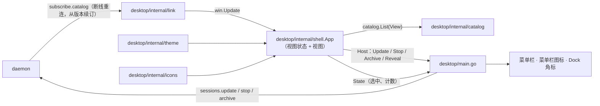

# M1 · PR9a 桌面骨架与设计系统 · 详细计划

> **执行方式：** 按任务顺序逐步执行；每一步用 `- [ ]` 勾选。每个任务结束时 `go test -race ./...` 和 `golangci-lint run ./...` 都应通过。修改已有文件的步骤给出补丁：把代码块存成文件后在仓库根目录执行 `git apply <文件>`；新文件给出完整内容。本计划的代码已在 `c54f137` 上实际写过一遍并通过 `make check` 与 `go tool mygo build desktop`（图标用占位文件；真实图标在任务 4 下载）。

**目标：** 有一个能用的 Hoplet 桌面端外壳：全玻璃窗口连上本机守护进程，侧栏实时列出会话（Code 按工作目录分组、Personal 每个会话一个伙伴），能置顶、标未读、改名、在 Finder 中显示、停止、归档；菜单栏、菜单栏图标（"需要你"数量）、Dock 角标跟随状态。设计系统（[0014](../design/0014-desktop-ui.md)）落成代码：颜色、字号、间距圆角、图标、标志。会话正文、输入框、新建页留给 PR9b，右栏留给 PR9c。

**架构：**



**维护者定的裁决：**
- PR9 拆成 9a / 9b / 9c；依赖后续里程碑的界面在 M1 不显示（见 0014“M1 范围”）。9a 不显示新建、搜索、收件箱入口、后退前进、目录 ＋、机器范围、设置、个人档案，这些随各自的功能出现。
- 置顶、未读、改名存在守护进程里（[0004](../design/0004-session-data-model.md)“列表属性”）：`sessions.update` + `hoplet session set --title / --pinned / --unread`。轮次结束时守护进程标未读；看得到窗口时选中会话即清掉。
- 标题为空时，守护进程取我的第一条消息的首行（≤60 字）；会话另记 `preview`（最近一条完整消息的首行，≤120 字），作伙伴行的第二行。
- M1 的 Personal 侧栏：一个 Personal 会话 = 一个伙伴（名字 = 标题，头像 = 首字）。

**原型验证得出的做法：**
- 透出桌面靠窗口 `Vibrancy: VibrancyUnderWindow`，根节点不铺底，各区只铺半透明 token。`glass.Glass{}` 只模糊窗口自己画的内容，9a 不用（9b 的输入框、弹层用）。
- 侧栏的行自己画：`ui.SidebarItem` 获得焦点时用强调色填满选中行（违反“选中用中性灰”），而且空标签会占满宽度；`ui.Avatar` 按名字配彩色（违反“只有一种彩色”），头像也自己画。
- MyGO 没有把 SVG 转 PNG 的接口。菜单栏模板图和应用图标用 `ui.NewTester(...).Image()` 从标志 SVG 渲染，作为黄金文件提交，`go test -update` 重新生成。
- `go tool mygo` 在 `desktop/` 下运行（`mygo.json` 在那里），桌面端与守护进程同一个 Go 模块，直接用 `internal/client`。MyGO v0.7.4 要求 Go ≥ 1.27.3，`go.mod` 的 go 版本随之升到 1.27.3。

## 全局约束

- 新依赖只有已约定的 `github.com/egoist/mygo v0.7.4`（含 `tool github.com/egoist/mygo/cmd/mygo`）；图标是复制进仓库的 SVG（Lucide 1.66.0 ISC、Simple Icons 16.36.0 CC0-1.0），许可证放在同目录。JetBrains Mono 与 Material Icon Theme 不在 9a（分别在 9b、9c）。
- 代码、注释、commit 用英文；界面文字用中文（0014“文字”）：能用图标的不用文字，图标按钮都有悬停提示“名称 快捷键”。
- 颜色只来自 `theme.Colors`；青色（`Accent` / `AccentFg`）只用于按钮、开关、链接、运行中、未读，不用于背景、选中底、中性灰；琥珀只表示需要你。字号只用 `theme.Style` 的 9 档，字重 400 / 500 / 600。
- 视图不把 `ui.Element` / `ui.Context` 存进结构体、包变量或 goroutine（`go tool mygo vet desktop` 检查）；后台结果用 `Window.Update` 回到 UI 线程。
- 库代码不 panic；错误用 `%w`；导出标识符有文档注释；没有可变的包级变量；不用 lint 抑制注释。
- 测试不访问网络、不碰真实的 `~/.hoplet`；除“轮询直到条件成立”外不用 sleep 同步。视图用 `ui.Tester` 测。
- 任何文件与 commit 都不得出现个人用户名或本机路径。
- 分支 `feat/desktop-shell`；commit 带 DCO 签名（`git commit -s`），标题不超过 72 字符；完成前 `make check` 通过。

## 文件

| 文件 | 职责 |
|---|---|
| `internal/store/migrations/0006_list.sql`、`internal/store/session.go`、`internal/store/append.go` 及测试 | `pinned` / `unread` / `preview` 列；轮次结束标未读；消息入库写预览与自动标题 |
| `proto/session.go`、`proto/api.go` 及测试 | `Session.Pinned / Unread / Preview`；`sessions.update` 与 `UpdateParams` |
| `internal/daemon/methods.go`、`internal/client/methods.go`、`cmd/hoplet/session.go` 及测试 | 守护进程方法、客户端方法、`session set` 新参数 |
| `go.mod`、`go.sum`、`Makefile` | MyGO 依赖与工具；lint 加 `go tool mygo vet desktop` |
| `desktop/internal/theme/` | 设计 token → `ui.Theme`、语义色、字号、圆角、尺寸 |
| `desktop/internal/icons/` | 嵌入的 SVG 与许可证；菜单栏模板图；渲染黄金测试（同时生成 `desktop/resources/icon.png`） |
| `desktop/internal/catalog/` | 会话目录：应用 catalog 条目、计数、按视图分组排序 |
| `desktop/internal/link/` | 连接守护进程、跟随 catalog、断线重连 |
| `desktop/internal/shell/` | 窗口：侧栏、行、右键菜单、改名、标题栏；`State` 给菜单栏与 Dock |
| `desktop/main.go`、`desktop/mygo.json`、`desktop/.gitignore`、`desktop/resources/icon.png` | 应用入口、菜单栏、菜单栏图标、Dock 角标、打包配置 |

## 接口（后续 PR 依赖）

- `proto.Session{Pinned, Unread, Preview}`；`proto.MethodSessionsUpdate`、`proto.UpdateParams{Session, Title, Pinned, Unread}`；`client.(*Client).Update(ctx, proto.UpdateParams) (proto.Session, error)`
- `store.SessionUpdate{Pinned, Unread}`
- `theme.Colors`、`theme.For(dark)`、`theme.Apply(c) Colors`、`theme.Style`（`Display` … `Code`）与 `Style.On(e)`、`Style.Size()`、圆角与尺寸常量
- `icons.Set`、`icons.Load()`、`icons.TrayState`、`icons.Tray(state)`
- `catalog.Catalog`（`Apply`、`Version`、`Get`、`Counts`、`List(View)`）、`catalog.View / Sort / Show / Group / List / Counts`
- `link.Watch(ctx, Dialer, Handler)`、`link.Handler{Connected, Lost, Item}`、`link.HomeDialer`、`link.DefaultDialer`
- `shell.App`（`New`、`View`、`Apply`、`Connected`、`Lost`、`Fail`、`SetAway`、`Select`、`SetMode`、`ToggleSidebar`、`TogglePin`、`MarkUnread`、`Rename`、`Reveal`、`Stop`、`Archive`）、`shell.Host`、`shell.State / Entry / Selection`

---

### 任务 0：建分支

- [ ] **步骤 1：建分支**

```bash
git switch main && git pull && git switch -c feat/desktop-shell
```

### 任务 1：会话的列表属性（存储与协议）

**文件：** 新建 `internal/store/migrations/0006_list.sql`、`internal/store/list_test.go`；修改 `internal/store/session.go`、`internal/store/append.go`、`proto/session.go`、`proto/session_test.go`

**接口：** 产生 `proto.Session.Pinned / Unread / Preview`、`store.SessionUpdate.Pinned / Unread`。`UpdateSession` 不改 `updated_at`（列表顺序不跳）。轮次结束（`TurnEnded`）把会话标为未读；完整消息（`Message`）写 `preview`，标题为空时取我的消息首行。

- [ ] **步骤 1：写测试**

`internal/store/list_test.go`：

```go
package store

import (
	"context"
	"strings"
	"testing"

	"github.com/yangflow/hoplet/proto"
)

func TestListProperties(t *testing.T) {
	ctx := context.Background()
	s := newStore(t)
	sess := newSession(t, s, "s")
	if sess.Pinned || sess.Unread || sess.Preview != "" || sess.Title != "" {
		t.Fatalf("new session %+v", sess)
	}
	appendOK(t, s, AppendRequest{Session: "s", Turn: 1, Entries: []Entry{
		{Payload: proto.TurnStarted{}},
		{Payload: proto.Message{ID: "u1", Role: proto.RoleUser, Text: "\n  fix   the\tsync bug\nin the bridge"}},
	}})
	got, _ := s.Session(ctx, "s")
	if got.Title != "fix the sync bug" || got.Preview != "fix the sync bug" || got.Unread {
		t.Fatalf("after my message %+v", got)
	}
	long := strings.Repeat("长", 200)
	appendOK(t, s, AppendRequest{Session: "s", Turn: 1, Entries: []Entry{
		{Payload: proto.Message{ID: "a1", Role: proto.RoleAssistant, Text: long}},
		{Payload: proto.Message{ID: "a2", Role: proto.RoleAssistant, Text: " \n "}},
		{Payload: proto.TurnEnded{Reason: proto.TurnCompleted}},
	}})
	got, _ = s.Session(ctx, "s")
	if got.Title != "fix the sync bug" || got.Preview != strings.Repeat("长", 120) || !got.Unread {
		t.Fatalf("after the turn %+v", got)
	}
	appendOK(t, s, AppendRequest{Session: "s", Turn: 2, Entries: []Entry{
		{Payload: proto.TurnStarted{}},
		{Payload: proto.Message{ID: "u2", Role: proto.RoleUser, Text: "and the tests"}},
	}})
	if got, _ = s.Session(ctx, "s"); got.Title != "fix the sync bug" || got.Preview != "and the tests" {
		t.Fatalf("a later message renamed the session: %+v", got)
	}

	before := got
	pin, read := true, false
	got, err := s.UpdateSession(ctx, "s", SessionUpdate{Pinned: &pin, Unread: &read})
	if err != nil || !got.Pinned || got.Unread {
		t.Fatalf("update %+v %v", got, err)
	}
	if !got.UpdatedAt.Equal(before.UpdatedAt) || got.Version <= before.Version {
		t.Fatalf("update moved updated_at or kept the version: %+v, before %+v", got, before)
	}
}

func TestFirstLine(t *testing.T) {
	for _, tc := range []struct {
		in   string
		n    int
		want string
	}{
		{"", 10, ""},
		{" \n\t\n", 10, ""},
		{"one", 10, "one"},
		{"  a  b \r\nc", 10, "a b"},
		{"\n\nsecond line", 20, "second line"},
		{"abcdef", 3, "abc"},
		{"你好世界", 2, "你好"},
	} {
		if got := firstLine(tc.in, tc.n); got != tc.want {
			t.Errorf("firstLine(%q, %d) = %q, want %q", tc.in, tc.n, got, tc.want)
		}
	}
}
```

```diff
diff --git a/proto/session_test.go b/proto/session_test.go
index aa6c380..daf9490 100644
--- a/proto/session_test.go
+++ b/proto/session_test.go
@@ -13,6 +13,7 @@ func TestSessionJSONRoundTrip(t *testing.T) {
 		ID: "s1", Mode: ModeCode, Harness: HarnessRef{Kind: "claude", Version: "2.1.312", NativeID: "n1"}, Permission: ModeAutoEdit,
 		Directory: "/work", Isolation: InPlace, Owner: OwnerMe, Origin: OriginMe, Status: StatusIdle,
 		Title: "sync", CreatedAt: archived.Add(-time.Hour), UpdatedAt: archived, ArchivedAt: &archived, LastSeq: 7, Version: 9,
+		Pinned: true, Unread: true, Preview: "done",
 	}
 	b, err := json.Marshal(in)
 	if err != nil {
```

- [ ] **步骤 2：确认失败**

```bash
go test ./internal/store/ ./proto/
```

预期：编译失败（`SessionUpdate` 没有 `Pinned` 字段、`firstLine` 未定义、`Session` 没有 `Pinned`）。

- [ ] **步骤 3：迁移、存储与协议**

`internal/store/migrations/0006_list.sql`：

```sql
ALTER TABLE sessions ADD COLUMN pinned INTEGER NOT NULL DEFAULT 0;
ALTER TABLE sessions ADD COLUMN unread INTEGER NOT NULL DEFAULT 0;
ALTER TABLE sessions ADD COLUMN preview TEXT NOT NULL DEFAULT '';
```

```diff
diff --git a/internal/store/append.go b/internal/store/append.go
index 77ff3ed..a16c8e1 100644
--- a/internal/store/append.go
+++ b/internal/store/append.go
@@ -5,6 +5,7 @@ import (
 	"database/sql"
 	"errors"
 	"fmt"
+	"strings"
 	"time"
 
 	"github.com/yangflow/hoplet/proto"
@@ -374,7 +375,7 @@ func insertEvent(ctx context.Context, tx *sql.Tx, ev proto.Event, p proto.Payloa
 }
 
 // project applies one event to the turn and approval projections and, for
-// a mode change, to the session record.
+// a mode change, an ended turn or a complete message, to the session record.
 func project(ctx context.Context, tx *sql.Tx, ev proto.Event, p proto.Payload) error {
 	var q string
 	var args []any
@@ -383,8 +384,19 @@ func project(ctx context.Context, tx *sql.Tx, ev proto.Event, p proto.Payload) e
 		q = `INSERT INTO turns (session_id, n, start_seq) VALUES (?, ?, ?) ON CONFLICT DO NOTHING`
 		args = []any{ev.Session, ev.Turn, ev.Seq}
 	case proto.TurnEnded:
+		if _, err := tx.ExecContext(ctx, `UPDATE sessions SET unread = 1 WHERE id = ?`, ev.Session); err != nil {
+			return fmt.Errorf("store: mark session %s unread: %w", ev.Session, err)
+		}
 		q = `UPDATE turns SET end_seq = ?, reason = ? WHERE session_id = ? AND n = ? AND end_seq IS NULL`
 		args = []any{ev.Seq, p.Reason, ev.Session, ev.Turn}
+	case proto.Message:
+		preview := firstLine(p.Text, previewRunes)
+		if preview == "" {
+			return nil
+		}
+		// An untitled session takes the first line of my first message.
+		q = `UPDATE sessions SET preview = ?, title = CASE WHEN title = '' AND ? THEN ? ELSE title END WHERE id = ?`
+		args = []any{preview, p.Role == proto.RoleUser, firstLine(p.Text, titleRunes), ev.Session}
 	case proto.ApprovalRequested:
 		q = `INSERT INTO approvals (id, session_id, request_seq, kind, status) VALUES (?, ?, ?, ?, 'pending') ON CONFLICT DO NOTHING`
 		args = []any{p.ID, ev.Session, ev.Seq, p.Kind}
@@ -406,6 +418,29 @@ func project(ctx context.Context, tx *sql.Tx, ev proto.Event, p proto.Payload) e
 	return nil
 }
 
+// Lengths, in runes, of a session's preview and of the title it takes from
+// my first message.
+const (
+	previewRunes = 120
+	titleRunes   = 60
+)
+
+// firstLine returns the first non-blank line of s with runs of white space
+// folded to one space, cut to at most n runes.
+func firstLine(s string, n int) string {
+	for line := range strings.Lines(s) {
+		f := strings.Join(strings.Fields(line), " ")
+		if f == "" {
+			continue
+		}
+		if r := []rune(f); len(r) > n {
+			f = string(r[:n])
+		}
+		return f
+	}
+	return ""
+}
+
 // deriveStatus computes the session status from the projections.
 func deriveStatus(ctx context.Context, tx *sql.Tx, id proto.SessionID) (proto.SessionStatus, error) {
 	var n int
diff --git a/internal/store/session.go b/internal/store/session.go
index ca8ad9d..4d933c2 100644
--- a/internal/store/session.go
+++ b/internal/store/session.go
@@ -14,7 +14,7 @@ import (
 )
 
 const sessionColumns = `id, mode, harness_kind, harness_version, native_id, directory, isolation,
-	owner, origin, status, title, created_at, updated_at, archived_at, last_seq, version, permission, plan, effort, fast`
+	owner, origin, status, title, created_at, updated_at, archived_at, last_seq, version, permission, plan, effort, fast, pinned, unread, preview`
 
 // CreateSession stores a new session. Status defaults to idle and
 // CreatedAt to now; UpdatedAt equals CreatedAt. The write is durable.
@@ -35,9 +35,10 @@ func (s *Store) CreateSession(ctx context.Context, sess proto.Session) (proto.Se
 	sess.UpdatedAt = sess.CreatedAt
 	sess.ArchivedAt = nil
 	sess.LastSeq = 0
+	sess.Pinned, sess.Unread, sess.Preview = false, false, ""
 	err := s.tx(ctx, true, func(tx *sql.Tx) error {
 		_, err := tx.ExecContext(ctx, `INSERT INTO sessions (`+sessionColumns+`)
-			VALUES (?, ?, ?, ?, ?, ?, ?, ?, ?, ?, ?, ?, ?, NULL, 0, 0, ?, ?, ?, ?)`,
+			VALUES (?, ?, ?, ?, ?, ?, ?, ?, ?, ?, ?, ?, ?, NULL, 0, 0, ?, ?, ?, ?, 0, 0, '')`,
 			sess.ID, sess.Mode, sess.Harness.Kind, sess.Harness.Version, sess.Harness.NativeID,
 			sess.Directory, sess.Isolation, sess.Owner, sess.Origin, sess.Status, sess.Title,
 			sess.CreatedAt.UnixMilli(), sess.UpdatedAt.UnixMilli(), sess.Permission, sess.Plan, sess.Effort, sess.Fast)
@@ -181,14 +182,18 @@ type SessionUpdate struct {
 	Plan       *bool
 	Fast       *bool
 	Effort     *proto.Effort // an empty effort restores the harness default
+	Pinned     *bool
+	Unread     *bool
 }
 
 // UpdateSession changes a session's harness-native ID, title, permission
-// mode, plan mode, fast mode and/or effort and returns the updated session. The write
-// is durable; with nothing to change it writes nothing and returns the
-// current session.
+// mode, plan mode, fast mode, effort, pin and/or unread mark and returns the
+// updated session. It leaves updated_at alone, so lists keep their order.
+// The write is durable; with nothing to change it writes nothing and
+// returns the current session.
 func (s *Store) UpdateSession(ctx context.Context, id proto.SessionID, u SessionUpdate) (proto.Session, error) {
-	if u.NativeID == nil && u.Title == nil && u.Permission == nil && u.Plan == nil && u.Fast == nil && u.Effort == nil {
+	if u.NativeID == nil && u.Title == nil && u.Permission == nil && u.Plan == nil && u.Fast == nil && u.Effort == nil &&
+		u.Pinned == nil && u.Unread == nil {
 		return s.Session(ctx, id)
 	}
 	if u.Permission != nil && !u.Permission.Valid() {
@@ -201,8 +206,8 @@ func (s *Store) UpdateSession(ctx context.Context, id proto.SessionID, u Session
 	err := s.tx(ctx, true, func(tx *sql.Tx) error {
 		res, err := tx.ExecContext(ctx, `UPDATE sessions SET native_id = COALESCE(?, native_id), title = COALESCE(?, title),
 			permission = COALESCE(?, permission), plan = COALESCE(?, plan), fast = COALESCE(?, fast),
-			effort = COALESCE(?, effort) WHERE id = ?`,
-			u.NativeID, u.Title, u.Permission, u.Plan, u.Fast, u.Effort, id)
+			effort = COALESCE(?, effort), pinned = COALESCE(?, pinned), unread = COALESCE(?, unread) WHERE id = ?`,
+			u.NativeID, u.Title, u.Permission, u.Plan, u.Fast, u.Effort, u.Pinned, u.Unread, id)
 		if err != nil {
 			return fmt.Errorf("store: update session %s: %w", id, err)
 		}
@@ -250,7 +255,8 @@ func scanSession(r scanner) (proto.Session, error) {
 	)
 	err := r.Scan(&sess.ID, &sess.Mode, &sess.Harness.Kind, &sess.Harness.Version, &sess.Harness.NativeID,
 		&sess.Directory, &sess.Isolation, &sess.Owner, &sess.Origin, &sess.Status, &sess.Title,
-		&created, &updated, &archived, &sess.LastSeq, &sess.Version, &sess.Permission, &sess.Plan, &sess.Effort, &sess.Fast)
+		&created, &updated, &archived, &sess.LastSeq, &sess.Version, &sess.Permission, &sess.Plan, &sess.Effort, &sess.Fast,
+		&sess.Pinned, &sess.Unread, &sess.Preview)
 	if err != nil {
 		if errors.Is(err, sql.ErrNoRows) {
 			return proto.Session{}, err
diff --git a/proto/session.go b/proto/session.go
index b72dbc8..035628a 100644
--- a/proto/session.go
+++ b/proto/session.go
@@ -86,4 +86,10 @@ type Session struct {
 	// Version is the store's catalog counter value at this session's last
 	// change; it grows with every change to the session record.
 	Version uint64 `json:"version"`
+	// Pinned keeps the session at the top of lists.
+	Pinned bool `json:"pinned,omitempty"`
+	// Unread says a turn ended that no client has shown yet.
+	Unread bool `json:"unread,omitempty"`
+	// Preview is the first line of the latest complete message.
+	Preview string `json:"preview,omitempty"`
 }
```

- [ ] **步骤 4：确认通过**

```bash
go test -race ./internal/store/ ./proto/ && go test -race ./...
```

预期：全部通过（已有测试不受影响：带标题创建的会话不会被改名）。

- [ ] **步骤 5：commit**

```bash
git add internal/store proto
git commit -s -m "feat(store): add pin, unread and preview to sessions"
```

### 任务 2：`sessions.update` 与 `session set`

**文件：** 新建 `internal/daemon/update_test.go`；修改 `proto/api.go`、`internal/daemon/methods.go`、`internal/client/methods.go`、`cmd/hoplet/session.go`、`cmd/hoplet/e2e_test.go`

**接口：** 产生 `proto.MethodSessionsUpdate`、`proto.UpdateParams`、`client.(*Client).Update`。方法直接调 `store.UpdateSession`（存储变更会推给 catalog 订阅者）；未知会话为 `not_found`。CLI：`hoplet session set ID [--title T] [--pinned on|off] [--unread on|off]`，在原有四项之后一次提交；`--title ""` 清空标题；输出加 `, pinned` / `, unread`。

- [ ] **步骤 1：写测试**

`internal/daemon/update_test.go`：

```go
package daemon

import (
	"testing"

	"github.com/yangflow/hoplet/proto"
)

func TestSessionUpdate(t *testing.T) {
	h, script := newHome(t, echoScript)
	start(t, testConfig(h, script))
	c := dial(t, h, "device:a")
	sess := create(t, c, h)
	cat, err := c.SubscribeCatalog(timeout(t), sess.Version)
	if err != nil {
		t.Fatal(err)
	}

	title, on := "Fix sync", true
	got, err := c.Update(timeout(t), proto.UpdateParams{Session: sess.ID, Title: &title, Pinned: &on})
	if err != nil || got.Title != "Fix sync" || !got.Pinned || got.Unread || !got.UpdatedAt.Equal(sess.UpdatedAt) {
		t.Fatalf("update %+v %v", got, err)
	}
	// The first item brings the client to its cursor; the change follows.
	for {
		var ci proto.CatalogItem
		if err := cat.Next(timeout(t), &ci); err != nil {
			t.Fatal(err)
		}
		if len(ci.Sessions) == 0 {
			continue
		}
		if len(ci.Sessions) != 1 || !ci.Sessions[0].Pinned || ci.Sessions[0].Title != "Fix sync" {
			t.Fatalf("catalog item after update %+v", ci)
		}
		break
	}

	if _, err := c.Update(timeout(t), proto.UpdateParams{Session: "missing", Pinned: &on}); apiCode(err) != proto.CodeNotFound {
		t.Fatalf("unknown session: %v", err)
	}
}
```

```diff
diff --git a/cmd/hoplet/e2e_test.go b/cmd/hoplet/e2e_test.go
index fbed924..fd8a6b8 100644
--- a/cmd/hoplet/e2e_test.go
+++ b/cmd/hoplet/e2e_test.go
@@ -155,7 +155,7 @@ func TestSessionInTheTerminal(t *testing.T) {
 		t.Fatalf("approve again: exit %d, %q", code, errs)
 	}
 	mustCLI(t, "session", "wait", short, "--for", "idle", "--timeout", "15s")
-	if out := mustCLI(t, "session", "set", short, "--plan", "on", "--fast", "on", "--effort", "high"); out != "permission auto_review, plan mode on, fast mode on, effort high\n" {
+	if out := mustCLI(t, "session", "set", short, "--plan", "on", "--fast", "on", "--effort", "high"); out != "permission auto_review, plan mode on, fast mode on, effort high, unread\n" {
 		t.Fatalf("session set: %q", out)
 	}
 	for _, args := range [][]string{{}, {"--effort", "huge"}, {"--permission", "read_only"}, {"--fast", "maybe"}} {
@@ -164,6 +164,12 @@ func TestSessionInTheTerminal(t *testing.T) {
 		}
 	}
 	mustCLI(t, "session", "set", short, "--plan", "off", "--fast", "off")
+	if out := mustCLI(t, "session", "set", short, "--title", "renamed", "--pinned", "on", "--unread", "off"); out != "permission auto_review, effort high, pinned\n" {
+		t.Fatalf("session set list properties: %q", out)
+	}
+	if code, _, _ := cli(t, "session", "set", short, "--pinned", "yes"); code != 2 {
+		t.Fatalf("session set --pinned yes: exit %d, want 2", code)
+	}
 	if code, _, errs := cli(t, "session", "wait", short, "--for", "blocked", "--timeout", "300ms"); code != 3 || !strings.Contains(errs, "timed out") {
 		t.Fatalf("wait blocked on an idle session: exit %d, %q", code, errs)
 	}
@@ -191,7 +197,7 @@ func TestSessionInTheTerminal(t *testing.T) {
 		t.Fatalf("turn 2 messages %q: wait returned before turn 2 ended", texts)
 	}
 
-	if out := mustCLI(t, "session", "list"); !strings.Contains(out, id) || !strings.Contains(out, "e2e") {
+	if out := mustCLI(t, "session", "list"); !strings.Contains(out, id) || !strings.Contains(out, "renamed") {
 		t.Fatalf("list: %q", out)
 	}
 	var listed []proto.Session
```

注意 e2e 里第一处 `session set` 的期望多了 `, unread`：此前一轮已结束，会话被标为未读，这是新行为。

- [ ] **步骤 2：确认失败**

```bash
go test ./internal/daemon/ -run TestSessionUpdate
```

预期：编译失败（`proto.UpdateParams`、`(*Client).Update` 未定义）。

- [ ] **步骤 3：实现**


```diff
diff --git a/cmd/hoplet/session.go b/cmd/hoplet/session.go
index 1735e15..a327e6d 100644
--- a/cmd/hoplet/session.go
+++ b/cmd/hoplet/session.go
@@ -27,6 +27,7 @@ commands:
   wait     ID [--for idle|blocked|done] [--timeout D]
   approve  ID [APPROVAL] --option OPTION
   set      ID [--permission MODE] [--plan on|off] [--fast on|off] [--effort LEVEL]
+           [--title T] [--pinned on|off] [--unread on|off]
   interrupt ID     end the running turn
   steer    ID TEXT  add TEXT to the running turn (harnesses that support it)
   stop     ID      stop the session's harness process
@@ -54,7 +55,9 @@ actions), full_auto (never ask). A harness lacking a mode runs the nearest
 stricter one. Plan mode stops all changes until you approve a plan. Fast
 mode gives faster output at a higher cost. Effort levels: low, medium, high,
 xhigh, max, ultra; each harness offers a subset. set applies its changes in
-the order permission, plan, fast, effort and stops at the first that fails.
+the order permission, plan, fast, effort, then title, pin and unread mark
+together, and stops at the first that fails. An empty --title clears the
+title.
 `
 
 // commandTimeout bounds one request of a command that does not follow a
@@ -525,11 +528,15 @@ func (a app) sessionSet(args []string) int {
 	plan := fs.String("plan", "", "on or off")
 	fast := fs.String("fast", "", "on or off")
 	effort := fs.String("effort", "", "low, medium, high, xhigh, max or ultra")
+	var title optString
+	fs.Var(&title, "title", "the session's title; empty clears it")
+	pinned := fs.String("pinned", "", "on or off")
+	unread := fs.String("unread", "", "on or off")
 	asJSON := fs.Bool("json", false, "print the session as JSON")
 	if code, ok := parse(fs, args, 1, 1); !ok {
 		return code
 	}
-	for _, f := range []struct{ name, value string }{{"plan", *plan}, {"fast", *fast}} {
+	for _, f := range []struct{ name, value string }{{"plan", *plan}, {"fast", *fast}, {"pinned", *pinned}, {"unread", *unread}} {
 		if f.value != "" && f.value != "on" && f.value != "off" {
 			fmt.Fprintf(a.stderr, "hoplet session set: --%s %q: want on or off\n", f.name, f.value)
 			return 2
@@ -543,8 +550,8 @@ func (a app) sessionSet(args []string) int {
 		fmt.Fprintf(a.stderr, "hoplet session set: --effort %q: want low, medium, high, xhigh, max or ultra\n", *effort)
 		return 2
 	}
-	if *perm == "" && *plan == "" && *fast == "" && *effort == "" {
-		fmt.Fprintln(a.stderr, "hoplet session set: nothing to change; give --permission, --plan, --fast or --effort")
+	if *perm == "" && *plan == "" && *fast == "" && *effort == "" && !title.set && *pinned == "" && *unread == "" {
+		fmt.Fprintln(a.stderr, "hoplet session set: nothing to change; give --permission, --plan, --fast, --effort, --title, --pinned or --unread")
 		return 2
 	}
 	return a.withClient("session set", commandTimeout, func(ctx context.Context, c *client.Client) error {
@@ -572,6 +579,14 @@ func (a app) sessionSet(args []string) int {
 				return err
 			}
 		}
+		if up := (proto.UpdateParams{Session: id, Pinned: onOff(*pinned), Unread: onOff(*unread)}); title.set || up.Pinned != nil || up.Unread != nil {
+			if title.set {
+				up.Title = &title.value
+			}
+			if _, err := c.Update(ctx, up); err != nil {
+				return err
+			}
+		}
 		st, err := c.Session(ctx, id)
 		if err != nil {
 			return err
@@ -585,8 +600,31 @@ func (a app) sessionSet(args []string) int {
 	})
 }
 
-// describeMode is a session's permission mode, plan mode, fast mode and
-// effort.
+// optString is a string flag that knows whether it was given, so an empty
+// value can mean "clear".
+type optString struct {
+	value string
+	set   bool
+}
+
+func (o *optString) String() string { return o.value }
+
+func (o *optString) Set(s string) error {
+	o.value, o.set = s, true
+	return nil
+}
+
+// onOff maps an "on" / "off" flag value to a bool; empty means not given.
+func onOff(v string) *bool {
+	if v == "" {
+		return nil
+	}
+	b := v == "on"
+	return &b
+}
+
+// describeMode is a session's permission mode, plan mode, fast mode,
+// effort, pin and unread mark.
 func describeMode(s proto.Session) string {
 	out := "permission " + string(s.Permission)
 	if s.Plan {
@@ -598,6 +636,12 @@ func describeMode(s proto.Session) string {
 	if s.Effort != "" {
 		out += ", effort " + string(s.Effort)
 	}
+	if s.Pinned {
+		out += ", pinned"
+	}
+	if s.Unread {
+		out += ", unread"
+	}
 	return out
 }
 
diff --git a/internal/client/methods.go b/internal/client/methods.go
index 3ec024f..1f3fd3c 100644
--- a/internal/client/methods.go
+++ b/internal/client/methods.go
@@ -68,6 +68,14 @@ func (c *Client) SetEffort(ctx context.Context, p proto.SetEffortParams) error {
 	return c.Call(ctx, proto.MethodSessionsSetEffort, p, nil)
 }
 
+// Update changes a session's title, pin or unread mark and returns the
+// session.
+func (c *Client) Update(ctx context.Context, p proto.UpdateParams) (proto.Session, error) {
+	var out proto.Session
+	err := c.Call(ctx, proto.MethodSessionsUpdate, p, &out)
+	return out, err
+}
+
 // Stop stops a session's harness.
 func (c *Client) Stop(ctx context.Context, id proto.SessionID) error {
 	return c.Call(ctx, proto.MethodSessionsStop, proto.SessionRef{Session: id}, nil)
diff --git a/internal/daemon/methods.go b/internal/daemon/methods.go
index d875431..39d5dcd 100644
--- a/internal/daemon/methods.go
+++ b/internal/daemon/methods.go
@@ -99,6 +99,12 @@ func (c *conn) call(ctx context.Context, f proto.ClientFrame) (any, error) {
 			return nil, err
 		}
 		return done, s.mgr.SetFast(ctx, p.Session, p.Fast)
+	case proto.MethodSessionsUpdate:
+		var p proto.UpdateParams
+		if err := decode(f, &p); err != nil {
+			return nil, err
+		}
+		return s.store.UpdateSession(ctx, p.Session, store.SessionUpdate{Title: p.Title, Pinned: p.Pinned, Unread: p.Unread})
 	case proto.MethodSessionsEvents:
 		var p proto.EventsParams
 		if err := decode(f, &p); err != nil {
diff --git a/proto/api.go b/proto/api.go
index c63ead5..32a7957 100644
--- a/proto/api.go
+++ b/proto/api.go
@@ -76,6 +76,7 @@ const (
 	MethodSessionsSetPlan   = "sessions.set_plan"
 	MethodSessionsSetEffort = "sessions.set_effort"
 	MethodSessionsSetFast   = "sessions.set_fast"
+	MethodSessionsUpdate    = "sessions.update"
 	MethodSessionsStop      = "sessions.stop"
 	MethodSessionsArchive   = "sessions.archive"
 	MethodSessionsEvents    = "sessions.events"
@@ -186,6 +187,15 @@ type SetEffortParams struct {
 	Effort  Effort    `json:"effort"`
 }
 
+// UpdateParams changes a session's list properties; nil fields stay as
+// they are. An empty title is allowed: the session shows untitled.
+type UpdateParams struct {
+	Session SessionID `json:"session"`
+	Title   *string   `json:"title,omitempty"`
+	Pinned  *bool     `json:"pinned,omitempty"`
+	Unread  *bool     `json:"unread,omitempty"`
+}
+
 // QueuedMessage is a message waiting for the running turn to end. Error,
 // when set, says why the daemon could not send it; the queue then waits
 // until the message is edited, moved or deleted.
```

- [ ] **步骤 4：确认通过**

```bash
go test -race ./internal/daemon/ ./cmd/hoplet/ && golangci-lint run ./...
```

- [ ] **步骤 5：commit**

```bash
git add proto internal/daemon internal/client cmd/hoplet
git commit -s -m "feat(daemon): add sessions.update and session set list flags"
```

### 任务 3：MyGO 依赖与设计 token

**文件：** 修改 `go.mod`、`go.sum`；新建 `desktop/internal/theme/theme.go`、`desktop/internal/theme/theme_test.go`

**接口：** 产生 `theme.Colors`、`theme.For(dark bool) Colors`、`theme.Apply(c *ui.Context) Colors`、`theme.Style` 与 `Style.On / Size`、圆角常量 `RadiusXS … RadiusPill`、尺寸常量 `RowHeight / RowDense / TitleBar / SideTop / SidebarWidth / IconSize / IconSizeInRow / IconSizeSmall`。

颜色值与 0014、设计系统 `tokens.json` 一致（深色 / 浅色两套）。`Apply` 每帧从 MyGO 当前外观的主题出发，所以跟随系统深浅色；`Background` 设为透明，让窗口材质透出。

- [ ] **步骤 1：加依赖**

```bash
go get github.com/egoist/mygo@v0.7.4
go get -tool github.com/egoist/mygo/cmd/mygo@v0.7.4
```

预期：`go.mod` 的 `go` 升到 `1.27.3`（MyGO 的要求），多出 `tool github.com/egoist/mygo/cmd/mygo`。CI 的 `setup-go` 用 `go-version: "1.27"`，会装 1.27 的最新补丁版；若装到的低于 1.27.3，Go 会按 `go.mod` 自动下载 1.27.3 工具链。

- [ ] **步骤 2：写测试**

对比度测试把半透明表面合成到近似桌面色（`wall`）上，再检查关键文字 ≥ 4.5:1，防止以后改 token 时悄悄降低可读性。

`desktop/internal/theme/theme_test.go`：

```go
package theme

import (
	"math"
	"testing"

	"github.com/egoist/mygo/ui"
)

// wall approximates the desktop behind the glass in each appearance.
func wall(dark bool) ui.Color {
	if dark {
		return ui.Hex("#15181C")
	}
	return ui.Hex("#DCDFE3")
}

// over composites c over an opaque bg.
func over(c, bg ui.Color) ui.Color {
	a := float64(c.A) / 255
	mix := func(x, y uint8) uint8 { return uint8(math.Round(float64(x)*a + float64(y)*(1-a))) }
	return ui.RGB(mix(c.R, bg.R), mix(c.G, bg.G), mix(c.B, bg.B))
}

// contrast is the WCAG contrast ratio of two opaque colors.
func contrast(a, b ui.Color) float64 {
	lum := func(c ui.Color) float64 {
		ch := func(v uint8) float64 {
			x := float64(v) / 255
			if x <= 0.03928 {
				return x / 12.92
			}
			return math.Pow((x+0.055)/1.055, 2.4)
		}
		return 0.2126*ch(c.R) + 0.7152*ch(c.G) + 0.0722*ch(c.B)
	}
	la, lb := lum(a), lum(b)
	if la < lb {
		la, lb = lb, la
	}
	return (la + 0.05) / (lb + 0.05)
}

func TestTextContrast(t *testing.T) {
	for _, dark := range []bool{true, false} {
		k := For(dark)
		pane, side := over(k.Pane, wall(dark)), over(k.Side, wall(dark))
		for name, pair := range map[string][2]ui.Color{
			"fg on pane":         {k.Fg, pane},
			"fg2 on pane":        {k.Fg2, pane},
			"fg3 on side":        {k.Fg3, side},
			"muted on pane":      {k.Muted, pane},
			"muted on side":      {k.Muted, side},
			"accent-fg on side":  {k.AccentFg, side},
			"attn-fg on pane":    {k.AttnFg, pane},
			"on-accent":          {k.OnAccent, k.Accent},
			"on-attn":            {k.OnAttn, k.Attn},
			"fg on selected row": {k.Fg, over(k.SelRow, side)},
		} {
			if r := contrast(pair[0], pair[1]); r < 4.5 {
				t.Errorf("dark=%v %s: %.2f, want ≥ 4.5", dark, name, r)
			}
		}
	}
}

func TestApply(t *testing.T) {
	var got ui.Theme
	var colors Colors
	tt := ui.NewTester(func(c *ui.Context) {
		colors = Apply(c)
		got = *c.Theme()
		UIStrong.On(ui.Text(c, "title"))
	}, 200, 100)
	for _, dark := range []bool{false, true} {
		tt.SetDark(dark)
		tt.Frame()
		want := For(dark)
		if colors != want || got.Dark != dark || got.Accent != want.Accent || got.Text != want.Fg ||
			got.Background != ui.Transparent || got.Radius != RadiusControl || got.FontSize != 13 {
			t.Errorf("dark=%v: theme %+v", dark, got)
		}
	}
	if !tt.HasText("title") {
		t.Fatalf("texts %q", tt.Texts())
	}
}
```

- [ ] **步骤 3：确认失败**

```bash
go test ./desktop/internal/theme/
```

预期：编译失败（`For`、`Apply` 未定义）。

- [ ] **步骤 4：实现**

`desktop/internal/theme/theme.go`：

```go
// Package theme holds the desktop design tokens (docs/design/0014) and
// applies them to MyGO's theme.
package theme

import "github.com/egoist/mygo/ui"

// Colors are the semantic colors of one appearance. Surfaces are
// translucent: the window's material shows through them.
type Colors struct {
	Pane      ui.Color // content area
	Side      ui.Color // sidebar and the right panel's column
	Glass     ui.Color // composer and controls floating over content
	GlassLine ui.Color // the composer's hairline
	Raised    ui.Color // selected segment, tab or mode
	Fill      ui.Color // control fill
	Fill2     ui.Color // control fill on hover; segmented track
	Sel       ui.Color // current menu item or option
	SelRow    ui.Color // selected session row
	Line      ui.Color // separators, card edges
	Line2     ui.Color // control edges

	Fg    ui.Color // body text
	Fg2   ui.Color // secondary body text
	Fg3   ui.Color // icons, control labels, tool rows
	Muted ui.Color // paths, times, counts
	Faint ui.Color // placeholders, disabled; never needed information

	Accent   ui.Color // fill of buttons, switches, send
	OnAccent ui.Color // text on Accent
	AccentFg ui.Color // links, focus ring, running, unread

	Attn     ui.Color // needs you: dot, badge, approval outline
	OnAttn   ui.Color // text on Attn
	AttnFg   ui.Color // needs-you text
	AttnLine ui.Color // the composer's outline during an approval

	Add   ui.Color // diff additions
	Del   ui.Color // diff deletions
	AddBg ui.Color
	DelBg ui.Color

	Bubble ui.Color // my message bubble
	Shadow ui.Color // popover shadow
}

// For returns the colors of the dark or the light appearance.
func For(dark bool) Colors {
	if dark {
		return Colors{
			Pane: ui.RGBA(14, 16, 20, .42), Side: ui.RGBA(255, 255, 255, .05),
			Glass: ui.RGBA(255, 255, 255, .05), GlassLine: ui.RGBA(255, 255, 255, .12),
			Raised: ui.RGBA(255, 255, 255, .16), Fill: ui.RGBA(255, 255, 255, .06), Fill2: ui.RGBA(255, 255, 255, .10),
			Sel: ui.RGBA(255, 255, 255, .10), SelRow: ui.RGBA(255, 255, 255, .09),
			Line: ui.RGBA(255, 255, 255, .08), Line2: ui.RGBA(255, 255, 255, .14),
			Fg: ui.Hex("#F4F4F5"), Fg2: ui.Hex("#D3D6DB"), Fg3: ui.Hex("#B0B4BB"), Muted: ui.Hex("#8E939B"), Faint: ui.Hex("#666B73"),
			Accent: ui.Hex("#3CC4C9"), OnAccent: ui.Hex("#0C1A1C"), AccentFg: ui.Hex("#3CC4C9"),
			Attn: ui.Hex("#F0A35B"), OnAttn: ui.Hex("#1E1408"), AttnFg: ui.Hex("#F5BB82"), AttnLine: ui.RGBA(240, 163, 91, .40),
			Add: ui.Hex("#7BC86C"), Del: ui.Hex("#F0758A"), AddBg: ui.RGBA(123, 200, 108, .12), DelBg: ui.RGBA(240, 117, 138, .11),
			Bubble: ui.RGBA(255, 255, 255, .10), Shadow: ui.RGBA(0, 0, 0, .45),
		}
	}
	return Colors{
		Pane: ui.RGBA(255, 255, 255, .10), Side: ui.RGBA(236, 238, 241, .45),
		Glass: ui.RGBA(120, 128, 140, .10), GlassLine: ui.Transparent,
		Raised: ui.RGBA(255, 255, 255, .88), Fill: ui.RGBA(0, 0, 0, .04), Fill2: ui.RGBA(0, 0, 0, .06),
		Sel: ui.RGBA(0, 0, 0, .055), SelRow: ui.RGBA(0, 0, 0, .06),
		Line: ui.RGBA(0, 0, 0, .06), Line2: ui.RGBA(0, 0, 0, .10),
		Fg: ui.Hex("#23272D"), Fg2: ui.Hex("#383B40"), Fg3: ui.Hex("#53575D"), Muted: ui.Hex("#5E6268"), Faint: ui.Hex("#A0A4AA"),
		Accent: ui.Hex("#066A70"), OnAccent: ui.Hex("#FFFFFF"), AccentFg: ui.Hex("#066A70"),
		Attn: ui.Hex("#A85C14"), OnAttn: ui.Hex("#FFFFFF"), AttnFg: ui.Hex("#8A4B0F"), AttnLine: ui.RGBA(217, 130, 43, .40),
		Add: ui.Hex("#2E7031"), Del: ui.Hex("#B02A55"), AddBg: ui.RGBA(46, 112, 49, .10), DelBg: ui.RGBA(176, 42, 85, .08),
		Bubble: ui.RGBA(120, 128, 140, .14), Shadow: ui.RGBA(0, 0, 0, .12),
	}
}

// Apply makes the frame use the tokens of the system's appearance and
// returns its colors. Call it at the top of every frame: it starts from
// MyGO's theme for the current appearance, so it follows the system.
func Apply(c *ui.Context) Colors {
	t := *c.Theme()
	k := For(t.Dark)
	t.Background = ui.Transparent
	t.Surface, t.SurfaceHover, t.SurfacePressed = k.Fill, k.Fill2, k.Sel
	t.Border = k.Line2
	t.Text, t.TextMuted = k.Fg, k.Muted
	t.Accent, t.AccentText = k.Accent, k.OnAccent
	t.Warning, t.Success, t.Danger = k.Attn, k.Add, k.Del
	t.Selection, t.Focus = k.SelRow, k.AccentFg
	t.Radius, t.Spacing, t.FontSize = RadiusControl, 4, UI.Size()
	c.SetTheme(&t)
	return k
}

// Radii, in points.
const (
	RadiusXS       = 4   // inline code, key caps
	RadiusRow      = 6   // sidebar rows, menu items
	RadiusControl  = 7   // buttons, tabs, icon buttons
	RadiusCard     = 10  // code blocks, popovers, change cards
	RadiusPanel    = 14  // inbox cards, command palette
	RadiusComposer = 18  // composer, bubbles
	RadiusPill     = 999 // effort pill, send button
)

// Fixed sizes, in points.
const (
	RowHeight     = 28  // session rows, buttons, icon buttons
	RowDense      = 24  // tool rows, file tree rows
	TitleBar      = 44  // title bars
	SideTop       = 52  // the sidebar's first row, beside the traffic lights
	SidebarWidth  = 260 // default; draggable 220–360
	IconSize      = 16  // icons in buttons and title bars
	IconSizeInRow = 14
	IconSizeSmall = 12
)

// Style is one step of the type scale. Only these sizes and the weights
// 400, 500 and 600 are used.
type Style int

// The type scale.
const (
	Display   Style = iota // 22/28 600: new-session page, empty states
	Title                  // 15/20 600: section titles, card numbers
	Reading                // 13.5/22: messages, composer
	UI                     // 13/18: sidebar, menus, buttons, tool rows
	UIStrong               // 13/18 600: title bar title, unread rows, companion names
	Secondary              // 12/16: paths, previews
	Caption                // 11/14: times, counts, shortcuts
	Label                  // 11/14 600: group titles
	Code                   // 12/19 monospace
)

// metrics returns the style's size and line height in points and its
// weight.
func (s Style) metrics() (size, line float32, weight int) {
	switch s {
	case Display:
		return 22, 28, 600
	case Title:
		return 15, 20, 600
	case Reading:
		return 13.5, 22, 400
	case UIStrong:
		return 13, 18, 600
	case Secondary:
		return 12, 16, 400
	case Caption:
		return 11, 14, 400
	case Label:
		return 11, 14, 600
	case Code:
		return 12, 19, 400
	}
	return 13, 18, 400
}

// Size is the style's font size in points.
func (s Style) Size() float32 {
	size, _, _ := s.metrics()
	return size
}

// On sets the style on e.
func (s Style) On(e ui.Element) ui.Element {
	size, line, weight := s.metrics()
	return e.FontSize(size).LineHeight(line / size).FontWeight(weight)
}
```

- [ ] **步骤 5：确认通过并 commit**

```bash
go mod tidy && go test -race ./desktop/... && golangci-lint run ./...
git add go.mod go.sum desktop/internal/theme
git commit -s -m "build(desktop): add MyGo and the design tokens"
```

### 任务 4：图标、标志与渲染出的图片

**文件：** 新建 `desktop/internal/icons/icons.go`、`desktop/internal/icons/render_test.go`、`desktop/internal/icons/brand/mark.svg`、`desktop/internal/icons/brand/app-icon.svg`、`desktop/internal/icons/lucide/*.svg` 与 `LICENSE`、`desktop/internal/icons/simpleicons/claude.svg` 与 `LICENSE.md`；生成 `desktop/internal/icons/tray/{idle,running,offline}.png`、`desktop/resources/icon.png`

**接口：** 产生 `icons.Set`（`Sidebar Personal Code Folder Pin Unpin Archive Arrange Machine Connected Offline Menu Claude Mark`）、`icons.Load() (*Set, error)`、`icons.TrayState`（`TrayIdle / TrayRunning / TrayOffline`）、`icons.Tray(TrayState) []byte`。

- [ ] **步骤 1：下载图标（需要维护者同意后再执行）**

下载 12 个 Lucide 图标与 1 个 Simple Icons 图标及两份许可证（每个文件几百字节，共约 20KB），来源是 npm 包在 unpkg 上的固定版本：

```bash
cd desktop/internal/icons && mkdir -p lucide simpleicons brand tray
for n in panel-left message-circle code-xml folder pin pin-off archive list-filter monitor link unlink chevron-down; do
  curl -fsSL "https://unpkg.com/lucide-static@1.66.0/icons/$n.svg" -o "lucide/$n.svg"
done
curl -fsSL https://unpkg.com/lucide-static@1.66.0/LICENSE -o lucide/LICENSE
curl -fsSL https://unpkg.com/simple-icons@16.36.0/icons/claude.svg -o simpleicons/claude.svg
curl -fsSL https://unpkg.com/simple-icons@16.36.0/LICENSE.md -o simpleicons/LICENSE.md
cd -
```

任何一个返回 404（图标在该版本改了名）就停下来报告，不要换别的图标顶替。打开几份 SVG 确认是 `stroke="currentColor"` 的 24 网格图标、没有脚本或外链。

- [ ] **步骤 2：标志 SVG**

`desktop/internal/icons/brand/mark.svg`（单色剪影；跳出的方块 42% 不透明，渲染菜单栏图时按状态替换）：

```xml
<svg xmlns="http://www.w3.org/2000/svg" viewBox="0 0 100 100" fill="currentColor"><g><rect x="16" y="16" width="20" height="68" rx="10"/><path d="M50 40 H74 A10 10 0 0 1 84 50 V74 A10 10 0 0 1 64 74 V60 H50 A10 10 0 0 1 50 40 Z"/></g><g opacity=".42"><rect x="62" y="9" width="20" height="20" rx="6.5" transform="rotate(14 72 19)"/></g></svg>
```

`desktop/internal/icons/brand/app-icon.svg`（深色应用图标：石墨渐变底、主体 #F4F4F5、方块 #3CC4C9）：

```xml
<svg xmlns="http://www.w3.org/2000/svg" viewBox="0 0 1024 1024"><defs><linearGradient id="bg" x1="0" y1="0" x2="0" y2="1"><stop offset="0" stop-color="#3A3F47"/><stop offset="1" stop-color="#15181C"/></linearGradient></defs><rect width="1024" height="1024" rx="230" fill="url(#bg)"/><g transform="translate(184 184) scale(6.56)"><g fill="#F4F4F5"><rect x="16" y="16" width="20" height="68" rx="10"/><path d="M50 40 H74 A10 10 0 0 1 84 50 V74 A10 10 0 0 1 64 74 V60 H50 A10 10 0 0 1 50 40 Z"/></g><g fill="#3CC4C9"><rect x="62" y="9" width="20" height="20" rx="6.5" transform="rotate(14 72 19)"/></g></g></svg>
```

- [ ] **步骤 3：写测试**

`TestRenderedImages` 把标志渲染成 36×36 的菜单栏模板图（三种状态：空闲方块 42%、运行中实心、断开 12%）和 1024×1024 的应用图标（按 macOS 图标网格，824 的图块居中），与提交的 PNG 逐像素比较（容差 2）。`-update` 重新生成。

`desktop/internal/icons/render_test.go`：

```go
package icons

import (
	"bytes"
	"flag"
	"image"
	"image/png"
	"os"
	"strings"
	"testing"

	"github.com/egoist/mygo/ui"
)

var update = flag.Bool("update", false, "rewrite the rendered images")

// render draws svg at size×size, inset by margin on every side, on a
// transparent canvas.
func render(t *testing.T, svg string, size, margin float32) *image.RGBA {
	t.Helper()
	icon, err := ui.ParseSVG([]byte(svg))
	if err != nil {
		t.Fatal(err)
	}
	tt := ui.NewTester(func(c *ui.Context) {
		c.Root().Background(ui.Transparent)
		ui.Box(c).Padding(margin).Children(func() {
			ui.Image(c, icon).Size(size-2*margin, size-2*margin)
		})
	}, int(size), int(size))
	tt.Frame()
	return tt.Image()
}

// TestRenderedImages checks the PNGs made from the brand SVGs: the menu bar
// template images and the app icon. Run with -update after changing an SVG.
func TestRenderedImages(t *testing.T) {
	mark, err := os.ReadFile("brand/mark.svg")
	if err != nil {
		t.Fatal(err)
	}
	app, err := os.ReadFile("brand/app-icon.svg")
	if err != nil {
		t.Fatal(err)
	}
	const piece = `opacity=".42"`
	if !strings.Contains(string(mark), piece) {
		t.Fatalf("brand/mark.svg lost its %s square", piece)
	}
	for _, out := range []struct {
		path string
		img  *image.RGBA
	}{
		{trayFile(TrayIdle), render(t, string(mark), 36, 0)},
		{trayFile(TrayRunning), render(t, strings.Replace(string(mark), piece, `opacity="1"`, 1), 36, 0)},
		{trayFile(TrayOffline), render(t, strings.Replace(string(mark), piece, `opacity=".12"`, 1), 36, 0)},
		// The macOS icon grid: an 824-point tile centered on 1024.
		{"../../resources/icon.png", render(t, string(app), 1024, 100)},
	} {
		if *update {
			var b bytes.Buffer
			if err := png.Encode(&b, out.img); err != nil {
				t.Fatal(err)
			}
			if err := os.WriteFile(out.path, b.Bytes(), 0o644); err != nil {
				t.Fatal(err)
			}
			continue
		}
		f, err := os.Open(out.path)
		if err != nil {
			t.Fatalf("%v (run go test -update)", err)
		}
		want, err := png.Decode(f)
		f.Close()
		if err != nil {
			t.Fatal(err)
		}
		if d := maxDiff(out.img, want); d > 2 {
			t.Errorf("%s differs from its SVG by %d; run go test -update", out.path, d)
		}
	}
}

// maxDiff is the largest difference of a channel between two images of
// the same size, or 255 when the sizes differ.
func maxDiff(a *image.RGBA, b image.Image) int {
	if a.Bounds() != b.Bounds() {
		return 255
	}
	worst := 0
	for y := a.Rect.Min.Y; y < a.Rect.Max.Y; y++ {
		for x := a.Rect.Min.X; x < a.Rect.Max.X; x++ {
			r1, g1, b1, a1 := a.At(x, y).RGBA()
			r2, g2, b2, a2 := b.At(x, y).RGBA()
			for _, d := range []int{int(r1>>8) - int(r2>>8), int(g1>>8) - int(g2>>8), int(b1>>8) - int(b2>>8), int(a1>>8) - int(a2>>8)} {
				worst = max(worst, d, -d)
			}
		}
	}
	return worst
}

func TestLoad(t *testing.T) {
	s, err := Load()
	if err != nil {
		t.Fatal(err)
	}
	if s.Mark == nil || s.Claude == nil || s.Pin == nil {
		t.Fatalf("set %+v", s)
	}
	for _, st := range []TrayState{TrayIdle, TrayRunning, TrayOffline} {
		if _, err := png.Decode(bytes.NewReader(Tray(st))); err != nil {
			t.Errorf("tray %d: %v", st, err)
		}
	}
}
```

- [ ] **步骤 4：实现**

`desktop/internal/icons/icons.go`：

```go
// Package icons embeds the desktop's vendored icons: a subset of Lucide
// (ISC), the Claude mark from Simple Icons (CC0) and Hoplet's own mark.
// Licenses sit beside the files.
package icons

import (
	"embed"
	"fmt"

	"github.com/egoist/mygo/ui"
)

//go:embed lucide/*.svg simpleicons/*.svg brand/*.svg tray/*.png
var files embed.FS

// Set holds the parsed icons. Build it once with Load and share it.
type Set struct {
	Sidebar   *ui.SVG // collapse or show the sidebar
	Personal  *ui.SVG // Personal mode
	Code      *ui.SVG // Code mode
	Folder    *ui.SVG // working directory group
	Pin       *ui.SVG
	Unpin     *ui.SVG
	Archive   *ui.SVG
	Arrange   *ui.SVG // sort and filter menu
	Machine   *ui.SVG // this machine
	Connected *ui.SVG // the daemon is reachable
	Offline   *ui.SVG // the daemon is not reachable
	Menu      *ui.SVG // a session's menu
	Claude    *ui.SVG // the Claude Code harness
	Mark      *ui.SVG // Hoplet's mark
}

// Load parses every icon.
func Load() (*Set, error) {
	s := &Set{}
	for _, f := range []struct {
		dst  **ui.SVG
		path string
	}{
		{&s.Sidebar, "lucide/panel-left.svg"},
		{&s.Personal, "lucide/message-circle.svg"},
		{&s.Code, "lucide/code-xml.svg"},
		{&s.Folder, "lucide/folder.svg"},
		{&s.Pin, "lucide/pin.svg"},
		{&s.Unpin, "lucide/pin-off.svg"},
		{&s.Archive, "lucide/archive.svg"},
		{&s.Arrange, "lucide/list-filter.svg"},
		{&s.Machine, "lucide/monitor.svg"},
		{&s.Connected, "lucide/link.svg"},
		{&s.Offline, "lucide/unlink.svg"},
		{&s.Menu, "lucide/chevron-down.svg"},
		{&s.Claude, "simpleicons/claude.svg"},
		{&s.Mark, "brand/mark.svg"},
	} {
		data, err := files.ReadFile(f.path)
		if err != nil {
			return nil, fmt.Errorf("icons: %w", err)
		}
		if *f.dst, err = ui.ParseSVG(data); err != nil {
			return nil, fmt.Errorf("icons: parse %s: %w", f.path, err)
		}
	}
	return s, nil
}

// TrayState is what the menu bar icon shows through its hopping square.
type TrayState int

// Tray states.
const (
	TrayIdle    TrayState = iota // the square at 42%
	TrayRunning                  // a session is running: the square solid
	TrayOffline                  // the daemon is not reachable: the square nearly gone
)

// trayFile names the rendered template image of a state: 18 points at 2x.
func trayFile(s TrayState) string {
	switch s {
	case TrayRunning:
		return "tray/running.png"
	case TrayOffline:
		return "tray/offline.png"
	}
	return "tray/idle.png"
}

// Tray returns the menu bar template image (PNG) for a state.
func Tray(s TrayState) []byte {
	// The files are embedded and TestRenderedImages keeps them present, so
	// reading cannot fail.
	data, _ := files.ReadFile(trayFile(s))
	return data
}
```

- [ ] **步骤 5：生成图片、检查、commit**

```bash
mkdir -p desktop/resources
touch desktop/internal/icons/tray/idle.png   # go:embed needs a match before the first run
go test ./desktop/internal/icons/ -run TestRenderedImages -update
go test -race ./desktop/internal/icons/
```

打开 `desktop/resources/icon.png` 和三张菜单栏图看一眼：应用图标是带圆角的石墨图块、白色 h、青色方块，四周留出透明边；菜单栏图是透明底的黑色 h，方块浓淡依次为 42%、实心、几乎看不见。

```bash
git add desktop/internal/icons desktop/resources/icon.png
git commit -s -m "feat(desktop): vendor icons and render brand images"
```

### 任务 5：会话目录

**文件：** 新建 `desktop/internal/catalog/catalog.go`、`desktop/internal/catalog/catalog_test.go`

**接口：** 产生 `catalog.Catalog`（零值可用；`Apply(proto.CatalogItem)`、`Version()`、`Get(id)`、`Counts()`、`List(View) List`）、`View{Mode, Archived, Sort, Show}`、`Sort`（`ByUpdated / ByCreated / ByName`）、`Show`（`ShowAll / ShowNeedsYou / ShowRunning`）、`Group{Dir, Name, Sessions}`、`List{Pinned, Groups}`、`Counts{NeedsYou, Running}`。

规则：快照条目替换全部会话，增量条目逐个覆盖；Code 会话按工作目录分组，组的顺序跟随组内第一个会话；Personal 与归档视图只有一组；置顶的未归档会话单独列在最前；同序时按 ID 排，结果稳定。

- [ ] **步骤 1：写测试**

`desktop/internal/catalog/catalog_test.go`：

```go
package catalog

import (
	"reflect"
	"testing"
	"time"

	"github.com/yangflow/hoplet/proto"
)

var t0 = time.Date(2026, 11, 1, 9, 0, 0, 0, time.UTC)

func sess(id string, mode proto.Mode, dir string, minutes int, mut ...func(*proto.Session)) proto.Session {
	s := proto.Session{ID: proto.SessionID(id), Mode: mode, Directory: dir, Status: proto.StatusIdle, Title: id,
		CreatedAt: t0.Add(-time.Duration(minutes) * time.Minute), UpdatedAt: t0.Add(time.Duration(minutes) * time.Minute)}
	for _, m := range mut {
		m(&s)
	}
	return s
}

func ids(ss []proto.Session) []string {
	out := []string{}
	for _, s := range ss {
		out = append(out, string(s.ID))
	}
	return out
}

func TestApply(t *testing.T) {
	var c Catalog
	c.Apply(proto.CatalogItem{Snapshot: true, Version: 3, Sessions: []proto.Session{sess("a", proto.ModeCode, "/w", 1)}})
	c.Apply(proto.CatalogItem{Version: 4, Sessions: []proto.Session{sess("b", proto.ModeCode, "/w", 2)}})
	if _, ok := c.Get("a"); !ok || c.Version() != 4 {
		t.Fatalf("after a change: version %d", c.Version())
	}
	c.Apply(proto.CatalogItem{Snapshot: true, Version: 9, Sessions: []proto.Session{sess("c", proto.ModeCode, "/w", 3)}})
	if _, ok := c.Get("a"); ok || c.Version() != 9 {
		t.Fatal("a snapshot kept a session it does not list")
	}
}

func TestList(t *testing.T) {
	archived := t0
	var c Catalog
	c.Apply(proto.CatalogItem{Snapshot: true, Sessions: []proto.Session{
		sess("a1", proto.ModeCode, "/w/api", 5),
		sess("a2", proto.ModeCode, "/w/api", 1, func(s *proto.Session) { s.Status = proto.StatusWaiting }),
		sess("b1", proto.ModeCode, "/w/web", 3, func(s *proto.Session) { s.Status = proto.StatusRunning }),
		sess("pin", proto.ModeCode, "/w/web", 0, func(s *proto.Session) { s.Pinned = true }),
		sess("old", proto.ModeCode, "/w/api", 9, func(s *proto.Session) { s.ArchivedAt = &archived }),
		sess("p1", proto.ModePersonal, "", 2),
		sess("p2", proto.ModePersonal, "", 4),
	}})
	for name, tc := range map[string]struct {
		v      View
		pinned []string
		groups [][]string
		dirs   []string
	}{
		"code by updated": {View{Mode: proto.ModeCode}, []string{"pin"}, [][]string{{"a1", "a2"}, {"b1"}}, []string{"/w/api", "/w/web"}},
		"code by created": {View{Mode: proto.ModeCode, Sort: ByCreated}, []string{"pin"}, [][]string{{"a2", "a1"}, {"b1"}}, []string{"/w/api", "/w/web"}},
		"code by name":    {View{Mode: proto.ModeCode, Sort: ByName}, []string{"pin"}, [][]string{{"a1", "a2"}, {"b1"}}, []string{"/w/api", "/w/web"}},
		"needs you":       {View{Mode: proto.ModeCode, Show: ShowNeedsYou}, []string{}, [][]string{{"a2"}}, []string{"/w/api"}},
		"running":         {View{Mode: proto.ModeCode, Show: ShowRunning}, []string{}, [][]string{{"b1"}}, []string{"/w/web"}},
		"archived":        {View{Mode: proto.ModeCode, Archived: true}, []string{}, [][]string{{"old"}}, []string{""}},
		"personal":        {View{Mode: proto.ModePersonal}, []string{}, [][]string{{"p2", "p1"}}, []string{""}},
	} {
		l := c.List(tc.v)
		var groups [][]string
		var dirs []string
		for _, g := range l.Groups {
			groups = append(groups, ids(g.Sessions))
			dirs = append(dirs, g.Dir)
		}
		if !reflect.DeepEqual(ids(l.Pinned), tc.pinned) || !reflect.DeepEqual(groups, tc.groups) || !reflect.DeepEqual(dirs, tc.dirs) {
			t.Errorf("%s: pinned %v groups %v dirs %v; want %v %v %v", name, ids(l.Pinned), groups, dirs, tc.pinned, tc.groups, tc.dirs)
		}
	}
	if l := c.List(View{Mode: proto.ModeCode}); l.Groups[0].Name != "api" {
		t.Errorf("group name %q", l.Groups[0].Name)
	}
	if n := c.Counts(); n != (Counts{NeedsYou: 1, Running: 1}) {
		t.Errorf("counts %+v", n)
	}
}
```

- [ ] **步骤 2：确认失败**

```bash
go test ./desktop/internal/catalog/
```

- [ ] **步骤 3：实现**

`desktop/internal/catalog/catalog.go`：

```go
// Package catalog keeps the desktop's copy of the daemon's session list
// and arranges it for the sidebar.
package catalog

import (
	"cmp"
	"path/filepath"
	"slices"
	"strings"

	"github.com/yangflow/hoplet/proto"
)

// Catalog is the session list as of a catalog version. The zero value is
// empty and ready to use.
type Catalog struct {
	sessions map[proto.SessionID]proto.Session
	version  uint64
}

// Apply brings the catalog up to an item of subscribe.catalog.
func (c *Catalog) Apply(it proto.CatalogItem) {
	if c.sessions == nil || it.Snapshot {
		c.sessions = make(map[proto.SessionID]proto.Session, len(it.Sessions))
	}
	for _, s := range it.Sessions {
		c.sessions[s.ID] = s
	}
	c.version = it.Version
}

// Version is the catalog version to resume a subscription from.
func (c *Catalog) Version() uint64 { return c.version }

// Get returns a session.
func (c *Catalog) Get(id proto.SessionID) (proto.Session, bool) {
	s, ok := c.sessions[id]
	return s, ok
}

// Counts are what the menu bar icon and the Dock show.
type Counts struct {
	NeedsYou int // live sessions waiting on me
	Running  int // live sessions in a turn
}

// Counts counts the sessions that are not archived.
func (c *Catalog) Counts() Counts {
	var n Counts
	for _, s := range c.sessions {
		if s.ArchivedAt != nil {
			continue
		}
		switch s.Status {
		case proto.StatusWaiting:
			n.NeedsYou++
		case proto.StatusRunning:
			n.Running++
		}
	}
	return n
}

// Sort orders sessions in the list.
type Sort int

// Sort orders.
const (
	ByUpdated Sort = iota // most recently updated first
	ByCreated             // most recently created first
	ByName                // by title
)

// Show filters the list.
type Show int

// Filters.
const (
	ShowAll      Show = iota
	ShowNeedsYou      // waiting on me
	ShowRunning       // in a turn
)

// View says which sessions the sidebar lists and how.
type View struct {
	Mode     proto.Mode
	Archived bool // list archived sessions instead of live ones
	Sort     Sort
	Show     Show
}

// Group is the sessions of one working directory; Dir is empty for
// sessions without one and for every Personal session.
type Group struct {
	Dir      string
	Name     string // the directory's last element
	Sessions []proto.Session
}

// List is the sidebar's content: pinned sessions first, then groups.
type List struct {
	Pinned []proto.Session
	Groups []Group
}

// List arranges the catalog for v. Code sessions are grouped by working
// directory, groups ordered by their first session; Personal sessions and
// archived ones form one group. Pinned live sessions are listed apart.
func (c *Catalog) List(v View) List {
	var out List
	var rest []proto.Session
	for _, s := range c.sessions {
		if s.Mode != v.Mode || (s.ArchivedAt != nil) != v.Archived || !v.shows(s) {
			continue
		}
		if s.Pinned && !v.Archived {
			out.Pinned = append(out.Pinned, s)
		} else {
			rest = append(rest, s)
		}
	}
	v.sort(out.Pinned)
	v.sort(rest)
	if v.Mode != proto.ModeCode || v.Archived {
		if len(rest) > 0 {
			out.Groups = []Group{{Sessions: rest}}
		}
		return out
	}
	at := map[string]int{}
	for _, s := range rest {
		i, ok := at[s.Directory]
		if !ok {
			i = len(out.Groups)
			at[s.Directory] = i
			out.Groups = append(out.Groups, Group{Dir: s.Directory, Name: filepath.Base(s.Directory)})
		}
		out.Groups[i].Sessions = append(out.Groups[i].Sessions, s)
	}
	return out
}

func (v View) shows(s proto.Session) bool {
	switch v.Show {
	case ShowNeedsYou:
		return s.Status == proto.StatusWaiting
	case ShowRunning:
		return s.Status == proto.StatusRunning
	}
	return true
}

func (v View) sort(ss []proto.Session) {
	slices.SortFunc(ss, func(a, b proto.Session) int {
		var d int
		switch {
		case v.Archived:
			d = b.ArchivedAt.Compare(*a.ArchivedAt)
		case v.Sort == ByCreated:
			d = b.CreatedAt.Compare(a.CreatedAt)
		case v.Sort == ByName:
			d = strings.Compare(strings.ToLower(a.Title), strings.ToLower(b.Title))
		default:
			d = b.UpdatedAt.Compare(a.UpdatedAt)
		}
		return cmp.Or(d, strings.Compare(string(a.ID), string(b.ID)))
	})
}
```

- [ ] **步骤 4：确认通过并 commit**

```bash
go test -race ./desktop/internal/catalog/
git add desktop/internal/catalog
git commit -s -m "feat(desktop): arrange the session catalog for the sidebar"
```

### 任务 6：连接守护进程

**文件：** 新建 `desktop/internal/link/link.go`、`desktop/internal/link/link_test.go`

**接口：** 产生 `link.Watch(ctx, Dialer, Handler)`、`link.Handler{Connected func(*client.Client, string); Lost func(error); Item func(proto.CatalogItem)}`、`link.Dialer`、`link.HomeDialer(dir)`、`link.DefaultDialer()`。设备 ID 为 `desktop@<主机名>`。

`Watch` 连上后从上次交付的 catalog 版本订阅；连接失败或断开就报告原因，等 1 秒重试，每次翻倍，最多 30 秒，连上后重置。测试在临时 home 里启停真实的守护进程（不建会话，所以不需要 shim）。

- [ ] **步骤 1：写测试**

`desktop/internal/link/link_test.go`：

```go
package link

import (
	"context"
	"os"
	"testing"
	"time"

	"github.com/yangflow/hoplet/internal/client"
	"github.com/yangflow/hoplet/internal/daemon"
	"github.com/yangflow/hoplet/internal/env"
	"github.com/yangflow/hoplet/proto"
)

// event is one call Watch made to its handler.
type event struct {
	kind string // connected, lost or item
	host string
	item proto.CatalogItem
}

func startDaemon(t *testing.T, dir string) *daemon.Daemon {
	t.Helper()
	// No session is created, so the daemon never runs Exe.
	exe, err := os.Executable()
	if err != nil {
		t.Fatal(err)
	}
	d, err := daemon.Start(context.Background(), daemon.Config{Home: dir, Version: "test", Exe: exe, Env: env.Static{"PATH=" + os.Getenv("PATH")}})
	if err != nil {
		t.Fatal(err)
	}
	return d
}

func next(t *testing.T, ch <-chan event) event {
	t.Helper()
	select {
	case ev := <-ch:
		return ev
	case <-time.After(15 * time.Second):
		t.Fatal("no event from Watch")
		return event{}
	}
}

func TestWatchReconnects(t *testing.T) {
	// Unix socket paths are short: keep the home out of t.TempDir.
	dir, err := os.MkdirTemp("", "dl")
	if err != nil {
		t.Fatal(err)
	}
	t.Cleanup(func() { os.RemoveAll(dir) })
	ctx, cancel := context.WithCancel(context.Background())
	ch := make(chan event, 16)
	done := make(chan struct{})
	go func() {
		defer close(done)
		Watch(ctx, HomeDialer(dir), Handler{
			Connected: func(_ *client.Client, host string) { ch <- event{kind: "connected", host: host} },
			Lost:      func(error) { ch <- event{kind: "lost"} },
			Item:      func(it proto.CatalogItem) { ch <- event{kind: "item", item: it} },
		})
	}()
	t.Cleanup(func() { cancel(); <-done })

	// No daemon yet: Watch reports why and keeps trying.
	if ev := next(t, ch); ev.kind != "lost" {
		t.Fatalf("before the daemon: %+v", ev)
	}
	d := startDaemon(t, dir)
	for ev := next(t, ch); ev.kind != "connected"; ev = next(t, ch) {
		if ev.kind != "lost" {
			t.Fatalf("waiting to connect: %+v", ev)
		}
	}
	if ev := next(t, ch); ev.kind != "item" || !ev.item.Snapshot {
		t.Fatalf("first item %+v", ev)
	}

	if err := d.Close(); err != nil {
		t.Fatal(err)
	}
	if ev := next(t, ch); ev.kind != "lost" {
		t.Fatalf("after the daemon stopped: %+v", ev)
	}
	d = startDaemon(t, dir)
	t.Cleanup(func() { d.Close() })
	for ev := next(t, ch); ev.kind != "connected"; ev = next(t, ch) {
		if ev.kind != "lost" {
			t.Fatalf("waiting to reconnect: %+v", ev)
		}
	}
	if ev := next(t, ch); ev.kind != "item" {
		t.Fatalf("item after reconnecting %+v", ev)
	}
}
```

- [ ] **步骤 2：确认失败，再实现**

```bash
go test ./desktop/internal/link/
```

`desktop/internal/link/link.go`：

```go
// Package link keeps the desktop connected to the local daemon and
// following its session catalog.
package link

import (
	"context"
	"errors"
	"os"
	"time"

	"github.com/yangflow/hoplet/internal/client"
	"github.com/yangflow/hoplet/internal/home"
	"github.com/yangflow/hoplet/proto"
)

// Retry delays after a failed or lost connection.
const (
	firstRetry = time.Second
	lastRetry  = 30 * time.Second
)

// Handler receives what Watch learns. Its functions are called from
// Watch's goroutine, one at a time.
type Handler struct {
	// Connected reports a new connection, with the daemon's host name.
	Connected func(c *client.Client, host string)
	// Lost reports that there is no connection and why.
	Lost func(err error)
	// Item delivers a catalog item.
	Item func(proto.CatalogItem)
}

// Dialer connects to the daemon.
type Dialer func(ctx context.Context) (*client.Client, error)

// HomeDialer dials the daemon of the home directory dir as this desktop.
func HomeDialer(dir string) Dialer {
	return func(ctx context.Context) (*client.Client, error) {
		o, err := client.HomeOptions(dir, deviceID())
		if err != nil {
			return nil, err
		}
		return client.Dial(ctx, o)
	}
}

// DefaultDialer dials the daemon of the user's Hoplet home.
func DefaultDialer() (Dialer, error) {
	dir, err := home.Dir()
	if err != nil {
		return nil, err
	}
	return HomeDialer(dir), nil
}

func deviceID() string {
	h, err := os.Hostname()
	if err != nil || h == "" {
		h = "localhost"
	}
	return "desktop@" + h
}

// Watch connects, follows the catalog and, when the connection fails or
// ends, connects again, resuming from the last catalog version it
// delivered. It returns when ctx ends.
func Watch(ctx context.Context, dial Dialer, h Handler) {
	var version uint64
	wait := firstRetry
	for ctx.Err() == nil {
		c, err := dial(ctx)
		if err == nil {
			wait = firstRetry
			h.Connected(c, c.Hello().Host)
			err = follow(ctx, c, &version, h.Item)
			c.Close()
		}
		if ctx.Err() != nil {
			return
		}
		h.Lost(err)
		select {
		case <-ctx.Done():
			return
		case <-time.After(wait):
		}
		wait = min(wait*2, lastRetry)
	}
}

// follow delivers catalog items until the subscription ends.
func follow(ctx context.Context, c *client.Client, version *uint64, item func(proto.CatalogItem)) error {
	sub, err := c.SubscribeCatalog(ctx, *version)
	if err != nil {
		return err
	}
	for {
		var it proto.CatalogItem
		if err := sub.Next(ctx, &it); err != nil {
			if errors.Is(err, client.ErrEnded) {
				return errors.New("link: the daemon ended the catalog subscription")
			}
			return err
		}
		*version = it.Version
		item(it)
	}
}
```

- [ ] **步骤 3：确认通过并 commit**

```bash
go test -race -count=3 ./desktop/internal/link/
git add desktop/internal/link
git commit -s -m "feat(desktop): follow the daemon's catalog with reconnects"
```

### 任务 7：窗口：侧栏与标题栏

**文件：** 新建 `desktop/internal/shell/app.go`、`sidebar.go`、`content.go`、`text.go`、`shell_test.go`

**接口：** 消费任务 3–5 的 `theme`、`icons`、`catalog`。产生 `shell.Host`（`Update / Stop / Archive / Reveal`，都不阻塞）、`shell.App`、`shell.New(set, host, changed func(State))`、`shell.State{Connected, Counts, NeedsYou, Running, Selected}`、`shell.Entry`、`shell.Selection`。

按 0014 实现的部分：
- 侧栏 260 宽、`side` 底：顶行 52 高，左边让出红绿灯（`c.TitleBar().Left`），收起侧栏按钮，右侧 Personal / Code 图标切换（选中项 `raised`）。
- 列表标题行：Code“会话”（归档视图“已归档”）+ 排列菜单（排序：最近更新 / 创建时间 / 名称；显示：全部 / 需要我处理的 / 运行中）；Personal“伙伴”。
- 置顶分组；工作目录分组标题（文件夹图标 · 目录名，悬停显示完整路径，点击折叠）。
- 会话行 28 高（伙伴行 44 高、两行）：harness 图标（Claude 标志，其他首字母）· 标题（未读加粗）· 行尾一样东西：运行中转圈、需要你琥珀圆点、出错方块、未读青色小点、空闲显示相对时间；悬停换成置顶、归档。选中行 `sel-row`。
- 右键菜单与标题栏 ⌄ 菜单相同：置顶 / 取消置顶、标为未读、重命名、在 Finder 中显示、停止（仅运行中）、归档。重命名在行内输入，↩ 保存、⎋ 放弃；标题栏双击标题也进入重命名。
- 底部 44 高：电脑图标 · 守护进程主机名 · 连接图标（断线换成断链、琥珀色，悬停写原因）；Code 下右侧“已归档”切换。
- 出错用一次性提示：“没做成：<原因>”。
- 窗口在后台或隐藏（`SetAway(true)`）时，新结果保持未读；回到前台再清。

- [ ] **步骤 1：写测试**

`desktop/internal/shell/shell_test.go`：

```go
package shell

import (
	"errors"
	"reflect"
	"testing"
	"time"

	"github.com/egoist/mygo/ui"

	"github.com/yangflow/hoplet/desktop/internal/icons"
	"github.com/yangflow/hoplet/proto"
)

// host records what the shell asks for.
type host struct {
	updates  []proto.UpdateParams
	stopped  []proto.SessionID
	archived []proto.SessionID
	revealed []string
}

func (h *host) Update(p proto.UpdateParams) { h.updates = append(h.updates, p) }
func (h *host) Stop(id proto.SessionID)     { h.stopped = append(h.stopped, id) }
func (h *host) Archive(id proto.SessionID)  { h.archived = append(h.archived, id) }
func (h *host) Reveal(dir string)           { h.revealed = append(h.revealed, dir) }

func newApp(t *testing.T) (*App, *host, *ui.Tester, *[]State) {
	t.Helper()
	set, err := icons.Load()
	if err != nil {
		t.Fatal(err)
	}
	h := &host{}
	var states []State
	a := New(set, h, func(s State) { states = append(states, s) })
	tt := ui.NewTester(a.View, 1000, 700)
	tt.SetVibrancy(true)
	now := tt.Now()
	a.Connected("studio")
	a.Apply(proto.CatalogItem{Snapshot: true, Version: 5, Sessions: []proto.Session{
		{ID: "s1", Mode: proto.ModeCode, Harness: proto.HarnessRef{Kind: "claude"}, Directory: "/w/hoplet", Status: proto.StatusIdle,
			Title: "Fix sync", Unread: true, UpdatedAt: now.Add(-5 * time.Minute)},
		{ID: "s2", Mode: proto.ModeCode, Harness: proto.HarnessRef{Kind: "codex"}, Directory: "/w/hoplet", Status: proto.StatusWaiting,
			Title: "Add tray", UpdatedAt: now.Add(-time.Minute)},
		{ID: "s3", Mode: proto.ModeCode, Harness: proto.HarnessRef{Kind: "claude"}, Directory: "/w/site", Status: proto.StatusRunning,
			UpdatedAt: now.Add(-2 * time.Minute)},
		{ID: "s4", Mode: proto.ModeCode, Harness: proto.HarnessRef{Kind: "claude"}, Directory: "/w/site", Status: proto.StatusIdle,
			Title: "Old idea", UpdatedAt: now.Add(-3 * time.Hour)},
		{ID: "p1", Mode: proto.ModePersonal, Harness: proto.HarnessRef{Kind: "hermes"}, Status: proto.StatusIdle,
			Title: "小助手", Preview: "明天 9 点提醒你", UpdatedAt: now},
	}})
	tt.Frame()
	return a, h, tt, &states
}

func TestSidebarLists(t *testing.T) {
	_, _, tt, states := newApp(t)
	for _, want := range []string{"hoplet", "site", "Fix sync", "Add tray", "新会话", "未读", "3 小时", "studio"} {
		if !tt.HasText(want) {
			t.Errorf("no %q in %q", want, tt.Texts())
		}
	}
	if tt.HasText("小助手") {
		t.Error("Code mode lists a companion")
	}
	got := (*states)[len(*states)-1]
	want := State{Connected: true, Counts: got.Counts,
		NeedsYou: []Entry{{"s2", "Add tray"}}, Running: []Entry{{"s3", "新会话"}}}
	if !reflect.DeepEqual(got, want) || got.Counts.NeedsYou != 1 || got.Counts.Running != 1 {
		t.Fatalf("state %+v", got)
	}
}

func TestSelectMarksRead(t *testing.T) {
	a, h, tt, states := newApp(t)
	if err := tt.Click("Fix sync"); err != nil {
		t.Fatal(err)
	}
	off := false
	if len(h.updates) != 1 || !reflect.DeepEqual(h.updates[0], proto.UpdateParams{Session: "s1", Unread: &off}) {
		t.Fatalf("updates %+v", h.updates)
	}
	if (*states)[len(*states)-1].Selected.ID != "s1" || a.selected != "s1" {
		t.Fatalf("selection %+v", (*states)[len(*states)-1].Selected)
	}
	// The title bar shows the selection.
	if r, ok := tt.Find("会话菜单"); !ok || r.W == 0 {
		t.Fatal("no session menu in the title bar")
	}
}

func TestAwayKeepsUnread(t *testing.T) {
	a, h, tt, _ := newApp(t)
	if err := tt.Click("Add tray"); err != nil {
		t.Fatal(err)
	}
	a.SetAway(true)
	s, _ := a.cat.Get("s2")
	s.Unread = true
	a.Apply(proto.CatalogItem{Version: 6, Sessions: []proto.Session{s}})
	if len(h.updates) != 0 {
		t.Fatalf("marked read while away: %+v", h.updates)
	}
	a.SetAway(false)
	off := false
	if len(h.updates) != 1 || !reflect.DeepEqual(h.updates[0], proto.UpdateParams{Session: "s2", Unread: &off}) {
		t.Fatalf("updates after coming back %+v", h.updates)
	}
}

func TestSessionMenu(t *testing.T) {
	_, h, tt, _ := newApp(t)
	if err := tt.RightClick("Add tray"); err != nil {
		t.Fatal(err)
	}
	if err := tt.ChooseMenuItem("置顶"); err != nil {
		t.Fatal(err)
	}
	on := true
	if last := h.updates[len(h.updates)-1]; !reflect.DeepEqual(last, proto.UpdateParams{Session: "s2", Pinned: &on}) {
		t.Fatalf("pin %+v", last)
	}

	if err := tt.RightClick("Add tray"); err != nil {
		t.Fatal(err)
	}
	if err := tt.ChooseMenuItem("在 Finder 中显示"); err != nil {
		t.Fatal(err)
	}
	if !reflect.DeepEqual(h.revealed, []string{"/w/hoplet"}) {
		t.Fatalf("revealed %v", h.revealed)
	}

	if err := tt.RightClick("Add tray"); err != nil {
		t.Fatal(err)
	}
	if err := tt.ChooseMenuItem("重命名"); err != nil {
		t.Fatal(err)
	}
	tt.Key(ui.Cmd, ui.KeyA)
	tt.Type("Tray icon")
	tt.Key(0, ui.KeyEnter)
	title := "Tray icon"
	if last := h.updates[len(h.updates)-1]; !reflect.DeepEqual(last, proto.UpdateParams{Session: "s2", Title: &title}) {
		t.Fatalf("rename %+v", last)
	}

	if err := tt.RightClick("Add tray"); err != nil {
		t.Fatal(err)
	}
	if err := tt.ChooseMenuItem("归档"); err != nil {
		t.Fatal(err)
	}
	if !reflect.DeepEqual(h.archived, []proto.SessionID{"s2"}) {
		t.Fatalf("archived %v", h.archived)
	}
}

func TestHoverActions(t *testing.T) {
	_, h, tt, _ := newApp(t)
	r, ok := tt.Find("Add tray")
	if !ok {
		t.Fatal("no row")
	}
	tt.Move(r.X+2, r.Y+2)
	tt.Frame()
	if err := tt.Click("置顶 ⇧⌘P"); err != nil {
		t.Fatalf("%v; texts %q", err, tt.Texts())
	}
	if len(h.updates) == 0 || h.updates[len(h.updates)-1].Pinned == nil {
		t.Fatalf("updates %+v", h.updates)
	}
}

func TestModesAndArrange(t *testing.T) {
	a, _, tt, _ := newApp(t)
	if err := tt.Click("Personal ⌘1"); err != nil {
		t.Fatal(err)
	}
	if !tt.HasText("小助手") || !tt.HasText("明天 9 点提醒你") || tt.HasText("Fix sync") {
		t.Fatalf("personal texts %q", tt.Texts())
	}
	if err := tt.Click("Code ⌘2"); err != nil {
		t.Fatal(err)
	}
	if err := tt.Click("排列"); err != nil {
		t.Fatal(err)
	}
	if err := tt.ChooseMenuItem("需要我处理的"); err != nil {
		t.Fatal(err)
	}
	tt.Frame()
	if !tt.HasText("Add tray") || tt.HasText("Fix sync") {
		t.Fatalf("needs-you texts %q", tt.Texts())
	}
	if err := tt.Click("hoplet"); err != nil {
		t.Fatal(err)
	}
	if !a.closed["/w/hoplet"] || tt.HasText("Add tray") {
		t.Fatalf("group not folded: %q", tt.Texts())
	}
}

func TestOffline(t *testing.T) {
	a, _, tt, states := newApp(t)
	a.Lost(errors.New("dial: no such file"))
	tt.Frame()
	if _, ok := tt.Find("断线"); !ok {
		t.Fatalf("texts %q", tt.Texts())
	}
	if (*states)[len(*states)-1].Connected {
		t.Fatal("state still connected")
	}
	a.Fail(errors.New("session not found"))
	tt.Frame()
	if !tt.HasText("没做成：session not found") {
		t.Fatalf("no toast in %q", tt.Texts())
	}
}

func TestAgo(t *testing.T) {
	now := time.Date(2026, 11, 1, 12, 0, 0, 0, time.Local)
	for d, want := range map[time.Duration]string{
		10 * time.Second: "刚刚", 5 * time.Minute: "5 分", 3 * time.Hour: "3 小时", 49 * time.Hour: "2 天", 40 * 24 * time.Hour: "9月22日",
	} {
		if got := ago(now, now.Add(-d)); got != want {
			t.Errorf("ago %v = %q, want %q", d, got, want)
		}
	}
}
```

- [ ] **步骤 2：确认失败**

```bash
go test ./desktop/internal/shell/
```

- [ ] **步骤 3：实现**

`desktop/internal/shell/app.go`：

```go
// Package shell is the desktop window: the sidebar of sessions and the
// content area's title bar. It keeps the view state; the daemon and the
// operating system are reached through Host.
package shell

import (
	"slices"

	"github.com/egoist/mygo/ui"

	"github.com/yangflow/hoplet/desktop/internal/catalog"
	"github.com/yangflow/hoplet/desktop/internal/icons"
	"github.com/yangflow/hoplet/desktop/internal/theme"
	"github.com/yangflow/hoplet/proto"
)

// Host carries out what the shell asks. Calls must not block: daemon
// requests run elsewhere and their effects come back through the catalog,
// their failures through App.Fail.
type Host interface {
	Update(p proto.UpdateParams)
	Stop(id proto.SessionID)
	Archive(id proto.SessionID)
	// Reveal shows a directory in Finder.
	Reveal(dir string)
}

// State is what the window offers outside itself: the menu bar, the menu
// bar icon and the Dock follow it.
type State struct {
	Connected bool
	Counts    catalog.Counts
	// NeedsYou and Running list the live sessions in those states.
	NeedsYou, Running []Entry
	// Selected is the selected session; its ID is empty when there is none.
	Selected Selection
}

// Entry names a session in a menu.
type Entry struct {
	ID   proto.SessionID
	Name string
}

// Selection is what the session menu needs to know of the selected
// session.
type Selection struct {
	ID       proto.SessionID
	Pinned   bool
	Running  bool
	Archived bool
	HasDir   bool
}

func (s State) equal(o State) bool {
	return s.Connected == o.Connected && s.Counts == o.Counts && s.Selected == o.Selected &&
		slices.Equal(s.NeedsYou, o.NeedsYou) && slices.Equal(s.Running, o.Running)
}

// App is the window's state. Use it from the UI thread only.
type App struct {
	icons *icons.Set
	host  Host

	cat       catalog.Catalog
	connected bool
	machine   string // the daemon's host name
	offline   string // why there is no connection

	mode     proto.Mode
	sort     catalog.Sort
	show     catalog.Show
	archived bool
	selected string
	closed   map[string]bool // collapsed directory groups
	hideSide bool
	away     bool // the app is in the background or the window hidden

	renaming proto.SessionID
	draft    string

	toast string // an error to show once

	changed func(State)
	last    State
}

// New returns the app in Code mode, not yet connected. changed is called
// from the view whenever State changes.
func New(set *icons.Set, host Host, changed func(State)) *App {
	return &App{icons: set, host: host, mode: proto.ModeCode, closed: map[string]bool{}, changed: changed}
}

// Connected records a new connection to the daemon of host.
func (a *App) Connected(host string) {
	a.connected, a.machine, a.offline = true, host, ""
}

// Lost records that the connection is gone and why.
func (a *App) Lost(err error) {
	a.connected = false
	a.offline = err.Error()
}

// Fail shows that something asked of the host did not happen.
func (a *App) Fail(err error) { a.toast = "没做成：" + err.Error() }

// Apply brings the session list up to a catalog item.
func (a *App) Apply(it proto.CatalogItem) {
	a.cat.Apply(it)
	a.markRead()
}

// SetMode switches between Personal and Code.
func (a *App) SetMode(m proto.Mode) {
	if a.mode != m {
		a.mode, a.archived, a.selected = m, false, ""
	}
}

// ToggleSidebar hides or shows the sidebar.
func (a *App) ToggleSidebar() { a.hideSide = !a.hideSide }

// Select selects a session, switching to its mode.
func (a *App) Select(id proto.SessionID) {
	s, ok := a.cat.Get(id)
	if !ok {
		return
	}
	a.mode, a.archived, a.selected = s.Mode, s.ArchivedAt != nil, string(id)
	a.markRead()
}

// SetAway records whether I can see the window: not while the app is in
// the background or the window is hidden. Coming back marks the selected
// session read.
func (a *App) SetAway(away bool) {
	a.away = away
	a.markRead()
}

// markRead clears the unread mark of the selected session while I can see
// it.
func (a *App) markRead() {
	if s, ok := a.current(); ok && s.Unread && !a.away {
		off := false
		a.host.Update(proto.UpdateParams{Session: s.ID, Unread: &off})
	}
}

func (a *App) current() (proto.Session, bool) {
	return a.cat.Get(proto.SessionID(a.selected))
}

// TogglePin pins or unpins the selected session.
func (a *App) TogglePin() {
	if s, ok := a.current(); ok {
		on := !s.Pinned
		a.host.Update(proto.UpdateParams{Session: s.ID, Pinned: &on})
	}
}

// MarkUnread marks the selected session unread.
func (a *App) MarkUnread() {
	if s, ok := a.current(); ok {
		on := true
		a.host.Update(proto.UpdateParams{Session: s.ID, Unread: &on})
	}
}

// Rename starts renaming the selected session in its row.
func (a *App) Rename() {
	if s, ok := a.current(); ok {
		a.renaming, a.draft = s.ID, s.Title
	}
}

// Reveal shows the selected session's directory in Finder.
func (a *App) Reveal() {
	if s, ok := a.current(); ok && s.Directory != "" {
		a.host.Reveal(s.Directory)
	}
}

// Stop stops the selected session's harness.
func (a *App) Stop() {
	if s, ok := a.current(); ok && s.Status == proto.StatusRunning {
		a.host.Stop(s.ID)
	}
}

// Archive archives the selected session.
func (a *App) Archive() {
	if s, ok := a.current(); ok && s.ArchivedAt == nil {
		a.host.Archive(s.ID)
		a.selected = ""
	}
}

func (a *App) commitRename() {
	if s, ok := a.cat.Get(a.renaming); ok && a.draft != s.Title {
		title := a.draft
		a.host.Update(proto.UpdateParams{Session: s.ID, Title: &title})
	}
	a.renaming = ""
}

// state computes State.
func (a *App) state() State {
	st := State{Connected: a.connected, Counts: a.cat.Counts()}
	if s, ok := a.current(); ok {
		st.Selected = Selection{ID: s.ID, Pinned: s.Pinned, Running: s.Status == proto.StatusRunning,
			Archived: s.ArchivedAt != nil, HasDir: s.Directory != ""}
	}
	for _, m := range []proto.Mode{proto.ModeCode, proto.ModePersonal} {
		for _, s := range all(a.cat.List(catalog.View{Mode: m, Show: catalog.ShowNeedsYou})) {
			st.NeedsYou = append(st.NeedsYou, Entry{s.ID, name(s)})
		}
		for _, s := range all(a.cat.List(catalog.View{Mode: m, Show: catalog.ShowRunning})) {
			st.Running = append(st.Running, Entry{s.ID, name(s)})
		}
	}
	return st
}

// all returns a list's sessions in order, pinned ones first.
func all(l catalog.List) []proto.Session {
	out := slices.Clone(l.Pinned)
	for _, g := range l.Groups {
		out = append(out, g.Sessions...)
	}
	return out
}

// View draws the window.
func (a *App) View(c *ui.Context) {
	k := theme.Apply(c)
	if a.toast != "" {
		c.Toast(a.toast)
		a.toast = ""
	}
	if c.Vibrancy() {
		c.Root().Background(ui.Transparent)
	}
	ui.Row(c).Fill().AlignItems(ui.Stretch).Children(func() {
		if !a.hideSide {
			a.sidebar(c, k)
		}
		a.content(c, k)
	})
	if st := a.state(); !st.equal(a.last) {
		a.last = st
		if a.changed != nil {
			a.changed(st)
		}
	}
}
```
`desktop/internal/shell/sidebar.go`：

```go
package shell

import (
	"unicode"
	"unicode/utf8"

	"github.com/egoist/mygo/ui"

	"github.com/yangflow/hoplet/desktop/internal/catalog"
	"github.com/yangflow/hoplet/desktop/internal/theme"
	"github.com/yangflow/hoplet/proto"
)

// sidebar draws the sidebar: the top row beside the traffic lights, the
// list header, the sessions and the footer.
func (a *App) sidebar(c *ui.Context, k theme.Colors) {
	bar := c.TitleBar()
	ui.Column(c).Width(theme.SidebarWidth).Background(k.Side).Children(func() {
		ui.Row(c).Height(max(bar.Height, theme.SideTop)).Padding(0, 12, 0, bar.Left+8).Gap(4).AlignItems(ui.Center).DragWindow().Children(func() {
			if iconButton(c, k, a.icons.Sidebar, "隐藏侧栏 ⌃⌘S", false).Clicked() {
				a.ToggleSidebar()
			}
			ui.Spacer(c)
			a.modeSwitch(c, k)
		})
		ui.Row(c).Height(theme.RowHeight).Padding(0, 8, 0, 16).AlignItems(ui.Center).Children(func() {
			label := "会话"
			switch {
			case a.mode == proto.ModePersonal:
				label = "伙伴"
			case a.archived:
				label = "已归档"
			}
			theme.Label.On(ui.Text(c, label)).TextColor(k.Muted).Grow(1)
			if a.mode == proto.ModeCode && !a.archived {
				iconButton(c, k, a.icons.Arrange, "排列", false).Menu(a.arrangeMenu)
			}
		})
		ui.Scroll(c).Grow(1).Children(func() { a.list(c, k) })
		a.footer(c, k)
	})
}

// modeSwitch is the Personal | Code segmented switch, icons only.
func (a *App) modeSwitch(c *ui.Context, k theme.Colors) {
	ui.Row(c).Padding(2).Gap(2).Radius(theme.RadiusControl).Background(k.Fill2).Children(func() {
		for _, m := range []struct {
			mode proto.Mode
			icon *ui.SVG
			tip  string
		}{
			{proto.ModePersonal, a.icons.Personal, "Personal ⌘1"},
			{proto.ModeCode, a.icons.Code, "Code ⌘2"},
		} {
			b := iconButton(c.Key(m.mode), k, m.icon, m.tip, a.mode == m.mode).Size(30, 24)
			if a.mode == m.mode {
				b.Background(k.Raised)
			}
			if b.Clicked() {
				a.SetMode(m.mode)
			}
		}
	})
}

// arrangeMenu sorts and filters the Code list.
func (a *App) arrangeMenu(m *ui.Menu) {
	for _, s := range []struct {
		by    catalog.Sort
		label string
	}{{catalog.ByUpdated, "最近更新"}, {catalog.ByCreated, "创建时间"}, {catalog.ByName, "名称"}} {
		if m.Item(s.label).Radio(a.sort == s.by).Chosen() {
			a.sort = s.by
		}
	}
	m.Separator()
	for _, s := range []struct {
		show  catalog.Show
		label string
	}{{catalog.ShowAll, "全部"}, {catalog.ShowNeedsYou, "需要我处理的"}, {catalog.ShowRunning, "运行中"}} {
		if m.Item(s.label).Radio(a.show == s.show).Chosen() {
			a.show = s.show
		}
	}
}

// list draws the sessions of the current view.
func (a *App) list(c *ui.Context, k theme.Colors) {
	l := a.cat.List(catalog.View{Mode: a.mode, Archived: a.archived, Sort: a.sort, Show: a.show})
	if len(l.Pinned) == 0 && len(l.Groups) == 0 {
		empty := "没有会话"
		switch {
		case a.archived:
			empty = "没有归档的会话"
		case a.mode == proto.ModePersonal:
			empty = "没有伙伴"
		}
		theme.UI.On(ui.Text(c, empty)).TextColor(k.Muted).Padding(8, 16)
		return
	}
	ui.Column(c).Padding(0, 8).Children(func() {
		if len(l.Pinned) > 0 {
			groupLabel(c, k, "置顶")
			for _, s := range l.Pinned {
				a.row(c, k, s)
			}
		}
		for _, g := range l.Groups {
			if g.Dir != "" {
				a.groupHeader(c.Key("dir:"+g.Dir), k, g)
			}
			if !a.closed[g.Dir] {
				for _, s := range g.Sessions {
					a.row(c, k, s)
				}
			}
		}
	})
}

// groupLabel is a small title over a group of rows.
func groupLabel(c *ui.Context, k theme.Colors, label string) {
	ui.Row(c).Height(theme.RowHeight).Padding(0, 8).AlignItems(ui.Center).Children(func() {
		theme.Label.On(ui.Text(c, label)).TextColor(k.Muted)
	})
}

// groupHeader is a working directory's row: folder icon and name; a click
// folds the group.
func (a *App) groupHeader(c *ui.Context, k theme.Colors, g catalog.Group) {
	h := ui.Row(c).Height(theme.RowHeight).Padding(0, 8).Gap(6).AlignItems(ui.Center).Tooltip(g.Dir)
	if h.Clicked() {
		a.closed[g.Dir] = !a.closed[g.Dir]
	}
	h.Children(func() {
		ui.Icon(c, a.icons.Folder).FontSize(theme.IconSizeInRow).TextColor(k.Fg3)
		theme.UI.On(ui.Text(c, g.Name)).TextColor(k.Fg3).SingleLine()
	})
}

// row draws one session: a line for Code, two for a Personal companion.
// The selected row has a neutral background; the accent never marks a
// selection.
func (a *App) row(c *ui.Context, k theme.Colors, s proto.Session) {
	c = c.Key(s.ID)
	personal := s.Mode == proto.ModePersonal
	h := float32(theme.RowHeight)
	if personal {
		h = 44
	}
	r := ui.Row(c).Height(h).Padding(0, 8).Gap(8).AlignItems(ui.Center).Radius(theme.RadiusRow).Label(name(s))
	hovered := r.Hovered()
	switch {
	case a.selected == string(s.ID):
		r.Background(k.SelRow)
	case hovered:
		r.Background(k.Fill)
	}
	if r.Clicked() {
		a.Select(s.ID)
	}
	r.ContextMenu(func(m *ui.Menu) { a.sessionMenu(m, s) }).Children(func() {
		if personal {
			a.avatar(c, k, s)
		} else {
			a.harnessIcon(c, k, s.Harness.Kind, theme.IconSizeInRow)
		}
		ui.Column(c).Grow(1).Shrink(1).AlignItems(ui.Stretch).Children(func() {
			if a.renaming == s.ID {
				a.renameInput(c)
				return
			}
			title := theme.UI
			if s.Unread || personal {
				title = theme.UIStrong
			}
			title.On(ui.Text(c, name(s))).TextColor(k.Fg).SingleLine()
			if personal && s.Preview != "" {
				theme.Secondary.On(ui.Text(c, s.Preview)).TextColor(k.Muted).SingleLine()
			}
		})
		a.trailing(c, k, s, hovered)
	})
}

// trailing is the one thing at a row's end: a state mark, the age of an
// idle session, or, on hover, pin and archive.
func (a *App) trailing(c *ui.Context, k theme.Colors, s proto.Session, hovered bool) {
	switch {
	case hovered && a.renaming != s.ID:
		pin, tip := a.icons.Pin, "置顶 ⇧⌘P"
		if s.Pinned {
			pin, tip = a.icons.Unpin, "取消置顶 ⇧⌘P"
		}
		if iconButton(c, k, pin, tip, false).Size(24, 24).Clicked() {
			a.Select(s.ID)
			a.TogglePin()
		}
		if s.ArchivedAt == nil && iconButton(c, k, a.icons.Archive, "归档 ⌘⌫", false).Size(24, 24).Clicked() {
			a.Select(s.ID)
			a.Archive()
		}
	case s.Status == proto.StatusRunning:
		ui.Spinner(c).Size(12, 12).Label("运行中")
	case s.Status == proto.StatusWaiting:
		ui.Box(c).Size(8, 8).Radius(4).Background(k.Attn).Label("需要你")
	case s.Status == proto.StatusErrored:
		ui.Box(c).Size(8, 8).Radius(2).Background(k.Del).Label("出错")
	case s.Unread:
		ui.Box(c).Size(6, 6).Radius(3).Background(k.AccentFg).Label("未读")
	default:
		theme.Caption.On(ui.Text(c, ago(c.Now(), s.UpdatedAt))).TextColor(k.Muted).FontFeatures("tnum")
	}
}

// renameInput edits a session's title in its row: Enter keeps it, Escape
// drops it.
func (a *App) renameInput(c *ui.Context) {
	in := ui.TextInput(c, &a.draft).AutoFocus().Label("标题")
	switch {
	case in.Submitted():
		a.commitRename()
	case in.Shortcut(0, ui.KeyEscape):
		a.renaming = ""
	}
}

// harnessIcon is the harness's mark at size: Claude's own, others their
// initial.
func (a *App) harnessIcon(c *ui.Context, k theme.Colors, kind string, size float32) {
	if kind == "claude" {
		ui.Icon(c, a.icons.Claude).FontSize(size).TextColor(k.Fg3).Label("Claude Code")
		return
	}
	ui.Box(c).Size(size, size).Radius(theme.RadiusXS).Background(k.Fill2).Center().Label(kind).Children(func() {
		ui.Text(c, initial(kind)).FontSize(size * 0.7).FontWeight(600).TextColor(k.Fg3)
	})
}

// avatar is a companion's picture: its initial on neutral gray, with its
// harness in the corner.
func (a *App) avatar(c *ui.Context, k theme.Colors, s proto.Session) {
	ui.Box(c).Size(28, 28).Radius(14).Background(k.Fill2).Center().Children(func() {
		theme.UIStrong.On(ui.Text(c, initial(name(s)))).TextColor(k.Fg2)
		ui.Box(c).Absolute().Right(-3).Bottom(-3).Padding(1).Radius(theme.RadiusXS).Background(k.Raised).Children(func() {
			a.harnessIcon(c, k, s.Harness.Kind, 10)
		})
	})
}

// initial is the upper-cased first letter of s, or ? for an empty s.
func initial(s string) string {
	r, _ := utf8.DecodeRuneInString(s)
	if r == utf8.RuneError {
		return "?"
	}
	return string(unicode.ToUpper(r))
}

// sessionMenu is a session's context menu; the title bar's menu is the
// same.
func (a *App) sessionMenu(m *ui.Menu, s proto.Session) {
	pin := "置顶"
	if s.Pinned {
		pin = "取消置顶"
	}
	act := func(label string, mods ui.Modifiers, key ui.Key, ok bool, do func()) {
		it := m.Item(label).Disabled(!ok)
		if key != 0 {
			it.Shortcut(mods, key)
		}
		if it.Chosen() {
			a.Select(s.ID)
			do()
		}
	}
	live := s.ArchivedAt == nil
	act(pin, ui.Shift|ui.Cmd, ui.KeyP, live, a.TogglePin)
	act("标为未读", ui.Shift|ui.Cmd, ui.KeyU, !s.Unread, a.MarkUnread)
	act("重命名", 0, 0, true, a.Rename)
	m.Separator()
	act("在 Finder 中显示", 0, 0, s.Directory != "", a.Reveal)
	act("停止", 0, 0, s.Status == proto.StatusRunning, a.Stop)
	act("归档", ui.Cmd, ui.KeyBackspace, live, a.Archive)
}

// footer shows this machine and the connection, and switches to the
// archived sessions.
func (a *App) footer(c *ui.Context, k theme.Colors) {
	ui.Row(c).Height(theme.TitleBar).Padding(0, 8, 0, 16).Gap(6).AlignItems(ui.Center).Children(func() {
		ui.Icon(c, a.icons.Machine).FontSize(theme.IconSizeInRow).TextColor(k.Fg3)
		machine := a.machine
		if machine == "" {
			machine = "本机"
		}
		theme.UI.On(ui.Text(c, machine)).TextColor(k.Fg3).SingleLine().Shrink(1)
		if a.connected {
			ui.Icon(c, a.icons.Connected).FontSize(theme.IconSizeSmall).TextColor(k.Muted).Label("已连接").Tooltip("已连接守护进程")
		} else {
			ui.Icon(c, a.icons.Offline).FontSize(theme.IconSizeSmall).TextColor(k.Attn).Label("断线").Tooltip("连不上守护进程：" + a.offline)
		}
		ui.Spacer(c)
		if a.mode == proto.ModeCode && iconButton(c, k, a.icons.Archive, "已归档", a.archived).Clicked() {
			a.archived, a.selected = !a.archived, ""
		}
	})
}

// iconButton is a 28-point button showing only an icon; tip names it for
// the tooltip and assistive technology.
func iconButton(c *ui.Context, k theme.Colors, icon *ui.SVG, tip string, on bool) ui.Element {
	b := ui.Button(c, "").Label(tip).Tooltip(tip).Size(theme.RowHeight, theme.RowHeight).Padding(0).
		Radius(theme.RadiusControl).Background(ui.Transparent).Border(0, ui.Transparent)
	if on {
		b.Background(k.Fill2)
	}
	return b.Children(func() {
		ui.Icon(c, icon).FontSize(theme.IconSize).TextColor(k.Fg3)
	})
}
```
`desktop/internal/shell/content.go`：

```go
package shell

import (
	"github.com/egoist/mygo/ui"

	"github.com/yangflow/hoplet/desktop/internal/theme"
	"github.com/yangflow/hoplet/proto"
)

// content draws the content area: the selected session's title bar. The
// conversation comes with the session view.
func (a *App) content(c *ui.Context, k theme.Colors) {
	bar := c.TitleBar()
	ui.Column(c).Grow(1).Background(k.Pane).Children(func() {
		left := float32(16)
		if a.hideSide {
			left = bar.Left + 8
		}
		ui.Row(c).Height(max(bar.Height, theme.TitleBar)).Padding(0, 12, 0, left).Gap(8).AlignItems(ui.Center).DragWindow().Children(func() {
			if a.hideSide && iconButton(c, k, a.icons.Sidebar, "显示侧栏 ⌃⌘S", false).Clicked() {
				a.ToggleSidebar()
			}
			s, ok := a.current()
			if !ok {
				return
			}
			if s.Mode == proto.ModeCode {
				a.harnessIcon(c, k, s.Harness.Kind, theme.IconSize)
			}
			title := theme.UIStrong.On(ui.Text(c, name(s))).TextColor(k.Fg).SingleLine().Shrink(1)
			if s.Directory != "" {
				title.Tooltip(s.Directory)
			}
			if title.DoubleClicked() {
				a.Rename()
			}
			iconButton(c, k, a.icons.Menu, "会话菜单", false).Size(24, 24).Menu(func(m *ui.Menu) { a.sessionMenu(m, s) })
		})
		ui.Box(c).Grow(1).Center().Children(func() {
			if _, ok := a.current(); !ok {
				ui.Icon(c, a.icons.Mark).FontSize(48).TextColor(k.Faint)
			}
		})
	})
}
```
`desktop/internal/shell/text.go`：

```go
package shell

import (
	"fmt"
	"time"

	"github.com/yangflow/hoplet/proto"
)

// name is how a session is shown: its title, or 新会话 while it has none.
func name(s proto.Session) string {
	if s.Title != "" {
		return s.Title
	}
	return "新会话"
}

// ago is a short relative time: 刚刚, 5 分, 3 小时, 2 天, then the date.
func ago(now, t time.Time) string {
	d := now.Sub(t)
	switch {
	case d < time.Minute:
		return "刚刚"
	case d < time.Hour:
		return fmt.Sprintf("%d 分", int(d/time.Minute))
	case d < 24*time.Hour:
		return fmt.Sprintf("%d 小时", int(d/time.Hour))
	case d < 30*24*time.Hour:
		return fmt.Sprintf("%d 天", int(d/(24*time.Hour)))
	}
	t = t.Local()
	return fmt.Sprintf("%d月%d日", t.Month(), t.Day())
}
```

- [ ] **步骤 4：确认通过并 commit**

```bash
go test -race ./desktop/internal/shell/ && go tool mygo vet desktop && golangci-lint run ./...
git add desktop/internal/shell
git commit -s -m "feat(desktop): add the window shell and sidebar"
```

### 任务 8：应用入口、菜单栏、菜单栏图标、Dock

**文件：** 新建 `desktop/main.go`、`desktop/mygo.json`、`desktop/.gitignore`；修改 `Makefile`

**接口：** 消费前面全部任务。

- 单实例；第二次启动、点 Dock 图标都把窗口带到前面。关窗口只是隐藏，应用继续运行（菜单栏图标还在）；退出走菜单。
- 窗口 1280×800（最小 760×480），`TitleBarHiddenInset`，`VibrancyUnderWindow`，位置大小按 `StateKey` 记住。
- 菜单栏：hoplet（系统应用菜单）· 文件（关闭）· 编辑（系统）· 会话（置顶 ⇧⌘P、标为未读 ⇧⌘U、重命名、在 Finder 中显示、停止、归档 ⌘⌫，按选中会话置灰、置顶项随状态改名）· 视图（Personal ⌘1、Code ⌘2、显示或隐藏侧栏 ⌃⌘S、全屏）· 窗口（系统）。
- 菜单栏图标：模板图按状态切换（断线 / 有会话运行 / 空闲），右侧数字 = 需要你的数量（0 不显示）；菜单列出“需要你”“运行中”的会话（点一下打开窗口并选中），然后“打开 Hoplet”“退出 Hoplet”。
- Dock 角标 = 需要你的数量。
- 对守护进程的请求在 goroutine 里做（30 秒时限），失败经 `Window.Update` 回到窗口提示。

- [ ] **步骤 1：入口与配置**

`desktop/main.go`：

```go
// Command desktop is Hoplet's desktop app: a window over the local
// daemon's sessions, with a menu bar icon and a Dock badge.
package main

import (
	"context"
	"errors"
	"fmt"
	"log/slog"
	"os"
	"sync"
	"time"

	"github.com/egoist/mygo"
	"github.com/egoist/mygo/ui"

	"github.com/yangflow/hoplet/desktop/internal/icons"
	"github.com/yangflow/hoplet/desktop/internal/link"
	"github.com/yangflow/hoplet/desktop/internal/shell"
	"github.com/yangflow/hoplet/internal/client"
	"github.com/yangflow/hoplet/proto"
)

// callTimeout bounds one daemon request the window makes.
const callTimeout = 30 * time.Second

func main() {
	if err := run(); err != nil {
		slog.Error("hoplet desktop", "err", err)
		os.Exit(1)
	}
}

func run() error {
	if !mygo.App.RequestSingleInstanceLock() {
		return nil
	}
	set, err := icons.Load()
	if err != nil {
		return err
	}
	dial, err := link.DefaultDialer()
	if err != nil {
		return err
	}
	d := &desktop{}
	d.app = shell.New(set, d, d.changed)
	mygo.App.SetMenu(d.menu())
	mygo.App.OnSecondInstance(func([]string, string) { d.show() })
	mygo.App.OnActivate(func(bool) { d.show() })
	mygo.App.OnBeforeQuit(func(*mygo.QuitEvent) { d.quitting = true })
	// While the app is in the background, new results stay unread.
	mygo.App.OnDidResignActive(func() { d.away(true) })
	mygo.App.OnDidBecomeActive(func() { d.away(false) })
	// The app keeps running with its window closed: the menu bar icon stays.
	mygo.App.OnWindowAllClosed(func() {})

	ctx, cancel := context.WithCancel(context.Background())
	defer cancel()
	mygo.App.WhenReady(func() {
		d.win = mygo.NewWindow(mygo.WindowOptions{
			Title: "Hoplet", Width: 1280, Height: 800, MinWidth: 760, MinHeight: 480,
			TitleBarStyle: mygo.TitleBarHiddenInset, TitleBarHeight: 52,
			Vibrancy: mygo.VibrancyUnderWindow, StateKey: "main",
			Content: ui.View(d.app.View),
		})
		d.win.OnClose(func(e *mygo.CloseEvent) {
			if !d.quitting {
				e.PreventDefault()
				d.win.Hide()
				d.away(true)
			}
		})
		tray, err := mygo.NewTray(mygo.TrayOptions{ID: "main", Icon: icons.Tray(icons.TrayOffline), IconIsTemplate: true, ToolTip: "Hoplet"})
		if err != nil {
			slog.Warn("menu bar icon", "err", err)
		}
		d.tray = tray
		d.changed(shell.State{})
		go link.Watch(ctx, dial, link.Handler{
			Connected: func(c *client.Client, host string) {
				d.setClient(c)
				d.win.Update(func() { d.app.Connected(host) })
			},
			Lost: func(err error) {
				d.setClient(nil)
				d.win.Update(func() { d.app.Lost(err) })
			},
			Item: func(it proto.CatalogItem) { d.win.Update(func() { d.app.Apply(it) }) },
		})
	})
	return mygo.App.Run()
}

// desktop wires the window to the daemon, the menu bar, the menu bar icon
// and the Dock.
type desktop struct {
	app      *shell.App
	win      *mygo.Window
	tray     *mygo.Tray
	quitting bool

	mu sync.Mutex
	c  *client.Client // the current connection, nil while there is none

	// Session menu items, enabled for the selected session.
	pin, unread, rename, reveal, stop, archive *mygo.MenuItem
}

func (d *desktop) setClient(c *client.Client) {
	d.mu.Lock()
	d.c = c
	d.mu.Unlock()
}

// call runs fn against the daemon off the UI thread; a failure shows in
// the window.
func (d *desktop) call(fn func(ctx context.Context, c *client.Client) error) {
	d.mu.Lock()
	c := d.c
	d.mu.Unlock()
	if c == nil {
		d.app.Fail(errors.New("没有连上守护进程"))
		return
	}
	go func() {
		ctx, cancel := context.WithTimeout(context.Background(), callTimeout)
		defer cancel()
		if err := fn(ctx, c); err != nil {
			d.win.Update(func() { d.app.Fail(err) })
		}
	}()
}

// Update implements shell.Host.
func (d *desktop) Update(p proto.UpdateParams) {
	d.call(func(ctx context.Context, c *client.Client) error {
		_, err := c.Update(ctx, p)
		return err
	})
}

// Stop implements shell.Host.
func (d *desktop) Stop(id proto.SessionID) {
	d.call(func(ctx context.Context, c *client.Client) error { return c.Stop(ctx, id) })
}

// Archive implements shell.Host.
func (d *desktop) Archive(id proto.SessionID) {
	d.call(func(ctx context.Context, c *client.Client) error { return c.Archive(ctx, id) })
}

// Reveal implements shell.Host.
func (d *desktop) Reveal(dir string) { mygo.Shell.ShowItemInFolder(dir) }

// show brings the window forward.
func (d *desktop) show() {
	if d.win != nil {
		d.win.Show()
		d.win.Focus()
		d.away(false)
	}
}

// away tells the window whether I can see it.
func (d *desktop) away(away bool) {
	if d.win != nil {
		d.win.Update(func() { d.app.SetAway(away) })
	}
}

// do runs a window command from a menu.
func (d *desktop) do(fn func()) func(*mygo.MenuItem, *mygo.Window) {
	return func(*mygo.MenuItem, *mygo.Window) {
		if d.win != nil {
			d.win.Update(fn)
		}
	}
}

// menu builds the menu bar.
func (d *desktop) menu() *mygo.Menu {
	d.pin = &mygo.MenuItem{Label: "置顶", Accelerator: "Shift+CmdOrCtrl+P", Click: d.do(d.app.TogglePin)}
	d.unread = &mygo.MenuItem{Label: "标为未读", Accelerator: "Shift+CmdOrCtrl+U", Click: d.do(d.app.MarkUnread)}
	d.rename = &mygo.MenuItem{Label: "重命名", Click: d.do(d.app.Rename)}
	d.reveal = &mygo.MenuItem{Label: "在 Finder 中显示", Click: d.do(d.app.Reveal)}
	d.stop = &mygo.MenuItem{Label: "停止", Click: d.do(d.app.Stop)}
	d.archive = &mygo.MenuItem{Label: "归档", Accelerator: "CmdOrCtrl+Backspace", Click: d.do(d.app.Archive)}
	return mygo.NewMenu([]*mygo.MenuItem{
		{Role: mygo.RoleAppMenu},
		{Label: "文件", Submenu: []*mygo.MenuItem{{Role: mygo.RoleClose}}},
		{Role: mygo.RoleEditMenu},
		{Label: "会话", Submenu: []*mygo.MenuItem{d.pin, d.unread, d.rename, mygo.Separator(), d.reveal, d.stop, d.archive}},
		{Label: "视图", Submenu: []*mygo.MenuItem{
			{Label: "Personal", Accelerator: "CmdOrCtrl+1", Click: d.do(func() { d.app.SetMode(proto.ModePersonal) })},
			{Label: "Code", Accelerator: "CmdOrCtrl+2", Click: d.do(func() { d.app.SetMode(proto.ModeCode) })},
			mygo.Separator(),
			{Label: "显示或隐藏侧栏", Accelerator: "Ctrl+Cmd+S", Click: d.do(d.app.ToggleSidebar)},
			{Role: mygo.RoleToggleFullScreen},
		}},
		{Role: mygo.RoleWindowMenu},
	})
}

// changed makes the menu bar, the menu bar icon and the Dock follow the
// window's state. It runs on the UI thread.
func (d *desktop) changed(st shell.State) {
	sel := st.Selected
	live := sel.ID != "" && !sel.Archived
	d.pin.SetEnabled(live)
	if sel.Pinned {
		d.pin.SetLabel("取消置顶")
	} else {
		d.pin.SetLabel("置顶")
	}
	d.unread.SetEnabled(sel.ID != "")
	d.rename.SetEnabled(sel.ID != "")
	d.reveal.SetEnabled(sel.HasDir)
	d.stop.SetEnabled(sel.Running)
	d.archive.SetEnabled(live)

	mygo.App.SetBadgeCount(st.Counts.NeedsYou)
	if d.tray == nil {
		return
	}
	state := icons.TrayIdle
	switch {
	case !st.Connected:
		state = icons.TrayOffline
	case st.Counts.Running > 0:
		state = icons.TrayRunning
	}
	if err := d.tray.SetIcon(icons.Tray(state), true); err != nil {
		slog.Warn("menu bar icon", "err", err)
	}
	title := ""
	if st.Counts.NeedsYou > 0 {
		title = fmt.Sprint(st.Counts.NeedsYou)
	}
	d.tray.SetTitle(title)
	d.tray.SetMenu(d.trayMenu(st))
}

// trayMenu lists the sessions that need me and those running; choosing
// one opens it.
func (d *desktop) trayMenu(st shell.State) *mygo.Menu {
	var items []*mygo.MenuItem
	section := func(title string, es []shell.Entry) {
		if len(es) == 0 {
			return
		}
		items = append(items, &mygo.MenuItem{Label: title, Disabled: true})
		for _, e := range es {
			items = append(items, &mygo.MenuItem{Label: e.Name, Click: func(*mygo.MenuItem, *mygo.Window) {
				d.show()
				d.win.Update(func() { d.app.Select(e.ID) })
			}})
		}
		items = append(items, mygo.Separator())
	}
	section("需要你", st.NeedsYou)
	section("运行中", st.Running)
	items = append(items,
		&mygo.MenuItem{Label: "打开 Hoplet", Click: func(*mygo.MenuItem, *mygo.Window) { d.show() }},
		mygo.Separator(),
		&mygo.MenuItem{Role: mygo.RoleQuit, Label: "退出 Hoplet"},
	)
	return mygo.NewMenu(items)
}
```
`desktop/mygo.json`：

```json
{
  "name": "Hoplet",
  "identifier": "dev.hoplet.desktop",
  "version": "0.1.0",
  "out": "build",
  "icon": "resources/icon.png",
  "macos": { "minimumSystemVersion": "14.0" }
}
```
`desktop/.gitignore`：

```text
build/
.mygo/
```

```diff
diff --git a/Makefile b/Makefile
index f8c386b..4d2c010 100644
--- a/Makefile
+++ b/Makefile
@@ -21,9 +21,10 @@ ifneq ($(HAS_GO),)
 	@test -z "$$(golangci-lint fmt --diff ./... 2>&1)" || { golangci-lint fmt --diff ./...; exit 1; }
 endif
 
-lint: ## Run golangci-lint
+lint: ## Run golangci-lint and the desktop's UI checks
 ifneq ($(HAS_GO),)
 	golangci-lint run ./...
+	go tool mygo vet desktop
 endif
 
 test: ## Run tests with the race detector
```

- [ ] **步骤 2：全量检查**

```bash
make check
go tool mygo build desktop
```

预期：`make check` 全部通过（含 `go tool mygo vet desktop`）；`desktop/build/darwin-arm64/` 下有 `Hoplet.app` 和 dmg（`build/` 已被忽略）。

- [ ] **步骤 3：真实验收（本机守护进程）**

```bash
go tool mygo dev desktop
```

逐项确认：
1. 窗口透出桌面壁纸；侧栏、正文区明暗有别；系统切换深浅色时跟着变。
2. 侧栏列出已有会话：Code 按工作目录分组，Personal 下每个会话一行伙伴（首字头像、harness 角标、最近一条消息）。
3. 在终端 `hoplet session new … "say hi"`：新会话出现，运行中转圈，菜单栏图标方块变实心；轮次结束后行尾出现未读点，选中后消失。
4. 右键 → 置顶 / 重命名 / 标为未读 / 归档，再用 `hoplet session list --json` 看到同样的结果；反过来用 `hoplet session set ID --pinned on --title X`，侧栏立即更新。
5. 让一个会话等待审批：行尾琥珀点，菜单栏图标旁出现数字 1，Dock 角标 1；菜单栏图标菜单里点它会打开并选中。
6. `hoplet daemon` 停掉：底部连接图标变断链，菜单栏图标方块几乎透明；重启守护进程后几秒内自动恢复。
7. 关窗口后菜单栏图标仍在；点 Dock 图标窗口回来。

- [ ] **步骤 4：commit**

```bash
git add desktop/main.go desktop/mygo.json desktop/.gitignore Makefile
git commit -s -m "feat(desktop): add app entry, menus, menu bar icon and Dock badge"
```

## 风险

- **CI 在 Linux 上跑 `ui.Tester` 与渲染黄金测试。** 本机已确认 Linux 下能编译，但没能在 Linux 上实际运行。若 CI 上文字测量或渲染像素不同导致失败，停下来报告，不要放宽断言或跳过测试。
- **Lucide / Simple Icons 的文件名。** 若下载 404，说明该版本改了名，停下来确认替换方案。
- **菜单栏模板图。** 渲染出的 PNG 只有 alpha 有意义（颜色由系统决定）；若在真实菜单栏上方块浓淡不明显，调 `render_test.go` 里的三档不透明度并重新生成，同时更新 0014。
