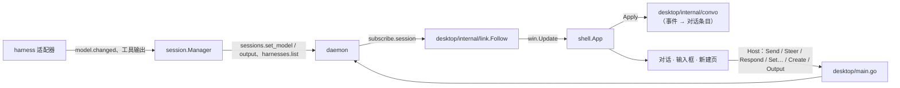

# M1 · PR9b 会话视图、输入框与审批 · 详细计划

> **执行方式：** 按任务顺序逐步执行；每一步用 `- [ ]` 勾选。每个任务结束时 `go test -race ./...` 和 `golangci-lint run ./...` 都应通过。修改已有文件的步骤给出补丁：把代码块存成文件后在仓库根目录执行 `git apply <文件>`；新文件给出完整内容。本计划的代码已在 `6e4f7cc` 上实际写过一遍，通过 `make check`，并按文档在干净的 worktree 里重放验证。

**目标：** 桌面端能用起来：新建 Code 会话（选 harness 与工作目录）→ 看 agent 工作（工作组、工具行、代码块、失败输出）→ 在输入框里批准或拒绝 → 看到改动卡；新建 Personal 会话 → 像聊天一样对话；随时换模型、强度、审批档位与 Plan，排队、插话、停止；断线时照常写，重连后发出。守护进程补上会话的当前模型、模型列表、换模型和工具输出读取。收件箱与命令面板留给 PR9b2，右栏留给 PR9c。

**架构：**



**第一步验证假设（已完成）：**
- Claude Code 2.1.312 回答 `initialize` 时列出模型：每项有 `value`（如 `opus`、`default`）、`resolvedModel`（如 `claude-opus-5-5`）、`displayName`、`description`、`supportedEffortLevels`、`supportsFastMode`（来自已有的原始录制；适配器原先不发 `initialize`，录制工具发过，Claude 接受）。每轮 `init` 行带当前 `model`。
- Hermes 0.22.5 的 `model.options`（对维护者本机 gateway 只读调用一次）：`{model, provider, providers:[{slug, name, is_current, authenticated, models:[…], capabilities:{模型:{fast, reasoning}}, …}]}`；换模型的 `session.mutate` 带 `model` 与 `provider`。每轮的 `session.usage` 带 `model` 与 `provider`，但这里的服务商名（`custom`）与 `model.options` 里的服务商代号可以不同。
- 现有适配器都不保存工具输出（`ToolCall.Output` 从未被填），插话也不进日志：9b 一并补上。

**维护者定的裁决：**
- 9b 拆成 9b（本 PR）与 9b2（收件箱、命令面板）。
- 后端补模型（会话记录、`harnesses.list`、`sessions.set_model`）与工具输出读取（`sessions.output`）；上下文占用圈、每轮 +/−、退出码先不显示。
- 不显示的部分见 0014“M1 范围”。改动卡列出本轮改过的文件，点文件打开 diff 随 9c 的右栏。
- 新建页：Code 选 harness 与工作目录（已有会话用过的目录，或“选择文件夹…”）；Personal 填名字、选 harness；然后写第一句话。
- 断线时消息暂存在内存，重连后按顺序发出，退出应用即丢失。

## 全局约束

- 不新增 Go 依赖；新增随仓库分发的资源：JetBrains Mono 2.304（Regular、SemiBold，SIL OFL 1.1）、29 个 Lucide 1.66.0 图标（ISC），下载前征得维护者同意。
- 已持久化的事件永远能解码：新事件类型 `model.changed` v1 在 `proto/testdata/events.jsonl` 加一行；迁移 `0007_model.sql` 只加列。
- 代码、注释、commit 用英文；界面文字中文，能用图标的用图标、悬停提示写名称与快捷键；颜色只用 `theme.Colors`，青色只给按钮、开关、链接、运行中、未读；字号只用 `theme.Style`。
- 视图不把 `ui.Element` / `ui.Context` 存进结构体、包变量或 goroutine（`go tool mygo vet desktop`）；后台结果经 `Window.Update` 回到 UI 线程。没有可变的包级变量；不用 lint 抑制注释。
- 测试不访问网络、不碰真实的 `~/.hoplet`；除轮询直到条件成立外不用 sleep 同步；视图用 `ui.Tester` 测。
- 任何文件与 commit 都不得出现个人用户名或本机路径。
- 分支 `feat/desktop-session`；commit 带 DCO 签名，标题不超过 72 字符；完成前 `make check` 通过。

## 接口（后续 PR 依赖）

- `proto.Session{Model, ModelProvider}`、`proto.ModelChanged`（`model.changed` v1）、`proto.ModelInfo`（`Matches(model)`）、`proto.HarnessInfo`；`MethodSessionsSetModel` / `MethodSessionsOutput` / `MethodHarnessesList`、`SetModelParams`、`OutputParams`、`ToolOutput`、`MaxOutput`；`CreateParams{Model, ModelProvider}`
- `store.SessionUpdate{Model, ModelProvider}`、`(*Store).ToolOutput`
- `harness.Info.Models []proto.ModelInfo`、`harness.Spec.ModelProvider`、`harness.Event.Output`、`harness.ModelLister`、`Run.SetModel(ctx, model, provider)`
- `session.Manager.SetModel / Harnesses / Output`；`client.(*Client).SetModel / Harnesses / Output`
- `link.Follow(ctx, c, id, after, item)`；`theme.Mono`、`theme.RegisterFonts`
- `convo.Convo`（`Apply`、`Prepend`、`Items`、`Pending`、`Question`、`Running`、`Queue`、`More`、`LastSeq`）、`convo.Item / Kind / Work / Entry / Approval`
- `shell.Host` 新增方法（见任务 6）、`shell.App.ApplySession / SetHarnesses / NewSession`

---

### 任务 0：建分支

- [ ] **步骤 1**

```bash
git switch main && git pull && git switch -c feat/desktop-session
```

### 任务 1：协议与存储：会话的模型、模型列表与工具输出的类型

**文件：** `internal/store/append.go`、`internal/store/events.go`、`internal/store/list_test.go`、`internal/store/migrations/0007_model.sql`、`internal/store/session.go`、`proto/api.go`、`proto/harness.go`、`proto/harness_test.go`、`proto/payloads.go`、`proto/session.go`、`proto/session_test.go`、`proto/testdata/events.jsonl`

**接口：** 见上。`ModelChanged` 的投影把 `model`、`model_provider` 写进会话；建会话可以带模型；`UpdateSession` 可以改模型；`Store.ToolOutput` 找到某个工具调用最近一次带输出的事件的 blob。

- [ ] **步骤 1：应用新文件与补丁**
`internal/store/migrations/0007_model.sql`：

```sql
ALTER TABLE sessions ADD COLUMN model TEXT NOT NULL DEFAULT '';
ALTER TABLE sessions ADD COLUMN model_provider TEXT NOT NULL DEFAULT '';
```

```diff
diff --git a/internal/store/append.go b/internal/store/append.go
index a16c8e1..1d6f7ee 100644
--- a/internal/store/append.go
+++ b/internal/store/append.go
@@ -375,7 +375,8 @@ func insertEvent(ctx context.Context, tx *sql.Tx, ev proto.Event, p proto.Payloa
 }
 
 // project applies one event to the turn and approval projections and, for
-// a mode change, an ended turn or a complete message, to the session record.
+// a mode or model change, an ended turn or a complete message, to the
+// session record.
 func project(ctx context.Context, tx *sql.Tx, ev proto.Event, p proto.Payload) error {
 	var q string
 	var args []any
@@ -404,6 +405,9 @@ func project(ctx context.Context, tx *sql.Tx, ev proto.Event, p proto.Payload) e
 		q = `UPDATE approvals SET status = ?, option_id = ?, decided_by = ?, resolved_seq = ?
 			WHERE session_id = ? AND id = ? AND status = 'pending'`
 		args = []any{p.Outcome, p.OptionID, p.DecidedBy, ev.Seq, ev.Session, p.ID}
+	case proto.ModelChanged:
+		q = `UPDATE sessions SET model = ?, model_provider = ? WHERE id = ?`
+		args = []any{p.Model, p.Provider, ev.Session}
 	case proto.ModeChanged:
 		// The harness changed its mode itself; the session record follows.
 		// The append that carries it bumps the catalog version.
diff --git a/internal/store/events.go b/internal/store/events.go
index b1f7a3b..790e4d7 100644
--- a/internal/store/events.go
+++ b/internal/store/events.go
@@ -236,3 +236,23 @@ func (s *Store) Snapshot(ctx context.Context, id proto.SessionID, turns int) (Se
 	}
 	return snap, nil
 }
+
+// ToolOutput returns the blob holding the output of a session's tool call,
+// from the call's latest event that has one; ErrNotFound when it has none.
+func (s *Store) ToolOutput(ctx context.Context, id proto.SessionID, toolCall string) (proto.BlobRef, error) {
+	var payload string
+	err := s.rdb.QueryRowContext(ctx, `SELECT payload FROM events
+		WHERE session_id = ? AND type = ? AND output_sha256 IS NOT NULL AND json_extract(payload, '$.id') = ?
+		ORDER BY seq DESC LIMIT 1`, id, proto.TypeToolCall, toolCall).Scan(&payload)
+	if errors.Is(err, sql.ErrNoRows) {
+		return proto.BlobRef{}, fmt.Errorf("%w: output of tool call %q in session %s", ErrNotFound, toolCall, id)
+	}
+	if err != nil {
+		return proto.BlobRef{}, fmt.Errorf("store: tool output: %w", err)
+	}
+	var tc proto.ToolCall
+	if err := json.Unmarshal([]byte(payload), &tc); err != nil || tc.Output == nil {
+		return proto.BlobRef{}, fmt.Errorf("store: tool output: unreadable tool call %q", toolCall)
+	}
+	return *tc.Output, nil
+}
diff --git a/internal/store/list_test.go b/internal/store/list_test.go
index eaaa32b..d1205b7 100644
--- a/internal/store/list_test.go
+++ b/internal/store/list_test.go
@@ -2,6 +2,7 @@ package store
 
 import (
 	"context"
+	"errors"
 	"strings"
 	"testing"
 
@@ -71,3 +72,48 @@ func TestFirstLine(t *testing.T) {
 		}
 	}
 }
+
+func TestModelChanged(t *testing.T) {
+	ctx := context.Background()
+	s := newStore(t)
+	newSession(t, s, "s")
+	appendOK(t, s, AppendRequest{Session: "s", Turn: 1, Entries: []Entry{
+		{Payload: proto.TurnStarted{}},
+		{Payload: proto.ModelChanged{Model: "gpt-6.1-sol", Provider: "local"}},
+	}})
+	got, _ := s.Session(ctx, "s")
+	if got.Model != "gpt-6.1-sol" || got.ModelProvider != "local" {
+		t.Fatalf("after model.changed %+v", got)
+	}
+	appendOK(t, s, AppendRequest{Session: "s", Turn: 1, Entries: []Entry{{Payload: proto.ModelChanged{Model: "claude-opus-5-5"}}}})
+	if got, _ = s.Session(ctx, "s"); got.Model != "claude-opus-5-5" || got.ModelProvider != "" {
+		t.Fatalf("a model without a provider kept the old one: %+v", got)
+	}
+}
+
+func TestToolOutput(t *testing.T) {
+	ctx := context.Background()
+	s := newStore(t)
+	newSession(t, s, "s")
+	ref, err := s.PutBlob(strings.NewReader("line 1\nline 2\n"))
+	if err != nil {
+		t.Fatal(err)
+	}
+	appendOK(t, s, AppendRequest{Session: "s", Turn: 1, Entries: []Entry{
+		{Payload: proto.TurnStarted{}},
+		{Payload: proto.ToolCall{ID: "t1", Kind: proto.ToolExec, Name: "Bash", Summary: "ls", Status: proto.ToolRunning}},
+		{Payload: proto.ToolCall{ID: "t1", Kind: proto.ToolExec, Name: "Bash", Summary: "ls", Status: proto.ToolDone, Output: &ref}},
+		{Payload: proto.ToolCall{ID: "t2", Kind: proto.ToolExec, Name: "Bash", Summary: "pwd", Status: proto.ToolDone}},
+	}})
+	got, err := s.ToolOutput(ctx, "s", "t1")
+	if err != nil || got != ref {
+		t.Fatalf("output of t1: %+v %v, want %+v", got, err, ref)
+	}
+	if _, err := s.ToolOutput(ctx, "s", "t2"); !errors.Is(err, ErrNotFound) {
+		t.Fatalf("a call without output: %v", err)
+	}
+	m := "claude-opus-5-5"
+	if got, err := s.UpdateSession(ctx, "s", SessionUpdate{Model: &m}); err != nil || got.Model != m {
+		t.Fatalf("update model %+v %v", got, err)
+	}
+}
diff --git a/internal/store/session.go b/internal/store/session.go
index 4d933c2..317b55f 100644
--- a/internal/store/session.go
+++ b/internal/store/session.go
@@ -14,7 +14,7 @@ import (
 )
 
 const sessionColumns = `id, mode, harness_kind, harness_version, native_id, directory, isolation,
-	owner, origin, status, title, created_at, updated_at, archived_at, last_seq, version, permission, plan, effort, fast, pinned, unread, preview`
+	owner, origin, status, title, created_at, updated_at, archived_at, last_seq, version, permission, plan, effort, fast, pinned, unread, preview, model, model_provider`
 
 // CreateSession stores a new session. Status defaults to idle and
 // CreatedAt to now; UpdatedAt equals CreatedAt. The write is durable.
@@ -38,10 +38,11 @@ func (s *Store) CreateSession(ctx context.Context, sess proto.Session) (proto.Se
 	sess.Pinned, sess.Unread, sess.Preview = false, false, ""
 	err := s.tx(ctx, true, func(tx *sql.Tx) error {
 		_, err := tx.ExecContext(ctx, `INSERT INTO sessions (`+sessionColumns+`)
-			VALUES (?, ?, ?, ?, ?, ?, ?, ?, ?, ?, ?, ?, ?, NULL, 0, 0, ?, ?, ?, ?, 0, 0, '')`,
+			VALUES (?, ?, ?, ?, ?, ?, ?, ?, ?, ?, ?, ?, ?, NULL, 0, 0, ?, ?, ?, ?, 0, 0, '', ?, ?)`,
 			sess.ID, sess.Mode, sess.Harness.Kind, sess.Harness.Version, sess.Harness.NativeID,
 			sess.Directory, sess.Isolation, sess.Owner, sess.Origin, sess.Status, sess.Title,
-			sess.CreatedAt.UnixMilli(), sess.UpdatedAt.UnixMilli(), sess.Permission, sess.Plan, sess.Effort, sess.Fast)
+			sess.CreatedAt.UnixMilli(), sess.UpdatedAt.UnixMilli(), sess.Permission, sess.Plan, sess.Effort, sess.Fast,
+			sess.Model, sess.ModelProvider)
 		var serr *sqlite.Error
 		if errors.As(err, &serr) && serr.Code() == sqlite3.SQLITE_CONSTRAINT_PRIMARYKEY {
 			return fmt.Errorf("%w: session %s", ErrExists, sess.ID)
@@ -184,16 +185,20 @@ type SessionUpdate struct {
 	Effort     *proto.Effort // an empty effort restores the harness default
 	Pinned     *bool
 	Unread     *bool
+	// Model and ModelProvider record the model asked for; the harness's
+	// model.changed later records the model it runs.
+	Model         *string
+	ModelProvider *string
 }
 
 // UpdateSession changes a session's harness-native ID, title, permission
-// mode, plan mode, fast mode, effort, pin and/or unread mark and returns the
-// updated session. It leaves updated_at alone, so lists keep their order.
+// mode, plan mode, fast mode, effort, pin, unread mark and/or model and
+// returns the updated session. It leaves updated_at alone, so lists keep their order.
 // The write is durable; with nothing to change it writes nothing and
 // returns the current session.
 func (s *Store) UpdateSession(ctx context.Context, id proto.SessionID, u SessionUpdate) (proto.Session, error) {
 	if u.NativeID == nil && u.Title == nil && u.Permission == nil && u.Plan == nil && u.Fast == nil && u.Effort == nil &&
-		u.Pinned == nil && u.Unread == nil {
+		u.Pinned == nil && u.Unread == nil && u.Model == nil && u.ModelProvider == nil {
 		return s.Session(ctx, id)
 	}
 	if u.Permission != nil && !u.Permission.Valid() {
@@ -206,8 +211,9 @@ func (s *Store) UpdateSession(ctx context.Context, id proto.SessionID, u Session
 	err := s.tx(ctx, true, func(tx *sql.Tx) error {
 		res, err := tx.ExecContext(ctx, `UPDATE sessions SET native_id = COALESCE(?, native_id), title = COALESCE(?, title),
 			permission = COALESCE(?, permission), plan = COALESCE(?, plan), fast = COALESCE(?, fast),
-			effort = COALESCE(?, effort), pinned = COALESCE(?, pinned), unread = COALESCE(?, unread) WHERE id = ?`,
-			u.NativeID, u.Title, u.Permission, u.Plan, u.Fast, u.Effort, u.Pinned, u.Unread, id)
+			effort = COALESCE(?, effort), pinned = COALESCE(?, pinned), unread = COALESCE(?, unread),
+			model = COALESCE(?, model), model_provider = COALESCE(?, model_provider) WHERE id = ?`,
+			u.NativeID, u.Title, u.Permission, u.Plan, u.Fast, u.Effort, u.Pinned, u.Unread, u.Model, u.ModelProvider, id)
 		if err != nil {
 			return fmt.Errorf("store: update session %s: %w", id, err)
 		}
@@ -256,7 +262,7 @@ func scanSession(r scanner) (proto.Session, error) {
 	err := r.Scan(&sess.ID, &sess.Mode, &sess.Harness.Kind, &sess.Harness.Version, &sess.Harness.NativeID,
 		&sess.Directory, &sess.Isolation, &sess.Owner, &sess.Origin, &sess.Status, &sess.Title,
 		&created, &updated, &archived, &sess.LastSeq, &sess.Version, &sess.Permission, &sess.Plan, &sess.Effort, &sess.Fast,
-		&sess.Pinned, &sess.Unread, &sess.Preview)
+		&sess.Pinned, &sess.Unread, &sess.Preview, &sess.Model, &sess.ModelProvider)
 	if err != nil {
 		if errors.Is(err, sql.ErrNoRows) {
 			return proto.Session{}, err
diff --git a/proto/api.go b/proto/api.go
index 32a7957..a758dcf 100644
--- a/proto/api.go
+++ b/proto/api.go
@@ -76,6 +76,9 @@ const (
 	MethodSessionsSetPlan   = "sessions.set_plan"
 	MethodSessionsSetEffort = "sessions.set_effort"
 	MethodSessionsSetFast   = "sessions.set_fast"
+	MethodSessionsSetModel  = "sessions.set_model"
+	MethodSessionsOutput    = "sessions.output"
+	MethodHarnessesList     = "harnesses.list"
 	MethodSessionsUpdate    = "sessions.update"
 	MethodSessionsStop      = "sessions.stop"
 	MethodSessionsArchive   = "sessions.archive"
@@ -125,6 +128,10 @@ type CreateParams struct {
 	Effort     Effort         `json:"effort,omitempty"`
 	Fast       bool           `json:"fast,omitempty"`
 	Title      string         `json:"title,omitempty"`
+	// Model and ModelProvider pick a model of HarnessInfo.Models; empty
+	// means the harness's default.
+	Model         string `json:"model,omitempty"`
+	ModelProvider string `json:"model_provider,omitempty"`
 }
 
 // SendParams sends a message; Key makes the request idempotent.
@@ -187,6 +194,32 @@ type SetEffortParams struct {
 	Effort  Effort    `json:"effort"`
 }
 
+// SetModelParams changes a session's model from its next turn; Provider is
+// required where models belong to a provider.
+type SetModelParams struct {
+	Session  SessionID `json:"session"`
+	Model    string    `json:"model"`
+	Provider string    `json:"provider,omitempty"`
+}
+
+// OutputParams asks for a tool call's output.
+type OutputParams struct {
+	Session  SessionID `json:"session"`
+	ToolCall string    `json:"tool_call"`
+}
+
+// ToolOutput is a tool call's output: at most MaxOutput bytes of it, cut at
+// a line end, with Truncated set when more was cut. Size is the whole
+// output's size.
+type ToolOutput struct {
+	Text      string `json:"text"`
+	Size      int64  `json:"size"`
+	Truncated bool   `json:"truncated,omitempty"`
+}
+
+// MaxOutput bounds the text sessions.output returns.
+const MaxOutput = 64 << 10
+
 // UpdateParams changes a session's list properties; nil fields stay as
 // they are. An empty title is allowed: the session shows untitled.
 type UpdateParams struct {
diff --git a/proto/harness.go b/proto/harness.go
index 1909eef..ebc78f9 100644
--- a/proto/harness.go
+++ b/proto/harness.go
@@ -103,3 +103,36 @@ func (c Capabilities) HasEffort(e Effort) bool {
 	}
 	return false
 }
+
+// ModelInfo is a model a harness offers. ID (with Provider, where models
+// belong to a provider) is what sessions.set_model takes; Model is the name
+// the harness reports in model.changed once it runs it, which may differ
+// from ID (an alias). Efforts and Fast are what this model supports; no
+// Efforts means the harness's Capabilities.Efforts.
+type ModelInfo struct {
+	ID          string   `json:"id"`
+	Provider    string   `json:"provider,omitempty"`
+	Model       string   `json:"model,omitempty"`
+	Name        string   `json:"name"`
+	Description string   `json:"description,omitempty"`
+	Default     bool     `json:"default,omitempty"`
+	Efforts     []Effort `json:"efforts,omitempty"`
+	Fast        bool     `json:"fast,omitempty"`
+}
+
+// Matches reports whether m is the model a session reports. Only the name
+// counts: a harness may name a provider differently when it reports.
+func (m ModelInfo) Matches(model string) bool {
+	return model == m.ID || (m.Model != "" && model == m.Model)
+}
+
+// HarnessInfo describes an installed harness for clients choosing one.
+// Models is empty until the harness has told the daemon its models (Claude
+// Code does when a session starts).
+type HarnessInfo struct {
+	Kind         string       `json:"kind"`
+	Version      string       `json:"version"`
+	Supported    bool         `json:"supported"`
+	Capabilities Capabilities `json:"capabilities"`
+	Models       []ModelInfo  `json:"models,omitempty"`
+}
diff --git a/proto/harness_test.go b/proto/harness_test.go
index b6a70bb..860de44 100644
--- a/proto/harness_test.go
+++ b/proto/harness_test.go
@@ -88,3 +88,18 @@ func TestModeChangedValidates(t *testing.T) {
 		t.Fatal(err)
 	}
 }
+
+func TestModelMatches(t *testing.T) {
+	m := ModelInfo{ID: "opus", Model: "claude-opus-5-5"}
+	for model, want := range map[string]bool{"opus": true, "claude-opus-5-5": true, "haiku": false, "": false} {
+		if got := m.Matches(model); got != want {
+			t.Errorf("Matches(%q) = %v, want %v", model, got, want)
+		}
+	}
+	if (ModelInfo{ID: "gpt"}).Matches("") {
+		t.Error("an empty model matched")
+	}
+	if err := (ModelChanged{}).validate(); err == nil {
+		t.Error("a model change without a model validated")
+	}
+}
diff --git a/proto/payloads.go b/proto/payloads.go
index 232dc32..6650539 100644
--- a/proto/payloads.go
+++ b/proto/payloads.go
@@ -17,6 +17,7 @@ const (
 	TypeUsage            EventType = "usage"
 	TypeError            EventType = "error"
 	TypeModeChanged      EventType = "mode.changed"
+	TypeModelChanged     EventType = "model.changed"
 )
 
 // TurnStarted marks the start of a turn.
@@ -215,6 +216,22 @@ func (m ModeChanged) validate() error {
 	return nil
 }
 
+// ModelChanged records the model the harness reports it runs: at the start
+// of a session, and after a model change takes effect. Provider is set for
+// harnesses whose models belong to a provider (Hermes). The store applies
+// it to the session record.
+type ModelChanged struct {
+	Model    string `json:"model"`
+	Provider string `json:"provider,omitempty"`
+}
+
+func (m ModelChanged) validate() error {
+	if m.Model == "" {
+		return fmt.Errorf("%w: model change without a model", ErrInvalidPayload)
+	}
+	return nil
+}
+
 func (r ApprovalResolved) validate() error {
 	switch r.Outcome {
 	case OutcomeAllowed, OutcomeDenied:
@@ -244,6 +261,7 @@ func (Question) eventType() EventType          { return TypeQuestion }
 func (Usage) eventType() EventType             { return TypeUsage }
 func (Error) eventType() EventType             { return TypeError }
 func (ModeChanged) eventType() EventType       { return TypeModeChanged }
+func (ModelChanged) eventType() EventType      { return TypeModelChanged }
 
 func (TurnStarted) eventVersion() uint16       { return 1 }
 func (TurnEnded) eventVersion() uint16         { return 1 }
@@ -258,6 +276,7 @@ func (Question) eventVersion() uint16          { return 1 }
 func (Usage) eventVersion() uint16             { return 1 }
 func (Error) eventVersion() uint16             { return 1 }
 func (ModeChanged) eventVersion() uint16       { return 1 }
+func (ModelChanged) eventVersion() uint16      { return 1 }
 
 func init() {
 	register[TurnStarted]()
@@ -273,4 +292,5 @@ func init() {
 	register[Usage]()
 	register[Error]()
 	register[ModeChanged]()
+	register[ModelChanged]()
 }
diff --git a/proto/session.go b/proto/session.go
index 035628a..61c16a0 100644
--- a/proto/session.go
+++ b/proto/session.go
@@ -92,4 +92,9 @@ type Session struct {
 	Unread bool `json:"unread,omitempty"`
 	// Preview is the first line of the latest complete message.
 	Preview string `json:"preview,omitempty"`
+	// Model is the model the harness last reported it runs, and
+	// ModelProvider its provider where models have one; empty until the
+	// harness reports.
+	Model         string `json:"model,omitempty"`
+	ModelProvider string `json:"model_provider,omitempty"`
 }
diff --git a/proto/session_test.go b/proto/session_test.go
index daf9490..5176f9b 100644
--- a/proto/session_test.go
+++ b/proto/session_test.go
@@ -13,7 +13,7 @@ func TestSessionJSONRoundTrip(t *testing.T) {
 		ID: "s1", Mode: ModeCode, Harness: HarnessRef{Kind: "claude", Version: "2.1.312", NativeID: "n1"}, Permission: ModeAutoEdit,
 		Directory: "/work", Isolation: InPlace, Owner: OwnerMe, Origin: OriginMe, Status: StatusIdle,
 		Title: "sync", CreatedAt: archived.Add(-time.Hour), UpdatedAt: archived, ArchivedAt: &archived, LastSeq: 7, Version: 9,
-		Pinned: true, Unread: true, Preview: "done",
+		Pinned: true, Unread: true, Preview: "done", Model: "claude-opus-5-5", ModelProvider: "p",
 	}
 	b, err := json.Marshal(in)
 	if err != nil {
diff --git a/proto/testdata/events.jsonl b/proto/testdata/events.jsonl
index b575f82..87afa0e 100644
--- a/proto/testdata/events.jsonl
+++ b/proto/testdata/events.jsonl
@@ -14,3 +14,4 @@
 {"session":"s1","seq":14,"ts":"2026-10-31T08:00:13Z","turn":3,"type":"approval.requested","v":1,"payload":{"id":"a2","kind":"tool","title":"Run tool","tool_call_id":"t1","options":[{"id":"deny","label":"Deny","scope":"deny"}]}}
 {"session":"s1","seq":15,"ts":"2026-10-31T08:00:14Z","turn":3,"type":"approval.resolved","v":1,"payload":{"id":"a2","outcome":"expired"}}
 {"session":"s1","seq":16,"ts":"2026-10-31T08:00:15Z","turn":3,"type":"mode.changed","v":1,"payload":{"permission":"auto_edit","plan":false}}
+{"session":"s1","seq":17,"ts":"2026-11-02T08:00:00Z","turn":3,"type":"model.changed","v":1,"payload":{"model":"gpt-6.1-sol","provider":"local"}}
```

- [ ] **步骤 2：确认通过并 commit**

```bash
go test -race ./proto/ ./internal/store/ && go build ./...
git add proto internal/store
git commit -s -m "feat(store): record a session's model and tool outputs"
```

### 任务 2：harness：报告模型、列出模型、交出工具输出

**文件：** `internal/harness/claude/adapter_test.go`、`internal/harness/claude/claude.go`、`internal/harness/claude/contract_test.go`、`internal/harness/claude/models_test.go`、`internal/harness/claude/record.go`、`internal/harness/claude/record_test.go`、`internal/harness/claude/run.go`、`internal/harness/claude/wire.go`、`internal/harness/fake/adapter.go`、`internal/harness/fake/fake_test.go`、`internal/harness/fake/protocol.go`、`internal/harness/harness.go`、`internal/harness/hermes/adapter_test.go`、`internal/harness/hermes/contract_test.go`、`internal/harness/hermes/hermes.go`、`internal/harness/hermes/models.go`、`internal/harness/hermes/models_test.go`、`internal/harness/hermes/requests.go`、`internal/harness/hermes/run.go`、`internal/harness/hermes/wire.go`；重新生成 `internal/harness/claude/testdata/2.1.312/*.golden` 与 `internal/harness/hermes/testdata/0.22.5/*.golden`

**接口：** `harness.Info.Models` 改为 `[]proto.ModelInfo`；`harness.Spec.ModelProvider`；`harness.Event.Output`；`harness.ModelLister`；`Run.SetModel(ctx, model, provider)`。

- Claude Code：`Attach` 先发 `initialize`，回复里的模型更新 `Probe` 报告的列表；每轮 `init` 行的模型变化时发 `ModelChanged`；`tool_result` 的文本随该工具调用的事件交出（`Event.Output`）。录制脱敏保留 `initialize` 回复里的模型字段。
- Hermes：`session.usage` 的模型变化时发 `ModelChanged`（带它报的服务商名）；`Models` 在会话之外连一次 gateway 调 `model.options`，取已登录服务商的模型、当前服务商在前，缓存 10 分钟；换模型带服务商代号。
- fake：`Harness.Models` 由 `Probe` 报告；`tool` 事件的 `text` 作为输出。

- [ ] **步骤 1：应用新文件与补丁**
`internal/harness/claude/models_test.go`：

```go
package claude

import (
	"context"
	"encoding/json"
	"reflect"
	"strings"
	"testing"

	"github.com/yangflow/hoplet/internal/harness"
	"github.com/yangflow/hoplet/proto"
)

// initAnswerLine is claude 2.1.312's answer to initialize, cut to two of
// its models and the fields the adapter reads.
const initAnswerLine = `{"type":"control_response","response":{"subtype":"success","request_id":"%s","response":{"commands":[],"models":[` +
	`{"value":"default","resolvedModel":"claude-opus-5-5","displayName":"Default (recommended)","description":"Opus 5.5 · Best for everyday, complex tasks","supportedEffortLevels":["low","medium","high","xhigh","max"],"supportsFastMode":true},` +
	`{"value":"haiku","resolvedModel":"claude-haiku-5-5","displayName":"Haiku 5.5","description":"Fastest","supportedEffortLevels":["low","bogus"]}]}}}`

func TestAttachAsksForModels(t *testing.T) {
	io := newFakeStdio()
	h := &Harness{}
	r, err := h.Attach(context.Background(), harness.Spec{Session: "s", Mode: proto.ModeConfirm}, io)
	if err != nil {
		t.Fatal(err)
	}
	defer r.Close()
	writes := io.written()
	if len(writes) != 1 {
		t.Fatalf("attach wrote %q, want one initialize", writes)
	}
	var req requestLine
	if err := json.Unmarshal(writes[0], &req); err != nil || req.Type != "control_request" || req.RequestID == "" {
		t.Fatalf("initialize %s: %v", writes[0], err)
	}
	line := []byte(strings.Replace(initAnswerLine, "%s", req.RequestID, 1))
	go func() { io.lines <- harness.Line{Kind: harness.Stdout, Data: line, Offset: 1} }()
	<-r.Events() // the line's event follows its handling

	want := []proto.ModelInfo{
		{ID: "default", Model: "claude-opus-5-5", Name: "Default (recommended)", Description: "Opus 5.5 · Best for everyday, complex tasks", Default: true,
			Efforts: []proto.Effort{proto.EffortLow, proto.EffortMedium, proto.EffortHigh, proto.EffortXHigh, proto.EffortMax}},
		{ID: "haiku", Model: "claude-haiku-5-5", Name: "Haiku 5.5", Description: "Fastest", Efforts: []proto.Effort{proto.EffortLow}},
	}
	h.mu.Lock()
	got := h.models
	h.mu.Unlock()
	if !reflect.DeepEqual(got, want) {
		t.Fatalf("models %+v, want %+v", got, want)
	}
}

func TestToolResultRidesOnItsEvent(t *testing.T) {
	io := newFakeStdio()
	r := newRun(io, harness.Spec{Session: "s", Mode: proto.ModeConfirm}, nil)
	defer r.Close()
	lines := []string{
		`{"type":"assistant","message":{"id":"m1","content":[{"type":"tool_use","id":"t1","name":"Bash","input":{"command":"ls"}}]}}`,
		`{"type":"user","message":{"content":[{"type":"tool_result","tool_use_id":"t1","content":"a.go\nb.go"}]}}`,
	}
	go func() {
		for i, l := range lines {
			io.lines <- harness.Line{Kind: harness.Stdout, Data: []byte(l), Offset: int64(i + 1)}
		}
	}()
	for {
		ev := <-r.Events()
		tc, ok := ev.Payload.(proto.ToolCall)
		if !ok || tc.Status == proto.ToolRunning {
			if len(ev.Output) > 0 {
				t.Fatalf("output on %+v", ev)
			}
			continue
		}
		if string(ev.Output) != "a.go\nb.go" {
			t.Fatalf("output %q on %+v", ev.Output, tc)
		}
		return
	}
}
```
`internal/harness/hermes/models.go`：

```go
package hermes

import (
	"context"
	"encoding/json"
	"fmt"
	"slices"
	"time"

	"github.com/coder/websocket"

	"github.com/yangflow/hoplet/proto"
)

// modelsTTL is how long the model list is reused before Hermes is asked
// again.
const modelsTTL = 10 * time.Minute

// Models lists the models of the providers Hermes is signed in to, from
// the gateway's model.options. It reuses an answer for modelsTTL.
func (h *Harness) Models(ctx context.Context) ([]proto.ModelInfo, error) {
	h.mu.Lock()
	if h.models != nil && h.now().Sub(h.listed) < modelsTTL {
		m := slices.Clone(h.models)
		h.mu.Unlock()
		return m, nil
	}
	h.mu.Unlock()
	env := h.env()
	path, err := Find(env)
	if err != nil {
		return nil, err
	}
	ep, err := Ensure(ctx, path, env)
	if err != nil {
		return nil, err
	}
	c, err := Dial(ctx, ep)
	if err != nil {
		return nil, err
	}
	defer c.Close(websocket.StatusNormalClosure, "")
	if err := c.Write(ctx, websocket.MessageText, []byte(`{"jsonrpc":"2.0","id":"hoplet-models","method":"model.options","params":{}}`)); err != nil {
		return nil, fmt.Errorf("hermes: model.options: %w", err)
	}
	for {
		_, data, err := c.Read(ctx)
		if err != nil {
			return nil, fmt.Errorf("hermes: model.options: %w", err)
		}
		var f struct {
			ID     string          `json:"id"`
			Result json.RawMessage `json:"result"`
			Error  *rpcError       `json:"error"`
		}
		if json.Unmarshal(data, &f) != nil || f.ID != "hoplet-models" {
			continue // events and other connections' traffic
		}
		if f.Error != nil {
			return nil, fmt.Errorf("hermes: model.options: %s", f.Error.Message)
		}
		m, err := parseModelOptions(f.Result)
		if err != nil {
			return nil, err
		}
		h.mu.Lock()
		h.models, h.listed = m, h.now()
		h.mu.Unlock()
		return slices.Clone(m), nil
	}
}

// modelOptions is the part of model.options' answer Hoplet reads.
type modelOptions struct {
	Model     string          `json:"model"`
	Providers []modelProvider `json:"providers"`
}

type modelProvider struct {
	Slug          string   `json:"slug"`
	Name          string   `json:"name"`
	Current       bool     `json:"is_current"`
	Authenticated bool     `json:"authenticated"`
	Models        []string `json:"models"`
	Capabilities  map[string]struct {
		Fast bool `json:"fast"`
	} `json:"capabilities"`
}

// parseModelOptions lists the models of signed-in providers, the current
// provider first; the model Hermes runs by default is marked Default.
func parseModelOptions(raw json.RawMessage) ([]proto.ModelInfo, error) {
	var o modelOptions
	if err := json.Unmarshal(raw, &o); err != nil {
		return nil, fmt.Errorf("hermes: model.options answer: %w", err)
	}
	providers := slices.Clone(o.Providers)
	slices.SortStableFunc(providers, func(a, b modelProvider) int {
		switch {
		case a.Current == b.Current:
			return 0
		case a.Current:
			return -1
		}
		return 1
	})
	out := []proto.ModelInfo{}
	for _, p := range providers {
		if !p.Authenticated {
			continue
		}
		for _, m := range p.Models {
			out = append(out, proto.ModelInfo{
				ID: m, Provider: p.Slug, Name: m, Description: p.Name,
				Default: p.Current && m == o.Model, Fast: p.Capabilities[m].Fast,
			})
		}
	}
	return out, nil
}
```
`internal/harness/hermes/models_test.go`：

```go
package hermes

import (
	"reflect"
	"testing"

	"github.com/yangflow/hoplet/proto"
)

// The shape of Hermes 0.22.5's model.options answer, with made-up
// providers and models.
const modelOptionsAnswer = `{"model":"codex/m2","provider":"local","providers":[
{"slug":"cloud","name":"Cloud","is_current":false,"authenticated":true,"models":["c1"],"capabilities":{"c1":{"fast":true,"reasoning":true}},"total_models":1},
{"slug":"off","name":"Signed out","is_current":false,"authenticated":false,"models":["x"]},
{"slug":"local","name":"local","is_current":true,"authenticated":true,"models":["codex/m1","codex/m2"],"capabilities":{"codex/m1":{"fast":false,"reasoning":true}},"aliases":{}}]}`

func TestParseModelOptions(t *testing.T) {
	got, err := parseModelOptions([]byte(modelOptionsAnswer))
	if err != nil {
		t.Fatal(err)
	}
	want := []proto.ModelInfo{
		{ID: "codex/m1", Provider: "local", Name: "codex/m1", Description: "local"},
		{ID: "codex/m2", Provider: "local", Name: "codex/m2", Description: "local", Default: true},
		{ID: "c1", Provider: "cloud", Name: "c1", Description: "Cloud", Fast: true},
	}
	if !reflect.DeepEqual(got, want) {
		t.Fatalf("got %+v\nwant %+v", got, want)
	}
	if _, err := parseModelOptions([]byte(`[`)); err == nil {
		t.Fatal("a broken answer parsed")
	}
}
```

```diff
diff --git a/internal/harness/claude/adapter_test.go b/internal/harness/claude/adapter_test.go
index 2f4db15..485eafc 100644
--- a/internal/harness/claude/adapter_test.go
+++ b/internal/harness/claude/adapter_test.go
@@ -114,7 +114,7 @@ func TestLaunch(t *testing.T) {
 func liveRun(t *testing.T, spec harness.Spec) (*replayer, *fakeStdio) {
 	t.Helper()
 	io := newFakeStdio()
-	p := &replayer{t: t, io: io, run: newRun(io, spec)}
+	p := &replayer{t: t, io: io, run: newRun(io, spec, nil)}
 	t.Cleanup(func() { p.run.Close() })
 	return p, io
 }
diff --git a/internal/harness/claude/claude.go b/internal/harness/claude/claude.go
index ac48e3a..9c345a5 100644
--- a/internal/harness/claude/claude.go
+++ b/internal/harness/claude/claude.go
@@ -48,6 +48,8 @@ type Harness struct {
 	mu     sync.Mutex
 	cached harness.Info
 	stamp  stamp // the binary the cached info is for
+	// models are the models the last session's claude listed.
+	models []proto.ModelInfo
 }
 
 // stamp identifies a binary's contents cheaply: its resolved path, size
@@ -95,6 +97,7 @@ func (h *Harness) Probe(ctx context.Context) (harness.Info, error) {
 		h.stamp = st
 	}
 	info := h.cached
+	info.Models = slices.Clone(h.models)
 	// Not cached: a failed follow-up leaves the binary as it was.
 	if u, ok := lastUpdate(h.Binary); ok {
 		info.Notice, info.Attention = notice(u, info.Version)
@@ -235,7 +238,19 @@ func launchEnv(env []string) []string {
 	return append(out, "DISABLE_AUTOUPDATER=1")
 }
 
-// Attach starts translating io's lines into events.
-func (h *Harness) Attach(_ context.Context, spec harness.Spec, io harness.Stdio) (harness.Run, error) {
-	return newRun(io, spec), nil
+// Attach starts translating io's lines into events and asks claude for its
+// settings, whose answer updates the models Probe reports.
+func (h *Harness) Attach(ctx context.Context, spec harness.Spec, io harness.Stdio) (harness.Run, error) {
+	r := newRun(io, spec, h.setModels)
+	if err := r.initialize(ctx); err != nil {
+		r.Close()
+		return nil, err
+	}
+	return r, nil
+}
+
+func (h *Harness) setModels(m []proto.ModelInfo) {
+	h.mu.Lock()
+	h.models = m
+	h.mu.Unlock()
 }
diff --git a/internal/harness/claude/contract_test.go b/internal/harness/claude/contract_test.go
index e345e78..2c6042d 100644
--- a/internal/harness/claude/contract_test.go
+++ b/internal/harness/claude/contract_test.go
@@ -168,7 +168,7 @@ func (p *replayer) command(in string) bool {
 		case "interrupt":
 			err = p.run.Interrupt(ctx)
 		case "set_model":
-			err = p.run.SetModel(ctx, msg.Request["model"].(string))
+			err = p.run.SetModel(ctx, msg.Request["model"].(string), "")
 		case "set_permission_mode":
 			mode := msg.Request["mode"].(string)
 			p.run.mu.Lock()
@@ -277,7 +277,7 @@ func TestRecordings(t *testing.T) {
 				spec = harness.Spec{Mode: proto.ModeConfirm}
 			}
 			io := newFakeStdio()
-			p := &replayer{t: t, io: io, run: newRun(io, spec)}
+			p := &replayer{t: t, io: io, run: newRun(io, spec, nil)}
 			defer p.run.Close()
 			for _, e := range readFixture(t, file) {
 				switch e.Dir {
diff --git a/internal/harness/claude/record.go b/internal/harness/claude/record.go
index 9355693..6641166 100644
--- a/internal/harness/claude/record.go
+++ b/internal/harness/claude/record.go
@@ -313,6 +313,26 @@ func Sanitize(in io.Reader, out io.Writer, dir, home string) error {
 	return nil
 }
 
+// reduceModels keeps the fields of initialize's models the adapter reads.
+func reduceModels(v any) []any {
+	list, _ := v.([]any)
+	out := []any{}
+	for _, m := range list {
+		mm, ok := m.(map[string]any)
+		if !ok {
+			continue
+		}
+		kept := map[string]any{}
+		for _, k := range []string{"value", "resolvedModel", "displayName", "description", "supportedEffortLevels"} {
+			if x, ok := mm[k]; ok {
+				kept[k] = x
+			}
+		}
+		out = append(out, kept)
+	}
+	return out
+}
+
 // reduce trims a recorded line in place and reports whether to keep it.
 func reduce(dir string, v map[string]any) bool {
 	switch v["type"] {
@@ -328,7 +348,9 @@ func reduce(dir string, v map[string]any) bool {
 		if dir == "out" {
 			if resp, ok := v["response"].(map[string]any); ok {
 				if inner, ok := resp["response"].(map[string]any); ok && inner["commands"] != nil {
-					resp["response"] = map[string]any{}
+					// The initialize answer: only its models, which the
+					// adapter reads.
+					resp["response"] = map[string]any{"models": reduceModels(inner["models"])}
 				}
 			}
 		}
diff --git a/internal/harness/claude/record_test.go b/internal/harness/claude/record_test.go
index 6be6b59..700d0a2 100644
--- a/internal/harness/claude/record_test.go
+++ b/internal/harness/claude/record_test.go
@@ -90,7 +90,7 @@ func TestRecord(t *testing.T) {
 func TestSanitize(t *testing.T) {
 	entries := []Entry{
 		{Dir: "in", Line: `{"type":"user","message":{"role":"user","content":"edit /home/me/proj/a.go"}}`},
-		{Dir: "out", Line: `{"type":"control_response","response":{"subtype":"success","request_id":"h1","response":{"commands":[1],"account":{"email":"x"}}}}`},
+		{Dir: "out", Line: `{"type":"control_response","response":{"subtype":"success","request_id":"h1","response":{"commands":[1],"account":{"email":"x"},"models":[{"value":"opus","displayName":"Opus","supportsAutoMode":true}]}}}`},
 		{Dir: "out", Line: `{"type":"system","subtype":"init","session_id":"s","cwd":"/home/me/proj","skills":["mine"],"memory_paths":{"auto":"/home/me/.claude"}}`},
 		{Dir: "out", Line: `{"type":"rate_limit_event"}`},
 		{Dir: "out", Line: `{"type":"stream_event","event":{"type":"content_block_delta","delta":{"type":"input_json_delta","partial_json":"/home/m"}}}`},
@@ -117,12 +117,12 @@ func TestSanitize(t *testing.T) {
 		lines = append(lines, e.Dir+" "+e.Line)
 	}
 	got := strings.Join(lines, "\n") + "\n"
-	for _, bad := range []string{"/home/me", "account", "skills", "memory_paths", "rate_limit", "input_json_delta", "signature", "debug"} {
+	for _, bad := range []string{"/home/me", "account", "skills", "memory_paths", "supportsAutoMode", "rate_limit", "input_json_delta", "signature", "debug"} {
 		if strings.Contains(got, bad) {
 			t.Errorf("sanitized recording still has %q:\n%s", bad, got)
 		}
 	}
-	for _, want := range []string{"edit /work/a.go", `"cwd":"/work"`, `"response":{}`, "exit 0"} {
+	for _, want := range []string{"edit /work/a.go", `"cwd":"/work"`, `"response":{"models":[{"displayName":"Opus","value":"opus"}]}`, "exit 0"} {
 		if !strings.Contains(got, want) {
 			t.Errorf("sanitized recording lacks %q:\n%s", want, got)
 		}
diff --git a/internal/harness/claude/run.go b/internal/harness/claude/run.go
index 07211bf..1e64f2d 100644
--- a/internal/harness/claude/run.go
+++ b/internal/harness/claude/run.go
@@ -54,6 +54,14 @@ type run struct {
 	blocks map[string]int // content blocks seen per assistant message ID
 	msgID  string         // the message being streamed
 	tools  map[string]tool
+	model  string // the model claude last reported
+	// outputs are tool results waiting to ride on their ToolCall's event.
+	outputs map[string][]byte
+
+	// initID is the request ID of this run's initialize; models receives
+	// the models its answer lists.
+	initID string
+	models func([]proto.ModelInfo)
 
 	prefix string // makes this run's control request IDs unique
 	seq    sync.Mutex
@@ -73,12 +81,12 @@ type run struct {
 	observed string
 }
 
-func newRun(io harness.Stdio, spec harness.Spec) *run {
+func newRun(io harness.Stdio, spec harness.Spec, models func([]proto.ModelInfo)) *run {
 	r := &run{
 		io: io, events: make(chan harness.Event, 64), done: make(chan struct{}), finished: make(chan struct{}),
 		inTurn: spec.State.InTurn, native: spec.State.Native, blocks: map[string]int{}, tools: map[string]tool{},
 		prefix: "hoplet-" + rand.Text()[:8], approvals: map[string]pending{},
-		base: spec.Mode, plan: spec.Plan,
+		base: spec.Mode, plan: spec.Plan, models: models, outputs: map[string][]byte{},
 	}
 	r.want = r.wanted()
 	go r.loop()
@@ -168,6 +176,10 @@ func (r *run) handle(l harness.Line) (evs []harness.Event, final bool) {
 				ev.Native = "" // announced once
 			}
 			ev.Payload = p
+			if tc, ok := p.(proto.ToolCall); ok {
+				ev.Output = r.outputs[tc.ID]
+				delete(r.outputs, tc.ID)
+			}
 			evs = append(evs, ev)
 		}
 		return evs, false
@@ -199,6 +211,10 @@ func (r *run) translate(data []byte) ([]proto.Payload, string) {
 		if ln.PermissionMode != "" {
 			out = append(out, r.observeMode(ln.PermissionMode)...)
 		}
+		if ln.Subtype == "init" && ln.Model != "" && ln.Model != r.model {
+			r.model = ln.Model
+			out = append(out, proto.ModelChanged{Model: ln.Model})
+		}
 		if ln.Subtype == "init" {
 			return out, ln.SessionID // claude announces its session on every turn
 		}
@@ -215,6 +231,11 @@ func (r *run) translate(data []byte) ([]proto.Payload, string) {
 		if ln.Response != nil && ln.Response.Subtype == "error" {
 			return []proto.Payload{proto.Error{Message: "claude refused a request: " + ln.Response.Error}}, ""
 		}
+		if ln.Response != nil && ln.Response.RequestID == r.initID && r.models != nil {
+			if m := modelsOf(ln.Response.Response); len(m) > 0 {
+				r.models(m)
+			}
+		}
 		return nil, ""
 	case "control_cancel_request":
 		r.mu.Lock()
@@ -296,6 +317,9 @@ func (r *run) toolResults(m *message) []proto.Payload {
 			status = proto.ToolFailed
 		}
 		out = append(out, proto.ToolCall{ID: b.ToolUseID, Kind: t.kind, Name: t.name, Summary: summary(t.name, t.input), Status: status})
+		if text := resultText(b.Content); text != "" {
+			r.outputs[b.ToolUseID] = []byte(text)
+		}
 		if !ok || b.IsError {
 			continue
 		}
@@ -594,8 +618,39 @@ func (r *run) SetEffort(ctx context.Context, effort proto.Effort) error {
 // through its stdio protocol.
 func (r *run) SetFast(context.Context, bool) error { return harness.ErrUnsupported }
 
-// SetModel changes the model for the following turns.
-func (r *run) SetModel(ctx context.Context, model string) error {
+// initialize asks claude for its settings; the answer lists its models.
+func (r *run) initialize(ctx context.Context) error {
+	r.initID = r.requestID()
+	return r.write(ctx, requestLine{Type: "control_request", RequestID: r.initID, Request: map[string]string{"subtype": "initialize"}})
+}
+
+// modelsOf reads the models of an initialize answer. Claude lists its
+// default as an entry of its own ("default"), which stays: it follows
+// claude's recommendation as that changes.
+func modelsOf(raw json.RawMessage) []proto.ModelInfo {
+	var a initAnswer
+	if json.Unmarshal(raw, &a) != nil {
+		return nil
+	}
+	var out []proto.ModelInfo
+	for _, m := range a.Models {
+		if m.Value == "" {
+			continue
+		}
+		info := proto.ModelInfo{ID: m.Value, Model: m.ResolvedModel, Name: m.DisplayName, Description: m.Description, Default: m.Value == "default"}
+		for _, e := range m.Efforts {
+			if proto.Effort(e).Valid() {
+				info.Efforts = append(info.Efforts, proto.Effort(e))
+			}
+		}
+		out = append(out, info)
+	}
+	return out
+}
+
+// SetModel changes the model for the following turns; claude's models have
+// no provider.
+func (r *run) SetModel(ctx context.Context, model, _ string) error {
 	return r.control(ctx, map[string]string{"subtype": "set_model", "model": model})
 }
 
diff --git a/internal/harness/claude/wire.go b/internal/harness/claude/wire.go
index 2d1ce36..8ea05ad 100644
--- a/internal/harness/claude/wire.go
+++ b/internal/harness/claude/wire.go
@@ -12,12 +12,14 @@ type line struct {
 	Subtype   string `json:"subtype"`
 	SessionID string `json:"session_id"`
 	// PermissionMode is claude's mode, on system init and status lines.
-	PermissionMode string          `json:"permissionMode"`
-	Message        *message        `json:"message"`
-	Event          *streamEvent    `json:"event"`
-	RequestID      string          `json:"request_id"`
-	Request        *controlRequest `json:"request"`
-	Response       *controlResult  `json:"response"`
+	PermissionMode string `json:"permissionMode"`
+	// Model is the model claude runs, on system init lines.
+	Model     string          `json:"model"`
+	Message   *message        `json:"message"`
+	Event     *streamEvent    `json:"event"`
+	RequestID string          `json:"request_id"`
+	Request   *controlRequest `json:"request"`
+	Response  *controlResult  `json:"response"`
 
 	// result fields
 	IsError        bool            `json:"is_error"`
@@ -81,9 +83,22 @@ type controlRequest struct {
 }
 
 type controlResult struct {
-	Subtype   string `json:"subtype"`
-	RequestID string `json:"request_id"`
-	Error     string `json:"error"`
+	Subtype   string          `json:"subtype"`
+	RequestID string          `json:"request_id"`
+	Error     string          `json:"error"`
+	Response  json.RawMessage `json:"response"`
+}
+
+// initAnswer is the part of claude's answer to initialize the adapter
+// reads: the models it offers.
+type initAnswer struct {
+	Models []struct {
+		Value         string   `json:"value"`
+		ResolvedModel string   `json:"resolvedModel"`
+		DisplayName   string   `json:"displayName"`
+		Description   string   `json:"description"`
+		Efforts       []string `json:"supportedEffortLevels"`
+	} `json:"models"`
 }
 
 type usage struct {
diff --git a/internal/harness/fake/adapter.go b/internal/harness/fake/adapter.go
index c182b0d..9bc9dc3 100644
--- a/internal/harness/fake/adapter.go
+++ b/internal/harness/fake/adapter.go
@@ -23,6 +23,8 @@ type Harness struct {
 	Binary       string
 	Script       string
 	Capabilities *proto.Capabilities
+	// Models are the models Probe reports.
+	Models []proto.ModelInfo
 }
 
 var _ harness.StdioHarness = (*Harness)(nil)
@@ -43,7 +45,7 @@ func (h *Harness) Kind() string { return Kind }
 
 // Probe reports the fake harness's capabilities.
 func (h *Harness) Probe(context.Context) (harness.Info, error) {
-	return harness.Info{Version: "1", Capabilities: h.caps(), Supported: true}, nil
+	return harness.Info{Version: "1", Capabilities: h.caps(), Supported: true, Models: h.Models}, nil
 }
 
 // Launch returns the command, environment and directory for the binary.
@@ -163,6 +165,13 @@ func (r *run) handle(line harness.Line) (ev harness.Event, final bool) {
 			r.native = native
 			r.mu.Unlock()
 		}
+		if _, ok := p.(proto.ToolCall); ok {
+			// A tool event's text is the call's output.
+			var e Ev
+			if json.Unmarshal(line.Data, &e) == nil && e.Text != "" {
+				ev.Output = []byte(e.Text)
+			}
+		}
 		switch p.(type) {
 		case proto.TurnStarted:
 			r.inTurn = true
@@ -292,7 +301,7 @@ func (r *run) SetFast(ctx context.Context, on bool) error {
 	return r.send(ctx, Op{Op: "set_fast", Text: text})
 }
 
-func (r *run) SetModel(ctx context.Context, model string) error {
+func (r *run) SetModel(ctx context.Context, model, _ string) error {
 	if !r.caps.SetModel {
 		return harness.ErrUnsupported
 	}
diff --git a/internal/harness/fake/fake_test.go b/internal/harness/fake/fake_test.go
index ed619b0..5941f1a 100644
--- a/internal/harness/fake/fake_test.go
+++ b/internal/harness/fake/fake_test.go
@@ -414,7 +414,7 @@ func TestUnsupportedCapabilities(t *testing.T) {
 	if err := r.SetMode(ctx, proto.ModeAutoReview); !errors.Is(err, harness.ErrUnsupported) {
 		t.Fatalf("SetMode: %v", err)
 	}
-	if err := r.SetModel(ctx, "m"); !errors.Is(err, harness.ErrUnsupported) {
+	if err := r.SetModel(ctx, "m", ""); !errors.Is(err, harness.ErrUnsupported) {
 		t.Fatalf("SetModel: %v", err)
 	}
 	if n := stub.writes.Load(); n != 0 {
@@ -463,7 +463,7 @@ func TestSetModeAndModel(t *testing.T) {
 	if m := payloadAs[proto.Message](t, next(t, r)); m.Text != "mode:auto_edit" {
 		t.Fatalf("mode echo %#v", m)
 	}
-	if err := r.SetModel(ctx, "big"); err != nil {
+	if err := r.SetModel(ctx, "big", ""); err != nil {
 		t.Fatal(err)
 	}
 	if m := payloadAs[proto.Message](t, next(t, r)); m.Text != "model:big" {
@@ -539,7 +539,7 @@ func TestInterruptOutsideTurnIsSilent(t *testing.T) {
 	if err := r.Interrupt(ctx); err != nil {
 		t.Fatal(err)
 	}
-	if err := r.SetModel(ctx, "m"); err != nil { // acts as a barrier
+	if err := r.SetModel(ctx, "m", ""); err != nil { // acts as a barrier
 		t.Fatal(err)
 	}
 	if m := payloadAs[proto.Message](t, next(t, r)); m.Text != "model:m" {
diff --git a/internal/harness/fake/protocol.go b/internal/harness/fake/protocol.go
index abe6069..802b75b 100644
--- a/internal/harness/fake/protocol.go
+++ b/internal/harness/fake/protocol.go
@@ -13,7 +13,8 @@ type Op struct {
 	Option string `json:"option,omitempty"`
 }
 
-// Ev is one line the fake harness writes. In and Out are the token counts of
+// Ev is one line the fake harness writes. A tool event's Text is the
+// call's output. In and Out are the token counts of
 // a usage event; a file_change event uses Name as the path and Kind as the
 // operation; a mode_changed event uses Text as the permission mode and
 // Status "plan" for plan mode.
diff --git a/internal/harness/harness.go b/internal/harness/harness.go
index 6e8a4b5..adb9e41 100644
--- a/internal/harness/harness.go
+++ b/internal/harness/harness.go
@@ -37,11 +37,18 @@ var (
 	ErrDetached = errors.New("harness: transport ended without an exit")
 )
 
+// ModelLister is a Harness that can list its models without a session.
+type ModelLister interface {
+	Models(ctx context.Context) ([]proto.ModelInfo, error)
+}
+
 // Info describes an installed harness.
 type Info struct {
 	Version      string
 	Capabilities proto.Capabilities
-	Models       []string
+	// Models are the models the harness offers, as far as it has told the
+	// adapter; empty until then.
+	Models []proto.ModelInfo
 	// Supported is false when Version is outside the verified range. The
 	// daemon then keeps existing sessions read-only and starts no new turns.
 	Supported bool
@@ -81,14 +88,16 @@ type Spec struct {
 	// to restore when plan mode ends; Fast in fast mode; Effort is the
 	// thinking effort, empty for the harness default. Mode is one of the
 	// harness's Capabilities.Modes, or confirm when it declares none.
-	Plan      bool
-	Fast      bool
-	Effort    proto.Effort
-	Model     string // empty: the harness default
-	Resume    string // native session ID to resume; empty starts fresh
-	State     State
-	MCP       []MCPServer
-	Ephemeral bool
+	Plan   bool
+	Fast   bool
+	Effort proto.Effort
+	Model  string // empty: the harness default
+	// ModelProvider is the provider of Model, for harnesses whose models have one.
+	ModelProvider string
+	Resume        string // native session ID to resume; empty starts fresh
+	State         State
+	MCP           []MCPServer
+	Ephemeral     bool
 }
 
 // Event is one normalized event.
@@ -107,6 +116,9 @@ type Event struct {
 	Offset  int64       // transport position just after the triggering line
 	Native  string      // set where the harness announces its own session ID
 	Exit    *ExitStatus // set on the final event when the harness process ended
+	// Output is the output of the ToolCall in Payload, when the harness
+	// reported one; the daemon stores it as the call's output blob.
+	Output []byte
 	// StdinError reports that a line written to the harness's stdin failed;
 	// the Payload says why.
 	StdinError bool
@@ -231,7 +243,7 @@ type Run interface {
 	SetPlan(ctx context.Context, on bool) error
 	SetEffort(ctx context.Context, effort proto.Effort) error
 	SetFast(ctx context.Context, on bool) error
-	SetModel(ctx context.Context, model string) error
+	SetModel(ctx context.Context, model, provider string) error
 	Events() <-chan Event
 	NativeSession() string
 	Err() error
diff --git a/internal/harness/hermes/adapter_test.go b/internal/harness/hermes/adapter_test.go
index 1a5f187..86a2f20 100644
--- a/internal/harness/hermes/adapter_test.go
+++ b/internal/harness/hermes/adapter_test.go
@@ -765,7 +765,7 @@ func TestANewerPickWinsOverAGuardedModelsConfirmation(t *testing.T) {
 		x := newTester(t, harness.Spec{Resume: "s1"})
 		x.attach("s1", false)
 		n := len(x.io.written())
-		if err := x.run.SetModel(context.Background(), "A"); err != nil {
+		if err := x.run.SetModel(context.Background(), "A", ""); err != nil {
 			t.Fatal(err)
 		}
 		x.answer(n, guarded)
@@ -780,10 +780,10 @@ func TestANewerPickWinsOverAGuardedModelsConfirmation(t *testing.T) {
 		x.attach("s1", false)
 		n := len(x.io.written())
 		ctx := context.Background()
-		if err := x.run.SetModel(ctx, "A"); err != nil {
+		if err := x.run.SetModel(ctx, "A", ""); err != nil {
 			t.Fatal(err)
 		}
-		if err := x.run.SetModel(ctx, "B"); err != nil {
+		if err := x.run.SetModel(ctx, "B", ""); err != nil {
 			t.Fatal(err)
 		}
 		x.answer(n, guarded)
@@ -1719,7 +1719,7 @@ func TestARefusedAttachFailsTheCommands(t *testing.T) {
 				"SetMode":   func() error { return x.run.SetMode(ctx, proto.ModeFullAuto) },
 				"SetFast":   func() error { return x.run.SetFast(ctx, true) },
 				"SetEffort": func() error { return x.run.SetEffort(ctx, proto.EffortLow) },
-				"SetModel":  func() error { return x.run.SetModel(ctx, "m") },
+				"SetModel":  func() error { return x.run.SetModel(ctx, "m", "") },
 			} {
 				if err := call(); err == nil || !strings.Contains(err.Error(), "refused to attach the session: session_not_found") {
 					t.Fatalf("%s: %v", name, err)
diff --git a/internal/harness/hermes/contract_test.go b/internal/harness/hermes/contract_test.go
index 9bc4b7a..7de30d2 100644
--- a/internal/harness/hermes/contract_test.go
+++ b/internal/harness/hermes/contract_test.go
@@ -260,7 +260,8 @@ func (p *replayer) command(want rpc) {
 			err = p.run.SetEffort(ctx, proto.Effort(effort))
 		case "model":
 			model, _ := payload["model"].(string)
-			err = p.run.SetModel(ctx, model)
+			provider, _ := payload["provider"].(string)
+			err = p.run.SetModel(ctx, model, provider)
 		default:
 			p.t.Fatalf("unexpected session.mutate %v", want.Params)
 		}
diff --git a/internal/harness/hermes/hermes.go b/internal/harness/hermes/hermes.go
index d962fb6..22509c5 100644
--- a/internal/harness/hermes/hermes.go
+++ b/internal/harness/hermes/hermes.go
@@ -59,11 +59,15 @@ type Harness struct {
 	path    string
 	probed  time.Time
 	nowFunc func() time.Time
+	// models are model.options' answer as of listed.
+	models []proto.ModelInfo
+	listed time.Time
 }
 
 var (
 	_ harness.StdioHarness = (*Harness)(nil)
 	_ harness.EnvUser      = (*Harness)(nil)
+	_ harness.ModelLister  = (*Harness)(nil)
 )
 
 // Kind reports "hermes".
diff --git a/internal/harness/hermes/requests.go b/internal/harness/hermes/requests.go
index 3aae7ef..d4f9d58 100644
--- a/internal/harness/hermes/requests.go
+++ b/internal/harness/hermes/requests.go
@@ -53,6 +53,9 @@ func (r *run) attachSession() {
 		}
 		if r.spec.Model != "" {
 			params["model"] = r.spec.Model
+			if r.spec.ModelProvider != "" {
+				params["provider"] = r.spec.ModelProvider
+			}
 		}
 		if r.spec.Effort != "" {
 			params["reasoning"] = string(r.spec.Effort)
diff --git a/internal/harness/hermes/run.go b/internal/harness/hermes/run.go
index 2484ddd..b91f502 100644
--- a/internal/harness/hermes/run.go
+++ b/internal/harness/hermes/run.go
@@ -66,6 +66,7 @@ type run struct {
 	segment   int             // the assistant message being streamed in this turn
 	text      strings.Builder // its text so far
 	tools     map[string]tool
+	model     string // the model Hermes last reported
 	lastTool  string
 	late      map[string]bool // turns ended by a newer turn whose receipt is still due
 	retries   map[string]int  // receipt retries per admission
@@ -528,6 +529,14 @@ func (r *run) translateEvent(ev event) []proto.Payload {
 			return nil
 		}
 		return []proto.Payload{proto.Error{Message: p.Message}}
+	case "session.usage":
+		// Each turn's usage names the model that ran it.
+		var p usagePayload
+		if json.Unmarshal(ev.Payload, &p) != nil || p.Model == "" || p.Model == r.model {
+			return nil
+		}
+		r.model = p.Model
+		return []proto.Payload{proto.ModelChanged{Model: p.Model, Provider: p.Provider}}
 	case "session.info", "session.updated":
 		var p infoPayload
 		if json.Unmarshal(ev.Payload, &p) == nil {
@@ -705,12 +714,17 @@ func (r *run) SetFast(ctx context.Context, on bool) error {
 	return r.call(ctx, "config.set", map[string]any{"session_id": native, "key": "service_tier", "value": value})
 }
 
-// SetModel changes the model; Hermes applies it from the next turn.
-func (r *run) SetModel(ctx context.Context, model string) error {
+// SetModel changes the model; Hermes applies it from the next turn. The
+// provider is one of model.options' provider slugs.
+func (r *run) SetModel(ctx context.Context, model, provider string) error {
 	if err := r.refused(); err != nil {
 		return err
 	}
-	return r.mutate(ctx, "model", map[string]any{"model": model})
+	payload := map[string]any{"model": model}
+	if provider != "" {
+		payload["provider"] = provider
+	}
+	return r.mutate(ctx, "model", payload)
 }
 
 func (r *run) Events() <-chan harness.Event { return r.events }
diff --git a/internal/harness/hermes/wire.go b/internal/harness/hermes/wire.go
index be9a32f..ba7cb00 100644
--- a/internal/harness/hermes/wire.go
+++ b/internal/harness/hermes/wire.go
@@ -146,6 +146,12 @@ type settledPayload struct {
 	ID string `json:"prompt_id"`
 }
 
+// usagePayload is the part of a session.usage event the adapter reads.
+type usagePayload struct {
+	Model    string `json:"model"`
+	Provider string `json:"provider"`
+}
+
 type infoPayload struct {
 	Revision   *int64 `json:"revision"`
 	Generation *int64 `json:"execution_generation"`
```

- [ ] **步骤 2：重新生成录制回放的黄金文件并审查**

```bash
go test ./internal/harness/claude/ ./internal/harness/hermes/ -run TestRecordings -update
git diff --stat -- '*.golden'
git diff -U0 -- '*.golden' | grep '^[-+]' | grep -v '^+++\|^---' | grep -v ModelChanged
```

预期：15 个黄金文件各多一行 `proto.ModelChanged`（Claude 为 `claude-opus-5-5` 或 `claude-haiku-5-5`，Hermes 为 `codex/gpt-6.1-sol` 带 `"provider":"custom"`），最后一条命令没有输出（没有别的变化）。

- [ ] **步骤 3：确认通过并 commit**

```bash
go test -race ./internal/harness/... && golangci-lint run ./...
git add internal/harness
git commit -s -m "feat(harness): report models and hand over tool output"
```

### 任务 3：守护进程：换模型、模型列表、读输出、记下插话

**文件：** `cmd/hoplet/e2e_test.go`、`cmd/hoplet/session.go`、`internal/client/methods.go`、`internal/daemon/daemon_test.go`、`internal/daemon/methods.go`、`internal/daemon/models_test.go`、`internal/session/ingest.go`、`internal/session/manager.go`

**接口：** `Manager.SetModel(ctx, id, model, provider)`（harness 不能换时 `unsupported`，空模型 `invalid`）、`Manager.Harnesses(ctx)`（探测失败的 harness 不列）、`Manager.Output(ctx, id, toolCall)`（最多 `proto.MaxOutput` 字节、截在行尾）；入库时把 `Event.Output` 存成 blob 填进 `ToolCall.Output`；`Steer` 送达后把文字作为本轮我的消息记进日志。守护进程方法 `sessions.set_model`、`sessions.output`、`harnesses.list`；客户端方法 `SetModel`、`Harnesses`、`Output`；CLI `hoplet session set ID --model M [--provider P]`。

注意 `TestCommandsReachTheHarness`：插话现在在日志里多一条我的消息，与 fake 的回显先后不定，测试按集合比较。

- [ ] **步骤 1：应用新文件与补丁**
`internal/daemon/models_test.go`：

```go
package daemon

import (
	"path/filepath"
	"reflect"
	"strings"
	"testing"

	"github.com/yangflow/hoplet/internal/harness/fake"
	"github.com/yangflow/hoplet/proto"
)

func TestModelsAndToolOutput(t *testing.T) {
	// A long output: 100-byte lines, more than proto.MaxOutput in all.
	long := strings.Repeat(strings.Repeat("x", 99)+"\n", proto.MaxOutput/100+50)
	h, script := newHome(t, fake.Script{Session: "n1", Turns: []fake.Turn{{Steps: []fake.Step{
		{Emit: &fake.Ev{Ev: "tool", ID: "t1", Kind: "exec", Name: "Bash", Summary: "ls", Status: "running"}},
		{Emit: &fake.Ev{Ev: "tool", ID: "t1", Kind: "exec", Name: "Bash", Summary: "ls", Status: "done", Text: "a.go\nb.go\n"}},
		{Emit: &fake.Ev{Ev: "tool", ID: "t2", Kind: "exec", Name: "Bash", Summary: "cat big", Status: "done", Text: long}},
		{EchoPrompt: true},
	}}}})
	cfg := testConfig(h, script)
	models := []proto.ModelInfo{{ID: "big", Name: "Big", Default: true}, {ID: "small", Name: "Small"}}
	cfg.Harnesses["fake"].(*fake.Harness).Models = models
	start(t, cfg)
	c := dial(t, h, "device:a")
	ctx := timeout(t)

	hs, err := c.Harnesses(ctx)
	if err != nil || len(hs) != 1 || hs[0].Kind != "fake" || !reflect.DeepEqual(hs[0].Models, models) || !hs[0].Capabilities.SetModel {
		t.Fatalf("harnesses %+v %v", hs, err)
	}

	sess, err := c.Create(ctx, proto.CreateParams{Mode: proto.ModeCode, Harness: "fake", Directory: filepath.Join(h, "work"), Model: "small"})
	if err != nil || sess.Model != "small" {
		t.Fatalf("create %+v %v", sess, err)
	}
	w := watch(t, c, sess.ID, 0)
	if _, err := c.Send(ctx, proto.SendParams{Session: sess.ID, Text: "go", Key: "k1"}); err != nil {
		t.Fatal(err)
	}
	w.until(turnEnded(1))

	out, err := c.Output(ctx, proto.OutputParams{Session: sess.ID, ToolCall: "t1"})
	if err != nil || out.Text != "a.go\nb.go\n" || out.Size != 10 || out.Truncated {
		t.Fatalf("output %+v %v", out, err)
	}
	big, err := c.Output(ctx, proto.OutputParams{Session: sess.ID, ToolCall: "t2"})
	if err != nil || !big.Truncated || big.Size != int64(len(long)) || len(big.Text) != proto.MaxOutput/100*100 || !strings.HasSuffix(big.Text, "x\n") {
		t.Fatalf("long output: %d bytes, size %d, truncated %v, %v", len(big.Text), big.Size, big.Truncated, err)
	}
	if _, err := c.Output(ctx, proto.OutputParams{Session: sess.ID, ToolCall: "nope"}); apiCode(err) != proto.CodeNotFound {
		t.Fatalf("unknown tool call: %v", err)
	}

	if err := c.SetModel(ctx, proto.SetModelParams{Session: sess.ID, Model: "big"}); err != nil {
		t.Fatal(err)
	}
	if st, err := c.Session(ctx, sess.ID); err != nil || st.Session.Model != "big" {
		t.Fatalf("after set_model %+v %v", st.Session, err)
	}
	if err := c.SetModel(ctx, proto.SetModelParams{Session: sess.ID}); apiCode(err) != proto.CodeInvalid {
		t.Fatalf("no model: %v", err)
	}
}
```

```diff
diff --git a/cmd/hoplet/e2e_test.go b/cmd/hoplet/e2e_test.go
index fd8a6b8..0f258d5 100644
--- a/cmd/hoplet/e2e_test.go
+++ b/cmd/hoplet/e2e_test.go
@@ -167,6 +167,12 @@ func TestSessionInTheTerminal(t *testing.T) {
 	if out := mustCLI(t, "session", "set", short, "--title", "renamed", "--pinned", "on", "--unread", "off"); out != "permission auto_review, effort high, pinned\n" {
 		t.Fatalf("session set list properties: %q", out)
 	}
+	if out := mustCLI(t, "session", "set", short, "--model", "m1"); !strings.Contains(out, ", model m1") {
+		t.Fatalf("session set --model: %q", out)
+	}
+	if code, _, _ := cli(t, "session", "set", short, "--provider", "p"); code != 2 {
+		t.Fatalf("session set --provider alone: exit %d, want 2", code)
+	}
 	if code, _, _ := cli(t, "session", "set", short, "--pinned", "yes"); code != 2 {
 		t.Fatalf("session set --pinned yes: exit %d, want 2", code)
 	}
diff --git a/cmd/hoplet/session.go b/cmd/hoplet/session.go
index a327e6d..e798280 100644
--- a/cmd/hoplet/session.go
+++ b/cmd/hoplet/session.go
@@ -27,7 +27,7 @@ commands:
   wait     ID [--for idle|blocked|done] [--timeout D]
   approve  ID [APPROVAL] --option OPTION
   set      ID [--permission MODE] [--plan on|off] [--fast on|off] [--effort LEVEL]
-           [--title T] [--pinned on|off] [--unread on|off]
+           [--title T] [--pinned on|off] [--unread on|off] [--model ID [--provider P]]
   interrupt ID     end the running turn
   steer    ID TEXT  add TEXT to the running turn (harnesses that support it)
   stop     ID      stop the session's harness process
@@ -55,8 +55,9 @@ actions), full_auto (never ask). A harness lacking a mode runs the nearest
 stricter one. Plan mode stops all changes until you approve a plan. Fast
 mode gives faster output at a higher cost. Effort levels: low, medium, high,
 xhigh, max, ultra; each harness offers a subset. set applies its changes in
-the order permission, plan, fast, effort, then title, pin and unread mark
-together, and stops at the first that fails. An empty --title clears the
+the order permission, plan, fast, effort, model, then title, pin and unread
+mark together, and stops at the first that fails. A model takes effect from
+the next message; --provider names its provider where the harness has them. An empty --title clears the
 title.
 `
 
@@ -530,6 +531,8 @@ func (a app) sessionSet(args []string) int {
 	effort := fs.String("effort", "", "low, medium, high, xhigh, max or ultra")
 	var title optString
 	fs.Var(&title, "title", "the session's title; empty clears it")
+	model := fs.String("model", "", "the model, from the next message")
+	provider := fs.String("provider", "", "the model's provider, where the harness has them")
 	pinned := fs.String("pinned", "", "on or off")
 	unread := fs.String("unread", "", "on or off")
 	asJSON := fs.Bool("json", false, "print the session as JSON")
@@ -550,8 +553,12 @@ func (a app) sessionSet(args []string) int {
 		fmt.Fprintf(a.stderr, "hoplet session set: --effort %q: want low, medium, high, xhigh, max or ultra\n", *effort)
 		return 2
 	}
-	if *perm == "" && *plan == "" && *fast == "" && *effort == "" && !title.set && *pinned == "" && *unread == "" {
-		fmt.Fprintln(a.stderr, "hoplet session set: nothing to change; give --permission, --plan, --fast, --effort, --title, --pinned or --unread")
+	if *perm == "" && *plan == "" && *fast == "" && *effort == "" && *model == "" && !title.set && *pinned == "" && *unread == "" {
+		fmt.Fprintln(a.stderr, "hoplet session set: nothing to change; give --permission, --plan, --fast, --effort, --model, --title, --pinned or --unread")
+		return 2
+	}
+	if *provider != "" && *model == "" {
+		fmt.Fprintln(a.stderr, "hoplet session set: --provider goes with --model")
 		return 2
 	}
 	return a.withClient("session set", commandTimeout, func(ctx context.Context, c *client.Client) error {
@@ -579,6 +586,11 @@ func (a app) sessionSet(args []string) int {
 				return err
 			}
 		}
+		if *model != "" {
+			if err := c.SetModel(ctx, proto.SetModelParams{Session: id, Model: *model, Provider: *provider}); err != nil {
+				return err
+			}
+		}
 		if up := (proto.UpdateParams{Session: id, Pinned: onOff(*pinned), Unread: onOff(*unread)}); title.set || up.Pinned != nil || up.Unread != nil {
 			if title.set {
 				up.Title = &title.value
@@ -636,6 +648,9 @@ func describeMode(s proto.Session) string {
 	if s.Effort != "" {
 		out += ", effort " + string(s.Effort)
 	}
+	if s.Model != "" {
+		out += ", model " + s.Model
+	}
 	if s.Pinned {
 		out += ", pinned"
 	}
diff --git a/internal/client/methods.go b/internal/client/methods.go
index 1f3fd3c..aefa988 100644
--- a/internal/client/methods.go
+++ b/internal/client/methods.go
@@ -76,6 +76,25 @@ func (c *Client) Update(ctx context.Context, p proto.UpdateParams) (proto.Sessio
 	return out, err
 }
 
+// SetModel changes a session's model from its next turn.
+func (c *Client) SetModel(ctx context.Context, p proto.SetModelParams) error {
+	return c.Call(ctx, proto.MethodSessionsSetModel, p, nil)
+}
+
+// Harnesses describes the installed harnesses and their models.
+func (c *Client) Harnesses(ctx context.Context) ([]proto.HarnessInfo, error) {
+	var out []proto.HarnessInfo
+	err := c.Call(ctx, proto.MethodHarnessesList, struct{}{}, &out)
+	return out, err
+}
+
+// Output reads a tool call's output.
+func (c *Client) Output(ctx context.Context, p proto.OutputParams) (proto.ToolOutput, error) {
+	var out proto.ToolOutput
+	err := c.Call(ctx, proto.MethodSessionsOutput, p, &out)
+	return out, err
+}
+
 // Stop stops a session's harness.
 func (c *Client) Stop(ctx context.Context, id proto.SessionID) error {
 	return c.Call(ctx, proto.MethodSessionsStop, proto.SessionRef{Session: id}, nil)
diff --git a/internal/daemon/daemon_test.go b/internal/daemon/daemon_test.go
index ab8e018..a07c7e3 100644
--- a/internal/daemon/daemon_test.go
+++ b/internal/daemon/daemon_test.go
@@ -8,6 +8,7 @@ import (
 	"net/http"
 	"os"
 	"path/filepath"
+	"slices"
 	"strings"
 	"testing"
 	"time"
@@ -453,8 +454,10 @@ func TestCommandsReachTheHarness(t *testing.T) {
 	if err := c.SetPermission(ctx, proto.SetPermissionParams{Session: sess.ID, Permission: proto.ModeFullAuto}); err != nil {
 		t.Fatal(err)
 	}
-	w.until(func(w *watcher) bool { return len(w.texts(1)) >= 3 })
-	if got := w.texts(1); got[1] != "steer:faster" || got[2] != "mode:full_auto" {
+	// The steer is in the log as my message, beside the harness's echo; the
+	// two may land in either order.
+	w.until(func(w *watcher) bool { return len(w.texts(1)) >= 4 })
+	if got := w.texts(1); !slices.Contains(got[1:3], "faster") || !slices.Contains(got[1:3], "steer:faster") || got[3] != "mode:full_auto" {
 		t.Fatalf("turn 1 messages %v", got)
 	}
 	if err := c.Respond(ctx, proto.RespondParams{Session: sess.ID, Approval: "a1", Option: "maybe", Key: "r1"}); apiCode(err) != proto.CodeInvalid {
diff --git a/internal/daemon/methods.go b/internal/daemon/methods.go
index 39d5dcd..0501caf 100644
--- a/internal/daemon/methods.go
+++ b/internal/daemon/methods.go
@@ -36,6 +36,7 @@ func (c *conn) call(ctx context.Context, f proto.ClientFrame) (any, error) {
 		return s.mgr.Create(ctx, session.CreateRequest{
 			Mode: p.Mode, Harness: p.Harness, Directory: p.Directory, Isolation: p.Isolation,
 			Permission: p.Permission, Plan: p.Plan, Fast: p.Fast, Effort: p.Effort, Title: p.Title, Origin: proto.OriginMe,
+			Model: p.Model, ModelProvider: p.ModelProvider,
 		})
 	case proto.MethodSessionsSend:
 		var p proto.SendParams
@@ -99,6 +100,20 @@ func (c *conn) call(ctx context.Context, f proto.ClientFrame) (any, error) {
 			return nil, err
 		}
 		return done, s.mgr.SetFast(ctx, p.Session, p.Fast)
+	case proto.MethodSessionsSetModel:
+		var p proto.SetModelParams
+		if err := decode(f, &p); err != nil {
+			return nil, err
+		}
+		return done, s.mgr.SetModel(ctx, p.Session, p.Model, p.Provider)
+	case proto.MethodSessionsOutput:
+		var p proto.OutputParams
+		if err := decode(f, &p); err != nil {
+			return nil, err
+		}
+		return s.mgr.Output(ctx, p.Session, p.ToolCall)
+	case proto.MethodHarnessesList:
+		return s.mgr.Harnesses(ctx), nil
 	case proto.MethodSessionsUpdate:
 		var p proto.UpdateParams
 		if err := decode(f, &p); err != nil {
diff --git a/internal/session/ingest.go b/internal/session/ingest.go
index b5b9091..4a7f8e5 100644
--- a/internal/session/ingest.go
+++ b/internal/session/ingest.go
@@ -1,6 +1,7 @@
 package session
 
 import (
+	"bytes"
 	"errors"
 	"fmt"
 	"strings"
@@ -214,6 +215,14 @@ func (in *ingester) event(ev harness.Event) error {
 			turn = in.turn
 		}
 	}
+	if tc, ok := payload.(proto.ToolCall); ok && len(ev.Output) > 0 {
+		ref, err := in.m.cfg.Store.PutBlob(bytes.NewReader(ev.Output))
+		if err != nil {
+			return err
+		}
+		tc.Output = &ref
+		payload = tc
+	}
 	var entry *store.Entry
 	if payload != nil {
 		entry = &store.Entry{Payload: payload}
diff --git a/internal/session/manager.go b/internal/session/manager.go
index f10d72c..20415b7 100644
--- a/internal/session/manager.go
+++ b/internal/session/manager.go
@@ -24,12 +24,15 @@
 package session
 
 import (
+	"bytes"
 	"context"
 	"crypto/rand"
 	"encoding/hex"
 	"errors"
 	"fmt"
+	"io"
 	"log/slog"
+	"maps"
 	"os"
 	"path/filepath"
 	"slices"
@@ -227,6 +230,10 @@ type CreateRequest struct {
 	Effort     proto.Effort // empty: the harness default
 	Title      string
 	Origin     proto.Origin
+	// Model and ModelProvider pick one of the harness's models; empty
+	// means its default.
+	Model         string
+	ModelProvider string
 }
 
 // Create stores a new session. The harness starts on the first Send.
@@ -293,7 +300,7 @@ func (m *Manager) Create(ctx context.Context, req CreateRequest) (proto.Session,
 	sess, err := m.cfg.Store.CreateSession(ctx, proto.Session{
 		ID: id, Mode: req.Mode, Harness: proto.HarnessRef{Kind: req.Harness, Version: info.Version},
 		Directory: req.Directory, Isolation: req.Isolation, Permission: info.Capabilities.Fallback(req.Permission),
-		Plan: req.Plan, Fast: req.Fast, Effort: req.Effort,
+		Plan: req.Plan, Fast: req.Fast, Effort: req.Effort, Model: req.Model, ModelProvider: req.ModelProvider,
 		Owner: proto.OwnerMe, Origin: req.Origin, Title: req.Title,
 	})
 	if err != nil {
@@ -559,7 +566,19 @@ func (m *Manager) Steer(ctx context.Context, id proto.SessionID, text string) er
 	if err != nil {
 		return err
 	}
-	return l.run.Steer(ctx, text)
+	if err := l.run.Steer(ctx, text); err != nil {
+		return err
+	}
+	// The log keeps what I said into the turn, as a message of mine in it.
+	last, open, err := m.cfg.Store.TurnState(ctx, id)
+	if err != nil || !open {
+		return err // the turn ended meanwhile: the harness had the text
+	}
+	_, err = m.cfg.Store.Append(ctx, store.AppendRequest{
+		Session: id, Turn: last,
+		Entries: []store.Entry{{Payload: proto.Message{ID: "steer-" + rand.Text()[:12], Role: proto.RoleUser, Text: text}}},
+	})
+	return err
 }
 
 // Answer answers a question the harness asked.
@@ -628,6 +647,75 @@ func (m *Manager) SetEffort(ctx context.Context, id proto.SessionID, effort prot
 	return m.apply(ctx, id, store.SessionUpdate{Effort: &effort}, func(r harness.Run) error { return r.SetEffort(ctx, effort) })
 }
 
+// SetModel changes the model from the next turn.
+func (m *Manager) SetModel(ctx context.Context, id proto.SessionID, model, provider string) error {
+	if model == "" {
+		return fmt.Errorf("%w: no model", store.ErrInvalid)
+	}
+	caps, err := m.capabilities(ctx, id)
+	if err != nil {
+		return err
+	}
+	if !caps.SetModel {
+		return harness.ErrUnsupported
+	}
+	return m.apply(ctx, id, store.SessionUpdate{Model: &model, ModelProvider: &provider},
+		func(r harness.Run) error { return r.SetModel(ctx, model, provider) })
+}
+
+// Harnesses describes the installed harnesses, by kind; one that cannot be
+// probed (not installed) is left out. Models come from the harness's
+// probe, or from listing them where the harness can.
+func (m *Manager) Harnesses(ctx context.Context) []proto.HarnessInfo {
+	kinds := slices.Sorted(maps.Keys(m.cfg.Harnesses))
+	out := []proto.HarnessInfo{}
+	for _, kind := range kinds {
+		h := m.cfg.Harnesses[kind]
+		info, err := h.Probe(ctx)
+		if err != nil {
+			continue
+		}
+		hi := proto.HarnessInfo{Kind: kind, Version: info.Version, Supported: info.Supported, Capabilities: info.Capabilities, Models: info.Models}
+		if l, ok := h.(harness.ModelLister); ok {
+			if models, err := l.Models(ctx); err == nil {
+				hi.Models = models
+			} else {
+				m.log.Warn("list models", "harness", kind, "err", err)
+			}
+		}
+		out = append(out, hi)
+	}
+	return out
+}
+
+// Output reads a tool call's output: at most proto.MaxOutput bytes, cut at
+// the last line end when more remains.
+func (m *Manager) Output(ctx context.Context, id proto.SessionID, toolCall string) (proto.ToolOutput, error) {
+	ref, err := m.cfg.Store.ToolOutput(ctx, id, toolCall)
+	if err != nil {
+		return proto.ToolOutput{}, err
+	}
+	rc, err := m.cfg.Store.OpenBlob(ref)
+	if err != nil {
+		return proto.ToolOutput{}, err
+	}
+	defer rc.Close()
+	b, err := io.ReadAll(io.LimitReader(rc, proto.MaxOutput+1))
+	if err != nil {
+		return proto.ToolOutput{}, fmt.Errorf("session: read tool output: %w", err)
+	}
+	out := proto.ToolOutput{Size: ref.Size}
+	if len(b) > proto.MaxOutput {
+		b = b[:proto.MaxOutput]
+		if i := bytes.LastIndexByte(b, '\n'); i >= 0 {
+			b = b[:i+1]
+		}
+		out.Truncated = true
+	}
+	out.Text = string(b)
+	return out, nil
+}
+
 // apply stores a setting and, when the harness runs, hands it over. It
 // holds the session lock, which starting a harness also holds: a harness
 // starting meanwhile either reads the new value or is running by the time
@@ -732,8 +820,8 @@ func (m *Manager) Env() []string {
 func (m *Manager) specFor(sess proto.Session, inTurn bool) harness.Spec {
 	return harness.Spec{
 		Session: sess.ID, WorkDir: m.workDir(sess), Env: m.Env(), Mode: sess.Permission, Plan: sess.Plan, Fast: sess.Fast, Effort: sess.Effort,
-		Resume: sess.Harness.NativeID,
-		State:  harness.State{InTurn: inTurn, Native: sess.Harness.NativeID},
+		Model: sess.Model, ModelProvider: sess.ModelProvider, Resume: sess.Harness.NativeID,
+		State: harness.State{InTurn: inTurn, Native: sess.Harness.NativeID},
 	}
 }
 
```

- [ ] **步骤 2：确认通过并 commit**

```bash
go test -race ./internal/... ./cmd/... && golangci-lint run ./...
git add internal cmd
git commit -s -m "feat(daemon): add set_model, harnesses.list and sessions.output"
```

### 任务 4：桌面资源与会话跟随

**文件：** `desktop/internal/icons/icons.go`、`desktop/internal/link/link.go`、`desktop/internal/link/link_test.go`、`desktop/internal/theme/fonts.go`、`desktop/internal/theme/theme_test.go`；新增 `desktop/internal/theme/fonts/`（两个 TTF 与 `OFL.txt`）、`desktop/internal/icons/lucide/` 下 29 个 SVG

- [ ] **步骤 1：下载字体与图标（需要维护者同意后再执行）**

```bash
mkdir -p /tmp/jbm && curl -fsSL -o /tmp/jbm/jbm.zip https://github.com/JetBrains/JetBrainsMono/releases/download/v2.304/JetBrainsMono-2.304.zip
mkdir -p desktop/internal/theme/fonts
unzip -o -j -q /tmp/jbm/jbm.zip fonts/ttf/JetBrainsMono-Regular.ttf fonts/ttf/JetBrainsMono-SemiBold.ttf OFL.txt -d desktop/internal/theme/fonts
shasum -a 256 desktop/internal/theme/fonts/*
cd desktop/internal/icons
for n in copy check file-text search pencil file-plus terminal globe box git-branch message-square-text shield-check shield-x shield-question-mark shield-half shield-off list-checks corner-down-right triangle-alert rotate-ccw arrow-down arrow-up square chevron-right zap x plus user info; do
  curl -fsSL "https://unpkg.com/lucide-static@1.66.0/icons/$n.svg" -o "lucide/$n.svg"
done
grep -l -i '<script\|href' lucide/*.svg
cd -
```

预期校验和：`JetBrainsMono-Regular.ttf` a0bf60ef0f83c5ed4d7a75d45838548b1f6873372dfac88f71804491898d138f，`JetBrainsMono-SemiBold.ttf` 1b3bfa1ed5665a4ce3f9feb68d2d4e40e70bf8b4b7d9a3edd418f321b4e166a0，`OFL.txt` 30f0c136e3c88e422d0791acd97238870f9054a9729bc34cf2ff0d4ed8cac4ad。`grep` 没有输出；任何图标 404 就停下来报告。

- [ ] **步骤 2：应用新文件与补丁**
`desktop/internal/theme/fonts.go`：

```go
package theme

import (
	"embed"
	"fmt"

	"github.com/egoist/mygo/ui"
)

// Mono is the code font: the bundled JetBrains Mono (SIL OFL 1.1, license
// beside it), then the system's monospace. Use it with FontFeatures
// "liga=0": code shows the characters typed.
const Mono = "JetBrains Mono, monospace"

//go:embed fonts/*.ttf
var fonts embed.FS

// RegisterFonts registers the bundled fonts; call it once before the first
// frame.
func RegisterFonts() error {
	for _, name := range []string{"JetBrainsMono-Regular.ttf", "JetBrainsMono-SemiBold.ttf"} {
		data, err := fonts.ReadFile("fonts/" + name)
		if err != nil {
			return fmt.Errorf("theme: %w", err)
		}
		if err := ui.RegisterFont(data, ""); err != nil {
			return fmt.Errorf("theme: register %s: %w", name, err)
		}
	}
	return nil
}
```

```diff
diff --git a/desktop/internal/icons/icons.go b/desktop/internal/icons/icons.go
index 08d54b6..caa6c41 100644
--- a/desktop/internal/icons/icons.go
+++ b/desktop/internal/icons/icons.go
@@ -31,6 +31,38 @@ type Set struct {
 	Menu      *ui.SVG // a session's menu
 	Claude    *ui.SVG // the Claude Code harness
 	Mark      *ui.SVG // Hoplet's mark
+
+	// The conversation and the composer.
+	New      *ui.SVG // new session
+	Copy     *ui.SVG
+	Check    *ui.SVG
+	Read     *ui.SVG // tool: read
+	Search   *ui.SVG // tool: search
+	Edit     *ui.SVG // tool: edit
+	Write    *ui.SVG // tool: write a new file
+	Run      *ui.SVG // tool: run a command
+	Web      *ui.SVG // tool: fetch a web page
+	Tool     *ui.SVG // tool: MCP and others
+	Task     *ui.SVG // tool: a subtask
+	Thinking *ui.SVG
+	Allowed  *ui.SVG // a decided approval: allowed
+	Denied   *ui.SVG // a decided approval: denied
+	Confirm  *ui.SVG // permission: confirm
+	AutoEdit *ui.SVG // permission: auto_edit
+	Review   *ui.SVG // permission: auto_review
+	FullAuto *ui.SVG // permission: full_auto
+	Plan     *ui.SVG
+	Steer    *ui.SVG
+	Warning  *ui.SVG
+	Reset    *ui.SVG
+	ToBottom *ui.SVG
+	Send     *ui.SVG
+	Stop     *ui.SVG
+	Expand   *ui.SVG // a folded group or row
+	Fast     *ui.SVG
+	Close    *ui.SVG
+	Me       *ui.SVG // my avatar
+	Info     *ui.SVG // session details
 }
 
 // Load parses every icon.
@@ -56,6 +88,36 @@ func Load() (*Set, error) {
 		{&s.Menu, "lucide/chevron-down.svg"},
 		{&s.Claude, "simpleicons/claude.svg"},
 		{&s.Mark, "brand/mark.svg"},
+		{&s.New, "lucide/plus.svg"},
+		{&s.Copy, "lucide/copy.svg"},
+		{&s.Check, "lucide/check.svg"},
+		{&s.Read, "lucide/file-text.svg"},
+		{&s.Search, "lucide/search.svg"},
+		{&s.Edit, "lucide/pencil.svg"},
+		{&s.Write, "lucide/file-plus.svg"},
+		{&s.Run, "lucide/terminal.svg"},
+		{&s.Web, "lucide/globe.svg"},
+		{&s.Tool, "lucide/box.svg"},
+		{&s.Task, "lucide/git-branch.svg"},
+		{&s.Thinking, "lucide/message-square-text.svg"},
+		{&s.Allowed, "lucide/shield-check.svg"},
+		{&s.Denied, "lucide/shield-x.svg"},
+		{&s.Confirm, "lucide/shield-question-mark.svg"},
+		{&s.AutoEdit, "lucide/shield-half.svg"},
+		{&s.Review, "lucide/shield-check.svg"},
+		{&s.FullAuto, "lucide/shield-off.svg"},
+		{&s.Plan, "lucide/list-checks.svg"},
+		{&s.Steer, "lucide/corner-down-right.svg"},
+		{&s.Warning, "lucide/triangle-alert.svg"},
+		{&s.Reset, "lucide/rotate-ccw.svg"},
+		{&s.ToBottom, "lucide/arrow-down.svg"},
+		{&s.Send, "lucide/arrow-up.svg"},
+		{&s.Stop, "lucide/square.svg"},
+		{&s.Expand, "lucide/chevron-right.svg"},
+		{&s.Fast, "lucide/zap.svg"},
+		{&s.Close, "lucide/x.svg"},
+		{&s.Me, "lucide/user.svg"},
+		{&s.Info, "lucide/info.svg"},
 	} {
 		data, err := files.ReadFile(f.path)
 		if err != nil {
diff --git a/desktop/internal/link/link.go b/desktop/internal/link/link.go
index 1206662..44c0582 100644
--- a/desktop/internal/link/link.go
+++ b/desktop/internal/link/link.go
@@ -106,3 +106,19 @@ func follow(ctx context.Context, c *client.Client, version *uint64, item func(pr
 		item(it)
 	}
 }
+
+// Follow delivers a session's subscription items, from after seq, until
+// the subscription or ctx ends; it returns why it ended.
+func Follow(ctx context.Context, c *client.Client, id proto.SessionID, after uint64, item func(proto.SessionItem)) error {
+	sub, err := c.SubscribeSession(ctx, proto.SessionParams{Session: id, AfterSeq: after})
+	if err != nil {
+		return err
+	}
+	for {
+		var it proto.SessionItem
+		if err := sub.Next(ctx, &it); err != nil {
+			return err
+		}
+		item(it)
+	}
+}
diff --git a/desktop/internal/link/link_test.go b/desktop/internal/link/link_test.go
index fff93ad..bf905eb 100644
--- a/desktop/internal/link/link_test.go
+++ b/desktop/internal/link/link_test.go
@@ -2,6 +2,7 @@ package link
 
 import (
 	"context"
+	"errors"
 	"os"
 	"testing"
 	"time"
@@ -95,3 +96,25 @@ func TestWatchReconnects(t *testing.T) {
 		t.Fatalf("item after reconnecting %+v", ev)
 	}
 }
+
+func TestFollowUnknownSession(t *testing.T) {
+	dir, err := os.MkdirTemp("", "dl")
+	if err != nil {
+		t.Fatal(err)
+	}
+	t.Cleanup(func() { os.RemoveAll(dir) })
+	d := startDaemon(t, dir)
+	t.Cleanup(func() { d.Close() })
+	c, err := HomeDialer(dir)(context.Background())
+	if err != nil {
+		t.Fatal(err)
+	}
+	defer c.Close()
+	ctx, cancel := context.WithTimeout(context.Background(), 15*time.Second)
+	defer cancel()
+	err = Follow(ctx, c, "missing", 0, func(proto.SessionItem) { t.Error("an item for a missing session") })
+	var ae *proto.APIError
+	if !errors.As(err, &ae) || ae.Code != proto.CodeNotFound {
+		t.Fatalf("follow a missing session: %v", err)
+	}
+}
diff --git a/desktop/internal/theme/theme_test.go b/desktop/internal/theme/theme_test.go
index 9854d4b..80759f2 100644
--- a/desktop/internal/theme/theme_test.go
+++ b/desktop/internal/theme/theme_test.go
@@ -85,3 +85,9 @@ func TestApply(t *testing.T) {
 		t.Fatalf("texts %q", tt.Texts())
 	}
 }
+
+func TestRegisterFonts(t *testing.T) {
+	if err := RegisterFonts(); err != nil {
+		t.Fatal(err)
+	}
+}
```

- [ ] **步骤 3：确认通过并 commit**

```bash
go test -race ./desktop/... && golangci-lint run ./...
git add desktop/internal/theme desktop/internal/icons desktop/internal/link
git commit -s -m "feat(desktop): add the code font, icons and session follow"
```

### 任务 5：对话模型

**文件：** `desktop/internal/convo/convo.go`、`desktop/internal/convo/convo_test.go`

**接口：** `convo.Convo` 把一个会话的事件整理成条目：轮次分隔（开始时间、用时）、我的消息（轮次中途的是插话）、正文（流式时 `Streaming`）、工作组（思考与工具调用，失败数、起止时间；运行中的轮次里、之后没有正文的那组是 `Running`）、审批记录（请求处占位，结清后填结果）、出错、已停止、改动卡（本轮改过的文件，去重）。另给出待审批、本轮的提问、是否运行、排队。快照替换全部，增量跳过已持有的 seq，`Prepend` 往回翻页。工具调用后来的状态更新它原来那一行，即使中间隔了别的条目。

- [ ] **步骤 1：新建文件**
`desktop/internal/convo/convo.go`：

```go
// Package convo turns a session's event log into what the conversation
// shows: turn separators, my messages, the harness's text, work groups of
// thinking and tool calls, approval records, errors, stops and change
// cards; and keeps what waits on me: open approvals, a question, the
// queue.
package convo

import (
	"slices"
	"strconv"
	"time"

	"github.com/yangflow/hoplet/proto"
)

// Kind is the kind of an item.
type Kind int

// Item kinds.
const (
	KindTurn     Kind = iota // a separator at a turn's start
	KindMine                 // a message of mine; Steer when sent into a running turn
	KindText                 // the harness's text
	KindWork                 // thinking and tool calls between two texts
	KindApproval             // a decided approval
	KindError                // something went wrong
	KindStopped              // the turn was stopped
	KindChanges              // the files a turn changed
)

// Item is one entry of the conversation.
type Item struct {
	Kind Kind
	Key  string    // stable across rebuilds
	Time time.Time // when it started

	Turn     uint32
	Duration time.Duration // a turn's length; 0 while it runs

	Text      string
	Steer     bool
	Streaming bool

	Work     *Work
	Approval *Approval
	Files    []proto.FileChange
}

// Work is a group of thinking and tool calls.
type Work struct {
	Entries []Entry
	Running bool // the turn is still running and this is its last group
	Failed  int
	Start   time.Time
	End     time.Time
}

// Entry is one step of a work group: Tool is set for a tool call,
// Thinking for visible reasoning.
type Entry struct {
	Tool     *proto.ToolCall
	Thinking string
	Start    time.Time
	End      time.Time // zero while the call runs
}

// Duration is how long the step took; 0 while it runs.
func (e Entry) Duration() time.Duration {
	if e.End.IsZero() {
		return 0
	}
	return e.End.Sub(e.Start)
}

// Approval is a decided approval.
type Approval struct {
	Request   proto.ApprovalRequested
	Outcome   proto.ApprovalOutcome
	OptionID  string
	DecidedBy string
	At        time.Time
}

// Convo is one session's conversation. The zero value is empty.
type Convo struct {
	session proto.Session
	events  []proto.Event
	more    bool // older events exist before the first one held
	queue   []proto.QueuedMessage

	built   bool
	items   []Item
	pending []proto.ApprovalRequested
	asked   *proto.Question
	running bool
}

// Apply brings the conversation up to a subscription item: a snapshot
// replaces what is held, events append.
func (c *Convo) Apply(it proto.SessionItem) {
	if s := it.Snapshot; s != nil {
		c.session, c.events, c.more = s.Session, slices.Clone(s.Events), s.More
	}
	for _, ev := range it.Events {
		if n := len(c.events); n > 0 && ev.Seq <= c.events[n-1].Seq {
			continue // already held
		}
		c.events = append(c.events, ev)
	}
	if it.Queue != nil {
		c.queue = slices.Clone(it.Queue.Messages)
	}
	c.built = false
}

// Prepend adds older events, as paging back returns them.
func (c *Convo) Prepend(page proto.EventsPage) {
	if len(page.Events) == 0 {
		c.more = false
		return
	}
	first := uint64(0)
	if len(c.events) > 0 {
		first = c.events[0].Seq
	}
	var older []proto.Event
	for _, ev := range page.Events {
		if first == 0 || ev.Seq < first {
			older = append(older, ev)
		}
	}
	c.events, c.more = append(older, c.events...), page.More
	c.built = false
}

// More reports whether older events remain to page back to; First is the
// oldest seq held.
func (c *Convo) More() (bool, uint64) {
	if len(c.events) == 0 {
		return c.more, 0
	}
	return c.more, c.events[0].Seq
}

// LastSeq is the seq to resume the subscription after.
func (c *Convo) LastSeq() uint64 {
	if len(c.events) == 0 {
		return 0
	}
	return c.events[len(c.events)-1].Seq
}

// Items returns the conversation's items, oldest first.
func (c *Convo) Items() []Item {
	c.build()
	return c.items
}

// Pending returns the open approvals, oldest first.
func (c *Convo) Pending() []proto.ApprovalRequested {
	c.build()
	return c.pending
}

// Question returns the question the harness asked in the running turn, if
// it waits.
func (c *Convo) Question() (proto.Question, bool) {
	c.build()
	if c.asked == nil {
		return proto.Question{}, false
	}
	return *c.asked, true
}

// Running reports whether a turn runs.
func (c *Convo) Running() bool {
	c.build()
	return c.running
}

// Queue returns the messages waiting for the turn to end.
func (c *Convo) Queue() []proto.QueuedMessage { return c.queue }

// builder holds the state of one pass over the events.
type builder struct {
	items    []Item
	turnAt   int // index of the running turn's separator, -1 for none
	sawReply bool
	texts    map[string]int // message ID → item index
	tools    map[string]int // tool call ID → index of its work group
	approval map[string]int // approval ID → item index
	pending  map[string]proto.ApprovalRequested
	order    []string // pending approval IDs in request order
	files    []proto.FileChange
	asked    *proto.Question
}

func (c *Convo) build() {
	if c.built {
		return
	}
	b := &builder{turnAt: -1, texts: map[string]int{}, tools: map[string]int{}, approval: map[string]int{}, pending: map[string]proto.ApprovalRequested{}}
	for _, ev := range c.events {
		p, err := ev.Decode()
		if err != nil {
			continue // a type this client does not know yet
		}
		b.event(ev, p)
	}
	if b.turnAt >= 0 {
		// The running turn's last work group still works unless text
		// followed it; approvals, steers and errors do not close it.
	scan:
		for i := len(b.items) - 1; i > b.turnAt; i-- {
			switch b.items[i].Kind {
			case KindWork:
				b.items[i].Work.Running = true
				break scan
			case KindText:
				break scan
			}
		}
	}
	c.items, c.running, c.asked = b.items, b.turnAt >= 0, b.asked
	c.pending = c.pending[:0]
	for _, id := range b.order {
		if a, ok := b.pending[id]; ok {
			c.pending = append(c.pending, a)
		}
	}
	c.built = true
}

func (b *builder) add(it Item) int {
	b.items = append(b.items, it)
	return len(b.items) - 1
}

// lastWork returns the work group the next step joins: the last item, when
// it is a work group.
func (b *builder) lastWork() *Work {
	if n := len(b.items); n > 0 && b.items[n-1].Kind == KindWork {
		return b.items[n-1].Work
	}
	return nil
}

func (b *builder) work(ev proto.Event) *Work {
	if w := b.lastWork(); w != nil {
		return w
	}
	w := &Work{Start: ev.Time}
	b.add(Item{Kind: KindWork, Key: key("work", ev.Seq), Time: ev.Time, Turn: ev.Turn, Work: w})
	return w
}

func (b *builder) event(ev proto.Event, p proto.Payload) {
	switch p := p.(type) {
	case proto.TurnStarted:
		b.turnAt = b.add(Item{Kind: KindTurn, Key: key("turn", ev.Seq), Time: ev.Time, Turn: ev.Turn})
		b.sawReply, b.files, b.asked = false, nil, nil
	case proto.TurnEnded:
		if b.turnAt >= 0 {
			b.items[b.turnAt].Duration = ev.Time.Sub(b.items[b.turnAt].Time)
		}
		switch p.Reason {
		case proto.TurnInterrupted:
			b.add(Item{Kind: KindStopped, Key: key("stop", ev.Seq), Time: ev.Time, Turn: ev.Turn})
		case proto.TurnAborted, proto.TurnFailed:
			if p.Message != "" {
				b.add(Item{Kind: KindError, Key: key("err", ev.Seq), Time: ev.Time, Turn: ev.Turn, Text: p.Message})
			}
		}
		if len(b.files) > 0 {
			b.add(Item{Kind: KindChanges, Key: key("files", ev.Seq), Time: ev.Time, Turn: ev.Turn, Files: b.files})
		}
		b.turnAt, b.files, b.asked = -1, nil, nil
		// The turn's open approvals expire with it (the store resolves
		// them in the same append).
	case proto.Message:
		if p.Role == proto.RoleUser {
			b.add(Item{Kind: KindMine, Key: key("mine", ev.Seq), Time: ev.Time, Turn: ev.Turn, Text: p.Text, Steer: b.sawReply && b.turnAt >= 0})
			return
		}
		b.sawReply = true
		if i, ok := b.texts[p.ID]; ok {
			b.items[i].Text, b.items[i].Streaming = p.Text, false
			return
		}
		b.texts[p.ID] = b.add(Item{Kind: KindText, Key: "text:" + p.ID, Time: ev.Time, Turn: ev.Turn, Text: p.Text})
	case proto.MessageDelta:
		b.sawReply = true
		if i, ok := b.texts[p.MessageID]; ok {
			b.items[i].Text += p.Text
			return
		}
		b.texts[p.MessageID] = b.add(Item{Kind: KindText, Key: "text:" + p.MessageID, Time: ev.Time, Turn: ev.Turn, Text: p.Text, Streaming: true})
	case proto.Thinking:
		b.sawReply = true
		w := b.work(ev)
		w.Entries = append(w.Entries, Entry{Thinking: p.Text, Start: ev.Time, End: ev.Time})
		w.End = ev.Time
	case proto.ToolCall:
		b.sawReply = true
		tc := p
		if i, ok := b.tools[p.ID]; ok {
			// A later state of a call updates its row where it is.
			w := b.items[i].Work
			for j := range w.Entries {
				if e := &w.Entries[j]; e.Tool != nil && e.Tool.ID == p.ID {
					if p.Status == proto.ToolFailed && e.Tool.Status != proto.ToolFailed {
						w.Failed++
					}
					e.Tool = &tc
					if p.Status != proto.ToolRunning {
						e.End, w.End = ev.Time, ev.Time
					}
				}
			}
			return
		}
		w := b.work(ev)
		b.tools[p.ID] = len(b.items) - 1
		e := Entry{Tool: &tc, Start: ev.Time}
		if p.Status != proto.ToolRunning {
			e.End = ev.Time
		}
		if p.Status == proto.ToolFailed {
			w.Failed++
		}
		w.Entries = append(w.Entries, e)
		w.End = ev.Time
	case proto.FileChange:
		for _, f := range b.files {
			if f.Path == p.Path {
				return
			}
		}
		b.files = append(b.files, p)
	case proto.ApprovalRequested:
		b.pending[p.ID] = p
		b.order = append(b.order, p.ID)
		b.approval[p.ID] = b.add(Item{Kind: KindApproval, Key: "approval:" + p.ID, Time: ev.Time, Turn: ev.Turn, Approval: &Approval{Request: p}})
	case proto.ApprovalResolved:
		delete(b.pending, p.ID)
		if i, ok := b.approval[p.ID]; ok {
			a := b.items[i].Approval
			a.Outcome, a.OptionID, a.DecidedBy, a.At = p.Outcome, p.OptionID, p.DecidedBy, ev.Time
		}
	case proto.Question:
		q := p
		b.asked = &q
	case proto.Error:
		b.add(Item{Kind: KindError, Key: key("err", ev.Seq), Time: ev.Time, Turn: ev.Turn, Text: p.Message})
	}
}

func key(kind string, seq uint64) string {
	return kind + ":" + strconv.FormatUint(seq, 10)
}
```
`desktop/internal/convo/convo_test.go`：

```go
package convo

import (
	"reflect"
	"testing"
	"time"

	"github.com/yangflow/hoplet/proto"
)

var t0 = time.Date(2026, 11, 2, 9, 0, 0, 0, time.UTC)

// log builds events with seqs from first, one second apart.
func log(t *testing.T, first uint64, turn uint32, ps ...proto.Payload) []proto.Event {
	t.Helper()
	var out []proto.Event
	for i, p := range ps {
		seq := first + uint64(i)
		ev, err := proto.NewEvent("s", seq, turn, t0.Add(time.Duration(seq)*time.Second), p)
		if err != nil {
			t.Fatal(err)
		}
		out = append(out, ev)
	}
	return out
}

func kinds(items []Item) []Kind {
	var out []Kind
	for _, it := range items {
		out = append(out, it.Kind)
	}
	return out
}

func TestTurn(t *testing.T) {
	a := proto.ApprovalRequested{ID: "a1", Kind: proto.ApprovalCommand, Title: "Run go test", Options: []proto.ApprovalOption{{ID: "ok", Label: "Allow", Scope: proto.ScopeOnce}}}
	var c Convo
	c.Apply(proto.SessionItem{Events: log(t, 1, 1,
		proto.Message{ID: "k1", Role: proto.RoleUser, Text: "fix it"}, // 1
		proto.TurnStarted{},                        // 2
		proto.Thinking{Text: "look at the bridge"}, // 3
		proto.ToolCall{ID: "t1", Kind: proto.ToolRead, Name: "Read", Summary: "bridge.go", Status: proto.ToolRunning}, // 4
		proto.ToolCall{ID: "t1", Kind: proto.ToolRead, Name: "Read", Summary: "bridge.go", Status: proto.ToolDone},    // 5
		proto.MessageDelta{MessageID: "m1", Text: "Found "},                                                           // 6
		proto.MessageDelta{MessageID: "m1", Text: "it"},                                                               // 7
	)})
	if !c.Running() {
		t.Fatal("not running")
	}
	items := c.Items()
	if want := []Kind{KindMine, KindTurn, KindWork, KindText}; !reflect.DeepEqual(kinds(items), want) {
		t.Fatalf("kinds %v, want %v", kinds(items), want)
	}
	if w := items[2].Work; len(w.Entries) != 2 || w.Entries[1].Duration() != time.Second || w.Running || w.Failed != 0 {
		t.Fatalf("work %+v", w)
	}
	if it := items[3]; it.Text != "Found it" || !it.Streaming {
		t.Fatalf("streaming text %+v", it)
	}

	c.Apply(proto.SessionItem{Events: log(t, 8, 1,
		proto.Message{ID: "m1", Role: proto.RoleAssistant, Text: "Found it."},                                       // 8
		proto.ToolCall{ID: "t2", Kind: proto.ToolExec, Name: "Bash", Summary: "go test", Status: proto.ToolRunning}, // 9
		a, // 10
		proto.Message{ID: "steer-1", Role: proto.RoleUser, Text: "also lint"}, // 11
	)})
	if got := c.Pending(); len(got) != 1 || got[0].ID != "a1" {
		t.Fatalf("pending %+v", got)
	}
	items = c.Items()
	if want := []Kind{KindMine, KindTurn, KindWork, KindText, KindWork, KindApproval, KindMine}; !reflect.DeepEqual(kinds(items), want) {
		t.Fatalf("kinds %v, want %v", kinds(items), want)
	}
	if items[3].Text != "Found it." || items[3].Streaming || !items[6].Steer || items[0].Steer {
		t.Fatalf("items %+v", items)
	}
	if w := items[4].Work; !w.Running {
		t.Fatal("the running group is not marked running")
	}

	c.Apply(proto.SessionItem{Events: log(t, 12, 1,
		proto.ApprovalResolved{ID: "a1", Outcome: proto.OutcomeAllowed, OptionID: "ok", DecidedBy: "device:mac"},   // 12
		proto.ToolCall{ID: "t2", Kind: proto.ToolExec, Name: "Bash", Summary: "go test", Status: proto.ToolFailed}, // 13
		proto.FileChange{Path: "bridge.go", Op: proto.FileModified},                                                // 14
		proto.FileChange{Path: "bridge.go", Op: proto.FileModified},                                                // 15
		proto.Error{Message: "rate limited"},                                                                       // 16
		proto.TurnEnded{Reason: proto.TurnInterrupted},                                                             // 17
	)})
	items = c.Items()
	if want := []Kind{KindMine, KindTurn, KindWork, KindText, KindWork, KindApproval, KindMine, KindError, KindStopped, KindChanges}; !reflect.DeepEqual(kinds(items), want) {
		t.Fatalf("kinds %v, want %v", kinds(items), want)
	}
	if c.Running() || len(c.Pending()) != 0 {
		t.Fatalf("after the turn: running %v, pending %+v", c.Running(), c.Pending())
	}
	if items[1].Duration != 15*time.Second {
		t.Fatalf("turn took %v", items[1].Duration)
	}
	if w := items[4].Work; w.Running || w.Failed != 1 {
		t.Fatalf("finished group %+v", w)
	}
	if ap := items[5].Approval; ap.Outcome != proto.OutcomeAllowed || ap.DecidedBy != "device:mac" || ap.Request.Title != "Run go test" {
		t.Fatalf("approval record %+v", ap)
	}
	if f := items[9].Files; len(f) != 1 || f[0].Path != "bridge.go" {
		t.Fatalf("change card %+v", f)
	}
	if c.LastSeq() != 17 {
		t.Fatalf("last seq %d", c.LastSeq())
	}
}

func TestSnapshotPagesAndQuestion(t *testing.T) {
	var c Convo
	c.Apply(proto.SessionItem{Snapshot: &proto.SessionSnapshot{More: true, Events: log(t, 10, 3,
		proto.TurnStarted{}, proto.Question{ID: "q1", Text: "Which one?", Options: []string{"a", "b"}},
	)}, Queue: &proto.Queue{Messages: []proto.QueuedMessage{{Key: "q", Text: "next"}}}})
	if q, ok := c.Question(); !ok || q.ID != "q1" {
		t.Fatalf("question %+v %v", q, ok)
	}
	if more, first := c.More(); !more || first != 10 {
		t.Fatalf("more %v first %d", more, first)
	}
	if len(c.Queue()) != 1 {
		t.Fatalf("queue %+v", c.Queue())
	}
	// Events already held are skipped.
	c.Apply(proto.SessionItem{Events: log(t, 11, 3, proto.Question{ID: "q1", Text: "Which one?"})})
	if len(c.Items()) != 1 {
		t.Fatalf("items %+v", c.Items())
	}
	c.Prepend(proto.EventsPage{Events: log(t, 8, 2, proto.TurnStarted{}, proto.TurnEnded{Reason: proto.TurnCompleted})})
	if more, first := c.More(); more || first != 8 || len(c.Items()) != 2 {
		t.Fatalf("after paging back: more %v first %d items %+v", more, first, c.Items())
	}
	c.Apply(proto.SessionItem{Events: log(t, 12, 3, proto.TurnEnded{Reason: proto.TurnCompleted})})
	if _, ok := c.Question(); ok {
		t.Fatal("the question outlived its turn")
	}
	// A new snapshot replaces everything.
	c.Apply(proto.SessionItem{Snapshot: &proto.SessionSnapshot{}})
	if len(c.Items()) != 0 || c.LastSeq() != 0 {
		t.Fatalf("after an empty snapshot: %+v", c.Items())
	}
}
```

- [ ] **步骤 2：确认通过并 commit**

```bash
go test -race ./desktop/internal/convo/
git add desktop/internal/convo
git commit -s -m "feat(desktop): turn a session's events into a conversation"
```

### 任务 6：正文区、输入框、审批与新建页

**文件：** `desktop/internal/shell/app.go`、`desktop/internal/shell/chat.go`、`desktop/internal/shell/composer.go`、`desktop/internal/shell/content.go`、`desktop/internal/shell/convoview.go`、`desktop/internal/shell/newpage.go`、`desktop/internal/shell/session.go`、`desktop/internal/shell/session_test.go`、`desktop/internal/shell/shell_test.go`、`desktop/internal/shell/sidebar.go`

按设计稿（Content / Controls / Window 板）实现：

- **Code 对话**（列宽 720，居中，上 20、左右 32）：轮次分隔（等宽 11 号的时间 · 用时）；我的消息（右侧气泡，最宽 75%，悬停出时间与复制；插话为虚线气泡，上方插入箭头与时间）；正文（Markdown，阅读字号，代码块头部 30 高：语言、展开（超过 30 行时）、复制，复制后 1.5 秒显示 ✓；代码用 JetBrains Mono）；工作组（一行摘要“思考 · 读取 N 个文件 …”与总耗时，点开是左侧细线的树；运行中展开且只显示最近 3 条；有失败时展开并标“✕ N 个失败”）；工具行 24 高（动作图标 · 动词 · 等宽对象，运行中转圈并实时计时，悬停显示耗时，失败标 ✕ 并自动展开输出：前 20 行、“还有 N 行”、展开与复制）；审批记录（盾牌 · 已允许 / 已拒绝 · 对象，悬停显示谁、何时）；出错条；已停止；改动卡。滚到底时跟随新内容，否则出现“回到底部”（⌘↓）。
- **Personal 聊天**（列宽 640）：按天分隔；伙伴消息在左（带边框的浅色气泡，连续几条只在最后一条旁放 28 的头像），我的在右（灰气泡 + 我的默认头像）；工作痕迹永远一行；它在想或在做时显示三个点。
- **输入框**（玻璃、圆角 18）：Code 第一行是工作目录；控件行左边审批档位（盾牌随档位变，弹层列出 harness 有的档位与 Plan 开关）与 Plan 图标，右边强度胶囊（强度柱 · harness 图标 · 模型名，弹层里有 Fast、恢复默认、按模型裁剪的强度分段、模型列表）和发送；运行中发送变停止，有文字时多一个插话。↩ 发送（运行中进队列）、⇧↩ 换行、⌘↩ 插话、⎋ 两次停止；⇧⇥ 切 Plan，⇧⌘1–4 切档位。排队托盘贴在上方（全部插话、清空，每条插话、编辑、删除）。断线时外框虚线、第一行写明会在重连后发送，消息进暂存。
- **审批与提问在输入框里**：外框换成琥珀描边，上半部是类型图标 · 标题 · 计数、对象、编号的选项（选中行浅底 + ↩）；↑↓ 移动、↩ 确认；写了字再 ↩ = 拒绝并把文字作为下一条消息；✕ 或 ⎋ 收起。
- **会话详情**（⌘I）：机器、目录、harness 与版本、模型、强度、审批档位、Plan、复制会话 ID。
- **新建页**：标题、harness 与工作目录（或伙伴名字）、第一句话；↩ 或发送创建会话并发出。侧栏“新建”、目录标题上的 ＋（悬停加深）、Personal 标题的 ＋ 新建伙伴都打开它。

- [ ] **步骤 1：应用新文件与补丁**
`desktop/internal/shell/chat.go`：

```go
package shell

import (
	"time"

	"github.com/egoist/mygo/ui"
	"github.com/egoist/mygo/ui/markdown"

	"github.com/yangflow/hoplet/desktop/internal/convo"
	"github.com/yangflow/hoplet/desktop/internal/theme"
	"github.com/yangflow/hoplet/proto"
)

// chat draws a Personal conversation as a chat: days apart, the
// companion's bubbles on the left and mine on the right, an avatar beside
// the last of a run, work folded to one line, and dots while it works.
func (a *App) chat(c *ui.Context, k theme.Colors, s proto.Session, items []convo.Item, running bool) {
	var day string
	for i, it := range items {
		if d := dayLabel(c.Now(), it.Time); d != day && (it.Kind == convo.KindMine || it.Kind == convo.KindText) {
			day = d
			ui.Row(c.Key("day:" + it.Key)).FillWidth().Justify(ui.Center).Children(func() {
				theme.Caption.On(ui.Text(c, d)).TextColor(k.Muted)
			})
		}
		last := i == len(items)-1 || items[i+1].Kind != it.Kind
		c := c.Key(it.Key)
		switch it.Kind {
		case convo.KindMine:
			ui.Row(c).AlignSelf(ui.End).Gap(8).AlignItems(ui.End).Children(func() {
				ui.Box(c).MaxWidth(0.70*personalColumn).Padding(9, 14).Radius(theme.RadiusComposer).Background(k.Bubble).Children(func() {
					theme.Reading.On(ui.Text(c, it.Text)).TextColor(k.Fg).Selectable()
				})
				a.meAvatar(c, k, last)
			})
		case convo.KindText:
			ui.Row(c).AlignSelf(ui.Start).Gap(8).AlignItems(ui.End).Children(func() {
				if last {
					a.avatarSized(c, k, s, 28)
				} else {
					ui.Box(c).Size(28, 28)
				}
				ui.Box(c).MaxWidth(0.78*personalColumn).Padding(9, 14).Radius(theme.RadiusComposer).Background(k.Raised).Border(1, k.Line).Children(func() {
					a.s.md.Theme = mdTheme(c, k)
					a.s.md.CodeBlock = a.codeBlock(k)
					if it.Streaming {
						markdown.Stream(c, it.Text, &a.s.md)
					} else {
						markdown.View(c, it.Text, &a.s.md)
					}
				})
			})
		case convo.KindWork:
			ui.Box(c).Padding(0, 0, 0, 36).Children(func() { a.work(c, k, s, it, true) })
		case convo.KindError:
			a.item(c, k, s, it)
		case convo.KindStopped:
			separator(c, k, "已停止 · "+clock(it.Time))
		}
	}
	if running && (len(items) == 0 || items[len(items)-1].Kind != convo.KindText) {
		// It is thinking or working: three dots in a small bubble.
		ui.Row(c.Key("typing")).AlignSelf(ui.Start).Gap(8).Children(func() {
			a.avatarSized(c, k, s, 28)
			ui.Box(c).Padding(9, 14).Radius(theme.RadiusComposer).Background(k.Raised).Border(1, k.Line).Label("正在输入").Children(func() {
				theme.Reading.On(ui.Text(c, "···")).TextColor(k.Muted)
			})
		})
	}
}

// meAvatar is my default avatar: a person on dark gray; an empty space of
// its size when show is false.
func (a *App) meAvatar(c *ui.Context, k theme.Colors, show bool) {
	b := ui.Box(c).Size(28, 28)
	if !show {
		return
	}
	b.Radius(14).Background(k.Fg3).Center().Children(func() {
		ui.Icon(c, a.icons.Me).FontSize(theme.IconSizeInRow).TextColor(k.OnAccent)
	})
}

// dayLabel names a day: 今天, 昨天, a weekday within the week, else the
// date.
func dayLabel(now, t time.Time) string {
	now, t = now.Local(), t.Local()
	y1, m1, d1 := now.Date()
	y2, m2, d2 := t.Date()
	days := int(time.Date(y1, m1, d1, 0, 0, 0, 0, time.Local).Sub(time.Date(y2, m2, d2, 0, 0, 0, 0, time.Local)).Hours() / 24)
	switch {
	case days == 0:
		return "今天"
	case days == 1:
		return "昨天"
	case days < 7:
		return [...]string{"周日", "周一", "周二", "周三", "周四", "周五", "周六"}[t.Weekday()]
	}
	return t.Format("1月2日")
}
```
`desktop/internal/shell/composer.go`：

```go
package shell

import (
	"crypto/rand"
	"fmt"
	"path/filepath"
	"slices"
	"time"

	"github.com/egoist/mygo/plugins/glass"
	"github.com/egoist/mygo/ui"

	"github.com/yangflow/hoplet/desktop/internal/convo"
	"github.com/yangflow/hoplet/desktop/internal/theme"
	"github.com/yangflow/hoplet/proto"
)

// composer is the box I write in under the conversation. An approval or a
// question takes over its top in place; the line I write in stays.
func (a *App) composer(c *ui.Context, k theme.Colors, s proto.Session, cv *convo.Convo) {
	h, _ := a.harness(s.Harness.Kind)
	running := cv.Running()
	var ap *proto.ApprovalRequested
	pending := cv.Pending()
	for i := range pending {
		if !a.s.hidden[pending[i].ID] {
			ap = &pending[i]
			break
		}
	}
	q, asked := cv.Question()
	a.queueTray(c, k, s, cv, h.Capabilities.Steer)
	box := ui.Column(c).FillWidth().Padding(12, 12, 8, 14).Gap(8).Radius(theme.RadiusComposer).
		Background(k.Glass).Border(1, k.GlassLine).Shadow(0, 2, 10, 0, k.Shadow).Material(glass.Glass{})
	switch {
	case ap != nil || asked:
		box.Border(1, k.AttnLine)
	case !a.connected:
		box.Border(1, k.Line2).BorderStyle(ui.BorderDashed)
	}
	box.Children(func() {
		switch {
		case ap != nil:
			a.approvalBody(c, k, s, *ap, len(pending))
		case asked:
			a.questionBody(c, k, q)
		case !a.connected:
			ui.Row(c).Gap(6).AlignItems(ui.Center).Children(func() {
				ui.Icon(c, a.icons.Offline).FontSize(theme.IconSizeInRow).TextColor(k.AttnFg)
				theme.Secondary.On(ui.Text(c, "断线 · 消息会在重连后发送")).TextColor(k.Muted)
			})
		case s.Mode == proto.ModeCode && s.Directory != "":
			ui.Row(c).Gap(6).Children(func() {
				chip(c, k, a.icons.Folder, filepath.Base(s.Directory), s.Directory)
			})
		}
		a.input(c, s, cv, ap, q, asked)
		a.controls(c, k, s, h, running)
	})
}

// chip is a small labeled tag of the composer's first line.
func chip(c *ui.Context, k theme.Colors, icon *ui.SVG, label, tip string) ui.Element {
	return ui.Row(c).Height(24).Padding(0, 8).Gap(4).AlignItems(ui.Center).Radius(theme.RadiusControl).
		Border(1, k.Line).Background(k.Fill).Tooltip(tip).Children(func() {
		ui.Icon(c, icon).FontSize(theme.IconSizeSmall).TextColor(k.Fg3)
		ui.Text(c, label).Font(theme.Mono).FontSize(12).TextColor(k.Fg3).SingleLine()
	})
}

// input is the line I write in. ↩ sends (into the queue while a turn
// runs), ⇧↩ breaks the line, ⌘↩ steers the running turn. With an approval
// shown, ↩ chooses the highlighted option, or denies with what I wrote;
// with a question, ↩ answers with the option or what I wrote.
func (a *App) input(c *ui.Context, s proto.Session, cv *convo.Convo, ap *proto.ApprovalRequested, q proto.Question, asked bool) {
	draft := a.s.drafts[s.ID]
	hint := "回复"
	switch {
	case ap != nil:
		hint = "或者告诉它该怎么做…"
	case asked:
		hint = "或者直接回答…"
	case s.Mode == proto.ModePersonal:
		hint = "和 " + name(s) + " 聊…"
	case len(cv.Items()) == 0:
		hint = "要做什么？"
	}
	in := ui.TextArea(c, &draft).Lines(1, 8).Placeholder(hint).Label("消息").Font(ui.Theme{}.Font).
		FontSize(theme.Reading.Size()).Background(ui.Transparent).Border(0, ui.Transparent).Padding(0)
	in.OnTextKey(func(key ui.TextKey) bool {
		text := key.Text()
		switch {
		case key.Key == ui.KeyEnter && key.Mods == 0:
			switch {
			case ap != nil:
				a.decide(s, *ap, text)
			case asked:
				a.answer(s, q, text)
			case text == "":
				return true
			default:
				a.send(s, text)
			}
			key.SetText("")
			a.s.drafts[s.ID] = ""
			return true
		case key.Key == ui.KeyEnter && key.Mods == ui.Cmd && text != "" && cv.Running():
			a.host.Steer(proto.SteerParams{Session: s.ID, Text: text})
			key.SetText("")
			a.s.drafts[s.ID] = ""
			return true
		case (key.Key == ui.KeyUp || key.Key == ui.KeyDown) && key.Mods == 0 && (ap != nil || asked):
			n := len(q.Options)
			if ap != nil {
				n = len(ap.Options)
			}
			if n > 0 {
				d := 1
				if key.Key == ui.KeyUp {
					d = -1
				}
				a.s.pick = (a.s.pick + d + n) % n
			}
			return true
		case key.Key == ui.KeyEscape && key.Mods == 0:
			switch {
			case ap != nil:
				a.s.hidden[ap.ID] = true
			case cv.Running():
				a.stopTurn(s)
			}
			return true
		}
		return false
	})
	a.s.drafts[s.ID] = draft
}

// stopTwice is how soon a second ⎋ must come to stop the turn.
const stopTwice = 2 * time.Second

// stopTurn stops the running turn on the second ⎋ within stopTwice.
func (a *App) stopTurn(s proto.Session) {
	now := time.Now()
	if now.Sub(a.s.armed) < stopTwice {
		a.s.armed = time.Time{}
		a.host.Interrupt(s.ID)
		return
	}
	a.s.armed = now
	a.toast = "再按一次 ⎋ 停止"
}

// decide answers an approval: with what I wrote, it denies and sends the
// text as my next message; else it takes the highlighted option.
func (a *App) decide(s proto.Session, ap proto.ApprovalRequested, text string) {
	opt := ""
	if text != "" {
		for _, o := range ap.Options {
			if o.Scope == proto.ScopeDeny {
				opt = o.ID
			}
		}
	} else if a.s.pick < len(ap.Options) {
		opt = ap.Options[a.s.pick].ID
	}
	if opt == "" {
		return
	}
	a.host.Respond(proto.RespondParams{Session: s.ID, Approval: ap.ID, Option: opt, Key: "desktop-" + rand.Text()})
	a.s.pick = 0
	if text != "" {
		a.send(s, text)
	}
}

// answer answers a question with what I wrote, else the highlighted
// option.
func (a *App) answer(s proto.Session, q proto.Question, text string) {
	if text == "" && a.s.pick < len(q.Options) {
		text = q.Options[a.s.pick]
	}
	if text == "" {
		return
	}
	a.host.Answer(proto.AnswerParams{Session: s.ID, Question: q.ID, Answer: text})
	a.s.pick = 0
}

// approvalBody shows an approval in the composer: its kind, title and
// count, what it is about, and its options, the highlighted one with ↩.
func (a *App) approvalBody(c *ui.Context, k theme.Colors, s proto.Session, ap proto.ApprovalRequested, n int) {
	ui.Row(c).Gap(8).AlignItems(ui.Center).Children(func() {
		ui.Icon(c, a.approvalIcon(ap.Kind)).FontSize(theme.IconSize).TextColor(k.AttnFg)
		theme.UIStrong.On(ui.Text(c, ap.Title)).TextColor(k.Fg).SingleLine().Grow(1).Shrink(1)
		if n > 1 {
			theme.Caption.On(ui.Textf(c, "1 / %d", n)).TextColor(k.Muted)
		}
		if iconButton(c, k, a.icons.Close, "收起 ⎋", false).Size(24, 24).Clicked() {
			a.s.hidden[ap.ID] = true
		}
	})
	if ap.Detail != "" {
		ui.Text(c, ap.Detail).Font(theme.Mono).FontSize(12).TextColor(k.Fg2).FontFeatures("liga=0").MaxLines(8).
			Padding(8, 10).Radius(theme.RadiusRow).Background(k.Fill).FillWidth().Selectable()
	}
	a.options(c, k, len(ap.Options), func(i int) string { return ap.Options[i].Label }, func(i int) {
		a.s.pick = i
		a.decide(s, ap, "")
	})
}

// questionBody shows a question in the composer with its options.
func (a *App) questionBody(c *ui.Context, k theme.Colors, q proto.Question) {
	theme.UIStrong.On(ui.Text(c, q.Text)).TextColor(k.Fg)
	a.options(c, k, len(q.Options), func(i int) string { return q.Options[i] }, func(i int) { a.s.pick = i })
}

// options lists numbered choices; the highlighted one has a light
// background and ↩.
func (a *App) options(c *ui.Context, k theme.Colors, n int, label func(int) string, choose func(int)) {
	for i := 0; i < n; i++ {
		r := ui.Row(c.Key(i)).Height(30).Padding(0, 8).Gap(10).AlignItems(ui.Center).Radius(theme.RadiusRow).Label(label(i))
		on := i == a.s.pick
		if on {
			r.Background(k.Sel)
		}
		if r.Clicked() {
			choose(i)
		}
		r.Children(func() {
			ui.Box(c).Padding(0, 4).Radius(theme.RadiusXS).Border(1, k.Line2).Children(func() {
				theme.Caption.On(ui.Textf(c, "%d", i+1)).TextColor(k.Muted)
			})
			theme.UI.On(ui.Text(c, label(i))).TextColor(k.Fg).Grow(1)
			if on {
				theme.Caption.On(ui.Text(c, "↩")).TextColor(k.Muted)
			}
		})
	}
}

func (a *App) approvalIcon(kind proto.ApprovalKind) *ui.SVG {
	switch kind {
	case proto.ApprovalCommand:
		return a.icons.Run
	case proto.ApprovalFileChange:
		return a.icons.Edit
	}
	return a.icons.Confirm
}

// controls is the composer's bottom row: the permission mode and plan on
// the left; the effort and model pill and send (stop and steer while a
// turn runs) on the right.
func (a *App) controls(c *ui.Context, k theme.Colors, s proto.Session, h proto.HarnessInfo, running bool) {
	caps := h.Capabilities
	ui.Row(c).Gap(4).AlignItems(ui.Center).Children(func() {
		if s.Mode == proto.ModeCode && caps.SetMode {
			b := iconButton(c, k, a.modeIcon(s.Permission), "审批："+modeName(s.Permission), false)
			if b.Clicked() {
				a.s.permOpen = !a.s.permOpen
			}
			ui.Popover(c, b, &a.s.permOpen, func() { a.permissionMenu(c, k, s, caps) })
			if s.Plan && iconButton(c, k, a.icons.Plan, "Plan ⇧⇥", true).Clicked() {
				a.host.SetPlan(proto.SetPlanParams{Session: s.ID, Plan: false})
			}
		}
		ui.Spacer(c)
		a.effortPill(c, k, s, h)
		draft := a.s.drafts[s.ID]
		if running {
			if caps.Steer && draft != "" && iconButton(c, k, a.icons.Steer, "插话 ⌘↩", false).Clicked() {
				a.host.Steer(proto.SteerParams{Session: s.ID, Text: draft})
				a.s.drafts[s.ID] = ""
			}
			if round(c, k, a.icons.Stop, "停止 ⎋", true).Clicked() {
				a.host.Interrupt(s.ID)
			}
			return
		}
		if round(c, k, a.icons.Send, "发送 ↩", draft != "").Clicked() && draft != "" {
			a.send(s, draft)
			a.s.drafts[s.ID] = ""
		}
	})
}

// round is the round send or stop button; off grays it.
func round(c *ui.Context, k theme.Colors, icon *ui.SVG, tip string, on bool) ui.Element {
	b := ui.Button(c, "").Label(tip).Tooltip(tip).Size(theme.RowHeight, theme.RowHeight).Padding(0).
		Radius(theme.RadiusPill).Border(0, ui.Transparent).Background(k.Accent).Disabled(!on)
	color := k.OnAccent
	if !on {
		b.Background(k.Fill2)
		color = k.Faint
	}
	return b.Children(func() { ui.Icon(c, icon).FontSize(theme.IconSize).TextColor(color) })
}

// permissionModes are the modes in order, with what each does.
func permissionModes() []struct {
	mode proto.PermissionMode
	what string
} {
	return []struct {
		mode proto.PermissionMode
		what string
	}{
		{proto.ModeConfirm, "改动和命令都先问我"},
		{proto.ModeAutoEdit, "编辑直接改，命令仍问"},
		{proto.ModeAutoReview, "harness 判断风险，只问危险的"},
		{proto.ModeFullAuto, "什么都不问（慎用）"},
	}
}

func modeName(m proto.PermissionMode) string {
	switch m {
	case proto.ModeAutoEdit:
		return "自动编辑"
	case proto.ModeAutoReview:
		return "智能审批"
	case proto.ModeFullAuto:
		return "全自动"
	}
	return "需确认"
}

func (a *App) modeIcon(m proto.PermissionMode) *ui.SVG {
	switch m {
	case proto.ModeAutoEdit:
		return a.icons.AutoEdit
	case proto.ModeAutoReview:
		return a.icons.Review
	case proto.ModeFullAuto:
		return a.icons.FullAuto
	}
	return a.icons.Confirm
}

// permissionMenu lists the modes the harness has, then plan mode.
func (a *App) permissionMenu(c *ui.Context, k theme.Colors, s proto.Session, caps proto.Capabilities) {
	ui.Column(c).Width(280).Padding(6).Gap(2).Children(func() {
		for _, m := range permissionModes() {
			if !slices.Contains(caps.Modes, m.mode) {
				continue
			}
			r := menuRow(c.Key(m.mode), k, s.Permission == m.mode)
			if r.Clicked() {
				a.host.SetPermission(proto.SetPermissionParams{Session: s.ID, Permission: m.mode})
				a.s.permOpen = false
			}
			r.Children(func() {
				ui.Icon(c, a.modeIcon(m.mode)).FontSize(theme.IconSize).TextColor(k.Fg3)
				ui.Column(c).Grow(1).Children(func() {
					theme.UI.On(ui.Text(c, modeName(m.mode))).TextColor(k.Fg)
					theme.Caption.On(ui.Text(c, m.what)).TextColor(k.Muted)
				})
			})
		}
		if caps.PlanMode {
			ui.Box(c).Height(1).FillWidth().Background(k.Line).Margin(4, 0)
			ui.Row(c).Height(36).Padding(0, 8).Gap(10).AlignItems(ui.Center).Children(func() {
				ui.Icon(c, a.icons.Plan).FontSize(theme.IconSize).TextColor(k.Fg3)
				ui.Column(c).Grow(1).Children(func() {
					theme.UI.On(ui.Text(c, "Plan")).TextColor(k.Fg)
					theme.Caption.On(ui.Text(c, "先给计划，我批准后才动手")).TextColor(k.Muted)
				})
				on := s.Plan
				if ui.Switch(c, &on).Label("Plan ⇧⇥").Changed() {
					a.host.SetPlan(proto.SetPlanParams{Session: s.ID, Plan: on})
				}
			})
		}
	})
}

// menuRow is a row of a popover list; on marks the current choice.
func menuRow(c *ui.Context, k theme.Colors, on bool) ui.Element {
	r := ui.Row(c).Height(40).Padding(0, 8).Gap(10).AlignItems(ui.Center).Radius(theme.RadiusRow)
	switch {
	case on:
		r.Background(k.Sel)
	case r.Hovered():
		r.Background(k.Fill)
	}
	return r
}

// effortPill shows the effort as bars, the harness and the model; it opens
// the effort and model popover.
func (a *App) effortPill(c *ui.Context, k theme.Colors, s proto.Session, h proto.HarnessInfo) {
	model, _ := currentModel(s, h)
	b := ui.Button(c, "").Label("强度与模型").Tooltip(fmt.Sprintf("%s · %s · 强度 %s", h.Kind, model, effortName(s.Effort))).
		Height(theme.RowHeight).Padding(0, 10).Gap(6).Radius(theme.RadiusPill).Border(1, k.Line).Background(ui.Transparent)
	if b.Clicked() {
		a.s.effortOpen = !a.s.effortOpen
		if a.s.effortOpen {
			a.host.Harnesses(a.SetHarnesses)
		}
	}
	b.Children(func() {
		bars(c, k, s.Effort)
		a.harnessIcon(c, k, s.Harness.Kind, theme.IconSizeInRow)
		theme.Secondary.On(ui.Text(c, model)).TextColor(k.Fg3).SingleLine()
		ui.Icon(c, a.icons.Menu).FontSize(theme.IconSizeSmall).TextColor(k.Faint)
	})
	ui.Popover(c, b, &a.s.effortOpen, func() { a.effortMenu(c, k, s, h) })
}

func effortName(e proto.Effort) string {
	switch e {
	case proto.EffortLow:
		return "低"
	case proto.EffortMedium:
		return "中"
	case proto.EffortHigh:
		return "高"
	case proto.EffortXHigh:
		return "很高"
	case proto.EffortMax:
		return "最高"
	case proto.EffortUltra:
		return "极限"
	}
	return "默认"
}

// bars draws the effort as three bars, lit by level.
func bars(c *ui.Context, k theme.Colors, e proto.Effort) {
	lit := 2 // the default reads as medium
	switch e {
	case proto.EffortLow:
		lit = 1
	case proto.EffortHigh, proto.EffortXHigh:
		lit = 3
	case proto.EffortMax, proto.EffortUltra:
		lit = 3
	}
	ui.Row(c).Gap(2).AlignItems(ui.End).Label("强度 " + effortName(e)).Children(func() {
		for i := 1; i <= 3; i++ {
			color := k.Line2
			if i <= lit {
				color = k.Fg3
			}
			ui.Box(c.Key(i)).Size(3, float32(3+i*3)).Radius(1).Background(color)
		}
	})
}

// currentModel names the session's model as its harness lists it, and
// returns the entry when it is listed.
func currentModel(s proto.Session, h proto.HarnessInfo) (string, *proto.ModelInfo) {
	for i, m := range h.Models {
		if s.Model != "" && m.Matches(s.Model) {
			return m.Name, &h.Models[i]
		}
	}
	if s.Model != "" {
		return s.Model, nil
	}
	for i, m := range h.Models {
		if m.Default {
			return m.Name, &h.Models[i]
		}
	}
	return "默认模型", nil
}

// effortMenu is the effort and model popover: Fast, the current effort and
// model, reset, the models, the levels the model takes. Changes apply from
// the next message.
func (a *App) effortMenu(c *ui.Context, k theme.Colors, s proto.Session, h proto.HarnessInfo) {
	caps := h.Capabilities
	_, cur := currentModel(s, h)
	levels := caps.Efforts
	fast := caps.Fast
	if cur != nil && len(cur.Efforts) > 0 {
		levels = cur.Efforts
	}
	if cur != nil && h.Kind == "hermes" {
		fast = fast && cur.Fast
	}
	ui.Column(c).Width(300).Padding(8).Gap(6).Children(func() {
		ui.Row(c).Gap(6).AlignItems(ui.Center).Children(func() {
			on := s.Fast
			fb := iconButton(c, k, a.icons.Fast, "Fast：更快，更贵", on).Disabled(!fast)
			if fb.Clicked() {
				a.host.SetFast(proto.SetFastParams{Session: s.ID, Fast: !on})
			}
			model, _ := currentModel(s, h)
			theme.UI.On(ui.Text(c, "强度 "+effortName(s.Effort)+" · "+model)).TextColor(k.Fg).Grow(1).SingleLine()
			if iconButton(c, k, a.icons.Reset, "恢复默认", false).Clicked() {
				a.host.SetEffort(proto.SetEffortParams{Session: s.ID, Effort: ""})
			}
		})
		if len(levels) > 0 {
			labels := make([]string, len(levels))
			sel := -1
			for i, e := range levels {
				labels[i] = effortName(e)
				if e == s.Effort {
					sel = i
				}
			}
			if ui.Segmented(c, &sel, labels...).Label("强度").FillWidth().Changed() && sel >= 0 {
				a.host.SetEffort(proto.SetEffortParams{Session: s.ID, Effort: levels[sel]})
			}
		}
		if caps.SetModel && len(h.Models) > 0 {
			ui.Box(c).Height(1).FillWidth().Background(k.Line)
			ui.Scroll(c).MaxHeight(260).Children(func() {
				for i, m := range h.Models {
					r := menuRow(c.Key(i), k, cur != nil && cur.ID == m.ID && cur.Provider == m.Provider)
					if r.Clicked() {
						a.host.SetModel(proto.SetModelParams{Session: s.ID, Model: m.ID, Provider: m.Provider})
						a.s.effortOpen = false
					}
					r.Children(func() {
						ui.Column(c).Grow(1).Children(func() {
							theme.UI.On(ui.Text(c, m.Name)).TextColor(k.Fg).SingleLine()
							if m.Description != "" {
								theme.Caption.On(ui.Text(c, m.Description)).TextColor(k.Muted).SingleLine()
							}
						})
					})
				}
			})
		}
		theme.Caption.On(ui.Text(c, "下一条消息起生效")).TextColor(k.Faint)
	})
}

// queueTray shows the messages waiting for the turn to end, and those
// written while offline, above the composer.
func (a *App) queueTray(c *ui.Context, k theme.Colors, s proto.Session, cv *convo.Convo, steer bool) {
	queue := cv.Queue()
	outbox := a.outbox(s.ID)
	if len(queue) == 0 && len(outbox) == 0 {
		return
	}
	ui.Column(c).FillWidth().Margin(0, 12, 0, 12).Padding(6, 8).Gap(2).Radius(12, 12, 0, 0).Background(k.Glass).Border(1, k.Line).Children(func() {
		ui.Row(c).Height(24).Gap(4).AlignItems(ui.Center).Children(func() {
			theme.Label.On(ui.Textf(c, "排队 %d", len(queue)+len(outbox))).TextColor(k.Muted).Grow(1)
			if steer && len(queue) > 0 && iconButton(c, k, a.icons.Steer, "全部插话", false).Size(24, 24).Clicked() {
				for _, m := range queue {
					a.host.Steer(proto.SteerParams{Session: s.ID, Text: m.Text})
					a.host.DeleteQueued(proto.QueueKeyParams{Session: s.ID, Key: m.Key})
				}
			}
			if len(queue) > 0 && iconButton(c, k, a.icons.Close, "清空", false).Size(24, 24).Clicked() {
				for _, m := range queue {
					a.host.DeleteQueued(proto.QueueKeyParams{Session: s.ID, Key: m.Key})
				}
			}
		})
		shown := queue
		if len(shown) > 3 {
			shown = shown[:3]
		}
		for _, m := range shown {
			ui.Row(c.Key(m.Key)).Height(26).Gap(4).AlignItems(ui.Center).Children(func() {
				label := m.Text
				if m.Error != "" {
					label = m.Error + " · " + m.Text
				}
				theme.UI.On(ui.Text(c, label)).TextColor(k.Fg2).SingleLine().Grow(1).Shrink(1)
				if steer && iconButton(c, k, a.icons.Steer, "插话", false).Size(22, 22).Clicked() {
					a.host.Steer(proto.SteerParams{Session: s.ID, Text: m.Text})
					a.host.DeleteQueued(proto.QueueKeyParams{Session: s.ID, Key: m.Key})
				}
				if iconButton(c, k, a.icons.Edit, "编辑", false).Size(22, 22).Clicked() {
					a.s.drafts[s.ID] = m.Text
					a.host.DeleteQueued(proto.QueueKeyParams{Session: s.ID, Key: m.Key})
				}
				if iconButton(c, k, a.icons.Close, "删除", false).Size(22, 22).Clicked() {
					a.host.DeleteQueued(proto.QueueKeyParams{Session: s.ID, Key: m.Key})
				}
			})
		}
		if n := len(queue) - len(shown); n > 0 {
			theme.Caption.On(ui.Textf(c, "还有 %d 条", n)).TextColor(k.Muted)
		}
		for i, t := range outbox {
			ui.Row(c.Key(fmt.Sprintf("out:%d", i))).Height(26).Gap(6).AlignItems(ui.Center).Children(func() {
				theme.UI.On(ui.Text(c, t)).TextColor(k.Fg2).SingleLine().Grow(1).Shrink(1)
				theme.Caption.On(ui.Text(c, "重连后发送")).TextColor(k.Muted)
			})
		}
	})
}
```
`desktop/internal/shell/convoview.go`：

```go
package shell

import (
	"fmt"
	"math"
	"path"
	"slices"
	"strings"
	"time"

	"github.com/egoist/mygo/ui"
	"github.com/egoist/mygo/ui/markdown"

	"github.com/yangflow/hoplet/desktop/internal/convo"
	"github.com/yangflow/hoplet/desktop/internal/theme"
	"github.com/yangflow/hoplet/proto"
)

// Widths of the conversation column.
const (
	codeColumn     = 720
	personalColumn = 640
)

// conversation draws a session's conversation over its composer. The
// column follows new content while it is scrolled to the end.
func (a *App) conversation(c *ui.Context, k theme.Colors, s proto.Session) {
	cv := a.conv(s.ID)
	personal := s.Mode == proto.ModePersonal
	width := float32(codeColumn)
	if personal {
		width = personalColumn
	}
	sc := &a.s.scroll
	atEnd := sc.Y >= sc.MaxY-4
	ui.Box(c).Grow(1).Children(func() {
		ui.Scroll(c).Fill().TrackScroll(sc).Children(func() {
			ui.Row(c).FillWidth().Justify(ui.Center).Children(func() {
				ui.Column(c).Width(width).Padding(20, 32, 24, 32).Gap(14).Children(func() {
					if more, first := cv.More(); more {
						if ui.Button(c, "更早的消息").Clicked() {
							a.host.Older(s.ID, first, func(p proto.EventsPage) { cv.Prepend(p) })
						}
					}
					items := cv.Items()
					if personal {
						a.chat(c, k, s, items, cv.Running())
						return
					}
					for _, it := range items {
						a.item(c.Key(it.Key), k, s, it)
					}
				})
			})
		})
		if atEnd {
			sc.Y = math.MaxFloat32
		} else if iconButton(c, k, a.icons.ToBottom, "回到底部 ⌘↓", false).Absolute().Bottom(8).Left(0).Right(0).Margin(0, ui.Auto).
			Background(k.Raised).Radius(theme.RadiusPill).Clicked() {
			sc.Y = math.MaxFloat32
		}
	})
	if c.Shortcut(ui.Cmd, ui.KeyDown) {
		sc.Y = math.MaxFloat32
	}
	a.modeKeys(c, s)
	ui.Row(c).FillWidth().Justify(ui.Center).Padding(0, 0, 16, 0).Children(func() {
		ui.Column(c).Width(width - 64).Children(func() { a.composer(c, k, s, cv) })
	})
}

// item draws one item of a Code conversation.
func (a *App) item(c *ui.Context, k theme.Colors, s proto.Session, it convo.Item) {
	switch it.Kind {
	case convo.KindTurn:
		label := clock(it.Time)
		if it.Duration > 0 {
			label += " · " + duration(it.Duration)
		}
		separator(c, k, label)
	case convo.KindMine:
		a.mine(c, k, it)
	case convo.KindText:
		a.text(c, k, it)
	case convo.KindWork:
		a.work(c, k, s, it, false)
	case convo.KindApproval:
		a.record(c, k, it.Approval)
	case convo.KindError:
		ui.Row(c).FillWidth().Padding(8, 12).Gap(8).AlignItems(ui.Center).Radius(theme.RadiusCard).Background(k.Fill).Children(func() {
			ui.Icon(c, a.icons.Warning).FontSize(theme.IconSize).TextColor(k.AttnFg)
			theme.UI.On(ui.Text(c, it.Text)).TextColor(k.Fg).Grow(1)
		})
	case convo.KindStopped:
		separator(c, k, "已停止 · "+clock(it.Time))
	case convo.KindChanges:
		a.changes(c, k, it)
	}
}

// separator is a thin line with a label in its middle.
func separator(c *ui.Context, k theme.Colors, label string) {
	ui.Row(c).FillWidth().Gap(10).AlignItems(ui.Center).Children(func() {
		ui.Box(c).Height(1).Grow(1).Background(k.Line)
		ui.Text(c, label).Font(theme.Mono).FontSize(11).TextColor(k.Faint).FontFeatures("tnum")
		ui.Box(c).Height(1).Grow(1).Background(k.Line)
	})
}

// modeKeys are the composer's mode shortcuts: ⇧⇥ plan mode, ⇧⌘1–4 the
// permission modes the harness has.
func (a *App) modeKeys(c *ui.Context, s proto.Session) {
	h, _ := a.harness(s.Harness.Kind)
	if h.Capabilities.PlanMode && c.Shortcut(ui.Shift, ui.KeyTab) {
		a.host.SetPlan(proto.SetPlanParams{Session: s.ID, Plan: !s.Plan})
	}
	if !h.Capabilities.SetMode {
		return
	}
	for i, key := range []ui.Key{ui.Key1, ui.Key2, ui.Key3, ui.Key4} {
		m := permissionModes()[i].mode
		if c.Shortcut(ui.Shift|ui.Cmd, key) && slices.Contains(h.Capabilities.Modes, m) {
			a.host.SetPermission(proto.SetPermissionParams{Session: s.ID, Permission: m})
		}
	}
}

// mine draws a message of mine: a bubble on the right, its time and copy
// on hover; a steer is dashed, under an insert arrow and the time it
// reached the turn.
func (a *App) mine(c *ui.Context, k theme.Colors, it convo.Item) {
	col := ui.Column(c).AlignSelf(ui.End).AlignItems(ui.End).MaxWidth(0.75 * codeColumn).Gap(4)
	hovered := col.Hovered()
	col.Children(func() {
		if it.Steer {
			ui.Row(c).Gap(4).AlignItems(ui.Center).Tooltip("运行中插话").Children(func() {
				ui.Icon(c, a.icons.Steer).FontSize(theme.IconSizeSmall).TextColor(k.Muted)
				theme.Caption.On(ui.Text(c, clock(it.Time))).TextColor(k.Muted)
			})
		}
		b := ui.Box(c).Padding(9, 14).Radius(14).Background(k.Bubble)
		if it.Steer {
			b.Background(ui.Transparent).Border(1, k.Line2).BorderStyle(ui.BorderDashed)
		}
		b.Children(func() {
			theme.Reading.On(ui.Text(c, it.Text)).TextColor(k.Fg).Selectable()
		})
		row := ui.Row(c).Height(24).Gap(2).AlignItems(ui.Center)
		if !hovered {
			row.Opacity(0)
		}
		row.Children(func() {
			theme.Caption.On(ui.Text(c, clock(it.Time))).TextColor(k.Muted)
			a.copyButton(c, k, it.Key, it.Text)
		})
	})
}

// text draws the harness's text as Markdown, streaming while it comes.
func (a *App) text(c *ui.Context, k theme.Colors, it convo.Item) {
	a.s.md.Theme = mdTheme(c, k)
	a.s.md.CodeBlock = a.codeBlock(k)
	if it.Streaming {
		markdown.Stream(c, it.Text, &a.s.md).FillWidth()
		return
	}
	markdown.View(c, it.Text, &a.s.md).FillWidth()
}

// mdTheme is the Markdown look: reading size, the code font, the accent
// only for links.
func mdTheme(c *ui.Context, k theme.Colors) *markdown.Theme {
	th := markdown.DefaultTheme(c.Theme())
	th.FontSize = theme.Reading.Size()
	th.LineHeight = 22 / theme.Reading.Size()
	th.CodeFont = theme.Mono
	th.Text, th.Muted, th.Link = k.Fg, k.Muted, k.AccentFg
	th.CodeBackground = k.Fill
	th.CodeBlockBackground, th.CodeBlockBorder, th.CodeBlockRadius = k.Fill, k.Line, theme.RadiusCard
	return th
}

// codeLines folds a code block longer than this.
const codeLines = 30

// codeBlock draws a code block: a 30-point header with the language, then
// expand (for a long block) and copy as icon buttons.
func (a *App) codeBlock(k theme.Colors) func(c *ui.Context, b *markdown.CodeBlockView) {
	return func(c *ui.Context, b *markdown.CodeBlockView) {
		code := b.Code()
		long := strings.Count(code, "\n") > codeLines
		id := fmt.Sprintf("code:%p:%d", b, b.Index)
		open := a.s.open[id]
		ui.Column(c).AlignSelf(ui.Stretch).Radius(theme.RadiusCard).Border(1, k.Line).Background(k.Fill).Clip().Children(func() {
			ui.Row(c).Height(30).Padding(0, 4, 0, 12).AlignItems(ui.Center).Children(func() {
				theme.Caption.On(ui.Text(c, b.Language)).TextColor(k.Muted).Grow(1)
				if long {
					tip := "展开"
					if open {
						tip = "折叠"
					}
					if iconButton(c, k, a.icons.Expand, tip, false).Size(24, 24).Clicked() {
						a.s.open[id] = !open
					}
				}
				a.copyButton(c, k, id, code)
			})
			body := b.Body(c)
			if long && !open {
				body.MaxHeight(codeLines * 19)
			}
		})
	}
}

// copyButton copies text; its icon shows a check for 1.5 seconds after.
func (a *App) copyButton(c *ui.Context, k theme.Colors, id, text string) {
	icon, tip := a.icons.Copy, "复制"
	if at, ok := a.s.copied[id]; ok && c.Now().Sub(at) < 1500*time.Millisecond {
		icon, tip = a.icons.Check, "已复制"
	}
	if iconButton(c, k, icon, tip, false).Size(24, 24).Clicked() {
		c.WriteClipboard(text)
		a.s.copied[id] = c.Now()
		c.After(1500 * time.Millisecond)
	}
}

// work draws a work group. A finished group folds into one line unless a
// step failed; a running one shows its last three steps. folded keeps it
// one line whatever happens (Personal).
func (a *App) work(c *ui.Context, k theme.Colors, s proto.Session, it convo.Item, folded bool) {
	w := it.Work
	key := "work:" + string(s.ID) + ":" + it.Key
	open, set := a.s.open[key]
	if !set {
		open = w.Running || w.Failed > 0
	}
	if folded {
		open = false
	}
	ui.Column(c).FillWidth().Children(func() {
		h := ui.Row(c).Height(26).Gap(6).AlignItems(ui.Center)
		if !folded && h.Clicked() {
			a.s.open[key] = !open
		}
		h.Children(func() {
			chev := ui.Icon(c, a.icons.Expand).FontSize(theme.IconSizeSmall).TextColor(k.Faint)
			if open {
				chev.Rotate(90)
			}
			theme.UI.On(ui.Text(c, summary(w))).TextColor(k.Fg3).SingleLine().Shrink(1)
			if w.Failed > 0 {
				theme.Caption.On(ui.Textf(c, "✕ %d 个失败", w.Failed)).TextColor(k.Del)
			}
			ui.Spacer(c)
			if !w.Running {
				ui.Text(c, duration(w.End.Sub(w.Start))).Font(theme.Mono).FontSize(11).TextColor(k.Faint)
			}
		})
		if !open {
			return
		}
		ui.Column(c).Margin(2, 0, 0, 4).Padding(0, 0, 0, 14).Gap(2).BorderWidth(0, 0, 0, 1).BorderColor(k.Line).Children(func() {
			entries := w.Entries
			if w.Running && len(entries) > 3 {
				theme.Caption.On(ui.Textf(c, "更早的 %d 条", len(entries)-3)).TextColor(k.Muted)
				entries = entries[len(entries)-3:]
			}
			for i, e := range entries {
				a.workStep(c.Key(i), k, s, e)
			}
		})
	})
}

// workStep draws one step of a work group: thinking, or a tool row that opens
// its output.
func (a *App) workStep(c *ui.Context, k theme.Colors, s proto.Session, e convo.Entry) {
	if e.Tool == nil {
		ui.Column(c).Gap(2).Children(func() {
			ui.Row(c).Height(24).Gap(8).AlignItems(ui.Center).Children(func() {
				ui.Icon(c, a.icons.Thinking).FontSize(theme.IconSizeInRow).TextColor(k.Fg3)
				theme.UI.On(ui.Text(c, "思考")).TextColor(k.Fg).FontWeight(500)
			})
			theme.Secondary.On(ui.Text(c, e.Thinking)).TextColor(k.Muted).Padding(0, 0, 0, 22).Selectable()
		})
		return
	}
	tc := *e.Tool
	key := "out:" + string(s.ID) + ":" + tc.ID
	open, set := a.s.open[key]
	if !set {
		open = tc.Status == proto.ToolFailed
	}
	if open && tc.Output != nil {
		if _, ok := a.s.outputs[key]; !ok {
			a.s.outputs[key] = nil // asked
			a.host.Output(proto.OutputParams{Session: s.ID, ToolCall: tc.ID}, func(o proto.ToolOutput) { a.s.outputs[key] = &o })
		}
	}
	ui.Column(c).Children(func() {
		r := ui.Row(c).Height(24).Gap(8).AlignItems(ui.Center)
		hovered := r.Hovered()
		if tc.Output != nil && r.Clicked() {
			a.s.open[key] = !open
		}
		r.Children(func() {
			icon, verb := a.action(tc)
			if tc.Status == proto.ToolRunning {
				ui.Spinner(c).Size(14, 14)
			} else {
				ui.Icon(c, icon).FontSize(theme.IconSizeInRow).TextColor(k.Fg3)
			}
			theme.UI.On(ui.Text(c, verb)).TextColor(k.Fg).FontWeight(500)
			ui.Text(c, tc.Summary).Font(theme.Mono).FontSize(12).TextColor(k.Fg3).FontFeatures("liga=0").SingleLine().Shrink(1)
			ui.Spacer(c)
			switch {
			case tc.Status == proto.ToolRunning:
				ui.Text(c, duration(c.Now().Sub(e.Start))+"…").Font(theme.Mono).FontSize(11).TextColor(k.Faint)
				c.After(time.Second)
			case tc.Status == proto.ToolFailed:
				ui.Text(c, "✕ "+duration(e.Duration())).Font(theme.Mono).FontSize(11).TextColor(k.Del)
			case hovered:
				ui.Text(c, duration(e.Duration())).Font(theme.Mono).FontSize(11).TextColor(k.Faint)
			}
		})
		if open {
			a.output(c, k, key)
		}
	})
}

// outputLines shows at most this many lines of an output.
const outputLines = 20

// output draws a tool's output: its first 20 lines, then how many remain.
func (a *App) output(c *ui.Context, k theme.Colors, key string) {
	o := a.s.outputs[key]
	ui.Column(c).Margin(2, 0, 4, 22).Padding(8, 10).Radius(theme.RadiusRow).Background(k.Fill).Children(func() {
		if o == nil {
			ui.Spinner(c).Size(12, 12)
			return
		}
		lines := strings.Split(strings.TrimRight(o.Text, "\n"), "\n")
		shown := lines
		if len(shown) > outputLines && !a.s.open[key+":all"] {
			shown = shown[:outputLines]
		}
		ui.Text(c, strings.Join(shown, "\n")).Font(theme.Mono).FontSize(12).LineHeight(19.0 / 12).TextColor(k.Fg2).FontFeatures("liga=0").Selectable()
		if rest := len(lines) - len(shown); rest > 0 || o.Truncated {
			ui.Row(c).Gap(4).AlignItems(ui.Center).Children(func() {
				label := fmt.Sprintf("还有 %d 行", rest)
				if rest == 0 {
					label = "输出过长，只显示了开头"
				}
				theme.Caption.On(ui.Text(c, label)).TextColor(k.Muted).Grow(1)
				if rest > 0 && iconButton(c, k, a.icons.Expand, "展开", false).Size(22, 22).Clicked() {
					a.s.open[key+":all"] = true
				}
				a.copyButton(c, k, key, o.Text)
			})
		}
	})
}

// action is a tool call's icon and verb.
func (a *App) action(tc proto.ToolCall) (*ui.SVG, string) {
	switch tc.Name {
	case "Grep", "Glob", "search_files":
		return a.icons.Search, "搜索"
	case "Task", "Agent":
		return a.icons.Task, "子任务"
	case "Write", "write_file":
		return a.icons.Write, "写入"
	}
	switch tc.Kind {
	case proto.ToolRead:
		return a.icons.Read, "读取"
	case proto.ToolEdit:
		return a.icons.Edit, "编辑"
	case proto.ToolExec:
		return a.icons.Run, "运行"
	case proto.ToolWeb:
		return a.icons.Web, "抓取网页"
	}
	return a.icons.Tool, tc.Name
}

// summary is a work group's one line: thinking · read N files · …, with
// the running one saying so.
func summary(w *convo.Work) string {
	var think bool
	counts := map[string]int{}
	var order []string
	for _, e := range w.Entries {
		if e.Tool == nil {
			think = true
			continue
		}
		verb := toolVerb(*e.Tool)
		if counts[verb] == 0 {
			order = append(order, verb)
		}
		counts[verb]++
	}
	var parts []string
	if think {
		parts = append(parts, "思考")
	}
	for _, v := range order {
		parts = append(parts, fmt.Sprintf(v, counts[v]))
	}
	out := strings.Join(parts, " · ")
	if w.Running {
		out += " · 运行中"
	}
	return out
}

// toolVerb is a tool call's part of a summary, with %d for the count.
func toolVerb(tc proto.ToolCall) string {
	switch tc.Name {
	case "Grep", "Glob", "search_files":
		return "搜索 %d 次"
	case "Task", "Agent":
		return "%d 个子任务"
	}
	switch tc.Kind {
	case proto.ToolRead:
		return "读取 %d 个文件"
	case proto.ToolEdit:
		return "编辑 %d 个文件"
	case proto.ToolExec:
		return "运行 %d 条命令"
	case proto.ToolWeb:
		return "抓取 %d 个网页"
	}
	return "调用 %d 个工具"
}

// record draws a decided approval: a shield, the outcome, what it was
// about; who decided and when show on hover.
func (a *App) record(c *ui.Context, k theme.Colors, ap *convo.Approval) {
	if ap.Outcome == "" {
		return // still open: it waits in the composer
	}
	r := ui.Row(c).Height(24).Gap(8).AlignItems(ui.Center)
	hovered := r.Hovered()
	r.Children(func() {
		icon, label := a.icons.Allowed, "已允许"
		switch ap.Outcome {
		case proto.OutcomeDenied:
			icon, label = a.icons.Denied, "已拒绝"
		case proto.OutcomeExpired:
			icon, label = a.icons.Denied, "未答复"
		}
		ui.Icon(c, icon).FontSize(theme.IconSizeInRow).TextColor(k.Fg3)
		theme.UI.On(ui.Text(c, label)).TextColor(k.Fg).FontWeight(500)
		ui.Text(c, ap.Request.Title).Font(theme.Mono).FontSize(12).TextColor(k.Fg3).SingleLine().Shrink(1)
		ui.Spacer(c)
		if hovered {
			who := ap.DecidedBy
			if who == "" {
				who = "harness"
			}
			theme.Caption.On(ui.Text(c, who+" · "+clock(ap.At))).TextColor(k.Muted)
		}
	})
}

// changes draws the files a turn changed, at the end of its reply. The
// rows open the file's diff in the right panel once there is one.
func (a *App) changes(c *ui.Context, k theme.Colors, it convo.Item) {
	ui.Column(c).FillWidth().Padding(6, 6).Radius(theme.RadiusCard).Border(1, k.Line).Children(func() {
		theme.UI.On(ui.Textf(c, "改了 %d 个文件", len(it.Files))).TextColor(k.Fg3).FontWeight(500).Padding(4, 6)
		for _, f := range it.Files {
			ui.Row(c).Height(26).Padding(0, 6).Gap(8).AlignItems(ui.Center).Children(func() {
				ui.Text(c, opLetter(f.Op)).Font(theme.Mono).FontSize(11).FontWeight(600).TextColor(opColor(k, f.Op))
				theme.UI.On(ui.Text(c, path.Base(f.Path))).TextColor(k.Fg).SingleLine()
				theme.Caption.On(ui.Text(c, path.Dir(f.Path))).TextColor(k.Faint).SingleLine().Shrink(1)
			})
		}
	})
}

func opLetter(op proto.FileOp) string {
	switch op {
	case proto.FileCreated:
		return "A"
	case proto.FileDeleted:
		return "D"
	}
	return "M"
}

func opColor(k theme.Colors, op proto.FileOp) ui.Color {
	switch op {
	case proto.FileCreated:
		return k.Add
	case proto.FileDeleted:
		return k.Del
	}
	return k.Fg3
}

// clock is a local time of day, 14:20.
func clock(t time.Time) string { return t.Local().Format("15:04") }

// duration is a short length of time: 8 秒, 3 分 12 秒, 1 小时 5 分.
func duration(d time.Duration) string {
	s := int(d.Round(time.Second) / time.Second)
	switch {
	case s < 60:
		return fmt.Sprintf("%d 秒", s)
	case s < 3600:
		if s%60 == 0 {
			return fmt.Sprintf("%d 分", s/60)
		}
		return fmt.Sprintf("%d 分 %d 秒", s/60, s%60)
	}
	return fmt.Sprintf("%d 小时 %d 分", s/3600, s%3600/60)
}
```
`desktop/internal/shell/newpage.go`：

```go
package shell

import (
	"path/filepath"
	"slices"

	"github.com/egoist/mygo/plugins/glass"
	"github.com/egoist/mygo/ui"

	"github.com/yangflow/hoplet/desktop/internal/catalog"
	"github.com/yangflow/hoplet/desktop/internal/theme"
	"github.com/yangflow/hoplet/proto"
)

// newPage is the new-session page: a question and a composer whose first
// line chooses the harness and, for Code, the working directory; for
// Personal, the companion's name. Sending creates the session and sends
// the message.
func (a *App) newPage(c *ui.Context, k theme.Colors) {
	pick := &a.s.newPick
	if pick.harness == "" {
		pick.harness = a.defaultHarness()
	}
	personal := a.mode == proto.ModePersonal
	title := "在 hoplet 上做什么？"
	if personal {
		title = "新伙伴"
	}
	ui.Column(c).Grow(1).AlignItems(ui.Center).Padding(160, 32, 0, 32).Children(func() {
		ui.Column(c).Width(680).Gap(14).Children(func() {
			theme.Display.On(ui.Text(c, title)).TextColor(k.Fg)
			ui.Column(c).FillWidth().Padding(12, 14, 10, 14).Gap(10).Radius(theme.RadiusComposer).
				Background(k.Glass).Border(1, k.GlassLine).Shadow(0, 2, 10, 0, k.Shadow).Material(glass.Glass{}).Children(func() {
				ui.Row(c).Gap(6).Wrap().AlignItems(ui.Center).Children(func() {
					a.harnessChip(c, k, pick)
					if personal {
						ui.TextInput(c, &pick.name).Placeholder("名字").Label("伙伴的名字").Width(160).Height(24).FontSize(12)
					} else {
						a.dirChip(c, k, pick)
					}
				})
				draft := a.s.drafts[""]
				hint := "要做什么？"
				if personal {
					hint = "和它说第一句话…"
				}
				in := ui.TextArea(c, &draft).Lines(1, 8).Placeholder(hint).Label("消息").AutoFocus().
					FontSize(theme.Reading.Size()).Background(ui.Transparent).Border(0, ui.Transparent).Padding(0)
				ready := draft != "" && pick.harness != "" && (personal || pick.dir != "")
				in.OnTextKey(func(key ui.TextKey) bool {
					if key.Key != ui.KeyEnter || key.Mods != 0 {
						return false
					}
					if ready {
						a.create(key.Text())
						key.SetText("")
					}
					return true
				})
				a.s.drafts[""] = draft
				ui.Row(c).Children(func() {
					ui.Spacer(c)
					if round(c, k, a.icons.Send, "发送 ↩", ready).Clicked() && ready {
						a.create(draft)
					}
				})
			})
		})
	})
}

// defaultHarness is the harness a new session starts with: Claude Code
// for Code, Hermes for Personal, else the first installed.
func (a *App) defaultHarness() string {
	want := "claude"
	if a.mode == proto.ModePersonal {
		want = "hermes"
	}
	if _, ok := a.harness(want); ok {
		return want
	}
	if len(a.s.harnesses) > 0 {
		return a.s.harnesses[0].Kind
	}
	return ""
}

// harnessChip shows the chosen harness and lists the installed ones.
func (a *App) harnessChip(c *ui.Context, k theme.Colors, pick *newChoice) {
	label := pick.harness
	if label == "" {
		label = "没有可用的 harness"
	}
	b := ui.Button(c, "").Label("harness").Height(24).Padding(0, 8).Gap(5).Radius(theme.RadiusControl).Border(1, k.Line).Background(k.Fill)
	b.Children(func() {
		a.harnessIcon(c, k, pick.harness, theme.IconSizeSmall)
		ui.Text(c, label).FontSize(12).TextColor(k.Fg3)
		ui.Icon(c, a.icons.Menu).FontSize(10).TextColor(k.Faint)
	})
	b.Menu(func(m *ui.Menu) {
		for _, h := range a.s.harnesses {
			if m.Item(h.Kind).Radio(h.Kind == pick.harness).Disabled(!h.Supported).Chosen() {
				pick.harness = h.Kind
			}
		}
	})
}

// dirChip shows the chosen working directory and lists the directories of
// existing sessions, then the folder chooser.
func (a *App) dirChip(c *ui.Context, k theme.Colors, pick *newChoice) {
	label := "选择工作目录"
	if pick.dir != "" {
		label = filepath.Base(pick.dir)
	}
	b := ui.Button(c, "").Label("工作目录").Tooltip(pick.dir).Height(24).Padding(0, 8).Gap(5).Radius(theme.RadiusControl).Border(1, k.Line).Background(k.Fill)
	b.Children(func() {
		ui.Icon(c, a.icons.Folder).FontSize(theme.IconSizeSmall).TextColor(k.Fg3)
		ui.Text(c, label).Font(theme.Mono).FontSize(12).TextColor(k.Fg3)
		ui.Icon(c, a.icons.Menu).FontSize(10).TextColor(k.Faint)
	})
	b.Menu(func(m *ui.Menu) {
		for _, dir := range a.recentDirs() {
			if m.Item(dir).Radio(dir == pick.dir).Chosen() {
				pick.dir = dir
			}
		}
		m.Separator()
		if m.Item("选择文件夹…").Chosen() {
			a.host.ChooseFolder(func(dir string) { pick.dir = dir })
		}
	})
}

// recentDirs are the working directories of Code sessions, most recently
// used first.
func (a *App) recentDirs() []string {
	var dirs []string
	for _, s := range all(a.cat.List(catalog.View{Mode: proto.ModeCode})) {
		if s.Directory != "" && !slices.Contains(dirs, s.Directory) {
			dirs = append(dirs, s.Directory)
		}
	}
	return dirs
}

// create creates the session the page describes and sends it the first
// message; the new session opens.
func (a *App) create(text string) {
	pick := a.s.newPick
	p := proto.CreateParams{Mode: a.mode, Harness: pick.harness}
	if a.mode == proto.ModeCode {
		p.Directory = pick.dir
	} else {
		p.Title = pick.name
	}
	a.s.drafts[""] = ""
	a.host.Create(p, func(s proto.Session) {
		a.cat.Apply(proto.CatalogItem{Version: a.cat.Version(), Sessions: []proto.Session{s}})
		a.Select(s.ID)
		a.send(s, text)
	})
}
```
`desktop/internal/shell/session.go`：

```go
package shell

import (
	"crypto/rand"
	"slices"
	"time"

	"github.com/egoist/mygo/ui"
	"github.com/egoist/mygo/ui/markdown"

	"github.com/yangflow/hoplet/desktop/internal/convo"
	"github.com/yangflow/hoplet/proto"
)

// sessionView is the state of the content area beyond the sidebar: each
// session's conversation and draft, what is folded or loaded, the
// composer's popovers and the new-session page.
type sessionView struct {
	convos    map[proto.SessionID]*convo.Convo
	followed  proto.SessionID
	drafts    map[proto.SessionID]string
	outbox    []proto.SendParams // messages written while offline, in order
	harnesses []proto.HarnessInfo

	open    map[string]bool              // work groups, tool rows and code blocks I opened or closed
	outputs map[string]*proto.ToolOutput // loaded tool outputs, by session and call
	scroll  ui.ScrollState
	md      markdown.Options

	permOpen, effortOpen, detailOpen bool
	pick                             int                  // the highlighted option of the approval shown
	hidden                           map[string]bool      // approvals I put away with ⎋
	copied                           map[string]time.Time // when each copy button last copied
	armed                            time.Time            // the first ⎋ of two that stop a turn

	newPage bool
	newPick newChoice
}

// newChoice is what the new-session page has chosen.
type newChoice struct {
	harness string
	dir     string
	name    string // a companion's name
}

func newSessionView() sessionView {
	return sessionView{
		convos: map[proto.SessionID]*convo.Convo{}, drafts: map[proto.SessionID]string{},
		open: map[string]bool{}, outputs: map[string]*proto.ToolOutput{}, hidden: map[string]bool{}, copied: map[string]time.Time{},
	}
}

// conv returns the conversation of a session, made empty on first use.
func (a *App) conv(id proto.SessionID) *convo.Convo {
	c, ok := a.s.convos[id]
	if !ok {
		c = &convo.Convo{}
		a.s.convos[id] = c
	}
	return c
}

// follow follows the selected session from what is already held.
func (a *App) follow() {
	s, ok := a.current()
	if !ok || !a.connected {
		return
	}
	a.s.followed = s.ID
	a.host.Follow(s.ID, a.conv(s.ID).LastSeq())
}

// ApplySession brings a session's conversation up to a subscription item.
func (a *App) ApplySession(id proto.SessionID, it proto.SessionItem) {
	a.conv(id).Apply(it)
}

// SetHarnesses records the installed harnesses and their models.
func (a *App) SetHarnesses(hs []proto.HarnessInfo) { a.s.harnesses = hs }

// harness returns the description of a harness kind.
func (a *App) harness(kind string) (proto.HarnessInfo, bool) {
	i := slices.IndexFunc(a.s.harnesses, func(h proto.HarnessInfo) bool { return h.Kind == kind })
	if i < 0 {
		return proto.HarnessInfo{}, false
	}
	return a.s.harnesses[i], true
}

// NewSession opens the new-session page in the current mode.
func (a *App) NewSession() { a.newSessionIn("") }

// newSessionIn opens the new-session page with a directory already chosen.
func (a *App) newSessionIn(dir string) {
	a.s.newPage, a.selected = true, ""
	a.s.newPick = newChoice{dir: dir}
	a.host.Harnesses(a.SetHarnesses)
}

// send sends the draft of the selected session: into the queue while a
// turn runs, into the outbox while offline.
func (a *App) send(s proto.Session, text string) {
	p := proto.SendParams{Session: s.ID, Text: text, Key: "desktop-" + rand.Text()}
	if !a.connected {
		a.s.outbox = append(a.s.outbox, p)
		return
	}
	a.host.Send(p)
}

// flushOutbox sends what was written while offline, in order.
func (a *App) flushOutbox() {
	for _, p := range a.s.outbox {
		a.host.Send(p)
	}
	a.s.outbox = nil
}

// outbox returns the messages waiting to go out for a session.
func (a *App) outbox(id proto.SessionID) []string {
	var out []string
	for _, p := range a.s.outbox {
		if p.Session == id {
			out = append(out, p.Text)
		}
	}
	return out
}
```
`desktop/internal/shell/session_test.go`：

```go
package shell

import (
	"reflect"
	"strings"
	"testing"
	"time"

	"github.com/egoist/mygo/ui"

	"github.com/yangflow/hoplet/proto"
)

// events builds a session's events from seq first, a second apart, ending
// before the tester's clock.
func events(t *testing.T, now time.Time, first uint64, turn uint32, ps ...proto.Payload) []proto.Event {
	t.Helper()
	var out []proto.Event
	for i, p := range ps {
		seq := first + uint64(i)
		ev, err := proto.NewEvent("s1", seq, turn, now.Add(-time.Hour+time.Duration(seq)*time.Second), p)
		if err != nil {
			t.Fatal(err)
		}
		out = append(out, ev)
	}
	return out
}

func claudeHarness() proto.HarnessInfo {
	return proto.HarnessInfo{Kind: "claude", Version: "2.1.312", Supported: true,
		Capabilities: proto.Capabilities{SetMode: true, SetModel: true, PlanMode: true,
			Modes:   []proto.PermissionMode{proto.ModeConfirm, proto.ModeAutoEdit, proto.ModeAutoReview, proto.ModeFullAuto},
			Efforts: []proto.Effort{proto.EffortLow, proto.EffortMedium, proto.EffortHigh}},
		Models: []proto.ModelInfo{
			{ID: "default", Model: "claude-opus-5-5", Name: "Default (recommended)", Default: true},
			{ID: "haiku", Model: "claude-haiku-5-5", Name: "Haiku 5.5", Description: "Fastest"},
		}}
}

func TestCodeConversation(t *testing.T) {
	a, h, tt, _ := newApp(t)
	tt.SetSize(1200, 900)
	h.outputs = map[string]proto.ToolOutput{"t2": {Text: "FAIL bridge_test.go:12\nexit status 1\n", Size: 34}}
	a.SetHarnesses([]proto.HarnessInfo{claudeHarness()})
	if err := tt.Click("Fix sync"); err != nil {
		t.Fatal(err)
	}
	if !reflect.DeepEqual(h.followed, []proto.SessionID{"s1"}) {
		t.Fatalf("followed %v", h.followed)
	}
	out := &proto.BlobRef{SHA256: "x", Size: 34}
	now := tt.Now()
	a.ApplySession("s1", proto.SessionItem{Snapshot: &proto.SessionSnapshot{Events: events(t, now, 1, 1,
		proto.Message{ID: "k1", Role: proto.RoleUser, Text: "fix the heartbeat"},
		proto.TurnStarted{},
		proto.Thinking{Text: "the pump never closes"},
		proto.ToolCall{ID: "t1", Kind: proto.ToolRead, Name: "Read", Summary: "bridge.go", Status: proto.ToolDone},
		proto.ToolCall{ID: "t2", Kind: proto.ToolExec, Name: "Bash", Summary: "go test ./...", Status: proto.ToolFailed, Output: out},
		proto.ApprovalRequested{ID: "a1", Kind: proto.ApprovalCommand, Title: "Run go test"},
		proto.ApprovalResolved{ID: "a1", Outcome: proto.OutcomeAllowed, OptionID: "ok", DecidedBy: "device:mac"},
		proto.Message{ID: "m1", Role: proto.RoleAssistant, Text: "Fixed: the pump **closes** now."},
		proto.FileChange{Path: "/w/hoplet/bridge.go", Op: proto.FileModified},
		proto.TurnEnded{Reason: proto.TurnCompleted},
	)}})
	tt.Frame()
	tt.Frame() // the failed call's output arrives
	for _, want := range []string{"fix the heartbeat", "思考 · 读取 1 个文件 · 运行 1 条命令", "✕ 1 个失败", "go test ./...",
		"FAIL bridge_test.go:12\nexit status 1", "已允许", "Run go test", "改了 1 个文件", "bridge.go"} {
		if !tt.HasText(want) {
			t.Errorf("no %q in %q", want, tt.Texts())
		}
	}
	if !strings.Contains(strings.Join(tt.Texts(), "|"), "closes") {
		t.Errorf("markdown text missing: %q", tt.Texts())
	}
	if got := h.last(); !reflect.DeepEqual(got, proto.OutputParams{Session: "s1", ToolCall: "t2"}) {
		t.Fatalf("last call %#v", got)
	}
}

// selectRunning selects s1 with a running turn.
func selectRunning(t *testing.T, a *App, tt *ui.Tester, extra ...proto.Payload) {
	t.Helper()
	a.SetHarnesses([]proto.HarnessInfo{claudeHarness()})
	a.Select("s1")
	ps := append([]proto.Payload{proto.Message{ID: "k1", Role: proto.RoleUser, Text: "go"}, proto.TurnStarted{}}, extra...)
	a.ApplySession("s1", proto.SessionItem{Snapshot: &proto.SessionSnapshot{Events: events(t, tt.Now(), 1, 1, ps...)}})
	tt.Frame()
}

func TestComposerSendsQueuesAndSteers(t *testing.T) {
	a, h, tt, _ := newApp(t)
	a.SetHarnesses([]proto.HarnessInfo{claudeHarness()})
	a.Select("s1")
	tt.Frame()
	if err := tt.Click("消息"); err != nil {
		t.Fatal(err)
	}
	tt.Type("hello")
	tt.Key(0, ui.KeyEnter)
	if got := h.last(); !reflect.DeepEqual(got, proto.SendParams{Session: "s1", Text: "hello"}) {
		t.Fatalf("send %#v", got)
	}
	selectRunning(t, a, tt)
	if err := tt.Click("消息"); err != nil {
		t.Fatal(err)
	}
	tt.Type("also lint")
	tt.Key(ui.Cmd, ui.KeyEnter)
	if got := h.last(); !reflect.DeepEqual(got, proto.SteerParams{Session: "s1", Text: "also lint"}) {
		t.Fatalf("steer %#v", got)
	}
	tt.Type("then docs")
	tt.Key(0, ui.KeyEnter) // a turn runs: the daemon queues it
	if got := h.last(); !reflect.DeepEqual(got, proto.SendParams{Session: "s1", Text: "then docs"}) {
		t.Fatalf("queued send %#v", got)
	}
	a.ApplySession("s1", proto.SessionItem{Queue: &proto.Queue{Messages: []proto.QueuedMessage{{Key: "q1", Text: "then docs"}}}})
	tt.Frame()
	if !tt.HasText("排队 1") || !tt.HasText("then docs") {
		t.Fatalf("queue tray %q", tt.Texts())
	}
	if err := tt.Click("删除"); err != nil {
		t.Fatal(err)
	}
	if got := h.last(); !reflect.DeepEqual(got, proto.QueueKeyParams{Session: "s1", Key: "q1"}) {
		t.Fatalf("delete %#v", got)
	}
	if err := tt.Click("停止 ⎋"); err != nil {
		t.Fatal(err)
	}
	if got := h.last(); got != "interrupt s1" {
		t.Fatalf("stop %#v", got)
	}
}

func TestApprovalInComposer(t *testing.T) {
	a, h, tt, _ := newApp(t)
	selectRunning(t, a, tt, proto.ApprovalRequested{ID: "a1", Kind: proto.ApprovalCommand, Title: "Run go test", Detail: "go test -race ./...",
		Options: []proto.ApprovalOption{{ID: "once", Label: "Allow once", Scope: proto.ScopeOnce}, {ID: "always", Label: "Always allow", Scope: proto.ScopeAlways}, {ID: "no", Label: "Deny", Scope: proto.ScopeDeny}}})
	for _, want := range []string{"Run go test", "go test -race ./...", "Allow once", "Always allow", "Deny"} {
		if !tt.HasText(want) {
			t.Fatalf("no %q in %q", want, tt.Texts())
		}
	}
	if err := tt.Click("消息"); err != nil {
		t.Fatal(err)
	}
	tt.Key(0, ui.KeyDown)
	tt.Key(0, ui.KeyEnter)
	if got := h.last(); !reflect.DeepEqual(got, proto.RespondParams{Session: "s1", Approval: "a1", Option: "always"}) {
		t.Fatalf("respond %#v", got)
	}
	tt.Type("use make check instead")
	tt.Key(0, ui.KeyEnter)
	n := len(h.calls)
	if !reflect.DeepEqual(h.calls[n-2], proto.RespondParams{Session: "s1", Approval: "a1", Option: "no"}) ||
		!reflect.DeepEqual(h.calls[n-1], proto.SendParams{Session: "s1", Text: "use make check instead"}) {
		t.Fatalf("deny with a reason: %#v", h.calls[n-2:])
	}
	if err := tt.Click("收起 ⎋"); err != nil {
		t.Fatal(err)
	}
	if tt.HasText("Always allow") {
		t.Fatal("the approval did not go away")
	}
}

func TestOfflineOutbox(t *testing.T) {
	a, h, tt, _ := newApp(t)
	a.SetHarnesses([]proto.HarnessInfo{claudeHarness()})
	a.Select("s1")
	a.Lost(errDaemon)
	tt.Frame()
	if err := tt.Click("消息"); err != nil {
		t.Fatal(err)
	}
	tt.Type("later")
	tt.Key(0, ui.KeyEnter)
	if len(h.calls) != 0 || !tt.HasText("重连后发送") || !tt.HasText("断线 · 消息会在重连后发送") {
		t.Fatalf("calls %#v texts %q", h.calls, tt.Texts())
	}
	a.Connected("studio")
	if got := h.last(); !reflect.DeepEqual(got, proto.SendParams{Session: "s1", Text: "later"}) {
		t.Fatalf("after reconnecting %#v", got)
	}
}

func TestEffortModelAndPermission(t *testing.T) {
	a, h, tt, _ := newApp(t)
	h.models = []proto.HarnessInfo{claudeHarness()}
	a.SetHarnesses(h.models)
	a.Select("s1")
	tt.Frame()
	if err := tt.Click("强度与模型"); err != nil {
		t.Fatal(err)
	}
	if err := tt.Click("Haiku 5.5"); err != nil {
		t.Fatalf("%v in %q", err, tt.Texts())
	}
	if got := h.last(); !reflect.DeepEqual(got, proto.SetModelParams{Session: "s1", Model: "haiku"}) {
		t.Fatalf("set model %#v", got)
	}
	if err := tt.Click("强度与模型"); err != nil {
		t.Fatal(err)
	}
	if err := tt.Click("高"); err != nil {
		t.Fatal(err)
	}
	if got := h.last(); !reflect.DeepEqual(got, proto.SetEffortParams{Session: "s1", Effort: proto.EffortHigh}) {
		t.Fatalf("set effort %#v", got)
	}
	if err := tt.Click("审批：需确认"); err != nil {
		t.Fatalf("%v in %q", err, tt.Texts())
	}
	if err := tt.Click("全自动"); err != nil {
		t.Fatal(err)
	}
	if got := h.last(); !reflect.DeepEqual(got, proto.SetPermissionParams{Session: "s1", Permission: proto.ModeFullAuto}) {
		t.Fatalf("set permission %#v", got)
	}
}

func TestNewSession(t *testing.T) {
	a, h, tt, _ := newApp(t)
	h.models = []proto.HarnessInfo{claudeHarness()}
	if err := tt.Click("新建"); err != nil {
		t.Fatal(err)
	}
	if !tt.HasText("在 hoplet 上做什么？") || !tt.HasText("选择工作目录") {
		t.Fatalf("new page %q", tt.Texts())
	}
	if err := tt.Click("工作目录"); err != nil {
		t.Fatal(err)
	}
	if err := tt.ChooseMenuItem("/w/site"); err != nil {
		t.Fatal(err)
	}
	if err := tt.Click("消息"); err != nil {
		t.Fatal(err)
	}
	tt.Type("add a tray")
	tt.Key(0, ui.KeyEnter)
	if got := h.last(); !reflect.DeepEqual(got, proto.CreateParams{Mode: proto.ModeCode, Harness: "claude", Directory: "/w/site"}) {
		t.Fatalf("create %#v", got)
	}
	h.created(proto.Session{ID: "n1", Mode: proto.ModeCode, Harness: proto.HarnessRef{Kind: "claude"}, Directory: "/w/site", Status: proto.StatusIdle})
	if a.selected != "n1" || !reflect.DeepEqual(h.last(), proto.SendParams{Session: "n1", Text: "add a tray"}) {
		t.Fatalf("selected %q, last %#v", a.selected, h.last())
	}
}

func TestPersonalChat(t *testing.T) {
	a, _, tt, _ := newApp(t)
	a.Select("p1")
	now := tt.Now()
	evs := events(t, now, 1, 1,
		proto.Message{ID: "k1", Role: proto.RoleUser, Text: "下个月去东京"},
		proto.TurnStarted{},
		proto.ToolCall{ID: "t1", Kind: proto.ToolWeb, Name: "web_search", Summary: "tokyo", Status: proto.ToolDone},
	)
	for i := range evs {
		evs[i].Session = "p1"
	}
	a.ApplySession("p1", proto.SessionItem{Snapshot: &proto.SessionSnapshot{Events: evs}})
	tt.Frame()
	for _, want := range []string{"今天", "下个月去东京", "抓取 1 个网页 · 运行中", "···"} {
		if !tt.HasText(want) {
			t.Errorf("no %q in %q", want, tt.Texts())
		}
	}
}
```

```diff
diff --git a/desktop/internal/shell/app.go b/desktop/internal/shell/app.go
index 8ac8f18..6a5d56a 100644
--- a/desktop/internal/shell/app.go
+++ b/desktop/internal/shell/app.go
@@ -15,14 +15,39 @@ import (
 )
 
 // Host carries out what the shell asks. Calls must not block: daemon
-// requests run elsewhere and their effects come back through the catalog,
-// their failures through App.Fail.
+// requests run elsewhere and their effects come back through the catalog
+// or the followed session, their failures through App.Fail; a done
+// function runs on the UI thread.
 type Host interface {
 	Update(p proto.UpdateParams)
 	Stop(id proto.SessionID)
 	Archive(id proto.SessionID)
 	// Reveal shows a directory in Finder.
 	Reveal(dir string)
+
+	Create(p proto.CreateParams, done func(proto.Session))
+	Send(p proto.SendParams)
+	Steer(p proto.SteerParams)
+	Interrupt(id proto.SessionID)
+	Respond(p proto.RespondParams)
+	Answer(p proto.AnswerParams)
+	SetPermission(p proto.SetPermissionParams)
+	SetPlan(p proto.SetPlanParams)
+	SetEffort(p proto.SetEffortParams)
+	SetFast(p proto.SetFastParams)
+	SetModel(p proto.SetModelParams)
+	EditQueued(p proto.QueueEditParams)
+	DeleteQueued(p proto.QueueKeyParams)
+	MoveQueued(p proto.QueueMoveParams)
+	Output(p proto.OutputParams, done func(proto.ToolOutput))
+	// Older pages back through a session's events before seq.
+	Older(id proto.SessionID, before uint64, done func(proto.EventsPage))
+	Harnesses(done func([]proto.HarnessInfo))
+	// Follow follows one session's events from after seq, in place of the
+	// session followed before; its items reach App.ApplySession.
+	Follow(id proto.SessionID, after uint64)
+	// ChooseFolder asks for a directory; done is not called when I cancel.
+	ChooseFolder(done func(dir string))
 }
 
 // State is what the window offers outside itself: the menu bar, the menu
@@ -90,6 +115,8 @@ type App struct {
 
 	toast string // an error to show once
 
+	s sessionView // the conversation, the composer and the new-session page
+
 	changed func(State)
 	last    State
 }
@@ -97,12 +124,15 @@ type App struct {
 // New returns the app in Code mode, not yet connected. changed is called
 // from the view whenever State changes.
 func New(set *icons.Set, host Host, changed func(State)) *App {
-	return &App{icons: set, host: host, mode: proto.ModeCode, closed: map[string]bool{}, at: -1, changed: changed}
+	return &App{icons: set, host: host, mode: proto.ModeCode, closed: map[string]bool{}, at: -1, changed: changed, s: newSessionView()}
 }
 
-// Connected records a new connection to the daemon of host.
+// Connected records a new connection to the daemon of host: the followed
+// session resumes and messages written while offline go out.
 func (a *App) Connected(host string) {
 	a.connected, a.machine, a.offline = true, host, ""
+	a.follow()
+	a.flushOutbox()
 }
 
 // Lost records that the connection is gone and why.
@@ -157,7 +187,9 @@ func (a *App) open(id proto.SessionID) bool {
 		return false
 	}
 	a.mode, a.archived, a.selected = s.Mode, s.ArchivedAt != nil, string(id)
+	a.s.newPage = false
 	a.markRead()
+	a.follow()
 	return true
 }
 
diff --git a/desktop/internal/shell/content.go b/desktop/internal/shell/content.go
index 5d25dd8..d306739 100644
--- a/desktop/internal/shell/content.go
+++ b/desktop/internal/shell/content.go
@@ -40,11 +40,57 @@ func (a *App) content(c *ui.Context, k theme.Colors) {
 				a.Rename()
 			}
 			iconButton(c, k, a.icons.Menu, "会话菜单", false).Size(22, 22).Margin(0, 0, 0, -4).Menu(func(m *ui.Menu) { a.sessionMenu(m, s) })
+			ui.Spacer(c)
+			d := iconButton(c, k, a.icons.Info, "会话详情 ⌘I", a.s.detailOpen)
+			if d.Clicked() || c.Shortcut(ui.Cmd, ui.KeyI) {
+				a.s.detailOpen = !a.s.detailOpen
+			}
+			ui.Popover(c, d, &a.s.detailOpen, func() { a.details(c, k, s) })
 		})
-		ui.Box(c).Grow(1).Center().Children(func() {
-			if _, ok := a.current(); !ok {
+		s, ok := a.current()
+		switch {
+		case a.s.newPage:
+			a.newPage(c, k)
+		case ok:
+			a.conversation(c, k, s)
+		default:
+			ui.Box(c).Grow(1).Center().Children(func() {
 				ui.Icon(c, a.icons.Mark).FontSize(48).TextColor(k.Faint)
+			})
+		}
+	})
+}
+
+// details is the session details popover: machine, directory, harness and
+// version, model, effort, plan; and copying the session ID.
+func (a *App) details(c *ui.Context, k theme.Colors, s proto.Session) {
+	h, _ := a.harness(s.Harness.Kind)
+	model, _ := currentModel(s, h)
+	rows := [][2]string{
+		{"机器", a.machine},
+		{"目录", s.Directory},
+		{"harness", s.Harness.Kind + " " + s.Harness.Version},
+		{"模型", model},
+		{"强度", effortName(s.Effort)},
+		{"审批", modeName(s.Permission)},
+	}
+	if s.Plan {
+		rows = append(rows, [2]string{"Plan", "开"})
+	}
+	ui.Column(c).Width(320).Padding(10, 12).Gap(6).Children(func() {
+		for _, r := range rows {
+			if r[1] == "" {
+				continue
 			}
+			ui.Row(c.Key(r[0])).Gap(10).Children(func() {
+				theme.Caption.On(ui.Text(c, r[0])).TextColor(k.Muted).Width(56)
+				theme.Secondary.On(ui.Text(c, r[1])).TextColor(k.Fg).Grow(1).Selectable()
+			})
+		}
+		ui.Row(c).Gap(6).AlignItems(ui.Center).Children(func() {
+			theme.Caption.On(ui.Text(c, "会话 ID")).TextColor(k.Muted).Width(56)
+			ui.Text(c, string(s.ID)).Font(theme.Mono).FontSize(12).TextColor(k.Fg3).Grow(1)
+			a.copyButton(c, k, "id:"+string(s.ID), string(s.ID))
 		})
 	})
 }
diff --git a/desktop/internal/shell/shell_test.go b/desktop/internal/shell/shell_test.go
index 34b56be..f014afc 100644
--- a/desktop/internal/shell/shell_test.go
+++ b/desktop/internal/shell/shell_test.go
@@ -2,6 +2,7 @@ package shell
 
 import (
 	"errors"
+	"fmt"
 	"reflect"
 	"testing"
 	"time"
@@ -12,18 +13,69 @@ import (
 	"github.com/yangflow/hoplet/proto"
 )
 
-// host records what the shell asks for.
+// host records what the shell asks for; calls holds the 9b requests as
+// the parameters they were given.
 type host struct {
 	updates  []proto.UpdateParams
 	stopped  []proto.SessionID
 	archived []proto.SessionID
 	revealed []string
+	calls    []any
+	followed []proto.SessionID
+	created  func(proto.Session) // the pending Create's done
+	outputs  map[string]proto.ToolOutput
+	models   []proto.HarnessInfo
+	folder   string
 }
 
 func (h *host) Update(p proto.UpdateParams) { h.updates = append(h.updates, p) }
 func (h *host) Stop(id proto.SessionID)     { h.stopped = append(h.stopped, id) }
 func (h *host) Archive(id proto.SessionID)  { h.archived = append(h.archived, id) }
 func (h *host) Reveal(dir string)           { h.revealed = append(h.revealed, dir) }
+func (h *host) Create(p proto.CreateParams, done func(proto.Session)) {
+	h.calls = append(h.calls, p)
+	h.created = done
+}
+func (h *host) Send(p proto.SendParams) {
+	p.Key = "" // random
+	h.calls = append(h.calls, p)
+}
+func (h *host) Steer(p proto.SteerParams)                 { h.calls = append(h.calls, p) }
+func (h *host) Interrupt(id proto.SessionID)              { h.calls = append(h.calls, "interrupt "+string(id)) }
+func (h *host) Respond(p proto.RespondParams)             { p.Key = ""; h.calls = append(h.calls, p) }
+func (h *host) Answer(p proto.AnswerParams)               { h.calls = append(h.calls, p) }
+func (h *host) SetPermission(p proto.SetPermissionParams) { h.calls = append(h.calls, p) }
+func (h *host) SetPlan(p proto.SetPlanParams)             { h.calls = append(h.calls, p) }
+func (h *host) SetEffort(p proto.SetEffortParams)         { h.calls = append(h.calls, p) }
+func (h *host) SetFast(p proto.SetFastParams)             { h.calls = append(h.calls, p) }
+func (h *host) SetModel(p proto.SetModelParams)           { h.calls = append(h.calls, p) }
+func (h *host) EditQueued(p proto.QueueEditParams)        { h.calls = append(h.calls, p) }
+func (h *host) DeleteQueued(p proto.QueueKeyParams)       { h.calls = append(h.calls, p) }
+func (h *host) MoveQueued(p proto.QueueMoveParams)        { h.calls = append(h.calls, p) }
+func (h *host) Output(p proto.OutputParams, done func(proto.ToolOutput)) {
+	h.calls = append(h.calls, p)
+	if o, ok := h.outputs[p.ToolCall]; ok {
+		done(o)
+	}
+}
+func (h *host) Older(id proto.SessionID, before uint64, _ func(proto.EventsPage)) {
+	h.calls = append(h.calls, fmt.Sprintf("older %s %d", id, before))
+}
+func (h *host) Harnesses(done func([]proto.HarnessInfo)) { done(h.models) }
+func (h *host) Follow(id proto.SessionID, _ uint64)      { h.followed = append(h.followed, id) }
+func (h *host) ChooseFolder(done func(string)) {
+	if h.folder != "" {
+		done(h.folder)
+	}
+}
+
+// last returns the last 9b request.
+func (h *host) last() any {
+	if len(h.calls) == 0 {
+		return nil
+	}
+	return h.calls[len(h.calls)-1]
+}
 
 func newApp(t *testing.T) (*App, *host, *ui.Tester, *[]State) {
 	t.Helper()
@@ -287,3 +339,5 @@ func TestTopRowCentersOnTrafficLights(t *testing.T) {
 		t.Fatalf("show-sidebar button at %+v", r)
 	}
 }
+
+var errDaemon = errors.New("dial: no such file")
diff --git a/desktop/internal/shell/sidebar.go b/desktop/internal/shell/sidebar.go
index 0e7d9aa..6cd6476 100644
--- a/desktop/internal/shell/sidebar.go
+++ b/desktop/internal/shell/sidebar.go
@@ -22,6 +22,25 @@ func (a *App) sidebar(c *ui.Context, k theme.Colors) {
 			ui.Spacer(c)
 			a.modeSwitch(c, k)
 		})
+		// Search and the inbox join the new-session entry with the
+		// command palette and the inbox page.
+		ui.Column(c).Padding(0, 8).Children(func() {
+			e := ui.Row(c).Height(theme.RowHeight).Padding(0, 8).Gap(8).AlignItems(ui.Center).Radius(theme.RadiusRow).
+				Label("新建").Tooltip("新建会话 ⌘N")
+			switch {
+			case a.s.newPage:
+				e.Background(k.SelRow)
+			case e.Hovered():
+				e.Background(k.Fill)
+			}
+			if e.Clicked() {
+				a.NewSession()
+			}
+			e.Children(func() {
+				ui.Icon(c, a.icons.New).FontSize(theme.IconSize).TextColor(k.Fg3)
+				theme.UI.On(ui.Text(c, "新建")).TextColor(k.Fg)
+			})
+		})
 		// The machine scope ("全部机器 ▾") comes with several machines.
 		ui.Row(c).Height(theme.RowHeight).Margin(8, 0, 0, 0).Padding(0, 8, 0, 16).AlignItems(ui.Center).Children(func() {
 			label := "全部机器"
@@ -29,8 +48,13 @@ func (a *App) sidebar(c *ui.Context, k theme.Colors) {
 				label = "已归档"
 			}
 			theme.UIStrong.On(ui.Text(c, label)).TextColor(k.Fg).Grow(1)
-			if a.mode == proto.ModeCode && !a.archived {
+			switch {
+			case a.mode == proto.ModeCode && !a.archived:
 				iconButton(c, k, a.icons.Arrange, "排列", false).Size(26, 26).Menu(a.arrangeMenu)
+			case a.mode == proto.ModePersonal:
+				if iconButton(c, k, a.icons.New, "新建伙伴 ⇧⌘N", false).Size(26, 26).Clicked() {
+					a.NewSession()
+				}
 			}
 		})
 		ui.Scroll(c).Grow(1).Children(func() { a.list(c, k) })
@@ -169,12 +193,22 @@ func groupLabel(c *ui.Context, k theme.Colors, label string) {
 // session in the directory comes with the new-session page.
 func (a *App) groupHeader(c *ui.Context, k theme.Colors, g catalog.Group) {
 	h := ui.Row(c).Height(26).Margin(10, 0, 0, 0).Padding(0, 6, 0, 8).Gap(6).AlignItems(ui.Center).Tooltip(g.Dir)
+	hovered := h.Hovered()
 	if h.Clicked() {
 		a.closed[g.Dir] = !a.closed[g.Dir]
 	}
 	h.Children(func() {
 		ui.Icon(c, a.icons.Folder).FontSize(theme.IconSize).TextColor(k.Muted)
 		theme.UIStrong.On(ui.Text(c, g.Name)).TextColor(k.Fg3).SingleLine().Grow(1)
+		// ＋ starts a session in this directory: faint, darker with a
+		// background while the title is hovered.
+		plus := iconButton(c, k, a.icons.New, "在此目录新建会话", hovered).Size(22, 22)
+		if !hovered {
+			plus.Opacity(0.5)
+		}
+		if plus.Clicked() {
+			a.newSessionIn(g.Dir)
+		}
 	})
 }
 
```

- [ ] **步骤 2：确认通过并 commit**

```bash
go test -race ./desktop/internal/shell/ && go tool mygo vet desktop && golangci-lint run ./...
git add desktop/internal/shell
git commit -s -m "feat(desktop): add the conversation, composer and new-session page"
```

### 任务 7：接上守护进程，全量检查与真实验收

**文件：** `desktop/main.go`

`desktop` 实现 `shell.Host` 的新方法：请求在 goroutine 里做，结果经 `Window.Update` 回到界面；同一时间只跟随一个会话，换会话或断线时取消上一个；连上后取一次 harness 列表；“选择文件夹…”在后台调系统的选择框；启动时注册字体；“文件”菜单加“新建会话 ⌘N”。

- [ ] **步骤 1：应用补丁**

```diff
diff --git a/desktop/main.go b/desktop/main.go
index e32a9b2..d56f9cf 100644
--- a/desktop/main.go
+++ b/desktop/main.go
@@ -17,6 +17,7 @@ import (
 	"github.com/yangflow/hoplet/desktop/internal/icons"
 	"github.com/yangflow/hoplet/desktop/internal/link"
 	"github.com/yangflow/hoplet/desktop/internal/shell"
+	"github.com/yangflow/hoplet/desktop/internal/theme"
 	"github.com/yangflow/hoplet/internal/client"
 	"github.com/yangflow/hoplet/proto"
 )
@@ -39,6 +40,9 @@ func run() error {
 	if err != nil {
 		return err
 	}
+	if err := theme.RegisterFonts(); err != nil {
+		return err
+	}
 	dial, err := link.DefaultDialer()
 	if err != nil {
 		return err
@@ -83,6 +87,7 @@ func run() error {
 			Connected: func(c *client.Client, host string) {
 				d.setClient(c)
 				d.win.Update(func() { d.app.Connected(host) })
+				d.Harnesses(d.app.SetHarnesses)
 			},
 			Lost: func(err error) {
 				d.setClient(nil)
@@ -104,10 +109,12 @@ type desktop struct {
 
 	mu sync.Mutex
 	c  *client.Client // the current connection, nil while there is none
+	// unfollow ends following the session followed now.
+	unfollow context.CancelFunc
 
 	// Session menu items, enabled for the selected session.
 	pin, unread, rename, reveal, stop, archive *mygo.MenuItem
-	back, forward                              *mygo.MenuItem
+	back, forward, newSession                  *mygo.MenuItem
 }
 
 func (d *desktop) setClient(c *client.Client) {
@@ -156,6 +163,159 @@ func (d *desktop) Archive(id proto.SessionID) {
 // Reveal implements shell.Host.
 func (d *desktop) Reveal(dir string) { mygo.Shell.ShowItemInFolder(dir) }
 
+// ui runs fn on the UI thread.
+func (d *desktop) ui(fn func()) { d.win.Update(fn) }
+
+// Create implements shell.Host.
+func (d *desktop) Create(p proto.CreateParams, done func(proto.Session)) {
+	d.call(func(ctx context.Context, c *client.Client) error {
+		s, err := c.Create(ctx, p)
+		if err == nil {
+			d.ui(func() { done(s) })
+		}
+		return err
+	})
+}
+
+// Send implements shell.Host.
+func (d *desktop) Send(p proto.SendParams) {
+	d.call(func(ctx context.Context, c *client.Client) error {
+		_, err := c.Send(ctx, p)
+		return err
+	})
+}
+
+// Steer implements shell.Host.
+func (d *desktop) Steer(p proto.SteerParams) {
+	d.call(func(ctx context.Context, c *client.Client) error { return c.Steer(ctx, p) })
+}
+
+// Interrupt implements shell.Host.
+func (d *desktop) Interrupt(id proto.SessionID) {
+	d.call(func(ctx context.Context, c *client.Client) error { return c.Interrupt(ctx, id) })
+}
+
+// Respond implements shell.Host.
+func (d *desktop) Respond(p proto.RespondParams) {
+	d.call(func(ctx context.Context, c *client.Client) error { return c.Respond(ctx, p) })
+}
+
+// Answer implements shell.Host.
+func (d *desktop) Answer(p proto.AnswerParams) {
+	d.call(func(ctx context.Context, c *client.Client) error { return c.Answer(ctx, p) })
+}
+
+// SetPermission implements shell.Host.
+func (d *desktop) SetPermission(p proto.SetPermissionParams) {
+	d.call(func(ctx context.Context, c *client.Client) error { return c.SetPermission(ctx, p) })
+}
+
+// SetPlan implements shell.Host.
+func (d *desktop) SetPlan(p proto.SetPlanParams) {
+	d.call(func(ctx context.Context, c *client.Client) error { return c.SetPlan(ctx, p) })
+}
+
+// SetEffort implements shell.Host.
+func (d *desktop) SetEffort(p proto.SetEffortParams) {
+	d.call(func(ctx context.Context, c *client.Client) error { return c.SetEffort(ctx, p) })
+}
+
+// SetFast implements shell.Host.
+func (d *desktop) SetFast(p proto.SetFastParams) {
+	d.call(func(ctx context.Context, c *client.Client) error { return c.SetFast(ctx, p) })
+}
+
+// SetModel implements shell.Host.
+func (d *desktop) SetModel(p proto.SetModelParams) {
+	d.call(func(ctx context.Context, c *client.Client) error { return c.SetModel(ctx, p) })
+}
+
+// EditQueued implements shell.Host.
+func (d *desktop) EditQueued(p proto.QueueEditParams) {
+	d.call(func(ctx context.Context, c *client.Client) error { return c.EditQueued(ctx, p) })
+}
+
+// DeleteQueued implements shell.Host.
+func (d *desktop) DeleteQueued(p proto.QueueKeyParams) {
+	d.call(func(ctx context.Context, c *client.Client) error { return c.DeleteQueued(ctx, p) })
+}
+
+// MoveQueued implements shell.Host.
+func (d *desktop) MoveQueued(p proto.QueueMoveParams) {
+	d.call(func(ctx context.Context, c *client.Client) error { return c.MoveQueued(ctx, p) })
+}
+
+// Output implements shell.Host.
+func (d *desktop) Output(p proto.OutputParams, done func(proto.ToolOutput)) {
+	d.call(func(ctx context.Context, c *client.Client) error {
+		o, err := c.Output(ctx, p)
+		if err == nil {
+			d.ui(func() { done(o) })
+		}
+		return err
+	})
+}
+
+// Older implements shell.Host.
+func (d *desktop) Older(id proto.SessionID, before uint64, done func(proto.EventsPage)) {
+	d.call(func(ctx context.Context, c *client.Client) error {
+		page, err := c.EventsBefore(ctx, proto.EventsParams{Session: id, BeforeSeq: before})
+		if err == nil {
+			d.ui(func() { done(page) })
+		}
+		return err
+	})
+}
+
+// Harnesses implements shell.Host.
+func (d *desktop) Harnesses(done func([]proto.HarnessInfo)) {
+	d.call(func(ctx context.Context, c *client.Client) error {
+		hs, err := c.Harnesses(ctx)
+		if err == nil {
+			d.ui(func() { done(hs) })
+		}
+		return err
+	})
+}
+
+// Follow implements shell.Host: one session is followed at a time, until
+// another is or the connection ends.
+func (d *desktop) Follow(id proto.SessionID, after uint64) {
+	d.mu.Lock()
+	c := d.c
+	if d.unfollow != nil {
+		d.unfollow()
+	}
+	ctx, cancel := context.WithCancel(context.Background())
+	d.unfollow = cancel
+	d.mu.Unlock()
+	if c == nil {
+		return
+	}
+	go func() {
+		err := link.Follow(ctx, c, id, after, func(it proto.SessionItem) {
+			d.ui(func() { d.app.ApplySession(id, it) })
+		})
+		if ctx.Err() == nil {
+			slog.Warn("follow session", "session", id, "err", err)
+		}
+	}()
+}
+
+// ChooseFolder implements shell.Host.
+func (d *desktop) ChooseFolder(done func(string)) {
+	go func() {
+		paths, err := mygo.Dialog.Open(mygo.OpenDialogOptions{Parent: d.win, Title: "选择工作目录", Directory: true, CreateDirectories: true})
+		if err != nil {
+			d.ui(func() { d.app.Fail(err) })
+			return
+		}
+		if len(paths) == 1 {
+			d.ui(func() { done(paths[0]) })
+		}
+	}()
+}
+
 // show brings the window forward.
 func (d *desktop) show() {
 	if d.win != nil {
@@ -189,11 +349,12 @@ func (d *desktop) menu() *mygo.Menu {
 	d.reveal = &mygo.MenuItem{Label: "在 Finder 中显示", Click: d.do(d.app.Reveal)}
 	d.stop = &mygo.MenuItem{Label: "停止", Click: d.do(d.app.Stop)}
 	d.archive = &mygo.MenuItem{Label: "归档", Accelerator: "CmdOrCtrl+Backspace", Click: d.do(d.app.Archive)}
+	d.newSession = &mygo.MenuItem{Label: "新建会话", Accelerator: "CmdOrCtrl+N", Click: d.do(d.app.NewSession)}
 	d.back = &mygo.MenuItem{Label: "后退", Accelerator: "CmdOrCtrl+[", Click: d.do(d.app.Back)}
 	d.forward = &mygo.MenuItem{Label: "前进", Accelerator: "CmdOrCtrl+]", Click: d.do(d.app.Forward)}
 	return mygo.NewMenu([]*mygo.MenuItem{
 		{Role: mygo.RoleAppMenu},
-		{Label: "文件", Submenu: []*mygo.MenuItem{{Role: mygo.RoleClose}}},
+		{Label: "文件", Submenu: []*mygo.MenuItem{d.newSession, mygo.Separator(), {Role: mygo.RoleClose}}},
 		{Role: mygo.RoleEditMenu},
 		{Label: "会话", Submenu: []*mygo.MenuItem{d.pin, d.unread, d.rename, mygo.Separator(), d.reveal, d.stop, d.archive}},
 		{Label: "视图", Submenu: []*mygo.MenuItem{
```

- [ ] **步骤 2：全量检查**

```bash
make check
go tool mygo build desktop
```

- [ ] **步骤 3：真实验收（本机守护进程，真实 Claude Code 与 Hermes）**

```bash
go tool mygo dev desktop
```

逐项确认：
1. 侧栏“新建”→ 选工作目录 → 写“用 go test 跑一遍并告诉我结果”→ 会话出现并开始运行；工作组运行中展开、结束后折叠成一行；审批出现在输入框里，选“允许一次”后继续。
2. 让它改一个文件：回复末尾出现改动卡；命令失败时那一行自动展开输出。
3. 强度胶囊：模型列表来自 Claude（含“Default (recommended)”），换成另一个模型后下一条消息的回复里模型变了（`hoplet session list --json` 的 `model`）；改强度、审批档位、Plan 在下一条消息生效。
4. 运行中再发一条：进排队托盘；⌘↩ 插话：对话里出现虚线气泡；⎋ 两次停止：出现“已停止”。
5. Personal：新建伙伴（名字、Hermes）→ 聊天形态；模型列表来自 Hermes 的服务商。
6. 停掉守护进程：输入框变虚线，写的消息显示“重连后发送”；启动守护进程后自动发出。

- [ ] **步骤 4：commit**

```bash
git add desktop/main.go
git commit -s -m "feat(desktop): wire the session view to the daemon"
```

## 风险

- **Claude 的 `initialize` 现在由适配器发。** 录制里它一直被接受；若某个版本拒绝，适配器只是拿不到模型列表（不影响会话），doctor 不报错。发现时停下来报告。
- **Hermes 的 `model.options` 结构是对一台机器实测的推断。** 字段缺失时模型列表为空，换模型不可用但会话照常。
- **`ui.Tester` 在 Linux CI 上的文字测量。** 9a 已在 CI 跑通；9b 的测试只按文字与调用断言，不比较像素。
