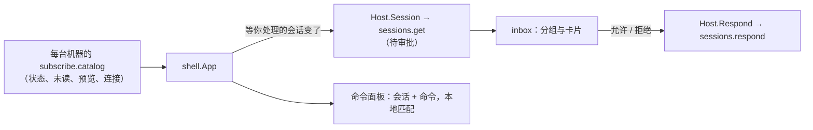

# M1 · PR9b2 收件箱与命令面板 · 详细计划

> **执行方式：** 按任务顺序执行，每一步用 `- [ ]` 勾选；每个任务结束时 `make check` 通过。本计划按任务列出文件、接口、要测的情况与 commit，代码在实现时写，基于 `4a42a2b`（PR9b 合并后）的 `main`。

**目标：** 不用逐个打开会话就能处理“等我”的事：收件箱集中列出审批、已完成待查看和出错的会话，在卡片上直接批准或拒绝；⌘K 命令面板能找到并打开任一会话、执行常用命令。后退 / 前进覆盖收件箱与新建页。

**验收（M1 总计划）：** 在收件箱里直接批准另一个会话的命令；⌘K 能找到并打开任一会话。

**架构：**



## 维护者的裁决

1. **按多台机器设计。** 客户端对每台主机各连一条、在本地汇总（[0005](../design/0005-sync-protocol.md)）。收件箱的输入是一组机器：每台的名字、是否连着、断开多久、它的会话目录与待审批；卡片记住自己属于哪台机器，动作发回那台机器。M1 只有本机一条连接，但结构不再假设只有一台，接上别的机器时只多一路输入。数据不加后端接口：目录订阅里已有状态、未读和预览；等你处理的会话用现有的 `sessions.get` 取待审批，目录里这些会话的版本变了才重取。
2. **分组：需要你 · 已完成，待查看 · 出错 · 断线。** “断线”按机器成卡：“vps 已断线 12 分钟，正在重连；重连后会话自动续上，期间的审批保留。”，下面列这台机器断开前等你处理的会话（灰掉，不能操作）。本机守护进程断开时同样出现，所以 M1 就能看到。卡片种类留出“提问”：harness 会提问后由 `sessions.get` 一并给出再加，现在两个 harness 都不提问。
3. **便捷，但不复杂：**
   - 审批卡的按钮照 harness 给的选项排，最多三个：允许一次（主按钮）· 本会话总是允许（有这一项时）· 拒绝；数字键 1–3 对应，和输入框里的审批一致。其余操作（改说法、拒绝并说明）点“打开会话”去会话里做。
   - 处理完的卡片原地显示一行结果（“已允许一次” / “已拒绝”）后收起，选中移到下一张，可以一路按 1 处理下去。
   - 待查看的卡片悬停出“标为已读”，不用打开；这一组标题右侧“全部标为已读”。
   - 键盘：↑↓ 在卡片间移动（中性灰选中），↩ 打开会话，1–3 选审批选项，⇧⌘I 打开收件箱。
   - 侧栏与 Dock 的角标都是所有机器上需要你的数量。
   - 不做：批量批准（误批风险大）、收件箱里直接回复、重试出错的轮次（没有对应接口）。
4. **命令面板的范围：** 全部 / 会话 / 命令（⌘1–3）；“文件”随 9c。命令只列已有的操作（新建会话、新建伙伴、切到 Personal / Code、收件箱、显示 / 隐藏侧栏、会话详情，以及当前会话的置顶、标为未读、重命名、在 Finder 中显示、停止、归档）；“显示右侧栏”“打开设置”随 9c 与设置页再加。会话行写机器 · 目录，多台机器时能分清。
5. **命令面板的外观：** 不用毛玻璃，照现行规则用 `popover` 底 + `line2` 细边 + 弹层阴影。
6. **先重画画板**（收件箱：空、有审批、处理后的结果、待查看、出错、断线、键盘选中；命令面板：空输入、有输入、没有匹配；深浅各一），维护者确认后再写代码。

## 全局约束

- 不新增 Go 依赖，不新增图标以外的资源；新图标只用 Lucide 1.66.0 官方 SVG（`inbox`、`search` 已有或原样下载，下载前征得同意）。
- 不改协议与存储。
- 只用 MyGO 自带的组件与做法：命令面板 `ui.Dialog` + `ui.SearchField` + `ui.List`（照 `mygo.md` 的组件对应表；`ui.List` 的强调色选中如与“选中用中性灰”冲突，照侧栏的做法自己画选中行）；快捷键用 `Shortcut`；不自己写计时器与浮层。
- 代码、注释、commit 用英文；界面文字中文；颜色只用 `theme.Colors`，字号只用 `theme.Style`。
- 视图用 `ui.Tester` 测；测试不访问网络、不碰真实的 `~/.hoplet`。
- 任何文件与 commit 都不得出现个人用户名或本机路径。
- 分支 `feat/desktop-inbox`；commit 带 DCO 签名，标题不超过 72 字符；完成前 `make check` 通过。

## 接口

```go
// shell.Host 新增：读一个会话的待审批与排队（sessions.get）。
Session(id proto.SessionID, done func(proto.SessionState))

// 收件箱的输入：每台机器一份；M1 只有本机。
type machineFeed struct {
	name         string
	connected    bool
	offlineSince time.Time
	sessions     []proto.Session
	pending      map[proto.SessionID][]proto.ApprovalRequested
}

// 收件箱的一项，记住所属机器，动作发回那台。
type inboxItem struct {
	machine  string
	kind     inboxKind // inboxApproval, inboxUnread, inboxErrored, inboxOffline（以后 inboxQuestion）
	session  proto.Session
	approval *proto.ApprovalRequested
}

// shell.App 新增（菜单栏、Dock 与快捷键调用）：
func (a *App) OpenInbox()   // ⇧⌘I
func (a *App) OpenPalette() // ⌘K

// 页面：会话、收件箱、新建页；后退 / 前进记录这三种。
type page struct {
	kind pageKind // pageSession, pageInbox, pageNew
	id   proto.SessionID
}
```

## 任务

### 任务 0：建分支

- [x] `git checkout -b feat/desktop-inbox main`

### 任务 1：画板与设计系统

- [x] 重画“5 整体效果 · 收件箱”与“4 按钮功能区 · 命令面板”，状态见“待定”第 6 点；深浅两套主题各一张。
- [x] 请维护者确认；确认前不写界面代码。
- [x] 确认后同步设计系统（新增 Inbox、CommandPalette 两个组件的 README 与 preview，`mygo.md` 对应表）与 0014（侧栏入口、收件箱、命令面板、快捷键），删掉 0014 里“搜索与收件箱随 PR9b2”的说法。
- [x] commit：`docs(desktop): design the inbox and command palette`

### 任务 2：页面与后退 / 前进

文件：`desktop/internal/shell/app.go`、`session.go`、`content.go`、`shell_test.go`。

- [ ] 把 `selected` + `s.newPage` 换成当前 `page`；`history` 记 `page`，后退 / 前进在会话、收件箱、新建页之间走；同一页不重复记。
- [ ] 测试：会话 → 收件箱 → 新建页，后退依次回到收件箱、会话，前进再回来；归档当前会话后后退跳过它。
- [ ] commit：`feat(desktop): navigate between sessions, inbox and new page`

### 任务 3：侧栏入口、快捷键与菜单

文件：`sidebar.go`、`desktop/main.go`、`icons/icons.go`、测试。

- [ ] 侧栏“新建”下面加“搜索”（`search`）与“收件箱”（`inbox`，角标 = 需要你的会话数，0 不显示）；当前页是收件箱时整行 `sel-row`。
- [ ] ⌘K 打开命令面板，⇧⌘I 打开收件箱；菜单栏“视图”加“收件箱 ⇧⌘I”“搜索 ⌘K”；Dock 右键菜单加“收件箱”。
- [ ] 测试：角标随目录里等你处理的会话数变化；点“收件箱”与 ⇧⌘I 都打开收件箱。
- [ ] commit：`feat(desktop): add search and inbox entries to the sidebar`

### 任务 4：收件箱

文件：新 `desktop/internal/shell/inbox.go`、`inbox_test.go`，`app.go`（Host 加 `Session`），`desktop/main.go`。

- [ ] 分组（纯函数 `inboxSections(feeds []machineFeed) []inboxSection`，表驱动测试）：需要你（连着的机器上状态 waiting 的会话，每个待审批一张卡）· 已完成，待查看（未读且不在“需要你”里）· 出错（状态 errored）· 断线（每台断开的机器一张卡，下面列它断开前等你处理的会话，灰掉）；组内按更新时间新的在前；空组不显示；全空时空状态一行“没有要你处理的事”。
- [ ] 待审批：进入收件箱和目录里等你处理的会话版本变化时，对这些会话调 `Host.Session`，结果按会话缓存；离开收件箱不再取。
- [ ] 卡片：harness 标志 · 标题 · 机器 · 目录 · 时间 · 打开会话；审批卡加类型图标与标题、命令或文件（等宽 `fill` 底）、最多三个选项按钮；待查看卡是预览，悬停出“标为已读”；出错卡是“出错了”加预览；断线卡是断开多久与重连说明。
- [ ] 处理后：卡片原地显示结果一行再收起（`Transition`，减少动态效果时直接去掉），选中移到下一张。
- [ ] 键盘：↑↓ 在卡片间移动（中性灰选中，可聚焦的列 + `Shortcut`），↩ 打开会话，1–3 选审批选项。
- [ ] 测试：分组与排序，含断开的机器（表驱动）；点“允许一次”发出 `sessions.respond` 且选项是单次允许；按 1 处理后选中移到下一张；“全部标为已读”与卡片上的“标为已读”发出 `sessions.update`；守护进程断开时出现断线卡且审批按钮不可用；没有任何事时显示空状态。
- [ ] commit：`feat(desktop): add the inbox`

### 任务 5：命令面板

文件：新 `desktop/internal/shell/palette.go`、`palette_test.go`。

- [ ] 匹配（纯函数）：会话按标题、目录、预览，命令按名字；不分大小写；排序：开头匹配 > 词首匹配 > 包含；“全部”里每组最多 5 条。
- [ ] 面板：`ui.Dialog`（居中、宽 600、`popover` 底）+ `ui.SearchField` + 范围 全部 / 会话 / 命令（⌘1–3 只作用于面板）；空输入时列 最近会话 · 快捷操作；行：图标 · 名字 · 灰色位置 · 快捷键；底部键帽提示 ↑↓ 选择、↩ 打开、esc 关闭；没有匹配时一行说明。
- [ ] 测试：匹配与排序（表驱动）；⌘K 输入标题的一部分、↩ 打开那个会话；在“命令”范围里执行“新建会话”打开新建页；esc 关闭且焦点回到原处。
- [ ] commit：`feat(desktop): add the command palette`

### 任务 6：收尾与真实验收

- [ ] `m1-overview.md`：9b 标为已合并，加本计划的链接。
- [ ] `make check`；重装守护进程后在真实窗口里：让一个 Claude Code 会话请求运行命令，切到另一个会话，从收件箱“允许一次”，回到原会话看到命令执行；⌘K 找到并打开任一会话。
- [ ] commit：`docs: link the PR9b2 plan`；推送并开 PR。

## 风险

- `ui.List` 选中行的强调色与“选中用中性灰”冲突：照侧栏会话列表的做法，自己画行并用 `Shortcut` 接 ↑↓。
- 等你处理的会话很多时，逐个 `sessions.get` 会慢：本机场景下会话数小；真遇到再加守护进程侧的 `inbox` 订阅（“待定”第 1 点的备选）。
- `ui.Dialog` 的默认外观与设计不符时用 `DialogBase` 自己画外框，不绕开它。
