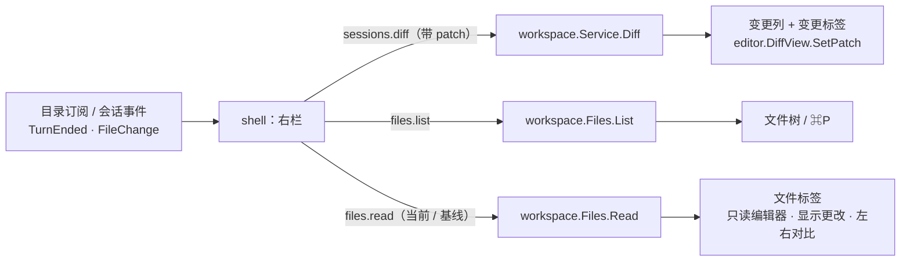

# M1 · PR9c 右栏：变更与文件 · 详细计划

> **执行方式：** 按任务顺序执行，每一步用 `- [ ]` 勾选；每个任务结束时 `make check` 通过。本计划按任务列出文件、接口、要测的情况与 commit，代码在实现时写，基于 `195d632`（PR9b2 合并后）的 `main`。

**目标：** 在桌面端看完一次会话的全部改动，并能打开会话目录里的任意文件：右栏的查看区按标签显示“变更”与文件，右列在文件树和变更之间切换；⌘P 与命令面板的“文件”范围能找到任一文件。

**验收（M1 总计划）：** 在桌面端看完一次会话的全部改动，并能打开任意文件。

**依据：** [0024](../design/0024-desktop-layout.md)“右栏”、[0014](../design/0014-desktop-ui.md)、[0022](../design/0022-workspace-snapshots.md)、[0008](../design/0008-workspace-lifecycle.md)、[0005](../design/0005-sync-protocol.md)，画板的 DeskPanelChanges、DeskPanelFiles、DeskOpenWith、DeskPanelDark 与设计系统的 RightPanel 组件。

**架构：**



## 维护者的裁决（2026-11-05）

1. **M1 只做累计。** “本次”“分支”在 0008 排在 M3，守护进程只有累计 diff；按“能力未落地的入口隐藏”，变更列不显示三段，直接列累计改动。M3 加上后再出现。
2. **去掉“打开方式”的应用列表。** MyGO 0.7.4 没有列出本机应用的接口，只有用默认应用打开（`OpenPath`）。路径栏右侧只留：显示更改 · 左右对比 · 在 Finder 中显示 · 打开方式按钮改为一个弹层：用默认应用打开、复制路径 ⌥⌘C（都只对本机会话）。等 MyGO 有接口再加回列表。
3. **变更标签用 `sessions.diff` 的 patch 画。** 一次请求拿到全部文件，每个文件 `editor.ParsePatch` + `DiffState.SetPatch`；折叠条写“N 行未改动 · 所在函数”，N 由前后两段的行号算出，不能展开。在单个文件里“显示更改 / 左右对比”另读基线和当前全文，可以展开。
4. **⌘P 与命令面板“文件”范围放进 9c。** `files.list` 能一次列出会话目录下全部未被忽略的文件（上限 20000，与快照同），桌面端本地匹配。
5. **M1 不出现：** “撤销”（M3）、终端标签与 ＋ 菜单里的“终端”（M3）、Personal 右栏（产物 M4a、触发器 M4c）。Personal 会话没有右栏开关。
6. **先补画板**（见任务 1 的状态清单），维护者确认后再写界面代码。

## 全局约束

- 不新增 Go 依赖；新图标只用 Lucide 1.66.0 官方 SVG（9c 要用的已在 #21 加入），文件图标用已有的 Material Icon Theme 5.40.0。
- 只读：守护进程新接口不写用户目录、不写用户仓库，直接读用户仓库的 git 命令只增加 `check-ignore --no-index`（同 0022 的安全环境）。
- 只用 MyGO 自带的组件与做法：`ui.Split`、`ui.Tabs` / `Segmented`、`ui.Tree`、`editor.DiffView`、只读 `editor`（`ReadOnly`）、`ui.PopoverBase`、`Shortcut`、`Transition` / `AnimateTo`；不自己写计时器与浮层。
- 尺寸、颜色、时长只取 `theme` 的 token（守卫测试）；新尺寸先进设计系统再 `go generate`。
- 代码、注释、commit 用英文；设计文档与界面文字中文；改了 `proto/` 运行 `make gen`。
- 视图用 `ui.Tester` 测；测试不访问网络、不碰真实的 `~/.hoplet`；不用 sleep 同步。
- 任何文件与 commit 都不得出现个人用户名或本机路径。
- 分支 `feat/desktop-panel`；commit 带 DCO 签名，标题不超过 72 字符；完成前 `make check` 通过。

## 接口

```go
// proto：两个只读方法。
MethodFilesList = "files.list"
MethodFilesRead = "files.read"

// FilesListParams lists a directory of a session's working directory (Path
// relative to it, "" for the root), or with All every file under it.
// Ignored also lists what .gitignore leaves out, marked as such.
type FilesListParams struct {
	Session SessionID `json:"session"`
	Path    string    `json:"path,omitempty"`
	All     bool      `json:"all,omitempty"`
	Ignored bool      `json:"ignored,omitempty"`
}

type FileKind string // "file" | "dir" | "symlink"

type FileEntry struct {
	Path    string   `json:"path"` // relative to the working directory
	Kind    FileKind `json:"kind"`
	Size    int64    `json:"size,omitempty"`
	Ignored bool     `json:"ignored,omitempty"`
}

type FileList struct {
	Session   SessionID   `json:"session"`
	Path      string      `json:"path"`
	Entries   []FileEntry `json:"entries"`
	Truncated bool        `json:"truncated,omitempty"`
}

// FilesReadParams reads one file now, or with Baseline as the session's
// baseline recorded it.
type FilesReadParams struct {
	Session  SessionID `json:"session"`
	Path     string    `json:"path"`
	Baseline bool      `json:"baseline,omitempty"`
}

// FileContent is a file's text. Binary, TooLarge and Missing leave Text
// empty; Size is the file's size when known.
type FileContent struct {
	Session  SessionID `json:"session"`
	Path     string    `json:"path"`
	Text     string    `json:"text,omitempty"`
	Size     int64     `json:"size,omitempty"`
	Binary   bool      `json:"binary,omitempty"`
	TooLarge bool      `json:"too_large,omitempty"`
	Missing  bool      `json:"missing,omitempty"`
}

// shell.Host 新增：
DiffPatch(id proto.SessionID, done func(proto.SessionDiff)) // sessions.diff，Patch: true
Files(p proto.FilesListParams, done func(proto.FileList, error))
ReadFile(p proto.FilesReadParams, done func(proto.FileContent, error))
Open(path string)     // 用默认应用打开（MyGO OpenPath）
CopyPath(path string) // 复制到剪贴板

// shell.App 新增（菜单与快捷键调用）：
func (a *App) TogglePanel()          // ⌥⌘I
func (a *App) ShowPanel(c panelColumn) // ⌥⌘E 文件树、⌥⌘D 变更
func (a *App) OpenFilePicker()       // ⌘P
```

**读取规则（写进 0008 / 0005）：**

- 路径：相对会话目录、清理后不得以 `..` 开头或为绝对路径；任一级父目录是符号链接时视为不存在（同 0022）；符号链接本身列为 `symlink`，不跟随、不读取。不在会话目录内的路径一律报错。
- 列举：一层按名字排序，目录在前；默认不列被忽略的路径和 `.git`；`Ignored` 时列出并标记。忽略按所在仓库的 `git check-ignore --no-index`（安全环境同 0022）；不在仓库里的路径不算忽略。`All` 只列文件，深度不限，跳过被忽略的目录、`.git` 与符号链接目录，最多 20000 项，超出 `Truncated`。
- 读取：只打开普通文件（`O_NOFOLLOW|O_NONBLOCK` + fstat）；大于 2 MiB 为 `TooLarge`；前 8000 字节含 NUL 或不是 UTF-8 为 `Binary`；不存在为 `Missing`。`Baseline` 从 Hoplet 私有对象库里该仓库基线的树取 blob（不读用户对象）；不在仓库里或没有基线时报错“没有基线”，基线里没有该文件为 `Missing`（新文件）。
- 刷新：同 `sessions.diff`，客户端在 `TurnEnded` / `FileChange` 后重新请求展开着的目录、打开着的文件与变更；不新增事件。

## 任务

### 任务 0：建分支

- [x] `git checkout -b feat/desktop-panel main`

### 任务 1：设计同步与画板补齐

- [ ] 0024“右栏”与“M1 范围”：裁决 1、2、5 写进去（M1 不显示范围三段、撤销、终端；打开方式弹层只有用默认应用打开、复制路径）；0008“当前目录与隔离边界”的文件 / diff 行与 0005 的方法表加 `files.list` / `files.read` 及上面的读取规则；0019 的 M1 交付边界同步。
- [ ] 画板补 M1 状态（深浅各一）：变更列无三段；无改动（“没有改动”）；目录不是 git 仓库（变更列一行说明，文件树照常）；基线缺失（变更列写原因）；文件标签：二进制、超过 2 MiB、已删除、读取失败；文件树：加载中、空目录、列举被截断；⌘P 与命令面板“文件”范围（有结果、无匹配）；打开方式弹层的新内容；右栏收起时标题栏的 `panel-right` 按钮。
- [ ] 请维护者确认；确认后同步设计系统的 RightPanel 组件 README / preview 与 `mygo.md` 对应表。
- [ ] commit：`docs(design): settle the right panel for M1`

### 任务 2：协议

文件：`proto/api.go`、`proto/api_test.go`、`testdata/vectors/`、生成的 Swift 类型。

- [ ] 加上面的类型与方法常量；JSON 往返测试（表驱动，含 `omitempty` 的空值）；`make gen` 更新向量与 Swift。
- [ ] commit：`feat(proto): add read-only file listing and reading`

### 任务 3：守护进程的文件读取

文件：新 `internal/workspace/files.go`、`files_test.go`；`internal/workspace/git.go`（`check-ignore`、读基线 blob）；`internal/daemon/methods.go` 与测试。

- [ ] `List`、`Read` 按“读取规则”实现；基线 blob 用 Hoplet 自己的对象目录 `cat-file`，不碰用户对象库。
- [ ] 测试（临时目录 + 临时 git 仓库）：根目录与子目录排序；被忽略的默认不列、`Ignored` 时标记；`.git` 不列；`..`、绝对路径、经符号链接父目录的路径报错；符号链接列出不跟随；`All` 跳过被忽略目录并在超过上限时 `Truncated`；读取文本、二进制、超大、不存在；FIFO 不卡住；基线读取：改过的文件拿到旧内容、新文件 `Missing`、非仓库路径报错；用户仓库的 `.git` 在调用前后不变（对象、index、refs）。
- [ ] 守护进程：两个方法按会话目录调用；未知会话报错；测试走现有的方法测试。
- [ ] commit：`feat(workspace): list and read a session's files`

### 任务 4：右栏外框

文件：新 `desktop/internal/shell/panel.go`、`panel_test.go`；`app.go`、`content.go`、`desktop/main.go`（菜单与快捷键）。

- [ ] 右栏：宽取 `layout.json`（默认 640，可拖 420–960，`ui.Split`）；默认收起，⌥⌘I 与标题栏 `panel-right` 开合，`Smooth` 尺寸过渡加裁切；正文区窄于 560 时自动收起；只对 Code 会话出现。
- [ ] 查看区标签栏（高 44）：标签 = 图标 + 名字，当前 `raised` 底、`ui-medium`、带 ✕；＋ 菜单只有“文件 ⌘P”；最右 ⤢ 放大到占满正文区（再按或 ⎋ 还原）。没有标签时查看区空状态。
- [ ] 右列（宽 220 文件树 / 260 变更）：顶栏与标签栏同高，切换 文件树 / 变更（带改动数），最右收起右栏；⌥⌘E / ⌥⌘D 打开右栏并切到对应列。边界只在右栏左边与右列左边各一条 `line`。
- [ ] 菜单栏“视图”：右栏 ⌥⌘I、文件树 ⌥⌘E、变更 ⌥⌘D、打开文件 ⌘P；“编辑”：复制路径 ⌥⌘C（有打开的文件时）。
- [ ] 测试：⌥⌘I 开合；窄窗口自动收起；Personal 会话没有右栏；切会话时右栏状态按会话保留（打开的标签、所选列）。
- [ ] commit：`feat(desktop): add the right panel frame`

### 任务 5：变更

文件：新 `desktop/internal/shell/changes.go`、`changes_test.go`；`session.go`（改动卡点文件）。

- [ ] 变更列：汇总“N 个文件 · +a −b”· 每个仓库一节（仓库名 · 分支 · 合计；无改动写“无改动”；`error` / `missing` 写原因）· 按目录成树（`ui.Tree`，行高 24、缩进 16，状态 M / A / D / R，M、R 中性灰）。点文件打开唯一的“变更”标签并滚到该文件。
- [ ] 变更标签：所有改动文件的 diff 连续排开（每个文件一个 `DiffState.SetPatch`，`FitContent`，外层一个滚动视图）；文件标题行 ⌄ · 状态 · 文件图标 · 文件名 · 目录 · +/− · 打开文件；折叠条用 `RenderSeparator`：由相邻 hunk 的行号算“N 行未改动”，后接 hunk 头里的函数名；标题行与折叠条不铺底；增删行 `add-bg` / `del-bg` + 3 宽竖条（`DiffBars`）。二进制、带 filter、被截断的文件各一行说明。
- [ ] 刷新：打开右栏、`TurnEnded`、`FileChange` 时请求，`sha` 不变的仓库不重建。
- [ ] 正文区改动卡：点文件打开右栏的变更标签并滚到该文件（9b 留下的）。
- [ ] 测试：分组与汇总（纯函数，表驱动：多仓库、子仓库、无改动、出错、重命名）；N 行未改动的计算（表驱动，含首尾）；点变更列的文件滚到对应文件；sha 不变不重建；点改动卡的文件打开变更标签。
- [ ] commit：`feat(desktop): show a session's changes in the panel`

### 任务 6：文件树与文件查看

文件：新 `desktop/internal/shell/files.go`、`fileview.go`、测试。

- [ ] 文件树：筛选框（⌘P 聚焦，占满一行）+ 显示被忽略的文件（开关）；根是会话目录；按层懒加载（展开时 `files.list`）；行高 24、缩进 16；有改动的文件加粗、行尾 M / A / D，目录行尾改动数；当前文件 `sel-row`；Material 文件图标。
- [ ] 文件标签：路径栏（高 32）仓库 › 目录 › 文件名；右侧 显示更改 · 左右对比 · 在 Finder 中显示 · 打开方式弹层（用默认应用打开、复制路径 ⌥⌘C）；正文是只读 `editor`（语法高亮，`code` 样式）。“显示更改”读基线后用 `DiffUnified`，“左右对比”用 `DiffSplit`，都可以展开；文件没有改动时两个按钮不出现。二进制、过大、已删除、读取失败各显示一行说明（画板定）。
- [ ] 刷新：`TurnEnded` / `FileChange` 后重读打开着的文件与展开着的目录。
- [ ] 测试：展开目录才请求；显示被忽略的文件后请求带 `Ignored`；点文件打开标签、再点同一文件不重复开；显示更改发出基线读取；二进制 / 过大的说明；复制路径与用默认应用打开调用 Host。
- [ ] commit：`feat(desktop): browse and read a session's files`

### 任务 7：⌘P 与命令面板的“文件”

文件：`palette.go`、`palette_test.go`。

- [ ] 命令面板加范围“文件”（⌘4），⌘P 直接打开到这个范围；第一次打开时 `files.list` + `All`，之后在 `TurnEnded` / `FileChange` 后失效重取；匹配按文件名 > 路径，规则同会话；行：文件图标 · 文件名 · 灰色目录；↩ 打开文件标签。列表被截断时底部一行说明。
- [ ] 测试：匹配与排序（表驱动）；⌘P 输入文件名一部分、↩ 打开该文件；截断说明。
- [ ] commit：`feat(desktop): find files from the palette`

### 任务 8：收尾与真实验收

- [ ] `m1-overview.md`：9b2 标为已合并，9c 行按裁决 2 更新，加本计划的链接。
- [ ] `make check`；重装守护进程后在真实窗口里（深浅两套）：让 Claude Code 在一个两仓库的目录里改几处文件，在右栏看完全部改动；从文件树和 ⌘P 各打开一个文件，显示更改、左右对比；核对动效与减少动态效果。
- [ ] commit：`docs: link the PR9c plan`；推送并开 PR。

## 风险

- 很多文件的连续 diff：每个文件一个 `FitContent` 的 `DiffView`，大 patch 可能卡；先按 0022 的响应上限（单仓库 patch ≤ 3 MiB）实测，真卡再改成只建视口附近的文件（`ui` 的虚拟列表），不自己画。
- `check-ignore --no-index` 会把已跟踪但匹配忽略规则的文件也标成忽略：M1 接受，在 0008 写明。
- `editor` 只读模式的外观（行号、光标）与画板不符时，用它的 `Theme` 与选项调整；做不到就提设计改动。
