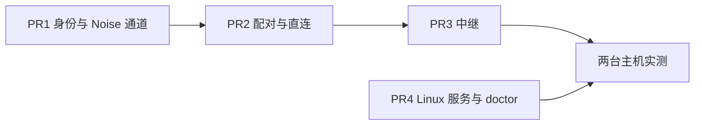

# M2a 安全网络 · 总计划

**目标：** 两台自有主机（Mac 与海外 Linux VPS）互相配对后，在一台上用 CLI 经直连或海外中继操作另一台的会话：认证连接、事件追赶、断线恢复，与本机使用同一套客户端协议。

**验收（交付路线）：** 两台自有主机可认证连接并追赶事件；拒绝重放、已吊销设备和未配对主机；路由切换不新增信任。

**依据：** [设计总览](../README.md)，以及 [0006](../design/0006-connectivity-security.md)、[0002](../design/0002-process-model.md)、[0005](../design/0005-sync-protocol.md)、[0013](../design/0013-testing-release.md)、[0019](../design/0019-delivery-roadmap.md)。

**前置：** M1 代码已合入，`make check` 在 `3e084ce`（#22 合并后）通过；M1 整体验收（两种模式完整本机操作）由维护者确认。

## 维护者的裁决（2026-11-07）

1. **Noise 用 `flynn/noise`。** Go 侧用第三方参考实现，M2b 的 Swift 手写实现由 Go 生成的向量独立核对。
2. **M2a 的客户端是 CLI。** 全局 `--host <名字>` 让 CLI 连另一台主机；桌面端多机器（“全部机器 ▾”范围、新建页选机器、断线卡）先上画板审核，另起 PR。
3. **局域网 Bonjour 随 M2b。** M2a 只有两条路由：手动配置的直连地址、海外中继（主域名 → 备用域名）。iOS 侧用系统 Network.framework 发现，Go 侧届时只做广播。
4. **中继证书内置 autocert。** `hoplet relay` 用 `x/crypto/acme/autocert` 自己申请 Let's Encrypt 证书，不需要反向代理。
5. **中继注册用 Noise XN 握手证明持有主机密钥。** X25519 不能签名；不另加 Ed25519 密钥。
6. **中继只接受白名单里的主机。** `hoplet relay allow <主机 ID>`；客户端可以请求连接任一已注册主机，由守护进程按 IK 拒绝未配对设备。
7. **中继每个客户端一条 WSS。** 守护进程保持一条控制连接；有客户端到来时中继通知，守护进程为它新拨一条 WSS，中继两头对接、逐条转发，不做多路复用。
8. **推迟：** 配对二维码（M2b，M2a 打印文本配对码）；按实测延迟与丢包定主备（M2a 按配置顺序尝试，后台探测前面的路由，能通就切回）；Swift 跨语言向量（M2b）。

## 全局约束

- 新增依赖仅限下表；表外的依赖要另行同意。

| 依赖 | 版本 | 用途 | 引入于 |
|---|---|---|---|
| `github.com/flynn/noise` | v1.1.0 | Noise IK / IKpsk2 / XN 握手与传输 | PR1 |
| `golang.org/x/crypto` | v0.58.0 | flynn/noise 的密码原语；中继的 `acme/autocert` | PR1 |

- 加密与认证全在应用层；直连与中继只搬运字节。中继不缓存、不解密、不记录载荷。
- 远程连接里跑的仍是现有 `/v1` 客户端协议（hello、订阅、请求、回执），只把传输换成 Noise 通道；不另起一套远程 API。
- 测试不访问网络、不碰真实的 `~/.hoplet`、不申请真实证书；不用 sleep 同步。
- 代码、注释、commit 用英文；本目录下的计划用中文。

## 协议

### 身份与配对

| 项 | 方案 |
|---|---|
| 身份密钥 | 每个 `HOPLET_HOME` 一对长期 X25519 密钥，`keys/identity`，0600；守护进程作响应方、本机 CLI 作发起方都用它 |
| 主机 ID | 公钥 SHA-256 的前 16 字节，小写 base32 无填充；显示名默认系统主机名 |
| 发起配对 | 主机 B：`hoplet pair` 经本机 API `pairing.start` 让守护进程生成一次性 32 字节 PSK（只存内存，10 分钟，用一次即作废），打印配对码 `hoplet1:` + base64url（主机 ID、主机公钥、路由、PSK、过期时间） |
| 加入 | 主机 A：`hoplet host add <配对码> [--name]`，以 `Noise_IKpsk2_25519_ChaChaPoly_BLAKE2s` 握手；首条消息载荷带设备名。B 记下 A 的公钥（`devices`），A 记下 B 的公钥、路由与名字（`hosts`） |
| 日常连接 | `Noise_IK_25519_ChaChaPoly_BLAKE2s`；守护进程在第一条消息解出发起方公钥后，未配对或已吊销即断开 |
| prologue | `hoplet/1`，协议版本绑进握手；只有这一个版本 |
| 吊销 | `hoplet device list / revoke <ID>`；吊销立刻断开该设备的在线连接。`hoplet host list / remove` 管理本机已知的主机 |

### 通道帧

- 一条 WebSocket 二进制消息正好是一条 Noise 传输消息；Noise 隐式计数器使重放、乱序、篡改都解密失败，失败即断开。
- 现有 hello 在 Noise 通道里照旧发送，不带 token；设备身份取 Noise 握手认证的公钥，忽略客户端自报的设备 ID。
- 端到端回声：通道层 ping / pong 每 15s 一次，10s 无回应断开；中继与 WebSocket 的每段心跳另行保留。
- 守护进程把现有连接改为建在“帧连接”抽象上：本机 WebSocket 与 Noise 通道是它的两种实现，订阅、背压、回执逻辑不变。

### 路由

| 路由 | 方案 |
|---|---|
| 直连 | 守护进程可选监听 `network.listen`（`config.toml`，默认关），明文 WebSocket `/v1/noise`，拒绝非空 `Origin`；Noise 负责加密与认证 |
| 中继 | `wss://<域名>/v1/host`（守护进程控制连接，XN 握手证明主机身份，必须在白名单里）、`/v1/connect?host=<ID>`（客户端）、`/v1/accept?stream=<令牌>`（守护进程为某个客户端回拨） |
| 顺序 | 主机记录里的路由按序尝试：直连地址 → 中继主域名 → 中继备用域名；连在后面的路由时每 60s 探测前面的路由，能通就新建连接、按游标重新订阅、再关旧连接（追赶保证不丢不重） |
| 守护进程侧 | 配置 `network.relays`（按序的中继 URL）后保持控制连接，断开按 1s 起倍增至 30s 重连 |

### 中继

| 项 | 方案 |
|---|---|
| 命令 | `hoplet relay --domain <域名> [--domain <备用域名>]`，数据目录放证书缓存与白名单 |
| 证书 | `autocert`，`HostPolicy` 只放行配置的域名；监听 443（ACME 用 TLS-ALPN-01，不需要 80） |
| 白名单 | `hoplet relay allow / deny / list`，按主机 ID |
| 转发 | 两头各一条 WSS，逐条转发二进制消息，读一条写一条，不排队；任一头断开即两头关闭 |
| 限制 | 每主机并发流、每 IP 待接入连接、等待守护进程回拨 10s，超出拒绝；数值在实现里定并写测试 |
| 可见 | 只见密文、主机 ID、客户端 IP 与流量大小；日志不记载荷 |

## PR 拆分与顺序

PR4 与 PR1–PR3 互不依赖，可以并行开发。

| PR | 标题 | 主要内容 | 验收 |
|---|---|---|---|
| 1 | `feat(noise): add identity keys and Noise channel` | `internal/noise`：身份密钥生成与读取（权限检查）、主机 ID；IK / IKpsk2 / XN 握手封装；分片帧、ping / pong；通道建在“收发一条消息”的接口上 | 握手往返；重放、乱序、篡改、错误 PSK、过期配对码、未知静态公钥均失败；大于 64 KiB 的帧分片往返一致；身份文件权限过宽拒绝 |
| 2 | `feat(daemon): pair devices and accept them over Noise` | 存储迁移：`devices`、`hosts`；守护进程连接改建在帧连接上；`pairing.start`、`devices.list / revoke`；`network.listen` 直连监听；`internal/client` 远程拨号；CLI `pair`、`host add/list/remove`、`device list/revoke`、全局 `--host` | 本机起两个 `HOPLET_HOME` 的守护进程：配对后经直连跑通一次假 harness 会话；断线后按游标追赶无缺无重；吊销后在线连接立刻断开、重连被拒；未配对公钥被拒 |
| 3 | `feat(relay): add relay with autocert` | `hoplet relay`、白名单命令；守护进程控制连接（XN）与回拨；客户端经中继拨号；路由顺序、后台探测与切回 | 测试里用本地 TLS 证书起中继：经中继跑通会话；不在白名单的主机注册被拒；中继看到的都是密文；中继重启后守护进程与客户端自动恢复；直连恢复后切回直连且不丢事件 |
| 4 | `feat(cli): install daemon and relay as Linux services` | `daemon install/uninstall/status` 支持 systemd 用户服务（未开 linger 时提示 `loginctl enable-linger`，不代跑 sudo）；`relay install` 以 root 写系统服务（`AmbientCapabilities=CAP_NET_BIND_SERVICE`）；`doctor` 加身份密钥、监听、中继连通 | Linux 上生成的 unit 文件 golden 一致；未开 linger 有明确提示；macOS 行为不变 |

**两台主机实测（PR3、PR4 之后）：** Mac 与 VPS 配对；Mac 合盖再开、切换网络、VPS 守护进程重启时，`hoplet --host vps session watch` 都能续上；记录经中继的流式延迟（0013 预算 p95 < 400ms）。

## 关键假设的验证点

| 假设 | 在哪验证 | 不成立时 |
|---|---|---|
| 国内到海外 VPS 的 WSS:443 稳定可用 | PR3 后实测 | 启用备用域名经 Cloudflare 代理；仍不稳定则重新讨论 0006 |
| autocert 用 TLS-ALPN-01 能在只开 443 的 VPS 上签发 | PR3 部署 | 改用 HTTP-01 并开放 80 |
| 现有订阅与背压逻辑在 Noise 通道上不变 | PR2 | 停下，重新讨论 0005 |

## 每个 PR 的详细计划

开工某个 PR 前，在本目录写 `m2a-prN-<名称>.md`：逐步列出文件、接口、测试、命令和 commit，基于当时 `main` 的真实代码。
