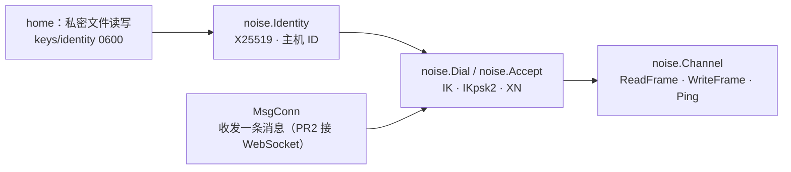

# M2a · PR1 身份密钥与 Noise 通道 · 详细计划

> **执行方式：** 按任务顺序执行，每一步用 `- [ ]` 勾选；每个任务结束时 `make check` 通过。本计划按任务列出文件、接口、要测的情况与 commit，代码在实现时写，基于 `9527dae`（#23 合并后）的 `main`。

**目标：** 提供一条与传输无关的加密通道：每个 `HOPLET_HOME` 一把长期身份密钥；在“收发一条消息”的连接上完成 IK（日常）、IKpsk2（配对）、XN（中继注册）三种握手；握手后按帧收发任意长度的数据，并有端到端 ping / pong。PR1 不接入守护进程、不开监听、不改客户端协议。

**验收（M2a 总计划）：** 握手往返；重放、乱序、篡改、错误 PSK、未知静态公钥均失败；大于 64 KiB 的帧分片往返一致；身份文件权限过宽拒绝。

**依据：** [M2a 总计划](m2a-overview.md)、[0006](../design/0006-connectivity-security.md)、[0013](../design/0013-testing-release.md)。

**架构：**



## 维护者的裁决（2026-11-07）

1. **哈希用 SHA256。** 套件为 `25519_ChaChaPoly_SHA256`：iOS 的 CryptoKit 自带 Curve25519、ChaChaPoly、SHA256，没有 BLAKE2s；Swift 只需实现 Noise 状态机。0006 与总计划同步改正。

## 全局约束

- 新增依赖：`github.com/flynn/noise` v1.1.0、`golang.org/x/crypto` v0.58.0（总计划已同意）。X25519 密钥生成与公钥推导用标准库 `crypto/ecdh`。
- 包名 `internal/noise`；导入第三方库时用别名 `fnoise`。
- 测试不访问网络、不碰真实的 `~/.hoplet`（`t.TempDir()`）；不用 sleep 同步；全部 `-race`。
- 握手的随机源可注入（`fnoise.Config.Random`），测试里用确定的随机源复现握手；生产代码只用 `crypto/rand`。
- 不 panic；错误用 `%w` 包装，对外的失败原因是包内哨兵错误，调用方用 `errors.Is` 判断。

## 协议细节

| 项 | 规则 |
|---|---|
| 套件 | `Noise_IK_25519_ChaChaPoly_SHA256`、`Noise_IKpsk2_25519_ChaChaPoly_SHA256`、`Noise_XN_25519_ChaChaPoly_SHA256` |
| 握手类型 | 发起方第一条消息前加 1 字节类型：`1` 日常 IK、`2` 配对 IKpsk2、`3` 中继注册 XN；未知类型立即失败。路由（直连路径、中继）不必区分握手 |
| prologue | `hoplet/1` 后接类型字节；版本与类型都绑进握手，被改即握手失败 |
| 身份 | 32 字节 X25519 私钥，十六进制一行存 `keys/identity`（目录 0700、文件 0600），公钥由私钥推导、不另存 |
| 主机 ID | `SHA-256(公钥)` 前 16 字节，小写 base32 无填充（26 个字符） |
| 响应方放行 | IK / IKpsk2 读完第一条消息、XN 读完第三条消息后，用对方静态公钥与首条载荷调用放行函数；拒绝即关闭连接，不回第二条消息 |
| 首条载荷 | IK 为空；IKpsk2 带发起方的显示名（UTF-8，≤ 64 字节）；XN 为空 |
| PSK | 32 字节；响应方在读第一条消息前从调用方取得 |
| 握手消息大小 | 每条 ≤ 65535 字节，超出视为失败 |
| 传输消息 | 一条底层消息 = 一条 Noise 传输消息：密文 = 1 字节标志 + 片段 + 16 字节标签 |
| 标志 | `0` 帧的最后一片、`1` 后面还有、`2` ping（8 字节随机数）、`3` pong（原样回同一随机数）；其他值立即失败 |
| 片段上限 | 65535 − 16 − 1 = 65518 字节 |
| 帧上限 | 组装后默认 16 MiB（与 shim payload 上限一致），可配置；超出失败 |
| 重放 / 乱序 / 篡改 | Noise 隐式计数器，解密失败即通道失败；不重试、不跳过 |

## 文件

| 文件 | 内容 |
|---|---|
| `internal/home/home.go` | 抽出私密文件的读（拒绝组 / 其他权限位）与“一次性原子创建”，`ReadToken` / `EnsureToken` 改用它；加 `IdentityFile(home)` |
| `internal/home/home_test.go` | 私密文件：权限过宽拒绝、并发创建只有一份、已存在则读回 |
| `internal/noise/doc.go` | 包说明：握手类型、帧格式、身份文件 |
| `internal/noise/identity.go` | `Identity`、`HostID`、`EnsureIdentity`、`LoadIdentity`、`IDOf` |
| `internal/noise/identity_test.go` | |
| `internal/noise/handshake.go` | `Kind`、`MsgConn`、`DialConfig`、`AcceptConfig`、`Dial`、`Accept`、哨兵错误 |
| `internal/noise/handshake_test.go` | |
| `internal/noise/channel.go` | `Channel`：`ReadFrame`、`WriteFrame`、`Ping`、`Close`、`Peer` |
| `internal/noise/channel_test.go` | |
| `internal/noise/pipe_test.go` | 测试用内存 `MsgConn` 对，可截获、丢弃、重复、篡改、交换消息 |
| `go.mod` / `go.sum` | 两个新依赖 |

## 接口（后续 PR 依赖）

```go
package noise

// Identity is this home's long-term X25519 key pair.
type Identity struct{ /* private key, public key */ }

func EnsureIdentity(home string) (Identity, error) // create keys/identity once, 0600
func LoadIdentity(home string) (Identity, error)   // refuse group / other bits
func (Identity) Public() []byte
func (Identity) ID() HostID

// HostID names a host or device by its public key.
type HostID string

func IDOf(pub []byte) (HostID, error) // error when pub is not 32 bytes

// Kind is the handshake a connection opens with.
type Kind byte

const (
	KindDaily Kind = 1 // Noise IK
	KindPair  Kind = 2 // Noise IKpsk2
	KindRelay Kind = 3 // Noise XN, initiator proves its key to a relay
)

// MsgConn carries whole messages; PR2 adapts a WebSocket to it.
type MsgConn interface {
	ReadMessage(ctx context.Context) ([]byte, error)
	WriteMessage(ctx context.Context, p []byte) error
	Close() error
}

type DialConfig struct {
	Identity   Identity
	Kind       Kind
	PeerStatic []byte // responder's public key; required for KindDaily and KindPair
	PSK        []byte // KindPair only
	Payload    []byte // first-message payload (KindPair: display name)
	MaxFrame   int    // 0 means 16 MiB
}

type AcceptConfig struct {
	Identity Identity     // unused by KindRelay responders
	Kinds    []Kind       // kinds this listener takes; others fail with ErrKind
	PSK      func() []byte // KindPair: the live pairing secret, nil when none
	// Allow decides after the initiator's static key is known; an error
	// refuses the connection and is returned from Accept wrapped.
	Allow    func(kind Kind, peer []byte, payload []byte) error
	MaxFrame int
}

func Dial(ctx context.Context, c MsgConn, cfg DialConfig) (*Channel, error)
func Accept(ctx context.Context, c MsgConn, cfg AcceptConfig) (*Channel, Kind, error)

// Channel is safe for one reader and many writers.
func (*Channel) Peer() []byte                                // nil for a KindRelay initiator
func (*Channel) ReadFrame(ctx context.Context) ([]byte, error) // answers pings itself
func (*Channel) WriteFrame(ctx context.Context, p []byte) error
func (*Channel) Ping(ctx context.Context) error // waits for the pong; needs a running reader
func (*Channel) Close() error

var (
	ErrKind      = errors.New("noise: unknown or unaccepted handshake kind")
	ErrHandshake = errors.New("noise: handshake failed")
	ErrRefused   = errors.New("noise: peer refused")
	ErrDecrypt   = errors.New("noise: message failed to decrypt")
	ErrFrame     = errors.New("noise: bad frame")
	ErrTooLarge  = errors.New("noise: frame too large")
)
```

`Accept` 在写完最后一条握手消息后返回。IK 的第一条消息可以被重放，但重放者拿不到会话密钥，第一帧必然解密失败；后续 PR 只在第一帧（hello）解出后才把设备记为在线。

## 任务

### 任务 0：建分支

- [ ] 从 `main` 建 `feat/noise-channel`；`go get github.com/flynn/noise@v1.1.0 golang.org/x/crypto@v0.58.0`，`go mod tidy`，确认 `go.mod` 只多这两项（及其间接依赖）。

### 任务 1：私密文件与身份密钥

**文件：** `internal/home/home.go`、`internal/home/home_test.go`、`internal/noise/doc.go`、`internal/noise/identity.go`、`internal/noise/identity_test.go`

**要测的情况：**

- `home`：私密文件有组 / 其他权限位时读取失败，提示 `chmod 600`；不存在时创建，内容完整、权限 0600、所在目录 0700；20 个 goroutine 并发创建只得到同一份内容；现有 token 测试不改仍通过。
- `EnsureIdentity` 两次返回同一把密钥；文件是一行 64 个十六进制字符；内容不是 32 字节、不是十六进制时报明确错误；`LoadIdentity` 在文件不存在时返回包装的 `os.ErrNotExist`。
- 公钥与 `crypto/ecdh` 推导一致；`IDOf` 对 RFC 7748 的测试公钥给出固定的 26 字符 ID（golden）；非 32 字节报错。

**commit：** `feat(noise): add identity keys and host IDs`

### 任务 2：握手

**文件：** `internal/noise/handshake.go`、`internal/noise/handshake_test.go`、`internal/noise/pipe_test.go`

**要测的情况**（表驱动，三种类型都跑）：

- 往返：双方得到对方静态公钥（XN 的发起方没有）；`Allow` 收到正确的类型、公钥与载荷；`Accept` 返回的类型正确。
- 未知类型字节、`Kinds` 里没有的类型 → `ErrKind`，响应方不回任何消息。
- IK：发起方用了错误的响应方公钥 → 响应方 `ErrHandshake`；`Allow` 拒绝（未配对 / 已吊销）→ 响应方返回包装了 `Allow` 错误的 `ErrRefused`，发起方读到连接关闭而失败。
- IKpsk2：PSK 不同 → `ErrHandshake`；`PSK()` 返回 nil（没有进行中的配对）→ `ErrRefused`；载荷超过 64 字节发起方直接报错。
- XN：`Allow` 拿到的是发起方公钥；拒绝时返回 `ErrRefused`。
- prologue：把第一条消息的类型字节从 1 改成 2 后转发 → 失败（不能把日常握手当配对握手接受）。
- 篡改握手消息任意一个字节 → `ErrHandshake`；截断 → `ErrHandshake`；超过 65535 字节 → `ErrHandshake`。
- `ctx` 取消或超时时 `Dial` / `Accept` 立即返回并关闭连接，不留 goroutine（不引入新依赖，用 `runtime.NumGoroutine` 前后对比）。
- 确定的随机源下，同一配置两次握手的消息字节完全相同（为 M2b 生成向量预备，不落盘）。

**commit：** `feat(noise): add IK, IKpsk2 and XN handshakes`

### 任务 3：通道与帧

**文件：** `internal/noise/channel.go`、`internal/noise/channel_test.go`

**要测的情况：**

- 帧往返：0 字节、1 字节、65518、65519、1 MiB、16 MiB 整（成功）、16 MiB + 1（`ErrTooLarge`，读方在累计超限时就失败，不先攒完）。
- 多个 goroutine 并发 `WriteFrame`，每帧完整、不交错（分片在锁内整帧发出）。
- 重放：截获一条传输消息再发一次 → `ErrDecrypt`；交换两条的顺序 → `ErrDecrypt`；丢掉一条 → 下一条 `ErrDecrypt`；改一个字节 → `ErrDecrypt`。失败后通道关闭，后续读写都返回同一错误。
- 未知标志、ping / pong 的随机数不是 8 字节 → `ErrFrame`。ping / pong 可以插在一帧的片段之间，读方处理后继续组装该帧。
- `Ping`：对方在读时返回 nil；对方不读、`ctx` 到时返回 `ctx` 的错误；pong 的随机数不匹配被忽略、不算应答；通道关闭时等待中的 `Ping` 立即返回错误。
- `Close` 后 `ReadFrame` / `WriteFrame` 返回 `net.ErrClosed`；重复 `Close` 不报错。
- 竞态：一个读者、多个写者、并发 `Ping` 与 `Close`，`-race` 干净。

**commit：** `feat(noise): add framed channel with ping`

### 任务 4：同步设计文档、全量检查

- [ ] 0006 与总计划中的套件已在本计划合入时改为 SHA256；实现与本文“协议细节”有出入时，先改本文与 0006 再合入。
- [ ] `make check`，报告真实输出。
- [ ] 在本文末尾追加“实现与计划的差异”。
- [ ] 推送并开 PR：`feat(noise): add identity keys and Noise channel`。

## 完成标准

- `internal/noise` 有上述接口与测试，`make check` 通过。
- 没有任何守护进程、CLI、客户端协议的行为变化；`go.mod` 只多两个直接依赖。
- 总计划 PR1 的验收项全部有对应测试（“过期配对码”属于配对码格式，随 PR2）。
