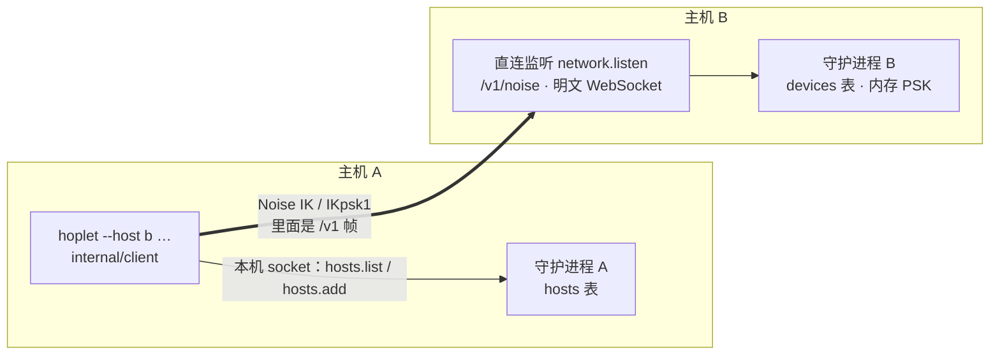

# M2a · PR2 配对与直连 · 详细计划

> **执行方式：** 按任务顺序执行，每一步用 `- [ ]` 勾选；每个任务结束时 `make check` 通过。本计划按任务列出文件、接口、要测的情况与 commit，代码在实现时写，基于 `f3bcabd`（#25 合并后）的 `main`。

**目标：** 两个 `HOPLET_HOME` 的守护进程之间完成配对，并经直连地址用 CLI 操作对方的会话：主机 B 出文本配对码，主机 A 的 CLI 以 IKpsk1 加入；之后 `hoplet --host <名字> session …` 以 IK 连 B，跑的仍是现有 `/v1` 客户端协议。设备可列出、吊销；吊销立刻断开在线连接。

**验收（M2a 总计划）：** 过期或已用过的配对码被拒；本机起两个 `HOPLET_HOME` 的守护进程：配对后经直连跑通一次假 harness 会话；断线后按游标追赶无缺无重；吊销后在线连接立刻断开、重连被拒；未配对公钥被拒。

**依据：** [M2a 总计划](m2a-overview.md)、[PR1 计划](m2a-pr1-noise.md)、[0005](../design/0005-sync-protocol.md)、[0006](../design/0006-connectivity-security.md)、[0013](../design/0013-testing-release.md)。

**架构：**



- 守护进程与客户端的连接都改建在“帧连接”上：本机 WebSocket 文本消息与 Noise 通道是它的两种实现，订阅、背压、回执逻辑不变。
- CLI 自己读 `keys/identity` 拨号；主机记录放 A 的守护进程，经本机 API 读写。

## 维护者的裁决（2026-11-07）

1. **CLI 拨号，守护进程存主机。** `hoplet host add` 与 `--host` 由 CLI 读身份密钥、直接与 B 握手；主机记录在 A 的守护进程 `hosts` 表，经本机 API `hosts.add / list / remove` 读写。用 `--host` 需要 A 的守护进程在跑；M4e 的守护进程互调复用这张表。
2. **路由来自配置 `network.routes`。** `config.toml` 写 `network.routes = ["ws://203.0.113.5:7443"]`；`hoplet pair` 把它写进配对码，为空时拒绝并提示怎么配。PR3 起中继也进配对码的路由。
3. **`session watch` 在 PR2 自动重连。** 断开后按 1s 起倍增至 30s 重拨，以已打印的最后一个 seq 重新订阅；本机与远程一样。
4. **远程设备可列出、吊销设备，不能发配对码。** 按 0006“任一已配对设备上吊销”：`devices.list / revoke` 本机与远程都可调；`pairing.start` 与 `hosts.*` 只限本机连接。会话相关方法本机与远程一致。

## 全局约束

- 不加新依赖：WebSocket 用现有 `github.com/coder/websocket`，Noise 用 PR1 的 `internal/noise`。
- 测试只用回环地址（`127.0.0.1:0`），不访问外网、不碰真实的 `~/.hoplet`；不用 sleep 同步；全部 `-race`。
- 本机路径（Unix socket + token）的行为与现有测试不变；新代码不改 `/v1` 的方法语义。
- 不 panic；错误用 `%w` 包装；对用户的提示写 Hoplet，命令与路径小写。

## 协议细节

### 配对

| 项 | 规则 |
|---|---|
| 发码 | 本机 API `pairing.start` → `{code, expires_at}`；守护进程生成 32 字节 PSK，只存内存，10 分钟有效；再次 `pairing.start` 作废上一个；守护进程重启即失效 |
| 前提 | `network.routes` 非空，否则 `pairing.start` 返回 `invalid`，提示在 `config.toml` 配置 `network.routes`（以及 `network.listen`） |
| 配对码 | `hoplet1:` + base64url（无填充）的紧凑 JSON：`{"id","key","name","routes","psk","exp"}`；`name` 为 B 的显示名（默认系统主机名）；`key`、`psk` 为 base64url，`exp` 为 Unix 秒；解码时 `id` 必须等于 `IDOf(key)`，否则视为损坏 |
| 加入（A） | 解码 → 本地先查过期（过期直接报错，不拨号）→ 读身份密钥 → 按序尝试路由，以 `KindPair`、首条载荷为本机显示名（主机名，截到 64 字节的 UTF-8 边界）握手 → 通道里照常 `hello`，核对 `host_id` → 以 `--name` 或配对码里的名字，`hosts.add` 记入 A 的守护进程 |
| 放行（B） | `PSK()` 返回未过期、未用过的 PSK；`Allow` 在 PSK 已验证后执行：当前 PSK 仍是握手所用的那个才放行，并立即作废它（一次性）；记下设备公钥与显示名（显示名为空或非 UTF-8 → 拒绝）。同一公钥再次配对：更新名字、清除吊销 |
| 配对连接 | 握手后就是普通客户端连接（hello、请求都可用）；CLI 记完主机即关闭 |
| 名字冲突 | `hosts.add` 遇到同名不同 ID → `conflict`；名字在拨号前就已确定，`host add` 先 `hosts.list` 检查，避免白白用掉配对码 |

### 日常连接与身份

| 项 | 规则 |
|---|---|
| 直连监听 | `network.listen`（如 `0.0.0.0:7443`，默认空即不监听）；HTTP 只服务 `/v1/noise`，其他路径 404；非空 `Origin` → 403；一个 WebSocket 二进制消息 = 一条 Noise 消息，读上限 65536 字节 |
| 握手 | 监听接受 `KindDaily`、`KindPair`；握手限时 10s（与 hello 等待相同）；`Allow`（日常）：`devices` 表中存在且未吊销 |
| 路由地址 | `ws://` 或 `wss://` + 主机[:端口]，不带路径与查询；客户端拨 `<路由>/v1/noise` |
| hello | 通道里照常发 `hello`；远程连接忽略 `token` 与 `device_id`，设备 ID 为握手认证公钥的主机 ID（26 字符），审批的 `decided_by` 用它 |
| HelloResult | 新增 `host_id`（本机与远程都填），A 核对它等于握手对方公钥的 ID |
| 帧上限 | 守护进程收：1 MiB（同本机 `readLimit`）；客户端收：64 MiB（同本机） |
| 心跳 | 远程连接用通道的 ping / pong，15s 一次、10s 无回应断开；直连只有一段，不另做 WebSocket ping（中继的每段心跳随 PR3） |
| 吊销 | `devices.revoke` 写 `revoked_at`，随即关闭该设备所有在线连接；之后的握手被 `Allow` 拒绝 |
| 权限 | 远程连接调用 `pairing.start`、`hosts.*` → `unauthorized`；`hello` 之外的其他方法与本机相同 |

### 新增 API

| 方法 | 参数 → 结果 | 连接 |
|---|---|---|
| `pairing.start` | `{}` → `{code, expires_at}` | 本机 |
| `devices.list` | `{}` → `[{id, name, paired_at, revoked_at?}]` | 本机、远程 |
| `devices.revoke` | `{id}`（完整 ID 或 ≥ 4 字符的唯一前缀）→ `{}` | 本机、远程 |
| `hosts.add` | `{id, key, name, routes}` → `{}`（同 ID 覆盖名字与路由） | 本机 |
| `hosts.list` | `{}` → `[{id, key, name, routes, added_at}]` | 本机 |
| `hosts.remove` | `{host}`（名字或 ID）→ `{}` | 本机 |

### 存储

迁移 `0010_devices_hosts.sql`：

| 表 | 列 |
|---|---|
| `devices` | `id TEXT PRIMARY KEY`（主机 ID）、`public_key BLOB NOT NULL`、`name TEXT NOT NULL`、`paired_at INTEGER NOT NULL`、`revoked_at INTEGER`（NULL 为有效）；`STRICT` |
| `hosts` | `id TEXT PRIMARY KEY`、`public_key BLOB NOT NULL`、`name TEXT NOT NULL UNIQUE`、`routes TEXT NOT NULL`（JSON 数组）、`added_at INTEGER NOT NULL`；`STRICT` |

### CLI

| 命令 | 行为 |
|---|---|
| `hoplet pair` | 调 `pairing.start`，打印配对码、过期时间，以及“在另一台机器上运行 `hoplet host add <配对码>`” |
| `hoplet host add CODE [--name N]` | 见“加入（A）”；成功后打印主机名与 ID |
| `hoplet host list [--json]` / `host remove NAME\|ID` | |
| `hoplet device list [--json]` / `device revoke ID` | 支持 `--host` |
| `hoplet --host NAME <命令>` | 全局选项，必须在子命令前；`session …` 与 `device …` 认它，其他子命令带它是用法错误（退出码 2）；按名字或完整 ID 查 A 的 `hosts.list`，再按序尝试路由 |
| `session watch` | 断开后按 1s 起倍增至 30s 重连，从已打印的最后一个 seq 继续订阅；stderr 打印断开原因与“已重连”；`Ctrl-C` 照旧退出 |

## 文件

| 文件 | 内容 |
|---|---|
| `internal/daemon/frame.go` | `frameConn` 接口与两种实现：本机 WebSocket 文本、Noise 通道 |
| `internal/daemon/conn.go`、`server.go` | 连接改用 `frameConn`；连接记下 `remote` 与设备 ID；按设备登记在线连接以便吊销 |
| `internal/daemon/remote.go` | 直连监听、`/v1/noise`、握手、`Allow`、内存 PSK |
| `internal/daemon/methods.go` | 新方法与本机限定 |
| `internal/daemon/daemon.go` | `Config.Listen`、`Config.Routes`（启动时由 `hoplet daemon` 从配置传入，改了要重启守护进程）；启动时 `noise.EnsureIdentity`；`Daemon.NetworkAddr()`（测试取实际端口） |
| `internal/store/migrations/0010_devices_hosts.sql`、`internal/store/peers.go` | 两张表与读写 |
| `internal/config/config.go` | `network.listen`、`network.routes` 及校验 |
| `internal/pair/code.go` | 配对码编解码 |
| `internal/noise/wsconn.go` | 把 `*websocket.Conn` 适配成 `MsgConn`（二进制消息） |
| `internal/client/client.go`、`remote.go` | 客户端改用帧连接；`DialRemote`、`Pair` |
| `proto/api.go` | 新方法、参数与结果；`HelloResult.HostID` |
| `cmd/hoplet/main.go`、`cli.go`、`pair.go`、`session.go` | 全局 `--host`、`pair` / `host` / `device`、watch 重连；`daemon` 把配置传给 `daemon.Config` |
| `docs/design/0005`、`0006`、本计划 | 同步实现 |

## 接口（后续 PR 依赖）

```go
package client

// Remote says how to reach another host over Noise.
type Remote struct {
	Routes   []string // tried in order; "ws://host:port" or "wss://host"
	HostKey  []byte   // the host's public key, from pairing
	Identity noise.Identity
}

func DialRemote(ctx context.Context, r Remote) (*Client, error)

// Pair joins a host with a pairing code's secret; name is this machine's
// display name on the host.
func Pair(ctx context.Context, r Remote, psk []byte, name string) (*Client, error)

package pair

type Code struct {
	ID      noise.HostID
	Key     []byte
	Name    string
	Routes  []string
	PSK     []byte
	Expires time.Time
}

func (Code) String() string
func Parse(s string) (Code, error) // checks the prefix, encoding and ID; not expiry
```

PR3 在 `Remote` 里加中继路由与切换；`frameConn` 与 `DialRemote` 的形状保持。

## 任务

### 任务 0：建分支

- [ ] 从 `main` 建 `feat/pair-direct`。

### 任务 1：帧连接（纯重构）

**文件：** `internal/daemon/frame.go`、`conn.go`、`server.go`、`internal/client/client.go`

- 守护进程与客户端都通过“读一帧 / 写一帧 / ping / 关闭”工作；本机实现包住现有 WebSocket 文本消息与 WebSocket ping。
- **要测的情况：** 现有 daemon、client、cmd、desktop 测试不改全部通过；`frameConn` 的本机实现有读写、ping、关闭的单测。

**commit：** `refactor(daemon): serve the client protocol over frame conns`

### 任务 2：存储与配置

**文件：** `internal/store/migrations/0010_devices_hosts.sql`、`internal/store/peers.go`、`internal/store/peers_test.go`、`internal/config/config.go`、`internal/config/config_test.go`

- **要测的情况：** 设备：新增、同公钥再配对更新名字并清除吊销、吊销、按 ID 前缀查找（唯一 / 不唯一 / 不存在）、列出含已吊销；主机：新增、同 ID 覆盖、同名不同 ID → `ErrExists`、按名字或 ID 删除、不存在 → `ErrNotFound`；迁移从 0009 升级的库可用。配置：`network.listen` 必须是 `主机:端口`；`network.routes` 每项是 `ws` / `wss`、有主机、无路径与查询，否则报错。

**commit：** `feat(store): add devices and hosts`

### 任务 3：配对码与 WebSocket 适配

**文件：** `internal/pair/code.go`、`internal/pair/code_test.go`、`internal/noise/wsconn.go`、`internal/noise/wsconn_test.go`

- **要测的情况：** 配对码往返；前缀错、base64 错、JSON 错、`id` 与 `key` 不符、PSK 不是 32 字节、名字为空或超过 64 字节、路由为空 → 错误；`Parse` 不判过期（由调用方按时钟判断）。`wsconn`：在 `httptest` 回环上收发二进制消息、拒收文本消息、超过 65536 字节失败、`ctx` 取消即返回；PR1 的握手在真实 WebSocket 上往返一次。

**commit：** `feat(pair): add pairing codes and a WebSocket MsgConn`

### 任务 4：守护进程接受远程设备，客户端远程拨号

两边互为测试对象，同一个任务完成。

**文件：** `internal/daemon/remote.go`、`methods.go`、`daemon.go`、`conn.go`、`proto/api.go`、`internal/client/remote.go`、`internal/daemon/remote_test.go`、`internal/client/remote_test.go`

**要测的情况**（进程内两个守护进程；B 的直连监听前放一个测试用的回环转发，可随时切断，路由指向转发）：

- 没有 `network.listen` 时不监听；`pairing.start` 在 `routes` 为空时 `invalid`。
- 配对：`client.Pair` 成功后 B 的 `devices.list` 有 A 的公钥与名字；同一配对码第二次 → 握手被拒；B 的时钟越过过期时间后 → 被拒；`pairing.start` 再发一次后旧码 → 被拒；错误 PSK → 被拒且 PSK 不被作废。
- 日常：未配对公钥 → 被拒；已配对 → hello 成功，`HelloResult.HostID` 为 B 的 ID，与预期不符时 `DialRemote` 失败；`decided_by` 是 A 的主机 ID。
- 路由按序尝试，第一条不通用第二条；全部失败时错误里列出每条路由的原因。
- 远程连接调 `pairing.start`、`hosts.add` → `unauthorized`；`devices.list / revoke` 可用。
- 吊销：在线远程连接立即断开（客户端 `Done` 关闭）；重连被拒。
- `/v1/noise` 带 `Origin` → 403；其他路径 404；握手超时的连接被关闭。
- 心跳：对方不回 pong 时连接在 ping 超时后断开（注入短间隔）。
- 远程连接上的订阅追赶：会话进行中切断转发，重拨后按 `after_seq` 订阅，事件无缺无重。

**commit：** `feat(daemon): pair devices and accept them over Noise`

### 任务 5：CLI

**文件：** `cmd/hoplet/main.go`、`cli.go`、`pair.go`、`session.go`、`daemon.go`、`cmd/hoplet/pair_test.go`

- **要测的情况：** `pair` 打印的码能被 `host add` 使用；过期配对码在本地被拒且不拨号；名字冲突在拨号前被拒；`--host` 未知名字 → 明确报错；`--host` 放在不支持的子命令前 → 退出码 2；`device revoke` 前缀不唯一 → 报错列出候选；`session watch` 经可切断的回环转发连远程，切断后自动重连、输出无缺无重；`daemon` 把 `network.listen` / `network.routes` 传给守护进程。

**commit：** `feat(cli): pair hosts and reach them with --host`

### 任务 6：两台主机端到端、文档、全量检查

- [ ] `cmd/hoplet` 端到端：两个 `HOPLET_HOME`、两个守护进程，`pair` → `host add` → `--host b session new` 跑假 harness 一轮 → `session watch` 中途切断转发后续上 → `device revoke` → 再连被拒。
- [ ] 同步 0005（远程 hello、`host_id`）、0006（配对码格式、`network.routes`、本机限定方法）与本文“协议细节”；实现与本文有出入时先改文档。
- [ ] `make check`，报告真实输出。
- [ ] 在本文末尾追加“实现与计划的差异”。
- [ ] 推送并开 PR：`feat(daemon): pair devices and accept them over Noise`。

## 完成标准

- 总计划 PR2 的验收项全部有对应测试。
- 本机 socket 路径行为不变；没有新增依赖。
- `--host` 只在 `session` 与 `device` 子命令上生效，其他命令明确拒绝。
