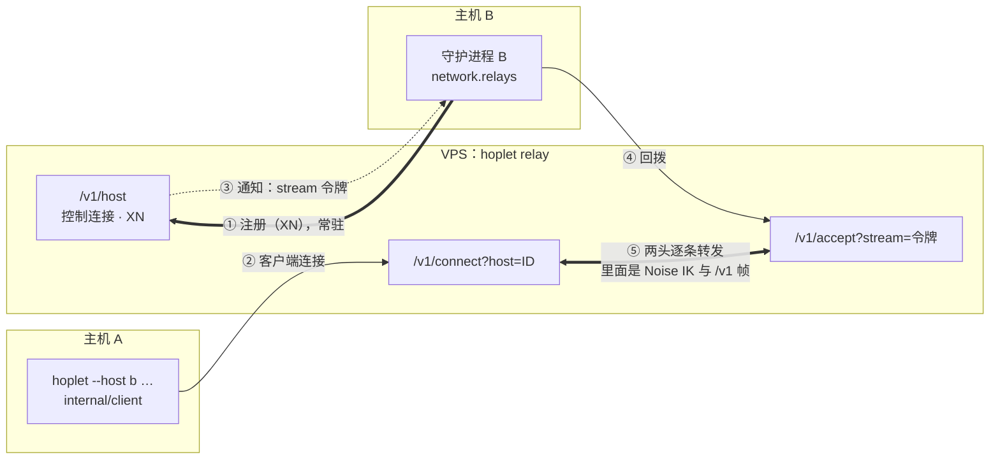

# M2a · PR3 中继 · 详细计划

> **执行方式：** 按任务顺序执行，每一步用 `- [x]` 勾选；每个任务结束时 `make check` 通过。本计划按任务列出文件、接口、要测的情况与 commit，代码在实现时写，基于 `7c2e619`（#27 合并后）的 `main`。

**目标：** 主机不开直连端口也能被已配对设备连上：`hoplet relay` 跑在海外 VPS，自己申请证书，只为白名单里的主机转发；守护进程向中继注册并为每个客户端回拨一条 WSS；CLI 按序尝试直连与中继，`session watch` 连在中继上时定期探测直连，通了就切回。

**验收（M2a 总计划）：** 测试里用本地 TLS 证书起中继：经中继跑通会话；不在白名单的主机注册被拒；中继看到的都是密文；中继重启后守护进程与客户端自动恢复；直连恢复后切回直连且不丢事件。

**依据：** [M2a 总计划](m2a-overview.md)、[PR2 计划](m2a-pr2-pair-direct.md)、[0005](../design/0005-sync-protocol.md)、[0006](../design/0006-connectivity-security.md)、[0013](../design/0013-testing-release.md)。

**架构：**

- 中继只认主机 ID 与令牌，转发的是端到端 Noise 消息；客户端与守护进程之间的握手、hello、吊销检查与直连完全相同。
- 守护进程收到回拨的连接后走与直连监听同一条路径（握手、`Allow`、登记、`serve`）。

## 维护者的裁决（2026-11-07）

1. **中继路由用路径区分。** 守护进程把 `network.relays` 里的每个中继（`wss://relay.example.com`）写成路由 `wss://relay.example.com/v1/connect`，排在 `network.routes` 之后进配对码；客户端见到路径 `/v1/connect` 就走中继、自己补 `?host=<ID>`，否则照旧拼 `/v1/noise`。配对码格式与 `hosts` 表不变。
2. **备用域名：其他 SNI 回主证书。** `hoplet relay --domain` 列出的域名用 autocert 签证书；SNI 不在列表里（如经 Cloudflare 代理的备用域名）时回第一个域名的证书，Cloudflare 用 Full（非 strict）模式接受。客户端照常按 `network.relays` 的顺序试两条中继路由。
3. **切回直连只在 `session watch`。** CLI 里只有 watch 是长连接：连在后面的路由时每 60s 试一次前面的路由（完整握手 + hello），通了就在新连接上按游标重新订阅、再关旧连接。其他命令每次按序拨号。桌面端随多机器 PR。
4. **中继数据是目录里的文件。** `hoplet relay --dir`，默认 `$HOPLET_HOME/relay`：autocert 缓存在 `certs/`，白名单是 `allow`（每行一个主机 ID，0600）。中继在每次注册与每个客户端连接时重读白名单，`relay allow / deny / list` 直接改文件，不需要重启或进程间通信。

## 全局约束

- 新增依赖只有总计划表里的：`golang.org/x/crypto` 从间接变为直接（`acme/autocert`）。WebSocket 仍用 `github.com/coder/websocket`。
- 测试不访问网络、不申请真实证书：中继测试用 `httptest` 的 TLS 证书，守护进程与 CLI 经测试注入的根证书信任它；生产代码用系统根证书。
- 测试只用回环地址；不用 sleep 同步；全部 `-race`。
- 本机 socket 与直连路径的行为不变；不改 `/v1` 方法语义。
- 中继不解密、不缓存、日志不记载荷。

## 协议细节

### 中继端点

| 端点 | 谁连 | 规则 |
|---|---|---|
| `/v1/host` | 守护进程 | WSS 二进制消息；Noise XN（`KindRelay`），中继无静态密钥；握手后得到主机公钥与 ID，不在白名单 → 关闭；同一主机 ID 新注册顶替旧控制连接 |
| `/v1/connect?host=<ID>` | 客户端 | 主机未注册或不在白名单 → 404；超过限制 → 503；中继生成令牌，经控制连接通知主机，等回拨最多 10s，超时 → 关闭客户端连接 |
| `/v1/accept?stream=<令牌>` | 守护进程 | 令牌一次性、只在等待期内有效，未知或过期 → 404；对上后两头转发 |
| 其他路径 | | 404；非空 `Origin` → 403 |

### 控制连接

| 项 | 规则 |
|---|---|
| 消息 | Noise 通道里的 JSON 帧：中继 → 主机 `{"type":"registered"}`（注册成功，第一条）、`{"type":"stream","stream":"<令牌>"}`；主机不向中继发业务消息 |
| 注册结果 | XN 的最后一条消息由主机发出，被拒只表现为连接关闭；守护进程在 10s 内收到 `registered` 才算注册成功，否则记“中继拒绝或不可用”并按退避重试 |
| 令牌 | 128 位随机数，`crypto/rand.Text()`；只经加密的控制连接下发 |
| 心跳 | 通道 ping / pong，15s 一次，10s 无回应断开（双方） |
| 重连 | 守护进程对每个中继各保持一条控制连接，断开后按 1s 起倍增至 30s 重拨；中继重启后自动恢复 |

### 转发

| 项 | 规则 |
|---|---|
| 方式 | 两头各一条 WebSocket，读一条二进制消息写一条，不排队、不合并；任一头断开或出错，两头都关 |
| 单条上限 | 65536 字节（同 Noise 传输消息上限，含余量）；文本消息 → 关闭 |
| 每段心跳 | 中继对两头各自每 15s 发 WebSocket Ping，10s 无回应关闭该流 |
| 可见 | 只见密文、主机 ID、客户端 IP 与字节数；日志记主机 ID、流的开始结束与字节数 |

### 限制

| 项 | 值 | 超出 |
|---|---|---|
| 每主机并发流 | 64 | `/v1/connect` → 503 |
| 每客户端 IP 等待回拨的连接 | 8 | 503 |
| 等待回拨 | 10s | 关闭客户端连接 |
| 控制连接握手 | 10s | 关闭 |

数值写成常量，测试经未导出的字段改小。

### 证书

| 项 | 规则 |
|---|---|
| 签发 | `autocert.Manager{Prompt: AcceptTOS, HostPolicy: HostWhitelist(domains…), Cache: DirCache(<dir>/certs)}`；TLS-ALPN-01，只监听 `--listen`（默认 `:443`） |
| 其他 SNI | `GetCertificate`：SNI 在 `--domain` 列表里交给 autocert；否则（含空 SNI）返回第一个域名的证书 |
| 测试 | `relay.Server` 接受外部给的 `net.Listener` 与 `*tls.Config`，测试用 `httptest` 证书，不经 autocert |

### 路由

| 项 | 规则 |
|---|---|
| 配置 | `network.relays`：按序的中继 URL，`wss://` + 主机[:端口]，不带路径与查询 |
| 配对码 | 路由 = `network.routes` 后接每个中继的 `<relay>/v1/connect`；两者都空时 `pairing.start` 拒绝，提示两项任配一项 |
| 客户端拨号 | 路由路径为 `/v1/connect` → 拨 `<路由>?host=<ID>`；否则拨 `<路由>/v1/noise`；之后同样 IK 握手、hello、核对 `host_id`；每条 15s |
| 切回 | 只在 `session watch`：连在第 i 条路由（i > 0）时每 60s 用前 i 条再拨一次；成功 → 在新连接上以已打印的最后一个 seq 订阅，再关旧连接，stderr 打印“switched to <路由>”；失败不打印 |

### 守护进程

| 项 | 规则 |
|---|---|
| 配置 | `daemon.Config` 增 `Relays []string` 与 `RelayTLS *tls.Config`（为空用系统根证书；导出，因为 `hoplet daemon` 要设它），测试主程序从环境读取测试根证书 |
| 回拨后 | 与直连监听相同：`enter` → 握手（日常 / 配对）→ `Allow` → 登记设备连接 → `serve`；吊销同样断开 |
| 关闭 | `Daemon.Close` 关控制连接与所有回拨连接 |

## 文件

| 文件 | 内容 |
|---|---|
| `proto/api.go` | `RelayHostPath`、`RelayConnectPath`、`RelayAcceptPath` |
| `internal/config/config.go` | `network.relays` 与校验 |
| `internal/relay/` | `Server`（三个端点、注册表、令牌、限制、转发、心跳）、白名单文件、证书选择 |
| `internal/daemon/relay.go` | 每个中继一条控制连接、重连、回拨；`remote.go` 抽出直连与回拨共用的 `serveRemote` |
| `internal/daemon/remote.go`、`daemon.go` | 配对码路由加中继；`Config.Relays` |
| `internal/client/remote.go` | 中继路由拨号；`Remote.TLS`（测试）；`Client.Route()` 报告所用路由 |
| `cmd/hoplet/relay.go` | `hoplet relay`、`relay allow / deny / list` |
| `cmd/hoplet/session.go` | watch 探测前面的路由并切回 |
| `cmd/hoplet/daemon.go` | 把 `network.relays` 传给守护进程 |

## 任务

### 任务 0：分支

- [x] 从 `main` 建 `feat/relay`。

### 任务 1：配置与路由

**文件：** `proto/api.go`、`internal/config/config.go`、`internal/daemon/remote.go`、`daemon.go`、`cmd/hoplet/daemon.go` 及测试

- `network.relays` 校验：`wss` 才收，有主机，不带路径、查询、用户；`ws://` 拒绝。
- `pairing.start`：路由 = routes + relays 加 `/v1/connect`；两者都空 → `invalid`，提示配 `network.routes` 或 `network.relays`。
- **要测的情况：** 各种非法中继 URL；只配中继也能发码，且路由顺序是直连在前、中继在后；两者都空的提示。

**commit：** `feat(config): add network.relays`

### 任务 2：中继服务

**文件：** `internal/relay/server.go`、`allow.go`、`server_test.go`、`allow_test.go`

- `Server{Dir, Logger}`、`Serve(ctx, ln net.Listener, tlsConf *tls.Config)`；三个端点、注册表（主机 ID → 控制连接）、令牌表、限制、转发、每段心跳。
- 白名单：`Allow(dir, id)`、`Deny(dir, id)`、`List(dir)`、读时校验每行是 26 字符的主机 ID；文件权限过宽拒绝。
- **要测的情况：** 注册（在白名单 / 不在 / 白名单里删除后再注册被拒）；新注册顶替旧控制连接；客户端经中继与一个测试响应方完成 IK 握手并往返多帧；转发的字节里找不到明文标记（中继看到的都是密文）；未注册主机 → 404；令牌错误、过期、属于别的主机 → 拒绝；回拨超时；每主机并发与每 IP 等待上限 → 503；任一头断开两头都关；每段心跳超时关流；`Origin` 403、其他路径 404、文本消息关闭。

**commit：** `feat(relay): forward Noise streams between hosts and clients`

### 任务 3：`hoplet relay` 命令与证书

**文件：** `cmd/hoplet/relay.go`、`main.go`、`relay_test.go`；`internal/relay/cert.go`、`cert_test.go`；`go.mod`

- `hoplet relay --domain D [--domain D2] [--listen :443] [--dir DIR]`；`hoplet relay allow ID`、`deny ID`、`list`。
- `GetCertificate`：列表内交 autocert，其他回第一个域名的证书。
- **要测的情况：** 证书选择（列表内、列表外、空 SNI；用替身代替 autocert，不联网）；`allow / deny / list` 改写文件与权限；缺 `--domain` 退出码 2；`--host` 放在 `relay` 前退出码 2。

**commit：** `feat(cli): run a relay with autocert`

### 任务 4：守护进程注册与回拨

**文件：** `internal/daemon/relay.go`、`remote.go`、`daemon.go`、`relay_test.go`

- 每个中继一个 goroutine：拨 `/v1/host`、XN、等 `registered`、读 `stream` 通知、为每个令牌回拨 `/v1/accept` 并交给 `serveRemote`；断开按 1s 起倍增至 30s 重连。
- **要测的情况：** 经中继完成配对与日常连接；未配对设备经中继被拒；不在白名单 → 守护进程记录拒绝并按退避重试，加入白名单后注册成功；中继重启后控制连接自动恢复，客户端再拨成功；吊销断开经中继的连接；`Daemon.Close` 结束控制连接与回拨连接。

**commit：** `feat(daemon): register with relays and accept streams`

### 任务 5：客户端与 CLI

**文件：** `internal/client/remote.go`、`remote_test.go`；`cmd/hoplet/session.go`、`cli.go`、`shim_test.go`（测试主程序注入根证书）、`pair_test.go`

- 中继路由拨号；`Client.Route()`；`app` 增测试用的根证书与探测间隔。
- watch：连在第 i > 0 条路由时按间隔探测前 i 条，成功即切换。
- **要测的情况：** 直连不通时落到中继；路由路径判断（`/v1/connect` 与否）；watch 连在中继上，直连恢复后切回，输出无缺无重，stderr 有“switched to”；探测失败不打印、不影响当前连接。

**commit：** `feat(cli): reach hosts through relays and return to direct routes`

### 任务 6：两台主机端到端、文档、全量检查

- [x] `cmd/hoplet` 端到端：中继在测试进程里用本地证书起；两个 `HOPLET_HOME`、两个守护进程，B 配 `network.routes`（经可切断的转发）与 `network.relays`。转发断开时 `pair` → `host add` → `--host b session new` 经中继跑假 harness；`session watch` 期间重启中继后续上；转发恢复后切回直连；全程事件无缺无重。
- [x] 同步 0006（中继端点、控制消息、白名单文件、限制、证书与备用域名、路由路径区分）、0005（watch 切回）与本文“协议细节”；实现与本文有出入时先改文档。
- [x] `make check`，报告真实输出。
- [x] 在本文末尾追加“实现与计划的差异”。
- [x] 推送并开 PR：`feat(relay): add relay with autocert`。

## 完成标准

- 总计划 PR3 的验收项全部有对应测试。
- 直连与本机 socket 行为不变；新增依赖只有 `golang.org/x/crypto` 转为直接依赖。
- 中继代码不解析 Noise 载荷；日志不含载荷。
- Linux 服务安装（`relay install`）与 `doctor` 的中继检查留给 PR4。

## 实现与计划的差异

- **令牌是全局一张表。** 回拨请求不带主机身份，“令牌必须属于发起它的那条控制连接的主机”无从核对；128 位令牌只经该主机的加密控制连接下发，已足够。删去“用别的主机的令牌回拨”这条测试。
- **客户端经中继拨号提前到任务 4。** `Remote.TLS`、`routeURL` 与 `Client.Route()` 在守护进程测试里就要用。
- **`daemon.Config.RelayTLS` 是导出字段。** `cmd/hoplet` 要设它；中继的限制仍是 `relay.Server` 的未导出字段，测试经它改小。
- **守护进程复用已有时限。** 等 `registered` 用 hello 时限（10s），控制连接心跳用通道心跳的 15s / 10s。
- **新增间接依赖 `golang.org/x/net`。** `acme/autocert` 需要它，由 `go mod tidy` 引入；直接依赖只多了 `golang.org/x/crypto`。
- **测试辅助。** `internal/testnet.TLS` 给出 `httptest` 的证书与信任它的根证书；`cmd/hoplet` 的测试把该证书写成 PEM，经 `HOPLET_TEST_RELAY_CA` 交给子进程；watch 探测间隔经 `HOPLET_TEST_PROBE_EVERY` 改小。
- **端到端测试随任务 5 提交。** 任务 5 要测的 watch 切回需要两台主机加中继的完整环境，与任务 6 的端到端是同一个测试（`TestReachAHostThroughARelay`）。
