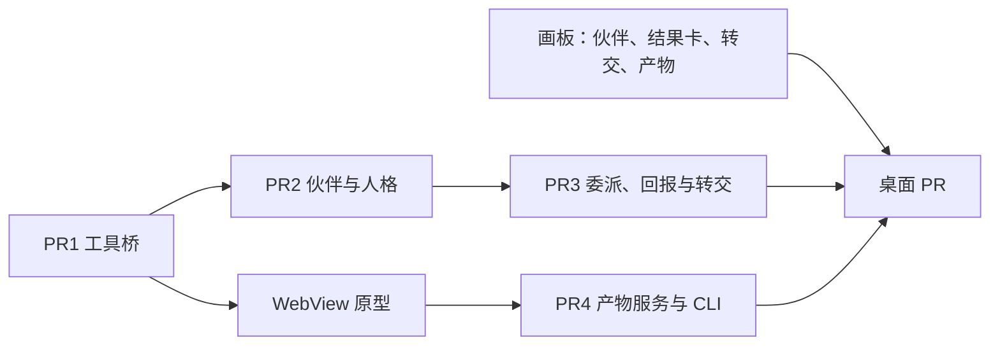

# M4a 工具桥与伙伴底座 · 总计划

**目标：** 工作 harness 经 Hoplet 的 MCP 工具桥调用 daemon 服务；Personal 有独立的伙伴实体与人格；伙伴把事情委派给子会话或转交 Code，结果持久回到伙伴；会话可以发布产物并在桌面查看。

**验收（交付路线）：** 工作 harness 经工具桥调用同一服务；委派结果回到伙伴并可持续跟进。

**依据：** [设计总览](../README.md)，以及 [0010](../design/0010-personal-mode.md)、[0012](../design/0012-orchestration-api.md)、[0007](../design/0007-commands-approvals.md)、[0003](../design/0003-agent-driving.md)、[0020](../design/0020-hermes-adapter.md)、[0021](../design/0021-claude-adapter.md)、[0025](../design/0025-artifacts.md)、[0024](../design/0024-desktop-layout.md)、[0019](../design/0019-delivery-roadmap.md)。

**前置：** M1 与 M2a 代码已合入，`make check` 在 `f00ba67`（#31 合并后）通过。

## 维护者的裁决（2026-11-07）

1. **MCP 走 stdio。** harness 的 MCP 配置运行 `hoplet mcp`，它连本机 daemon socket 转发；不开 TCP 端口。
2. **用官方 MCP Go SDK。** `github.com/modelcontextprotocol/go-sdk`，固定版本。
3. **会话 token。** 存储只留 SHA-256；daemon 重启后仍有效，会话归档后作废，只对本会话有效；只放在 MCP 配置项的 `env` 里。Claude Code 每次启动新生成；Hermes 随会话不变（2026-11-07 补充裁决，见下方实测）。
4. **M4a 工具集。** `sessions_list`、`session_get`、`session_create`（仅 Personal，新会话归属托管、关联父会话）、`session_send`（只到托管会话）、`handoff`、`report`、`artifact_publish`。`notify_me` 推迟；不加载 `rules.toml`，默认规则写在代码里。
5. **伙伴实体最小化。** 只有 ID、名字、主机、harness、主会话；每个已有 Personal 会话迁成一个伙伴。
6. **不设“事情”实体。** 一件事由一个委派子会话承担，结果经持久回报交回：父会话空闲时投递，忙时排队。harness 自己的子代理照常可用，不跟踪。
7. **人格。** `~/.hoplet/companions/<id>/persona.md` 是唯一来源，该目录也是主会话的工作目录。Claude Code 经 `--append-system-prompt` 传入；Hermes 每次启动时由 Hoplet 生成同目录的 `HERMES.md`。改动保证对新主会话生效。
8. **转交 Code。** `handoff` 建归属于我的 Code 会话，带目录、摘要和关联；它的轮次结束或等待审批时回报伙伴。
9. **产物按 0025。** 实现前先用原型确认 MyGo WebView 的内容规则挡住不可信页面的外部请求。2026-11-08 补充裁决：原型显示除 WebRTC 外全部挡住，WebRTC 作为已知缺口记入 0025；页面能力（`db` / `publish` / `files` / `ask`）暂缓，产物能查看并实际使用后再定，`artifact_db_*` 随之移出 M4a。
10. **顺序与界面。** 后端按工具桥 → 伙伴 → 委派与转交 → 产物推进；桌面界面先上画板审定。建议回复移到 M4b 之后。

## 实测结论（2026-11-07）

| harness | 已确认 |
|---|---|
| Claude Code 2.1.316 | `--mcp-config` 的 stdio 服务可用，token 只在 MCP 进程环境里；不加 `--strict-mcp-config`，用户自己的 MCP 照常加载；需 `--allowedTools mcp__hoplet__*`，否则每次调用都变成审批；`--append-system-prompt` 生效 |
| Hermes 0.22.5 | `session.create` 的 `editor.mcp_servers` 可用，调用不经审批；同一配置续接可重新挂载，配置不同报 `acp_mcp_policy_conflict`；配置连同 token 存在 Hermes 会话里，不带 `editor` 续接照样重启服务，空闲时经 `session.mutate` 的 `editor_mcp` 换配置、下次续接生效；`messages` 不被接受；工作目录的 `HERMES.md` 生效，系统提示冻结在会话上 |

## 全局约束

- 新增依赖仅限下表；表外的依赖要另行同意。

| 依赖 | 版本 | 用途 | 引入于 |
|---|---|---|---|
| `github.com/modelcontextprotocol/go-sdk` | v1.8.0 | `hoplet mcp` 的 MCP 服务端 | PR1 |

- 工具桥只是现有服务的另一个入口：工具调用落到与 API / CLI 相同的服务方法，范围检查在服务里做，不靠提示词。
- 持久化的新事件带版本号，旧解码器保留。
- 测试不碰真实的 `~/.hoplet`、不启动真实 harness、不用 sleep 同步；harness 协议按录制的向量核对。
- 代码、注释、commit 用英文；本目录下的计划用中文。

## PR 拆分与顺序

| PR | 标题 | 主要内容 | 验收 |
|---|---|---|---|
| 1 | `feat(mcp): add session tool bridge` | 存储：会话 token（只存 SHA-256）；启动 harness 时签发 token、填 `Spec.MCP`；`hoplet mcp`（stdio MCP 服务，以会话 token 连 daemon）；Claude 适配：`--mcp-config`、`--allowedTools mcp__hoplet__*`；Hermes 适配：创建时带 `editor.mcp_servers`、续接带同一配置、空闲时经 `editor_mcp` 轮换；工具 `sessions_list`、`session_get` | 假 harness 经 `hoplet mcp` 调通两个工具；别的会话的 token、归档后的 token 被拒；daemon 重启后 token 仍有效；token 不出现在 harness 的环境里；两家适配器的启动参数与请求按录制向量一致 |
| 2 | `feat(companion): add companions and personas` | 存储迁移：伙伴表，已有 Personal 会话各迁成一个伙伴；伙伴目录与 `persona.md`；主会话工作目录改为伙伴目录；Claude 传 `--append-system-prompt`，Hermes 启动前生成 `HERMES.md`；API 与 CLI `companion list / show / new / persona` | 迁移前后会话与事件不变；新建伙伴得到目录与空人格；两家启动参数 / 生成的文件与人格一致；改人格后新主会话生效 |
| 3 | `feat(session): delegate child sessions and report back` | 会话关联父会话；`session_create`、`session_send`、`report`、`handoff`；持久回报：父会话空闲时投递，忙时排队；`handoff` 的 Code 会话在轮次结束或等待审批时自动回报 | Code 会话调用 `session_create` / `session_send` / `handoff` 被拒；`session_send` 到非托管会话被拒；父会话忙时回报排队、空闲后投递一次；daemon 重启后未投递的回报不丢不重 |
| 4 | `feat(artifact): add artifact service and CLI` | 先在草稿里做 WebView 内容规则原型，结论写进 0025（已完成）；产物存储、版本与上限；`artifact_publish`；同步协议 `artifacts.list` / `artifacts.read`；CLI `hoplet artifact publish / list` | 0025 验收表中不依赖界面的各项 |

桌面部分（伙伴人格入口、结果卡、转交、产物标签与右栏列表）先在画板上画出并审定，同步进设计系统与 0014 后另起 PR，不在上表内。

## 关键假设的验证点

| 假设 | 在哪验证 | 不成立时 |
|---|---|---|
| 托管的 Claude Code 新版本仍按 2.1.316 的方式加载 `--mcp-config` 与 `--allowedTools` | PR1 录制 | 按新版本调整并重录；未验证版本不注入 |
| go-sdk v1.8.0 能应答 Claude Code 的 `server/discover` 探测（PR1 录制已确认：协议 2026-07-28，不发 `initialize`） | PR1 录制 | 停下讨论：换版本或自己应答探测 |
| MyGo WebView 的内容规则能挡住不可信页面的外部请求 | PR4 前原型（2026-11-08：除 WebRTC 外全部挡住） | 已重新讨论：WebRTC 记为已知缺口，页面能力暂缓 |

## 每个 PR 的详细计划

开工某个 PR 前，在本目录写 `m4a-prN-<名称>.md`：逐步列出文件、接口、测试、命令和 commit，基于当时 `main` 的真实代码。
