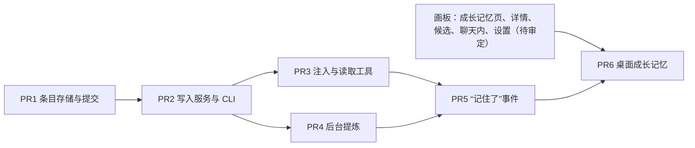

# M4b 成长记忆第一期 · 总计划

**目标：** 用户的事实、偏好、约定和经验由 Hoplet 持有；伙伴、用户和后台提炼都经同一服务写入；新会话不论用哪个 harness 都拿到同一份有效记忆，用户能查看来源、纠正和撤回。

**验收（交付路线）：** 换 harness 保留约定；旧材料不覆盖用户纠正。

**依据：** [设计总览](../README.md)，以及 [0016](../design/0016-growth-memory.md)、[0021](../design/0021-claude-adapter.md)、[0020](../design/0020-hermes-adapter.md)、[0010](../design/0010-personal-mode.md)、[0024](../design/0024-desktop-layout.md)、[0019](../design/0019-delivery-roadmap.md)。

**前置：** M4a 已合入；0016 的第一期设计已合入。

## 维护者的裁决（2026-11-08）

1. **范围。** 手动闭环加后台提炼一起做；技能复用、原生记忆控制、回合级刷新、iOS 管理、空闲维护、向量检索、多机同步、场景范围不做。
2. **分级生效。** 明确说明和已验证经验自动生效；观察、推测、范围扩大和提炼提出的撤回留在候选。
3. **提炼执行方。** 跟随来源会话的 harness 和模型，批次按 harness 分开，材料不跨 harness。
4. **触发。** 明确写入不走后台；后台在归档、交接、换 harness、子会话回报、闲置 30 分钟时批量提炼。
5. **Hermes 不提炼。** 隔离未通过；其明确写入、纠正、注入和读取照常。
6. **一条目一文件。** `profile/entries/<category>/<id>.md`，`PROFILE.md` 由程序生成。
7. **刷新。** 新启动的会话取最新摘要；续接沿用启动时的上下文，用读取工具查最新版本。
8. **管理端。** Mac 加 CLI。
9. **人格不进记忆系统。** 仍只在 `companions/<id>/persona.md`。

## 实测结论（2026-11-08）

| harness | 已确认 |
|---|---|
| Claude Code 2.1.319 | 0021 “隔离提炼”一节的参数与环境组合下，工具、MCP、slash 为空，项目与用户规则不进上下文，项目 hook 不触发，会话不可恢复，结果带用量；`--bare` 不支持 OAuth，`--setting-sources ""` 报未登录；用户级和插件 hook 依赖 `disableAllHooks`，未单独测 |
| Hermes 0.22.5 | `-z -t "" --ignore-rules` 下 MCP 工具仍可用且会被调用，会话写入会话库，没有不落盘的开关；`--safe-mode` 指定已配置服务商的模型时运行失败 |

## 全局约束

- 不新增依赖。frontmatter 只解析 0016 定义的固定字段，用自己的严格解析器，不引入 YAML 库；未知字段或格式不符按“不合法”处理。
- 三个写入来源走同一个服务方法，范围和证据校验在服务里做，不靠提示词。
- 未提交或写入失败不得回复“已保存”。
- 持久化的新事件带版本号，旧解码器保留。
- 不读 harness 私有历史、记忆文件或凭据；提炼运行不额外传入凭据变量。
- 测试不碰真实的 `~/.hoplet`、不启动真实 harness、不用 sleep 同步；崩溃恢复用注入失败点测试。
- 代码、注释、commit 用英文；本目录下的计划用中文。界面文字写 Hoplet 和 harness 的产品名。

## PR 拆分与顺序

| PR | 标题 | 主要内容 | 验收 |
|---|---|---|---|
| 1 | `feat(memory): add entry storage and commit log` | 新包 `internal/memory`；条目类型与严格 frontmatter 编解码；迁移 `0016`（审计含旧版本正文、检索索引，索引与持久表分开；提炼运行和注入记录的表随 PR4、PR3 加）；意图 → 原子写 → 标记提交；启动恢复；重建索引与 `PROFILE.md`；扫描手改文件 | 每个失败点崩溃后状态正确且不重复写入；期望版本不符被拒；重建索引不动审计；手改合法的记一次用户编辑，不合法的不进索引且文件不动；未知字段被拒 |
| 2 | `feat(memory): add write service and profile CLI` | 写入服务：三个来源、证据校验、凭据拒绝、生效门槛、候选、撤回、旧材料拦截；daemon API；CLI `hoplet profile list / show / edit / withdraw / candidates / accept / reject` | 0016 “更新与纠错”表逐条有表驱动测试；纠正后回放旧材料不复活；撤回内容重现被拦截，晚于撤回的 `user_stated` 可恢复；写入失败不报已保存 |
| 3 | `feat(memory): inject summaries and add read tools` | 启动摘要选择（约 8KB 加索引）；Claude 的 `--append-system-prompt` 与 Hermes 的 `HERMES.md` 同人格一起注入；Code 会话入口；注入记录；工具 `profile_list`、`profile_read`、`profile_write` | 选择顺序与预算按表测试；非生效条目不注入不检索；Code 调用 `profile_write` 被拒；两家启动参数 / 生成文件按录制核对；摘要失败时会话照常启动并记录失败；假 harness 跑通“写入 → 换 harness → 取到” |
| 4 | `feat(memory): extract candidates in the background` | 适配器的隔离运行（只 Claude 2.1.319，能力位标明）；触发器、队列、选材、32KB 与每日 20 次预算、重试、进度持久化；输出解析并经 PR2 服务提交；开关 | 启动参数与环境按 0021 核对；未验证版本与 Hermes 不创建运行并报原因；预算用尽材料保留；崩溃重试不重复提交；注入内容与提炼事件不进材料；非法输出最多重试 2 次；不阻塞前台 |
| 5 | `feat(memory): report saves in the session log` | 会话日志新事件“记住了”；自动保存后写入，不触发提炼；`make gen`。管理方法已随 PR2、PR4 落地，只限本机客户端 | 只有自动保存实际生效才有事件；重放只记一条；旧日志照常解码；新事件不进提炼材料，也不算新证据 |
| 6 | `feat(desktop): add growth memory views` | 成长记忆页、条目详情、候选、聊天内一行、设置项 | 与审定画板一致；`ui.Tester` 覆盖编辑、撤回、确认；真实 app 跑通验收 |

PR3 和 PR4 互不依赖，可以并行。

## 手动验收（PR6 合入后）

用真实 Claude Code 和 Hermes 跑 0016 验收表：明确记住后换 harness；纠正后回放旧记录；提炼无工具调用、无残留会话；撤回后不再注入；提炼中途杀 daemon 后恢复。结果写进 0016。

## 关键假设的验证点

| 假设 | 在哪验证 | 不成立时 |
|---|---|---|
| 依赖中的 SQLite 带 FTS5，且对中文短词可用 | PR1 开工前实测（2026-11-08：不可用，两字中文词查不到） | 已改为对索引做子串匹配，0016 已修正 |
| Hermes Code 会话有受支持的启动注入入口 | PR3 录制 | 该组合标记能力不足，读取工具照常；提出来讨论，不绕过 |
| 闲置 30 分钟能从现有会话状态判断 | PR4 计划时读代码 | 停下讨论触发方式 |
| 用户级和插件 hook 被 `disableAllHooks` 关闭 | PR4 录制 | 该版本不启用提炼 |
| 模型能稳定输出操作 JSON | PR4 用真实 Claude 录制样本 | 调提炼指令；格式错误仍按失败计，不放宽校验 |

## 每个 PR 的详细计划

开工某个 PR 前，在本目录写 `m4b-prN-<名称>.md`：逐步列出文件、接口、测试、命令和 commit，基于当时 `main` 的真实代码。PR6 的计划要等画板审定并同步进设计系统、0014 和 0024 之后再写。
