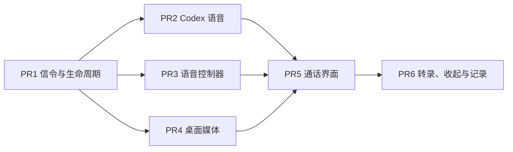

# M5d 语音通话（桌面）· 总计划

**目标：** 在桌面上用打电话的方式查进度、给任意会话发话、转交新的 Code。

**验收（交付路线）：** 口头查进度、发话、转交；失败在开始前说清，不回退。

**依据：** [设计总览](../README.md)，以及 [0027](../design/0027-voice-calls.md)、[0014](../design/0014-desktop-ui.md)、[0028](../design/0028-codex-adapter.md)。

**前置：** M4a、M5a 已合入。

## 实测结论（2026-11-08，Codex 0.167.0，订阅账号）

| 项 | 结果 |
|---|---|
| 语音组件 | 托管的官方包自带，带签名和麦克风 entitlement |
| 组件启动 | 工作目录不是组件所在目录时，`initializeRuntime` 以退出码 23 结束 |
| 登录 | `account/read` 返回 `chatgpt` |
| 声音列表 | `thread/realtime/listVoices` 按版本返回；V3 不接受 V2 的声音 |
| 版本 | V2 被拒绝，只能用 V1 或 V3；按 V3 实现 |
| 协商 | V3、V1 都收到语音服务 404，通话未建立，原因待查 |

## 全局约束

- 不新增依赖。媒体只用官方组件；Hoplet 不打包、不再分发。
- 不读 `CODEX_HOME`，组件环境变量走固定白名单。
- SDP 不进事件、不进日志；声音和中间转录不落盘。
- 持久化的新事件带版本号，旧解码器保留。
- 测试不启动真实 Codex 和真实组件，用假 Provider 和假组件；不用 sleep 同步。
- 界面取值来自设计系统；设计里没画的状态不做。声音选择界面待绘制，本里程碑不做。

## PR 拆分与顺序

| PR | 标题 | 主要内容 | 验收 |
|---|---|---|---|
| 1 | `feat(voice): add provider seam and call lifecycle` | `proto` 的 `voice.*`（probe、start、confirm、heartbeat、stop）；`VoiceProvider` 接口；一台机器一通电话；5 秒心跳、15 秒超时；固定错误码 | 假 Provider 跑通全流程；占线、超时、守护进程重启都结束通话；SDP 不进事件和日志 |
| 2 | `feat(codex): start realtime voice calls` | `Probe`（Codex、ChatGPT 登录、自定义服务、语音组件）；`thread/realtime/start` 走 WebRTC V3；分别等 `started` 和 `sdp`；错误映射；最终转录 | 按 schema 手写假服务的契约测试；真实录制等真实通话打通后补 |
| 3 | `feat(voice): add the voice controller` | 隐藏会话（不进侧栏、空目录、只读沙箱）；读、发、`handoff` 三类工具；目标必须解析到唯一会话；转录写事件，随归档删除 | 调不到三类以外的工具；目标不唯一时不发送；消息标明来自语音通话 |
| 4 | `feat(desktop): run the voice media helper` | 组件帧协议与启动；静音打开、确认后取消静音、挂断先关音频；`mygo.json` 声明麦克风用途与 entitlement | 假组件覆盖顺序和异常退出；挂断后不残留进程 |
| 5 | `feat(desktop): add the call page` | 侧栏入口、MVoiceConsent、MVoiceHosts、PVoice、ADots、CCallBar、错误提示 | `ui.Tester` 覆盖各状态；同意只问一次 |
| 6 | `feat(desktop): add transcript, pill and history` | CTranscriptLine、CCallOp、CCallPill、PVoiceHistory | 收起后通话继续；操作可打开对应会话 |

真实通话是最后一步验收，等语音服务 404 查清后做；0027 的待验证项届时收口。

## 不做

iOS 通话、语音审批、自动重连、API Key 回退、跨机器操作、声音选择界面。
